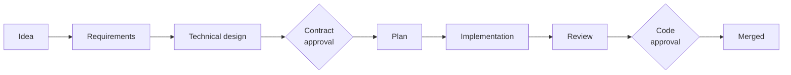

# Pyxis

> The compass that steers the fleet.

Pyxis is an open-source software factory. You describe the problem and what
"done" means; AI coding agents do the planning, implementation, review, and
verification, under gates that decide what is allowed to merge.

It works with the agent CLIs you already use (Claude Code, Codex, Cursor, and
OpenCode) and keeps every integration behind an adapter, so no issue tracker,
code host, or CI system is privileged. Pyxis runs against GitHub, Forgejo, or a
plain local Git repository.

The name is the mariner's compass, and the constellation *Pyxis* formed from a
fragment of the ancient ship *Argo*.

## Quickstart

**Install the CLI** on macOS or Linux. No account or credential is needed:

```bash
curl -fsSL https://raw.githubusercontent.com/agenticlab-ai/pyxis/main/install.sh | sh
```

The installer downloads the `pyxis` binary from
[GitHub Releases](https://github.com/agenticlab-ai/pyxis/releases), verifies its
checksum before anything runs, and installs it to `~/.local/bin`.

**Set up a repository.** Inside an empty directory or empty Git repository:

```bash
pyxis init
```

`init` asks for your settings and a Git destination (GitHub, Forgejo, or a local
bare repository), then installs the gates, hooks, and agent skills, commits the
initial tree, and pushes it. Add `--preview` to see everything it would do
without doing it. For a repository that already has code, use `pyxis adopt`.

The GitHub destination needs the [GitHub CLI](https://cli.github.com) logged in;
a local destination needs nothing extra.

**Name who approves.** To use approvals, set your GitHub login in
`.pyxis/config.yaml`. Until you do, draft pull requests request no reviewer and
approval is refused:

```yaml
approval:
  operator_login: your-github-login
```

**Start your first feature.** Open your agent CLI in that repository:

| Command | What it does |
|---|---|
| `/help start` | Shows a newcomer where to begin |
| `/help <problem>` | Names the command that handles your problem |
| `/feature-brainstorm` | Turns a raw idea into a recorded set of decisions |
| `/argus <idea>` | Hands the idea to the AI engineer, which drives the whole pipeline and asks you only about decisions it may not make |

### Requirements

- **macOS or Linux**, amd64 or arm64.
- **Git**, and at least one supported agent CLI. Run `pyxis surfaces` to see which
  CLIs are installed and wired.
- **On Linux, Bubblewrap**, which agents run inside
  (`sudo apt-get install bubblewrap` on Debian or Ubuntu). AppArmor hosts may
  also need the profile Pyxis ships:

  ```bash
  sudo install -m 0644 .pyxis/security/bwrap.apparmor /etc/apparmor.d/pyxis-bwrap
  sudo apparmor_parser --replace /etc/apparmor.d/pyxis-bwrap
  ```

  macOS uses the built-in `sandbox-exec`. `pyxis doctor` reports whether your
  machine is ready.

## How it works

A feature moves through an ordered pipeline. Agents do the work at each stage,
and a person (or an AI engineer holding an explicit, recorded grant) approves
the contract and the code.



| Stage | Command | Result |
|---|---|---|
| Define the feature | `/feature-brainstorm`, `/prd-new` | Requirements in a feature draft |
| Review the requirements | `/prd-review` | An unmanned, versioned review |
| Design the solution | `/tech-design-brainstorm`, `/tech-design-new` | A technical spec in the same draft |
| Review and lock | `/tech-design-review`, then approval | Requirements and design locked together |
| Plan | `/plan-new` | Frozen, dependency-ordered tasks on your tracker |
| Build | `/implement-now` | A pull request with evidence for each task |
| Review the code | `/impl-review`, then approval | Reviewed code, merged |

The full map, including every human gate, is in
[`.pyxis/pipeline.md`](.pyxis/pipeline.md).

### Why trust the output

- **Checks run in code, not prompts.** `docgate` and `codegate` are compiled
  gates. The same checks run on your machine and in CI.
- **Contracts are explicit.** Work starts from locked requirements and design,
  and decisions and their reasons live in Git as durable memory.
- **Authority is recorded.** The AI engineer acts only under a versioned
  authority contract and escalates anything beyond it.
- **Releases are verified.** Every downloaded artifact is checked against pinned
  checksums before it runs, and verification fails closed on any mismatch.

## Status

Pyxis is early and moving quickly, and it builds itself: this repository is
developed through its own pipeline.

| Area | State |
|---|---|
| Feature definition, design, review, and locking | Built |
| Planning and projection to a tracker | Built |
| Local implementation engine (`/implement-now`) | Built, still proving itself in daily use |
| Unmanned reviewers | Built; advisory, so their verdicts don't block merges yet |
| End-to-end verification stage | Not built |
| Scheduled maintenance stage | Partly built |

Expect commands and file formats to change before 1.0.

## Common commands

```bash
pyxis doctor              # read-only health and drift report
pyxis converge --preview  # show what bringing a repository up to date would change
pyxis upgrade             # update to the latest release
pyxis surfaces --detected # wire skills into the agent CLIs on this machine
```

Run `pyxis` with no arguments for the full list.

## Learn more

- [Documentation map](docs/README.md): where everything lives.
- [Product vision](docs/product-vision.md): the goals behind the design.
- [Architecture principles](docs/architecture-principles.md): the rules every
  design cites.
- [Shell startup setup](scripts/startup/README.md): optionally launch agent
  sessions in a fresh worktree automatically.
- [Releasing Pyxis](docs/runbooks/releasing.md): for maintainers.

## Contributing

Contributions are welcome. Read [CONTRIBUTING.md](CONTRIBUTING.md) to get a
checkout building and passing the gate, and [SECURITY.md](SECURITY.md) to report a
vulnerability privately. Agents working in this repository follow
[AGENTS.md](AGENTS.md).

## License

[MIT](LICENSE)
