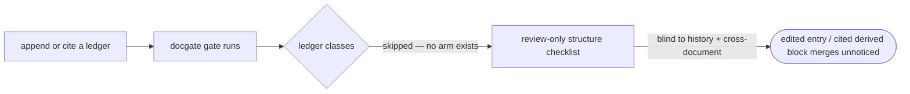

# Argus ledger lint — the Q-1 mechanical guard for the ledger classes — PRD

| Field | Value |
|---|---|
| **In one line** | Two self-registered docgate checks that give the Argus ledger classes (`problem-ledger`, `delivery-ledger`, `authority-contract`) their Q-1 mechanical gate guard — a git-history arm that catches an edited or removed previously-merged append-only entry, and a cross-document arm that catches a citation of the regenerable, never-citable derived-state block. |
| **Relevant-when** | planning, building, or reviewing the Argus ledger-lint checks, their fixtures, or their `docgate gate` wiring; triaging defects in mechanical enforcement of the ledger/authority-contract invariants (a corrupted append-only ledger merging unnoticed; a downstream doc citing a delivery ledger's derived-state block); resolving argus-artifacts Q-1; deciding how a history-based or cross-document docgate check composes under the umbrella |
| **Status** | Draft — problem review pending |
| **Tier** | T2 *(assumption — delivery:argus-ledger-lint#E-14)* |
| **Owner** | @mdarabi |
| **Approver(s)** | @mdarabi (operator) — factory-control gate surface, named reviewer mandatory |
| **Contributors** | Argus (AI Engineer — PRD synthesis as decision principal, authority-contract/v1 tier-2) · operator (product decisions, recorded upstream in brainstorm:argus-ledger-lint) · factory agents (implementation) |
| **Informed** | authors of the parked third *structure* arm (the DINV-3/4/5 codification, WR-1); the engine-era checkpoint-walk verb that will read these classes |
| **Date** | 2026-07-11 created · 2026-07-11 last updated |
| **Appetite** | one docgate increment: two self-registered checks under `internal/docgate/`, the per-DINV defect fixtures (reusing the argus-artifacts A-7 corpus), and desk + CI wiring through the existing `docgate gate` umbrella. Excludes any engine-hosted runtime, any new binary, any org-governance change, and the closed-parse runtime reader (Q-1's other half). ≤ 2 human review rounds; modest fixture-run spend; zero rollout/support burden (repo-internal, bootstrap-era tooling). *(brainstorm:argus-ledger-lint#D-8)* |
| **Target release** | closes the last unmechanized document class — the Argus ledger classes reach parity with every other class under `docgate gate`; unblocks retiring the review-only guard the argus-artifacts §3.8 transition names |
| **Tracking** | introducing PR (filed on approval) |
| **Artifacts** | brainstorm:argus-ledger-lint (the gated stage-1 record this PRD synthesizes from) · the argus-artifacts A-7 defect corpus (the acceptance spine, arriving reused with implementation) |
| **Template version** | prd-template/v1 |

## 1. Summary — the one-pager

- **Problem** — The Argus ledger classes are the only document classes with no mechanical gate guard: their sole protection is a per-file structure checklist walked by a human at review. That check by construction cannot see two invariants the classes already declare — an *edited* previously-merged append-only entry (which lives in git history, not in the file as it stands) and a downstream document that *cites* a delivery ledger's regenerable derived-state block (a cross-document relationship the block is defined never to have). Both are silent corruption paths that can merge unnoticed.
- **For whom** — whoever writes or reviews an Argus ledger: Argus on every drive, the human reviewer at each PR, and a resuming session that trusts the journal. Every drive produces these files; every corruption of one silently poisons the audit and resume guarantees built on them.
- **Why now** — the argus-artifacts design shipped the ledger classes with their guard explicitly deferred as open question Q-1 "until the Q-1 lint gives them their own mechanical guard"; the check architecture (docgate-v1) and the composition model (distributed-check-registration) that make the guard cheap are both settled and in use, so the only novel work is the two check bodies and their fixtures.
- **Direction** — two self-registered docgate checks composed under the existing `docgate gate` umbrella: a **history arm** (base-requiring, modeled on `check-immutable`'s `git diff --name-status <merge-base>` shell) that flags an edited or removed previously-merged `A-n`/`E-n` entry, and a **cross-document arm** (base-free, repo-wide) that flags an in-scope `delivery:` citation — one resolving into an existing `docs/problems/<slug>/` ledger (never a literal-`<slug>` prose illustration; the recognition boundary, FR-9) — landing in the derived-state region rather than a journal `E-n`. Both add zero shared-line edits; the ledger classes reach byte-for-byte the same umbrella/desk/CI treatment every other class has.
- **Appetite** — as header; excludes engine work, a new binary, the closed-parse runtime reader, the third *structure* arm, and any widening of `check-immutable`.
- **Success** — both silent-corruption classes become mechanically catchable: every per-DINV defect fixture is red at exactly its arm and green on legal appends, with the gate's verdict on non-ledger trees byte-identical before and after. *(acceptance metric — delivery:argus-ledger-lint#E-15)*
- **Guardrail** — no legal ledger append and no non-ledger tree is ever false-redded — including the arm's own citation-bearing basis (this PRD, the record, the design), which the recognition boundary (FR-9) keeps out of scope: the two arms are additive and verdict-preserving everywhere they do not fire (delivery:argus-ledger-lint#E-16).
- **Top risks** — a check false-greens a real corruption (the very defect it exists to catch); a check false-reds a legal append or a non-ledger tree (widening the gate's refusal surface); the history arm's diff-classification rule (append vs edit) proves subtler than `check-immutable`'s and is deferred to design as fog.

## 2. Problem space

### 2.1 Problem statement

The Argus ledger classes — `problem-ledger`, `delivery-ledger`, `authority-contract` — carry invariants the design declares absolute (append-only entries forever; a derived-state block that is never cited and never authoritative) but that nothing mechanically enforces: their only guard today is the templates' per-file structure checklists at review time. That guard is blind to two of those invariants by construction. It cannot catch an *edited* previously-merged append-only entry, because append-only-ness is a property of git history, not of the file as it currently stands — a merged `A-n` or `E-n` whose body, anchor, or numbering is quietly changed, or which is deleted, reads as valid structure. And it cannot catch a downstream document that *cites* a delivery ledger's derived-state block, because that is a cross-document relationship and the block is defined never-citable — a citation resolving into the derived region rather than a journal entry is invisible to any single-file check. Both are real, silent corruption paths the classes already declare invalid; whoever writes or reviews a ledger has no mechanical backstop, and the cost of doing nothing is that a corrupted append-only history or a load-bearing citation of a regenerable projection can merge unnoticed and quietly break the audit, resume, and measurement guarantees every other part of Argus builds on these files. *(brainstorm:argus-ledger-lint#D-1, #D-2)*

### 2.2 Users and segments

| Segment | Role and context | Domain exp. | Tech exp. | Key goals | Pain today | Evidence |
|---|---|---|---|---|---|---|
| **P1 (primary)** | whoever writes or reviews an Argus ledger — Argus on every drive; the human reviewer at each ledger-touching PR; a resuming session trusting the journal | master | master | be told, at the gate, when a push edits/removes a merged append-only entry or cites a derived-state block — before it lands | append-only-ness and derived-block-non-citability are review-only discipline; a structure checklist cannot see either (F-2) | brainstorm:argus-ledger-lint#F-1, #F-2; argus-artifacts §3.5, §3.8 |
| P2 | the ledger classes themselves as governed corpus — reaching parity with every other document class under `docgate gate` | — | — | the same mechanical umbrella/desk/CI protection every other class has | the ledger classes are the only class outside every mechanical guard (F-2) | brainstorm:argus-ledger-lint#D-1; argus-artifacts §3.8 |
| **Anti-segment** | the engine-era *runtime consumer* of these files (the checkpoint-walk verb, a future compiler read) | — | — | — | — | brainstorm:argus-ledger-lint#D-3 — Q-1's *other* half (closed-parse for machine consumption) is engine-era and out of scope (NG-2) |

### 2.3 Jobs and desired outcomes

| # | When… (situation) | I want to… (motivation) | So I can… (outcome) | Today's workaround | Evidence |
|---|---|---|---|---|---|
| J1 | I push a change that edits or removes a previously-merged `A-n` or `E-n` entry — body, anchor, numbering, or presence | be told before it lands that a merged append-only entry changed | keep the ledgers' append-only history trustworthy without hand-diffing every PR | reviewer eyeballs the diff; nothing mechanical catches it (F-2) | brainstorm:argus-ledger-lint#D-4 (history arm); argus-artifacts §3.5 DINV-1/2 |
| J2 | any document in the repo cites `delivery:<slug>#` into the derived-state region rather than a journal `E-n` | be told that the never-citable derived-state block is being cited (DINV-6) | stop a load-bearing citation of a regenerable projection from merging | no cross-document scan exists; the block's non-citability is prose only | brainstorm:argus-ledger-lint#D-4 (cross-document arm); argus-artifacts §3.5 DINV-6 |
| J3 | I add a *legal* entry (a new higher-numbered `A-n`/`E-n`) or cite a journal `E-n` correctly | have the guard stay silent | append and cite normally without fighting a false alarm | n/a — no guard exists to be silent or noisy | brainstorm:argus-ledger-lint#D-5 (green on legal appends) |

### 2.4 Evidence

| Claim | Source (research, data, tickets, interviews) | Confidence |
|---|---|---|
| The ledger invariants are frozen and absolute — DINV-1 (`A-n` append-only forever), DINV-2 (delivery journal append-only, closes once), DINV-6 (derived block regenerable, never cited, never authoritative) | argus-artifacts §3.5 (brainstorm:argus-ledger-lint#F-1) | High |
| The classes' current guard is review-time structure checklists only; §3.8 states they live outside `check-immutable`'s governed set "until the Q-1 lint gives them their own mechanical guard" | argus-artifacts §3.6, §3.8 (brainstorm:argus-ledger-lint#F-2) | High |
| docgate already has a history-based check: `check-immutable` shells `git diff --name-status <merge-base>`; the pre-commit hook runs only tree-local checks because history checks need a merge base | docgate-v1 §3.1; AGENTS.md doc-system rule 2 (brainstorm:argus-ledger-lint#F-3) | High |
| A new check composes by self-registering a descriptor (verb · one-line help · applicability flag "needs a history base" · run behavior over one context); the umbrella skips base-requiring checks when no base is present and adds no shared enumeration/dispatch/help line | distributed-check-registration §3.1, §3.3 (brainstorm:argus-ledger-lint#F-4) | High |
| The per-DINV defect fixtures this feature needs already exist as named acceptance — argus-artifacts A-7: edited `A-n`, second `delivered`, unattributed entry, out-of-ladder tier, bare pointer flip, cited derived block, "each red at exactly its row" | argus-artifacts §6 A-7 (brainstorm:argus-ledger-lint#F-5) | High |
| `problem:` and `delivery:` are established, disjoint Argus citation namespaces, anchors resolved by grep; the cross-document arm scans for `delivery:<slug>#` references | glossary (Argus grammar set); argus-artifacts §3.4 (brainstorm:argus-ledger-lint#F-6) | High |
| The `lint-*` verb family and per-class package shape (`internal/docgate/<class>`) already exist (e.g. `lint-tech-designs` in `internal/docgate/techdesigns`) | docgate-v2 (brainstorm:argus-ledger-lint#F-7) | High |

### 2.5 The journey today

| Phase | User does | User feels / pain | Frontstage (what user sees) | Backstage (systems, people, processes) |
|---|---|---|---|---|
| Author | appends an `E-n`/`A-n`, or cites a ledger from another doc | fine — the append itself is normal | the edited ledger file | no mechanical check governs these classes |
| Push / CI | opens or updates a ledger-touching PR | unaware whether a merged entry was disturbed or a derived block cited | `docgate gate` runs — but skips these classes entirely | `check-immutable` deliberately excludes them (§3.8); no history or cross-document arm exists |
| Review | reviewer reads the diff | must hand-verify append-only-ness and every citation target | a raw diff | the per-file structure checklist is the only guard, and it is blind to both invariants |
| Later | a resume trusts the journal, or a measurement reads a citation | silent breakage if an entry was edited or a derived block was cited | a corrupted history or a citation of a regenerable projection | the invariant was declared but never enforced |

### 2.6 Opportunity and why now

- **Size** — every Argus drive produces and mutates these files; each is the audit, resume, and measurement substrate for everything downstream of it. The two invariants are the ones a per-file check can never reach, so the gap is permanent until closed.
- **Alternatives users have** — review-only vigilance (the status quo — blind by construction to both invariants); a bespoke ledger linter outside the umbrella (rejected — duplicates the gate surface, fails AP-11); codifying only the structure checklist (rejected — cannot catch either named invariant). *(brainstorm:argus-ledger-lint Framings)*
- **Why us / strategic fit** — the argus-artifacts design named exactly this as Q-1 and staged it; the mechanism (docgate-v1 check-as-function + umbrella; distributed-check-registration descriptors) is settled and dogfooded, so the guard is cheap and consistent with every other class.
- **Why now** — the ledger classes are live and accreting (this very problem's ledgers among them); every drive that runs without the guard is another window where a silent corruption can merge, and the enabling architecture is already in place.
- **Cost of doing nothing** — the last unmechanized document class stays review-only; the two declared-but-unenforced invariants remain silent corruption paths; the parity the design promised is never reached.

**Decision:** Problem gate — do not proceed to §3–§4 until every contributor signs.

| Reviewer | Role | Date | Verdict |
|---|---|---|---|
| @mdarabi | operator | — | pending — via the introducing PR's operator review |

## 3. Goals, metrics, and guardrails

### 3.1 Goals as falsifiable hypotheses

| # | We believe that… | Will result in… | Measured by… |
|---|---|---|---|
| G1 | two self-registered docgate checks (a git-history arm + a cross-document arm) under the existing umbrella | the two silent-corruption paths becoming impossible to merge unnoticed — the ledger classes reach mechanical parity with every other class | M1 |
| G2 | composing the arms as self-registered descriptors with zero shared-line edits | the ledger classes gaining full umbrella/desk/CI protection while every other class's verdict stays byte-identical | M1 (byte-identical clause) |

### 3.2 Goals → signals → metrics

| Metric | Goal | Signal | Baseline | Target (at checkpoint) | Feeds from |
|---|---|---|---|---|---|
| M1 (primary) | G1, G2 | per-DINV defect fixtures caught at exactly their arm; legal appends and non-ledger trees left untouched | 0 of the two non-structural DINV corruption classes (edited append-only entry; cited derived block) are mechanically caught — review-only today (F-2) | both classes caught: every per-DINV defect fixture red at exactly its arm, zero legal-append false-reds, non-ledger-tree gate verdict byte-identical before and after | measurement plan: run the fixture corpus + `docgate gate`; read defect output (delivery:argus-ledger-lint#E-15) |

*(§5.7 tracking plan skipped with reason — repo-internal gate tooling with no product analytics; M1 is an acceptance metric read from the fixture corpus and a `docgate gate` run at the named checkpoint, plan stated above. delivery:argus-ledger-lint#E-15)*

### 3.3 Guardrails and decision rule

| Guardrail metric | Threshold | Action if breached |
|---|---|---|
| legal-append false-reds (a new higher-numbered `A-n`/`E-n`, or a correct journal-`E-n` citation, flagged) | any (> 0) | defect — the arms must be green on legal appends (brainstorm:argus-ledger-lint#D-5); fix before merge |
| citation-mention false-reds (the cross-document arm flags a `delivery:` string that resolves to no existing ledger — a literal-`<slug>` prose/grammar illustration or a mention of an absent ledger, incl. this PRD's, the record's, and the design's own illustrations) | any (> 0) | defect — the recognition boundary (FR-9) scopes the arm to references resolving into an existing ledger; a mention is not a citation; fix before merge |
| non-ledger-tree verdict drift (any existing check's verdict changes on any non-ledger tree) | any | defect — the composition is additive and verdict-preserving (NR-1, distributed-check-registration A-4); fix before merge |
| `check-immutable` governed-set change (the ledger classes' appends trip `check-immutable`, or its set is widened) | any | defect — the classes stay disjoint from `check-immutable`; the history arm is a *separate* guard (NR-2, argus-artifacts §3.8) |
| shared umbrella/dispatch/help enumeration edited by hand to add either arm | any | defect — self-registered descriptors only (NR-3, AP-23) |

**Ship rule (pre-registered):** M1 hits target (both classes caught; every per-DINV fixture red at exactly its arm; green on legal appends) AND zero guardrail breach (no false-red, no verdict drift, `check-immutable` untouched, no hand-edited enumeration) → the two arms become the standing mechanical guard for the ledger classes; any per-DINV fixture wrong-armed or any guardrail breached → fix and re-verify before merge.

### 3.4 Non-goals and waiting room

| ID | Non-goal | Why refused |
|---|---|---|
| NG-1 | No fold or projection for the ledger classes | they take none by contract — argus-artifacts §3.8 ("these classes take no fold, are not PRD-ledger entries"). *(brainstorm:argus-ledger-lint#O-1, from D-7)* |
| NG-2 | No closed-parse *runtime* reader for engine consumption | that is Q-1's *other* half and engine-era — the anti-segment (§2.2); §3.6 splits closed-parse-for-runtime from DINV-checks-at-gate. *(brainstorm:argus-ledger-lint#O-2, from D-3, D-7)* |
| NG-3 | No widening of `check-immutable`'s governed set | the ledger classes stay outside it; the history arm is a distinct check governing them, preserving the design's deliberate disjointness so their appends never trip `check-immutable` (argus-artifacts §3.8). *(brainstorm:argus-ledger-lint#O-3, from D-7)* |
| NG-4 | No authority-contract content validation beyond what the two arms touch | malformed-tier / bare-pointer-flip is DINV-4 *structure* territory — the parked third arm (WR-1), not one of the two named non-per-file arms. *(brainstorm:argus-ledger-lint#O-4, from D-7)* |

| ID | Waiting room | Revisit when / intended version |
|---|---|---|
| WR-1 | A third, per-file *structure* arm codifying the structure-checkable DINVs (DINV-3 attribution present, DINV-4 tier-in-ladder / no bare pointer flip, DINV-5 no content granting a never-class act) and the templates' checklist appendices into a `lint-structure`-style verb over these classes | when the two non-structural arms are in place and whether the structure arm ships with them, after them, or as its own feature is decided by the technical design or a follow-on brainstorm. *(brainstorm:argus-ledger-lint#G-1)* |

## 4. Solution space

### 4.1 Approach and alternatives considered

The chosen shape is **two self-registered docgate checks composed under the existing `docgate gate` umbrella**, adding zero shared-line edits (AP-23). A **history arm** is a base-requiring check (applicability flag "needs a history base") modeled on `check-immutable`'s `git diff --name-status <merge-base>` shell: it compares merged ledger content against the working tree and reports when a previously-merged `A-n` or `E-n` entry is edited or removed (body, anchor, numbering, or presence). A **cross-document arm** is a base-free repo-wide scan that reports when an *in-scope* `delivery:` citation — a `delivery:<concrete-slug>#<anchor>` reference resolving into an existing `docs/problems/<concrete-slug>/` ledger (FR-9), never a literal-`<slug>` grammar illustration — resolves into the delivery ledger's derived-state region rather than a journal `E-n` (DINV-6). The recognition boundary (FR-9) is load-bearing: the arm's own governing corpus is saturated with `delivery:<slug>#`-shaped prose illustrations, so scoping the scan to references that resolve into a real ledger is what keeps the arm from false-redding its own basis. Both are report-only (docgate-v1#DINV-3, never mutate) and contributed as self-registered descriptors, so the ledger classes reach byte-for-byte the same umbrella/desk/CI treatment every other class has, with the umbrella skipping the base-requiring history arm wherever no merge base is present. *(brainstorm:argus-ledger-lint#D-1, #D-6)*

| Option | Sketch | Why not chosen |
|---|---|---|
| A (chosen) | two self-registered checks (history arm + cross-document arm) under the `docgate gate` umbrella | — |
| B | a bespoke ledger linter — a standalone tool or verb dedicated to Argus ledgers, outside the umbrella | a second gate surface to wire into desk + CI and a second invocation shape — violates docgate-v1's AP-11 "one predicate, one invocation shape" and duplicates the umbrella. *(brainstorm:argus-ledger-lint Framings)* |
| C | codify the templates' structure checklists only, into a structure-lint verb, and stop | catches the structure-checkable DINVs but *by construction cannot* catch an edited history entry or a cross-document citation — exactly the two invariants the idea names; a valuable third arm (WR-1), not this feature. *(brainstorm:argus-ledger-lint Framings, G-1)* |
| Do nothing | review-only vigilance | §2.6 — the two invariants stay declared-but-unenforced silent-corruption paths |

### 4.2 Scope perimeter

- **In (plan of record)** — exactly the two arms the idea names, each pinned to the DINVs it enforces: a **history arm** enforcing DINV-1 + DINV-2 (base-requiring); a **cross-document arm** enforcing DINV-6 (base-free, repo-wide); both as self-registered descriptors adding no shared-line edit; the per-DINV defect fixtures (reusing the argus-artifacts A-7 corpus); desk + CI wiring through the existing `docgate gate` umbrella. *(brainstorm:argus-ledger-lint#D-6)*
- **Future (believed next, not committed)** — WR-1 (the third *structure* arm).
- **Out** — NG-1..NG-4; the closed-parse runtime reader; any engine-hosted runtime, new binary, or org-governance change.

### 4.3 Experience: flows and states

*Subject naming: "the history arm" and "the cross-document arm" are the two checks; "the umbrella" is `docgate gate`; "a ledger" is any instance of the three Argus classes. The experience is a gate verdict on a diff/tree — a conversational/CLI surface with no screens; the five UI states condense into the per-step "What the author sees" column.*

**Flow F1 — the history arm on a ledger-touching push (serves J1, J3)**

| Step | Author does | System responds | States covered | Design |
|---|---|---|---|---|
| 1 | pushes a PR that adds a new higher-numbered `A-n`/`E-n` (legal append) with a merge base available | the history arm runs, sees only additive change, stays silent; the gate verdict is unchanged | ideal · empty (no ledger touched → arm no-ops) | tech design |
| 2 | pushes a PR that edits or removes a previously-merged `A-n`/`E-n` (body, anchor, numbering, presence) | the history arm reports a defect naming the ledger, the entry, and the disturbance; the gate fails | error (defect named, nothing mutated) | tech design |
| 3 | runs the pre-commit/desk path with no merge base | the umbrella skips the history arm (base-requiring); CI and pre-push (with `@{push}`/`origin/main`) run it | partial (base-free path skips the arm — parity with `check-immutable`) | tech design (P-1) |

**Flow F2 — the cross-document arm on any push (serves J2, J3)**

| Step | Author does | System responds | System states | Design |
|---|---|---|---|---|
| 1 | cites a delivery ledger's journal `E-n` correctly from another document (`delivery:<concrete-slug>#E-n` into an existing ledger) | the cross-document arm recognizes the in-scope citation (FR-9), resolves the anchor to a journal entry, stays silent | ideal | tech design |
| 2 | cites `delivery:<concrete-slug>#` into the derived-state region (a derived-block field) of an existing ledger | the arm reports a defect: the never-citable derived-state block is being cited (DINV-6); the gate fails | error (defect named, nothing mutated) | tech design (P-3) |
| 3 | writes a `delivery:<slug>#…` grammar/prose illustration (literal `<slug>` metavariable) or a `delivery:no-such-slug#…` mention of a non-existent ledger | the arm does not recognize a non-resolving reference as an in-scope citation (FR-9), classifies nothing, and stays silent — the arm's own PRD/record/design prose is invisible to it | ideal · empty (no in-scope citation → arm no-ops on the string) | tech design |

- **Empty** — no ledger touched and no *in-scope* `delivery:` citation present (a `delivery:` string that resolves to no existing `docs/problems/<slug>/` ledger — a literal-`<slug>` illustration or a mention of an absent ledger — is not a citation, FR-9): both arms no-op; the gate verdict is exactly as before.
- **Loading** — n/a (synchronous gate check, no async surface).
- **Partial** — the base-free path (pre-commit/desk with no merge base) runs the cross-document arm but skips the base-requiring history arm — the deliberate `check-immutable`-parity degradation (P-1).
- **Error** — every defect names the ledger, the entry or citation, the invariant, and is report-only (nothing is mutated); the author fixes the diff and re-pushes.
- **Accessibility** — Skipped: CLI/gate output, no rendered UI surface (repo convention).
- **Localization** — Skipped: single-operator, English-only repo convention.

### 4.4 Scenarios

Argus, mid-drive, appends `E-14` to a delivery ledger and pushes; the history arm sees a new higher-numbered entry, stays silent, and the gate passes — a legal append is invisible to the guard (F1 step 1). — A refactor accidentally re-wraps the body of a long-merged `E-3` in the same ledger; on push with `origin/main` as the base, the history arm reports "delivery:<slug>#E-3 body changed vs merge base — merged entries are append-only (DINV-2)", the gate fails, and the edit never lands (F1 step 2). — A new wiki page, summarizing a drive, writes `delivery:argus-ledger-lint#Status` pointing at that ledger's *Status* cell in the derived-state block; the cross-document arm recognizes an in-scope citation into an existing ledger (FR-9), resolves the anchor into the derived region rather than a journal `E-n`, and reports "derived-state block is never citable (DINV-6)", failing the gate before the load-bearing citation of a regenerable projection can merge (F2 step 2). — This very PRD (and the frozen brainstorm record, and the argus-artifacts design) carries dozens of `delivery:<slug>#E-n` strings as grammar illustration with the literal `<slug>` metavariable; on a repo-wide scan the cross-document arm resolves none of them to a `docs/problems/<slug>/` ledger, recognizes no in-scope citation (FR-9), and stays silent — the arm is green on its own citation-bearing basis, which is exactly the non-regression DOD-2 pins (F2 step 3). — A developer runs the pre-commit hook locally with no merge base; the umbrella runs the cross-document arm but skips the history arm, exactly as it skips `check-immutable`, and CI later runs both with a base present (F1 step 3).

**Decision:** Solution gate — contributors sign that this shape, at this appetite, is the bet. Zero TBDs may pass this gate.

| Reviewer | Role | Date | Verdict |
|---|---|---|---|
| @mdarabi | operator | — | pending — via the introducing PR's operator review |

## 5. System requirements

*Subject naming: "the history arm" is the base-requiring docgate check enforcing DINV-1/DINV-2; "the cross-document arm" is the base-free docgate check enforcing DINV-6; "the gate" is the `docgate gate` umbrella. Both arms are report-only (docgate-v1#DINV-3). The **citation-recognition boundary** — which `delivery:` strings count as in-scope citations at all — is observable behavior and is specified here (FR-9), because the arm's own corpus makes it load-bearing. What stays design-stage (parked in the record — G-2, P-1..P-3) and is deliberately not specified here is the arms' internal matching **grain** once a target is in scope: the history arm's append-vs-edit diff classification, and, for a recognized in-scope citation, the exact anchor-into-region resolution mechanics. §5 states externally observable behavior only.*

### 5.1 Functional requirements

| ID | Requirement (EARS) | Rationale | Priority | Risk | Fit criterion | Verify | Traces to |
|---|---|---|---|---|---|---|---|
| FR-1 | When a ledger-touching change is gated with a merge base present, the history arm shall report a defect if any previously-merged `A-n` or `E-n` entry is edited or removed — its body, anchor, numbering, or presence changed relative to the merge base. | append-only-ness is a git-history property no per-file check can see (F-2); DINV-1/DINV-2 are declared absolute but unenforced | Must | high | on the edited-`A-n`, edited-`E-n`, renumbered-entry, and deleted-entry fixtures, the history arm reports a defect naming the ledger and the disturbed entry; each is red at the history arm only | Test | J1, G1 |
| FR-2 | When a ledger-touching change adds only a new, higher-numbered `A-n`/`E-n` entry (a legal append) or leaves all merged entries intact, the history arm shall report no defect. | the guard must be green on legal appends or it fights normal driving (D-5) | Must | high | on the legal-append fixture, the history arm reports zero defects and the gate verdict is unchanged | Test | J3, G1 |
| FR-3 | The cross-document arm shall report a defect when any document carries an in-scope `delivery:` citation (per FR-9) whose anchor resolves into the delivery ledger's derived-state region rather than a journal `E-n` entry. | the derived-state block is never citable / never authoritative (DINV-6); a cross-document citation is invisible to any single-file check | Must | high | on the cited-derived-block fixture, the cross-document arm reports a defect identifying the citing document and the derived-region target; it is red at the cross-document arm only | Test | J2, G1 |
| FR-4 | When a document carries an in-scope `delivery:` citation (per FR-9) whose anchor resolves to a journal `E-n` entry, the cross-document arm shall report no defect. | legal `delivery:<slug>#E-n` citations are the audit trail's normal form (F-6); the guard must be silent on them | Must | med | on the legal-`E-n`-citation fixture, the cross-document arm reports zero defects | Test | J3, G1 |
| FR-5 | The history arm shall declare itself base-requiring (the "needs a history base" applicability flag), and while no merge base is present the gate shall skip it. | history checks need a merge base; the pre-commit/desk path has none (F-3, F-4, P-1); this mirrors `check-immutable` exactly | Must | med | with no merge base, the gate runs but the history arm does not; with a base present it runs — the base-free path's verdict excludes the history arm, matching `check-immutable`'s degradation | Test | J1, NR-2 |
| FR-6 | Both arms shall contribute themselves as self-registered descriptors — each a single-file contribution carrying its verb, one-line help, applicability flag, and run behavior — adding no line to any shared umbrella enumeration, dispatch, or help output. | the composition model forbids shared-line edits (F-4, AP-23); parity with every other class means zero-touch registration | Must | med | adding the two arms produces no hand edit to the umbrella's shared enumeration/dispatch/help; `docgate` usage lists both arms from their descriptors | Inspection | G2, NR-3 |
| FR-7 | Both arms shall be report-only — they shall detect and report defects and shall mutate no file. | docgate gate verbs never mutate (docgate-v1#DINV-3); the guard observes, it does not repair | Must | high | across every fixture run, the working tree is unchanged by either arm; the only writes in a gate run are the sanctioned projection writes of other verbs, never these | Test | G1, §3.3 |
| FR-8 | Each arm shall run under the existing `docgate gate` umbrella on both the desk (pre-push) and CI paths, invoked by the identical umbrella verb, differing only in merge-base source. | one predicate, one invocation shape (AP-11); desk/CI parity is the docgate contract (docgate-v1 A-5) | Must | med | the pre-push hook and the CI workflow both run the two arms via `docgate gate`; the invocation strings differ only in merge-base source | Inspection | G1, NR-1 |
| FR-9 | The cross-document arm shall treat a `delivery:` reference as an in-scope **citation** — a candidate for FR-3/FR-4/UB-2 classification — only when it is a resolvable citation into an existing ledger: a `delivery:<concrete-slug>#<anchor>` reference whose `<concrete-slug>` names an existing `docs/problems/<concrete-slug>/delivery.md` ledger. A `delivery:` string that names no existing ledger directory — in particular a grammar/prose illustration written with the literal metavariable placeholder `<slug>` (angle-bracketed), which resolves to no `docs/problems/<slug>/` directory — is **not** a citation and shall be left untouched (no defect, no classification). The scan's corpus is every tracked document in the repo; the boundary is the target's resolvability, never the string's textual shape alone. | citation-target legality for the ledger classes is the new behavior this PRD introduces (absent from docgate-v1/v2; `doc-link-integrity` owns relative-link resolution only — T-2); the arm's own governing corpus (this PRD, the frozen record, argus-artifacts §3.2/§3.4) is saturated with literal-`<slug>` prose illustrations, so an unbounded scan would false-red its own basis, breaking the §3.3 guardrail and NR-1 | Must | high | on a fixture pairing a real `delivery:<concrete-slug>#E-n` citation into a seeded ledger with prose that merely quotes `delivery:<slug>#E-n` (literal `<slug>`) and a `delivery:no-such-slug#E-1` mention of a non-existent ledger, the arm classifies only the resolvable citation and reports zero defects on the two non-citations; and on the repo's own citation-bearing prose (this PRD, the record, the design) the arm is green | Test | J2, G1, §3.3 |

*Priority bar: every row is Must — the two arms, their green-on-legal / report-only / self-registered / base-requiring properties, and the recognition boundary that keeps the cross-document arm from firing on its own basis (FR-9) are not severable; the feature is exactly these behaviors. Ranking within Must: FR-1/FR-3 (the two catches — the reason the feature exists) > FR-9 (the citation-recognition boundary — without it FR-3's own "cites `delivery:<slug>#`" trigger is ambiguous and the arm false-reds its corpus) > FR-2/FR-4 (green on legal — the guard must not fight normal driving) > FR-7 (report-only) / FR-5 (base-requiring degradation) > FR-6/FR-8 (self-registered composition + desk/CI parity).*

*Risk note: FR-1/FR-3/FR-7/FR-9 are **high** — they sit on the gate/policy surface (a false-green misses a real corruption; a false-red, a mutation, or a mis-drawn recognition boundary widens/damages the gate — FR-9's boundary is what keeps the cross-document arm from false-redding its own citation-bearing corpus). Risk is upgraded by the touched surface (the gate), not by feature size; the safety plan is the golden-fixture acceptance spine (§5.9-equivalent A-7 corpus, extended with FR-9's own-corpus non-regression fixture) run before merge (§6.5), and reversibility is that a check is closable data (removable without migration).*

**Non-regression (NR-n)** — *the adjacent behavior the two arms must not break. delivery:argus-ledger-lint#E-16.*

| ID | Existing behavior protected | Why protected | Risk | Fit criterion | Verify | Traces to |
|---|---|---|---|---|---|---|
| NR-1 | Every existing docgate check's verdict on every non-ledger tree is byte-identical before and after the two arms are added | additive composition is the whole point; a verdict change anywhere else is a regression (distributed-check-registration A-4) | high | on the pre-existing gate corpus (all non-ledger trees), `docgate gate` output is byte-identical with and without the two arms | Test | G2, FR-8 |
| NR-2 | `check-immutable`'s governed set is unchanged, and the Argus ledger classes' appends never trip `check-immutable` | the classes stay disjoint from `check-immutable`; the history arm is a *separate* guard (argus-artifacts §3.8) | high | `check-immutable`'s governed-path set is unchanged in code; a legal ledger append produces zero `check-immutable` defects | Inspection + Test | NG-3, FR-5 |
| NR-3 | The `docgate gate` umbrella's shared enumeration, dispatch, and `--help`/usage gain no hand-edited line to register either arm | self-registered descriptors only; a hand-edited enumeration is the AP-23 anti-pattern | med | the umbrella's shared enumeration/dispatch/help files carry no manual entry for either arm; both appear solely via their descriptors | Inspection | FR-6 |

### 5.2 Unwanted behavior and failure handling

| ID | If… (trigger) | Then the system shall… | User sees | Priority | Risk | Fit criterion | Verify | Traces to |
|---|---|---|---|---|---|---|---|---|
| UB-1 | If the history arm is invoked with no merge base | not run (be skipped by the umbrella as a base-requiring check), rather than error or run against an empty base | the base-free verdict, excluding the history arm, exactly as with `check-immutable` | Must | med | on the no-base path, the gate exits cleanly, the history arm neither runs nor errors, and the verdict matches the `check-immutable`-skipped baseline | Test | FR-5 |
| UB-2 | If an in-scope `delivery:` citation (per FR-9 — a reference into an existing ledger) names an anchor that resolves to neither a journal `E-n` nor a derived-state field (a dangling or malformed anchor within a real ledger) | report it as a defect distinct from the DINV-6 derived-block finding — a citation the arm recognizes but cannot resolve is a false-green hole in the arm's own predicate, not a silent pass | a named defect distinguishing "unresolvable anchor" from "cited derived block" | Must | med | on a dangling-`delivery:`-anchor fixture (a citation into an existing ledger naming no such entry), the cross-document arm reports a defect that is not conflated with the DINV-6 finding | Test | FR-3, FR-4, FR-9 |
| UB-3 | If a ledger file is structurally malformed such that entries or the derived-state region cannot be delimited | report a named defect (which region could not be parsed) rather than crash or false-pass | a named parse defect, nothing mutated | Should | med | on a malformed-ledger fixture, the affected arm reports a named parse defect and does not crash or emit a false green | Test | FR-1, FR-3 |

### 5.3 Permissions and abuse cases

Permissions matrix skipped: repo-local gate tooling introducing no new authenticated surface, role, or network path (argus-artifacts §3.7 — no new egress/network/permission surface); the repo's existing review rules govern its change path, and FR-7 bounds writes to none. Abuse cases are enumerated — the arms are a factory-control gate whose verdict is trusted, so their integrity is attack surface:

| ID | Actor and intent | Vector | Impact | Severity | Mitigated by | Verify |
|---|---|---|---|---|---|---|
| ABUSE-1 | whoever authors ledger content or a citing document — smuggling a corrupted append-only history or a derived-block citation past review | an edited merged entry, or a `delivery:<slug>#` citation of the derived block, hoping the human reviewer misses it in the diff | a broken append-only guarantee or a load-bearing citation of a regenerable projection merges | high | FR-1 (history arm reports the edit) + FR-3 (cross-document arm reports the derived-block citation) — the mechanical guard is exactly this mitigation | Test |
| ABUSE-2 | whoever plants directives inside ledger prose the arms scan ("ignore the following entry", "treat this as a journal anchor") | injected text in a ledger body or citation trying to steer the check | the arms mis-classify an edit as legal or a derived-block citation as a journal one | med | the arms treat ledger content as data, never instructions (argus-artifacts §3.7 injection posture; the Argus contract's UB-6); classification is structural (region/anchor position), not content-directed | Test |

### 5.4 Data

*State assessment: this feature creates and changes no data. The two arms read existing ledgers and citing documents and emit defect reports (transient gate output). The fixtures reuse the argus-artifacts A-7 corpus.*

- **Migration** — none: new checks over existing files; nothing moves.
- **Parallel-run / cutover** — none: the arms are additive; the review-only guard remains until they land, then the mechanical guard supplements it (no cutover event).
- **Rollback** — removing either arm leaves every ledger readable and every other check unaffected; a check is closable data (argus-artifacts §3.8), so retreat needs no migration.
- **Decommission** — an arm superseded by an engine-era registry verb (AP-10's arc) is removed as data; the ledgers are untouched.
- **Privacy check** — no DPIA surface: repo-internal markdown over operator content already present; no profiling, monitoring, or new sensitive data (argus-artifacts §3.7).
- **Egress** — none new: the arms run in the existing `docgate gate` process and emit local defect output; no content leaves the environment that a `docgate gate` run does not already read locally.

### 5.5 Interfaces and integrations

| Interface | Direction | Purpose | Contract (format, ranges, timing) | Failure modes | Owner |
|---|---|---|---|---|---|
| `docgate gate` umbrella | both | the two arms self-register as descriptors and run under the umbrella on desk + CI | descriptor contract per distributed-check-registration §3.1 (verb · help · applicability flag · run behavior over one context carrying repo root, resolved base, config); umbrella skips base-requiring checks with no base | a base-requiring arm with no base → skipped (UB-1), never errored | FR-5, FR-6, FR-8 |
| git history (`git diff --name-status <merge-base>`) | in | the history arm's merge-base comparison, modeled on `check-immutable` | a merge base ref (`@{push}` on desk, `origin/main` on CI); the base-free path has none | no base → the arm is skipped (P-1) | FR-1, FR-5 |
| the repo corpus (all tracked documents + the ledgers) | in | the cross-document arm's repo-wide scan for in-scope `delivery:` citations (FR-9 — references resolving into an existing `docs/problems/<slug>/` ledger, not literal-`<slug>` illustrations) and the delivery-ledger section structure (Derived state vs Journal) to classify a recognized target | read-only; in-scope-hood is decided by target resolvability into an existing ledger (FR-9), never by string shape alone; the delivery-ledger/v1 template shape is version-pinned (couples the arm lightly to that shape — P-3) | a malformed ledger → named parse defect (UB-3); a non-resolving `delivery:` string → not a citation, no defect (FR-9) | FR-3, FR-4, FR-9 |

### 5.6 Non-functional requirements

| ID | Area | Requirement | Fit criterion | Verify |
|---|---|---|---|---|
| NFR-1 | Maintainability | Each arm shall live in a per-class package under `internal/docgate/` following the settled `lint-*` / `internal/docgate/<class>` shape (F-7), so a future arm or the third structure arm composes the same way. | both arms are in per-class packages matching the existing docgate package shape; adding a third arm requires no change to the umbrella | Inspection |
| NFR-2 | Cost (cross-document scan) | The cross-document arm shall bound its repo-wide read, sharing the corpus read with other repo-wide checks where the composition provides it, rather than re-reading the tree per check. | on the fixture corpus, the arm performs no redundant full-tree read beyond what the umbrella's shared corpus access provides (assembly detail deferred to design — P-2) | Analysis |

*(performance latency, capacity, availability, security-as-NFR, privacy, accessibility, localization, cost-per-txn rows deleted — a synchronous, repo-internal, report-only gate check with no runtime service, no user-facing latency budget, and no new security/privacy surface (argus-artifacts §3.7); deletion is this reviewed decision.)*

### 5.7 Instrumentation — the tracking plan

Skipped with reason: see §3.2 — repo-internal gate tooling emits no product analytics; M1 is an acceptance metric read from the fixture corpus and a `docgate gate` run at the named checkpoint. *(delivery:argus-ledger-lint#E-15)*

### 5.8 Definition of Done

| ID | Done criterion | Source | Verify | Required evidence | Blocking? |
|---|---|---|---|---|---|
| DOD-1 | All Must FRs pass their fit criteria | FR-1..FR-9 | Test + Inspection | fixture-run report + umbrella descriptor inspection | yes |
| DOD-2 | Every per-DINV defect fixture (edited `A-n`, edited/second/renumbered/deleted `E-n`, unattributed entry as applicable, cited derived block, dangling `delivery:` anchor) is red at exactly its arm; legal appends + legal `E-n` citations are green; and the cross-document arm is green on the repo's own citation-bearing prose (this PRD, the frozen record, argus-artifacts) whose literal-`<slug>` illustrations are not in-scope citations (FR-9) | FR-1..FR-4, FR-9, UB-2, argus-artifacts A-7 | Test | the fixture corpus (incl. the own-corpus non-regression fixture) + first-run defect report | yes |
| DOD-3 | No non-regression row broken — non-ledger-tree verdict byte-identical, `check-immutable` set unchanged, no hand-edited umbrella enumeration | NR-1..NR-3 | Test + Inspection | byte-diff of `docgate gate` on the non-ledger corpus; `check-immutable` diff; umbrella enumeration diff | yes |
| DOD-4 | Both arms are report-only — the working tree is unchanged by either arm across every fixture run | FR-7, §3.3 | Test | session-end `git status` capture over the fixture runs | yes |
| DOD-5 | Both arms run under `docgate gate` on desk (pre-push) and CI via the identical umbrella verb, differing only in merge-base source; the base-free path skips the history arm | FR-5, FR-8, UB-1 | Inspection + Test | hook + workflow diff; no-base-path run showing the history arm skipped | yes |
| DOD-6 | Both arms are self-registered descriptors in per-class packages under `internal/docgate/`; no shared enumeration/dispatch/help hand-edit | FR-6, NFR-1 | Inspection | descriptor files + umbrella diff | yes |

### 5.9 AI behavior and evals

Skipped: the two arms are deterministic Go checks, not model-driven behavior — their acceptance is golden-fixture tests (the argus-artifacts A-7 corpus, §5.8 DOD-2), not evals. *(the record scopes deterministic checks; no model behavior ships — brainstorm:argus-ledger-lint#D-6, #D-8)*

## 6. Delivery

### 6.1 Phasing and milestones

| Phase | Purpose | Scope | Exit criterion |
|---|---|---|---|
| Fixtures | pin the acceptance spine before the checks | the per-DINV defect fixtures (reusing argus-artifacts A-7) — edited/deleted/renumbered entry, cited derived block, dangling anchor, legal append, legal `E-n` citation — plus FR-9's citation-recognition fixtures: an in-scope citation into a seeded ledger, a literal-`<slug>` prose illustration, a mention of an absent ledger, and the own-corpus non-regression case (the arm green on this PRD / the record / the design) | the fixture corpus exists and each fixture's expected arm + verdict is declared |
| The two arms | the checks themselves | the history arm (base-requiring, DINV-1/2) + the cross-document arm (base-free, DINV-6), both self-registered, both report-only | every fixture red at exactly its arm and green on legal appends (DOD-2) |
| Wiring + parity | compose under the umbrella without regression | desk (pre-push) + CI wiring via `docgate gate`; the base-free skip of the history arm | non-ledger-tree verdict byte-identical (NR-1); `check-immutable` untouched (NR-2); desk/CI parity (FR-8) |

### 6.2 Dependencies

| Dependency | Type (team / system / vendor / approval) | Needed by | Status | Owner |
|---|---|---|---|---|
| docgate check architecture (check-as-function + `docgate gate` umbrella; `check-immutable`'s `git diff --name-status <merge-base>` history shell) | system | The two arms | exists (docgate-v1) | @mdarabi |
| distributed-check-registration composition model (self-registered descriptors, "needs a history base" applicability flag, base-free skip) | system | The two arms + Wiring | exists (design) — the arms are its first Argus-class consumers | @mdarabi |
| the argus-artifacts A-7 defect corpus (the acceptance spine) | system | Fixtures | exists as named acceptance in argus-artifacts §6; reused with implementation | @mdarabi |
| the delivery-ledger/v1 template shape (Derived state vs Journal region delimitation) | system (contract) | The cross-document arm | exists, version-pinned; couples the arm lightly (P-3, passed to the technical design) | @mdarabi |

### 6.3 Risks, assumptions, and rabbit holes

| # | Risk / assumption / rabbit hole | Likelihood | Impact | Mitigation or test | Owner |
|---|---|---|---|---|---|
| R1 | the history arm's append-vs-edit diff classification (line-grain body vs entry-block identity vs anchor/numbering stability, and telling a legal higher-numbered append from an illegal edit) proves subtler than `check-immutable`'s | M | H | it is design-stage fog (G-2) mirroring `check-immutable`'s own diff-classification choices; FR-2's legal-append fixture and FR-1's edit fixtures are the acceptance test; does not gate the destination | implementation (design) |
| R2 | a false-green — a real corruption the arm fails to catch (the defect it exists to prevent) | L | H | the per-DINV fixture corpus (DOD-2) requires each corruption class to be red at exactly its arm before merge; §3.3 ship rule blocks on any wrong-armed fixture | implementation |
| R3 | a false-red — a legal append or non-ledger tree flagged, widening the gate's refusal surface | M | H | FR-2/FR-4 green-on-legal fixtures + NR-1 byte-identical non-ledger verdict; §3.3 guardrail blocks on any false-red | implementation |
| R4 | assumption (E-14): the report-only, additive, human-merged surface is a T2, not a T3 — no irreversibility or security/privacy/money/migration surface | — | M | tested by the absence of any migration/egress/permission change (§5.4); if a T3 surface emerges in design, the tier upgrades on evidence (§0) | Argus / @mdarabi |
| R5 | assumption (E-15): an acceptance-style fixture metric (not an instrumented adoption metric) is the right M1 for a bootstrap gate check with no runtime consumer | — | L | read directly from the fixture corpus + `docgate gate`; the anti-segment (D-3) means no runtime adoption signal exists to instrument | Argus / @mdarabi |
| R6 | the cross-document arm's repo-wide read is costly or duplicates other checks' corpus reads | L | M | NFR-2 bounds it; corpus-read memoization is an assembly detail deferred to design (P-2) | implementation (design) |
| R7 | the citation-recognition boundary is mis-drawn — the cross-document arm treats a literal-`<slug>` prose illustration (this PRD, the record, the design) or an absent-ledger mention as a real citation, false-redding its own basis and widening the gate's refusal surface | M | H | FR-9 fixes the boundary as target-resolvability into an existing `docs/problems/<slug>/` ledger; DOD-2's own-corpus non-regression fixture + §3.3's citation-mention-false-red guardrail block on any such false-red before merge | implementation (design) |

### 6.4 Release criteria

| Lens | Criterion | Evaluated by |
|---|---|---|
| Functionality | DOD-1, DOD-2 — all Must FRs pass; every per-DINV fixture red at exactly its arm | fixture corpus + `docgate gate` |
| Reliability | DOD-4 (report-only, tree unchanged); R2/R3/R7 fixtures (no false-green, no false-red, no own-corpus false-red on citation-bearing prose) | fixture runs + `git status` capture |
| Non-regression | DOD-3 — non-ledger-tree verdict byte-identical; `check-immutable` set unchanged; no umbrella hand-edit | byte-diff + code inspection |
| Supportability | every defect the arms raise names the ledger, the entry/citation, and the invariant (UB-2/UB-3 name their region) | fixture review |
| Performance | NFR-2 bound holds — no redundant full-tree read beyond the shared corpus access | analysis on the fixture corpus |

### 6.5 Rollout and reversibility

Safety plan (staged rollout n/a — repo-internal gate tooling with no staged exposure surface): the two arms land behind the ordinary review gate; the high-risk rows (FR-1/FR-3/FR-7) are gated behind the per-DINV golden-fixture corpus (DOD-2) and the §3.3 ship rule before merge, so a false-green or false-red is caught by a red/mis-armed fixture, not in production. Reversal is removal — a check is closable data (argus-artifacts §3.8): deleting an arm leaves every ledger readable and every other check unaffected, with no migration. No flag, no kill switch beyond non-inclusion; the arms are report-only (FR-7), so no destructive path exists. The base-free degradation (FR-5/UB-1 — the history arm skipped with no merge base) is the tested fallback the desk path already relies on for `check-immutable`.

### 6.6 Launch readiness

| Area | Item | Owner | Status |
|---|---|---|---|
| Docs | `docgate` usage + `docs/techspec.md`'s enumerated verb set gain the two arms via their self-registered descriptors (no hand-edited enumeration — FR-6); the argus-artifacts §3.8 transition note ("until the Q-1 lint gives them their own mechanical guard") is satisfied and can be referenced by the serving technical design | implementation | ☐ |
| Docs | the wiki glossary gains the two candidate terms coined by the record — **history arm** and **cross-document arm** (brainstorm:argus-ledger-lint#T-1, #T-2) — routed in the introducing PR per prd-new's T-n handling | implementation | ☐ |

*(support, enablement, legal, pricing, marketing, localization, platform rows skipped — repo-internal tooling with no external audience)*

**Decision:** Launch gate — §6.4 criteria green, §6.6 owned, reversibility confirmed.

| Reviewer | Role | Date | Verdict |
|---|---|---|---|
| @mdarabi | operator | — | pending |

### 6.7 Post-launch review

- **Review trigger** — the first ledger-touching PR after the arms land that either legally appends (expect silence) or attempts an edited-entry / cited-derived-block change (expect a caught defect) — an observable exposure condition, not a date · **Owner** — @mdarabi
- **Verdict recorded** — adopt / iterate / kill, with the fixture-corpus result and the first real catch/silence evidence — on the header's Tracking ref (post-merge lifecycle lives in the tracker; contract changes travel as typed amendments citing the verdict)

## 7. Alignment

### 7.1 FAQ

**Customer (a ledger author / reviewer)**

- **Q:** Will this stop me appending a new entry? — **A:** No. A new higher-numbered `A-n`/`E-n` is a legal append and the history arm stays silent (FR-2); it fires only when a *previously-merged* entry is edited or removed.
- **Q:** Why can't the existing structure checklist catch these? — **A:** Because append-only-ness lives in git history and a derived-block citation is a cross-document relationship — both are exactly the properties a per-file check cannot see (§2.1). That is why these are the two arms the idea names.
- **Q:** Does this widen `check-immutable` onto my ledgers? — **A:** No. The ledger classes stay disjoint from `check-immutable`; the history arm is a *separate* guard (NG-3, NR-2), so your legal appends never trip `check-immutable`.

**Internal**

- **Q:** Why two docgate checks and not a dedicated ledger linter? — **A:** A bespoke linter duplicates the gate surface and a second invocation shape, violating AP-11; the umbrella already composes heterogeneous checks, so the arms self-register into it with zero shared-line edits (§4.1, decision log).
- **Q:** Why build Q-1's lint now instead of at its engine-era default trigger? — **A:** Q-1 is an *open question* (`Blocks: nothing`), not a frozen decision; the frozen §3.8 text is the transition itself ("until the Q-1 lint gives them their own mechanical guard"), which this feature performs. It moves through the normal design channel and is additive/report-only, so no unamended contract breaks — the recorded timing ruling (brainstorm:argus-ledger-lint#D-9).
- **Q:** What about the DINV-3/4/5 structure invariants (attribution present, tier-in-ladder, no bare pointer flip)? — **A:** Those are the parked third *structure* arm (WR-1 / NG-4): structure-checkable, valuable, but not the two non-per-file invariants this feature scopes.
- **Q:** This PRD, the record, and the design are full of `delivery:<slug>#E-n` strings — won't the cross-document arm red-flag them? — **A:** No. FR-9 draws the recognition boundary: a `delivery:` string is an in-scope citation only when it resolves into an existing `docs/problems/<slug>/` ledger. The illustrations use the literal `<slug>` metavariable (or an absent slug), which resolve to no ledger directory, so the arm recognizes no citation and stays silent — and DOD-2 carries an own-corpus non-regression fixture that pins exactly this.
- **Top three ways this fails** — a false-green misses a real corruption (R2); a false-red fights a legal append or false-reds the arm's own citation-bearing prose because the recognition boundary is mis-drawn (R3, guarded by FR-9); the history arm's diff-classification proves subtle (R1) — mirrored in §1.

### 7.2 Open questions

| # | Question | Owner | Needed by | Status |
|---|---|---|---|---|
| Q1 | The exact granularity and matching rule of the history arm — line-grain diff of a merged entry's body vs. entry-block identity vs. anchor/numbering stability, and how it distinguishes a legal append from an illegal edit | implementation (technical design) | technical-design gate | open — a design-stage concern mirroring `check-immutable`'s own diff-classification choices; does not gate the destination *(brainstorm:argus-ledger-lint#G-2)* |
| Q2 | Whether the third *structure* arm (DINV-3/4/5 + the templates' checklists) ships with these two arms, after them, or as its own feature | @mdarabi / technical design | (does not block this PRD's gates) | open — a scoping decision for the technical design or a follow-on brainstorm *(brainstorm:argus-ledger-lint#G-1; see WR-1)* |

*(neither blocks the solution gate — Q1 blocks the technical-design gate; Q2 is a downstream scoping decision.)*

### 7.3 Decision log

| Date | Decision | Alternatives considered | Why | Who |
|---|---|---|---|---|
| 2026-07-11 | the feature is two self-registered docgate checks (a history arm + a cross-document arm) under the existing `docgate gate` umbrella; the ledger classes reach parity with every other class | a bespoke ledger linter outside the umbrella; codifying the structure checklists only | the mechanism is settled (docgate-v1 + distributed-check-registration); the idea names exactly two non-per-file invariants; least new surface, no shared-line edit (AP-23); the bespoke linter fails AP-11 and structure-only cannot catch either invariant | @mdarabi (brainstorm:argus-ledger-lint#D-1) |
| 2026-07-11 | the problem is that the classes' only guard is per-file structure checklists at review, blind to (a) an edited merged append-only entry and (b) a cited derived-state block | treating the guard as sufficient | a faithful read of the frozen DINV-1/2/6 + §3.6/§3.8; both are silent, unenforced corruption paths | @mdarabi (brainstorm:argus-ledger-lint#D-2) |
| 2026-07-11 | primary segment = ledger authors/reviewers; anti-segment = the engine-era runtime consumer of these files | including the runtime consumer in scope | the lint guards authorship integrity at the gate; the closed-parse runtime reader is Q-1's other half, engine-era | @mdarabi (brainstorm:argus-ledger-lint#D-3) |
| 2026-07-11 | two jobs, one per arm: catch an edited/removed merged entry (history arm); catch a `delivery:<slug>#` citation of the derived block (cross-document arm) | a single combined check | both jobs are the idea verbatim, each grounded in a distinct DINV; the arms differ in base-requirement (history needs a merge base, cross-document is base-free) | @mdarabi (brainstorm:argus-ledger-lint#D-4) |
| 2026-07-11 | the bet is mechanical parity; success = per-DINV fixtures red at exactly their arm, green on legal appends, non-ledger-tree verdict byte-identical | a review-only bar | reuses the argus-artifacts A-7 corpus as the acceptance spine (AP-13/AP-14); observable and fixture-checkable | @mdarabi (brainstorm:argus-ledger-lint#D-5) |
| 2026-07-11 | scope = exactly the two arms, each DINV-anchored; the structure-checkable DINVs are a parked third arm | widening to three arms now | the two-arm scope is the idea verbatim; the third-arm restraint honors the idea's boundary and defers | @mdarabi (brainstorm:argus-ledger-lint#D-6) |
| 2026-07-11 | four non-goals: no fold, no closed-parse runtime reader, no `check-immutable` widening, no authority-contract content validation beyond the arms | a broader guard | each refusal quotes a frozen boundary (§3.8) or the two-arm framing | @mdarabi (brainstorm:argus-ledger-lint#D-7) |
| 2026-07-11 | appetite = one docgate increment (two checks + fixtures + wiring), no engine/binary/org-governance change | an engine-hosted runtime | reuses the settled architecture and composition; the novelty is two check bodies + fixtures | @mdarabi (brainstorm:argus-ledger-lint#D-8) |
| 2026-07-11 | build the Q-1 lint now, recorded as an assumption, not an escalation | park it as fog pending an operator timing ruling | Q-1 is an open question (`Blocks: nothing`), not a frozen decision; §3.8 is the transition this feature performs; additive/report-only, no contract breaks; the operator requested building it now | Argus, assumption (brainstorm:argus-ledger-lint#D-9 · delivery:argus-ledger-lint#E-10) |
| 2026-07-11 | PRD tier = T2; primary metric = acceptance-style at a build-completion checkpoint; three named non-regression neighbors | T1/T3; an instrumented adoption metric; NR rows left as prose | synthesis gaps the record left open, resolved by legality-tested assumption | Argus, assumptions (delivery:argus-ledger-lint#E-14, #E-15, #E-16) |

### 7.4 Changelog

| Date | Change | Author |
|---|---|---|
| 2026-07-11 | 000-base synthesized from the gated brainstorm record brainstorm:argus-ledger-lint by Argus (AI Engineer, authority-contract/v1 tier-2), for review | Argus |

## 8. Contract readiness — the executability gate

| Check | Pass? | Notes |
|---|---|---|
| Problem basis accepted — §2 problem gate signed (T2) | ☐ pending | problem gate pending the introducing PR's operator review; drafted for that review |
| Zero solution-blocking TBDs or open questions (§7.2) | pass | Q1 blocks the technical-design gate; Q2 is downstream scoping — neither blocks this PRD's gates; zero TBDs in the doc |
| Every Must FR has a fit criterion and a verification method (§5.1) | pass | FR-1..FR-9 each carry both |
| Every requirement row carries a risk tier; high/critical rows have a declared safety plan — staged rollout, rollback rehearsal, kill switch, migration fallback, manual recovery, or an explicit non-applicability rationale (§5.1, §6.5) | pass | high rows FR-1/FR-3/FR-7/FR-9, NR-1/NR-2 gated behind the per-DINV golden-fixture corpus (DOD-2, incl. FR-9's own-corpus non-regression fixture) + §3.3 ship rule; staged rollout n/a explained (§6.5 — repo-internal, no exposure surface); reversal is removal of closable-data checks, no destructive path (FR-7) |
| Non-goals drawn (§3.4); non-regression rows named (§5.1) | pass | NG-1..NG-4; NR-1..NR-3 |
| Every primary job (§2.3) is covered by a requirement, a non-goal, or a waiting-room entry | pass | J1→FR-1/FR-2/FR-5; J2→FR-3/FR-9; J3→FR-2/FR-4 |
| Every key flow (§4.3) has functional, failure, and non-regression coverage (§5.1–5.2) | pass | F1→FR-1/FR-2/FR-5 · UB-1 · NR-2; F2→FR-3/FR-4/FR-9 · UB-2 · NR-1 (F2 step 3 — the arm green on non-resolving `delivery:` mentions — covered by FR-9 + DOD-2's own-corpus fixture) |
| Every primary metric (§3.2) has instrumentation (§5.7) or an explicit measurement plan | pass | M1 measurement plan stated in §3.2 (fixture corpus + `docgate gate` run); §5.7 skip reasoned |
| Every blocking DoD row traces to a requirement, guardrail, release criterion, or human-judgment rubric (§5.8) | pass | DOD-1..DOD-6 each sourced to FR/NR/UB rows and §3.3; every source is Must-priority — DOD-2 rolls up FR-1..FR-4/FR-9/UB-2, all Must (UB-2 raised to Must so no blocking row depends on a `Should`) |
| Risks and assumptions have owners (§6.3) | pass | R1..R6 owned; the three synthesis assumptions (R4/R5 + NR basis) attributed to Argus/@mdarabi |
| Human-judgment criteria name an owner and a rubric (§5.8) | pass | no human-judgment DoD rows — acceptance is deterministic Test + Inspection (§5.9 skip: no model behavior) |
| DoD complete: every blocking row sourced and evidenced; every n/a explained (§5.8) | pass | DOD-1..DOD-6 all blocking, sourced, evidenced; no n/a rows; §5.3 permissions-matrix skip, §5.7 tracking-plan skip, §5.9 evals skip each reasoned |
