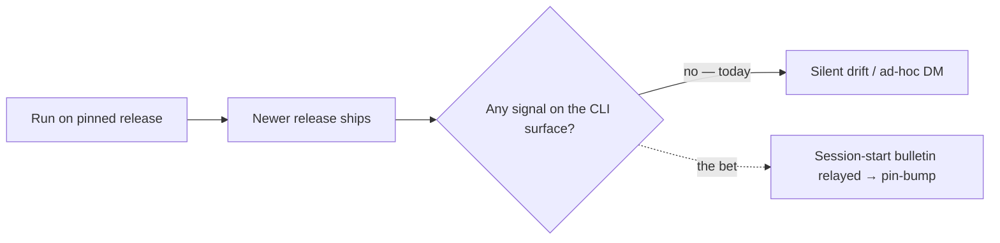

# channel-inbox — the distributor→operator notification channel — PRD

| Field | Value |
|---|---|
| **In one line** | Pyxis gains a voice on the one surface operators live in — their agentic CLI: a session-start `pyxis inbox` verb relays unseen channel bulletins (a locally-derived new-version advisory first, distributor-authored notices next) through the agent to the human, deduped by a user-global seen-ledger, silenceable by an advisory-only mute, and never able to wound a session. |
| **Relevant-when** | planning, building, or reviewing update notification, distributor→operand messaging, the `pyxis inbox` verb, the session-start hook surfaces, the seen-ledger / mute / channel-snapshot user-global state, or upgrade UX (installer WR-2); triaging a missed or duplicated notice, a muted emergency notice, or a wounded session; changing the release channel's published files, the bulletin schema, the pinned-version handshake, or any agentic-CLI hook wiring |
| **Status** | Draft — problem review pending |
| **Tier** | T3 — a signed cross-fleet channel whose content renders into every relaying agent's context (a prompt-injection and platform-trust surface); reversible and data-migration-free, but the security surface sets the rigor |
| **Owner** | @mdarabi |
| **Approver(s)** | @mdarabi (operator) |
| **Contributors** | — *(solo operator; gate tables record the introducing PR's review, rule 15)* |
| **Informed** | — |
| **Date** | 2026-07-23 created · 2026-07-23 last updated |
| **Appetite** | Feature-scale, well below the installer's program budget: a verb, a user-global state file, one session-start hook per wireable CLI, and one signed closed-schema bulletin format. The cut-line — parked, not built: message-authoring tooling, the revocation/force-refuse machinery, rollout channels/cohorts/telemetry, a general session briefing, any new host. The complexity valve: under scope pressure cut toward fewer typed template-rendered fields, never toward free-form channel text. |
| **Target release** | The first release after the installer ships releases at all — the channel needs a published release to point at (`brainstorm:installer#O-2`'s revisit trigger has fired: v0.1.x are live, pyxis-dist mirrors them). |
| **Tracking** | — *(the introducing PR)* |
| **Artifacts** | `brainstorm:channel-inbox` — the gated brainstorm record (rides this PR) |
| **Template version** | prd-template/v2 |

## 0. Read to rule — the human reviewer's section (~5 min)

*The body is the contract; this section only routes attention — on any conflict the body governs; machines ignore it.*

**Judge these**

| # | The call | Could have gone | If you disagree |
|---|---|---|---|
| 1 | **A signed channel bulletin, not just an upgrade nudge** — the feature is a general distributor→operator message channel; the version advisory is its first (locally-derived) kind | the nudge alone, no channel file/schema | you cut FR-8/FR-12 and the authored-notice half; the emergency lane (FR-4) has nowhere to live → §4.1, FR-2, FR-8 |
| 2 | **Notification, never mutation** — the channel tells; it never changes the pin or runs an upgrade | a self-updater that bumps and converges | you reopen the frozen no-unpinned-execution rule (installer DINV-2); force-upgrade returns as a design question → NG-2, §4.1 |
| 3 | **The emergency lane cannot be muted** — `blocking` bulletins re-fire every session; mute silences `advisory` only | a single mute over everything | a security/known-bad notice can be silenced into irrelevance → FR-4, FR-5, ABUSE-4 |
| 4 | **Channel content is data, never instructions** — typed fields rendered by pyxis-owned templates; drives never act on a bulletin | let the bulletin carry agent-actionable text | a compromised channel steers every relaying agent → FR-8, NFR-2, ABUSE-1, §2.2 anti-segment |
| 5 | **A wounded session is a defect, not a tradeoff** — fail-silent, exit-0, cache-only offline, zero repo writes | best-effort with occasional noise/blocking | the hook becomes a thing operators disable wholesale → NR-1, NR-2, UB-1..UB-6, NFR-1 |
| 6 | **Delivery is best-effort local; no read receipts** — must-land enforcement is deferred to the CI revocation future, not this channel | a phone-home acknowledgment channel | you add telemetry/egress and reopen `brainstorm:installer#O-7` → NG-1, NG-4, NFR-3 |

**Sanity-check the numbers** — an advisory shows **once** per operator per `(repo, pin, latest)` (FR-3); the channel snapshot refreshes on a bounded TTL with a fetch timeout of **≤ 2 s** (FR-7, NFR-1); `pyxis inbox --hook` performs **zero** network operations in the offline combo and always exits **0** (NR-2, UB-1, NFR-5); **zero** operator/repo identity leaves the machine (NFR-3).

**The author's open questions** — the primary metric's numeric freshness target (N sessions/days) is deliberately unset — baselined from the internal fleet after the channel is live (§3.2 M1, §7.2 Q1). Three mechanism choices are design-owned, not PRD gaps: the signature scheme and key custody (§7.2 Q2 / `brainstorm:channel-inbox#P-1`), the per-CLI session-start hook enumeration and fragment shape (Q3 / P-3), and the exact user-global state layout (Q4).

**Skip the rest** — structure/ID/fold correctness → docgate; substance and coherence → the unmanned `/prd-review`; the signature scheme, hook-fragment shapes, state-file layout, and cache mechanics → the technical design (§7.2); the revocation/force-refuse security contract this channel will later carry → its own feature (NG-3).

## 1. Summary

- **Problem** — Operators only ever touch pyxis through their agentic CLI, and pyxis has no voice there. When a newer version ships, or a version turns out to be bad, nothing tells them where they actually work — they drift out of date, and a bad rollout is chased down by hand.
- **For whom** — The operand operator: a human running an agentic CLI in an installed repo, who hears about pyxis only through the agent in front of them. Shaped for the external adopter on their own infrastructure as much as for the operator's own fleet.
- **Why now** — Releases now exist (v0.1.x are live; pyxis-dist mirrors them), so `brainstorm:installer#O-2`'s "first release that changes installed files" trigger has fired: WR-2's notification leg is due, and the installer's front door (`pyxis`, hooks, config) is the surface to hang it on.
- **Direction** — The distributor publishes signed, closed-schema **bulletins** on the release channel. A session-start hook runs `pyxis inbox`, which derives a new-version advisory locally (pin-vs-latest) and reads any authored bulletins from a cached snapshot, then relays the unseen ones — as data, through pyxis-owned templates — for the agent to surface and act on with the human. A user-global seen-ledger shows each advisory once; an advisory-only mute silences the noise without touching the emergency lane.
- **Appetite** — The header's budget: a verb, a state file, a hook, a signed schema. Authoring tooling, revocation machinery, rollout cohorts, and telemetry stay parked.
- **Success** — After the channel is live, the median installed repo's pin moves within a small number of sessions of the version advisory first firing (M1) — measured from operand git history, no telemetry; and a staged known-bad-version drill reaches a test operand's next session with its remedy (M2).
- **Guardrail** — No session is ever wounded: `pyxis inbox` never blocks or slows session start beyond its bound, never fails a gate, never writes repo content, and is silent offline (§3.3).
- **Top risks** — (1) the channel becomes a prompt-injection vector into every relaying agent; (2) the hook adds latency or noise and operators disable it wholesale; (3) advisory fatigue trains operators to ignore the surface, blunting the emergency lane.

## 2. Problem space

### 2.1 Problem statement

An operator runs pyxis entirely through an agentic CLI in an installed repo; the pin that decides which release they run lives in that repo's config, and they change it deliberately. But nothing on that surface tells them a newer release exists, so repos drift onto stale pins for no reason other than silence — and when a shipped version turns out to be bad, the distributor has no authenticated way to reach the fleet where it works, so remediation is ad-hoc messages and hope. The cost of doing nothing compounds per release: every version that ships widens the gap between what operators run and what they could, and leaves the bad-rollout case with no lane at all.

### 2.2 Users and segments

| Segment | Role and context | Domain exp. | Tech exp. | Key goals | Pain today | Evidence |
|---|---|---|---|---|---|---|
| **P1 (primary)** | The operand operator — a human in an agentic CLI on an installed repo; hears of pyxis only through the agent relaying to them | journeyman | journeyman·master | know when to upgrade; hear a can't-wait notice in time | no signal on their surface; drift is silent | `brainstorm:channel-inbox#D-2` |
| P2 (producer) | The distributor — whoever cuts releases into the channel; authors a bulletin by appending a schema-valid entry in the release runbook | master | master | reach every operator with a notice that can't wait for the next release | out-of-band DMs; no fleet reach | `brainstorm:channel-inbox#D-2`, `#F-5` |
| **Anti-segment** | Unattended agent drives (argus, headless executors) and the pyxis source repo | — | — | — | — | `brainstorm:channel-inbox#D-2` |

*Anti-segment, stated as policy: an unattended drive never acts on a bulletin — bulletins are relay-to-human only, the reason channel content is data and never instructions (ABUSE-1). The source repo runs source mode and learns of releases by making them; it is not an installed operand.*

### 2.3 Jobs and desired outcomes

| # | When… (situation) | I want to… (motivation) | So I can… (outcome) | Today's workaround | Evidence |
|---|---|---|---|---|---|
| J1 | I start work in an installed repo on a pinned release | be told, where I work, that a newer pyxis exists and how to move | decide to upgrade without polling release pages | none — drift goes unnoticed | `brainstorm:channel-inbox#D-3` |
| J2 *(producer, P2)* | I ship something operators must know now (a deprecation, a known-bad version, a security notice) | reach every operator on their surface with an authenticated notice | remediate a fleet without out-of-band chasing | ad-hoc DMs, no reach | `brainstorm:channel-inbox#D-3`, `#F-6` |
| J3 | a notification check runs at the start of my session | have it never cost me — no block, no slowdown, no noise when there's nothing to say | keep the channel on instead of disabling it | n/a — no such surface exists yet | `brainstorm:channel-inbox#D-3` |

### 2.4 Evidence

| Claim | Source (research, data, tickets, interviews) | Confidence |
|---|---|---|
| The agentic CLI is the only pyxis surface an operator touches; a session-start hook's stdout lands in the agent's context, not on the human's screen | `brainstorm:channel-inbox#F-4`; vendor CLI hook semantics (Claude Code SessionStart; the existing write-hook adapter pattern) | High |
| Execution stays pin-only (installer DINV-2), so notification-not-mutation is the compatible step and force-upgrade cannot push | `brainstorm:channel-inbox#F-6`; `docs/tech-design/installer-v1.md` DINV-2 | High |
| The revisit trigger for upgrade UX (installer WR-2 / `#O-2`) has fired — v0.1.x are live, pyxis-dist mirrors them | `brainstorm:channel-inbox#F-5`; `README.md` § Releases & distribution | High |
| A vendor-hook wiring precedent exists (the Claude Code write-hook adapter → `cmd/argus-writehook`); operand hooks ship via the release's payload-overlay model | `brainstorm:channel-inbox#F-2`, `#F-7`, `#F-8` | High |
| Session-start lifecycle hooks are established for Claude Code; Codex/OpenCode equivalents are not established in the repo | `brainstorm:channel-inbox#F-7` | Medium |

### 2.5 The journey today

| Phase | User does | User feels / pain | Frontstage (what user sees) | Backstage (systems, people, processes) |
|---|---|---|---|---|
| Run | works in the installed repo through the agent on a pinned release | unaware | nothing about versions | pin in the repo's pyxis config; release channel has newer tags |
| Drift | keeps running the stale pin release after release | none — no signal | nothing | gap widens silently |
| Bad rollout | a shipped version turns out bad | anxious once told out-of-band | a DM, if they see it | distributor chases the fleet by hand |
| Upgrade (rare) | happens to hear, bumps the pin, converges | relieved but late | manual pin-bump PR | git history records the late bump |

### 2.6 Opportunity and why now

- **Size** — Every installed operand × every release: the drift gap is per-repo-per-release, and the bad-rollout case is unbounded downside on a channel that today does not exist.
- **Alternatives users have** — Poll release pages (nobody does); out-of-band DMs (no reach, no authentication); do nothing (silent drift).
- **Why us / strategic fit** — The installer already owns the operand's front door (`pyxis`, config, hooks, the release channel); the bulletin is one more thing the front door carries, and it unblocks the installer's parked WR-2.
- **Why now** — Releases exist and are mirrored, so the parked trigger has fired; every further release without this widens drift and leaves the bad-rollout case unlaned.
- **Cost of doing nothing** — Fleets sit on stale and occasionally known-bad pins with no authenticated way to move them.

**Decision:** Problem gate — do not proceed to §3–§4 until signed.

| Reviewer | Role | Date | Verdict |
|---|---|---|---|
| @mdarabi | operator (via the introducing PR's review) | — | pending |

## 3. Goals, metrics, and guardrails

### 3.1 Goals as falsifiable hypotheses

| # | We believe that… | Will result in… | Measured by… |
|---|---|---|---|
| G1 | giving the distributor an authenticated voice on the operator's CLI surface | installed pins move sooner after a release, without polling | M1 |
| G2 | a not-muteable emergency lane reaching the next session | a known-bad version is surfaced with its remedy fleet-wide in one session-start | M2 |
| G3 *(qualitative)* | a notification that provably never wounds a session | operators leave the channel on rather than disabling it | the zero-cost guardrail holding as an e2e gate (§3.3) |

### 3.2 Goals → signals → metrics

| Metric | Goal | Signal | Baseline | Target (at checkpoint) | Feeds from |
|---|---|---|---|---|---|
| M1 (primary) | G1 | a repo's pin-bump commit lands after its version advisory first fires | today: no signal exists → unbounded | median pin-bump within N sessions/days of first firing — N baselined from the internal fleet once live (§7.2 Q1) | EVT-1 (local) + operand git history |
| M2 | G2 | a staged known-bad-version `blocking` bulletin is relayed with its remedy at a test operand's next session | no lane exists | the bad-rollout drill passes: reached and relayed at next session, remedy present | EVT-2 (local) + drill record |

*Measurement note: M1 is derived from operand git history (pin-bump timing vs first-fire), not from a phoned-home event — consistent with NFR-3. EVT-1/EVT-2 are local structured-log lines read by drills and CI artifacts, never aggregated centrally.*

### 3.3 Guardrails and decision rule

| Guardrail metric | Threshold | Action if breached |
|---|---|---|
| Session wound rate — sessions blocked, slowed beyond NFR-1's bound, or gate-failed by the hook | any occurrence in the e2e matrix | block release; the hook is not shippable until zero |
| Repo-content writes by `pyxis inbox` | any write outside user-global state | block release |
| Network operations in the offline combo | any | block release (violates NR-2) |
| Emergency-lane silence — a `blocking` bulletin suppressed by mute or seen-ledger | any occurrence | block release (violates FR-4) |

**Ship rule (pre-registered):** all four guardrails clean across the e2e matrix (including the offline combo and the mute/blocking cases) AND the bad-rollout drill (M2) passes → shippable. Any guardrail occurrence → not shippable, regardless of M1. M1's numeric target is a post-launch baseline, not a ship gate.

### 3.4 Non-goals and waiting room

| ID | Non-goal | Why refused |
|---|---|---|
| NG-1 | Fleet read-receipts, acknowledgment, or delivery telemetry | delivery is best-effort local; must-land enforcement is the CI revocation future, not this channel — keeps the no-phone-home posture (`#D-3`, `#O-1`) |
| NG-2 | Any mutation of the pin or automated upgrade/convergence by the channel | execution stays pin-only (installer DINV-2); the channel tells, never changes (`#D-1`) |
| NG-3 | The revocation / force-refuse machinery (making a bad version refuse to run) | its own security contract — severity, who may append, enforcement at CI — referenced by this channel, built elsewhere (`#O-2`, `#F-6`) |
| NG-4 | Rollout channels, A/B cohorts, and the platform loop | remain `brainstorm:installer#O-7` reserved config keys; a message inbox is not a rollout channel (`#O-3`) |
| NG-5 | A general session-start briefing / doctor front end (framing C) | the inbox is a distinct push channel, not a health surface; doctor's read-only role is the installer's (`#O-4`, `#D-1`) |
| NG-6 | Message-authoring tooling / UI | the distributor appends a schema-valid entry via the release runbook; no tooling in v1 (`#O-5`) |
| NG-7 | Standing up any new agentic-CLI or host integration for the inbox | no new vendor surface; unwireable CLIs fall back to the manual instruction (`#O-6`, `#D-8`) |

| ID | Waiting room | Revisit when / intended version |
|---|---|---|
| WR-1 | Message-authoring tooling (validate-and-append helper) | the runbook append proves error-prone in practice |
| WR-2 | The revocation / force-refuse contract that rides this channel | the first bad rollout that needs a hard refuse, or a dedicated security-contract feature |
| WR-3 | Aggregated fleet-freshness reporting (would need a phone-home) | only if a delivery-guarantee requirement ever overrides the no-telemetry posture |

## 4. Solution space

### 4.1 Approach and alternatives considered

The distributor publishes a signed, append-only, closed-schema **bulletin** file on the release channel. `pyxis inbox` is one verb with a hook mode: it derives the new-version advisory locally (the repo's pinned version vs the latest in a cached channel snapshot), reads any authored bulletins whose applicability matches, filters out those already in the user-global **seen-ledger** (advisory tier) while always including **blocking** tier, and emits the unseen set — rendered from pyxis-owned templates over the bulletins' typed fields, phrased as a relay-and-offer-remedy instruction to the agent. A session-start hook per wireable CLI calls `pyxis inbox --hook`; CLIs without a session-start hook fall back to a payload-shipped operand-manual instruction. A user-global mute (advisory-only, snooze-or-permanent) silences noise without touching the emergency lane.

| Option | Sketch | Why not chosen |
|---|---|---|
| A (chosen) | signed channel bulletin: verb + hook + seen-ledger + one authored kind, version advisory derived locally | — |
| B — upgrade nudge only | derive pin-vs-latest, no channel file/schema/authored kind | builds all the machinery (hook, storage, injection hardening) yet forecloses the authored-notice half and leaves the emergency lane homeless (`#D-1`) |
| C — session briefing | a doctor-lite pass relaying health + updates + notices each session | balloons into the doctor UX the frozen installer design already owns (`#D-1`, NG-5) |
| Do nothing | — | silent drift per release; the bad-rollout case stays unlaned (§2.6) |

### 4.2 Scope perimeter

- **In (plan of record)** — the `pyxis inbox` verb (hook/relay mode + `mute`/`unmute`/status); user-global state (seen-ledger, mute, channel snapshot) at XDG paths; the locally-derived version advisory; one signed closed-schema authored bulletin kind; the two severity tiers and their dedupe/mute rules; the bounded, timeout-guarded, offline-safe snapshot refresh; template-rendered output addressed to the relaying agent; session-start hook wiring for every CLI that exposes one, with the operand-manual fallback for those that don't; the distributor's runbook-append authoring path with closed-parse validation; the fail-silent/exit-0/zero-repo-write contract; the bad-rollout drill.
- **Future (believed next, not committed)** — WR-1..WR-3.
- **Out** — NG-1..NG-7.

### 4.3 Experience: flows and states

**Flow F1 — session-start relay (serves J1, J2, J3)**

| Step | User does | System responds | States covered | Design |
|---|---|---|---|---|
| 1 | starts an agent session in an installed repo | the wired session-start hook runs `pyxis inbox --hook` | ideal · empty · loading · partial · error | tech design |
| 2 | — | inbox refreshes the snapshot if TTL expired (timeout-guarded), else uses cache | loading · offline(partial) | tech design |
| 3 | — | derives the version advisory + selects unseen bulletins (advisory deduped, blocking always) | ideal · empty | tech design |
| 4 | reads what the agent relays | emits template-rendered relay-and-remedy text; marks advisory bulletins seen | ideal · empty | tech design |

- **Empty** — nothing unseen and no newer version: no output, exit 0 (the common case; J3).
- **Loading** — snapshot refresh in flight: bounded by the fetch timeout (NFR-1); on timeout, fall back to cache.
- **Partial** — offline or refresh failed: derive/select from the cached snapshot only; silent if that yields nothing.
- **Error** — any internal failure: no output, exit 0, no repo write (UB-3..UB-6); doctor names persistent faults later.
- **Accessibility** — n/a: output is text into an agent context, not a rendered UI surface.
- **Localization** — bulletin text is authored by the distributor; template scaffolding is English in v1 (Future).

**Flow F2 — mute (serves J3)**

| Step | User does | System responds | States covered | Design |
|---|---|---|---|---|
| 1 | runs `pyxis inbox mute [--for <duration>]` / `unmute` | writes the user-global mute state (snooze expiry or permanent); confirms | ideal · error | tech design |
| 2 | starts a session while muted | advisory bulletins are withheld; **blocking** bulletins still relay | ideal | tech design |
| 3 | runs `pyxis inbox` / `pyxis doctor` | shows mute state, snapshot age, last fetch | ideal | tech design |

**Flow F3 — distributor publish (serves J2)**

| Step | User does | System responds | States covered | Design |
|---|---|---|---|---|
| 1 | appends a schema-valid bulletin entry per the release runbook and signs the file | closed-parse validation rejects unknown keys / invalid tier | ideal · error | tech design |
| 2 | publishes the signed file to the release channel | operands verify the signature before reading any field | ideal · error(rejected) | tech design |

### 4.4 Scenarios

- **The stale operand.** A repo has run pin v0.3.0 for three releases. On the next session, the hook fires, inbox finds latest v0.4.2 in the cached snapshot, and the agent relays: "A newer pyxis (v0.4.2) is available; this repo pins v0.3.0 — want me to open a pin-bump PR and run converge?" The operator says yes. The advisory does not fire again for that repo until the pin or latest moves.
- **The bad rollout (the drill).** The distributor appends a signed `blocking` bulletin: "v0.4.2 has a known defect in X; pin ≥ v0.4.3." A muted test operand still receives it at its next session, relayed with the remedy — proving the emergency lane survives mute (M2).
- **The noise-averse operator.** Tired of advisories mid-focus, they run `pyxis inbox mute --for 30d`. Advisories go quiet; a `blocking` security notice two weeks later still reaches them (ABUSE-4).
- **Offline.** A session starts with no network. Inbox uses the cached snapshot only, performs no network op, and if nothing is unseen, says nothing and exits 0 (NR-2, UB-1).

**Decision:** Solution gate — this shape at this appetite is the bet. Zero TBDs may pass.

| Reviewer | Role | Date | Verdict |
|---|---|---|---|
| @mdarabi | operator (via the introducing PR's review) | — | pending |

## 5. System requirements

### 5.1 Functional requirements

| ID | Requirement (EARS) | Rationale | Priority | Risk | Fit criterion | Verify | Traces to |
|---|---|---|---|---|---|---|---|
| FR-1 | When invoked in hook mode at session start, `pyxis inbox` shall emit the set of unseen bulletins for the current repo and operator, or nothing when the set is empty. | the relay job | Must | med | fixture repos with 0 / 1 / N unseen bulletins each emit exactly that set; the empty case emits no output | Test | G1, J1, F1 |
| FR-2 | `pyxis inbox` shall derive a new-version advisory by comparing the repo's pinned version to the latest version in the cached channel snapshot, and include it when the pinned version is older. | discover-a-newer-version without polling | Must | med | pin<latest yields one advisory; pin==latest / pin>latest yields none, across fixture snapshots | Test | G1, J1, F1 |
| FR-3 | Where a bulletin is `advisory` tier, `pyxis inbox` shall emit it at most once per operator per identity key — the derived advisory keyed by `(repo, pinned, latest)`, an authored advisory by its bulletin id. | show-once, the seen-ledger contract | Must | med | a second hook run over unchanged inputs emits the advisory zero times; changing any key element re-emits once | Test | J1, J3, F1 |
| FR-4 | Where a bulletin is `blocking` tier, `pyxis inbox` shall emit it on every session until its clearing condition is met, regardless of seen-ledger or mute state. | the emergency lane that cannot be silenced | Must | high | a `blocking` bulletin re-emits across repeated runs and while muted; it stops only when its stated condition is satisfied in a fixture | Test | G2, J2, F1 |
| FR-5 | When the operator sets mute (permanent or with an expiry), `pyxis inbox` shall withhold `advisory`-tier bulletins for that operator until unmute or expiry, and shall never withhold `blocking`-tier bulletins. | silenceable noise, non-silenceable emergencies | Must | high | muted runs emit zero advisories and all blocking bulletins; expiry restores advisories; unmute is immediate | Test | J3, G3, F2 |
| FR-6 | When mute is active or a snapshot has been fetched, `pyxis inbox` status and `pyxis doctor` shall report the mute state (incl. expiry), the snapshot age, and the last fetch outcome. | the state is inspectable | Should | low | status/doctor output names mute state, snapshot age, and last fetch across fixtures | Test | F2, NFR-4 |
| FR-7 | `pyxis inbox` shall refresh the cached channel snapshot only when its time-to-live has expired, bound the fetch by a timeout, and on timeout or failure fall back to the existing cache. | bounded, non-blocking freshness | Must | med | within-TTL runs perform no fetch; an expired-TTL run fetches; an injected slow/failed fetch falls back to cache within the timeout | Test | J3, F1, NFR-1 |
| FR-8 | `pyxis inbox` shall render all output from pyxis-owned templates populated only by a bulletin's typed schema fields, and shall never pass channel-supplied text through as agent-directed instructions. | channel content is data, not instructions | Must | critical | a bulletin whose fields contain instruction-shaped text renders inside the template's data slots only; a golden-output test pins the rendered form | Test | J2, ABUSE-1, F1 |
| FR-9 | `pyxis inbox` shall verify the integrity and authenticity of the bulletin source before reading any bulletin field, and shall ignore an unverified source. | only the distributor may speak on the channel | Must | critical | a tampered or unsigned bulletin file is ignored (no bulletin emitted); a valid one is read; verification precedes field parsing | Test | ABUSE-1, ABUSE-2, NFR-2 |
| FR-10 | When emitting a bulletin, `pyxis inbox` shall address the output to the relaying agent as a relay-to-the-operator instruction, and for the version advisory shall include the remedy (bump the pinned version and converge). | the human hears it only if the agent relays; the remedy rides along | Must | med | rendered output names the relay action and, for the advisory, the pin-bump-and-converge remedy | Test | J1, J2, F1 |
| FR-11 | Where a wired agentic CLI exposes no session-start lifecycle hook, the payload-shipped operand manual shall instruct the agent to run `pyxis inbox` at session start. | no surface left dark (the fallback half of D-8) | Must | med | for a CLI with no session-start hook, the operand manual contains the instruction; a wired CLI ships the hook fragment instead | Inspection | J1, F1 |
| FR-12 | Where the distributor appends a bulletin, the channel bulletin format shall parse closed — rejecting an unknown key, an invalid severity tier, or a missing required field with a named error. | authored notices stay well-formed at the source | Must | med | malformed-entry fixtures (unknown key, bad tier, missing field) each fail with their named error; a valid entry parses | Test | J2, F3 |

*Priority bar: every FR above is Must except FR-6 (Should) — the release does not ship a channel without relay, dedupe, the emergency lane, mute, integrity, and closed authoring. Within Must, FR-8/FR-9 rank first (the security surface), then FR-4/FR-5 (the emergency-lane contract), then the rest.*

**Non-regression (NR-n)**

| ID | Existing behavior protected | Why protected | Risk | Fit criterion | Verify | Traces to |
|---|---|---|---|---|---|---|
| NR-1 | Session start proceeds normally whether or not the hook runs | the hook must never wound a session | high | with the hook present and failing/slow/erroring, session start still completes; the hook's exit code never changes session outcome | Test | F1 |
| NR-2 | The installer offline floor (installer FR-13): zero network operations post-fetch in the carina + local-CI combo | medium-independence stays proven | high | `pyxis inbox --hook` performs zero network operations in the network-denied combo; any network op fails the run | Test | F1 |
| NR-3 | The existing write-time hook and gate hooks (`argus-writehook`, docgate gates) keep functioning | adding a session-start hook must not disturb existing hook surfaces | med | the existing hook suites stay green with the inbox hook wired | Test | F1 |

### 5.2 Unwanted behavior and failure handling

| ID | If… (trigger) | Then the system shall… | User sees | Priority | Risk | Fit criterion | Verify | Traces to |
|---|---|---|---|---|---|---|---|---|
| UB-1 | If the channel is unreachable or the machine is offline | use the cached snapshot only and stay silent when nothing is unseen, exiting 0 | nothing (or cached bulletins) | Must | med | offline fixtures emit only cached-derived output and exit 0; no error surfaced | Test | F1, NR-2 |
| UB-2 | If a snapshot fetch exceeds the timeout | abandon the fetch, use the existing cache, and exit 0 | nothing or cached output | Must | med | an injected slow fetch is abandoned within the timeout; cache is used | Test | F1, FR-7 |
| UB-3 | If a bulletin is malformed or of an unknown schema version | skip that bulletin and continue with the rest, emitting nothing for it | other bulletins only | Must | med | a malformed bulletin among valid ones is skipped; valid ones still emit | Test | FR-12, F1 |
| UB-4 | If the bulletin source fails integrity/authenticity verification | ignore the entire source, emit no bulletin, and record the fault for doctor | nothing | Must | critical | a tampered source yields zero bulletins; doctor names the invalid-signature fault | Test | FR-9, ABUSE-2 |
| UB-5 | If the seen-ledger is missing or unreadable | treat it as empty (re-show advisories) rather than crash, and still emit blocking bulletins | possibly a re-shown advisory | Must | med | a corrupt seen-ledger fixture yields a clean run: advisories re-shown, blocking emitted, exit 0 | Test | FR-3, FR-4 |
| UB-6 | If the mute state is missing or unreadable | treat the operator as unmuted (fail toward showing, never toward silence) | advisories shown | Must | med | a corrupt mute-state fixture emits advisories and all blocking; never silently suppresses | Test | FR-5 |
| UB-7 | If the operator writes a bulletin/state file by hand into user-global state | verify it on read and ignore anything unverified or malformed, never trusting local unsigned content as channel content | nothing | Should | med | a hand-planted unsigned bulletin in the cache is ignored (fails FR-9 verification) | Test | FR-9, ABUSE-2 |
| UB-8 | If the `pyxis` binary is not resolvable when the session-start hook fires | the hook wrapper shall no-op and let the session start normally, writing nothing and surfacing nothing | nothing (session unaffected) | Must | high | a fixture session with `pyxis` off PATH starts normally; the hook wrapper exits without error and produces no output | Test | NR-1, F1, FR-11 |

### 5.3 Permissions and abuse cases

| Function / data | Distributor (P2) | Operator (P1) | Unattended drive | Unauthenticated |
|---|---|---|---|---|
| Publish a bulletin on the channel | write (signed) | none | none | none |
| Read/relay bulletins | none | read (via agent) | **none — never acts on them** | none |
| Mute / seen-ledger (user-global state) | none | read/write | none | none |
| The pinned version / repo config | none | read/write (out of this feature's scope) | none | none |

| ID | Actor and intent | Vector | Impact | Severity | Mitigated by | Verify |
|---|---|---|---|---|---|---|
| ABUSE-1 | Attacker who controls or spoofs the channel wants to steer relaying agents | inject instruction-shaped text as a bulletin | every fleet agent's context is poisoned | high | FR-8 (typed fields into pyxis-owned templates, never passthrough) + FR-9 (verify before read) + the drive anti-segment (§2.2) | Test (golden-render + tamper fixtures) |
| ABUSE-2 | Attacker forges or replays a bulletin | publish an unsigned/forged file, or replay a stale one | fake or outdated notices reach the fleet | high | FR-9 integrity/authenticity verification; blocking bulletins clear on their stated condition so a replayed one auto-clears once the pin moved | Test (tamper + replay fixtures) |
| ABUSE-3 | A careless or compromised distributor floods `blocking` bulletins | over-use of the emergency tier | notification fatigue trains operators to ignore | med | authoring discipline (signed, distributor-only) + the tier being a distributor-owned, auditable, append-only record; social, noted for the runbook | Inspection (runbook review) |
| ABUSE-4 | A bulletin tries to silence the emergency lane | mark a security notice mutable, or induce a mute of blocking | a known-bad/security notice is silenced | high | FR-4 + FR-5: `blocking` is not muteable and not deduped, by contract; mute is user-only and advisory-only | Test (muted-blocking fixture) |

### 5.4 Data

| Entity / field | Meaning | Source of truth | Retention | Integrity rules | Privacy class |
|---|---|---|---|---|---|
| seen-ledger | which advisory bulletins this operator has been shown | user-global (XDG) state on the operator's machine | until unmute/reset; regenerable (loss re-shows advisories) | atomic write; unreadable → treated empty (UB-5) | internal (local only) |
| mute state | permanent or expiring silence of advisory tier | user-global (XDG) state | until unmute/expiry | unreadable → treated unmuted (UB-6) | internal (local only) |
| channel snapshot | cached copy of the channel's bulletins + latest version | user-global (XDG) cache | overwritten on refresh; gitignored-equivalent (never in a repo) | signature verified before use (FR-9) | internal (local only) |
| bulletin | one channel notice: id, severity tier, applicability, typed content fields | the release channel (distributor-published, signed) | append-only on the channel | closed-parse (FR-12); signed (FR-9) | public (channel content) |

- **Migration** — Skipped: no existing data is converted; all state is created fresh on first run.
- **Parallel-run / cutover** — Skipped: no prior system to run beside.
- **Rollback** — user-global state is regenerable and repo-independent; removing the hook and deleting the cache fully retreats with no repo impact (§6.5).
- **Decommission** — unwire the hook (converge) and delete the user-global state; nothing dangles.
- **Privacy check** — no DPIA: no personal data, no profiling, no monitoring; all state is local to the operator's machine.
- **Egress** — the only network operation is a read (GET) of the channel snapshot from the release channel; no operator identity, repo identity, or usage data is sent (NFR-3).

### 5.5 Interfaces and integrations

| Interface | Direction | Purpose | Contract (format, ranges, timing) | Failure modes | Owner |
|---|---|---|---|---|---|
| Release channel bulletin source | in | fetch the signed bulletin set + latest version | signed, closed-schema file over TLS; fetch bounded by timeout (FR-7) | unreachable → cache (UB-1); timeout → cache (UB-2); tampered → ignore (UB-4) | distributor / installer release channel |
| Agentic-CLI session-start hook | in | invoke `pyxis inbox --hook` at session start | per-CLI thin adapter fragment merged by `pyxis init`; stdout → agent context | no session-start hook → operand-manual fallback (FR-11) | pyxis (per-CLI adapter) |
| `pyxis` front door | both | `inbox` is a verb of the installer's `pyxis` binary | the installer's exec/verb grammar | — | prd:installer |

### 5.6 Non-functional requirements

| ID | Area | Requirement | Fit criterion | Verify |
|---|---|---|---|---|
| NFR-1 | Performance | `pyxis inbox --hook` shall complete within the wall-clock bound stated in its fit criterion so session start is not delayed beyond it. | with a warm cache, p95 ≤ 200 ms local wall-clock; any network fetch is bounded by a ≤ 2 s timeout after which cache is used | Test |
| NFR-2 | Security | The bulletin source shall be integrity- and authenticity-verified before any field is read; the verifying trust anchor ships with the `pyxis` binary, not with the channel. | tamper/forge/replay fixtures are all rejected before parse; the trust anchor is binary-resident | Test |
| NFR-3 | Privacy | The feature shall send no operator, repo, or usage data anywhere; the sole network operation is a read of the channel snapshot. | an egress scan over a run observes only the channel GET; no identifying payload leaves | Test (egress scan) |
| NFR-4 | Operability | `pyxis doctor` shall surface inbox state — mute (with expiry), snapshot age, last-fetch outcome, and any invalid-signature fault — performing no mutation. | doctor reports each field across fixtures; the filesystem diff across a doctor run is empty | Test |
| NFR-5 | Reliability | On any internal error, `pyxis inbox` shall exit 0 with no output and no repo-content write. | fault-injection across parse/fetch/state paths always yields exit 0 and an empty repo diff | Test |

### 5.7 Instrumentation — the tracking plan

| ID | Event name | Fires when | Properties (typed) | Source | Feeds |
|---|---|---|---|---|---|
| EVT-1 | inbox_advisory_emitted | an advisory bulletin is emitted at session start | tier: string, key: string, muted: bool | local slog | M1 |
| EVT-2 | inbox_blocking_emitted | a blocking bulletin is emitted | bulletin_id: string, cleared: bool | local slog | M2 |
| EVT-3 | inbox_fetch_outcome | a snapshot refresh is attempted | outcome: enum(ok·timeout·offline·rejected), age_ms: int | local slog | NFR-1, NFR-4 |

*These are local structured-log lines only — read by drills and CI artifacts, never aggregated centrally (NFR-3). M1's fleet-freshness figure is derived from operand git history (pin-bump timing), with EVT-1 marking the first-fire locally.*

### 5.8 Definition of Done

| ID | Done criterion | Source | Verify | Required evidence | Blocking? |
|---|---|---|---|---|---|
| DOD-1 | All Must FRs pass their fit criteria | FR-1..FR-5, FR-7..FR-12 | Test | CI run link | yes |
| DOD-2 | No non-regression row broken (session unharmed, offline floor, existing hooks) | NR-1..NR-3 | Test | suite result | yes |
| DOD-3 | Every guardrail clean across the e2e matrix (wound-free, zero repo write, offline-silent, emergency-lane never silenced) | §3.3 | Test | matrix run + egress scan | yes |
| DOD-4 | Every abuse case has its mitigation proven | ABUSE-1..ABUSE-4 | Test/Inspection | tamper/replay/muted-blocking fixtures + runbook review | yes |
| DOD-5 | The bad-rollout drill passes: a staged blocking bulletin reaches a test operand's next session with its remedy, even muted | M2, G2 | Demo | drill record | yes |
| DOD-6 | Integrity/authenticity verification precedes field read; the trust anchor is binary-resident | FR-9, NFR-2 | Test | security-fixture run | yes |
| DOD-7 | The manual-fallback instruction ships for any CLI without a session-start hook | FR-11 | Inspection | operand-manual diff | yes |

### 5.9 AI behavior and evals

Skipped: the feature ships no model-driven behavior — the relaying agent is an external consumer of the emitted text, not a component this PRD specifies or evaluates. The injection surface that agent creates is handled as a security requirement (FR-8/FR-9, ABUSE-1), not an eval.

## 6. Delivery

### 6.1 Phasing and milestones

| Phase | Purpose | Scope | Exit criterion |
|---|---|---|---|
| Core | verb + state + version advisory + dedupe + mute, fully offline-safe | FR-1..FR-7, FR-10, NR-1..NR-3, the guardrails | the guardrails hold in the e2e matrix; advisories dedupe and mute correctly |
| Channel | signed authored bulletins + closed authoring + integrity | FR-8, FR-9, FR-11, FR-12, ABUSE-1..ABUSE-4 | tamper/replay/muted-blocking fixtures pass; the bad-rollout drill (M2) passes |
| Wire | session-start hooks for wireable CLIs + manual fallback | FR-11 + per-CLI adapters | each targeted CLI relays at session start, or falls back to the manual instruction |

### 6.2 Dependencies

| Dependency | Type (team / system / vendor / approval) | Needed by | Status | Owner |
|---|---|---|---|---|
| The installer's `pyxis` front door + release channel + config (`prd:installer`, `design:installer-v1`) | system | Core | confirmed (merged) | @mdarabi |
| A signature scheme + trust-anchor custody decision (`brainstorm:channel-inbox#P-1`) | approval (design) | Channel | at-design | @mdarabi |
| Per-CLI session-start hook-surface enumeration (`#P-3`) | system | Wire | at-design | @mdarabi |

### 6.3 Risks, assumptions, and rabbit holes

| # | Risk / assumption / rabbit hole | Likelihood | Impact | Mitigation or test | Owner |
|---|---|---|---|---|---|
| R1 | The channel becomes a prompt-injection vector into every relaying agent | M | H | FR-8 + FR-9 + drive anti-segment; tamper/golden-render fixtures (ABUSE-1) | @mdarabi |
| R2 | The hook adds latency or noise; operators disable it wholesale | M | M | NFR-1 bound + fail-silent + the empty-case-says-nothing rule (J3, UB-1) | @mdarabi |
| R3 | Advisory fatigue blunts the emergency lane | M | M | advisory-only mute + snooze; blocking reserved and distributor-audited (ABUSE-3) | @mdarabi |
| R4 | Assumption: session-start hooks exist beyond Claude Code (Medium confidence, §2.4) | M | M | the manual-fallback (FR-11) makes non-existence a degraded, not dark, surface; P-3 enumerates per CLI | @mdarabi |
| R5 | Signature/trust-anchor custody balloons into key-management | L | M | scope to a binary-resident verify-only anchor; full key rotation is WR / the revocation contract (WR-2) | @mdarabi |

### 6.4 Release criteria

| Lens | Criterion | Evaluated by |
|---|---|---|
| Functionality | All Must FRs pass their fit criteria | CI / test suite |
| Reliability | Zero session wounds, zero repo writes, offline-silent across the e2e matrix (§3.3) | e2e matrix + fault injection |
| Security | Tamper/forge/replay/muted-blocking fixtures all rejected; trust anchor binary-resident (FR-9, NFR-2, ABUSE-1..4) | security-fixture suite |
| Supportability | `pyxis doctor` surfaces inbox state; the bad-rollout drill is documented and passes | doctor test + drill record |
| Performance | NFR-1 bound met with warm cache; fetch timeout enforced | perf/timeout test |

### 6.5 Rollout and reversibility

- **Flag** — per-operand: the session-start hook is wired by `pyxis init`/converge and can be omitted via repo config; the whole feature is absent if unwired. Owner: @mdarabi.
- **Kill switch** — unwire the hook (converge) and/or the operator mutes: with the hook gone, no inbox code runs at session start; deleting the user-global cache fully resets. The fallback (no notifications) is the pre-feature status quo — tested by construction.
- **Experiment** — none (no A/B; NG-4).
- **Cutover/migration steps** — none (§5.4: fresh state only).

| Stage | Audience | Minimum evidence | Advance when | Roll back when |
|---|---|---|---|---|
| Internal | the operator's own fleet | the e2e matrix + the bad-rollout drill green | guardrails clean (§3.3) | any guardrail occurrence |
| Adopters | external installed repos | one real release advisory fires and relays cleanly | M1 shows pins moving, guardrails clean | any guardrail occurrence |

### 6.6 Launch readiness

| Area | Item | Owner | Status |
|---|---|---|---|
| Docs | operand-manual fallback instruction + README channel note | @mdarabi | ☐ |
| Support | the release runbook's "append + sign a bulletin" step; the bad-rollout drill as the runbook's rehearsal | @mdarabi | ☐ |
| Platform | the bulletin schema + signature scheme documented for the channel | @mdarabi | ☐ |
| Localization | Skipped: template scaffolding English-only in v1 (Future) | @mdarabi | ☑ n/a |

**Decision:** Launch gate — §6.4 criteria green, §6.6 owned, rollback (unwire) rehearsed.

| Reviewer | Role | Date | Verdict |
|---|---|---|---|
| @mdarabi | operator (via the introducing PR's review) | — | pending |

### 6.7 Post-launch review

- **Review trigger** — the first public release published after the channel ships, once its version advisory has fired across the internal fleet. **Owner** — @mdarabi.
- **Verdict recorded** — adopt / iterate / kill, with the M1 fleet-freshness evidence — on the header's Tracking ref (post-merge lifecycle lives in the tracker; contract changes travel as amendments citing the verdict).

## 7. Alignment

### 7.1 FAQ

**Customer**

- **Q:** Will this auto-update pyxis or change my pin behind my back? — **A:** No. The channel only tells you; you (or your agent, with your approval) bump the pin and converge. Execution stays pin-only (NG-2).
- **Q:** Can I turn it off? — **A:** Yes — `pyxis inbox mute` (optionally `--for <duration>`) silences advisories user-wide. Security/known-bad `blocking` notices still reach you (FR-5).
- **Q:** Does it send anything about me or my repo anywhere? — **A:** No. The only network call is reading the public channel snapshot; nothing about you leaves (NFR-3).

**Internal**

- **Q:** A message file that renders into every agent's context — isn't that a prompt-injection hole? — **A:** That is the central risk (R1). It is closed by construction: content is typed fields rendered through pyxis-owned templates (never passthrough, FR-8), the source is integrity-verified before any field is read (FR-9), and unattended drives never act on a bulletin (§2.2). A golden-render test pins the boundary.
- **Q:** Why no delivery guarantee / read receipts? — **A:** Best-effort local keeps the no-phone-home posture (NG-1); anything that *must* land is the CI-enforced revocation future, a separate contract (NG-3, WR-2).
- **Q:** What if a CLI has no session-start hook? — **A:** The operand manual instructs the agent to run `pyxis inbox` at session start — degraded but not dark (FR-11).

### 7.2 Open questions

| # | Question | Owner | Needed by | Status |
|---|---|---|---|---|
| Q1 | The primary metric's numeric freshness target (N sessions/days) | @mdarabi | post-launch (baseline) | open — non-blocking; baselined from the internal fleet once live |
| Q2 | Signature scheme + trust-anchor custody (`#P-1`) | @mdarabi | Channel phase (design) | open — design-owned |
| Q3 | Per-CLI session-start hook-surface enumeration + fragment shape; manual-fallback wording (`#P-3`) | @mdarabi | Wire phase (design) | open — design-owned |
| Q4 | The exact user-global state layout (paths, file formats) under XDG (`#P-2` fail-silent mechanics) | @mdarabi | Core phase (design) | open — design-owned |

### 7.3 Decision log

| Date | Decision | Alternatives considered | Why | Who |
|---|---|---|---|---|
| 2026-07-23 | The feature is a signed channel bulletin (framing B), nudge-disciplined | upgrade nudge only (B/A); session briefing (C) | machinery is needed even for the nudge; pay for generality once (brainstorm:channel-inbox#D-1) | @mdarabi |
| 2026-07-23 | Segments: operand operator via agent relay; drives + source repo excluded | agent as audience; drives act on bulletins | keeps decision authority human; makes injection hardening policy (#D-2) | @mdarabi |
| 2026-07-23 | Three v1 jobs; read-receipts shaped out | include delivery telemetry | keeps the O-7 boundary + no-phone-home (#D-3) | @mdarabi |
| 2026-07-23 | Mute: user-global, advisory-only, snooze-first | repo-config mute; mute over everything | distraction is the human's; the emergency lane must survive (#D-4, #D-5) | @mdarabi |
| 2026-07-23 | Bet + observable success (freshness, zero-cost gate, drill) | a numeric N committed now | measurable from git history without telemetry (#D-6) | @mdarabi |
| 2026-07-23 | Appetite feature-scale; cut-line explicit | program-scale | a verb, a state file, a hook, a schema (#D-7) | @mdarabi |
| 2026-07-23 | Hook coverage: wire-where-possible + manual fallback, one verb | a fixed CLI list | vendor capabilities shift; no surface left dark (#D-8) | @mdarabi |

### 7.4 Changelog

| Date | Change | Author |
|---|---|---|
| 2026-07-23 | 000-base created from `brainstorm:channel-inbox` (gated ready-for-prd) | @mdarabi |

## 8. Contract readiness — the executability gate

| Check | Pass? | Notes |
|---|---|---|
| Problem basis accepted — §2 problem gate signed (T2/T3) | ☐ | pending the introducing PR's problem review |
| Zero solution-blocking TBDs or open questions (§7.2) | ☑ | Q1 is a post-launch baseline; Q2–Q4 are design-owned mechanism choices behind settled requirements — none block the solution shape |
| Every Must FR has a fit criterion and a verification method (§5.1) | ☑ | FR-1..FR-12 |
| Every requirement row carries a risk tier; high/critical rows have a declared safety plan (§5.1, §6.5) | ☑ | high/critical rows (FR-4/5/8/9, NR-1/2) covered by the guardrails, fail-silent contract, and the unwire kill switch |
| Non-goals drawn (§3.4); non-regression rows named (§5.1) | ☑ | NG-1..NG-7; NR-1..NR-3 |
| Every primary job (§2.3) is covered by a requirement, a non-goal, or a waiting-room entry | ☑ | J1→FR-1/2/3/10; J2→FR-8/9/12, FR-4; J3→FR-7, NR-1, NFR-1 |
| Every key flow (§4.3) has functional, failure, and non-regression coverage (§5.1–5.2) | ☑ | F1→FR-1..10/UB-1..6,8/NR-1..3; F2→FR-5/6; F3→FR-12/FR-9 |
| Every primary metric (§3.2) has instrumentation (§5.7) or an explicit measurement plan | ☑ | M1→EVT-1 + git-history plan; M2→EVT-2 + drill |
| Every blocking DoD row traces to a requirement, guardrail, release criterion, or human-judgment rubric (§5.8) | ☑ | DOD-1..7 each cite their sources |
| Risks and assumptions have owners (§6.3) | ☑ | R1..R5 |
| Human-judgment criteria name an owner and a rubric (§5.8) | ☑ | none — all DoD rows are Test/Demo/Inspection |
| DoD complete: every blocking row sourced and evidenced; every n/a explained (§5.8) | ☑ | DOD-1..7 blocking, sourced, evidenced |
