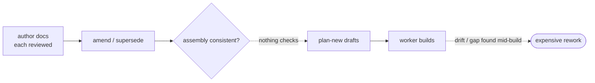

# contract-gate — the mechanical stage-6 contract gate — PRD

| Field | Value |
|---|---|
| **In one line** | The mechanical (code-only) half of pipeline stage 6: a deterministic gate that validates a feature's *assembled* contract — currency, inverse coverage, link resolution, structural completeness, compilability — before planning consumes it, bouncing a flawed contract with one structured defect report and materializing **nothing** on a pass; the LLM-judgment half is a tracked follow-up. |
| **Relevant-when** | planning, building, or reviewing the contract gate — its five checks, the planning-entry hard gate, the continuous advisory drift surface, the verdict, or the defect-report schema; triaging a wrong-bounce, a missed mechanical defect, or a stale/uncovered contract admitted to planning; changing the machine faces the checks read (the PRD source map, the design index + serves-inverse, the DoD schema) or plan-new's planning-entry precondition |
| **Status** | Problem + solution gates signed (2026-07-17, via the introducing operator review session) — launch review pending (post-implementation); merge freezes the base |
| **Tier** | T3 — a governance gate on the pipeline's critical path (stage 6 → 7): a wrong verdict either blocks all planning or admits a flawed contract, and the abuse surface (gaming the gate to slip a flawed contract into planning) is real. It executes no untrusted code and touches no data-migration, money, or model-driven surface — those T3 sections skip honestly. |
| **Owner** | @mdarabi |
| **Approver(s)** | @mdarabi (operator) |
| **Contributors** | — *(solo operator; gate tables record the introducing PR's review, rule 15)* |
| **Informed** | — |
| **Date** | 2026-07-17 created · 2026-07-17 last updated |
| **Appetite** | Build the complete mechanical gate: the five checks (each wiring an existing substrate — the coverage join, the citation resolver, the §12 invalidation computation — into an enforced gate), the dual-face template-governed defect report, the plan-new planning-entry precondition, the continuous advisory CI context, and the check-input data-path work. Bounded by the scope line, not by a task count. Excludes the LLM-judgment layer (semantic ambiguity, contradiction, verification-path adequacy, risk, cost, suggested evals, required human decisions) and any success artifact (nothing materializes on a pass). Budget follows the gap-closing bet — the currency + coverage gaps have no owner today — not perceived effort. |
| **Target release** | plan-new's planning-entry precondition — the gate plan-new drives to before it drafts a plan; that integration is the consuming edge. |
| **Tracking** | agenticlab-ai/pyxis — the introducing PR (filed with this base) |
| **Artifacts** | `brainstorm:contract-compiler-2` — the gated brainstorm record (rides this PR) · `review:contract-gate-000` — the unmanned reviewer's report (rides this PR) |
| **Template version** | prd-template/v2 |

## 0. Read to rule — the human reviewer's section (~6 min)

*The body is the contract; this section only routes attention — on any conflict the body governs; machines ignore it.*

**Judge these**

| # | The call | Could have gone | If you disagree |
|---|---|---|---|
| 1 | **Gate, not translator** — a passing contract materializes nothing; only a failure emits an artifact (the defect report) | Materialize the ExecutableContract on every pass (the inherited translator identity) | The artifact economy flips: O-1's revisit trigger becomes a Must, §4.1's chosen shape changes → §4.1, NG-1, `brainstorm:contract-compiler-2#D-1` |
| 2 | **Mechanical-only; the LLM layer is a separate follow-up** — v1 is fully deterministic | Build the whole stage-6 compiler now (semantic + analytical checks included) | Pass semantics change from "mechanically clean" to "executable"; the follow-up (O-2) folds back in; cost stops being ~zero → §3.4 WR-1, NFR-3, `#D-2` |
| 3 | **Pass = "mechanically clean," a floor — not "executable"** — semantic defects can still be present | Claim v1 delivers the full stage-6 guarantee | The honest-floor framing and the §3.4 boundary change; reviewers over-trust a green verdict → §5.1 FR-7, NG-2, `#D-7` |
| 4 | **Severity split** — inverse coverage is hard at planning entry, advisory on contract-doc PRs | Hard everywhere | Mid-authoring contracts (a PRD merged before its designs) false-bounce continuously → FR-3, FR-9, `#D-4` |
| 5 | **Defect report retained + parseable** — one structured dual-face artifact per bounce, not a fire-and-forget diagnostic | Ephemeral console/session output | The storage question (P-3) and the downstream consumers — the LLM follow-up, Argus, telemetry — lose their input → FR-8, §7.2 Q3, `#D-5` |
| 6 | **Reuse the existing substrate** — wire the coverage join, the citation resolver, the §12 computation into a gate; don't re-implement | Fresh implementations owned by the gate | Duplicated logic drifts from its source; the appetite grows → §4.1 option C, NFR-5, `#F-5` |

**Sanity-check the numbers** — the gate runs in **p95 ≤ 5 s** on the repo's largest live contract (NFR-1); the false-bounce guardrail tolerates **zero unresolved wrong-bounces** at the dogfood checkpoint (§3.3); the dogfood demands the gate run over **every live contract in the repo** and surface at least the known drift instance without a false bounce (M2).

**The author's open questions** — the gate's binary home and name (P-1), the check-input data path (P-2, a flag-and-surface budget risk per §6.3 R1), and the defect-report storage mechanism (P-3) are all design-owned, parked in §7.2. The one accepted product residual: the mechanical gate passes a *present-but-substanceless* serving design (a stub that Serves every Must with no content) — that class is the LLM follow-up's, named at ABUSE-1 and §3.4 WR-1.

**Skip the rest** — structure/ID/fold correctness → docgate; substance and coherence → the unmanned `/prd-review`; check internals, verdict schema depth, and defect-report storage → the technical design (§7.2 design-owned rows); plan-new's decomposition/sizing/projection → plan-new's contract; the semantic and analytical verdicts → the LLM follow-up's PRD.

## 1. Summary — the one-pager

- **Problem** — Before planning turns a contract into autonomous work, nothing checks that the *assembled* contract — the merged PRD, its serving designs, and its definition of done taken together — is current, jointly complete, link-resolvable, and structurally well-formed. Each document is reviewed at birth and the planner checks its own plan against a design, but the assembly has no owner, so a contract can drift (an amendment supersedes a requirement a merged design still serves) or arrive incomplete, and the first thing to notice is a worker mid-implementation — the most expensive possible place.
- **For whom** — The contract owner (Argus or a human engineer), who gets a named, actionable bounce instead of a mid-build surprise; and the planning stage plus everything downstream of it (workers, review), protected from building on a broken contract.
- **Why now** — The machine faces this gate reads were all built for it within the last weeks (the source map is specified as "what the Contract Compiler consumes"; `Serves` as "the stage-6 compiler's join key"), the §12 invalidation contract is computed but its enforcement is explicitly assigned to "the Contract Compiler" and unbuilt, and the feature-level coverage bar has no owner. The substrate exists; only the gate that enforces it is missing.
- **Direction** — A deterministic gate the planner invokes before it drafts: it runs five assembly-property checks over the machine faces, and either returns clean (planning proceeds, nothing materialized) or bounces the contract with one structured, dual-face, template-governed defect report naming every failure and what unblocks it. The same checks run as a continuous advisory CI context on contract-doc PRs, so drift surfaces as it is introduced. Every check is a deterministic join or hash over already-committed data; zero model tokens; the semantic half is a tracked follow-up.
- **Appetite** — The header's budget: the five checks + the defect report + the planning-entry precondition + the continuous context + the data-path work, bounded by the scope line. Excludes the LLM layer and any success artifact.
- **Success** — Once enforced, no plan freezes against a contract carrying any of the five mechanical defect classes (M1), and the gate run over the repo's own live contracts surfaces the known drift without a false bounce (M2).
- **Guardrail** — Zero unresolved wrong-bounces: a valid contract the gate wrongly refuses blocks nothing else until dispositioned (§3.3).
- **Top risks** — (1) the check-input data path (per-requirement fit/verification fields the source map does not expose today) turns into a large machine-face change and eats the budget; (2) the gate false-bounces legitimately-mid-authoring contracts and trains bypass; (3) reviewers over-trust a "mechanically clean" pass as if it were the full stage-6 guarantee.

## 2. Problem space

### 2.1 Problem statement

A feature's contract is not one document but an assembly: the merged PRD projection, the technical designs that serve its requirements, and the definition of done. The unmanned reviewers judge each document's substance at birth, and the planner checks its own plan against the design it slices — but nothing checks the *assembly* before planning consumes it. So a contract can pass every per-document gate and still be broken as a whole: a requirement no live design serves, a citation that dangles after a supersession, a design that still serves a requirement an amendment retired, a requirement with no stated way to verify it. Today the first actor to notice is a worker partway through building the wrong thing — the most expensive point in the pipeline to discover a contract defect, and precisely the failure the vision means by "bad contracts produce bad autonomous work."

### 2.2 Users and segments

| Segment | Role and context | Domain exp. | Tech exp. | Key goals | Pain today | Evidence |
|---|---|---|---|---|---|---|
| **P1 (primary)** | The contract owner — Argus (the AI engineer) now, a human engineer where one drives the contract — who authored the PRD + design set and is about to have it planned | master | master | a named, actionable bounce before work starts; certainty the contract is plannable | no signal until a worker is mid-build against a broken contract | `brainstorm:contract-compiler-2#D-6` |
| P2 (secondary) | The planning stage (plan-new) and everything downstream (workers, review), which consume the contract as given | master | master | proceed only on an assembly that is current, covered, and well-formed | plans (and workers) build on drift and incompleteness no one checked | `brainstorm:contract-compiler-2#D-6`, `#F-7` |
| **Anti-segment** | Contracts still **mid-authoring** (a PRD merged before its serving designs exist) — shielded by the advisory-vs-hard split (`#D-4`); and **draft-only (autonomy L0) repos** that never enter planning — the hard gate never fires for them | — | — | — | — | — |

### 2.3 Jobs and desired outcomes

| # | When… (situation) | I want to… (motivation) | So I can… (outcome) | Today's workaround | Evidence |
|---|---|---|---|---|---|
| J1 | my contract is about to be planned | get a named bounce for any mechanical defect before any work starts | fix the contract cheaply instead of discovering it mid-build | none — the defect surfaces mid-implementation | `brainstorm:contract-compiler-2#D-6` |
| J2 | planning is invoked on a feature | proceed only when the assembled contract is current, covered, resolvable, and well-formed | not decompose and dispatch work against a broken contract | plan-new checks plan-vs-design, not the assembly | `brainstorm:contract-compiler-2#D-6`, `#F-7` |
| J3 | an amendment or supersession changes one document | learn immediately if it left the assembly inconsistent | catch drift at introduction, not at the next planning attempt | the index's stale-serves flag exists but gates nothing | `brainstorm:contract-compiler-2#D-4`, `#F-5` |
| J4 | I read a "the contract passed" signal | know exactly what that guarantee does and does not cover | trust the green without over-trusting it | none — no such signal exists | `brainstorm:contract-compiler-2#D-7` |

### 2.4 Evidence

| Claim | Source (research, data, tickets, interviews) | Confidence |
|---|---|---|
| The machine faces were built for this consumer: the source map is specified as "what the Contract Compiler, traceability, and invalidation consume"; `Serves` is "the stage-6 compiler's join key"; design binding elements are "what stage 6 compiles" | `docs/wiki/glossary.md` (amendment model §4 · tech-design-conventions §3.1/§3.3) · `brainstorm:contract-compiler-2#F-3` | High |
| The currency contract is specified and its enforcement explicitly assigned but unbuilt: derived artifacts pin ledger position + fingerprint + cited IDs; invalidation states are computed by `docgate diff`; "enforcement is absorbed by the Contract Compiler (VNEXT-1)" — today it is review discipline only | `docs/tech-design/prd-amendment-model.md` §12 · R7 · `brainstorm:contract-compiler-2#F-4` | High |
| The mechanical substrate already ships: the coverage join (requirement-universe ↔ live-design serves), the design index's `serves_inverse` and non-fatal stale flags, per-projection content fingerprints, and repo-wide citation-dangler gating | `internal/docgate/techdesigns/index.go` · `internal/docgate/gate/reg_check_citations.go` · `internal/plangate/plan/plan.go` · `brainstorm:contract-compiler-2#F-5` | High |
| The feature-level coverage bar — every live Must requirement served by ≥1 live design *before* planning — has no owner: the planner's coverage is plan-vs-design slice, the reviewers prove design→PRD anchors, the coverage join is computed on read but gates nothing | `docs/prds/plan-new/effective.md` FR-26 · FR-2 · `brainstorm:contract-compiler-2#F-6`, `#F-7` | High |
| Point-in-time validity drifts: a live design served a superseded requirement while every per-stage gate passed honestly, caught only by the index's non-gating stale-serves flag | operator's linearity challenge + the index's stale-serves evidence, 2026-07-10 · `brainstorm:contract-compiler#F-5` | Med |

### 2.5 The journey today

| Phase | User does | User feels / pain | Frontstage (what user sees) | Backstage (systems, people, processes) |
|---|---|---|---|---|
| author | owner writes PRD + designs, each reviewed at birth | confident — every document passed its own gate | green per-document reviews | reviewers judge substance per document, never the assembly |
| amend | an amendment supersedes a requirement; a design still serves the old one | unaware — nothing re-checks the whole | the amendment merges green | the index flags stale-serves, non-fatally; nothing gates |
| plan | owner invokes planning | ready to build | the planner starts drafting | plan-new re-derives linkage, checks its own slice — not the assembly's currency or feature coverage |
| discover | a worker builds against the drift/gap | whiplash — the defect surfaces after work started | a failing or wrong implementation | the most expensive point in the pipeline to find a contract defect |

### 2.6 Opportunity and why now

- **Size** — every feature that enters planning, on the pipeline's hottest hand-off (stage 6 → 7); a contract defect caught here costs a re-fold, caught mid-build it costs a wasted worker pass plus rework, and at fleet scale that multiplies across every feature.
- **Alternatives users have** — rely on per-document review alone (blind to the assembly); rely on the planner's plan-vs-design coverage (wrong altitude — it never checks feature-level coverage or currency); read the non-gating stale-serves flag by eye (surfaced-not-gating is exactly how the drift happens).
- **Why us / strategic fit** — the factory owns the whole document system, so it already emits the machine faces this gate joins; the gate is the enforcement point the amendment model already names and the coverage join already computes — a compounding asset on ground the corpus explicitly reserved for it.
- **Why now** — the substrate shipped in the last weeks and its enforcement is unowned; the planner runs compiler-less today, re-deriving what a gate could guarantee once; and Argus is beginning to drive planning unattended, which is exactly where an un-validated contract is most dangerous.
- **Cost of doing nothing** — contract defects keep surfacing at implementation time, the currency and coverage gaps stay ownerless, and the §12 invalidation contract stays "review discipline" that no one enforces.

**Decision:** Problem gate — do not proceed to §3–§4 until every contributor signs. *(sign-off table below)*

| Reviewer | Role | Date | Verdict |
|---|---|---|---|
| @mdarabi | operator (via the introducing operator review session) | 2026-07-17 | approved |

*capture: lineless miss (review time not recorded) · items: none — the operator review render was approved in session (lgtm), zero surface annotations; this collapsed review signs the problem and solution gates in one event.*

## 3. Goals, metrics, and guardrails

### 3.1 Goals as falsifiable hypotheses

| # | We believe that… | Will result in… | Measured by… |
|---|---|---|---|
| G1 | running five deterministic assembly-property checks as a hard gate at planning entry | no worker ever building against a mechanically-broken contract — defects caught at the cheapest point | M1 |
| G2 | making the ownerless currency and inverse-coverage checks gating over the machine faces | the drift and incompleteness that surface mid-build today being caught before planning | M2 |
| G3 | running the same checks as a continuous advisory context on contract-doc PRs | contract drift surfaced at the moment it is introduced, not at the next planning attempt | M3 |
| G4 *(qualitative)* | emitting one structured, named, dual-face defect report per bounce | contract owners fixing the contract straight from the report without re-deriving what broke | unprompted reliance on the report in dogfood + post-launch review (§6.7) |

### 3.2 Goals → signals → metrics

| Metric | Goal | Signal | Baseline | Target (at checkpoint) | Feeds from |
|---|---|---|---|---|---|
| M1 (primary) | G1 | the gate's **escape rate** — mechanically-flawed contracts that pass the gate yet carry a defect of one of the five classes, surfaced downstream (at planning-consumption, review, or implementation) | unmeasured (no gate today; every class uncaught) | zero escapes across the dogfood feature's planned contracts, cross-checked by the corpus sweep (DOD-7); a non-zero escape falsifies the check set's completeness and reopens it | EVT-1, EVT-3, DOD-7 |
| M2 | G2 | mechanical defects the gate catches on the repo's own live contracts | those defects uncaught today | the gate run over every live contract surfaces ≥ the known drift instance (§2.4) with zero false bounces, at the corpus-sweep checkpoint (before the hard gate is enforced) | EVT-2 |
| M3 | G3 | seeded contract drift flagged at contract-doc-PR time | n/a (no continuous check) | a fixture PR seeding a currency/link/structural defect is flagged by the advisory context, and a coverage-only gap is advisory-not-blocking, at the continuous-context checkpoint | EVT-1, EVT-2 |
| M4 *(qualitative)* | G4 | the defect report validates against its schema and its human face is read at review | n/a | both faces validate on every fixture bounce; the report is consulted in the dogfood review (§6.7) | EVT-2 |

*That every planned contract passed the gate is true **by construction** once FR-1 is enforced — a wiring property, not a hypothesis. M1 measures the falsifiable residual (a check that misses a defect it should have caught), which is what can actually lose.*

### 3.3 Guardrails and decision rule

| Guardrail metric | Threshold | Action if breached |
|---|---|---|
| Unresolved wrong-bounces (a contract the owner disputes as valid, still undispositioned) | 0 at the dogfood checkpoint; every disputed bounce gets a disposition (check fixed, or bounce upheld) | demote the offending check to **advisory** via a human-lane change to the severity-map policy (FR-13) until fixed; contracts planned under the demotion proceed, and the demotion is recorded in the disposition (EVT-4) |
| Gate-caused planning stalls (planning blocked by a gate error, not a genuine defect) | 0 unresolved at the dogfood checkpoint | the gate fails closed and reports the error honestly (UB-4); the defect is fixed or the run's error is triaged — never worked around by disabling the gate; disposition recorded (EVT-4) |

**Ship rule (pre-registered):** M1 and M2 met AND both guardrails clean → the capability is proven and the hard gate is enforced. M3 (continuous surface) may iterate after the hard gate ships. Any unresolved wrong-bounce or gate-caused stall → not shippable until dispositioned.

### 3.4 Non-goals and waiting room

| ID | Non-goal | Why refused |
|---|---|---|
| NG-1 | Materializing any **success artifact** — a compiled ExecutableContract, requirement graph, or verification graph — on a passing contract | the artifact's consumers (a fan-out Planner, the stage-10 Verifier, traceability) don't exist yet and the mechanical checks are cheap to recompute, so a persisted success artifact is net-negative now; a pass materializes nothing (`brainstorm:contract-compiler-2#D-1`, and WR-2's revisit trigger) |
| NG-2 | Any **semantic or analytical judgment** — detecting vague/ambiguous requirements, PRD↔design contradiction, verification-path *adequacy*, or producing risk, cost, suggested tests/evals, or required-human-decisions | those require reasoning (non-deterministic, dear to recompute); this phase is the deterministic code-only core, and pass means "mechanically clean," not "executable" (`#D-2`, `#D-7`) |
| NG-3 | Re-judging any **per-document substance** — re-running the prd-review / tech-design-review lenses or scoring requirement quality | the gate consumes reviewed, merged documents and checks only assembly properties; the reviewers own substance at birth (`#O-3`, the inherited boundary) |
| NG-4 | Owning any **planning behavior** — decomposition, task sizing, plan-vs-design coverage, the fog bounce, or projection | that is plan-new's contract; the gate is a precondition plan-new depends on, not a change to its internals (`#D-4`) |
| NG-5 | Merging, approving, or mutating anything — the gate emits a verdict and (on failure) a report only | a validator that also writes is a blast-radius the read-only design forecloses; the gate makes zero mutations on any path (`#D-1`, FR-11) |

| ID | Waiting room | Revisit when / intended version |
|---|---|---|
| WR-1 | The **LLM-judgment layer** — semantic ambiguity, contradiction, verification-path adequacy, risk, cost, suggested evals, required human decisions | the tracked follow-up feature; a present-but-substanceless design (ABUSE-1) passes the mechanical gate until it lands (`#O-2`) |
| WR-2 | An **always-on ExecutableContract artifact** (requirement + verification graph materialized on pass) | a stage-10 Verifier or fan-out Planner is built and needs the contract-as-graph as a consumed input, or the LLM follow-up needs to freeze expensive judgment as data (`#O-1`) |
| WR-3 | **Eager recompilation / active invalidation** — recompute-on-merge rather than check-at-consumption | if demand-driven checking proves insufficient at scale; ruled out for now as the regenerate-in-the-loop shape the amendment model rejects (`brainstorm:contract-compiler#D-2`, AP-27) |

## 4. Solution space

### 4.1 Approach and alternatives considered

The chosen shape is a **deterministic gate the planner invokes as a precondition**. An invocation resolves a feature's assembled contract — its live PRD projection, its live serving designs, its DoD — from the committed machine faces, runs five assembly-property checks (currency, inverse coverage, link resolution, structural completeness, compilability), and returns one structured verdict. On a clean verdict the planner proceeds and the gate materializes nothing. On any failure the gate emits exactly one structured, dual-face, template-governed defect report bundling every failed check's named defects, and the planner refuses to draft. The identical checks run as a continuous CI context on contract-doc PRs, hard on the currency/link/structural classes and advisory on inverse coverage. Every check is a join or hash over already-committed data — zero model tokens.

| Option | Sketch | Why not chosen |
|---|---|---|
| A (chosen) | a read-only deterministic gate: five checks over the machine faces; nothing on pass, one defect report on fail; planning-entry hard + continuous advisory | — |
| B | a translator that compiles and **materializes** the ExecutableContract (requirement + verification graph) on every pass, handed to the planner | the artifact's consumers don't exist yet and the planner reads the docs fine today; materializing on every pass builds what nothing reads (`brainstorm:contract-compiler-2#D-1`; NG-1) |
| C | the gate re-implements coverage, citation resolution, and invalidation itself | duplicates logic that already ships (the coverage join, `check-citations`, the §12 computation) and drifts from it; reuse keeps one source of truth (`#F-5`) |
| D | keep it advisory only — surface defects on contract-doc PRs, never gate planning | surfaced-not-gating is exactly how the assembly drifts today (`#F-5`); a broken contract still reaches a worker |
| Do nothing | — | contract defects keep surfacing mid-build; the currency + coverage gaps stay ownerless; §12 stays unenforced |

### 4.2 Scope perimeter

- **In (plan of record)** — the gate core (contract resolution from the machine faces; the five checks FR-2..FR-6; the closed verdict schema FR-7); the single dual-face template-governed defect report (FR-8); the planning-entry hard precondition wired into plan-new (FR-1); the continuous advisory CI context with the severity split (FR-9); the closed-schema versioned severity-map policy (FR-13); the check-input data-path work needed to expose per-requirement fit/verification fields to the checks (P-2); a fixture suite of clean and per-defect-class contracts; the dogfood sweep over the repo's own live contracts.
- **Future (believed next, not committed)** — the waiting room: the LLM-judgment layer (WR-1), an always-on ExecutableContract artifact (WR-2), eager recompilation (WR-3); the verdict schema is shaped to let the semantic verdicts and analytical fields land additively.
- **Out** — success-artifact materialization (NG-1); semantic/analytical judgment (NG-2); re-judging document substance (NG-3); planning behavior (NG-4); merge/mutation authority (NG-5).

### 4.3 Experience: flows and states

*The gate has no human UI; its "screens" are the verdict and the defect report, consumed by the host (plan-new at planning entry, the CI context on contract-doc PRs). The state classes are verdict states: **clean** (all applicable checks pass; nothing materialized) · **incomplete** (a coverage or structural check failed) · **malformed** (a compilability check failed) · **stale** (a currency check failed) · **unresolved** (a link-resolution check failed) · **error** (a check could not run — malformed machine face or missing input, fail-closed) · **configuration-error** (invoked on an unmerged or non-existent contract; zero checks ran). Accessibility and localization: skipped — no human-facing surface ships; the report's human face renders through the host's existing surfaces.*

**Flow F1 — the planning-entry gate (serves J2)**

| Step | Actor does | Gate responds | States covered | Design |
|---|---|---|---|---|
| 1 | plan-new is invoked for a feature; it calls the gate on the feature's contract | resolves the contract from the machine faces, runs the five checks | clean · incomplete · malformed · stale · unresolved · error | tech design |
| 2 | on clean | returns clean; plan-new proceeds to draft; nothing is materialized | clean | FR-1, FR-11 |
| 3 | on any failure | returns the failure verdict + one defect report; plan-new refuses to draft | incomplete · malformed · stale · unresolved | FR-8, FR-1 |

**Flow F2 — the bounce and defect report (serves J1):** on a failing verdict the gate emits one structured report bundling every failed check's named defects — each with the check id, the specific offender (a requirement ID, a citation + source location, a stale input + what superseded it, a malformed join), and what unblocks it — in a machine-readable face and a human-readable rendering. The owner fixes the contract and re-invokes; the checks are cheap, so the report regenerates on each run.

**Flow F3 — the continuous drift surface (serves J3):** when a PRD or design PR would merge, the gate runs the checks over the affected feature's contract as a CI context — currency, link, and structural defects report as hard signals; inverse coverage reports as advisory only, because a PRD legitimately merges before its serving designs exist.

**Flow F4 — the honest floor (serves J4):** a contract with no live design serving a Must bounces `incomplete` at planning entry (correctly — it cannot be planned); the same gap on a contract-doc PR is an advisory coverage note, not a block. A contract that is *mechanically* clean but semantically weak (a vague requirement, a stub design) passes — the verdict says "mechanically clean," and the semantic classes are named as the follow-up's (WR-1), never silently claimed.

### 4.4 Scenarios

**The common case.** Argus finishes a PRD and one serving design and invokes planning. The gate resolves the contract, runs the five checks in a few seconds, returns clean, and plan-new drafts — nothing is materialized, the only trace is the plan's own fingerprint pin over the same inputs.

**The stale contract.** An amendment retired FR-11 last week; a merged design still serves it. The owner invokes planning. The currency check fails: the verdict is `stale`, the defect report names the design, the retired requirement it serves, and the unblock (supersede the design or re-target the serve). plan-new refuses. The owner fixes the design; the re-run is clean.

**The uncovered Must.** A PRD has a Must no live design serves. At planning entry the gate bounces `incomplete`, naming the unserved Must. Earlier, when that PRD first merged with no designs yet, the continuous context flagged the same gap as advisory — visible, not blocking — because the designs were simply not written yet.

**The stub design (the named residual).** An author adds a design that Serves every Must with an empty body to clear coverage. The mechanical gate passes it — it checks that a live design serves each Must, not whether the design says anything. The verdict is `clean` and honest about its scope; catching the substanceless design is the LLM follow-up's job (ABUSE-1, WR-1).

**Decision:** Solution gate — contributors sign that this shape, at this appetite, is the bet. Zero TBDs may pass this gate.

| Reviewer | Role | Date | Verdict |
|---|---|---|---|
| @mdarabi | operator (via the introducing operator review session) | 2026-07-17 | approved |

## 5. System requirements

*Terms used below: a feature's **assembled contract** is its live PRD projection (`effective.source.json`), the live technical designs whose `Serves` targets its requirements, and its definition of done (§5.8 of the PRD). A **machine face** is a committed, docgate-generated projection (the PRD source map, the design index + `serves_inverse`) the gate reads. The **five checks** are the FR-2..FR-6 rows; a **defect** is one named failure a check produces.*

### 5.1 Functional requirements

| ID | Requirement (EARS) | Rationale | Priority | Risk | Fit criterion | Verify | Traces to |
|---|---|---|---|---|---|---|---|
| FR-1 | When planning is invoked for a feature, the planner shall call the gate on that feature's assembled contract and shall not draft, freeze, or project any plan unless the gate returns a clean verdict. | the gate is the planning-entry hard stop; a broken contract must not reach decomposition | Must | critical | on fixtures, a planning invocation against a bouncing contract produces zero draft/plan output and surfaces the defect report; against a clean contract, planning proceeds | Test | G1, J2, F1 |
| FR-2 | When the gate runs, it shall verify that no live serving design of the contract serves a superseded or retired requirement and that no live serving design builds on a superseded design, failing with a **currency** defect naming each stale design and the superseded/retired anchor it references. | point-in-time validity drifts after dependents freeze; the planning-entry currency check is the index's stale-serves / stale-builds-on state (`#F-5`) made gating — distinct from the §12 derived-artifact invalidation (`#F-4`), which governs a *prior* plan/charter's freshness against main and has no derived artifact to check pre-planning | Must | high | a fixture whose live design serves a retired requirement yields a `stale` verdict naming both; a fully-current fixture passes; the check reads the index's stale-serves / stale-builds-on computation, not a re-derivation | Test | G2, J3, F1 |
| FR-3 | When the gate runs at planning entry, it shall verify that every live **Must** requirement of the PRD is served by at least one live design, failing with an **inverse-coverage** defect naming each unserved Must. | the feature-level "complete enough to plan" bar that has no owner today (`#F-6`, `#F-7`) | Must | high | a fixture with an unserved Must yields an `incomplete` verdict naming it; a fully-served fixture passes; the check consumes the existing coverage join, not a fork | Test | G1, G2, J2, F1 |
| FR-4 | When the gate runs, it shall verify that every typed cross-document citation the contract depends on — the PRD's and designs' `prd:`/`design:`/`corpus:`/`brainstorm:` references and every `Serves` target — resolves to a live anchor, failing with an **unresolved** defect naming each dangling citation and its source location. | traceability is real only if links resolve; a dangling serve or reference is a silent hole | Must | med | a fixture with a dangling `Serves` target and a fixture with a dangling body citation each yield an `unresolved` verdict naming the offender + location; a fully-resolvable fixture passes; the check reuses the citation resolver | Test | G2, J2, F1 |
| FR-5 | When the gate runs, it shall verify that every live requirement carries a fit criterion and a declared verification method, that the PRD's definition of done (§5.8) is present, and that its contract-readiness section (§8) is present, failing with a **structural** defect naming each requirement or section missing a required field. | a requirement with no stated way to verify it, or a missing DoD, is not plannable; this is field-presence, not adequacy (the adequacy judgment is WR-1) | Must | med | a fixture with a Must lacking a fit criterion, and one lacking a verification method, each yield an `incomplete` verdict naming the requirement; a fixture missing §5.8 fails; a complete fixture passes | Test | G2, J2, F1 |
| FR-6 | When the gate runs, it shall verify that the source map and `Serves` joins assemble consistently — no `Serves` target naming a nonexistent requirement, no requirement in a broken supersession state (a `superseded_by` resolving nowhere or forming a cycle), and no cyclic design build-on chain — failing with a **compilability** defect naming each malformed join. | the assembly must be a well-formed graph before anything consumes it as one | Must | med | fixtures seeding an orphan `Serves`, a dangling `superseded_by`, and a build-on cycle each yield a `malformed` verdict naming the join; a well-formed fixture passes | Test | G2, J2, F1 |
| FR-7 | When an invocation completes, the gate shall return one structured verdict (closed schema) classifying the contract as `clean` or one of `incomplete`/`malformed`/`stale`/`unresolved`/`error`/`configuration-error`, recording the identity of what it evaluated — each input's content fingerprint and the gate version — and shall represent a pass as **"mechanically clean," never "executable."** | the verdict is the trust artifact; it must name what it certifies and must not over-claim past the mechanical scope (`#D-7`; AP-13) | Must | high | every fixture run's verdict validates against the schema, enumerates each check's result, and records the input fingerprints; no verdict labels a mechanically-clean pass as a full stage-6 pass; the semantic-verdict fields exist in the schema and are marked not-evaluated in v1 | Test | G1, G4, J4, F1 |
| FR-8 | When the gate returns any failing verdict, it shall emit exactly **one** structured, template-governed defect report bundling every failed check's defects — each carrying its check id, the specific offender, and what unblocks it — in two faces, a machine-readable projection and a human-readable rendering; and when the verdict is `clean`, it shall emit no report and materialize no artifact. | one named, parseable bounce the owner and downstream consumers can act on; nothing persists on a pass (`#D-5`, `#D-1`) | Must | high | every failing fixture emits one report validating against both faces and enumerating all failed checks with offenders + unblocks; every clean fixture produces zero report and zero materialized artifact (filesystem + tracker inspection) | Test, Inspection | G4, J1, F2 |
| FR-9 | When a PRD or design PR would merge, the gate shall run the five checks over the affected feature's contract as a CI context, reporting currency, link-resolution, and structural defects as blocking and inverse-coverage defects as advisory (non-blocking). | drift must surface at introduction (`#F-5`), but a PRD legitimately merges before its serving designs exist, so coverage cannot block continuously (`#D-4`) | Must | high | a fixture PR seeding a currency/link/structural defect fails the context; a fixture PR whose only gap is an unserved Must reports advisory and does not block; a clean PR passes | Test | G3, J3, F3 |
| FR-10 | The gate shall read the contract exclusively from the committed machine faces (the PRD source map, the design index and its `serves_inverse`, the DoD schema) and shall not parse document prose for substance or re-run any reviewer lens. | assembly properties are decidable from the machine faces; substance is the reviewers' ground (`#O-3`, `#F-3`) | Must | med | inspection confirms the gate's inputs are the machine faces only; no code path invokes a review lens or scores requirement quality; a fixture whose prose is weak but whose machine faces are well-formed passes | Test, Inspection | J4, NG-3 |
| FR-11 | The gate shall make zero mutations on any path — no committed artifact, no tracker write, no git mutation — its only outputs being the verdict and, on failure, the defect report. | a read-only validator has no blast radius; the design forecloses self-mutation (`#D-1`, NG-5) | Must | high | across all fixtures (clean and failing), a filesystem + tracker + git audit shows zero writes beyond the returned verdict and, on failure, the report at its declared sink | Test, Inspection | J2, NG-5 |
| FR-12 | The gate shall run headless and deterministically from a clean checkout with no agent, session, or network dependency, producing its verdict and (on failure) its defect report as its sole outputs. | the same artifact runs at planning entry and as the CI context; determinism is what makes a gate trustworthy | Must | high | the same contract inputs yield byte-identical verdicts across repeated runs (modulo declared timing fields); a network attempt by the gate fails the determinism suite; the CI-context and planning-entry invocations on one contract produce the same verdict | Test | G3, NFR-2 |
| FR-13 | The gate shall read its per-trigger severity map — which checks are blocking versus advisory at planning entry versus on contract-doc PRs — from a closed-schema, versioned policy artifact, such that changing a severity is a data change requiring no behavior-code change. | policy as data (AP-6/AP-10); the guardrail's demotion path (§3.3) is a data edit, and the default split (all hard at entry; coverage advisory continuously) is the seed | Must | med | an unknown policy key fails closed-parse; editing the map to demote a check to advisory flips a fixture's gate outcome with zero code diff; the default map encodes `#D-4`'s split | Test | G1, §3.3 |

*Rank within Must: FR-1..FR-8 are the irreducible gate (the checks, the verdict, the report, the planning-entry stop); FR-9 (continuous surface), FR-10/FR-11/FR-12 (read-only/deterministic invariants), and FR-13 (severity policy) complete it. A proposal to cut any row reopens the contract.*

**Non-regression (NR-n)**

| ID | Existing behavior protected | Why protected | Risk | Fit criterion | Verify | Traces to |
|---|---|---|---|---|---|---|
| NR-1 | plan-new's decomposition, sizing, plan-vs-design coverage, fog bounce, and projection stay byte-behaviorally unchanged except for the added planning-entry precondition | the gate confines its change to a new precondition, not a rewrite; plan-new is merged, so the integration lands as a typed amendment to its ledger adding the precondition FR, touching nothing else | high | plan-new's existing fixtures stay green; the amendment to its ledger adds only the precondition, and a diff shows its other rows untouched | Test, Inspection | NG-4 |
| NR-2 | docgate's existing checks and gate output stay green; the design index's `serves_inverse` and non-fatal stale flags keep their current (advisory) shape for their other readers | the gate reads these computations and decides to fail; it must not change them where other consumers rely on their advisory nature | med | the docgate gate suite stays green; the index's stale-serves flag remains non-fatal in the index itself; the gate's fatality lives in the gate, not in the shared computation | Test, Inspection | §4.1 option C |
| NR-3 | the citation resolver's existing repo-wide dangling-citation gate is unchanged; the contract gate scopes the same resolver to the contract set without altering its global behavior | reuse must not fork or weaken the existing check (`#F-5`) | med | the existing `check-citations` behavior is unchanged on fixtures; the contract gate's link check invokes the same resolver | Test | FR-4 |

### 5.2 Unwanted behavior and failure handling

| ID | If… (trigger) | Then the gate shall… | Host sees | Priority | Risk | Fit criterion | Verify | Traces to |
|---|---|---|---|---|---|---|---|---|
| UB-1 | a contract input is missing or unreadable (a feature with no folded projection, a referenced design file absent) | emit a `configuration-error` verdict naming the missing input, with zero checks run, and refuse planning fail-closed | configuration-error verdict | Must | high | the missing-projection and missing-design fixtures each yield configuration-error naming the input; no check executes; planning does not proceed | Test | FR-1, F1 |
| UB-2 | a machine face is malformed (unparseable JSON, unknown schema keys) | emit an `error` verdict naming the defect, fail-closed, never a pass | error verdict | Must | high | the malformed-source-map and malformed-index fixtures each yield an `error` verdict; no path returns clean on malformed input | Test | FR-10 |
| UB-3 | the gate is invoked on a contract whose PRD is not yet merged (still a draft) | refuse with a `configuration-error` verdict — the gate operates only on merged, reviewed documents | configuration-error verdict | Must | med | the unmerged-PRD fixture yields configuration-error; no check runs against draft content | Test | FR-10, NG-3 |
| UB-4 | a check itself raises (an internal fault, not a contract defect) | record that check as `error` in the verdict, fail-closed, and refuse planning — never a false pass | error verdict naming the failed check | Must | high | a fault-injected check yields an `error` verdict, overall not-clean; planning does not proceed; no other check's result is silently dropped | Test | FR-7, §3.3 |
| UB-5 | at planning entry a feature has a PRD but no live serving designs at all | bounce `incomplete` (every Must unserved), naming the uncovered Musts — never treat "no designs" as vacuously clean | incomplete verdict | Must | high | the no-designs fixture bounces `incomplete` at planning entry; the same feature on a contract-doc PR reports coverage advisory (FR-9), not blocking | Test | FR-3, F4 |
| UB-6 | the severity-map policy is malformed (unknown keys, unparseable) | emit a `configuration-error` verdict naming the policy defect, with zero checks run; a *missing* policy falls back to the built-in default map (the `#D-4` split), never fails | configuration-error verdict | Must | med | the malformed-severity-map fixture yields configuration-error naming the defect; the absent-policy fixture runs on the default split | Test | FR-13 |

### 5.3 Permissions and abuse cases

*No roles or user-facing access surface ship: the gate is a read-only binary invoked by the host over committed repo content. Access reduces to: the gate reads the machine faces and writes nothing (FR-11); the severity-map policy is repo content changed in the human lane. The abuse table is the heart of this section — the adversary is a contract author (Argus or human) trying to slip a flawed contract into planning.*

| ID | Actor and intent | Vector | Impact | Severity | Mitigated by | Verify |
|---|---|---|---|---|---|---|
| ABUSE-1 | a contract author clearing inverse coverage | adds a live design that `Serves` every Must with an empty or substanceless body | coverage passes on a design that says nothing; a hollow contract enters planning | high | **honestly residual in v1**: the mechanical gate checks that a live design *serves* each Must (FR-3), not whether it has substance; catching the substanceless design is the LLM follow-up's adequacy judgment (WR-1). The **same present-but-substanceless residual applies to FR-5's structural check** — a bogus fit criterion or a verification method that names no real proof passes field-presence; the whole mechanical/semantic boundary is the follow-up's (WR-1, NG-2). The residual is named here, not hidden; until WR-1, `clean` means "mechanically clean" and reviewers are told so (FR-7) | Inspection; closed at WR-1 |
| ABUSE-2 | a contract author avoiding the gate | plans without invoking the precondition, or manually decomposes outside plan-new | the planning-entry stop is bypassed | med | the precondition is wired into plan-new (FR-1); the continuous context (FR-9) catches contract defects independently of whether anyone plans; a plan whose inputs the gate would bounce is detectable by re-running the gate over the plan's pinned inputs. Residual: fully-manual planning outside the factory is visible to the human lane | Inspection; FR-9 fixtures |
| ABUSE-3 | a contract author faking a pass | hand-edits a machine face (the source map or index) to fabricate coverage or currency | the gate trusts a forged input | high | the machine faces are docgate-generated and byte-verified in CI (`verify-generated`); a hand-edited projection fails the existing docgate gate before this gate runs — the gate inherits that guarantee rather than re-proving it | Inspection (the docgate dependency); a hand-edited-projection fixture fails docgate |

### 5.4 Data

| Entity / field | Meaning | Source of truth | Retention | Integrity rules | Privacy class |
|---|---|---|---|---|---|
| verdict | one run's structured result: the per-check outcomes, the overall class, and the identity of what was evaluated | the gate (returned per run) | rides the host's invocation; the plan's own fingerprint pin is the durable audit trace on pass | closed schema (FR-7); records each input's content fingerprint + gate version; a pass is never labeled "executable"; a pass-class never coexists with a failed/errored check (FR-7) | internal |
| defect report | one bounce's bundled named defects, two faces | the gate (emitted only on failure) | retained/parseable so downstream consumers can read it; the storage mechanism is design-owned (P-3) | template-governed closed schema (FR-8); one report per bounce; every defect names its check id, offender, and unblock; emitted on failure only, never on pass | internal |
| severity-map policy | which checks are blocking vs advisory per trigger (planning entry / contract-doc PR) | the repo (`pyxis-config/`), human-authored | repo lifetime | closed schema, versioned; unknown keys are errors (FR-13); the default encodes `#D-4`'s split; demotion is a human-lane edit (§3.3) | internal |
| the machine faces (read) | the PRD source map, the design index + `serves_inverse`, the DoD schema | docgate (generated, byte-verified) — **read-only to this gate** | per the doc system | the gate never writes them; it trusts docgate's `verify-generated` guarantee (ABUSE-3) | internal |

- **Migration** — none: all owned entities are new; the gate reads existing machine faces without changing them.
- **Parallel-run / cutover** — none: the gate is additive; it is adopted by invocation (planning entry) and by registering the CI context.
- **Rollback** — stop invoking the gate (planning-entry precondition removed via a plan-new amendment) and unregister the CI context; the severity-map policy is inert without the gate.
- **Decommission** — n/a for v1 (no persistent services; the defect report and verdict are host/PR content).
- **Privacy check** — no personal data; no DPIA trigger.
- **Egress** — none: the gate makes no network calls and reads only committed repo files (FR-12, NFR-2).

### 5.5 Interfaces and integrations

| Interface | Direction | Purpose | Contract (format, ranges, timing) | Failure modes | Owner |
|---|---|---|---|---|---|
| plan-new ⇄ gate (planning-entry precondition) | in/out | the hard gate (F1) | in: a feature id / contract handle; out: the verdict (+ defect report on failure); plan-new refuses to draft on any non-clean verdict; integration lands as a typed amendment to plan-new's ledger (NR-1) | UB-1..5; a plan-new amendment that mis-wires the precondition | this feature (gate); plan-new (the precondition row) |
| contract-doc CI context | out | the continuous advisory surface (F3) | the same checks as a CI context on PRD/design PRs; currency/link/structural blocking, coverage advisory (FR-9) | a false block on a mid-authoring contract (mitigated by the severity split) | this feature |
| the machine faces | in | contract resolution (FR-10) | reads the PRD source map, the design index + `serves_inverse`, the DoD schema; closed, docgate-generated | UB-2; drift if a machine-face schema changes without updating the gate's reader | docgate (faces); this feature (reader) |
| the defect report | out | the bounce consumers | one dual-face structured report; consumed by plan-new's session, the CI context, and future readers (the LLM follow-up, Argus remediation, telemetry over defect classes) | consumer drift if the report schema changes | this feature (schema) |
| the LLM follow-up | out (future) | the semantic + analytical verdicts land additively | the verdict schema reserves the semantic-verdict fields (FR-7); the follow-up fills them | deferred (WR-1) | future feature |

### 5.6 Non-functional requirements

| ID | Area | Requirement | Fit criterion | Verify |
|---|---|---|---|---|
| NFR-1 | Performance | The gate shall complete within 5 s at p95 on the repo's largest live contract. | p95 wall-time ≤ 5 s over the repo's live contracts in the dogfood sweep | Test |
| NFR-2 | Determinism | Given the same contract inputs, the gate shall produce an identical verdict — no network access, no clock- or randomness-dependent behavior. | repeated fixture runs byte-identical in verdict content (modulo declared timing fields); a network attempt by the gate fails the determinism suite | Test |
| NFR-3 | Cost | Gate operation shall consume zero model tokens — every check is deterministic. | inspection: no model/API client linked; the dogfood sweep's gate spend is exactly zero tokens | Inspection, Analysis |
| NFR-4 | Operability | The gate shall ship as a single self-contained Go executable in the docgate/plangate/codegate family, with no runtime dependency beyond the repo's committed files. | inspection of the release artifact; a clean-checkout fixture run with no external service | Inspection, Test |
| NFR-5 | Maintainability | Adding a check shall land as a self-registered unit (self-registration/scan) with no edit to any shared list or existing check code (AP-27). | a demonstration check lands via the derived-registration seam; inspection confirms the diff touches no central aggregate | Inspection |
| NFR-6 | Security | The gate shall be read-only and network-free by construction: it reads committed repo files and writes only its verdict and (on failure) the defect report at its declared sink. | FR-11's audit; zero writes elsewhere; zero network calls observed | Test, Inspection |

### 5.7 Instrumentation — the tracking plan

| ID | Event name | Fires when | Properties (typed) | Source | Feeds |
|---|---|---|---|---|---|
| EVT-1 | gate_run | every invocation completes (any verdict) | run_id: string, feature: string, trigger: enum(planning-entry·contract-doc-pr), verdict: enum, per-check: result, input_fingerprints: map, wall_ms: int | gate structured log + verdict | M1, M3 |
| EVT-2 | defect_emitted | a check produces a defect | check_id: string, class: enum(currency·coverage·link·structural·compilability), offender: string, severity: enum(blocking·advisory) | gate structured log + defect report | M2, M3, M4 |
| EVT-3 | planning_gated | a planning-entry invocation returns non-clean and planning refused | run_id: string, feature: string, verdict: enum | plan-new + gate | M1 |
| EVT-4 | disposition_record | a disputed bounce or a gate-caused stall is opened and dispositioned | verdict_ref: string, status: enum(opened·dispositioned), outcome: enum(check-fixed·bounce-upheld·stall-defect-fixed·stall-error-upheld), action: string | operator record | §3.3 guardrails |

### 5.8 Definition of Done

| ID | Done criterion | Source | Verify | Required evidence | Blocking? |
|---|---|---|---|---|---|
| DOD-1 | Every Must FR passes its fit criterion | §5.1 Must rows | Test | gate CI run (fixture suite) link | yes |
| DOD-2 | Each of the five checks catches its seeded defect class and passes a clean fixture | FR-2..FR-6 | Test | per-check fixture results | yes |
| DOD-3 | plan-new refuses to draft on a bouncing contract and proceeds on a clean one | FR-1; NR-1 | Demo, Test | integration fixture + the plan-new precondition amendment | yes |
| DOD-4 | The continuous CI context reports currency/link/structural blocking and inverse-coverage advisory | FR-9; FR-13 | Test | contract-doc-PR fixtures | yes |
| DOD-5 | The defect report validates against both faces and enumerates all failed checks with offenders + unblocks; a clean run emits none | FR-8 | Test, Inspection | schema-validation fixtures | yes |
| DOD-6 | The gate makes zero mutations on any path | FR-11; NFR-6 | Test, Inspection | filesystem/tracker/git audit | yes |
| DOD-7 | The dogfood sweep runs the gate over every live contract in the repo, producing valid verdicts, surfacing ≥ the known drift with zero false bounces; any real defect found is triaged | M1, M2; §3.3 | Analysis, Demo | sweep record + verdicts (EVT-1/EVT-2) + dispositions (EVT-4) | yes |
| DOD-8 | No non-regression row broken | NR-1..3 | Test, Inspection | CI + integration inspection note | yes |
| DOD-9 | Unwanted-behavior rows demonstrated | §5.2 rows | Test | fail-closed fixture results | yes |
| DOD-10 | Living rollups updated for the shipped capability (techspec/prd) | AGENTS.md rule 3 | Inspection | the implementing PRs | yes |

### 5.9 AI behavior and evals

Skipped: v1 ships no model-driven behavior — every check is deterministic by ruling (`brainstorm:contract-compiler-2#D-2`, `#D-3`); the semantic and analytical verdicts are the LLM follow-up (WR-1), whose amendment must add this section's eval rows.

## 6. Delivery

### 6.1 Phasing and milestones

| Phase | Purpose | Scope | Exit criterion |
|---|---|---|---|
| A — gate core + fixtures | prove the checks on controlled ground | contract resolution, the five checks, the verdict schema, the dual-face defect report, the severity-map policy, the check-input data path (P-2), the fixture suite | the fixture-verifiable clauses of DOD-1/2/5/6/9 green in the gate's CI |
| B — corpus sweep + dogfood | prove it on the repo's real contracts | run the gate over every live contract; triage real defects; measure false bounces | DOD-7 met (known drift surfaced, zero unresolved false bounces); M2 recorded |
| C — planning-entry integration | wire the hard gate | the plan-new precondition amendment; advisory-first then enforced | DOD-3 met; M1 met at the dogfood checkpoint |
| D — continuous context | surface drift as introduced | the contract-doc-PR CI context with the severity split | DOD-4 met; M3 recorded |

### 6.2 Dependencies

| Dependency | Type (team / system / vendor / approval) | Needed by | Status | Owner |
|---|---|---|---|---|
| the machine faces — the PRD source map, the design index + `serves_inverse`, the citation resolver, the §12 invalidation computation | system (shipped) | Phase A | confirmed (in docgate/plangate today) | @mdarabi |
| the check-input data path — per-requirement fit/verification fields the source map does not expose today (P-2) | system (may need a fold enrichment) | Phase A | at-risk — a flag-and-surface budget risk (§6.3 R1) | @mdarabi |
| plan-new — the host: the planning-entry precondition | system (merged; integration is a typed amendment to its ledger) | Phase C | confirmed; amendment lands the precondition (NR-1) | @mdarabi |
| docgate `verify-generated` — the machine-face integrity guarantee the gate relies on (ABUSE-3) | system (shipped) | Phase A | confirmed | @mdarabi |

### 6.3 Risks, assumptions, and rabbit holes

| # | Risk / assumption / rabbit hole | Likelihood | Impact | Mitigation or test | Owner |
|---|---|---|---|---|---|
| R1 | The check-input data path (P-2) balloons — exposing per-requirement fit/verification fields to the checks turns into a large machine-face change | M | H | flag-and-surface per `#D-8`: if the fold enrichment is large, raise it before absorbing; Phase A front-loads it so the cost is known before integration compounds | @mdarabi |
| R2 | The gate false-bounces legitimately-mid-authoring contracts and trains bypass | M | H | the advisory-vs-hard severity split (FR-9, FR-13); advisory-first rollout at planning entry (§6.5); the §3.3 wrong-bounce guardrail with a human-lane demotion path | @mdarabi |
| R3 | Reviewers over-trust a "mechanically clean" pass as the full stage-6 guarantee | M | M | FR-7 forbids labeling a pass "executable"; the honest-floor framing is stated in §1, §4.3 F4, and NG-2; the residual (ABUSE-1) is named in-document | @mdarabi |
| R4 | The plan-new precondition amendment perturbs its frozen contract beyond the local-gate row | L | M | NR-1 confines the amendment to the precondition FR; an inspection diff proves its other rows untouched | @mdarabi |
| A1 | *Assumption (from §2.4, Med):* assembly drift occurs at meaningful rates in real contracts | M | M | the dogfood sweep (DOD-7) measures it over the repo's own live contracts; if near-zero, the currency check stays justified as cheap insurance | @mdarabi |

### 6.4 Release criteria

| Lens | Criterion | Evaluated by |
|---|---|---|
| Functionality | every Must FR passes its fit criterion; the five checks catch their seeds | gate CI / fixture suite |
| Reliability | fail-closed on every UB row; zero false pass on malformed input | failure-injection fixtures |
| Correctness on real data | the corpus sweep surfaces the known drift with zero unresolved false bounces | dogfood sweep + dispositions |
| Performance | NFR-1 met on the repo's largest live contract | gate timing in CI |
| Supportability | the defect report is self-contained (check id + offender + unblock per defect) | report-schema inspection |

### 6.5 Rollout and reversibility

- **Flag** — the planning-entry gate ships **advisory-first**: the gate runs and emits verdicts at planning entry but plan-new does not yet refuse, until the corpus sweep (Phase B) shows no false bounces; then the precondition flips to blocking (Phase C).
- **Kill switch** — demote any check to advisory via the severity-map policy (a human-lane data edit, FR-13); fully disable by removing the plan-new precondition (an amendment) and unregistering the CI context — the gate is inert when uninvoked (FR-11).
- **Experiment** — none; this is a deterministic gate, not an A/B.
- **Cutover/migration steps** — none (§5.4).

| Stage | Audience | Minimum evidence | Advance when | Roll back when |
|---|---|---|---|---|
| advisory | the repo's own planning invocations | the corpus sweep clean (DOD-7); verdicts emitted, none blocking | zero unresolved false bounces (§3.3) | any unresolved wrong-bounce |
| enforced | the repo's own planning invocations | M1 met; guardrails clean | M1 at the dogfood checkpoint | any §3.3 breach → demote to advisory |

### 6.6 Launch readiness

*Internal factory tooling: most launch rows are n/a. The ones that apply:*

| Area | Item | Owner | Status |
|---|---|---|---|
| Docs | the operational pipeline map's stage-6 row moves from ⏸ deferred to its built state; the glossary gains `contract gate` (from the record's T-1) | @mdarabi | ☐ |
| Platform | the gate registered as a CI context; the plan-new precondition amendment landed | @mdarabi | ☐ |
| Support | the defect-report format documented so a contract owner can act on a bounce | @mdarabi | ☐ |

**Decision:** Launch gate — §6.4 criteria green, §6.6 owned and checked, rollback (severity demotion) rehearsed.

| Reviewer | Role | Date | Verdict |
|---|---|---|---|
| @mdarabi | operator | — | pending |

### 6.7 Post-launch review *(trigger defined at launch, not after)*

- **Review trigger** — the repo's next N features planned through the enforced gate (an observable exposure condition, not a date) · **Owner** — @mdarabi
- **Verdict recorded** — adopt / iterate / kill, with the metric evidence (M1/M2 + the wrong-bounce guardrail) — on the header's Tracking ref (post-merge lifecycle lives in the tracker; contract consequences travel as amendments).

## 7. Alignment

### 7.1 FAQ

**Internal**

- **Q:** Why does a passing contract produce no artifact, when the vision's stage 6 "compiles" the contract? — **A:** The artifact's consumers (a fan-out Planner, the stage-10 Verifier, traceability) don't exist yet, and the checks are cheap to recompute, so materializing a compiled program on every pass builds what nothing reads. The gate is the value now; the artifact graduates when a consumer needs it (NG-1, WR-2).
- **Q:** How is this different from plan-new's coverage check? — **A:** plan-new checks its own *plan* against a *design* it slices (plan-level). This gate checks the *assembly* — every live Must served by some design, currency across the whole set, link resolution, structure — at the *feature* level, before planning runs (§2.4; `#F-7`).
- **Q:** Doesn't a "mechanically clean" pass over-promise? — **A:** No — FR-7 forbids labeling a pass "executable"; it means only that the five mechanical checks passed. Semantic defects (vague requirements, contradictions, substanceless designs) are explicitly the follow-up's, named as residuals (NG-2, ABUSE-1, WR-1).
- **Q:** Why reuse the coverage join and citation resolver instead of writing fresh ones? — **A:** they already ship and are the source of truth; a fork would drift from them (§4.1 option C; `#F-5`).

### 7.2 Open questions

| # | Question | Owner | Needed by | Status |
|---|---|---|---|---|
| Q1 | The gate's binary home and name — a new `cmd/contractgate` + `internal/contractgate` per the family precedent, versus a docgate verb set (`brainstorm:contract-compiler-2#P-1`) | design | technical design | open |
| Q2 | The check-input data path — enrich the fold's machine face with per-requirement kind/tier/fit/verification fields (a docgate amendment, single-parser) versus the gate parsing the projection tables (`#P-2`) — a §6.3 R1 budget risk | design | technical design (before Phase A completes) | open |
| Q3 | The defect-report storage mechanism — a git-committed file (like review reports), a CI-run artifact, or a planning-session record — and its staleness handling (a report is a deterministic derivable of a failing contract state) (`#P-3`) | design | technical design | open |
| Q4 | Whether the verdict's semantic-verdict fields (reserved for the LLM follow-up) are specified now or when the follow-up lands | design | technical design | open |

### 7.3 Decision log

*Append-only. A decision without alternatives recorded is an opinion.*

| Date | Decision | Alternatives considered | Why | Who |
|---|---|---|---|---|
| 2026-07-17 | Failure-only: a passing contract materializes nothing; only a bounce emits an artifact (`brainstorm:contract-compiler-2#D-1`) | materialize the ExecutableContract on every pass (translator) | consumers don't exist yet; checks are cheap; the plan's own fingerprint carries the audit trace | @mdarabi |
| 2026-07-17 | Scope: the deterministic code-only core now; the LLM-judgment layer is a tracked follow-up (`#D-2`) | build the whole stage-6 compiler now | opposite cost/verifiability profiles; the mechanical gate ships and gates immediately | @mdarabi |
| 2026-07-17 | The five checks: currency, inverse coverage, link resolution, structural completeness, compilability (`#D-3`) | a subset; or include semantic checks | the code-decidable assembly properties, each with an existing substrate | @mdarabi |
| 2026-07-17 | Trigger: hard at planning entry, advisory drift surface on contract-doc PRs, inverse coverage advisory-only continuously (`#D-4`) | continuous-only; planning-entry-only; hard everywhere | continuous-only drifts; entry-only sits latent; hard-everywhere false-bounces mid-authoring contracts | @mdarabi |
| 2026-07-17 | The defect report: one structured, dual-face, template-governed, retained/parseable artifact (`#D-5`) | ephemeral fire-and-forget diagnostic | downstream consumers (the follow-up, Argus, telemetry) parse why a contract bounced | @mdarabi |
| 2026-07-17 | Problem, beneficiary, jobs framing (`#D-6`) | — | vision §4 + the ownerless coverage/currency gaps | @mdarabi |
| 2026-07-17 | The bet + observable success: no plan freezes against a mechanically-flawed contract; a floor, not the full stage-6 guarantee (`#D-7`) | claim the full stage-6 guarantee | honest scope; the semantic verdicts are the follow-up | @mdarabi |
| 2026-07-17 | Appetite: the complete mechanical gate, bounded by the scope line; P-2 a flag-and-surface risk (`#D-8`) | a minimal spike; the full LLM-inclusive compiler | a load-bearing gap worth doing well, bounded by scope not effort | @mdarabi |

### 7.4 Changelog

| Date | Change | Author |
|---|---|---|
| 2026-07-17 | 000-base created from `brainstorm:contract-compiler-2` (ready-for-prd) | @mdarabi |
| 2026-07-17 | prd-review applied (approve-with-advisories, `review:contract-gate-000`); problem + solution gates signed via the introducing operator review session | @mdarabi |

## 8. Contract readiness — the executability gate *(required at every tier)*

| Check | Pass? | Notes |
|---|---|---|
| Problem basis accepted — §2 problem gate signed (T2/T3) | ✅ | §2.6 problem gate signed 2026-07-17 (introducing operator review session) |
| Zero solution-blocking TBDs or open questions (§7.2) | ☐ | §7.2 Q1–Q4 are design-owned, not solution-blocking for the PRD |
| Every Must FR has a fit criterion and a verification method (§5.1) | ☐ | FR-1..FR-13 each carry both |
| Every requirement row carries a risk tier; high/critical rows have a declared safety plan (§5.1, §6.5) | ☐ | the critical row (FR-1, the planning-entry gate) and the high-risk rows are covered by advisory-first staged rollout (§6.5), fail-closed UB behavior (§5.2), and the severity-demotion kill switch |
| Non-goals drawn (§3.4); non-regression rows named (§5.1) | ☐ | NG-1..5; NR-1..3 |
| Every primary job (§2.3) is covered by a requirement, a non-goal, or a waiting-room entry | ☐ | J1→FR-8; J2→FR-1..6; J3→FR-9; J4→FR-7 |
| Every key flow (§4.3) has functional, failure, and non-regression coverage (§5.1–5.2) | ☐ | F1→FR-1/UB-1..5; F2→FR-8; F3→FR-9; F4→FR-7 |
| Every primary metric (§3.2) has instrumentation (§5.7) or a measurement plan | ☐ | M1→EVT-1/3; M2→EVT-2; M3→EVT-1/2; M4→EVT-2 |
| Every blocking DoD row traces to a requirement, guardrail, release criterion, or rubric (§5.8) | ☐ | DOD-1..10 sourced |
| Risks and assumptions have owners (§6.3) | ☐ | R1..R4, A1 |
| Human-judgment criteria name an owner and a rubric (§5.8) | ☐ | none — every DoD row is Test/Demo/Inspection/Analysis (no human-judgment row) |
| DoD complete: every blocking row sourced and evidenced; every n/a explained (§5.8) | ☐ | §5.9 skip explained; no n/a DoD rows |
