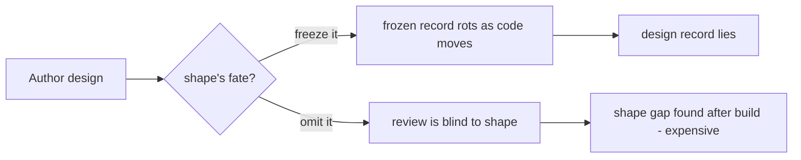

# Design solution-shape — PRD *(effective view)*

---

**GENERATED — DO NOT EDIT.** Sole writer: `docgate fold`. As of: **000**. Content fingerprint: `sha256:1e35e8cfd1530da685c488d2050fd891fcc13fd8352d0927bf9b53d43957d0af`. Tool version (recorded, never hashed): `docgate/v1`.

---

| Field | Value |
|---|---|
| **In one line** | Split "the design" into a durable **Decision** and a first-class concrete **solution-shape** (schema + interfaces), reviewed together in native form before implementation and authoritative only until the code supersedes it — so the design gate catches shape-level gaps without freezing volatile detail. |
| **Relevant-when** | planning, building, or reviewing how a feature's design is authored and reviewed — specifically the split between durable decisions and the concrete solution-shape, their paired review, or the shape's authoritative-until-code lifecycle; triaging defects where a design froze volatile shape (a stale record) or a review missed a shape-level gap that surfaced only after implementation; changing the technical-design model, the paired-review presentation, or the planning/contract-compilation contracts this hands off to |
| **Status** | Draft — problem review pending |
| **Tier** | T2 |
| **Owner** | @mdarabi |
| **Approver(s)** | the operator, via the introducing PR's review (solo-operator collapse — no ceremonial roles) |
| **Contributors** | @mdarabi (product + engineering); prior design session (this conversation) as the discovery record |
| **Informed** | — |
| **Date** | 2026-07-10 created · 2026-07-10 last updated |
| **Appetite** | A bounded change to the design-authoring model. Operator attention: review the split model and its paired-review presentation. Machine work: extend the technical-design projection and authoring workflow to carry a second artifact. Rollout burden: adopt it in the design-authoring flow. **Excludes** the stage-6 Contract Compiler, the downstream planner, and any engine runtime. |
| **Target release** | Dependency checkpoint, not a date: lands while the technical-design model is still malleable (its conventions are in review) and ahead of the stage-6 Contract Compiler consuming an approved design — so the shape's home is settled before those surfaces freeze. |
| **Tracking** | — (tracking issue created on problem-gate approval) |
| **Artifacts** | the prior design session (this conversation) as the discovery corpus — no UX/analytics artifacts; technical designs are excluded by rule (they cite PRDs, not the reverse) |
| **Template version** | prd-template/v1 |

## 1. Summary — the one-pager

- **Problem** — When I author a feature's design, I have to choose between freezing the concrete schema and interfaces — which then rot as the code moves — or leaving them out, which means I can't review the actual shape before the factory builds it. I want to review the real shape of the solution up front without turning it into a permanent record that later lies.
- **For whom** — The engineer authoring and reviewing a feature's design (the "author the feature contract" moment) — the operator today, engineers as the factory opens up; every feature that reaches the design stage.
- **Why now** — The design-doc model is being settled now (its conventions are still in review), the downstream planner is being built, and the stage-6 Contract Compiler is specified but unbuilt. The shape-of-the-solution artifact sits between them and is unspecified; fixing its lifecycle before those surfaces freeze avoids reworking a frozen model later.
- **Direction** — One authored design yields two projections: a durable **Decision** (invariants, rationale, acceptance — frozen, evolves by supersession) and a concrete **solution-shape** (schema and interfaces in native form). The two are reviewed together; only the Decision freezes; the shape is authoritative as the implementation reference until the code that implements it exists, then the code supersedes it.
- **Appetite** — The bounded design-model change from the header; explicitly not the stage-6 compiler, the planner, or engine runtime.
- **Success** — On a set of representative designs authored through the split, the author reviews the concrete solution-shape in native form before implementation, **and** every merged durable Decision carries zero volatile shape detail — with zero shape-level omissions escaping the design gate to be discovered only after the build.
- **Guardrail** — The durable-Decision model (immutability, supersession, the generated index) is unchanged: no existing frozen design or its review flow regresses.
- **Top risks** — (1) The split adds authoring/review overhead not worth its catch rate. (2) The two projections drift apart inside the review window. (3) The shape becomes a de-facto second source of truth if its throwaway-until-code lifecycle is not enforced.

## 2. Problem space

### 2.1 Problem statement

The design author and reviewer hurt at the design gate. "The design" today bundles two things with opposite lifetimes: durable decisions (invariants and rationale that must survive every future implementation) and the concrete shape of the solution (schema and interfaces the code owns and constantly moves). Bundled in one artifact, they force a lose-lose: freeze the whole thing and the concrete shape rots into a record that contradicts the code, or omit the concrete shape and the reviewer can only read prose — so a missing field or a wrong interface is caught after the build, the most expensive place. The cost of doing nothing is a design gate that is structurally blind to shape-level defects, or a design record no one can trust without cross-checking the code.

### 2.2 Users and segments

| Segment | Role and context | Domain exp. | Tech exp. | Key goals | Pain today | Evidence |
|---|---|---|---|---|---|---|
| **P1 (primary)** | The design author/reviewer, at the design gate, reasoning in schemas and interfaces | master | master | review the real shape before build; keep the durable record honest | must freeze-and-rot or omit-and-go-blind | this session |
| P2 (secondary) | Downstream consumers of an approved design (the planner; later the stage-6 compiler) | master | master | receive a coherent, reviewed shape to build against | the shape is unspecified between design and plan | `product-vision.md` pipeline |
| **Anti-segment** | The executor/planner deciding *how* work is sliced (epics/tasks/charters) | — | — | — | this PRD deliberately does **not** serve the decomposition step — that is the planner's job | — |

### 2.3 Jobs and desired outcomes

| # | When… (situation) | I want to… (motivation) | So I can… (outcome) | Today's workaround | Evidence |
|---|---|---|---|---|---|
| J1 | authoring a feature's design that creates state or an interface | lay out the concrete schema/interfaces and have them reviewed in native form | catch shape-level gaps before the factory builds | freeze the shape (it rots) or omit it (blind review) | this session |
| J2 | the implementing code has landed | have the concrete shape stop being authoritative | keep the durable record from lying about what the code now owns | manually remember the doc is stale | this session |
| J3 | revisiting a decision months later | read a durable record that holds only what survives | trust it without re-deriving intent from the code | archaeology through the diff | this session |

### 2.4 Evidence

| Claim | Source | Confidence |
|---|---|---|
| "The design" is canonically *decisions **and** the shape of the solution* — the two already coexist in one artifact | `product-vision.md` (the three-artifact feature contract) | High |
| Frozen documents that state volatile facts rot and mislead; freeze only what survives | the immutability discipline (AP-7), applied across the doc system | High |
| Reviewing a concrete artifact in its natural notation is already valued enough to build tooling for | the `plan-viewer` exists for exactly this reason | Medium |
| Reading prose invariants and reading a schema engage different reviewer faculties; a prose invariant does not reliably surface a missing field | this session (design rationale) | Medium |

### 2.5 The journey today

| Phase | User does | User feels / pain | Frontstage | Backstage |
|---|---|---|---|---|
| Author design | writes decisions + (maybe) concrete shape | forced choice | one design doc | the design class, frozen at merge |
| Decide shape's fate | freeze it, or omit it | trapped | frozen prose / a gap | immutability gate |
| Implement | code writes the real schema/interfaces | drift begins | the code | the repo |
| Discover | finds the shape gap after the build, or finds the frozen design now lies | expensive regret | rework | — |

### 2.6 Opportunity and why now

- **Size** — Every feature that reaches the design stage passes this gate; the defect class (shape gaps found post-build, or rotting design records) recurs on each stateful/interface feature.
- **Alternatives users have** — Freeze the shape (rots); omit the shape and review only at the code PR (too late); push the shape into the downstream plan (misses the design gate entirely and belongs to a different lifecycle).
- **Why us / strategic fit** — pyxis owns the whole feature-contract model, and it is still malleable: the design conventions are in review, the planner is mid-build, the stage-6 compiler is unbuilt. This is the cheapest moment to place the shape correctly.
- **Why now** — The surfaces that would otherwise freeze around a missing shape artifact (design conventions, planner input, stage-6 input) are all being decided now.
- **Cost of doing nothing** — The design gate stays blind to the defect class the factory most needs a human to catch (shape-level omissions), or the durable design record degrades into something that must be cross-checked against code to be trusted.

**Decision:** Problem gate — do not proceed to §3–§4 in review until signed.

| Reviewer | Role | Date | Verdict |
|---|---|---|---|
| @mdarabi | operator (via introducing PR) | — | pending |

## 3. Goals, metrics, and guardrails

### 3.1 Goals as falsifiable hypotheses

| # | We believe that… | Will result in… | Measured by… |
|---|---|---|---|
| G1 | splitting the design into a durable Decision and a concrete solution-shape reviewed in native form | shape-level gaps caught at the design gate instead of after the build | M1 |
| G2 *(qualitative)* | freezing only the durable Decision keeps the design record trustworthy over time | reviewers trusting a frozen Decision without cross-checking the code for the current shape | M2 + qualitative review verbatims |

### 3.2 Goals → signals → metrics

*(No runtime telemetry — this is a doc-authoring capability. Metrics are acceptance-style, measured by inspection of authored designs and review records; checkpoints are exposure conditions, never dates. §5.7 records the inspection that feeds each.)*

| Metric | Goal | Signal | Baseline | Target (at checkpoint) | Feeds from |
|---|---|---|---|---|---|
| M1 (primary) | G1 | shape-level gaps surfaced at the design gate vs. after implementation | today: shape gaps are structurally uncatchable at design (no native shape to review) | at a checkpoint of representative designs authored through the split: shape gaps are surfaced at the design gate, zero escape to post-build | INSP-1 |
| M2 | G2 | frozen Decisions carrying volatile shape detail | today: shape either frozen-in (rots) or absent | zero merged Decisions carry volatile shape detail across the same checkpoint set | INSP-2 |

### 3.3 Guardrails and decision rule

| Guardrail metric | Threshold | Action if breached |
|---|---|---|
| Regression of the durable-Decision model (existing frozen designs, supersession, index) | any existing frozen design or its review/immutability behavior changes | halt — this capability must not alter the Decision model it builds on |
| Paired-review overhead | the split introduces a *separate* second approval gate rather than one coupled gate | present both projections together in one conversation, not two reviews |

**Ship rule (pre-registered):** M1 shows shape gaps caught at the design gate AND M2 is zero AND no guardrail breached → adopt as the default design-authoring model; M1 catches nothing beyond prose review → iterate on the paired shape presentation; any guardrail breached → halt.

### 3.4 Non-goals and waiting room

| ID | Non-goal | Why refused |
|---|---|---|
| NG-1 | The downstream plan, tasks, charters, or their decomposition/sequencing | that is the planner's job (pipeline stage 7, `plan-new`); the solution-shape is upstream of it — decomposition is a separate concern this PRD deliberately excludes |
| NG-2 | Validating or classifying the whole feature contract (executable / ambiguous / contradictory) | that is the stage-6 Contract Compiler (VNEXT-1), a separate capability; this defines the shape artifact, not its global soundness check |
| NG-3 | Changing the durable-Decision model itself (immutability, supersession, the generated index) | this **builds on** that model; altering it is out of scope and guarded in §3.3 |
| NG-4 | Freezing the concrete field-level schema/interface as a permanent record | the shape is code-owned and volatile; freezing it is the rot this capability exists to prevent (AP-7) |
| NG-5 | The definition-of-done artifact (the third of the three feature-contract artifacts) | acceptance/test/eval criteria are their own artifact; this concerns only the decision↔shape split within the design |

| ID | Waiting room | Revisit when / intended version |
|---|---|---|
| WR-1 | One durable Decision realized by several distinct concrete solution-shapes | first decision whose realization needs more than one concrete shape |
| WR-2 | Scoped/surgical supersession of a durable Decision when only one invariant must change | first invariant-level shape change that a whole-document supersession makes too heavy (ties to the reserved scoped-supersession in the design conventions) |
| WR-3 | Mechanical detection that a proposed shape change violates a Decision invariant (auto-routing concrete-only vs. invariant-level) | when hand review can no longer reliably make the call |
| WR-4 | Eval-backed acceptance of partition quality (did the author split durable vs. shape correctly?) | when the human review gate is to be relaxed toward higher autonomy |

## 4. Solution space

### 4.1 Approach and alternatives considered

One authored design is the single source; at approval it projects into two artifacts with two lifecycles — the durable Decision (frozen, supersession-only) and the concrete solution-shape (authoritative until code supersedes it). The two are authored together and reviewed in one conversation, with schema and interface notation shown directly. Only the Decision freezes.

| Option | Sketch | Why not chosen |
|---|---|---|
| A (chosen) | one design → durable Decision + concrete solution-shape, co-reviewed, shape throwaway-until-code | — |
| B | freeze the concrete shape inside the design | rots the record the moment the code moves (NG-4) |
| C | omit the shape; review it only at the code PR | catches shape gaps after the build — the expensive place (§2.1) |
| D | carry the shape in the downstream plan | wrong lifecycle and too late: misses the design gate; belongs to the planner (NG-1) |
| Do nothing | keep the freeze-or-omit trap | the design gate stays blind to shape defects, or the record rots (§2.6) |

### 4.2 Scope perimeter

- **In (plan of record)** — the two-projection split of one authored design; paired review of the shape with the decisions in one conversation; the shape's lifecycle (authoritative → superseded-by-code; concrete change by re-approval; invariant-level change forces a Decision supersession); the durable↔shape consistency check at review.
- **Future (believed next, not committed)** — WR-1..4.
- **Out** — NG-1..5.

### 4.3 Experience: flows and states

**Flow F1 — author and review a design's two projections (serves J1)**

| Step | User does | System responds | States covered | Design |
|---|---|---|---|---|
| 1 | authors one design: decisions + concrete shape | holds it as a single source with two projections | ideal · empty · partial · error | follow-on tech design |
| 2 | opens review | presents the Decision and solution-shape together in the conversation, with schema as schema and interfaces as signatures or diagrams | ideal · partial | operator conversation |
| 3 | reviews | surfaces gaps: an invariant with no witnessing shape element; a shape element not marked durable-or-local | partial · error | — |
| 4 | approves | freezes the Decision (thin); marks the shape authoritative-not-frozen | ideal | — |

- **Empty** — a design with decisions but no shape yet: shown as shape-incomplete where the feature creates state or an interface (UB-1).
- **Partial** — decisions present, shape partial: the unresolved shape regions are named, not silently accepted.
- **Error** — a shape element contradicts a durable invariant: the review blocks approval and names the invariant (FR-6).

**Flow F2 — supersede-on-code (serves J2)**

| Step | User does | System responds | States covered | Design |
|---|---|---|---|---|
| 1 | lands implementing code | treats the code as truth; retires the shape as non-authoritative | ideal | — |
| 2 | queries "current shape" | resolves to the code, not the retired shape doc | ideal | — |

- **Accessibility / Localization** — Skipped: internal authoring artifacts, no end-user UI surface.

### 4.4 Scenarios

- **New service with a schema.** The author lays out the entity in the solution-shape; at review, reading it *as a schema*, the reviewer sees there is no tenant field and blocks — the gap is caught at design, not after the migration ships.
- **Concrete-only change before code.** A field is added to an approved, not-yet-built shape; the change is accepted by re-approving the shape, and no frozen Decision is touched (FR-4).
- **Invariant-level change.** A proposed shape change would violate a durable invariant; the review refuses it until the Decision is superseded, then accepts the new shape (FR-6).

**Decision:** Solution gate — the operator signs that this shape, at this appetite, is the bet. Zero TBDs may pass.

| Reviewer | Role | Date | Verdict |
|---|---|---|---|
| @mdarabi | operator (via introducing PR) | — | pending |

## 5. System requirements

### 5.1 Functional requirements

| ID | Requirement (EARS) | Rationale | Priority | Risk | Fit criterion | Verify | Traces to |
|---|---|---|---|---|---|---|---|
| FR-1 | When an author produces a feature's design, the system shall represent it as two projections of one authored source — a durable Decision and a concrete solution-shape. | the split is the capability | Must | high | on representative designs, each yields both projections; the Decision holds only durable elements, the shape holds the concrete schema/interfaces | Inspection | G1, J1 |
| FR-2 | While a design is under review, the system shall present the concrete solution-shape alongside the durable decisions in one operator conversation, preserving schema and interface notation. | direct notation is what engages shape review; one gate, not two | Must | med | representative reviews show the shape as schema/interfaces beside the decisions in one conversation | Demo | J1, F1 |
| FR-3 | When a design is approved, the system shall freeze only the durable Decision and shall not freeze the concrete solution-shape as a permanent record. | freeze only what survives (AP-7); the shape is code-owned | Must | high | post-approval the Decision is immutable and carries zero volatile shape detail; the shape is marked authoritative-not-frozen | Inspection | J3, G2, NG-4 |
| FR-4 | While no implementing code exists, the system shall treat the concrete solution-shape as the authoritative implementation reference, changeable only by re-approval. | the shape is the pre-code baseline | Must | med | a concrete-only change to an approved shape is accepted via re-approval with no edit to any frozen Decision | Demo | J1, F1 |
| FR-5 | When code implementing the solution-shape exists, the system shall treat the code as the source of truth and retire the shape as non-authoritative. | the shape is throwaway-until-code | Must | med | after implementation the shape carries a superseded-by-code marker; a "current shape" query resolves to the code, not the shape doc | Inspection | J2, F2 |
| FR-6 | If a proposed change to the solution-shape would contradict a durable Decision invariant, then the system shall refuse the shape change until the Decision is superseded, naming the invariant. | the shape must witness the Decision; the frozen Decision guards the shape | Must | high | a shape change violating an invariant is refused with the invariant named; a conforming change is accepted | Test | NG-3, F1 |
| FR-7 | While a design is under review, the system shall flag any durable invariant not witnessed by a shape element and any concrete choice not marked durable-or-shape-local. | the partition must be explicit or the projection can't route it | Should | med | paired-review fixtures raise both flags | Inspection | J1, F1 |

**Non-regression (NR-n)**

| ID | Existing behavior protected | Why protected | Risk | Fit criterion | Verify | Traces to |
|---|---|---|---|---|---|---|
| NR-1 | Existing frozen technical designs and their immutability, supersession, and index behavior | the Decision model is built on, not altered (NG-3) | high | no existing frozen design changes; the design index still computes liveness unchanged | Inspection | NG-3 |
| NR-2 | The downstream planner's governing-input contract | the planner still consumes an approved design without a new mandatory input it cannot handle | high | the planner's input contract is unbroken by the split | Inspection | NG-1 |

### 5.2 Unwanted behavior and failure handling

| ID | If… (trigger) | Then the system shall… | User sees | Priority | Risk | Fit criterion | Verify | Traces to |
|---|---|---|---|---|---|---|---|---|
| UB-1 | If a design creating state or an interface is approved with durable decisions but no concrete shape | flag it as shape-incomplete rather than accept it silently | shape-incomplete flag naming the unshaped region | Must | high | a stateful/interface design lacking a shape is flagged; a pure-decision design with no state passes | Test | F1 |
| UB-2 | If implementing code diverges from the approved solution-shape | surface the divergence at the code PR (shape is superseded by code, divergence noted) | "deviates from approved shape" signal | Should | med | a code change diverging from the approved shape is flagged | Demo | F2 |

### 5.3 Permissions and abuse cases

Skipped: no new access surface or role — the design and shape artifacts inherit the repository's existing controls; no privilege boundary is introduced.

### 5.4 Data

| Entity / field | Meaning | Source of truth | Retention | Integrity rules | Privacy class |
|---|---|---|---|---|---|
| the solution-shape artifact | the concrete schema/interfaces projected from a design | the shape while no code exists; the **code** once it does | retired/superseded when implementing code lands; never admitted to the queryable durable-design record | every durable invariant witnessed; every concrete choice marked durable-or-local | internal (public repo) |

- **Migration / parallel-run / cutover / decommission** — n/a: a new artifact class, no existing data moves.
- **Privacy check** — no DPIA trigger: internal authoring artifact, no personal or sensitive data.
- **Egress** — none beyond the repository; no new content leaves the environment.

### 5.5 Interfaces and integrations

| Interface | Direction | Purpose | Contract (format, ranges, timing) | Failure modes | Owner |
|---|---|---|---|---|---|
| approved design (Decision + solution-shape) → downstream planning | out | hand a coherent, reviewed shape to stage-7 planning | the approved-design contract; shape present for stateful/interface features | shape retired once code lands (planner reads code thereafter) | this feature + `plan-new` |
| approved design → stage-6 Contract Compiler (future) | out | supply the shape as a compilation input when stage-6 ships | deferred to VNEXT-1; contract specified there | — | VNEXT-1 |

### 5.6 Non-functional requirements

| ID | Area | Requirement | Fit criterion | Verify |
|---|---|---|---|---|
| NFR-1 | Operability | The system shall review both projections in a single approval gate. | co-review is one gate, not a separate second gate (guardrail §3.3) | Inspection |
| NFR-2 | Maintainability | The durable Decision shall remain thin — only durable elements — so concrete churn does not touch the frozen record. | a concrete-only shape change produces zero edits to any frozen Decision | Test |
| NFR-3 | Security | The split shall introduce no new content egress. | no prompt/diff/telemetry leaves the environment that did not before | Inspection |
| NFR-4..10 | Performance / capacity / availability / privacy / accessibility / localization / cost | — | — | Skipped: no runtime, no end-user surface, no new data-at-scale or cost driver |

### 5.7 Instrumentation — the tracking plan

*No runtime events — the capability is doc authoring and review. Each §3.2 metric is fed by a named inspection, not telemetry.*

| ID | "Event" (inspection) | Fires when | Properties (typed) | Source | Feeds |
|---|---|---|---|---|---|
| INSP-1 | design-gate shape-review record | a design is reviewed through the split flow | shape_gaps_found_at_gate: int, shape_gaps_escaped_to_build: int | review record | M1 |
| INSP-2 | frozen-Decision shape audit | a Decision is merged | volatile_shape_detail_present: bool | the merged Decision | M2 |

### 5.8 Definition of Done

| ID | Done criterion | Source | Verify | Required evidence | Blocking? |
|---|---|---|---|---|---|
| DOD-1 | All Must FRs pass their fit criteria | FR-1..6 | Test / Inspection | CI + review record | yes |
| DOD-2 | No non-regression row broken | NR-1..2 | Inspection | existing design corpus + planner contract unchanged | yes |
| DOD-3 | A representative design is authored end-to-end through the split — both projections produced, shape reviewed natively, Decision frozen thin, shape retired on code | FR-1..5, F1, F2 | Demo | the dogfood design (this feature's own follow-on technical design, authored via the model) | yes |
| DOD-4 | The follow-on technical design (mechanics: the projection, paired review, and the shape's home/format) is approved before build | §7.2 Q1–Q2 | Inspection | the approved design | yes |
| DOD-5 | The durable Decision reads as trustworthy standalone — carries no volatile shape | G2, M2 | Human judgment — @mdarabi, rubric: on the sampled designs, zero frozen shape detail and no need to cross-check code for what the Decision asserts | review record | yes |
| DOD-6 | Non-goals hold — no plan/decomposition, stage-6 validation, or Decision-model change shipped | NG-1..5 | Inspection | scope audit in the introducing PR | yes |

### 5.9 AI behavior and evals

Skipped: the durable-vs-shape partition is review-gated, not model-scored, in this scope. Eval-backed acceptance of partition quality is deferred (WR-4) — the precondition for relaxing the human review gate, not a parallel authority beside it.

## 6. Delivery

### 6.1 Phasing and milestones

| Phase | Purpose | Scope | Exit criterion |
|---|---|---|---|
| Pilot (dogfood) | prove the model on real work | author this feature's own follow-on technical design through the split | one design produces both projections; shape reviewed natively; Decision frozen thin; shape retired on code |
| GA | make it the default | the split is the standard design-authoring model for new stateful/interface designs | §6.4 release criteria green |

### 6.2 Dependencies

| Dependency | Type | Needed by | Status | Owner |
|---|---|---|---|---|
| the technical-design model / conventions (the durable-Decision half) | system | Pilot | in review | @mdarabi |
| operator conversation (to review the design and shape together) | process | Pilot | available | @mdarabi |
| the design projection tooling (to project the two artifacts) | system | Pilot | exists (extend) | @mdarabi |

### 6.3 Risks, assumptions, and rabbit holes

| # | Risk / assumption / rabbit hole | Likelihood | Impact | Mitigation or test | Owner |
|---|---|---|---|---|---|
| R1 | the split adds authoring/review overhead not worth its catch rate | M | M | one coupled gate (NFR-1); gate the shape only on stateful/interface designs; measure M1 on the dogfood | @mdarabi |
| R2 | the two projections drift apart within the review window | M | M | co-authored from one source; the partition-tag + witness flags (FR-7); reviewed together | @mdarabi |
| R3 | the shape becomes a de-facto second source of truth | M | H | mechanical retirement on code (FR-5); never admitted to the durable-design record (§5.4) | this feature |
| R4 | terminology collision with "contract" / "plan" confuses adopters | M | M | named "solution-shape"; boundaries drawn against `plan-new` and stage-6 (NG-1, NG-2) | @mdarabi |
| A1 (assumption) | reviewing the shape natively pre-code catches gaps prose invariants do not | — | H | test on the dogfood: compare shape-gap catches vs. a prose-only review | @mdarabi |

### 6.4 Release criteria

| Lens | Criterion | Evaluated by |
|---|---|---|
| Functionality | all Must FRs pass their fit criteria | CI + inspection |
| Reliability | no regression to the durable-Decision model (NR-1) | inspection |
| Usability | the author reviews the shape natively unaided on the dogfood design | demo |
| Supportability | the design-authoring guide and review flow document the split and the shape lifecycle | doc review |

### 6.5 Rollout and reversibility

- **Flag** — n/a: a doc-authoring model change, no runtime exposure.
- **Kill switch** — stop projecting the shape; designs revert to decisions-only and keep working (the Decision model is untouched, NR-1).
- **Experiment** — none.
- **Staged percentages** — Skipped: no runtime audience to stage; adoption is per-design, reversible by the kill switch above.

### 6.6 Launch readiness

| Area | Item | Owner | Status |
|---|---|---|---|
| Docs | design-authoring guide + review flow updated for the split and shape lifecycle | @mdarabi | ☐ |
| Support / Enablement / Legal / Pricing / Marketing / Platform / Localization | — | — | n/a — internal doc-model change, no external launch surface |

**Decision:** Launch gate — §6.4 green, docs updated, kill switch (stop projecting the shape) confirmed reversible.

| Reviewer | Role | Date | Verdict |
|---|---|---|---|
| @mdarabi | operator (via introducing PR) | — | pending |

### 6.7 Post-launch review

- **Review trigger** — a checkpoint of new designs authored through the split at GA · **Owner** — @mdarabi
- **Verdict recorded** — adopt / iterate / kill, with the M1/M2 evidence, on the header's Tracking ref (post-merge lifecycle lives in the tracker, never as edits to this frozen document; consequences travel as typed amendments citing the verdict).

## 7. Alignment

### 7.1 FAQ

**Customer (the operator)**

- **Q:** Why not just put the schema in the design? — **A:** Frozen, it rots as the code moves; omitted, the review goes blind. The split gives you the review without the freeze.
- **Q:** Why not review the schema at the code PR? — **A:** That catches a shape gap after the build — the expensive place. The point is to catch it at the design gate, when changing it is cheap.

**Internal**

- **Q:** Isn't this just the "plan"? — **A:** No. The plan is the downstream task decomposition (stage 7, `plan-new`); the solution-shape is the concrete technical shape reviewed at design time, upstream of any decomposition (NG-1).
- **Q:** Isn't "the design" already decisions + shape? — **A:** The vision bundles them into one artifact; this specifies how they split by lifecycle so the shape can be reviewed without being frozen.
- **Q:** Top three ways this fails? — **A:** overhead not worth it (R1); the two drift in review (R2); the shape becomes a second source of truth (R3).

### 7.2 Open questions

| # | Question | Owner | Needed by | Status |
|---|---|---|---|---|
| Q1 | The shape's home and format — its own document class, or a distinctly-lifecycled region of the design | @mdarabi | the follow-on technical design | open |
| Q2 | The partition-tag discipline — how durable-vs-shape is marked at authoring so the projection is deterministic | @mdarabi | the follow-on technical design | open |
| Q3 | Whether and how the shape feeds the stage-6 Contract Compiler when it ships | @mdarabi | VNEXT-1 integration (not this PRD) | open |

*(Q1–Q3 are design-mechanics questions owned by the follow-on technical design and the stage-6 work; they are not solution-blocking for this PRD's requirements, which state observable behavior, not mechanism.)*

### 7.3 Decision log

| Date | Decision | Alternatives considered | Why | Who |
|---|---|---|---|---|
| 2026-07-10 | split "the design" into a durable Decision + a concrete solution-shape | freeze-shape · omit-shape · shape-in-plan | review the shape without freezing it; keep the durable record honest | @mdarabi + this session |
| 2026-07-10 | name it "solution-shape", not "contract"/"decision-contract-model" | decision-contract-model | "contract" collides with feature-contract and executable-contract | @mdarabi |
| 2026-07-10 | reframe from greenfield to a refinement of "the design" artifact | a new standalone model | the ground-check found the Decision model, the planner, and stage-6 already occupy the space | @mdarabi |

### 7.4 Changelog

| Date | Change | Author |
|---|---|---|
| 2026-07-10 | base drafted | @mdarabi |

## 8. Contract readiness — the executability gate

| Check | Pass? | Notes |
|---|---|---|
| Problem basis accepted — §2 problem gate signed (T2) | ☐ | pending problem review (§2.6) |
| Zero solution-blocking TBDs or open questions (§7.2) | ☑ | Q1–Q3 are design-mechanics, owned by the follow-on design / VNEXT-1, not solution-blocking |
| Every Must FR has a fit criterion and a verification method (§5.1) | ☑ | FR-1..6 |
| Every requirement row carries a risk tier; high/critical rows have a declared safety plan (§5.1, §6.5) | ☑ | high rows (FR-1/3/6, NR-1/2, UB-1) guarded by NR-1/§3.3 and the reversible kill switch (§6.5) |
| Non-goals drawn (§3.4); non-regression rows named (§5.1) | ☑ | NG-1..5; NR-1..2 |
| Every primary job (§2.3) is covered by a requirement, a non-goal, or a waiting-room entry | ☑ | J1→FR-1/2, J2→FR-5, J3→FR-3 |
| Every key flow (§4.3) has functional, failure, and non-regression coverage (§5.1–5.2) | ☑ | F1→FR-1/2/6/7 + UB-1; F2→FR-5 + UB-2; NR-1/2 |
| Every primary metric (§3.2) has instrumentation or an explicit measurement plan (§5.7) | ☑ | INSP-1→M1, INSP-2→M2 (inspection-based) |
| Every blocking DoD row traces to a requirement, guardrail, release criterion, or human-judgment rubric (§5.8) | ☑ | DOD-1..6 sourced |
| Risks and assumptions have owners (§6.3) | ☑ | R1..4, A1 |
| Human-judgment criteria name an owner and a rubric (§5.8) | ☑ | DOD-5 |
| DoD complete: every blocking row sourced and evidenced; every n/a explained (§5.8) | ☑ | §5.8 |

## Superseded & retired

None — no unit has been superseded or retired; the ledger is its base.
