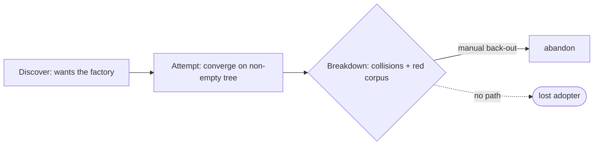

# Existing-repo onboarding — PRD

| Field | Value |
|---|---|
| **In one line** | The adoption negotiation that brings an existing, non-empty repository under factory management — inspect the repo, propose a reviewable plan, apply only on approval, and reverse cleanly — without ever mutating what the repo already owns. |
| **Relevant-when** | planning, building, or reviewing existing-repo adoption (the `adopt` verb, the adoption plan artifact, uninstall); triaging why a repo would not adopt; changing converge's non-empty-tree behavior, the install epoch, the single-owner collision resolutions (root convention files, the hook path, the CI-workflow directory), or stack detection |
| **Status** | Draft — problem review pending |
| **Tier** | T2 — Standard, with §5.3 abuse cases (a new surface that writes into a foreign repo and relaxes gates) |
| **Owner** | @mdarabi |
| **Approver(s)** | @mdarabi |
| **Contributors** | @mdarabi (product, engineering) |
| **Informed** | — |
| **Date** | 2026-07-23 created · 2026-07-23 last updated |
| **Appetite** | One contract, ~10–14 tracer-bullet tasks (brainstorm:existing-repo-onboarding#D-9): larger than the phase-1 portability contract (a new verb, an artifact class, three collision resolutions, the epoch baseline, and undo), below the installer program. Sustained operator attention at the review gates. Cut-line: anything not needed to pass the round-trip observable (§3.2 M1) is parked. |
| **Target release** | After config-driven-portability lands (the parameterization precondition, §6.2) — the first existing-repo adopter. |
| **Tracking** | — |
| **Artifacts** | brainstorm:existing-repo-onboarding (the gated stage-1 record) |
| **Template version** | prd-template/v2 |

## 0. Read to rule — the human reviewer's section (~4 min)

*The body is the contract; this section only routes attention — on any conflict the body governs; machines ignore it.*

**Judge these**

| # | The call | Could have gone | If you disagree |
|---|---|---|---|
| 1 | Collision residue resolves additive-adjacent where an honest mechanism exists, and instructs the human where none does — pyxis never takes over a file the repo owns | adopt-and-own with a backup copy (fully turnkey) | every owned-file collision becomes a manual step; turnkey adoption is impossible by construction → FR-6, FR-4, ABUSE-1 |
| 2 | A pre-existing corpus is grandfathered by a single **install-epoch** marker, not by enumerating every violation | scan-and-enumerate per-check exception lists | adoption cost stops being independent of corpus size; a large repo emits a huge accepted-debt list → FR-8, NFR-1 |
| 3 | The negotiation gets its **own verb and a durable plan artifact**, separate from steady-state converge | a `--plan` mode of converge with terminal-only output | adoption and steady-state repair share one verb; the manual instructions and the agreed record do not persist → FR-1, FR-2, FR-3 |
| 4 | **Uninstall is in scope**; adoption is a reversible round trip | defer uninstall to its own later contract | adoption ships without a back-out path — the trust lever that made the scope worth it → FR-9, §3.2 M1 |
| 5 | Toolchain is **detect-and-surface only** — no language profiles shipped, no command invented | ship SCAF-3 language profiles for common stacks | a non-Go adopter hand-sets its gate commands; the plan only names the detected stack → FR-7, NG-1 |

**Sanity-check the numbers** — the round-trip observable (§3.2 M1) is binary: the never-touch set is byte-identical after apply, and the whole tree is byte-identical to its pre-adoption state after undo. Post-adoption gate cost is required to scale with the set changed since the epoch, not the corpus size (§5.6 NFR-1). No other tunable thresholds.

**The author's open questions** — five parked technical constraints (§7.2 Q1–Q5) are design-owned, not PRD-blocking: the tree-local epoch honouring mechanism, the hook-path resolution rule, the plan artifact's home/format/lifecycle, the round-trip proof harness, and the stack-detection heuristic. None gates this contract.

**Skip the rest** — structure/anchors → docgate; substance and basis fidelity → the unmanned prd-review; the design-owned mechanics (Q1–Q5) → the technical design and its review; implementation defects → the downstream code gates.

## 1. Summary — the one-pager

- **Problem** — A team already has a repository — their own source, their own conventions, their own git hooks, their own CI, and a large existing document corpus — and they want the factory. Today they cannot get it without the factory colliding with what they already own or refusing them at the door.
- **For whom** — The maintainer of a generic mid-size repository with conventional CI and existing conventions; the first real adopter after the empty-repo installer.
- **Why now** — Config-driven portability (phase 1, landing) has just made every target-facing surface resolve from repo config, removing the hardcoded-layout block that made adoption impossible. The negotiation is now the only remaining gap.
- **Direction** — A distinct `adopt` verb inspects the repo and writes a durable, reviewable plan naming exactly what it adds, what it chains into, which collisions resolve how, what the human must do by hand, and what it will never touch; a second explicit step applies only that plan, idempotently; a third reverses it. A single install-epoch marker grandfathers the pre-existing corpus so the repo is green on day one.
- **Appetite** — ~10–14 tasks, one contract; the cut-line is the round-trip observable. Excludes org-scale adoption, branch protection, bot identity, repo intelligence, upgrade, and partial adoption.
- **Success** — The fixture-repo round trip passes: a repo carrying every collision at once adopts to gate-green, its never-touch set byte-identical before and after apply, and byte-identical to its original state after undo.
- **Guardrail** — The empty-repo install path (init) and converge's steady-state repair behavior do not regress.
- **Top risks** — (1) honouring the epoch inside tree-local gates has a real per-file cost (§6.3 R1); (2) hook chaining must contend with git's single hook path across hook managers (R2); (3) the collision resolutions compose in ways isolated tests miss (R3).

## 2. Problem space

### 2.1 Problem statement

A maintainer with an existing, non-empty repository cannot adopt the factory. Converge is built to own the tree it manages — it repairs engine content byte-exact, renders generated files, and refuses or would-overwrite anything else — so pointed at a repo full of someone else's source, hooks, CI, and documents it either refuses wholesale or threatens content the repo owns. The repo's pre-existing document corpus fails nearly every documentation gate (no ledgers, no headers, dangling citations), so even a clean install would turn the repo red immediately. And several paths the factory wants are single-owner paths a third party already fixed — the root convention file, the one git hook path, the CI-workflow directory — with no honest automatic merge. The cost of doing nothing is that the factory only ever runs in repositories born inside it.

### 2.2 Users and segments

| Segment | Role and context | Domain exp. | Tech exp. | Key goals | Pain today | Evidence |
|---|---|---|---|---|---|---|
| **P1 (primary)** | Maintainer of a generic mid-size repo (conventional CI, existing conventions), adopting the factory once, at the terminal | journeyman | journeyman | know exactly what will change before it changes; adopt without collisions; not go red on day one; be able to back out | converge assumes it owns the tree; corpus fails the gates; owned-path collisions have no honest resolution | brainstorm:existing-repo-onboarding#D-2 |
| **Anti-segment** | The greenfield/empty repo | — | — | — | already served by the empty-repo installer (init); `adopt` on an empty tree routes to init | brainstorm:existing-repo-onboarding#D-10 |
| **Anti-segment** | The large multi-language monorepo with a bespoke CI empire | — | — | — | its collision surface and epoch scale are a materially different problem, deliberately excluded to hold the segment line | brainstorm:existing-repo-onboarding#D-10 |

### 2.3 Jobs and desired outcomes

| # | When… (situation) | I want to… (motivation) | So I can… (outcome) | Today's workaround | Evidence |
|---|---|---|---|---|---|
| J1 | I am considering the factory for my existing repo | see exactly what adoption would add, chain into, and never touch, before anything changes | decide with no surprise | read the engine's source and guess | brainstorm:existing-repo-onboarding#D-1 |
| J2 | my repo already has a root convention file, its own hooks, and a CI directory | adopt without the factory overwriting or hijacking any of them | keep my repo's own conventions intact | none — job goes undone | brainstorm:existing-repo-onboarding#D-4 |
| J3 | my repo has a large pre-existing document corpus that does not follow the factory's conventions | adopt without every gate going red | get a green repo on day one and tighten only as I change files | none — job goes undone | brainstorm:existing-repo-onboarding#D-5 |
| J4 | I have adopted the factory and want to reconsider | remove it and return my repo to its prior state | try it and back out | none — job goes undone | brainstorm:existing-repo-onboarding#D-8 |

### 2.4 Evidence

| Claim | Source | Confidence |
|---|---|---|
| Converge classifies every managed path (engine-verbatim / repo-owned / generated) and already reports would-write / refused-by-name without mutating — a dry-run surface exists to build the negotiation on | brainstorm:existing-repo-onboarding#F-7 | High |
| Merge intelligence inside converge (three-way merge / conflict resolution on owned files) is a declared non-goal — repo-owned content is never rewritten | prd:installer/NG-3 (brainstorm:existing-repo-onboarding#F-1) | High |
| A prior adoption tool split along the permission boundary, calibrated required checks to what the repo actually runs (never a forced superset), and re-applied idempotently (only drifted files landing) | corpus:SCAF-2 (brainstorm:existing-repo-onboarding#F-2, #F-3, #F-4) | High |
| Every target-facing surface now resolves from repo config (phase 1), so the layout block is removed | prd:config-driven-portability (brainstorm:existing-repo-onboarding#F-6) | High |
| A per-command gate override already makes a non-Go repo functional, so language profiles are ergonomics, not a functional gate | brainstorm:config-driven-portability#O-1 (brainstorm:existing-repo-onboarding#D-3) | Medium |
| A removal contract already exists in the installer's e2e suite as prior art for uninstall | brainstorm:existing-repo-onboarding#F-8 | Medium |

### 2.5 The journey today

| Phase | User does | User feels / pain | Frontstage | Backstage |
|---|---|---|---|---|
| Discover | wants the factory in an existing repo | hopeful | the empty-repo install docs | install assumes a fresh tree |
| Attempt | points the install/converge at the non-empty tree | wary | refusal, or a would-overwrite report over content they own | converge owns the tree it manages |
| Breakdown | sees the corpus would fail every gate and owned paths collide | blocked | red gates, colliding files | no epoch; no collision policy |
| Abandon | backs out manually | lost | — | nothing adopted |

### 2.6 Opportunity and why now

- **Size** — Every existing repository is a potential adopter; today the addressable set is only repositories born inside the factory. This is the gate between a closed tool and an adoptable one.
- **Alternatives users have** — Hand-copy pieces of the factory (unsupported, drifts immediately); do nothing.
- **Why us / strategic fit** — The ownership-class model, converge's dry-run surface, and the just-landed config-driven parameterization are exactly the substrate an honest negotiation needs (F-6, F-7).
- **Why now** — Phase 1 removed the hardcoded-layout block; the negotiation is the last thing standing between the factory and a real existing repo.
- **Cost of doing nothing** — The factory remains un-adoptable; the entire existing-repo market stays closed.

**Decision:** Problem gate — do not proceed to §3–§4 until every contributor signs.

| Reviewer | Role | Date | Verdict |
|---|---|---|---|
| @mdarabi | Owner | — | pending |

## 3. Goals, metrics, and guardrails

### 3.1 Goals as falsifiable hypotheses

| # | We believe that… | Will result in… | Measured by… |
|---|---|---|---|
| G1 | offering an inspect → propose → apply negotiation with a provable never-touch guarantee | a generic existing repo can adopt the factory with no surprise mutation | M1 |
| G2 *(qualitative)* | a durable plan naming add / chain / collide / manual / never | the maintainer reads adoption as trustworthy and knows exactly what happens | M2 |

### 3.2 Goals → signals → metrics

*This is local, deterministic CLI tooling with no deployed telemetry surface (§5.7 skipped); the primary metric is an acceptance observable, its checkpoint the fixture e2e passing in CI.*

| Metric | Goal | Signal | Baseline | Target (at checkpoint) | Feeds from |
|---|---|---|---|---|---|
| M1 (primary) | G1 | the fixture-repo round trip: adopt to gate-green, never-touch set byte-identical before/after apply, whole tree byte-identical after undo | no adoption path exists | pass, in CI (the fixture e2e, §5.8 DOD-1) | acceptance test |
| M2 | G2 | the emitted manual instructions are the only human work needed to reach green (nothing silently assumed) | — | pass (fixture asserts no residual manual step beyond the plan's) | acceptance test |

### 3.3 Guardrails and decision rule

| Guardrail metric | Threshold | Action if breached |
|---|---|---|
| Empty-repo install (init) behavior | any regression in the init/converge test suites | block |
| Converge steady-state repair behavior | any change to engine-verbatim / repo-owned / generated handling for a repo already under management | block |
| Post-adoption gate cost | gate cost that grows with the count of unchanged corpus files, rather than only with the set changed since the epoch | block (NFR-1) |

**Ship rule (pre-registered):** M1 and M2 pass on the fixture e2e AND no guardrail regresses → ship. Any guardrail regression → do not ship.

### 3.4 Non-goals and waiting room

| ID | Non-goal | Why refused |
|---|---|---|
| NG-1 | Shipping language profiles (per-stack toolchain verbs, CI suite, templates) at adoption | the per-command gate override already makes a non-Go repo functional; profiles are ergonomics, not a functional gate, and building them now repeats a deferred speculation (brainstorm:existing-repo-onboarding#D-3, O-1) |
| NG-2 | Merge intelligence — three-way merge or conflict resolution inside a file the repo owns | inherits prd:installer/NG-3; the whole collision policy exists to avoid it (D-4) |
| NG-3 | Authoring governance substance — writing the content of a repo's governing documents | inherits prd:installer/NG-1; generated governance is counterfeit |
| NG-4 | Branch protection and bot-identity wiring | a different permission boundary (admin) and identity concern; deferred at prd:installer/WR-7 (D-8, O-3) |

| ID | Waiting room | Revisit when / intended version |
|---|---|---|
| WR-1 | Org-wide adoption sweep (classify + approve + act across many repos) | org-scale adoption demand — prd:installer/WR-5 / SCAF-4 (O-2) |
| WR-2 | Repo intelligence — a living, execution-verified model of the adopted repo | after adoption itself lands; a program in its own right (vision §11) (O-4) |
| WR-3 | Upgrade / migration of an already-adopted repo across releases | the first release that changes installed files — prd:installer/WR-2 (O-5) |
| WR-4 | Partial (subset) adoption — the doc system without the gates, or vice versa | real demand; it introduces a configuration matrix every behavior must honour (O-6) |
| WR-5 | Language profiles as a durable data extension point (SCAF-3) | a real non-Go adopter whose ergonomics justify it (NG-1) |

## 4. Solution space

### 4.1 Approach and alternatives considered

The chosen shape is **the adoption negotiation**: a distinct `adopt` verb inspects the repo, writes a durable adoption plan (a per-path ledger of add / chain / collide / manual / never), and — on approval — applies exactly that plan idempotently; a paired step reverses it. Collisions resolve additively where an honest mechanism exists (hook chaining, a distinct workflow filename) and become named manual instructions where none does (root convention files). A single install-epoch marker grandfathers the pre-existing corpus.

| Option | Sketch | Why not chosen |
|---|---|---|
| A (chosen) | inspect → durable plan → apply on approval → reversible | — |
| B | converge onto a non-empty tree: a `--plan` mode of the existing verb, terminal output | one verb for both one-time adoption and steady-state repair; instructions and the agreed record do not persist; NG-2 still forces a per-collision decision that terminal output cannot hold (D-6) |
| C | adoption is a profile problem: ship stack descriptors first | centres a deferred speculation (NG-1); over-builds against an adopter not yet met (D-3) |
| Do nothing | — | the factory stays un-adoptable for existing repos (§2.6) |

### 4.2 Scope perimeter

- **In (plan of record)** — the `adopt` verb; the durable, reviewable adoption plan; apply-on-approval, idempotent; the three collision resolutions (hook chaining, distinct workflow filename, owned-convention-file instruction); stack detect-and-surface; the install-epoch baseline; uninstall/undo; the fixture-repo round-trip acceptance harness.
- **Future (believed next, not committed)** — language profiles (WR-5), partial adoption (WR-4), upgrade (WR-3).
- **Out** — org sweep (WR-1), branch protection / bot identity (NG-4), repo intelligence (WR-2); mirrors §3.4.

### 4.3 Experience: flows and states

**Flow F1 — adopt (plan) (serves J1, J2)**

| Step | User does | System responds | States covered | Design |
|---|---|---|---|---|
| 1 | runs the adopt verb in plan mode at the repo root | inspects the tree; writes a durable plan naming add / chain / collide / manual / never, and the detected stack with any required gate-command action | ideal · empty (routes to init) · partial (unknown stack degrades to "set your gate commands") · error (not a git repo) | — |

**Flow F2 — adopt (apply) (serves J2, J3)**

| Step | User does | System responds | States covered | Design |
|---|---|---|---|---|
| 1 | reviews the plan, then runs apply | applies exactly the approved plan; records the install epoch; touches nothing outside the plan; re-apply lands only drift | ideal · partial (manual items remain the human's) · error (plan absent/stale → refuse) | — |

**Flow F3 — undo (serves J4)**

| Step | User does | System responds | States covered | Design |
|---|---|---|---|---|
| 1 | runs the undo/uninstall step | removes the installation from the plan record (unchains hooks to restore the prior path, deletes added paths, clears the epoch), preserving post-adoption work; names any manual reversions | ideal · partial (prior partial apply → removes what applied) · error (a modified added artifact → preserved-and-named, UB-6) | — |

- **Empty** — an empty tree is the anti-segment: adopt routes to init rather than negotiating (D-10).
- **Partial** — an unknown stack degrades to naming it "unknown" and asking for gate commands; never an error (P-5).
- **Error** — a non-git or non-repo target, or apply without an approved plan, refuses by name and changes nothing.
- **Accessibility / Localization** — n/a: terminal CLI, English diagnostics, consistent with the existing engine surface.

### 4.4 Scenarios

- **The common case** — A maintainer runs adopt on their Go/Python repo. The plan says: add the system tree and config; chain the pre-push hook into their husky path; land the CI workflow under a non-colliding name; *manual* — add three named lines to your existing root convention file; *never* — your source, your CI, your docs. They approve; apply lands it; the repo is green because the epoch grandfathers their corpus.
- **The collision-heavy case** — A repo with an existing root convention file, a husky hook path, and a workflow whose name would collide. Every collision is a named line item with its resolution; nothing they own is overwritten; the never-touch set is byte-identical after apply.
- **The reversal** — After a week they run undo; pyxis's additions are removed and their prior hook path restored, their week of work preserved. Any manual additions are named for them to remove, and a pyxis-added file they had edited is preserved-and-named rather than deleted (UB-6).

**Decision:** Solution gate — contributors sign that this shape, at this appetite, is the bet. Zero TBDs may pass this gate.

| Reviewer | Role | Date | Verdict |
|---|---|---|---|
| @mdarabi | Owner | — | pending |

## 5. System requirements

### 5.1 Functional requirements

| ID | Requirement (EARS) | Rationale | Priority | Risk | Fit criterion | Verify | Traces to |
|---|---|---|---|---|---|---|---|
| FR-1 | When the adopt verb is run in plan mode against a non-empty repository, the system shall inspect the tree and produce a durable adoption plan without modifying any tracked file. | the negotiation begins by reading, not writing (D-1, D-6) | Must | high | on the fixture repo, plan mode writes only the plan artifact; every other tracked path is byte-identical before and after | Test | G1, J1, F1 |
| FR-2 | The adoption plan shall classify every path the system would act on into add, chain, collide-with-resolution, manual-instruction, or never-touch. | the plan is the agreed record and the honest surface for NG-2 collisions (D-4, D-6) | Must | high | each of the five classes is present and correct for the fixture repo; every acted-on path appears in exactly one class | Test | G2, J1, J2, F1 |
| FR-3 | When apply is run against an approved plan, the system shall apply exactly that plan, changing no path the plan does not name. | apply is bound to the reviewed plan (D-6) | Must | high | applying the fixture plan produces the intended tree; no path absent from the plan changes | Test | J2, F2 |
| FR-4 | Where the repository already configures a git hook path, the system shall resolve the hook collision by chaining — invoking the pre-existing hook — without modifying the repository's existing hook content. | additive-adjacent resolution, no owned-file mutation (D-4) | Must | high | on the fixture (husky-style hook path), the pre-existing hook file is byte-identical after apply and still runs | Test | J2, F2, ABUSE-1 |
| FR-5 | When the CI-workflow filename the system installs would collide with an existing workflow, the system shall place its workflow under a distinct, non-colliding filename. | additive resolution fixed by the CI host (D-4) | Must | medium | on the fixture (name-colliding workflow), the adopter's existing workflow file is untouched and both workflows are present | Test | J2, F2 |
| FR-6 | Where a root convention file the system would author already exists, the system shall write nothing to it and shall emit in the plan the exact content for the human to add. | no honest mechanical merge exists; NG-2 (D-4) | Must | high | on the fixture (existing root convention file), the file is byte-identical after apply and the plan carries the exact lines | Test | J2, F2, ABUSE-1 |
| FR-7 | When the system inspects the repository, the system shall detect and name the repository's stack in the plan and name the gate-command action the adopter must supply, inventing no build, test, or lint command. | detect-and-surface, not ship-profiles (D-3) | Must | medium | for a Go and a non-Go fixture, the plan names the detected stack and the required gate-command action; no command is fabricated | Test | J1, F1, NG-1 |
| FR-8 | When apply completes, the system shall record an install-epoch baseline such that the documentation gates judge only content changed after it and grandfather the pre-existing corpus. | the epoch keeps a real corpus from failing every gate (D-5; installer's Q-4 grandfathering shape, prd:installer/Q-4) | Must | critical | on the fixture (non-conforming corpus), the repo is gate-green immediately after adoption; a post-epoch change to a file is fully gated | Test | G1, J3, F2, ABUSE-2 |
| FR-9 | When the undo step is run, the system shall remove the installation — unchaining any chained hook to restore the prior hook path, deleting the paths adoption added, and clearing the epoch — preserving all post-adoption work, and shall name any manual addition for the human to reverse. | reversibility is the trust lever; removal, not snapshot-revert, so a week of the operator's own work survives (D-8; refined by D-11) | Must | high | after adopt → undo on the fixture, the whole tree is byte-identical to its pre-adoption state; a post-adoption commit made before undo survives | Test | J4, F3 |
| FR-10 | The adoption plan shall declare the never-touch set — the paths the system will not read into, write, or configure. | the never-touch set is the subject of the round-trip proof (D-7) | Must | high | the plan's never-touch set covers the adopter's source, CI, and docs; the fixture asserts it byte-identical across the round trip | Test | G1, F1 |
| FR-11 | When apply is re-run against an already-applied plan, the system shall land only content that has drifted from the plan, making no other change. | idempotent re-apply inherits SCAF-2 (F-4); the basis for UB-4's re-adopt | Must | medium | a second apply of the fixture plan lands zero further changes | Test | J2, F2 |

**Non-regression (NR-n)**

| ID | Existing behavior protected | Why protected | Risk | Fit criterion | Verify | Traces to |
|---|---|---|---|---|---|---|
| NR-1 | The empty-repo install path (init on a fresh tree) | adoption must not disturb the installer it succeeds | high | the existing init/installer test suites pass unchanged | Test | F2 |
| NR-2 | Converge's steady-state repair for a repo already under management (engine-verbatim / repo-owned / generated handling) | steady-state behavior is a separate, live contract | high | the existing converge test suites pass unchanged | Test | F2 |
| NR-3 | The existing per-check grandfather exception surface (e.g. the citation exception list) | the epoch adds to, never replaces, targeted exceptions | medium | existing grandfather-list tests pass; both mechanisms coexist | Test | FR-8 |

### 5.2 Unwanted behavior and failure handling

| ID | If… (trigger) | Then the system shall… | User sees | Priority | Risk | Fit criterion | Verify | Traces to |
|---|---|---|---|---|---|---|---|---|
| UB-1 | the adopt verb is pointed at an empty tree | route to the empty-repo install path rather than negotiating | a message directing to init | Must | low | adopt on an empty fixture invokes init, writes no plan | Test | F1, D-10 |
| UB-2 | apply is run with no approved plan, or a plan stale relative to the tree | refuse by name and change nothing | a named refusal naming the remedy | Must | high | apply without/with-stale plan makes zero tracked-file changes | Test | F2 |
| UB-3 | the repository's stack cannot be identified | name the stack unknown and request the gate commands, not error | plan line: unknown stack, set your gate commands | Must | medium | an unknown-stack fixture yields a plan, not a failure | Test | FR-7, F1 |
| UB-4 | adopt is run against a repository already adopted | re-plan idempotently, reporting no-op where nothing changed | a plan showing only drift, or none | Should | medium | adopt on an already-adopted fixture reports a no-op plan | Test | FR-3, F1 |
| UB-5 | the target is not a git repository | refuse by name before inspecting | a named refusal | Must | low | a non-git target refuses and writes nothing | Test | F1 |
| UB-6 | the undo step finds a path adoption added modified since adoption (a chained-hook wrapper or an added file the operator edited) | preserve the modified path, name it, and complete the rest of the removal — never silently delete operator content | the modified path named as preserved; the rest removed | Must | high | adopt → edit a chained-hook wrapper → undo preserves-and-names it and removes the rest | Test | F3, FR-9 |
| UB-7 | a prior pyxis config surface encountered at re-adopt or apply is absent-but-required, partial, or malformed under the closed schema | refuse by name, naming the offending key, and change nothing | a named refusal naming the key and remedy | Must | high | a fixture carrying a malformed prior config refuses by name; no tracked file changes | Test | UB-4, FR-3 |

### 5.3 Permissions and abuse cases

*Access: the adopt/apply/undo verbs act with the write access of the operator running them at the terminal — the same-principal model of the rest of the engine; there is no new role or privileged substrate.*

| Function / data | Role: operator (repo write) | Unauthenticated |
|---|---|---|
| adopt (plan) — read tree, write plan | read/write | none |
| apply — write the approved plan | read/write | none |
| undo — restore pre-adoption state | read/write | none |

| ID | Actor and intent | Vector | Impact | Severity | Mitigated by | Verify |
|---|---|---|---|---|---|---|
| ABUSE-1 | a defect (or an operator's mistaken trust) causing the system to write outside the plan | apply touches a path in the never-touch set | the factory silently mutates content the repo owns — the core trust violation | high | FR-2, FR-4, FR-5, FR-6, FR-10 | Test — the round-trip byte-identity assertion fails if any never-touch path changes |
| ABUSE-2 | an adopter (or defect) over-broadening the epoch to silence gates on changed content | an epoch that grandfathers post-adoption changes | gates are silently disabled; drift ships unchecked (the phase-1 gate-aiming abuse class) | high | FR-8 | Test — a post-epoch change to a file is fully gated in the fixture |

### 5.4 Data

*The install epoch is the one new persistent datum.*

| Entity / field | Meaning | Source of truth | Retention | Integrity rules | Privacy class |
|---|---|---|---|---|---|
| install epoch | the adoption baseline the gates scope against | the repo config surface | life of the adoption | set once at apply: apply records the repository's commit at adoption as the epoch and creates no commit of its own — the operator commits the adoption, so adoption makes no undisclosed change to history (J1); a single marker, not a per-file list | internal |
| adoption plan | the durable record of what adoption agreed | its own artifact (home is design-owned, Q3) | life of the adoption (consumed by apply/undo) | reviewable before apply; apply and undo bind to it | internal |

- **Migration** — none: adoption creates state in a repo that had none of it; absence is the pre-adoption baseline.
- **Rollback** — undo (FR-9) removes the installation and preserves post-adoption work; the plan record is the rollback input, and a pyxis-added artifact the operator modified is preserved-and-named, never clobbered (UB-6).
- **Privacy check** — no personal data, no DPIA: the epoch is a commit marker, the plan names paths.
- **Egress** — none: adoption is a local operation on the operator's own tree; nothing leaves the environment.

### 5.5 Interfaces and integrations

| Interface | Direction | Purpose | Contract | Failure modes | Owner |
|---|---|---|---|---|---|
| git (hook path, tree state, commit for the epoch) | both | detect the hook path, read the tree, mark the epoch | standard git; hook chaining via the configured hook path | non-git target (UB-5); a hook manager's own path (P2) | this feature |
| the repo config surface | out | record the epoch and the resolved surfaces (phase 1) | the closed config schema (phase 1) | a prior config that is absent-but-required, partial, or malformed → refuse by name (UB-7) | config-driven-portability |

### 5.6 Non-functional requirements

| ID | Area | Requirement | Fit criterion | Verify |
|---|---|---|---|---|
| NFR-1 | Performance / scale | The system shall bound post-adoption gate cost to the volume of content changed since the epoch, independent of the pre-existing corpus size. | the gates visit only content changed since the epoch; total gate cost grows with the changed set, never with the count of unchanged corpus files | Analysis |
| NFR-2 | Security | The system shall confine every write, read, and configuration action to paths outside the plan's never-touch set. | the round-trip byte-identity assertion holds for every never-touch path (ABUSE-1) | Test |
| NFR-3 | Operability | The system shall make the adoption state (epoch, chained hooks) observable to the existing health check. | doctor reports the adoption state on the fixture | Demo |
| NFR-4 | Maintainability | The system shall reuse the existing ownership-class and dry-run machinery rather than introduce a parallel one. | the design threads converge's existing classification/reporting; no second drift engine | Inspection |

### 5.7 Instrumentation — the tracking plan

*Skipped: local, deterministic CLI tooling with no deployed telemetry surface. The primary metrics (§3.2) are acceptance observables verified by the fixture e2e, not instrumented events.*

### 5.8 Definition of Done

| ID | Done criterion | Source | Verify | Required evidence | Blocking? |
|---|---|---|---|---|---|
| DOD-1 | The fixture-repo round trip passes: adopt to gate-green, never-touch byte-identical before/after apply, whole tree byte-identical after immediate undo | G1, FR-1..FR-11, M1 | Test | the fixture e2e CI run | yes |
| DOD-2 | The manual instructions are the only human work to reach green — nothing silently assumed | G2, M2, FR-6 | Test | the fixture e2e assertion | yes |
| DOD-3 | Every Must FR and every Must UB row passes its fit criterion | FR-1..FR-11, UB-1/2/3/5/6/7 | Test | CI run | yes |
| DOD-4 | No non-regression row broken (init, converge steady-state, grandfather lists) | NR-1..NR-3 | Test | suite result | yes |
| DOD-5 | The epoch grandfathers the pre-existing corpus and fully gates a post-epoch change | FR-8, ABUSE-2 | Test | the fixture e2e | yes |
| DOD-6 | Post-adoption gate cost scales with the changed set, not the corpus size | NFR-1 | Analysis | the design's cost argument + a scaling test (fixed change-set, growing corpus → flat gate cost) | yes |

### 5.9 AI behavior and evals

*Skipped: no model-driven behavior — adoption is deterministic inspection, planning, and file operations.*

## 6. Delivery

### 6.1 Phasing and milestones

| Phase | Purpose | Scope | Exit criterion |
|---|---|---|---|
| Single phase | deliver the adoption negotiation end to end | §4.2 "In" | DOD-1..DOD-6 green (the fixture round trip) |

### 6.2 Dependencies

| Dependency | Type | Needed by | Status | Owner |
|---|---|---|---|---|
| config-driven-portability (phase 1) — every target-facing surface resolves from config | system | before build | landing (build complete, PR open) | config-driven-portability |
| The technical design settling Q1–Q5 (§7.2) | approval | design gate | pending | this feature |

### 6.3 Risks, assumptions, and rabbit holes

| # | Risk / assumption / rabbit hole | Likelihood | Impact | Mitigation or test | Owner |
|---|---|---|---|---|---|
| R1 | Honouring the epoch inside tree-local gates (which judge the current tree with no history notion) needs a per-file "unchanged since epoch" test with a real cost | H | M | design-owned (Q1); NFR-1 scaling test; history-scoped checks get it nearly free | design |
| R2 | Hook chaining must contend with git's single hook path across hook managers (husky vs stock) | M | M | design-owned (Q2); the fixture uses a hook-manager path; undo restores the prior path | design |
| R3 | The collision resolutions compose in ways isolated tests miss | M | H | the fixture carries every collision at once and runs the full round trip (D-7) | this feature |
| R4 | The plan artifact's home/format/lifecycle is unsettled and apply/undo bind to it | M | M | design-owned (Q3); PRD fixes the negotiation shape, not the artifact mechanics | design |

### 6.4 Release criteria

| Lens | Criterion | Evaluated by |
|---|---|---|
| Functionality | every Must FR passes its fit criterion | the fixture e2e / test suite |
| Reliability | the never-touch set is byte-identical across the round trip; zero out-of-plan writes | byte-identity assertion |
| Performance | post-adoption gate cost independent of corpus size, scaling with the changed set (NFR-1) | scaling analysis/test |
| Supportability | doctor reports the adoption state; undo restores the prior state | doctor demo + undo test |

### 6.5 Rollout and reversibility

*Local tooling shipped as an engine verb; no staged traffic exposure. Reversibility is a product feature, not only a rollout property.*

- **Kill switch** — the verb is opt-in and run by the operator; not running it is the off state. An adopted repo reverses via undo (FR-9).
- **Cutover/migration steps** — none; adoption is the first write of this state into a repo.

### 6.6 Launch readiness

*Skipped beyond docs: internal engine tooling, no external launch surface. Docs — the verb and the plan artifact are documented in the engine's own surface (owner @mdarabi).*

### 6.7 Post-launch review

- **Review trigger** — the first real existing repo adopted through the verb · **Owner** — @mdarabi
- **Verdict recorded** — adopt / iterate / kill, on the header's Tracking ref, with the round-trip evidence.

## 7. Alignment

### 7.1 FAQ

**Customer**

- **Q:** Will adopting the factory change my existing files? — **A:** No file you already own is written by adoption. Where the factory needs something you already have — your root convention file, your hooks, your CI — it either chains onto it additively or tells you the exact lines to add yourself, and it declares upfront the set it will never touch. You can also undo the whole thing.
- **Q:** My repo has years of docs that do not follow your conventions — will everything go red? — **A:** No. Adoption records an epoch; the gates judge only what you change after it, so you are green on day one and get stricter only as you touch files.

**Internal**

- **Q:** How is "no surprise mutation" more than a promise? — **A:** The acceptance test asserts the declared never-touch set is byte-identical before and after apply, and the whole tree byte-identical after undo — a violation fails CI (ABUSE-1, M1).
- **Q:** Why not just teach converge to merge an existing AGENTS.md? — **A:** prd:installer/NG-3 forbids merge intelligence in converge; there is no honest automatic merge of owned content, so the honest answer is a named instruction, not an invented merge (NG-2).
- **Q:** Top three ways this fails? — **A:** tree-local epoch cost (R1), hook-path chaining across managers (R2), collision composition (R3).

### 7.2 Open questions

*All five are design-owned (parked technical constraints from the record), none blocking this contract's gates.*

| # | Question | Owner | Needed by | Status |
|---|---|---|---|---|
| Q1 | The mechanism for honouring the epoch inside tree-local gates (per-file unchanged-since-epoch test, caching) | technical design | design gate | open — brainstorm:existing-repo-onboarding#P-1 |
| Q2 | The hook-path resolution rule (delegate to the prior hook vs install into the repo's existing path) and how undo reverses it | technical design | design gate | open — brainstorm:existing-repo-onboarding#P-2 |
| Q3 | The adoption plan artifact's home, format, and lifecycle, and how apply/undo bind to it | technical design | design gate | open — brainstorm:existing-repo-onboarding#P-3 |
| Q4 | The hermetic mechanism for the byte-identity round-trip proof (hashing the complement of managed paths) | technical design | design gate | open — brainstorm:existing-repo-onboarding#P-4 |
| Q5 | The stack-detection heuristic and its degradation to "unknown; set your gate commands" | technical design | design gate | open — brainstorm:existing-repo-onboarding#P-5 |

### 7.3 Decision log

| Date | Decision | Alternatives considered | Why | Who |
|---|---|---|---|---|
| 2026-07-23 | The feature is the adoption negotiation (inspect → propose → apply on approval) | converge-on-non-empty (A); profiles-first (C) | NG-3 forecloses implicit collision merging; the decision must be explicit and approved (brainstorm:existing-repo-onboarding#D-1) | @mdarabi |
| 2026-07-23 | Primary segment: a generic mid-size repo archetype | own repos (real fixture); any repo incl. monorepos | avoid over-fitting; keep the path honest for an arbitrary adopter (#D-2) | @mdarabi |
| 2026-07-23 | Toolchain: detect-and-surface only, no profiles | ship SCAF-3 profiles; Go-only-refuse-others | the gate override already makes non-Go functional; profiles are speculative ergonomics (#D-3) | @mdarabi |
| 2026-07-23 | Collisions: additive-adjacent where honest, instruct-the-human otherwise; never take over an owned file | never-touch-anything; adopt-and-own-with-backup | NG-3 forbids merging; a backup does not make mutation unsurprising (#D-4) | @mdarabi |
| 2026-07-23 | Grandfathering: a single install-epoch marker | enumerated per-check lists; no grandfathering | constant cost in corpus size; honest (not yet judged, not claimed conforming) (#D-5) | @mdarabi |
| 2026-07-23 | A new verb plus a durable plan artifact | a converge mode with terminal output; a new verb with an ephemeral plan | adoption is one-time vs steady-state; the record must persist for apply/undo (#D-6) | @mdarabi |
| 2026-07-23 | Acceptance: a fixture carrying every collision, round-tripped, with a byte-identity untouched-set proof | per-collision tests only; adopt a real repo | byte-identity is the falsifiable core; composition is where it breaks; a real repo is non-hermetic (#D-7) | @mdarabi |
| 2026-07-23 | Uninstall/reversibility is in scope; five other items deferred | split uninstall to its own contract | reversibility is the trust lever; the plan is the natural undo input (#D-8) | @mdarabi |
| 2026-07-23 | Appetite: one contract, ~10–14 tasks, cut-line = the round-trip observable | tighter; split uninstall out | below the installer program; splitting undo loses the trust property (#D-9) | @mdarabi |
| 2026-07-23 | Anti-segment: the empty repo (→ init) and the large monorepo | — | keep adopt/init distinct; hold the segment line (#D-10) | @mdarabi |
| 2026-07-23 (review) | Undo on a diverged tree removes the installation and preserves post-adoption work, failing closed on operator-edited artifacts | revert-to-snapshot (clobbers work); blanket-refuse-on-divergence (rarely usable) | the only semantics consistent with the no-surprise-mutation + reversibility thesis; resolves prd-review FND-1 (brainstorm:existing-repo-onboarding#D-11) | @mdarabi |

### 7.4 Changelog

| Date | Change | Author |
|---|---|---|
| 2026-07-23 | 000-base authored from brainstorm:existing-repo-onboarding (gated ready-for-prd) | @mdarabi |

## 8. Contract readiness — the executability gate

| Check | Pass? | Notes |
|---|---|---|
| Problem basis accepted — §2 problem gate signed (T2) | ☐ | pending problem review |
| Zero solution-blocking TBDs or open questions (§7.2) | ☑ | Q1–Q5 are design-owned with a named owner and the design gate as deadline; none blocks this contract |
| Every Must FR has a fit criterion and a verification method (§5.1) | ☑ | FR-1..FR-10 all carry fit + Test |
| Every requirement row carries a risk tier; high/critical rows have a declared safety plan (§5.1, §6.5) | ☑ | FR-8 (critical) and the high rows are covered by the round-trip proof, reversibility (undo), and refuse-closed apply |
| Non-goals drawn (§3.4); non-regression rows named (§5.1) | ☑ | NG-1..NG-4, WR-1..WR-5; NR-1..NR-3 |
| Every primary job (§2.3) is covered by a requirement, a non-goal, or a waiting-room entry | ☑ | J1→FR-1/7; J2→FR-2/3/4/5/6/11; J3→FR-8; J4→FR-9/UB-6 |
| Every key flow (§4.3) has functional, failure, and non-regression coverage (§5.1–5.2) | ☑ | F1 func→FR-1/7, fail→UB-1/3/5; F2 func→FR-3/4/5/6/8/11, fail→UB-2/7; F3 func→FR-9, fail→UB-6. Non-regression is change-level: NR-1/2/3 guard init, converge steady-state, and the grandfather surface the whole change touches |
| Every primary metric (§3.2) has instrumentation (§5.7) or an explicit measurement plan | ☑ | M1/M2 are acceptance observables; §5.7 skip is the explicit plan |
| Every blocking DoD row traces to a requirement, guardrail, release criterion, or rubric (§5.8) | ☑ | DOD-1..6 each cite their sources |
| Risks and assumptions have owners (§6.3) | ☑ | R1–R4 owned |
| Human-judgment criteria name an owner and a rubric (§5.8) | ☑ | none — all DoD rows are Test/Analysis |
| DoD complete: every blocking row sourced and evidenced; every n/a explained (§5.8) | ☑ | six blocking rows, all sourced |
