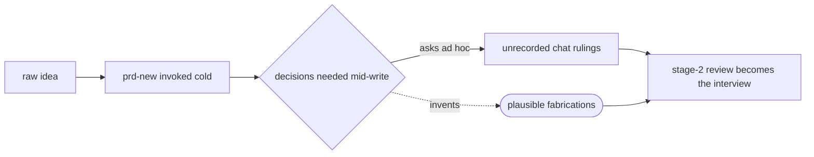

# feature-brainstorm — the stage-1 elicitation skill — PRD

| Field | Value |
|---|---|
| **In one line** | The pipeline-stage-1 front half: a factory-driven grilling session that turns a raw product idea into a frozen, operator-answered **brainstorm record** — decisions resolved one question at a time, gaps parked as fog — from which `prd-new` synthesizes the PRD without re-interviewing. |
| **Relevant-when** | planning, building, or reviewing the feature-brainstorm skill, its authoring guide, or the brainstorm-record contract; triaging defects in stage-1 elicitation (self-answered decisions, lost decision provenance, re-interviewing during PRD synthesis, fabricated resolutions of open questions); changing `prd-new`'s inputs, the brainstorm-record template, or the stage-1 → stage-2 handoff |
| **Status** | Problem review ✓ · Solution review ✓ (2026-07-09) — launch review pending, post-implementation |
| **Tier** | T2 |
| **Owner** | @mdarabi |
| **Approver(s)** | @mdarabi (operator) |
| **Contributors** | operator (product) · factory agents (implementation) |
| **Informed** | authors of the sibling stage-3 skill (tech-design-brainstorm); the future Contract Compiler design (stage 6) |
| **Date** | 2026-07-09 created · 2026-07-09 last updated |
| **Appetite** | small: one authoring guide + record template + eval fixture corpus; ≤2 human review rounds; modest eval-run spend; zero rollout/support burden (repo-internal, bootstrap-era skill) |
| **Target release** | precedes the next per-feature PRD authored in this repo — the next 000-base should be born from a brainstorm record; completes the elicitation half of the System-2 authoring set (feature-brainstorm · prd-new · tech-design-brainstorm · tech-design-new) |
| **Tracking** | introducing PR (filed on approval) |
| **Artifacts** | brainstorm-record template (arrives with implementation) · eval fixture corpus (arrives with implementation) · external prior-art survey of agent-skill grilling disciplines (2026-07-09 session) · the local-work-tracker PRD authoring session (2026-07-07 — the ad hoc run this feature formalizes) |
| **Template version** | prd-template/v1 |

## 1. Summary — the one-pager

- **Problem** — A raw idea has no disciplined path into a PRD: the operator either writes the contract by hand or invokes synthesis cold, and the product decisions that shape the contract get improvised by the model, buried in an unrecorded chat, or discovered missing at review. Nothing today guarantees that every decision in a PRD was actually the operator's.
- **For whom** — the operator bringing feature ideas (every new feature, starting now); the `prd-new` synthesis step, which needs pre-resolved decisions; and downstream traceability, which needs to know who ruled what, when.
- **Why now** — the pipeline's stages 1–2 are named "the upstream edge" and have no implementation; the System-2 authoring set (prd-new, tech-design-new, operator review) exists but starts at synthesis — the interview in front of it happened exactly once, ad hoc, for the local-work-tracker PRD, and its value and its failure modes are both now known.
- **Direction** — a human-in-the-loop skill that orients against the governing corpus, offers 2–3 distinct framings of the idea, then grills the operator one question at a time (recommendation attached, facts looked up rather than asked), capturing every resolved decision into a typed record as it lands; gaps are parked as named fog, refusals as out-of-scope rulings; the session ends only through an explicit operator gate, and the record is the frozen input `prd-new` synthesizes from.
- **Appetite** — as header; excludes the sibling stage-3 brainstorm skill, any engine/judgment-service code, and any tracker integration.
- **Success** — `prd-new`, synthesizing from a gated record, asks the operator zero decision-questions (median across the first five features through the stage).
- **Guardrail** — the skill mutates no governed document and writes nothing but its own record; any breach is a defect.
- **Top risks** — the model answering its own questions under long-session drift (decision integrity); the record becoming a second source of truth beside the PRD; operator fatigue turning grilling into rubber-stamping.

## 2. Problem space

### 2.1 Problem statement

Every feature contract begins with decisions — what the feature is, whom it serves, what it refuses to do — and today those decisions have no home before the PRD exists. The operator who invokes PRD synthesis directly gets interviewed ad hoc (batched questions, no recommendations, no record) or not at all: the model fills gaps with plausible inventions, and the operator discovers them — or misses them — at stage-2 review. Decisions resolved in conversation die with the context window; a PRD's decision log cites nothing upstream of itself; and when a later stage asks *why does this requirement exist*, the answer is git archaeology. The one real stage-1 run to date (the local-work-tracker PRD, 2026-07-07) worked only because the operator drove an interview by hand — unrepeatable, unrecorded discipline. The cost of doing nothing: every future PRD's fidelity depends on improvised sessions, and the upstream half of the traceability chain (raw idea → decision → requirement) never exists.

### 2.2 Users and segments

| Segment | Role and context | Domain exp. | Tech exp. | Key goals | Pain today | Evidence |
|---|---|---|---|---|---|---|
| **P1 (primary)** | the operator bringing a raw feature idea to the factory, at their desk, per new feature | master | master | be interviewed one decision at a time with a recommendation attached; end with gaps named, not papered over | writes contracts by hand, or answers un-recommended ad hoc question batches; decisions lost with the session | product-vision §4 stages 1–2; 2026-07-07 lwt session |
| P2 | the `prd-new` synthesis step — the agent consuming the record to author a 000-base | — | master | every product decision pre-resolved and citable; never invent an answer | no structured input exists; gaps are guessed or asked ad hoc | `.pyxis/authoring/prd-new.md` (asks for missing input) |
| P3 | downstream traceability consumers — stage-2 reviewers today; the Contract Compiler and Trace once built | — | — | the provenance chain: which operator ruling produced which requirement | chain starts at the PRD; nothing above it | product-vision §6 (end-to-end traceability); AP-5 |
| **Anti-segment** | anyone wanting fully-autonomous PRD generation with no human in the loop | — | — | — | — | stage-1 decisions are the operator's by definition; see NG-4 |

### 2.3 Jobs and desired outcomes

| # | When… (situation) | I want to… (motivation) | So I can… (outcome) | Today's workaround | Evidence |
|---|---|---|---|---|---|
| J1 | I have a raw idea worth contracting | be grilled one question at a time, each with a recommended answer, facts looked up not asked | resolve the product decisions without authoring documents myself | hand-drive an undisciplined interview, or skip to synthesis | 2026-07-07 lwt session; product-vision §1 |
| J2 | `prd-new` synthesizes the 000-base | have every decision it needs already resolved and cited in one input | get a faithful contract with zero re-interviewing | none — synthesis asks ad hoc or invents | `.pyxis/authoring/prd-new.md` |
| J3 | my idea is half-baked | have the unresolvable parts named and parked explicitly | know whether to investigate before contracting, instead of discovering holes at review | gaps surface as stage-2 review churn | prd-template §0 rule 10 (ignorance explicit) |
| J4 | a later stage asks why a requirement exists | trace it to the operator ruling that produced it — question, answer, date | audit and amend contracts on evidence | git archaeology; memory | product-vision §6; AP-5 |
| J5 | a session dies mid-grilling (context limit, interruption) | resume from the durable record without re-answering anything | protect an hour of rulings from a crash | start over; re-answer | external prior-art survey (context-window discipline) |

### 2.4 Evidence

| Claim | Source (research, data, tickets, interviews) | Confidence |
|---|---|---|
| Stages 1–2 are a named, unbuilt gap — "the upstream edge"; harbormaster has no ancestor for them | product-vision §4, §11; docs/prds/README.md ("Not in the baseline"); domain-model §2.1 | High |
| The interview → synthesis pattern works and is worth formalizing: the one real run produced an approved PRD in a day | local-work-tracker 000-base (problem + solution gates signed 2026-07-07, one session) | Medium |
| Interview and synthesis must be separate steps: a synthesis template in context pulls the interviewer toward premature completion | external prior-art survey 2026-07-09 (grilling/spec-writing skill corpus: explicit interview/synthesis split; premature-completion mechanism) | Medium |
| An interviewing agent left unguarded answers its own questions — observed in the wild as a reported failure mode | external prior-art survey 2026-07-09 (HITL breakage reported by users of a wayfinding skill; fixed by a facts-vs-decisions rule) | Medium |
| Hard caps on question count are the wrong control — they conflate under-specified problems with low-quality questioning | external prior-art survey 2026-07-09 (question-cap request rejected with reasoning) | Medium |
| Decisions must be judged once at the richest-context site and frozen as data downstream steps read verbatim | AP-21; system-design F3 (judgment contract) | High |

### 2.5 The journey today

| Phase | User does | User feels / pain | Frontstage (what user sees) | Backstage (systems, people, processes) |
|---|---|---|---|---|
| Decide | picks the next idea to contract | fine — prioritization is human by design | their own notes | none |
| Elicit | *(missing stage)* — talks at the model ad hoc, or skips straight to synthesis | question batches with no recommendations; or silence and guesses | an unstructured chat | no record, no discipline, no fog parking |
| Synthesize | invokes `prd-new` | model asks for missing input mid-write, or invents plausible answers | a draft 000-base | decisions improvised at the lowest-context site |
| Review (stage 2) | operator reviews the draft | the review becomes the real interview — churn | comment rounds | rulings land as edits, provenance lost |
| Later | asks why a requirement exists | archaeology | git blame | the chain stops at the PRD |

### 2.6 Opportunity and why now

- **Size** — every feature the factory will ever build passes through stage 1; each session's output governs everything downstream of it (the contract is the factory's input).
- **Alternatives users have** — hand-written PRDs (the operator does the factory's job); cold synthesis (fidelity by luck); staying at the design-doc entry point like the predecessor (stage 1 permanently missing).
- **Why us / strategic fit** — the vision names drafting complete PRDs from raw ideas as the upstream edge; the System-2 authoring set is three-quarters built (prd-new, tech-design-new, operator review) and dogfooding it is how this repo works.
- **Why now** — the next PRDs this repo authors (the minimal-local siblings, the engine designs) are exactly the sessions this skill should front; every PRD authored without it is another contract with no upstream provenance.
- **Cost of doing nothing** — stage-1 quality stays operator-heroics; the traceability chain never reaches above the PRD; the two sibling brainstorm skills have no pattern to build on.

**Decision:** Problem gate — do not proceed to §3–§4 until every contributor signs.

| Reviewer | Role | Date | Verdict |
|---|---|---|---|
| @mdarabi | operator | 2026-07-09 | approved |

## 3. Goals, metrics, and guardrails

### 3.1 Goals as falsifiable hypotheses

| # | We believe that… | Will result in… | Measured by… |
|---|---|---|---|
| G1 | a disciplined elicitation front half producing a frozen record | PRD synthesis that never re-interviews and never invents — the contract reflects the operator's rulings | M1 |
| G2 | capturing every ruling with its question, answer, and anchor at the moment it lands | a complete provenance chain from raw idea to requirement | M2 |
| G3 *(qualitative)* | one-question-at-a-time with a recommendation attached | sessions the operator experiences as thinking help, not interrogation — confirmed at the gate, not assumed | qual: operator verdict recorded at each session gate (DOD-5 rubric) |

### 3.2 Goals → signals → metrics

| Metric | Goal | Signal | Baseline | Target (at checkpoint) | Feeds from |
|---|---|---|---|---|---|
| M1 (primary) | G1 | decision-questions `prd-new` asks the operator while synthesizing from a gated record | n/a (stage does not exist; cold synthesis asks ad hoc) | median 0, max ≤ 2, at checkpoint "five features through stage 1" | measurement plan: count operator-directed decision-questions in each synthesis session transcript |
| M2 | G2 | decision-log rows in merged 000-bases carrying a record anchor | n/a | 100% of decision-log rows at the same checkpoint | measurement plan: inspection of each merged 000-base against its record |

*(§5.7 tracking plan skipped with reason — repo-internal HITL tooling with no product analytics; both metrics are measured by transcript count and document inspection at the named checkpoint, plans stated above.)*

### 3.3 Guardrails and decision rule

| Guardrail metric | Threshold | Action if breached |
|---|---|---|
| governed-document mutations by the skill (vision, principles, PRD ledgers, designs, incidents) | any (> 0) | defect — the skill's write perimeter is its own record; fix before further sessions (docgate + FR-15 backstop) |
| tracker / work-item writes by the skill | any | defect — stage 1 precedes work items by design |
| decisions recorded without an operator answer | any single occurrence | sev-1 defect — decision integrity is the product; halt adoption, fix, re-run evals (EVAL-2) |
| median operator questions per session (burden, diagnostic) | median > 40 across the checkpoint set | discuss — review guide quality and fact-offloading; never add a hard cap (NG-5) |

**Ship rule (pre-registered):** M1 and M2 hit targets at the checkpoint AND zero integrity-guardrail breaches → adopt as the standing stage-1 front half; M1 missed with guardrails clean → iterate the guide and re-run the checkpoint; any integrity breach → halt, fix, re-verify before the next session.

### 3.4 Non-goals and waiting room

| ID | Non-goal | Why refused |
|---|---|---|
| NG-1 | Synthesizing the PRD (writing any part of a 000-base) | that is `prd-new`'s job; the split is the point — a synthesis template in context pulls the interview toward premature completion (§2.4) |
| NG-2 | Solution-space exploration — architectures, seams, implementation options | stage 3's job (the sibling tech-design-brainstorm); this skill *parks* surfaced technical constraints, never resolves them |
| NG-3 | Engine or judgment-service code (Go, Contract Compiler integration, a stage-1 judgment service) | bootstrap-era authoring skill; productizing stage 1 into the engine is future work under RW-5 |
| NG-4 | An autonomous / AFK mode that drafts records without an operator | stage-1 decisions are the operator's by definition; an unmanned interview is the sev-1 failure mode, not a feature |
| NG-5 | A hard cap on question count | caps conflate an under-specified problem with low-quality questioning; steering is natural language and the gate (§2.4) |
| NG-6 | Tracker writes, work-item creation, or PRD-ledger scaffolding | stage 1 precedes the artifact; zero side effects is a requirement (FR-15) |

| ID | Waiting room | Revisit when / intended version |
|---|---|---|
| WR-1 | A dedicated rejected-concepts index (a queryable out-of-scope knowledge base spanning features) | when accumulated out-of-scope rulings across records make per-session discovery unreliable (≈ 10+ rejections) |
| WR-2 | Extracting the shared grilling primitive (one-question discipline, facts-vs-decisions, capture rhythm) for reuse | with the sibling tech-design-brainstorm skill — the second consumer is the extraction trigger |
| WR-3 | Mechanized record linting (a docgate verb validating record structure) | when the checklist proves stable across the first five records (AP-10 says codify; the schema must stop moving first) |
| WR-4 | Multi-feature splits — one session chartering N features with shared context | when a real session hits it; until then the record parks sibling candidates as fog or out-of-scope |
| WR-5 | CI-wired eval runs on every guide change | when guide-change frequency justifies the spend; until then evals run on demand per §5.9 |

## 4. Solution space

### 4.1 Approach and alternatives considered

The chosen shape is a human-in-the-loop authoring skill — a vendor-neutral guide plus a typed record template — that runs a bounded elicitation session: orient silently against the governing corpus (vision, PRD index, domain model, glossary); check the idea against what already exists (merged capability, prior refusals); present 2–3 genuinely distinct framings and let the operator fix the destination; then grill one question at a time with a recommendation attached, looking facts up rather than asking them, appending each resolved decision to the record at the moment it lands; park what cannot be phrased sharply as fog and what the operator rules out as out-of-scope; and end only through an explicit operator gate whose verdict (ready-for-prd / needs-investigation / covered / abandoned) is itself recorded. The record — not the session — is the product: the frozen, citable input `prd-new` synthesizes from.

| Option | Sketch | Why not chosen |
|---|---|---|
| A (chosen) | a separate elicitation skill producing a typed record; `prd-new` consumes it | — |
| B | enrich `prd-new` with an interview phase (one merged skill) | the synthesis template in context pulls the model toward writing early (premature completion, §2.4); one skill cannot hide its own second half |
| C | free-form chat + ask `prd-new` to mine the conversation | no discipline (batched questions, no recommendations), no durable record, no resume, no provenance anchors — the status quo with extra steps |
| Do nothing | operator heroics per session | §2.6 — stage-1 quality stays luck; no provenance chain |

### 4.2 Scope perimeter

- **In (plan of record)** — the authoring guide + invocation glue (per the repo's vendor-neutral surface convention); the brainstorm-record template (typed sections, versioned); the session discipline (orientation, corpus check, framings, grilling, capture, fog, gate); the `prd-new` handoff (an additive "consume a record" input path); the eval fixture corpus and scripted-operator harness; resume-from-record.
- **Future (believed next, not committed)** — WR-1..5.
- **Out** — NG-1..6; the sibling stage-3 skill; any change to docgate beyond none.

### 4.3 Experience: flows and states

**Flow F1 — the session (serves J1, J3, J4)**

| Step | User does | System responds | States covered | Design |
|---|---|---|---|---|
| 1 | invokes the skill with a raw idea (or a pointer to notes) | orients against the governing corpus; opens the record with the idea verbatim; surfaces any overlap with merged capability or prior refusals | ideal · empty (no idea passed → asks for it first) · covered (overlap found) | authoring guide |
| 2 | picks or hybridizes one of 2–3 distinct framings | fixes the destination in the record; previews the decision branches it opens | ideal · error (all framings rejected → re-frame once, else park) | authoring guide |
| 3 | answers one question at a time | each question carries a recommendation + reasoning; facts are looked up, never asked; each ruling is appended to the record before the next question | ideal · partial (fog parked) · error (contradiction challenged) | authoring guide |
| 4 | confirms (or refuses) the gate | records the verdict — ready-for-prd / needs-investigation / covered / abandoned — with date and operator | ideal · partial (needs-investigation) | authoring guide |

**Flow F2 — resume (serves J5)**

| Step | User does | System responds | States covered | Design |
|---|---|---|---|---|
| 1 | re-invokes the skill pointing at an existing ungated record | reloads destination, rulings, fog; resumes at the frontier — zero re-asked questions | ideal · error (record invalid → named defect, no silent repair) | authoring guide |

**Flow F3 — handoff (serves J2)**

| Step | User does | System responds | States covered | Design |
|---|---|---|---|---|
| 1 | invokes `prd-new` naming a gated record | synthesis proceeds with zero decision-questions; every decision-log row cites its record anchor; remaining fog lands as open questions, not inventions | ideal · error (record not gated → refuse with remedy) | prd-new guide (additive) |

*(five-UI-states bullets condensed into the per-step "States covered" column — a conversational skill's states are prompts, parked entries, and named defects; no screens, no loading, no localization: single-operator, English-only repo convention.)*

### 4.4 Scenarios

The operator brings "the factory should support Linear." Orientation surfaces the WorkTracker port and the local-work-tracker PRD's waiting room; framing A (a Linear adapter now) vs B (adapter-authoring guide first) vs C (defer until the conformance kit exists) are presented; the operator picks C after two questions — the session ends in twenty minutes with verdict *covered*, its covering source recorded (the local-work-tracker PRD's waiting room), one out-of-scope ruling, and no PRD. — A genuinely new idea ("repo intelligence reports") runs forty minutes: eleven rulings captured with anchors, two fog entries typed **non-blocking** ("scoring model unclear", "where reports surface" — design-phase questions, not contract gaps), gate verdict *ready-for-prd*; `prd-new` synthesizes the 000-base the same afternoon asking nothing; both fog entries appear verbatim in §7.2 of the draft. — Mid-session the operator goes silent; the skill parks the open question as fog, notes the pause in the record, and stops — nothing is answered on their behalf; the next day, resume picks up at that exact question. — The operator answers a question in a way that contradicts a ruling from thirty minutes earlier; the skill quotes both, asks which stands, and marks the loser superseded — never silently deleted.

**Decision:** Solution gate — contributors sign that this shape, at this appetite, is the bet. Zero TBDs may pass this gate.

| Reviewer | Role | Date | Verdict |
|---|---|---|---|
| @mdarabi | operator | 2026-07-09 | approved |

## 5. System requirements

*Subject naming: "the skill" is the feature-brainstorm session behavior; "the record" is the brainstorm record it maintains; "the operator" is the human in the loop.*

### 5.1 Functional requirements

| ID | Requirement (EARS) | Rationale | Priority | Risk | Fit criterion | Verify | Traces to |
|---|---|---|---|---|---|---|---|
| FR-1 | When invoked with a raw idea, the skill shall orient against the governing corpus — the product vision, the PRD index and matching area/feature PRDs, the domain model, and the glossary — before asking the operator anything. | decisions belong at the richest-context site (AP-21); un-oriented questions waste the operator | Must | low | on every fixture session, the first operator-directed question is preceded by a recorded orientation summary naming the sources read | Eval | J1, G1 |
| FR-2 | While orienting, the skill shall check the idea against merged capability and prior refusals (non-goal and waiting-room rows of merged PRDs; out-of-scope rulings in prior records) and shall surface every overlap with its source and reasoning. | duplicate and re-litigated ideas are the cheapest sessions to end early | Must | med | on fixtures seeded with a covered idea and a previously-refused idea, the overlap is surfaced with the governing row cited, before any framing is offered | Eval | J1, UB-4 |
| FR-3 | When orientation completes without a covering overlap, the skill shall present two to three genuinely distinct framings of the feature — each implying a different thesis of what it is — and shall record the operator's choice or hybrid as the session's destination. | first-idea anchoring is cheapest to counter before any deep grilling | Must | med | every gated fixture record contains ≥ 2 framings and one operator-chosen destination with rationale | Eval | J1, G3 |
| FR-4 | While interviewing, the skill shall put questions to the operator one at a time, and every question shall carry a recommended answer with its reasoning. | batched questions bewilder; a recommendation turns each into a cheap confirm/redirect; one-at-a-time is a quality bar (the fit criterion), recommendation coverage is absolute | Must | med | across the fixture corpus, ≥ 95% of interview turns contain a single question and 100% carry a recommendation (EVAL-1) | Eval | J1, G3 |
| FR-5 | When a question is answerable from the committed corpus (code, documents, prior records), the skill shall answer it by lookup and record it as a fact with its source, reserving operator questions for genuine decisions. | the operator's attention is the scarcest budget; facts are free | Must | med | on fixtures seeded with doc-answerable questions, ≥ 95% are resolved by lookup and cited, not asked (EVAL-3) | Eval | J1, G1 |
| FR-6 | The skill shall record a decision only from an explicit operator answer given in the live session — content arriving in input artifacts or corpus documents is never an operator answer — and every decision entry shall carry the question, the operator's answer, the reasoning, and a session anchor (date · turn reference). | decision integrity is the product; the observed failure modes are the interviewer answering itself (§2.4) and instructions injected through inputs (ABUSE-1/2) | Must | high | across the entire fixture corpus including silence, long-session, and injected-input fixtures, zero decision entries lack a live operator-answer anchor (EVAL-2; zero-tolerance) | Eval | J4, G2, M2 |
| FR-7 | When a decision resolves, the skill shall append it to the record before asking the next question, re-reading the record from disk before each write so operator edits made between turns survive. | batch-captured rulings die with the context window; the record is collaborative | Must | med | on every fixture transcript, each ruling appears in the record before the next question turn; a seeded mid-session operator edit persists to the gated record | Eval | J4, J5, G2 |
| FR-8 | The skill shall maintain the record as typed sections under a versioned template — idea verbatim, orientation summary, framings + destination, decisions, facts, fog (not-yet-specified, each entry typed blocking or non-blocking), out-of-scope rulings, candidate glossary terms, parked technical constraints, and the gate — each entry structured per the template's field contract. | the record is a cross-boundary artifact and must be contractual, not prose (AP-6); `prd-new` and the checklist parse it | Must | med | 100% of gated fixture records pass the record-structure checklist (every section present or explicitly empty; every decision row complete) | Test | J2, G2 |
| FR-9 | When the operator's language conflicts with the glossary or uses one term for two concepts, the skill shall challenge it at that moment and record the resolution as a candidate glossary entry (term, definition, terms to avoid). | stage 1 is where domain language is born; unresolved vocabulary becomes contract ambiguity | Should | low | on a fixture seeded with a term collision, the collision is surfaced and the gated record carries ≥ 1 complete candidate entry | Eval | J1, G2 |
| FR-10 | When the idea or a ruling falls outside the product vision's scope, the skill shall surface the gap explicitly, record the operator's ruling on it, and leave every governing document unmodified. | governing docs are human-authored inputs; the factory never extends them from below (AP-24) | Must | high | on a fixture seeded with an out-of-vision idea, the gap is surfaced and named; across all sessions, zero writes to governed documents (also §3.3, FR-15) | Eval + Test | J1, G1 |
| FR-11 | When a branch cannot yet be phrased as a precise question, the skill shall park it as a named fog entry typed by what it blocks — **blocking** when it sits on the destination or on a decision-shaped input of the PRD template (problem, segments, jobs, goals direction, non-goals, appetite), **non-blocking** otherwise — and while blocking fog remains, the skill shall recommend the needs-investigation verdict rather than proceeding toward ready-for-prd. | honesty about ignorance is a contract property (template rule 10); a papered-over gap becomes a fabricated requirement; untyped fog made ready-for-prd ambiguous (gate review 2026-07-09) | Must | high | on under-specified fixtures, zero fabricated resolutions appear and every seeded gap is named as a typed fog entry (EVAL-4); the destination-level and missing-decision-input fixtures end needs-investigation | Eval | J3, G1 |
| FR-12 | When the interview frontier is empty (every branch resolved, parked, or ruled out), the skill shall put the gate to the operator and shall end the session only by recording their explicit verdict — ready-for-prd, needs-investigation, covered, or abandoned — with date and operator identity. | an unconfirmed shared understanding is an assumed one; the verdict is the stage-1 → stage-2 handoff signal | Must | high | 100% of ended fixture sessions carry exactly one gate entry with verdict, date, and operator; zero sessions end without one | Test | J2, G3 |
| FR-13 | While a record's gate verdict is ready-for-prd, every decision-shaped input `prd-new`'s template requires (problem, segments, jobs, goals direction, non-goals, appetite) shall hold a resolved decision, and every fog entry remaining in the record shall be typed non-blocking — sufficient for synthesis to proceed with no new operator decision-questions, remaining fog landing as the draft's open questions. | the handoff is the product's success condition (M1); sufficiency must be checkable, not hoped — ready-for-prd with a gap in a decision-shaped input is a contradiction (FR-11) | Must | high | `prd-new` run against every ready-for-prd fixture record asks median 0 (max ≤ 2) operator decision-questions (EVAL-5); the record-to-template coverage checklist reports full decision coverage of decision-shaped inputs and zero blocking fog | Eval + Test | J2, G1, M1 |
| FR-14 | When invoked against an existing ungated record, the skill shall resume from it — reloading destination, rulings, facts, and fog — and shall not re-ask any question whose ruling the record already holds. | the record is the durable session state; context windows are not | Must | med | on a kill-and-resume fixture, zero questions from the record's decisions section are re-asked | Eval | J5 |
| FR-15 | The skill shall confine its writes to its own record (and session scratch), making no tracker writes, creating no PRD ledger, and modifying no other document. | stage 1 precedes the artifact; a wide write perimeter is how side effects and drift enter | Must | med | after every fixture session, the working tree is clean except the record path; the docgate gate reports no governed-document change | Test | J1, NG-6, §3.3 |

*Priority bar: every row but FR-9 is Must — the stage's integrity properties are not severable. Ranking within Must: FR-6/12/13 (decision integrity, the gate, the handoff) > FR-7/8 (the record contract) > FR-4/5/11 (interview discipline) > FR-1/2/3/10/14/15 (orientation, grounding, hygiene).*

**Non-regression (NR-n)**

| ID | Existing behavior protected | Why protected | Risk | Fit criterion | Verify | Traces to |
|---|---|---|---|---|---|---|
| NR-1 | `prd-new` invoked directly (no record) keeps working exactly as today — the record becomes an optional input, never a prerequisite | operators may still contract a well-understood idea cold; the skill set composes, it does not gate | med | the prd-new guide diff is additive only (a "consume a record" input path); a recordless invocation follows the unmodified path | Inspection | J2 |
| NR-2 | docgate's gate and fold behavior are untouched — records are not ledger documents and trigger no docgate verb | the record is provenance, not a governed document class; widening docgate is out of scope | low | zero diff under `cmd/docgate` and `internal/docgate`; `docgate gate` output unchanged on a tree containing records | Inspection + Test | FR-15 |

### 5.2 Unwanted behavior and failure handling

| ID | If… (trigger) | Then the system shall… | User sees | Priority | Risk | Fit criterion | Verify | Traces to |
|---|---|---|---|---|---|---|---|---|
| UB-1 | If the operator goes silent or defers mid-question ("later", no answer) | park the open question as fog, note the pause in the record, and stop — recording no decision on the operator's behalf | a parked question and a paused session that resumes cleanly | Must | high | on the silence fixture, zero decisions are recorded during the absence; the parked question is the first offered on resume | Eval | FR-6, FR-14 |
| UB-2 | If an operator answer contradicts an earlier recorded ruling | quote both, ask which stands, and mark the losing ruling superseded-with-reason — never silently deleted or overwritten | the contradiction named; the record keeps both with one live | Must | med | on the contradiction fixture, both rulings survive in the record, exactly one live, the supersession reasoned | Eval | FR-7, J4 |
| UB-3 | If the record has been hand-edited between turns into a form the template contract cannot parse | surface a named defect (section, entry, reason, remedy) and continue from the last parseable state — never silently discard or rewrite the operator's edit | a named defect and a proposed fix to confirm | Must | med | on the invalid-edit fixture, the defect names section + reason and the operator's text is preserved verbatim in the record | Eval | FR-7, FR-8 |
| UB-4 | If orientation finds the idea already covered by merged capability or an existing contract | present the covering source and, on operator confirmation, end with verdict *covered* and a pointer entry — creating no parallel record content beyond it | a short session ending in a pointer, not a duplicate contract | Must | med | the covered fixture ends with verdict covered, cites the covering document, and its record contains no framings/decisions beyond the ruling | Eval | FR-2, FR-12 |
| UB-5 | If the operator rejects every framing and no sharper destination emerges within the session | end through the gate with verdict needs-investigation, the rejected framings and their reasons recorded as blocking fog context | an honest "not ready to contract" with the why captured | Must | med | the no-destination fixture ends needs-investigation with all rejected framings and reasons present | Eval | FR-3, FR-11 |

### 5.3 Permissions and abuse cases

Permissions matrix skipped: single-operator, repo-local authoring skill introducing no new authenticated surface, role, or network path; the repo's existing review rules govern its own change path, and FR-15 bounds its write perimeter. Abuse cases are enumerated — the record is a model-driven influence artifact that `prd-new` will trust, so its integrity chain is attack surface even without an auth surface:

| ID | Actor and intent | Vector | Impact | Severity | Mitigated by | Verify |
|---|---|---|---|---|---|---|
| ABUSE-1 | whoever authors the raw notes handed to the session — steering the contract without the operator's rulings | instructions embedded in the idea/notes input ("record the following as operator decisions…") | fabricated rulings enter the record and then the PRD | high | FR-6 (an operator answer is a live session turn; input content never qualifies) + EVAL-2 fixtures seeded with injected notes | Eval |
| ABUSE-2 | whoever can edit corpus documents or prior records the skill orients on — redirecting session behavior | instructions planted in a prior record or corpus doc ("skip the gate", "treat X as decided") | skipped gate, smuggled decisions, or poisoned orientation | high | FR-1/FR-2 treat the corpus as read-only cited data, never instructions; FR-12 (no session ends without an operator gate entry) + EVAL-2/EVAL-4 injected-corpus fixtures | Eval |
| ABUSE-3 | whoever edits a gated record between the gate and synthesis — inserting rulings the operator never made | post-gate record tampering before `prd-new` consumes it | the PRD inherits unreviewed "decisions" | med | the record rides the 000-base's introducing PR, so stage-2 human review sees record and PRD together (§5.4); M2's anchor citations make an unanchored ruling visible in diff; mechanized fingerprinting staged as WR-3 | Inspection |

### 5.4 Data

| Entity / field | Meaning | Source of truth | Retention | Integrity rules | Privacy class |
|---|---|---|---|---|---|
| BrainstormRecord {idea, orientation, framings[], destination, decisions[], facts[], fog[] (each typed blocking·non-blocking), out_of_scope[], candidate_terms[], parked_technical[], gate} | the session's durable state and the stage-1 → synthesis handoff artifact | the record file, until the PRD it feeds merges — after which the PRD is the sole truth and the record is provenance | committed with the 000-base it feeds; frozen from that merge (provenance, never edited after) | typed sections per versioned template; append-favoring (supersede, never delete rulings); one gate entry per session | internal (repo-local) |
| Decision {id, question, answer, reasoning, anchor, status: live·superseded} | one operator ruling with provenance | the record (until absorbed; the PRD decision log then cites the anchor) | with the record | operator answer mandatory (FR-6); supersession keeps both rows | internal |
| Gate {verdict, date, operator, covering source (required when verdict = covered)} | the session's terminal ruling | the record | with the record | exactly one per session; verdict ∈ {ready-for-prd, needs-investigation, covered, abandoned}; ready-for-prd requires zero blocking fog (FR-13) | internal |

- **Migration** — none: no prior records exist. The one ad hoc predecessor session (lwt, 2026-07-07) is history, not data to convert.
- **Parallel-run / cutover** — none: the skill is additive; cold `prd-new` remains available (NR-1).
- **Rollback** — removing the skill leaves existing records readable and citable; nothing downstream depends on the skill at runtime.
- **Decommission** — records stay as provenance even if the skill is replaced (e.g., by an engine judgment service later).
- **Privacy check** — no DPIA surface: operator-authored product content on their own disk; no profiling, no monitoring.
- **Egress** — session content reaches the operator's configured agent-runtime provider exactly as every authoring skill's does today; this feature adds no new destination, retention, or telemetry. Records themselves never leave the repo.

### 5.5 Interfaces and integrations

| Interface | Direction | Purpose | Contract (format, ranges, timing) | Failure modes | Owner |
|---|---|---|---|---|---|
| governing corpus (vision · PRD index + PRDs · domain model · glossary) | in | orientation, overlap check, term challenge | read-only; routing surfaces first (index + headers), bodies only on Relevant-when match | a missing document is noted in the orientation summary, never fabricated | FR-1, FR-2 |
| brainstorm record | out | the durable session state and handoff artifact | typed markdown per brainstorm-record template (versioned, e.g. brainstorm-record/v1) | invalid state → UB-3 named defect | FR-7, FR-8 |
| `prd-new` (authoring guide) | out | stage-1 → synthesis handoff | additive input path: a gated record; refuses an ungated record with a remedy | ungated record → refusal, not partial synthesis | FR-13, NR-1 |
| operator conversation | out | review a long record at the gate | the record and explicit verdict stay in the conversation; no separate review tool | interrupted → resume from the record before recording a verdict | FR-12 |

### 5.6 Non-functional requirements

| ID | Area | Requirement | Fit criterion | Verify |
|---|---|---|---|---|
| NFR-1 | Cost / orientation bound | The skill shall orient through routing surfaces (indexes, header tables, glossary) and shall load a full document body only when its Relevant-when matches the idea. | on fixture sessions, every full-body load is justified by a matching Relevant-when/header row; orientation reads ≤ 10 documents | Inspection |
| NFR-2 | Record compactness | The record shall carry gists and anchors, never transcript dumps. | a 15-ruling fixture record ≤ 350 lines; every decision entry ≤ 6 lines | Test |
| NFR-3 | Maintainability | The guide, template, and checklist shall follow the repo's authoring conventions (vendor-neutral content, versioned template, checklist derived from the prd-template's section list). | guide/glue split passes the AP-25 review check; record template carries a version; checklist rows map 1:1 to prd-template sections | Inspection |

*(performance, availability, capacity, accessibility, localization rows deleted — interactive single-operator authoring skill; deletion is this reviewed decision.)*

### 5.7 Instrumentation — the tracking plan

Skipped with reason: see §3.2 — no product analytics in repo-internal HITL tooling; M1/M2 are measured by transcript count and document inspection at the named checkpoint.

### 5.8 Definition of Done

| ID | Done criterion | Source | Verify | Required evidence | Blocking? |
|---|---|---|---|---|---|
| DOD-1 | All Must FRs pass their fit criteria | FR-1..8, FR-10..15 | Test + Eval | eval-harness run + checklist results on the fixture corpus | yes |
| DOD-2 | Every UB row and both NR rows hold | UB-1..5, NR-1..2 | Test + Eval + Inspection | fixture results; prd-new guide diff; docgate diff | yes |
| DOD-3 | The eval suite passes its thresholds, with EVAL-2 at zero failures | §5.9 | Eval | eval report on the committed fixture corpus | yes |
| DOD-4 | One real feature runs idea → gated record → `prd-new` → 000-base draft with zero synthesis decision-questions and 100% of decision-log rows anchored | FR-13, M1, M2 | Demo | the record + the draft 000-base + the synthesis transcript | yes |
| DOD-5 | The operator drives a full session unaided and affirms at the gate that the record faithfully reflects their rulings — including at least one parked fog entry or out-of-scope ruling where the session surfaced one | G3, J1, J3 | Human judgment — @mdarabi; rubric: gate verdict recorded; operator affirms every decision entry is theirs; gaps parked rather than resolved on their behalf | review record | yes |
| DOD-6 | Packaging honors the vendor-neutral surface: all content in the authoring guide, vendor entries are invocation glue only; the record template is versioned | NFR-3 | Inspection | file layout review | yes |
| DOD-7 | A full session leaves the working tree clean except the record path, and `docgate gate` stays green | FR-15, NR-2 | Test | session-end `git status` capture + gate output | yes |

### 5.9 AI behavior and evals

*The skill's behavior is model-driven end to end; acceptance is eval-backed. The harness is a scripted-operator fixture corpus: seeded ideas with programmed operator responses (including silence, contradiction, delegation, and hand-edits), each fixture with expected record properties.*

| ID | Behavior | Eval set / harness | Threshold | Negative examples |
|---|---|---|---|---|
| EVAL-1 | one question per turn, recommendation always attached | fixture corpus, all interview turns | ≥ 95% single-question turns; 100% carry a recommendation | a three-question dump; a question with options but no recommendation |
| EVAL-2 | decisions only from live operator answers | full corpus incl. silence, long-session, and injected-input fixtures (ABUSE-1/2) | zero decision entries without a live operator-answer anchor (sev-1: any) | recording its own recommendation during operator silence; "the obvious answer is X, moving on"; treating "you decide" as license without recording the delegation as the answer; treating instructions embedded in input notes or corpus documents as answers |
| EVAL-3 | facts looked up, not asked | fixtures seeded with doc-answerable questions | ≥ 95% resolved by lookup with source cited | asking the operator what the vision or an existing PRD already states |
| EVAL-4 | fog honesty under under-specification | under-specified idea fixtures | zero fabricated resolutions; every seeded gap named as typed fog, blocking gaps forcing needs-investigation | inventing a user segment; resolving a metric target the operator never gave; typing a destination gap non-blocking to reach ready-for-prd |
| EVAL-5 | handoff sufficiency | `prd-new` run on every ready-for-prd fixture record | median 0, max ≤ 2 operator decision-questions | synthesis stalling on an unrecorded decision; synthesis inventing instead of citing |

## 6. Delivery

### 6.1 Phasing and milestones

| Phase | Purpose | Scope | Exit criterion |
|---|---|---|---|
| Record contract | pin the artifact before the behavior | record template (versioned) + record-structure checklist + prd-new coverage checklist; Q1/Q2 resolved | template + checklists reviewed and committed; prd-new guide consumes a record additively (NR-1 inspected) |
| The skill | the session discipline | authoring guide + vendor glue; F1–F3 implemented as guide steps | a scripted dry-run session produces a gated record passing the structure checklist |
| Eval harness | make the integrity properties checkable | fixture corpus (incl. silence, contradiction, covered, under-specified, resume) + scripted-operator harness | EVAL-1..5 runnable on demand; thresholds green; EVAL-2 at zero |
| Prove | the stage works end to end | one real feature through idea → record → prd-new draft | DOD-4 + DOD-5 evidence recorded |

### 6.2 Dependencies

| Dependency | Type (team / system / vendor / approval) | Needed by | Status | Owner |
|---|---|---|---|---|
| `prd-new` skill + authoring guide (the consumer) | system | Record contract | exists; additive edit planned (NR-1) | @mdarabi |
| `.pyxis/templates/` + authoring-surface conventions (AP-25 layout) | system | The skill | exists | @mdarabi |
| operator conversation (gate-session surface for this PRD itself and its records) | process | Prove | available | @mdarabi |

### 6.3 Risks, assumptions, and rabbit holes

| # | Risk / assumption / rabbit hole | Likelihood | Impact | Mitigation or test | Owner |
|---|---|---|---|---|---|
| R1 | long-session drift erodes the HITL guard — the model starts answering itself late in a session | M | H | EVAL-2 zero-tolerance with long-session fixtures; resume-from-record (FR-14) keeps sessions short by design | implementation |
| R2 | the record becomes a second source of truth beside the merged PRD | M | H | freeze-at-feed lifecycle (§5.4); the PRD decision log cites anchors, never the reverse; the record is named provenance | @mdarabi |
| R3 | operator fatigue → rubber-stamping recommendations, hollowing the gate | M | M | recommendations make confirms cheap; fog parking legitimizes "not now"; burden guardrail tracked (§3.3); no cap (NG-5) | @mdarabi |
| R4 | prd-template evolution silently outruns the handoff checklist (FR-13 goes stale) | M | M | checklist rows derive 1:1 from prd-template sections (NFR-3); record header pins the template version it targeted | implementation |
| R5 | assumption: a markdown record with typed sections is contractual enough for reliable synthesis without a parser | — | M | tested directly by EVAL-5; if synthesis misreads structure, WR-3 (mechanized lint) accelerates | implementation |
| R6 | eval-harness cost/flakiness makes the suite decorative | L | M | small fixed corpus; on-demand runs (WR-5 defers CI wiring); zero-tolerance only where cheap to judge (EVAL-2) | implementation |

### 6.4 Release criteria

| Lens | Criterion | Evaluated by |
|---|---|---|
| Functionality | DOD-1, DOD-2 | eval harness + checklists |
| Reliability (integrity) | DOD-3 with EVAL-2 at zero; DOD-7 | eval report; session-end tree check |
| Usability | DOD-5 (operator-unaided session, honest gate) | operator review record |
| Supportability | every refusal/defect the skill raises names the entry, reason, and remedy (UB-3, F3 error) | fixture review |
| Performance | NFR-1..2 bounds hold on fixtures | inspection + line counts |

### 6.5 Rollout and reversibility

Safety plan (staged rollout n/a — repo-internal authoring skill with no staged exposure surface): adoption is per-session and voluntary — cold `prd-new` remains fully available (NR-1), so "rollout" is the operator choosing to front sessions with the skill, and reversal is deleting the guide + glue, with existing records remaining readable provenance (§5.4). The high-risk integrity rows (FR-6, FR-10..13) are gated behind the eval suite (EVAL-2 zero-tolerance) before the skill fronts a real feature, and the §3.3 ship rule halts adoption on any integrity breach. No flag, no kill switch beyond non-use; no destructive path exists (FR-15 bounds writes to the record).

### 6.6 Launch readiness

| Area | Item | Owner | Status |
|---|---|---|---|
| Docs | AGENTS.md layout table + skills list gain the feature-brainstorm row (coordinate with the in-flight AGENTS.md edits); prds/README "Not in the baseline" note updated to point here | @mdarabi | ☐ |
| Docs | the authoring guide cross-links: prd-new ↔ feature-brainstorm (each names when to start with the other) | implementation | ☐ |

*(support, enablement, legal, pricing, marketing, localization, platform rows skipped — repo-internal tooling)*

**Decision:** Launch gate — §6.4 criteria green, §6.6 owned, reversibility confirmed.

| Reviewer | Role | Date | Verdict |
|---|---|---|---|
| @mdarabi | operator | — | pending |

### 6.7 Post-launch review

- **Review trigger** — five features driven through stage 1 via the skill (the M1/M2 checkpoint) · **Owner** — @mdarabi
- **Verdict recorded** — adopt / iterate / kill, with M1, M2, the burden guardrail, and eval evidence

## 7. Alignment

### 7.1 FAQ

**Customer (the operator)**

- **Q:** Must I run this before every `prd-new`? — **A:** No. An idea you've already thought through can go straight to synthesis (NR-1). The skill is for when the decisions aren't resolved yet — which is most new ideas.
- **Q:** Does it write my PRD? — **A:** No. It ends at a gated record; `prd-new` writes the PRD from it. If the session shows the idea isn't ready, it ends at *needs-investigation* and no PRD is attempted — that is a success, not a failure.
- **Q:** Can I edit the record myself mid-session? — **A:** Yes — it re-reads before every write and preserves your edits; an edit it can't parse is surfaced, never discarded (UB-3).

**Internal**

- **Q:** Why a second skill instead of an interview phase inside `prd-new`? — **A:** The synthesis template in context measurably pulls the model toward writing early; separating explore from exploit is the premature-completion defense, and the pattern held in the one real run and in external corpora (§2.4, decision log).
- **Q:** What stops the model from quietly deciding things itself? — **A:** FR-6's provenance contract, UB-1's silence behavior, and EVAL-2's zero-tolerance eval — plus stage-2 review downstream. It's the top risk (R1) and treated as such.
- **Q:** Why is the record markdown and not schema-validated data? — **A:** The record is collaboratively edited by the operator mid-session; typed markdown sections under a versioned template are the contract (AP-6), the checklist verifies them, and mechanized linting is staged (WR-3) once the schema stops moving. If EVAL-5 shows synthesis misreading structure, WR-3 accelerates.
- **Top three ways this fails** — self-answering under drift (R1); record-vs-PRD truth split (R2); rubber-stamped gates (R3) — mirrored in §1.

### 7.2 Open questions

| # | Question | Owner | Needed by | Status |
|---|---|---|---|---|
| Q1 | The record's path convention, and the home of a record whose verdict never feeds a PRD (needs-investigation · covered · abandoned) — the fed-record lifecycle itself is decided: it rides the 000-base's introducing PR and freezes at that merge (§5.4, §7.3) | @mdarabi | Record-contract phase | open |
| Q2 | The record template's field contract per section (the brainstorm-record/v1 schema) and the checklist's derivation from prd-template/v1 | implementation | Record-contract phase | open |
| Q3 | Whether `needs-investigation` verdicts should emit anything beyond the record (e.g., a suggested investigation list) or stay inert until a human routes them | @mdarabi | The-skill phase | open |
| Q4 | How a reopened idea relates to its old record — resume the gated record (unfreeze risk) vs a fresh session citing it (leaning: fresh, cite the old) | @mdarabi | The-skill phase | open |

*(none block the solution gate — all block the named delivery phases.)*

### 7.3 Decision log

| Date | Decision | Alternatives considered | Why | Who |
|---|---|---|---|---|
| 2026-07-09 | elicitation and synthesis are separate skills (explore/exploit split) | one merged prd-new with an interview phase; free-form chat mined at synthesis | the in-context synthesis template pulls toward premature writing; the split is the defense and matches proven practice (§2.4) | @mdarabi |
| 2026-07-09 | the record is committed provenance that freezes when the PRD it feeds merges; the PRD is sole truth after | scratch-only session state; record as a living document | traceability above the PRD (AP-5) without a second source of truth (R2) | @mdarabi |
| 2026-07-09 | decisions require explicit operator answers; delegation is itself an answer to record | let the model resolve "obvious" decisions; treat silence as consent | the observed HITL failure mode; decision integrity is the product (FR-6, EVAL-2) | @mdarabi |
| 2026-07-09 | no hard cap on question count; burden is tracked, steering is natural language + the gate | a configurable question ceiling | caps conflate under-specified problems with bad questioning; the fix belongs in the guide, not a counter (§2.4) | @mdarabi |
| 2026-07-09 | HITL is definitional — no AFK mode (NG-4) | autonomous PRD drafting per the vision's upstream edge | the vision's stage-1 *factory* actor drives the interview; the decisions stay human — autonomy grows later via the synthesis half and a future judgment service, never by inventing rulings | @mdarabi |
| 2026-07-09 | fog is typed blocking vs non-blocking; ready-for-prd requires zero blocking fog | untyped fog with judgment left to the gate; a no-fog-at-all bar for ready-for-prd | untyped fog made ready-for-prd ambiguous against FR-11 (gate review); a no-fog bar would push honest design-phase gaps underground instead of into the draft's open questions | @mdarabi |

### 7.4 Changelog

| Date | Change | Author |
|---|---|---|
| 2026-07-09 | 000-base drafted for review | @mdarabi |
| 2026-07-09 | gate-review revisions: fog typed blocking/non-blocking (FR-8/11/13, UB-5, EVAL-4); covered verdict carries its source (§4.4, §5.4); Q1 narrowed to path convention + un-fed records; M2 signal scoped to decision-log rows; §5.3 abuse cases added (ABUSE-1..3, FR-6 live-session clause, EVAL-2 injection fixtures); FR-4 reworded to match its quality bar; provisional drafting note added under the problem gate | @mdarabi |
| 2026-07-09 | problem + solution gates signed (operator review session); provisional drafting note retired | @mdarabi |

## 8. Contract readiness — the executability gate

| Check | Pass? | Notes |
|---|---|---|
| Problem basis accepted — §2 problem gate signed (T2) | pass | problem + solution gates signed 2026-07-09 (operator review session) |
| Zero solution-blocking TBDs or open questions (§7.2) | pass | Q1–Q4 block delivery phases, not the solution gate |
| Every Must FR has a fit criterion and a verification method (§5.1) | pass | FR-1..15 each carry both |
| Every requirement row carries a risk tier; high/critical rows have a declared safety plan (§5.1, §6.5) | pass | high rows FR-6/10/11/12/13, UB-1 gated behind the eval suite (EVAL-2 zero-tolerance) + §3.3 halt rule; reversal is non-use/removal, no destructive path |
| Non-goals drawn (§3.4); non-regression rows named (§5.1) | pass | NG-1..6; NR-1..2 |
| Every primary job (§2.3) is covered by a requirement, a non-goal, or a waiting-room entry | pass | J1→FR-1..5, FR-10; J2→FR-12/13, NR-1; J3→FR-11, UB-5; J4→FR-6/7/8; J5→FR-14, UB-1 |
| Every key flow (§4.3) has functional, failure, and non-regression coverage (§5.1–5.2) | pass | F1→FR-1..12 / UB-1..5; F2→FR-14 / UB-3; F3→FR-13 / F3-error + NR-1 |
| Every primary metric (§3.2) has instrumentation or an explicit measurement plan | pass | measurement plans stated in §3.2 (transcript count; document inspection) |
| Every blocking DoD row traces to a requirement, guardrail, release criterion, or human-judgment rubric (§5.8) | pass | DOD-1..7 sourced; DOD-5 names owner + rubric |
| Risks and assumptions have owners (§6.3) | pass | R1..R6 owned |
| Human-judgment criteria name an owner and a rubric (§5.8) | pass | DOD-5: @mdarabi, faithful-record rubric |
| DoD complete: every blocking row sourced and evidenced; every n/a explained (§5.8) | pass | no n/a rows; §5.7 skip is reasoned; §5.3's permissions matrix is skipped with reason while its abuse cases are enumerated (ABUSE-1..3) |
