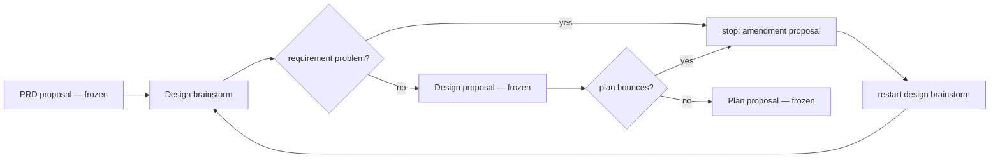

# Feature draft — PRD *(effective view)*

---

**GENERATED — DO NOT EDIT.** Sole writer: `docgate fold`. As of: **002**. Content fingerprint: `sha256:29fef49c38816512c173f498aa5c8a0408e040933f3b1b0e8da09225a0ebf64a`. Tool version (recorded, never hashed): `docgate/v1`.

---

| Field | Value |
|---|---|
| **In one line** | A new feature's PRD and tech spec are drafted together as one revisable feature draft, revised in feedback rounds in which only the product side changes requirements, and locked together into the repository memory by one human approval once readiness checks pass, with the plan generated from the locked draft afterwards — replacing Pyxis's per-stage proposal-and-freeze document pipeline. |
| **Relevant-when** | planning, building, or reviewing how new features are drafted, revised, reviewed, and locked in Pyxis; triaging refused locks, readiness failures, requirement changes made inside a draft, reopened features, or conflicts between open drafts; changing the document pipeline's gates (PRD ledger and design checks, the contract gate, planning entry), the PRD and tech-spec reviewers, the design brainstorm's bounce rule, memory reconciliation for contracts authored in memory, or the switch-over that closes the document pipeline |
| **Status** | Problem + solution gates signed (2026-09-22, via the operator's review of this draft); the 2026-09-23 in-draft revisions approved in the tech-spec operator review — launch review pending, post-implementation; merge freezes the base |
| **Tier** | T3 — changes the factory's own gates, approval point, and contract immutability rules (factory control) |
| **Owner** | @mdarabi |
| **Approver(s)** | @mdarabi via the introducing proposal's operator review |
| **Contributors** | Claude — source audit, brainstorm facilitation, requirements synthesis |
| **Informed** | Pyxis maintainers; agent sessions and Argus drives that author feature contracts |
| **Date** | 2026-09-22 |
| **Appetite** | One release delivering the complete process for new features in Pyxis's own repository — the draft and its rounds, readiness checks and the lock, reopen, visibility between open drafts, the switch-over, and reworked stage skills — built on the existing repository memory, unmanned reviewers, and plan projection, with no new service or dependency. Human attention: product rulings inside rounds and one approval per lock. Machine work: agent sessions per round plus unmanned review rounds; no token or money cap was set. Rollout burden: fix-forward only — no pilot stage and no switch back (brainstorm:feature-draft#D-11, brainstorm:feature-draft#D-17). |
| **Target release** | The release that carries the switch-over for Pyxis's own repository, the only repository using Pyxis (brainstorm:feature-draft#D-26) |
| **Tracking** | Operator request and brainstorm of 2026-09-22; no external work item yet |
| **Artifacts** | brainstorm:feature-draft (the gated brainstorm record) · memory-gate probe in a scratch clone at commit 9f2fbe98 (2026-09-22) · contract-proposal baseline audit of 25 planned features (2026-09-22) |
| **Template version** | prd-template/v2 |
| **Design coverage** | requirements-first/v1 |

## 0. Read to rule — the human reviewer's section (~7 min)

section still supplies no machine instructions.

*The body governs; this section only routes the human reviewer's attention.*

**Judge these**

| # | The call | Could have gone | If you disagree |
|---|---|---|---|
| 1 | Authorized Argus owns GitHub approval after independent review; the operator remains the fallback where the mainline grant is absent. | Require human approval even at the highest delegated tier. | FR-56, FR-57 and FR-59 change the driving principal at approval. |
| 2 | A same-account author records its decision in a host-authenticated COMMENTED review because GitHub prohibits author APPROVED reviews. | Require a separate GitHub reviewer account. | FR-58 and FR-60 state the exact authenticated boundary and honest agent attribution. |
| 3 | Mainline, not the candidate or local config, names the approver and grant; the operator's changes request remains a stop. | Let a proposed grant authorize itself. | FR-59, UB-15 and NR-8 preserve the policy boundary. |
| 4 | Existing host protection is preserved. A repository requiring a separate native approving review still requires that review. | Replace branch protection with a Pyxis-only check. | FR-60 does not authorize a protection change or bypass. |

**Sanity-check** — both independent current-digest contract reviews remain
mandatory, every approval names a full head, and every driver lock records the
host review and pre-merge policy commit. Existing rollout and local Git limits
remain; no repository is promoted by this amendment.

## 1. Summary — the one-pager

- **Problem** — A feature's contract is authored as a relay of separately landed stages — brainstorm, PRD, design brainstorm, design, reviews, plan — and each stage freezes when it lands. When design or planning shows that a requirement was wrong or missing, the correction costs another proposal after the earlier stage was already treated as done, and every authored document is also mirrored into the repository memory, whose own checks refuse contract content written there directly.
- **For whom** — The Pyxis operator, one human holding both the product and the engineering sides of a feature and working with agent sessions; secondarily Argus when it drives a feature for the operator.
- **Why now** — The repository memory now holds typed, immutable claims with supersession, rendering, and proposal views of product and design deltas; the document pipeline keeps growing workarounds around it (staged-contract rules, byte-for-byte source captures); every new feature pays at least one proposal per stage.
- **Direction** — One feature draft per feature holds the PRD and tech spec, with their brainstorm records and review reports. Rounds revise any part; a requirement changes only by a product-side ruling. Readiness checks gate one human lock of the PRD and tech spec together, which writes them into the repository memory; a plan is generated from the locked draft afterwards, when wanted, and stays the plan document that connects it to execution. Any later change reopens the feature as a new draft.
- **Appetite** — The complete process for new features in Pyxis's own repository, plus the FR-53 exception for compatible initialized installed repositories explicitly selecting local-git, on existing machinery; excludes changes to the execution handoff, other intake lanes, migrating existing features, a general installed-memory rollout, and governing documents.
- **Success** — Proposals from a draft's opening to its lock: today a median of 3 to a first plan (maximum 9) → exactly 1 for each of the first three draft-born features (M1).
- **Guardrail** — Zero reopens of those three features caused by a gap the readiness checks should have caught, judged once all three are implemented (M2); memory integrity never weakened (§3.3).
- **Top risks** — a draft-process defect blocks all new feature contracting, since nothing can switch back (R2); the unamended sibling ledgers keep stating the old rules and PRD review flags the contradiction (R1); existing features require their existing authoring and evolution rules until migration is designed (R3).

## 2. Problem space

### 2.1 Problem statement

The operator defines each feature's contract through a relay of stages —
brainstorm, PRD, PRD review, design brainstorm, design, design review,
planning — and each stage lands as its own proposal that freezes it. Real
feature definition is a loop: designing and planning regularly show that a
requirement was wrong, missing, or unbuildable. Each such discovery costs
another proposal — an amendment, a restarted design brainstorm, a superseding
design, or another plan — after the earlier stage was already treated as done,
and the contract is spread across separately frozen documents that must be
kept telling one story by hand. The repository memory mirrors every one of
those documents byte for byte, so every document edit is also memory work,
while the memory's own checks refuse to treat a contract written directly in
memory as authoritative. Doing nothing keeps paying one proposal per stage and
per correction and keeps the contract in two places.

### 2.2 Users and segments

| Segment | Role and context | Domain exp. | Tech exp. | Key goals | Pain today | Evidence |
|---|---|---|---|---|---|---|
| **P1 (primary)** | The Pyxis operator — one human holding both the product and the engineering sides of each feature, taking part in the rounds while agent sessions write the artifacts | master | master | define the right contract; correct it as soon as design or planning teaches something; approve once | at least one proposal per stage; a further proposal per correction after a stage froze | brainstorm:feature-draft#D-4 · §2.4 rows 1–3 |
| P2 (secondary) | Argus, the AI engineer, driving a feature for the operator under its authority contract | journeyman | master | run the contract loop with rulings where granted; escalate breaking decisions; request approval | a stage-by-stage drive in which every change must travel an amendment, supersession, or reopen-record channel | brainstorm:feature-draft#D-4 · prd:argus/FR-4 |
| **Anti-segment** | Authors of bug fixes, performance work, or other non-feature changes (later intake lanes); installed repositories outside FR-53's compatible initialized local-git exception; teams that require two different approvers (not in the first version) | — | — | — | — | brainstorm:feature-draft#D-8, brainstorm:feature-draft#D-26, brainstorm:feature-draft#O-5 |

FR-53 also serves the same solo operator and Argus in a compatible initialized installed local-git repository. It adds no team approval model or general memory rollout.

### 2.3 Jobs and desired outcomes

| # | When… (situation) | I want to… (motivation) | So I can… (outcome) | Today's workaround | Evidence |
|---|---|---|---|---|---|
| J1 | design or planning shows that a requirement is wrong, missing, or unbuildable | get a product ruling and correct the requirement in the same working contract | keep the PRD and tech spec telling one story without a separate proposal | stop the design, raise a PRD amendment proposal, restart the design brainstorm | brainstorm:feature-draft#F-6, brainstorm:feature-draft#F-11, brainstorm:feature-draft#D-9 |
| J2 | the PRD and tech spec look settled | approve them once, knowing mechanical checks confirm they are complete and consistent | hand execution a contract that will not bounce | three stage approvals, then a contract gate and a planner that bounce after earlier stages froze | brainstorm:feature-draft#D-1, brainstorm:feature-draft#D-3 |
| J3 | a locked feature must change — new learning, or another feature's change | change it through the same loop, with the old version binding until the new one locks | avoid an amendment, a superseding design, and a new plan as separate proposals | amendment + superseding design + new plan, each its own proposal | brainstorm:feature-draft#D-5 |
| J4 | several features' contracts are drafted in parallel sessions | have my lock checked against whatever locked before it | avoid locking a contract that contradicts one locked meanwhile | discover the conflict during execution and amend afterward | brainstorm:feature-draft#D-22 |

### 2.4 Evidence

| Claim | Source (research, data, tickets, interviews) | Confidence |
|---|---|---|
| Reaching a first plan takes a median of 3 contract proposals — one per stage, the rule's minimum — and a maximum of 9 when design sends work back | Git history of the 25 features with PRD ledgers and plans, counted from the first contract artifact to the first plan's introduction, 2026-09-22 | High |
| 22 of the 59 PRD amendments cite later-stage evidence — design brainstorms, design reviews, a plan bounce, build results — as what they learned from, and each landed as its own proposal | Learned-from rows of every amendment (brainstorm:feature-draft#F-6) | High |
| `planner-driven-model-routing` needed 9 proposals to its first plan (base, product gaps, three amendments, a design bounce, design, plan), then two more plans | brainstorm:feature-draft#F-11 | High |
| One proposal per ledger entry and one governed class per proposal are merged, enforced rules; the latest memory design rejected bundling a PRD with its design for that reason | prd:docgate/FR-27, prd:docgate/FR-30, design:memory-staged-contracts §4 (brainstorm:feature-draft#F-13) | High |
| Today's memory gate refuses a requirement written in memory that a design decision written in memory serves (`unauthorized-prd-serves`), because design coverage is authorized only through document ledgers and the design index | Probe of the memory gate in a scratch clone at 9f2fbe98 (brainstorm:feature-draft#F-1) | High |
| Memory records added on an unmerged proposal can still be revised; immutability is judged against the merge base | brainstorm:feature-draft#F-2 | High |
| 97% of the 4,004 memory records mirror documents; each document edit adds a capture record; no stage skill reads or writes memory | brainstorm:feature-draft#F-3, brainstorm:feature-draft#F-4, brainstorm:feature-draft#F-5 | High |
| The memory already renders a proposal's product delta and design delta for sign-off and reports other open proposals touching the same claims | brainstorm:feature-draft#F-7 | High |
| Memory's captured copies of existing features carry 425 accepted integrity findings across 37 features — PRD rows without a lossless mapping, PRD questions without a native disposition, missing design links — plus 224 requirements reported as undesigned | Memory reconciliation report at 9f2fbe98, 2026-09-22 | High |
| Repositories that install Pyxis receive the document pipeline but not the repository memory | brainstorm:feature-draft#F-12 | High |
| The operator wants contracting to mirror product/engineering practice: nothing locks until the back-and-forth converges, then PRD and tech spec lock together and the plan follows | Operator idea and rulings, 2026-09-22 and 2026-09-23 (brainstorm:feature-draft#D-1, brainstorm:feature-draft#D-25) | High |
| One proposal per draft is reachable when a draft spans many sessions and rounds | Assumption — tested at the checkpoint (M1, §6.3 R6) | Low |

### 2.5 The journey today

| Phase | User does | User feels / pain | Frontstage (what user sees) | Backstage (systems, people, processes) |
|---|---|---|---|---|
| Define | grills the idea, lands the brainstorm record with the PRD base | settled — for now | one proposal for the PRD base | merge freezes the base; memory captures both documents |
| Design | brainstorms and writes the design | discovers a requirement problem mid-design | the design session stops (`needs-more-product`) | the bounce rule forbids patching the PRD |
| Correct | raises a PRD amendment, then restarts the design brainstorm | repeats work already done | an amendment proposal; a second brainstorm record | the amendment folds into the projection; capture records multiply |
| Plan | raises the plan after the design lands | the planner bounces on fog or a stale contract | another proposal, or a re-cut of the PRD | contract gate and plan fold run on frozen documents |
| Change later | amends, supersedes, re-plans | every change is several proposals | amendment, superseding design, new plan | each stage frozen again at its merge |

### 2.6 Opportunity and why now

- **Size** — Every new feature pays at least one proposal per stage (median 3 to a first plan, maximum 9 across 25 features), and later corrections added 59 amendment proposals across 38 ledgers; every authored document edit also adds memory capture work.
- **Alternatives users have** — keep the per-stage document pipeline; keep documents but allow one proposal per feature by relaxing the one-class-per-proposal rule; do nothing.
- **Why us / strategic fit** — The repository memory already provides typed immutable claims, supersession with computed status, product and design deltas for sign-off, and detection of other open work on the same claims (brainstorm:feature-draft#F-7).
- **Why now** — The memory system has landed; the document pipeline is accumulating staging workarounds around it, and the operator directed its deprecation (brainstorm:feature-draft#D-6).
- **Cost of doing nothing** — one proposal per stage and per correction for every feature, a contract kept in two places, and a memory that cannot hold a contract natively.

**Decision:** Problem gate — do not proceed to §3–§4 until every contributor signs.

| Reviewer | Role | Date | Verdict |
|---|---|---|---|
| @mdarabi | Operator — product and engineering | 2026-09-22 | approved — problem and solution gates signed in one review; capture: 20m · items: none |
| @mdarabi | Operator — product and engineering | 2026-09-23 | approved — the in-draft revisions of 2026-09-23 (the plan after the lock, the day-one scope, answers to Q1, Q3, and Q11), reviewed with the tech spec; lineless |

## 3. Goals, metrics, and guardrails

### 3.1 Goals as falsifiable hypotheses

| # | We believe that… | Will result in… | Measured by… |
|---|---|---|---|
| G1 | drafting the PRD and tech spec together with one checked lock for the operator | one proposal per feature contract change instead of one per stage and per correction | M1 |
| G2 | readiness checks before the lock | corrections move inside the draft without pushing gaps past the lock | M2 |
| G3 | making the repository memory the authoritative home of a draft-born contract | no contract document is written for draft-born features, ending the double bookkeeping | M3 |
| G4 | routing every requirement change through a recorded product ruling | every in-draft requirement change stays attributable to its author, reason, and triggering problem | M4 |

### 3.2 Goals → signals → metrics

| Metric | Goal | Signal | Baseline | Target (at checkpoint) | Feeds from |
|---|---|---|---|---|---|
| M1 (primary) | G1 | proposals needed from a draft's opening to its lock | median 3 to a first plan, maximum 9, across 25 features; each later correction adds at least one proposal | exactly 1 for each of the first three draft-born features | EVT-1, EVT-5 |
| M2 | G2 | reopens of the first three draft-born features whose confirmed cause is a gap the readiness checks should have caught | not measured today; proxy upper bound — 22 of 59 amendments cited later-stage evidence, cross-feature dependency changes included | 0, judged once all three have finished implementation | EVT-6 |
| M3 | G3 | new files under the document corpus's PRD, tech-design, brainstorm, and review roots for draft-born features | at least three contract documents per feature today, plus brainstorm and review documents | 0 across the first three draft-born features | EVT-7 |
| M4 | G4 | in-draft requirement changes carrying a ruling with author, reason, and triggering problem | no equivalent — corrections land as amendments | 100% across the first three draft-born features | EVT-3 |

### 3.3 Guardrails and decision rule

| Guardrail metric | Threshold | Action if breached |
|---|---|---|
| A draft-process defect that stops new feature contracting | any occurrence | fix forward as the top priority and record an incident; no switch back exists (brainstorm:feature-draft#D-17) |
| Memory integrity weakened — widened accepted debt, a disabled record-immutability or evidence refusal, or design coverage accepted outside draft-born features | zero occurrences | refuse the release candidate; after release, fix forward |
| Executor or tracker-side behavior changed in order to consume a plan generated from a locked draft | zero changes | fix the handoff inside this feature before release |
| Existing document-pipeline documents changed by the switch-over | zero changed bytes | refuse the change |

**Ship rule (pre-registered):** The release lands only when every blocking §5.8 row is green on the release candidate — there is no pilot stage (brainstorm:feature-draft#D-17). At the checkpoint (brainstorm:feature-draft#D-18): M1 = 1 for each of the three features, M2 = 0, M3 = 0, and M4 = 100% → adopt; any miss with clean guardrails → iterate by fixing forward; any guardrail breach → fix forward immediately. A kill verdict means contracting a replacement process as a new feature; the document pipeline does not reopen.

### 3.4 Non-goals and waiting room

| ID | Non-goal | Why refused |
|---|---|---|
| NG-1 | Editing the product vision or the architecture principles | Governing changes remain the operator's separate call; the operator appends the vision §4 note personally (brainstorm:feature-draft#O-3, brainstorm:feature-draft#D-13) |
| NG-2 | Locking automatically when checks pass, or locking with known gaps | Every lock needs green readiness and a human approval (brainstorm:feature-draft#O-4) |
| NG-3 | Typed PRD amendments and superseding designs for draft-born features | A change reopens the feature as a new draft (brainstorm:feature-draft#O-6) |
| NG-4 | Migrating existing features into drafts, or converting them all at the switch-over | Day one: the release starts drafts for new features only; existing features keep their frozen documents (brainstorm:feature-draft#D-26) |
| NG-5 | Amending the other features' ledgers, or a governing ruling, to change their conflicting rows | This PRD states the override itself (brainstorm:feature-draft#O-9) |
| NG-6 | A pilot stage before the switch-over, or any setting that reopens the document pipeline after it | The pipeline closes at release; defects are fixed forward (brainstorm:feature-draft#O-10) |
| NG-7 | Overlap tracking between open drafts as part of the lock — required overlap lists, or forced re-checks when another draft locks | Readiness against the landing mainline catches conflicts; memory's existing in-flight report surfaces only as FR-23's advisory notice (brainstorm:feature-draft#O-11) |
| NG-8 | Marking the previous plan's unfinished tasks keep, replace, or cancel inside a reopened draft, or locking with them flagged stale | Unfinished tasks finish or are cancelled before a reopen (brainstorm:feature-draft#O-12) |

| ID | Waiting room | Revisit when / intended version |
|---|---|---|
| WR-1 | A new handoff of the whole locked pack — PRD, tech spec, plan, tasks — to implementation | When an execution-handoff feature is proposed; until then a plan generated from the locked draft feeds today's projection (brainstorm:feature-draft#O-1) |
| WR-2 | An intake step that classifies incoming work, and non-feature lanes such as bug fix and performance | When a second lane is contracted; the lane-neutral handoff (FR-26) keeps the plan as their meeting point (brainstorm:feature-draft#O-2) |
| WR-3 | Two different people approving one lock | When a repository with separate product and engineering owners adopts feature drafts (brainstorm:feature-draft#O-5) |
| WR-5 | Moving existing document-pipeline features into feature drafts, including their memory capture gaps | When an existing feature must change after the switch-over (brainstorm:feature-draft#D-26) |

## 4. Solution space

### 4.1 Approach and alternatives considered

One feature draft per feature holds its PRD and tech spec and stays
revisable until a single lock, which writes them into the repository memory. Rounds may revise
any part; engineering-side sessions record requirement problems and only the
product side's rulings change requirements. Readiness checks gate the lock,
the operator approves it once, and the PRD and tech spec become the
feature's next locked version together; a plan is generated from it afterwards. A later change reopens the feature as
a new draft while the locked version stays binding. At release the document
pipeline closes for new contract work in Pyxis's own repository.

| Option | Sketch | Why not chosen |
|---|---|---|
| A (chosen) | One contract, one approval: a revisable feature draft of all parts, product-ruled requirement changes, readiness checks, one human lock, reopen for change | — |
| B | A feature lifecycle recorded on the mainline: every draft edit lands there at once but binds nothing until a lock record seals a version | Every edit is still its own landing, and every consumer must learn to skip drafts (brainstorm:feature-draft#D-1) |
| C | A general intake with lanes — feature, bug fix, performance — and the feature draft as the first lane | Builds the intake and handoff before any feature benefits; this release is scoped to features (brainstorm:feature-draft#D-1, brainstorm:feature-draft#D-8) |
| D | Keep documents as the source and allow one proposal per feature by relaxing the one-class-per-proposal rule | Keeps the contract in two places and the memory subordinate to documents, against the move to memory (brainstorm:feature-draft#D-16) |
| Do nothing | Per-stage proposals and freezes continue | One proposal per stage and per correction, indefinitely (§2.6) |

### 4.2 Scope perimeter

- **In (plan of record)** — the feature draft and its rounds; brainstorm records and review reports as separate documents inside the draft; storage of every part in the repository memory at the lock, each file's exact text included; draft-born PRDs held to the PRD template, §0 included; requirement problems and product rulings, retirement included; readiness checks — the planning gate's currency, link, structural, and consistency checks included — computed against the mainline each lock lands on; the operator-reviewed lock with the selected medium's version-bound evidence and its capture line: authenticated hosted approval, or FR-50–FR-52's declared local receipt; locked versions; reopen, refused while the current plan has unfinished tasks; memory's in-flight notice as an advisory heads-up; plans generated from locked drafts, checked for coverage and projection rules and fed to today's projection; the new-feature authoring switch-over and FR-54/FR-55's gate applicability; compatible initialized installed local-git repositories under FR-53; memory integrity that treats draft-born contracts as authoritative; the overrides of the enumerated sibling rows; reworked stage skills; Argus as a driver; updated agent instructions, pipeline map, and domain model.
- **Future (believed next, not committed)** — the whole-pack execution handoff (WR-1); the intake step and other lanes (WR-2); two-approver teams (WR-3); a general installed-memory rollout beyond the scoped FR-53 exception; migrating existing features (WR-5).
- **Out** — governing-document edits (NG-1); automatic locks (NG-2); amendments for draft-born features (NG-3); bulk conversion or a permanent dual pipeline (NG-4); sibling-ledger amendments (NG-5); a pilot stage or a switch back (NG-6); overlap tracking between open drafts (NG-7); in-reopen task dispositions (NG-8).

Terms used below: a **feature draft** is the open, revisable workspace of one feature's contract until its lock; a **round** is one pass of feedback in which any part may be revised; the **lock** is the single human approval that ends a draft; a **locked version** (v1, v2, …) is what a lock produces; a **reopen** starts a new feature draft from a locked version; the **tech spec** is the per-feature technical design; a **draft-born feature** is any feature contracted through a feature draft — every feature started after the switch-over; the **switch-over** is the moment the release carrying this feature lands in Pyxis's own repository; the **document pipeline** is the per-stage process in which brainstorm records, PRD ledgers, technical designs, review reports, and plans are separate documents, each landing in its own proposal; **readiness** is the set of lock preconditions in FR-12 through FR-14, FR-16, and FR-38 through FR-42.

The local exception requires the pinned release's feature-draft memory/readiness capabilities and an existing configured-origin mainline. Its approval is a declared receipt, not authenticated human authorship. Existing features are not migrated. The approved source legacy-gate bypass remains; local selection changes the code-host medium, not document-gate policy.

### 4.3 Experience: flows and states

**F1 — draft a new feature (serves J1, J2).** The operator, or an agent
session or Argus acting for the operator, opens a feature draft. Brainstorm
sessions, the PRD, tech-spec brainstorm sessions, the tech spec, and review
rounds all write into that one draft; each brainstorm session and each
review round is its own document. Any part may change in any round, and none
of it reaches the mainline, planning, or execution until the lock.

**F2 — correct a requirement during a draft (serves J1).** A tech-spec
session finds that a requirement is wrong, missing, or unbuildable.
The session records a requirement problem against it, and the requirement
stays unchanged. The operator — or Argus where its authority contract grants
it — rules; the ruled change — a revision, an addition, or a retirement — is
applied to the PRD in the same draft with its author, reason, and triggering
problem, and the tech spec adjusts in
later rounds.

**F3 — lock (serves J2).** A lock is requested. Readiness runs against the
mainline the lock would land on and either refuses, naming every unmet
condition, or passes; a passing draft produces an approval request that shows
the PRD with its §0, the readiness result, and every requirement change made
during the draft with its ruling. Hosted review requires an authenticated
human identity. Explicit local-git mode presents the current proposal generation,
full prepared head, workflow-derived target ref and existing SHA, readiness
digest, and request nonce. The operator records a matching declared receipt
and invokes landing; its output discloses unauthenticated actor/origin identity
and no host-level mainline protection. The approval binds the presented version
and records the capture line when one is given. Any local binding mismatch,
including a revision that restores an old head, requires fresh preparation and
review before any landing write. The PRD and tech spec become the feature's
next locked version together and are written into the repository memory; a
plan generated from it afterwards goes to today's plan projection.

**F4 — change a locked feature (serves J3).** A change opens a new feature
draft starting from the current locked version — refused while that version's
plan has unfinished tasks, which finish or are cancelled first; finished tasks
keep tracing the version they delivered. The locked version stays binding for
planning and execution meanwhile. The reopened draft runs rounds and locks
under the same rules; its locked version replaces the previous one, which
stays readable as history. A reopen can retire requirements, which is how an
abandoned feature's requirements reach a typed terminal state.

**F5 — parallel drafts (serves J4).** Open drafts do not track each other.
Each lock's readiness runs against the mainline the lock lands on, so the
second draft to lock is checked against everything the first locked; a
conflict refuses it and is fixed in its own draft. Memory's existing notice of
other open proposals touching the same requirements or decisions gives an
optional early heads-up.

**F6 — switch-over (serves J1, J2).** New feature contracts use drafts.
In repositories where the legacy document gate remains enabled for cutover,
new-feature work proposed as PRD ledger entries, technical designs, brainstorm
records, or review reports is refused with that remedy, including proposals
already open at cutover; plans and permitted existing-feature evolution remain
accepted. The approved Pyxis-source bypass stays in
force, with frozen-document authoring rules and permitted existing-feature
evolution unchanged (FR-54, FR-55, NR-7). Existing documents remain readable,
and existing features are not automatically moved into drafts (WR-5).

- **Ideal** — each flow completes with its parts, rulings, readiness result, and locked version retrievable from the repository memory.
- **Empty** — a feature with no draft and no locked version reports no contract state; a newly opened draft reports each part as not yet written, and readiness names them all.
- **Loading** — not applicable; each step is a bounded synchronous repository operation or an agent session the operator runs.
- **Partial** — a draft with some parts written reports the missing parts and unmet readiness conditions; nothing locks partially.
- **Error** — every refusal names the failing condition, the exact item, and the next action, and leaves the draft's content unchanged.
- **Accessibility** — command output, approval requests, and rendered parts are plain text readable by screen readers and never rely on color alone.
- **Localization** — operator-facing text is English-only; no customer-facing strings ship.

### 4.4 Scenarios

The operator starts a model-routing feature. In round 1 the PRD requires an
explicit no-inference mode; in the same round a tech-spec brainstorm session
finds that the executor has no such mode and records a requirement problem.
The operator rules the requirement out and keeps real zero-work behavior as a
guarantee; the PRD changes in the same draft. In round 2 the tech spec
takes shape and both reviewers run. The first lock request is refused:
two Must requirements have no tech-spec decision. The tech spec is revised, the
reviewers re-run on the new version, readiness passes, and the approval request
lists the one requirement change with its ruling. The operator approves, v1
locks, and a plan generated from it is projected and built by today's executor
— one contract proposal and one plan proposal where the same feature once
needed nine.

Weeks later, with v1's tasks all delivered, another feature's change affects
this one. The operator reopens it; v1 stays binding while the reopened draft
runs one round and locks as v2. A second open draft that depends on a decision
v2 changed is refused at its own lock attempt, because its readiness runs
against the mainline that now holds v2, and is fixed in its own draft.

On a hosted approval surface, an agent session's approval is refused. In an
explicit local-git repository, Argus presents the prepared review request and
the operator records a declared receipt and invokes landing. A missing,
inconsistent, or stale receipt is refused by that route. The shared OS account
cannot establish which actor issued a consistent receipt or prevent a direct
Git write; output discloses both limits. Restoring an earlier head after a
revision still requires a fresh receipt for the new proposal generation.

If a defect in the draft process appears after release, new feature
contracting waits for its fix: the document pipeline does not reopen
(brainstorm:feature-draft#D-17).

**Decision:** Solution gate — contributors sign that this shape, at this appetite, is the bet. Zero TBDs may pass this gate.

| Reviewer | Role | Date | Verdict |
|---|---|---|---|
| @mdarabi | Operator — product and engineering | 2026-09-22 | approved — the same review event as §2.6, whose row carries its one capture line |
| @mdarabi | Operator — product and engineering | 2026-09-23 | approved — the same review event as §2.6's 2026-09-23 row |

## 5. System requirements

### 5.1 Functional requirements

Must priority is ranked by row order. Requirements that touch approval,
immutability, gate authority, or the switch-over carry critical risk because
they can compromise factory control.

| ID | Requirement (EARS) | Rationale | Priority | Risk | Fit criterion | Verify | Traces to |
|---|---|---|---|---|---|---|---|
| FR-1 | When the operator, or a driver acting for the operator, starts a new feature, the system shall open one feature draft for it that holds its PRD and tech spec with their brainstorm records and review reports. | One workspace holds the whole contract (brainstorm:feature-draft#D-1, brainstorm:feature-draft#D-2) | Must | high | A new-feature fixture yields exactly one open draft whose PRD, tech spec, brainstorm records, and review reports are each addressable, and zero document-pipeline artifacts. | Test | G1, J1, J2, F1 |
| FR-2 | While a feature draft is open, the system shall accept revisions to any of its parts in any round. | Nothing locks before the loop converges (brainstorm:feature-draft#D-1) | Must | high | A fixture draft revises each part in at least two rounds, including a PRD revision after both a tech-spec and a plan revision; zero revisions are refused for finality. | Test | G1, J1, F1, F2 |
| FR-3 | When a feature draft locks, the system shall store every part of it in the repository memory, each file's exact text included. | One home for the contract, written at the lock; the plan stays outside it (brainstorm:feature-draft#D-24, brainstorm:feature-draft#D-25) | Must | high | Every part of each locked fixture draft, the end-to-end fixture feature included, is retrievable from the repository memory as records and as each file's exact text; zero new files appear under the document corpus's PRD, tech-design, brainstorm, and review roots for any draft-born fixture; and the memory holds no record or capture of any draft-born plan. | Test + Inspection | G3, F1 |
| FR-4 | The system shall keep each brainstorm record and each review report of a feature draft as its own document inside the draft. | Session and review narratives stay whole (brainstorm:feature-draft#D-2) | Must | medium | A fixture draft with three brainstorm sessions and four review rounds exposes seven separately readable documents, each locked with the draft. | Test | J2, F1 |
| FR-5 | While a feature draft is open, the system shall keep the draft's content off the repository's mainline. | Drafts reach the mainline only at the lock (brainstorm:feature-draft#D-1) | Must | critical | In every fixture, the end-to-end fixture feature included, no draft content appears in mainline history before its lock. | Test + Inspection | G2, J2, F1 |
| FR-6 | The system shall let planning projection and execution act only on a feature's locked version. | Execution never starts from unapproved content (brainstorm:feature-draft#D-1, brainstorm:feature-draft#D-5) | Must | critical | Planning projection and execution invoked for a feature with an open draft act on its current locked version, or refuse when none exists; zero tracker writes derive from unlocked content. | Test | G2, J2, J3, F3, F4 |
| FR-7 | The system shall report each feature's contract state as one of: drafting its first version; locked at version N; drafting version N+1 while version N binds; or still in the document pipeline. | The draft state stays visible (brainstorm:feature-draft#D-1) | Must | medium | State queries over fixtures — a new draft, locked v1, a reopen while v1 binds, locked v2, and an unmigrated feature — return exactly those states. | Test | J3, F1, F4, F6 |
| FR-8 | When an engineering-side session finds that a requirement in an open feature draft is wrong, missing, or unbuildable, the system shall record a requirement problem against that requirement and leave the requirement unchanged. | Design flags, product rules; the PRD and tech spec never quietly disagree (brainstorm:feature-draft#D-9) | Must | critical | A fixture tech-spec session reporting a requirement defect produces one requirement problem naming the requirement, whose text stays byte-identical. | Test | G2, J1, F2 |
| FR-9 | When the product side rules on a requirement problem, the system shall apply the ruled change — a revision, an addition, or a retirement — to the PRD in the same feature draft and record the ruling's author, reason, and triggering problem. | The correction lands where it was found, attributably (brainstorm:feature-draft#D-9) | Must | critical | 100% of requirement changes in fixture drafts carry author, reason, and triggering problem; a requirement change lacking any of the three is refused; a retired requirement appears as retired in the locked version. | Test | G1, G4, J1, F2 |
| FR-10 | The system shall accept a product-side ruling from the human operator, and from Argus only where Argus's authority contract grants that act. | New intent stays the product side's call; Argus acts only under grant (brainstorm:feature-draft#D-4, brainstorm:feature-draft#D-9) | Must | critical | Operator rulings are accepted; an Argus ruling is accepted under a granting authority contract and refused without one; any other agent's ruling is refused. | Test | G4, J1, F2 |
| FR-11 | When a lock is requested for a feature draft that is not ready, the system shall refuse the lock and name every unmet readiness condition. | Nothing locks until the loop has converged (brainstorm:feature-draft#D-3) | Must | critical | One fixture per readiness condition in FR-12 through FR-14, FR-16, and FR-38 through FR-42 is refused naming exactly that condition; a fixture failing all of them names all of them; zero locks are granted to drafts that are not ready. | Test | G2, J2, F3 |
| FR-12 | The system shall treat a feature draft as ready only when every open question and every requirement problem in it has an answer. | Open questions answered (brainstorm:feature-draft#D-3) | Must | high | Drafts holding one unanswered question or one unruled requirement problem are refused; answering it clears that condition. | Test | G2, J2, F3 |
| FR-13 | The system shall treat a feature draft as ready only when every Must requirement in its PRD is served by at least one decision in its tech spec. | Every must-have requirement has a design decision (brainstorm:feature-draft#D-3) | Must | high | A draft with one unserved Must requirement is refused naming it; adding a serving decision clears the condition. | Test | G2, J2, F3 |
| FR-14 | The system shall treat a feature draft as ready only when every Must requirement in its PRD carries a pass/fail fit criterion and a verification method. | Every must-have requirement has a pass/fail test (brainstorm:feature-draft#D-3) | Must | high | A draft with one Must requirement lacking a fit criterion, and one lacking a verification method, are each refused naming the requirement. | Test | G2, J2, F3 |
| FR-15 | When a plan is generated from a locked feature draft, the system shall require every requirement in the locked PRD to be covered by at least one plan task or explicitly deferred with a reason. | Every requirement is covered by the plan or deferred; the plan follows the lock (brainstorm:feature-draft#D-25) | Must | high | A plan leaving one requirement uncovered and undeferred is refused naming it; covered and deferred-with-reason requirements pass. | Test | G2, J2, F3 |
| FR-16 | The system shall treat a feature draft as ready only when every blocking finding from the PRD review and the tech-spec review of the exact version being locked carries a disposition — applied, or declined with the operator's ruling. | The final review of the version being locked has no unresolved blocking finding (brainstorm:feature-draft#D-3) | Must | critical | A draft revised after its last review is refused until both reviews re-run on the new version; a draft with one undispositioned blocking finding is refused; dispositioned findings pass. | Test | G2, J2, F3 |
| FR-56 *(002 ← FR-48)* | When a ready feature draft's lock is requested on GitHub, the system shall accept approval of the exact prepared head from the configured authenticated operator, or from the configured authenticated Argus driver where the pre-merge mainline authority contract grants approve-merge. Without that grant it shall request the operator. Other hosted and explicit local-git surfaces shall retain their existing approval requirements. | Makes the delegated driver accountable for its granted lock approval | Must | critical | Granted driver and operator fixtures lock; an ungranted driver, a forged principal label, and a candidate-only grant are refused; existing local Git fixtures retain their behavior. | Test + Inspection | G2, J2, F3 |
| FR-18 | When the lock approval is requested, the system shall present every requirement change made during the draft together with its ruling, marking each change that no ruling names. | The lock review shows who changed what and why (brainstorm:feature-draft#D-9) | Must | high | The approval request of a fixture draft with five ruled changes and one unruled change lists all six, the five with author, reason, and triggering problem and the sixth marked unruled. | Test | G4, J1, J2, F3 |
| FR-19 | When a lock is approved, the system shall make the draft's PRD and tech spec immutable together as the feature's next locked version and record the approver in both the product and the engineering roles. | One lock for the whole contract; one person may hold both roles (brainstorm:feature-draft#D-1, brainstorm:feature-draft#D-4) | Must | critical | After a fixture lock, every change to a locked part outside a reopen is refused; the lock record names the version number and the approver in both roles. | Test | G1, G2, J2, F3 |
| FR-20 | When a change to a locked feature is started, the system shall open a new feature draft for it that starts from the feature's current locked version. | One loop for creation and change (brainstorm:feature-draft#D-5) | Must | high | Reopening a locked v1 fixture yields a draft whose parts equal v1 at opening. | Test | G1, J3, F4 |
| FR-21 | While a reopened feature draft is open, the system shall keep the feature's previous locked version as its binding contract. | The locked version stays in force until replaced (brainstorm:feature-draft#D-5) | Must | critical | During a fixture reopen, planning and execution read v1 exactly, and no reopened-draft content reaches them. | Test | J3, F4 |
| FR-22 | When a reopened feature draft locks, the system shall make it the feature's current locked version and keep the replaced version readable as history. | History is kept beside the present (brainstorm:feature-draft#D-5) | Must | high | After v2 locks, v2 is current and v1 remains retrievable byte-identically. | Test | J3, F4 |
| FR-23 | While a feature draft is open, the system shall show, as a non-blocking notice, the other open proposals that the repository memory reports touching the same requirements or decisions. | Memory's existing in-flight warning stays a free heads-up (brainstorm:feature-draft#D-22) | Should | low | In a fixture with two open drafts sharing a requirement, each shows the other in a notice that blocks nothing. | Test | J4, F5 |
| FR-24 | When a lock is requested, the system shall compute readiness against the mainline the lock will land on. | The second draft to lock must see what the first locked, and the mainline admits merges checked against an older state (brainstorm:feature-draft#D-22, brainstorm:feature-draft#F-15) | Must | critical | A fixture draft whose readiness passed before another draft locked a conflicting change is refused at its own lock and passes once revised; zero locks are accepted on a readiness result computed against an older mainline. | Test | G2, J4, F3, F5 |
| FR-25 | When a plan is generated from a locked feature draft, the system shall make it available to the existing plan projection in the form today's executor consumes. | Execution keeps working unchanged (brainstorm:feature-draft#D-8) | Must | critical | The plan generated from an end-to-end fixture feature's locked draft projects onto the tracker and is implemented by today's executor with zero executor changes. | Test + Demo | G1, J2, F3 |
| FR-26 | The system shall keep a plan's handoff free of parts that only a feature can supply, so that a non-feature intake can produce the same handoff. | Later lanes converge on the plan (brainstorm:feature-draft#D-8) | Must | medium | A hand-built non-feature fixture — intent cited from an existing requirement, one decision, one plan — yields a handoff the same projection accepts, with no feature-only field left empty or faked. | Test + Inspection | G1, WR-2 |
| FR-55 *(001 ← FR-27)* | While the switch-over is in effect, the feature-authoring workflow shall use feature drafts for new feature contracts. Where the legacy document gate remains enabled for that cutover, the system shall refuse new-feature contract work proposed as PRD ledger entries, technical designs, brainstorm records, or review reports with the feature-draft remedy, while accepting plan documents and the permitted evolution of existing document-pipeline features. The Pyxis-source bypass in FR-54 shall remain in effect. | Move new contracts to memory without reinstating the retired source gate or changing existing-feature authoring rules | Must | critical | An enabled-cutover new-feature fixture refuses each corpus-document kind, including a proposal opened before cutover, and accepts a plan; a permitted existing-feature amendment or successor remains accepted. Source inspection and gate fixtures establish that the workflow directs new features to drafts without activating automated legacy refusals. Existing merged features retain permitted typed amendments and design supersession under their authoring rules; no feature is automatically migrated. | Test + Inspection | G3, F6 |
| FR-29 | The system shall treat the repository memory as the authoritative source of a draft-born feature's PRD and tech spec and require no document source for them. | The memory gate must accept native contracts (brainstorm:feature-draft#F-1) | Must | critical | A draft-born fixture in which a requirement written in memory is served by a decision written in memory passes every required check, with zero PRD or design document sources. | Test | G3, J2, F1, F3 |
| FR-54 *(001 ← FR-30)* | While the switch-over is in effect, the system shall apply automated document-pipeline checks only to existing documents in repositories where those checks remain enabled, and shall apply none to draft-born contract parts. In the Pyxis source repository it shall preserve the approved memory-migration bypass; selecting local-git shall not restore legacy document checks. | Frozen-document authoring rules survive independently of the operator-disabled source gate | Must | critical | Enabled document-pipeline fixtures retain existing-document immutability refusals and produce zero such findings for draft-born parts. A trusted Pyxis-source fixture continues to bypass legacy document checks at push and CI in both hosted and local mode; retained non-document checks still run. Inspection confirms that source authoring rules for frozen documents remain binding. | Test + Inspection | G3, F6 |
| FR-31 | Where a feature is draft-born, the system shall accept its locked version as planning input in place of prd:plan-new/FR-1, prd:plan-new/FR-27, and prd:contract-gate/FR-1, with its readiness conditions — FR-12 through FR-14, FR-16, and FR-38 through FR-42 — as the planning-entry gate. | This contract overrides the planning-entry rows for draft-born features (brainstorm:feature-draft#D-15) | Must | critical | A locked draft-born fixture plans and projects without a PRD projection document, a design document, or the document contract gate; an open draft is refused (FR-6). | Test | G1, J2, F3 |
| FR-32 | Where a feature is draft-born, the system shall let the PRD reviewer and the tech-spec reviewer take its draft's PRD and tech spec as subjects in any round, in place of prd:prd-review/FR-1, prd:prd-review/FR-13, and prd:tech-design-review/FR-1. | This contract overrides the reviewer subject rows for draft-born features (brainstorm:feature-draft#D-15) | Must | high | Both reviewers complete a verdict on a fixture draft's PRD and tech spec, and each report is stored as a review document in the draft (FR-4). | Test | G2, J2, F1, F3 |
| FR-33 | Where a feature is draft-born, the system shall route a requirement defect found during tech-spec work through FR-8 and FR-9 in place of prd:tech-design-brainstorm/FR-14 and prd:tech-design-brainstorm/NG-6. | This contract overrides the design bounce rows for draft-born features (brainstorm:feature-draft#D-15) | Must | high | A fixture tech-spec session that finds a requirement defect produces a requirement problem in the same draft and zero amendment proposals. | Test | J1, F2 |
| FR-34 | When a stage skill that authors or reviews a feature contract runs for a draft-born feature, the skill shall read and write that feature's draft only. | The stage skills are reworked for drafts (brainstorm:feature-draft#D-11, brainstorm:feature-draft#D-16) | Must | high | Every contract-authoring and contract-reviewing stage skill run against the end-to-end fixture writes only draft content, with zero document-corpus writes. | Test + Demo | G1, G3, F1 |
| FR-57 *(002 ← FR-49)* | Where Argus drives a GitHub feature draft and has the mainline approve-merge grant, the Argus workflow shall inspect the prepared contract, verify both independent current-digest reviews and required native checks, submit its exact-head approval through FR-59, and record the host review identity and policy commit before advancing. Without grant it shall request the operator; explicit local-git retains operator approval and landing. | Approval is a driver judgment after independent review, not an automatic consequence of green checks | Must | critical | The granted drive submits a typed decision with current review references; ungranted and local drives request the operator; changed contract content requires both independent reviews again and a fresh approval. | Test + Inspection | J1, J2, F1, F3 |
| FR-36 | While the switch-over is in effect, the system shall describe the feature draft as the way new features are contracted in the repository's agent instructions, pipeline map, and domain model. | Agents learn the process from these surfaces (brainstorm:feature-draft#D-11) | Must | high | The agent instructions, pipeline map, and domain model name the feature draft for new features and reserve the per-stage document rules for existing documents; the operator confirms in review. | Inspection | F1, F6 |
| FR-37 | When a plan is generated from a locked feature draft, the system shall require the plan to pass the rules the plan projection enforces. | No plan reaches projection unless it passes the projection's rules; the plan follows the lock (brainstorm:feature-draft#D-25) | Must | high | A plan that breaks one projection rule — a dependency cycle, an oversize task without an accepted size, a trace to a nonexistent requirement — is refused naming the rule; a valid plan passes. | Test | G2, J2, F3 |
| FR-38 | The system shall treat a feature draft as ready only when none of its parts depends on another feature's superseded or retired content. | Currency, carried over from the planning gate (brainstorm:feature-draft#D-20) | Must | high | A draft whose tech spec builds on another feature's replaced decision, or serves another feature's retired requirement, is refused naming the stale dependency. | Test | G2, J2, J4, F3 |
| FR-39 | The system shall treat a feature draft as ready only when every citation in its parts resolves. | Link resolution, carried over from the planning gate (brainstorm:feature-draft#D-20) | Must | high | A draft holding one dangling citation is refused naming the citation and its location. | Test | G2, J2, F3 |
| FR-40 | The system shall treat a feature draft as ready only when every requirement not covered by FR-14 carries a pass/fail fit criterion and a verification method. | Structural completeness beyond Must rows, carried over from the planning gate (brainstorm:feature-draft#D-20) | Must | high | A draft with one Should requirement lacking a fit criterion, and one lacking a verification method, are each refused naming the requirement. | Test | G2, J2, F3 |
| FR-41 | The system shall treat a feature draft as ready only when its PRD holds every section the PRD template in force requires, §0 read-to-rule, the definition of done, and contract readiness included. | Draft-born PRDs follow the PRD template (brainstorm:feature-draft#D-20, brainstorm:feature-draft#D-21) | Must | high | A draft PRD missing §0, the definition of done, or contract readiness is refused naming the section; a complete PRD passes. | Test | G2, J2, F3 |
| FR-42 | The system shall treat a feature draft as ready only when the links among its requirements and tech-spec decisions form a consistent graph — no link to a nonexistent requirement, no broken supersession, and no cycle. | Compilability, carried over from the planning gate (brainstorm:feature-draft#D-20) | Must | high | Fixtures with a decision serving a nonexistent requirement, a broken supersession, and a dependency cycle are each refused naming the inconsistency. | Test | G2, J2, F3 |
| FR-43 | When a change to a locked feature is started while any task of its current plan is unfinished, the system shall refuse it and name each unfinished task with the remedy — finish it or cancel it. | No reopen while the current plan's tasks run (brainstorm:feature-draft#D-19) | Must | critical | A reopen of a fixture whose locked plan has one unfinished task is refused naming the task and the remedy, and proceeds once that task finishes or is cancelled. | Test | G2, J3, F4 |
| FR-44 | The system shall keep each finished task tracing the locked version it delivered. | Finished tasks stay history, never broken (brainstorm:feature-draft#D-19; incident I9) | Must | high | After a fixture reopen retires a requirement that a finished v1 task traced, the task's trace still resolves to v1's requirement and no broken trace is reported. | Test | J3, F4 |
| FR-45 | When the operator approves a lock, the system shall record the operator's capture line with the approval, or record the approval as lineless when none is given. | Read-to-rule's gate-time measurement continues for draft-born features, and a lineless gate never blocks (brainstorm:feature-draft#D-21) | Must | medium | Fixture approvals given with a capture line store it verbatim — minutes spent, each feedback item marked in or outside §0 — and approvals given without one are recorded as lineless and still lock. | Test | G4, J2, F3 |
| FR-58 *(002 ← FR-50)* | Where GitHub is selected, the system shall authenticate an Argus approval from the host review's account identity and commit ID and a closed versioned driver decision binding repository, PR number, exact head, pre-merge policy commit, drive slug, prepared contract digest when applicable, and review evidence. It shall accept the same-account author's COMMENTED review only with that decision, and record the approval as Argus rather than human. The existing authenticated operator review and explicit local-git declared receipt routes shall remain supported. | Supports an honest agent decision without impersonation or a second account requirement | Must | critical | Same-account COMMENTED and distinct-account APPROVED driver decisions pass; ordinary comments, malformed payloads, wrong accounts, stale heads, policy commits, and digests refuse; old human lock tags and local receipts remain readable. | Test + Failure injection | G2, J2, F3 |
| FR-51 *(001 ← FR-47)* | The system shall bind a lock approval to the exact draft version presented and void it when the draft changes before lock. In local-git mode it shall also bind approval to the current proposal generation, workflow-derived target ref and existing target SHA, readiness digest, and request nonce, and refuse any mismatch at landing. | Certifies the content and landing context that were actually presented, including a revision that restores an old head | Must | critical | Hosted change-after-request fixtures retain their verdicts. Local changed-head, changed-target-ref, moved-target, changed-digest, changed-proposal-generation, and H1→H2→H1 fixtures refuse the old receipt before any landing write and require fresh preparation and review. | Test | G2, J2, F3 |
| FR-52 *(001)* | When the operator records a local draft-lock review, the system shall retain a closed, versioned receipt binding proposal identity and kind, proposal-record full OID and monotonic sequence, operation draft-lock, branch ref, exact full prepared-head SHA, workflow-derived fully qualified mainline target ref and its existing full SHA, readiness digest, and a unique request nonce. It shall publish that receipt once, revalidate it against the current pre-landing proposal, and retain its canonical bytes and digest with the final proposal and lock evidence. | Prevents normal-route stale and same-origin replay errors and preserves clone-visible evidence after the review worktree is gone | Must | critical | Real bare-origin fixtures reject missing, malformed, wrong-proposal, wrong-operation, wrong-branch, wrong-head, wrong-target, wrong-digest, and wrong-generation receipts without advancing landing refs; a nonce cannot be overwritten; retry after a completed landing recognizes the original result instead of creating a second lock; a fresh clone detects missing or changed retained receipt bytes and reports consistency with unauthenticated actor and origin identity. | Test + Failure injection | G2, G4, J2, F3 |
| FR-53 *(001)* | Where an installed repository explicitly selects local-git and carries the feature-draft memory and readiness capabilities required by its pinned Pyxis release, the system shall permit new feature drafts only after the configured bare origin's mainline exists, and shall apply the same compile, readiness, memory-integrity, and locked-version rules as in the source repository. | Supplies the accepted local AEC workflow without inventing a separate base-free draft path | Must | high | A compatible initialized installed fixture reaches draft preparation and lock; missing-mainline open and preparation refuse before writes with the separate first-mainline-push remedy; an unsupported installed capability names the missing prerequisite; no existing document-pipeline feature is migrated by selecting local-git. | Test | G1, G2, J2, F1, F3 |
| FR-59 *(002)* | When an authorized Argus driver approves an open ready GitHub PR, the system shall publish one review bound to the explicitly reviewed full head, read back its exact host review identity and bytes, and refuse to report it current if the PR or mainline moves. It shall read approval accounts and the grant from mainline without candidate or local overrides, preserve the operator's outstanding changes-requested review, and avoid automatic write retries. | The same driver procedure serves contract and implementation PRs while making publication races visible | Must | critical | Publication uses COMMENT for an author and APPROVE for a distinct reviewer; wrong identity, absent grant, operator changes request, and movement observed by final preflight cause zero writes; movement after that observation, including before submission, can leave at most one exact old-head decision and must report staleness and refuse lock authorization for the changed head or policy; publication transport failure is not retried. | Test + Failure injection | J1, J2, F3 |
| FR-60 *(002)* | Where a GitHub lock is approved by Argus, the system shall retain an immutable versioned lock record identifying the agent account, host review ID, exact prepared head and contract digest, pre-merge policy commit, and review evidence, readable from a fresh clone; it shall not change required CI, code ownership, protected-branch review requirements, or merge bypass settings. | Approval attribution survives the authoring session while the host retains its own enforcement | Must | critical | A fresh clone renders the driver-approved locked contract with its v2 tag; human v1 tags keep their bytes and readability; candidate policy is refused; inspection confirms no protection or bypass mutation is introduced. | Test + Inspection | G2, G4, J2, F3 |

**Non-regression (NR-n)**

| ID | Existing behavior protected | Why protected | Risk | Fit criterion | Verify | Traces to |
|---|---|---|---|---|---|---|
| NR-1 | Today's plan projection onto the tracker and the executor's task consumption keep their behavior | Execution is out of scope and must keep working (brainstorm:feature-draft#D-8) | critical | The existing projection and executor suites pass with zero modifications | Test | FR-25, WR-1 |
| NR-7 *(001 ← NR-3)* | Existing document-pipeline documents keep their bytes through the switch-over and their merged-document authoring rules, permitted typed amendments, supersession, and sanctioned retirement paths. Automated legacy immutability and append-only checks remain active only in repositories where that pipeline is enabled; Pyxis source keeps its approved bypass. | Preserve historical authority without restoring checks the operator disabled during memory migration | critical | Existing documents are byte-identical through cutover. Enabled-repository immutability fixtures still refuse edits and sanctioned retirement fixtures still pass. Source gate fixtures retain the bypass, while source instructions continue to forbid edits to frozen documents and permit their established evolution routes. | Test + Inspection | FR-54, FR-55, F6 |
| NR-4 | Memory integrity checks keep refusing edited or deleted records, dangling relations, invalid evidence, and widened debt for every feature, and keep refusing unauthorized design coverage for features that are not draft-born | Relaxing document authority must not weaken integrity (brainstorm:feature-draft#P-1) | critical | The existing memory packet, reconciliation, and evidence fixtures keep their verdicts; the native-serves scenario outside a draft-born feature is still refused | Test | FR-29, ABUSE-4 |
| NR-5 | An existing document-pipeline feature keeps its merged PRD projection and live designs as its binding contract, and its already projected plans keep executing | Existing features are not migrated in this release (brainstorm:feature-draft#D-26) | high | Planning state and execution of an existing fixture feature are unchanged across the switch-over | Test | FR-30 |
| NR-8 *(002 ← NR-6)* | Authenticated operator approval, exact-head and digest checks, memory integrity, required CI, code-owner protection, stale native-review dismissal, and admin enforcement retain their behavior; local-git remains explicit and never satisfies a hosted approval fallback | Driver delegation must not silently remove the checks that make a reviewed version eligible to land | critical | Existing human, readiness, memory, and local receipt suites pass; the only added approval path requires the mainline driver grant and account; no protection or admin-bypass write exists. | Test + Inspection | FR-56, FR-58, FR-60 |

### 5.2 Unwanted behavior and failure handling

| ID | If… (trigger) | Then the system shall… | User sees | Priority | Risk | Fit criterion | Verify | Traces to |
|---|---|---|---|---|---|---|---|---|
| UB-1 | If a requirement changes during a draft without a ruling that names it | list the change in the lock's approval request, marked unruled, beside the ruled changes | every changed requirement with its ruling or the unruled mark | Must | critical | A fixture draft whose requirement row changed without a ruling produces an approval request listing that change marked unruled, while ruled changes list their ruling | Test | FR-8, FR-18, F2 |
| UB-2 | If any part of a draft changes after its last review round | treat the earlier reviews as stale and refuse the lock until both reviews re-run on the current version | the lock refusal naming the stale reviews | Must | critical | Every post-review revision fixture is refused until re-review, then passes | Test | FR-16, F3 |
| UB-15 *(002 ← UB-12)* | If an agent attempts a lock approval without the configured host identity, mainline approve-merge grant, or exact-version driver decision | refuse the approval and leave the request pending for the authorized driver or operator | the missing authority or stale-binding refusal | Must | critical | Forged-account, missing-grant, malformed-decision, stale-head, stale-digest, and candidate-policy fixtures produce no lock tag. | Test | FR-56, FR-57, FR-58, F3 |
| UB-4 | If a change to a locked version's parts is proposed outside a reopen | refuse the change, naming the reopen path | the refusal with the reopen remedy | Must | critical | Every in-place edit fixture on a locked part is refused; the locked bytes are unchanged | Test | FR-19, FR-20, F4 |
| UB-14 *(001 ← UB-5)* | If new-feature contract work is proposed as a PRD ledger entry, technical design, brainstorm record, or review report during cutover in a repository whose legacy document gate remains enabled, including a proposal opened before cutover | refuse it, naming the feature draft as the path; preserve the Pyxis-source bypass and permitted existing-feature evolution | in an enabled repository, the refusal with the draft remedy; in Pyxis source, no restored legacy-gate finding | Must | high | Enabled-cutover new-feature fixtures refuse each corpus-document kind with the remedy and accept plans; permitted existing-feature amendments and successors remain accepted. A Pyxis-source fixture does not produce an automated legacy finding for those files, and source authoring instructions still direct new features to drafts. | Test + Inspection | FR-54, FR-55, F6 |
| UB-6 | If a proposal would make a feature draft-born, or change which features are draft-born, and relies on that status in the same proposal | refuse the proposal until the status is already on the mainline | the refusal naming the status that must land first | Must | critical | Every same-proposal status fixture is refused; the identical change passes after the status lands | Test | FR-29, FR-30, ABUSE-4 |
| UB-7 | If any part of a draft is unreadable or invalid | refuse the lock and name the part, locking nothing | the refusal naming the invalid part | Must | high | Every invalid-part fixture is refused with zero partial locks | Test | FR-11, FR-19, F3 |
| UB-8 | If the mainline has moved since the draft's last readiness pass | refuse the lock until readiness re-runs against the mainline the lock will land on | the refusal naming the mainline change | Must | critical | Every moved-mainline fixture is refused until the re-run, then passes when readiness holds | Test | FR-24, F3, F5 |
| UB-9 | If a step of the draft process fails for a reason other than readiness | keep the draft's content unchanged and report the failing step | the failing step and its error, with the draft intact | Must | high | Injected failures at each step leave draft content byte-identical and name the step | Test + Failure injection | FR-2, F1, F3 |
| UB-10 | If the plan projection refuses a plan generated from a locked draft | keep the lock and report the refusal as a defect naming the rule on which the plan check and projection disagree | the defect report, with the draft still locked and the plan fixed forward | Must | high | An injected plan-check–projection disagreement produces the defect report and leaves the locked version unchanged | Test + Failure injection | FR-25, FR-37, F3 |
| UB-16 *(002 ← UB-13)* | If a draft changes after its approval request and before lock, or a local receipt's proposal generation, target, digest, or nonce no longer matches the current request | void the approval and require fresh preparation and review of the current request through the applicable authorized approval route: on GitHub the configured operator or granted authenticated Argus driver; on explicit local-git the retained operator procedure | the changed field, stale approval, and current prepare-and-review remedy | Must | critical | H1→H2 refuses H1 approval; both independent H2 reviews and readiness complete before fresh granted Argus approval succeeds without an additional Pyxis operator review; local generation, target, digest, nonce, and H1→H2→H1 mismatches still refuse before writes; outstanding operator changes requests and native host protection remain enforced. | Test + Inspection | FR-51, FR-52, FR-56, FR-57, FR-58, F3 |

### 5.3 Permissions and abuse cases

local Git, and abuse boundaries.

| Function / data | Role: operator | Role: agent session or Argus | Unauthenticated |
|---|---|---|---|
| Open or revise a feature draft | read/write | read/write, for the operator | none |
| Rule on a requirement problem | write | Argus under rule-acceptance grant only; other agents none | none |
| Approve a lock | hosted authenticated review; explicit local-git declared operator receipt and operator-invoked landing | GitHub Argus under the mainline approve-merge grant and configured authenticated account using FR-58; other agents none; local-git remains the operator procedure | hosted none; local actor identity remains unauthenticated |
| Change a locked version | only through reopen | only through reopen | none |
| Change approval policy or Argus's own grant | reviewed mainline operator change | none as an Argus act; a candidate cannot authorize itself | none |
| Change which features are draft-born | reviewed mainline change | none | none |
| Edit an existing frozen document | only its sanctioned evolution channel | only its sanctioned evolution channel | none |

| ID | Actor and intent | Vector | Impact | Severity | Mitigated by | Verify |
|---|---|---|---|---|---|---|
| ABUSE-1 | An agent seeks an easier requirement | silent requirement edit | product intent drifts | high | FR-8, FR-9, FR-18, UB-1 | unruled change appears in approval request |
| ABUSE-2 | An ungranted agent wants its work locked | self-declared driver approval | unread contract reaches execution | high | FR-56, FR-57, FR-58, UB-15 | ungranted and forged-host-account fixtures |
| ABUSE-3 | A session wants a quick lock | post-review contract revision | stale review certifies different content | high | FR-16, UB-2, UB-8 | post-review revision fixtures |
| ABUSE-4 | A candidate seeks weaker enforcement | same-proposal draft-born status | candidate selects its own gate | high | UB-6, FR-29, FR-54, NR-4 | same-proposal status fixtures |
| ABUSE-5 | A session skips reopen | in-place locked-record edit | unapproved contract changes | high | FR-19, UB-4 | memory integrity and reopen fixtures |
| ABUSE-6 | A session applies draft overrides to an existing document feature | wrong feature route | old document gates bypassed | med | FR-54, NR-7, NR-5 | existing-feature override fixtures |
| ABUSE-7 | A session starts before lock | open-draft planning or execution | unapproved contract acts as input | high | FR-5, FR-6 | open-draft planning fixtures |
| ABUSE-8 | An agent impersonates the operator | self-declared author label | forged approval | high | FR-58, FR-51, UB-13 | host-account and exact-version fixtures |
| ABUSE-9 | A candidate widens its own approval grant | candidate or local policy overlay | self-authorization | high | FR-59, FR-60, UB-15 | mainline policy and pre-merge lock fixtures |

### 5.4 Data

| Entity / field | Meaning | Source of truth | Retention | Integrity rules | Privacy class |
|---|---|---|---|---|---|
| feature draft | the open workspace of one feature's PRD and tech spec, with their brainstorm records and review reports, until its lock | working files on the draft's branch, off the mainline until the lock | until its lock or abandonment | parts revisable only while open | internal |
| locked version | the PRD and tech spec, with their brainstorm records and review reports, as approved at one lock | the repository memory on the mainline, each file's exact text included | permanent; replaced versions stay as history | immutable; numbered in sequence per feature | internal |
| requirement problem | an engineering-side finding against one requirement | the repository memory | permanent with the locked version | answered by one ruling before the lock | internal |
| ruling | a product-side decision that changes a requirement | the repository memory | permanent | records author, reason, and triggering problem | internal |
| lock approval | the operator's review of a ready draft, with medium-specific evidence | hosted: repository memory and authenticated approval surface; local: configured origin receipt, final proposal, and lock evidence | permanent | hosted authenticated identity; local declared reviewer in both roles, unauthenticated actor/origin identity, exact proposal generation/head/target/digest/nonce binding; capture line or lineless mark | internal |
| draft-born status | whether a feature is contracted through feature drafts | the repository mainline | permanent | changes only through a reviewed mainline change that lands before use | internal |

- **Migration** — none in this release (NG-4): existing features keep their frozen documents, and moving them into drafts waits in WR-5.
- **Parallel-run / cutover** — no parallel run for new contract work: the authoring workflow moves to drafts at release, with automated legacy refusals only where that gate remains enabled (FR-55); existing documents stay as frozen history (NR-7).
- **Rollback** — none by the operator's ruling (NG-6); defects are fixed forward, and locked versions stay valid regardless.
- **Decommission** — at release, Pyxis's own repository stops producing PRD ledgers, technical designs, and brainstorm and review documents for new contract work, and plans stay plan documents.
- **Privacy check** — no DPIA trigger: no personal data beyond operator identities already recorded with commits and approvals.
- **Egress** — no new egress: agent sessions and reviewers send draft parts to the same model providers the document pipeline already sends documents to, under unchanged settings.

### 5.5 Interfaces and integrations

| Interface | Direction | Purpose | Contract (format, ranges, timing) | Failure modes | Owner |
|---|---|---|---|---|---|
| Repository memory | both | holds draft parts, requirement problems, rulings, approvals, and locked versions | typed immutable records; mainline history only after a lock | unreadable or invalid part → UB-7 | Pyxis memory |
| Approval surface | in | carries the operator's lock approval | hosted: authenticated human identity; explicit local-git: closed once-only declared receipt bound to current proposal generation, head, workflow-derived target, readiness digest, and nonce | hosted agent identity or invalid local receipt → UB-12; stale approval → UB-13; local actor/origin authentication unavailable → FR-50 disclosure | operator |
| Plan projection to the tracker | out | hands a plan generated from a locked draft to execution | today's task form (NR-1) | projection refusal → UB-10; the plan is checked against the projection's rules when generated (FR-37) | Pyxis planning |
| Unmanned reviewers | both | review the draft's PRD and tech spec per round | verdicts and findings stored as review documents in the draft | a missing final review → readiness refuses (FR-16) | reviewer program |
| Argus | both | drives rounds, rules under grant, requests the lock | grant checked at act time | ungranted act → requested from the operator (FR-10) | Argus |
| Agentic CLIs | both | run the stage skills inside a draft | skills read and write the draft only (FR-34) | a failing step → UB-9 | stage skills |

### 5.6 Non-functional requirements

Omitted areas, by review decision: performance and capacity — every step runs at human-paced moments on local tooling under the existing check time budgets; privacy — no new data class (§5.4); accessibility and localization — covered in §4.3; cost — the operator set no token or money cap.

| ID | Area | Requirement | Fit criterion | Verify |
|---|---|---|---|---|
| NFR-5 *(001 ← NFR-1)* | Security | The system shall refuse every normal-route lock, draft-born status change, and locked-version change that lacks its required evidence, and surface every unruled requirement change in the approval request. Hosted actor authority shall remain authenticated; local approval shall enforce FR-50 through FR-52 with the disclosed shared-account limit. | Hosted ABUSE-2 through ABUSE-8 fixtures remain refused; local readiness, stale/replay, status, and immutable-version fixtures refuse inconsistent evidence; local actor-forgery and direct-ref-write inspection records the accepted lack of protection; the ABUSE-1 silent rewrite remains marked unruled. | Test + Inspection |
| NFR-2 | Operability / support | When the system refuses a lock, ruling, or document proposal, it shall name the failing condition, the exact item, and the next action. | Every refusal fixture's output names condition, item, and remedy; zero refusals lack a remedy | Test |
| NFR-3 | Maintainability | The system shall compute the same readiness result for the same draft version locally, in hosted checks, and at approval time. | A parity matrix over every readiness fixture yields identical results in all three places | Test |
| NFR-4 | Availability | The system shall keep every locked version and its approval verifiable from a fresh clone of the mainline after the draft's working state is gone. | A fresh-clone verification of the end-to-end fixture's locked version succeeds after its working state is deleted | Test |

### 5.7 Instrumentation — the tracking plan

Events are durable records in the repository, never execution logs.

| ID | Event name | Fires when | Properties (typed) | Source | Feeds |
|---|---|---|---|---|---|
| EVT-1 | draft_opened | a feature draft opens | feature: string, origin: new·reopen, basis_version: int·null, opened_at: timestamp | repository memory | M1 |
| EVT-2 | draft_step_failed | a draft step fails for a reason other than readiness | feature: string, step: string, error_class: string | repository memory | §3.3 defect guardrail |
| EVT-3 | requirement_changed | a ruling changes a requirement | feature: string, requirement: string, ruling_author: string, reason_present: bool, problem: string | repository memory | M4 |
| EVT-4 | lock_refused | readiness refuses a lock | feature: string, version_digest: string, unmet_conditions: list[string] | repository memory | M2 analysis, NFR-2 |
| EVT-5 | lock_approved | a lock is approved | feature: string, version: int, approver: string, roles: list[string], proposals_since_open: int, readiness_digest: string, capture_line: string·null | repository memory | M1; read-to-rule gate-time measurement |
| EVT-6 | draft_reopened | a locked feature is reopened | feature: string, from_version: int, cause: new-need·dependency-change·gap-lock-should-have-caught·other, cause_ref: string | repository memory | M2 |
| EVT-7 | checkpoint_inventory | the checkpoint in §6.7 is evaluated | features: list[string], new_corpus_files: int, reopens_by_cause: map[string]int | repository memory | M3, M2 |

### 5.8 Definition of Done

| ID | Done criterion | Source | Verify | Required evidence | Blocking? |
|---|---|---|---|---|---|
| DOD-11 *(001 ← DOD-1)* | Every active Must FR passes its fit criterion | active FR-1 through FR-55 | Test + Inspection | acceptance corpus results for hosted and explicit local modes | yes |
| DOD-16 *(001 ← DOD-2)* | Every active non-regression row passes its scoped fit criterion | active NR-1 through NR-7 | Test + Inspection | hosted conformance, existing-feature and memory-integrity fixtures, enabled-document-pipeline regressions, and source-bypass inspection | yes |
| DOD-12 *(001 ← DOD-3)* | Every active unwanted-behavior row and mode-scoped abuse row satisfies its stated refusal or accepted-limit criterion | active UB-1 through UB-14; ABUSE-1 through ABUSE-8; NFR-5 | Test + Failure injection + Inspection | hosted refusal matrix; local receipt/freshness matrix and shared-account limit inspection | yes |
| DOD-13 *(001 ← DOD-4)* | An end-to-end fixture goes from an opened draft through rounds, refused lock, ruled requirement change, ready lock with the selected medium's approval evidence, plan generation, projection, and executor pickup; explicit local mode starts with an existing mainline and verifies retained receipt and landing consistency from a fresh clone | active FR-1 through FR-25; active FR-37 through FR-53; NFR-3; NFR-4 | Test + Demo | hosted end-to-end regression; initialized bare-origin run and fresh-clone consistency verification with actor/origin authentication limits reported | yes |
| DOD-17 *(001 ← DOD-5)* | New feature authoring uses drafts, applicable enabled-repository cutover checks pass, and the approved Pyxis-source legacy-gate bypass remains in force | FR-54, FR-55, UB-14, NR-7 | Test + Inspection | enabled-cutover refusal fixtures, source gate fixtures, and inspection of new-feature guidance and frozen-document authoring rules | yes |
| DOD-6 | Memory integrity is unchanged apart from draft-born authorization, with no widened debt | FR-29, NR-4, §3.3 | Test | memory gate and debt ratchet on the release candidate | yes |
| DOD-14 *(001 ← DOD-7)* | Stage skills, Argus, agent instructions, pipeline map, and domain model work with or describe the feature draft and its selected approval boundary | FR-34; FR-49; FR-36; FR-50 | Inspection + Demo | skill runs and operator-reviewed diffs; local request without an Argus approval or landing invocation | yes |
| DOD-8 | Instrumentation fires for every event in §5.7 | EVT-1 through EVT-7, M1 through M4 | Test | event fixtures | yes |
| DOD-9 | The operator judges the end-to-end fixture's approval request complete and legible | G4, FR-18 | Human judgment — @mdarabi, rubric: every requirement change appears with author, reason, and triggering problem; every readiness condition is shown with its result; no part of the PRD or tech spec is missing from the approval view | review record | yes |
| DOD-10 | The checkpoint verdict is recorded after the first three draft-born features | §6.7, M1 through M4 | Analysis + Human judgment — @mdarabi, rubric: each metric compared with its target; adopt, iterate, or kill stated with the evidence | verdict on the Tracking reference | no — post-launch review, recorded after release |
| DOD-15 *(001)* | This scoped amendment and its successor design receive exact-source operator review and land in a contract-only proposal before any later proposal enables local code-host selection or receipt acceptance | FR-50; FR-52; NR-6 | Inspection | operator approval, independent mainline merge, and later implementation references to the merged contract | yes |
| DOD-18 *(002)* | Granted same-account and distinct-account driver publication, exact-read confirmation, stale and ungranted refusals, operator changes-request preservation, and fresh-clone driver lock rendering pass; Argus guide and CLI expose the same procedure | FR-56 through FR-60, UB-15, NR-8 | Test + Inspection | release-candidate tests, reviewed guide and CLI, host conformance evidence | yes |

### 5.9 AI behavior and evals

Skipped: no new model-driven behavior ships — the reviewers' and agent sessions' judgment is unchanged; their subjects and write targets move, and the rules this feature adds (rulings, readiness, approval) are enforced mechanically.

## 6. Delivery

### 6.1 Phasing and milestones

| Phase | Purpose | Scope | Exit criterion |
|---|---|---|---|
| Contract | Approve this scoped extension through the existing feature's typed amendment and successor design | this amendment and successor; no runtime activation | exact-source operator approval and independent contract-only mainline merge precede local selection and receipts (NR-6, DOD-15) |
| Build | Deliver every active Must requirement on a release candidate | all active Must FRs through FR-55, active non-regression and unwanted-behavior rows, and their scoped fixtures | every active blocking §5.8 DoD row is green, with hosted and local evidence at their declared boundaries |
| Release | Ship the new-feature draft workflow and compatible installed local-git capability | source authoring switch-over, retained source-gate bypass, and FR-53-compatible initialized installed repositories | all §6.4 criteria and active blocking DoDs hold on the released tree; DOD-17 confirms gate applicability |
| Checkpoint | Judge the original bet | the first three draft-born features | DOD-10 recorded |

### 6.2 Dependencies

| Dependency | Type (team / system / vendor / approval) | Needed by | Status | Owner |
|---|---|---|---|---|
| Vision §4 note that stages may repeat inside one draft and are approved together at the lock (brainstorm:feature-draft#D-13) | approval — the operator's governing edit | not ruled — the operator's timing (brainstorm:feature-draft#D-13) | requested | @mdarabi |
| Technical design answering Q4 through Q10 (brainstorm:feature-draft#P-1 through brainstorm:feature-draft#P-7) | system | Build | pending | tech spec author |
| Memory authority for draft-born features, landed on the mainline before any work relies on it (brainstorm:feature-draft#P-1) | system | Build | pending | Pyxis memory |
| Reviewers accepting draft subjects (FR-32) | system | Build | pending | reviewer program |
| Plan projection reading plans generated from locked drafts (FR-25) | system | Build | pending | Pyxis planning |

### 6.3 Risks, assumptions, and rabbit holes

| # | Risk / assumption / rabbit hole | Likelihood | Impact | Mitigation or test | Owner |
|---|---|---|---|---|---|
| R1 | PRD review flags the override of eight rows in five sibling ledgers as a contradiction, and readers of those ledgers still see the old rules | H | M | FR-31 through FR-33 name each row and scope the override to draft-born features; a flagged finding is declined with brainstorm:feature-draft#D-15 as the ruling | @mdarabi |
| R2 | With no pilot and no switch back, a draft-process defect blocks all new feature contracting until fixed | M | H | DOD-13 end-to-end proof and fresh-clone verification before release; UB-9 keeps draft content intact; fix forward as top priority | @mdarabi |
| R3 | Existing features stay in the document pipeline and must use its established evolution rules until migration is designed | H | M | Existing documents keep their authoring rules and bindings; automated legacy checks remain only where enabled, and the approved Pyxis-source bypass remains (FR-54, NR-7, NR-5); moving existing features into drafts waits in WR-5 | @mdarabi |
| R4 | Long-lived drafts meet the memory gate's ancestry and evidence rules | M | M | Q5 — the technical design settles re-evidencing at the lock | tech spec author |
| R5 | Review rounds on a moving draft consume agent sessions repeatedly | M | M | FR-16 binds the required review to the exact locked version; intermediate reviews stay optional; Q10 | tech spec author |
| R6 | Assumption: one proposal per draft is reachable when a draft spans many sessions and rounds | M | M | Measured at the checkpoint (M1); a miss iterates the process | @mdarabi |
| R7 | Several sessions editing one draft at once overwrite each other | M | M | Q9 and Q10 — the technical design settles concurrent editing | tech spec author |
| R8 | With reopens refused while tasks run, a task known to be wrong is built, or cancelled by hand, before the change | M | M | The refusal names each unfinished task and the remedy (FR-43); cancel promptly | @mdarabi |

### 6.4 Release criteria

| Lens | Criterion | Evaluated by |
|---|---|---|
| Release completeness | Every active blocking §5.8 DoD row passes; no retired row substitutes for an active criterion | the evidence recorded for every active blocking row, including instrumentation, memory integrity, gate applicability, and independent contract publication |
| Functionality | DOD-11, DOD-13, and DOD-16 pass, covering every active Must FR and non-regression row in the applicable mode | hosted acceptance and initialized installed local-git end-to-end corpus |
| Usability | DOD-9 passes | operator review of the complete approval request and local trust disclosure |
| Reliability | DOD-12 passes with failure injection; NFR-4 and DOD-13 hold from a fresh clone | hosted refusal matrix; local generation/head/target/digest/nonce and replay matrix; retained-receipt and landing consistency verification |
| Performance | Not applicable — steps run at human-paced moments under existing check budgets | — |
| Supportability | NFR-2 holds and DOD-14 passes; the missing-mainline prerequisite has its separate first-push remedy | refusal fixtures and reviewed instruction diffs |

### 6.5 Rollout and reversibility

The original no-pilot and no-switch-back ruling remains (NG-6). New features
use drafts in Pyxis source. FR-53 additionally admits compatible initialized
installed repositories explicitly selecting local-git; this selects the
code-host medium, not a way back to the document pipeline or a general memory
rollout. Existing features are not migrated (NG-4, WR-5).

Safety rests on every active blocking §5.8 row passing before release and
fix-forward afterward, with UB-9 preserving draft content through failures.
The reviewed contract-only amendment and successor land independently before
T1 selection and T3 receipt code (NR-6, DOD-15). Candidate proof covers hosted
regressions and the initialized installed local route, including receipt
freshness/replay, retained canonical evidence, and fresh-clone consistency
under the disclosed unauthenticated actor/origin limit.

- **Flag** — no draft-process pilot or switch-back flag (NG-6); local code-host selection is explicit.
- **Kill switch** — none (NG-6); recovery is fix-forward.
- **Experiment** — none; the checkpoint (§6.7) judges the original bet.
- **Cutover/migration steps** — new feature authoring uses drafts; enabled-cutover document repositories apply FR-55, and Pyxis source preserves its approved legacy-gate bypass (FR-54). Existing documents retain their authoring rules and bindings, with no automatic migration.

| Stage | Audience | Minimum evidence | Advance when | Roll back when |
|---|---|---|---|---|
| Release | Pyxis source and FR-53-compatible initialized installed local-git repositories | every active blocking §5.8 DoD row on the release candidate, including DOD-11 through DOD-17, DOD-6, DOD-8, and DOD-9 | all active blocking rows and §6.4 criteria pass; exact-source contract publication precedes activation | never — fix forward on any §3.3 breach (NG-6) |

### 6.6 Launch readiness

| Area | Item | Owner | Status |
|---|---|---|---|
| Support | refusal diagnostics (NFR-2) | @mdarabi | ☐ |
| Docs | agent instructions, pipeline map, domain model (FR-36); glossary terms; changelog entry | @mdarabi | ☐ |
| Enablement | not applicable — no sales or customer-success surface | — | n/a |
| Legal & privacy | not applicable — no new data class (§5.4) | — | n/a |
| Pricing & billing | not applicable | — | n/a |
| Marketing & comms | release notes state the switch-over and its fix-forward policy | @mdarabi | ☐ |
| Platform | FR-53 compatible installed release pin and initialized origin mainline; local receipt and clone proof; unchanged hosted route | @mdarabi | ☐ |
| Localization | not applicable — English-only operator text | — | n/a |

**Decision:** Launch gate — §6.4 criteria green, §6.6 owned and checked, fix-forward readiness confirmed in place of a rollback rehearsal (NG-6).

| Reviewer | Role | Date | Verdict |
|---|---|---|---|
| @mdarabi | Operator — product and engineering | — | pending, post-implementation |

### 6.7 Post-launch review

- **Review trigger** — the first three draft-born features have locked (M1, M3, M4) and all three have finished implementation (M2) (brainstorm:feature-draft#D-18) · **Owner** — @mdarabi
- **Verdict recorded** — adopt / iterate / kill, with the metric evidence, on the header's Tracking reference; a kill verdict means contracting a replacement process as a new feature, since the document pipeline does not reopen

## 7. Alignment

### 7.1 FAQ

**Customer**

- **Q:** What happens to my existing PRDs and designs? — **A:** They stay frozen and readable; their typed amendments, design supersession, and sanctioned retirement rules remain. This release does not migrate them into drafts (WR-5), and the Pyxis-source legacy-gate bypass remains (FR-54, NR-7).
- **Q:** Can I still amend a PRD? — **A:** A draft-born feature changes by reopening its locked version. An existing document-pipeline feature retains its typed-amendment and design-supersession authoring rules; selecting local-git does not migrate it.
- **Q:** Who approves a lock? — **A:** The operator. One approval covers both the product and the engineering roles.
- **Q:** What if the draft process breaks? — **A:** It is fixed forward; there is no switch back to documents.

**Internal**

- **Q:** Doesn't overriding other features' rows break the ledger rules? — **A:** It departs from them knowingly (brainstorm:feature-draft#D-15). FR-31 through FR-33 name each overridden row, and PRD review is expected to flag it (R1).
- **Q:** How does this fit the vision's stage order? — **A:** Design starts from the product side's in-draft rulings and the lock is the single approval; the operator appends a note to vision §4 (brainstorm:feature-draft#D-13).
- **Q:** What are the top ways this fails? — **A:** R2 (a defect blocks all new contracting), R1 (stale sibling rules), R3 (existing features must use their established document-pipeline evolution rules until migration is designed).

### 7.2 Open questions

| # | Question | Owner | Needed by | Status |
|---|---|---|---|---|
| Q1 | Is the living rollup `docs/techspec.md` renamed or annotated so "tech spec" names only the per-feature design, and do the living rollups survive the move to memory (brainstorm:feature-draft#G-1)? | @mdarabi | technical design | answered — the rollup keeps its name; its header notes that it is the system-wide architecture rollup, not a feature's tech spec, and the rollups stay (design-brainstorm:feature-draft-tech-design#D-17) |
| Q2 | When a migrating feature's memory capture has known gaps, does its draft open with each gap as a requirement problem, or does migration wait until reconciliation repairs the capture? Either way FR-11 through FR-16 refuse its lock until the gaps are resolved. | @mdarabi | technical design | withdrawn — no migration in this release (brainstorm:feature-draft#D-26) |
| Q3 | Do the gates also refuse new brainstorm and review documents after the switch-over, or is FR-34 sufficient? Plan documents stay the plan's home (brainstorm:feature-draft#D-24). | @mdarabi | technical design | answered — refuse them too; FR-27 and UB-5 extended (design-brainstorm:feature-draft-tech-design#D-15) |
| Q4 | How does the memory-authority change for draft-born features land on the mainline before any work relies on it (brainstorm:feature-draft#P-1)? | tech spec author | technical design | open |
| Q5 | How do long-lived drafts satisfy the memory gate's ancestry and evidence rules, including re-evidencing at the lock (brainstorm:feature-draft#P-2)? | tech spec author | technical design | open |
| Q6 | How do a draft-born plan's traces resolve against requirements and decisions that live in memory, given today's plan traces cite document anchors (brainstorm:feature-draft#P-3, brainstorm:feature-draft#D-24)? | tech spec author | technical design | open |
| Q7 | Which descriptions of the per-stage freeze change at the switch-over (brainstorm:feature-draft#P-4)? | tech spec author | technical design | open |
| Q8 | How does each tool that reads an overridden row — planner, contract gate, reviewers, design brainstorm — apply the override (brainstorm:feature-draft#P-5)? | tech spec author | technical design | open |
| Q9 | How does Argus drive a feature draft, and where do its problem and delivery ledgers live for draft-born features (brainstorm:feature-draft#P-6)? | tech spec author | technical design | open |
| Q10 | How do the reviewers' fixed-subject protocols map onto rounds and onto the required review of the exact version being locked (brainstorm:feature-draft#P-7)? | tech spec author | technical design | open |
| Q11 | What does abandoning an open feature draft do — how is it closed, and what record remains? | @mdarabi | technical design | answered — the draft's pull request lands one memory Learning with the reason, approved and merged, and the branch is deleted (design-brainstorm:feature-draft-tech-design#D-16) |

### 7.3 Decision log

| Date | Decision | Alternatives considered | Why | Who |
|---|---|---|---|---|
| 2026-09-22 | One contract, one approval (brainstorm:feature-draft#D-1) | a lifecycle recorded on the mainline; an intake with lanes first | removes per-stage proposals with the smallest new state | @mdarabi |
| 2026-09-22 | Brainstorm records and review reports stay separate documents inside the draft (brainstorm:feature-draft#D-2) | Q&A pinned to the changed item; keep only the final result | operator's choice over the recommendation | @mdarabi |
| 2026-09-22 | Readiness checks, then a human approval (brainstorm:feature-draft#D-3) | human judgment only; automatic lock | late bounces move inside the draft; human approval stays | @mdarabi |
| 2026-09-22 | First version built for a solo operator with agents (brainstorm:feature-draft#D-4) | separate product and engineering owners; Argus-first | matches the repository's single real gate | @mdarabi |
| 2026-09-22 | A locked feature changes by reopening as a new draft (brainstorm:feature-draft#D-5) | amendments after the lock; replacement features | one loop for creation and change | @mdarabi |
| 2026-09-22 | Cut over for new work; migrate existing features when they next change (brainstorm:feature-draft#D-6); migration superseded on 2026-09-23 by D-26 | both pipelines side by side; convert everything at once | full deprecation without a big-bang conversion | @mdarabi |
| 2026-09-22 | Judge by proposals per draft, guarded by late gaps (brainstorm:feature-draft#D-7) | time to a locked plan; reopen rate | churn, not speed, is the measured pain | @mdarabi |
| 2026-09-22 | Execution handoff, other lanes, and governing edits stay out; execution keeps working and the handoff stays lane-neutral (brainstorm:feature-draft#D-8) | feature-only handoff; include the execution handoff | keeps the plan as the lanes' meeting point | @mdarabi |
| 2026-09-22 | Design flags requirement problems; the product side rules (brainstorm:feature-draft#D-9) | design edits with review at the lock; free editing | keeps the no-silent-patch purpose | @mdarabi |
| 2026-09-22 | Open drafts see each other and re-check on another lock (brainstorm:feature-draft#D-10) | one draft at a time per area; no coordination | catches conflicts before the second lock | @mdarabi |
| 2026-09-22 | The complete process for new features in one release (brainstorm:feature-draft#D-11) | gates first, skills later; pilot first | requirements are clear enough to build whole | @mdarabi |
| 2026-09-22 | Keep the term "tech spec" (brainstorm:feature-draft#D-12) | "design" | operator's working term; rollup naming follows (Q1) | @mdarabi |
| 2026-09-22 | Design starts from in-draft rulings; the operator appends a vision §4 note (brainstorm:feature-draft#D-13) | fits as written; a mid-draft approval | removes any strict reading of §4 | @mdarabi |
| 2026-09-22 | Pyxis's own repository first (brainstorm:feature-draft#D-14); superseded on 2026-09-23 by D-26, the only repository | every installed repository at once; per-repository choice | installed repositories lack the memory | @mdarabi |
| 2026-09-22 | This PRD overrides the conflicting sibling rows (brainstorm:feature-draft#D-15) | one amendment per sibling; one governing ruling | no extra proposals; the contradiction is accepted and flagged | @mdarabi |
| 2026-09-22 | Every part of a draft is stored in memory (brainstorm:feature-draft#D-16); the plan excepted on 2026-09-23 | brainstorm and review documents stay files | one home for the whole draft | @mdarabi |
| 2026-09-22 | The switch-over happens at release with no switch back (brainstorm:feature-draft#D-17) | pilot first with an undo; release with an undo | operator's choice over the recommendation; defects are fixed forward | @mdarabi |
| 2026-09-22 | Success is judged after the first three draft-born features (brainstorm:feature-draft#D-18) | the first feature alone; the first five | more than one data point, with time for late gaps to surface | @mdarabi |
| 2026-09-22 | A feature cannot be reopened while its locked plan has unfinished tasks; finished tasks keep tracing their version (brainstorm:feature-draft#D-19) | mark each task keep/replace/cancel inside the reopen; lock with stale flags | operator's choice over the recommendation; closes review finding FND-4 (incident I9) | @mdarabi |
| 2026-09-22 | Readiness also runs the planning gate's currency, link, structural, and consistency checks (brainstorm:feature-draft#D-20) | cross-feature checks only; the D-3 list only | replacing the gate must not drop its checks; closes review finding FND-5 | @mdarabi |
| 2026-09-22 | Draft-born PRDs follow the PRD template with §0, and the lock approval records the capture line (brainstorm:feature-draft#D-21) | the template without §0; no fixed template | keeps read-to-rule for new features; closes review finding FND-6 | @mdarabi |
| 2026-09-22 | Replace overlap tracking with readiness computed against the landing mainline; supersedes D-10 (brainstorm:feature-draft#D-22) | keep D-10's overlap tracking | the second draft to lock already meets the first at its lock; closes review finding FND-2 | @mdarabi |
| 2026-09-22 | An existing feature cannot move into a draft while its current plan has unfinished tasks (brainstorm:feature-draft#D-23); superseded on 2026-09-23 by D-26, no migration | migrate at any time while old tasks keep running | one rule for reopen and migration | @mdarabi |
| 2026-09-22 | Approve the feature-draft requirement contract — problem and solution gates | revise the contract; reject the feature-draft direction | the reviewed contract carries every brainstorm and review ruling, with open questions owned by the technical design | @mdarabi |
| 2026-09-23 | The plan is not stored in memory; it stays the plan document connecting the locked contract to execution, superseding D-16 for the plan (brainstorm:feature-draft#D-24) | the plan compiled into memory like the other parts | the plan carries no learning or information of its own | @mdarabi |
| 2026-09-23 | The draft is the PRD and tech spec; it is written into memory at the lock with each file's exact text, and the plan is generated afterwards when wanted (brainstorm:feature-draft#D-25) | the plan inside the draft and the lock | the plan only connects a locked contract to execution | @mdarabi |
| 2026-09-23 | Day one: Pyxis's own repository is the only one using Pyxis, new features start as drafts, existing features are not migrated in this release, and no setting switches the process (brainstorm:feature-draft#D-26) | migrate-on-change; installed repositories kept on the document pipeline; a draft-mode setting | the operator scoped the release to a clean start | @mdarabi |
| 2026-09-23 | Unruled requirement changes are surfaced in the lock's approval request, not refused (design-brainstorm:feature-draft-tech-design#D-19) | refuse direct edits; require rulings once the tech spec starts | the operator judges every change at the lock | @mdarabi |

### 7.4 Changelog

| Date | Change | Author |
|---|---|---|
| 2026-09-22 | Drafted from the gated brainstorm record, the source audit, the memory-gate probe, and the contract-proposal baseline audit | Claude |
| 2026-09-22 | Applied the round-1 review dispositions and the review-born rulings D-19 through D-23; FR-7, FR-9, FR-23, FR-24, UB-5, and UB-8 restated before merge; FR-37 through FR-47, UB-10, UB-11, ABUSE-8, NG-7, NG-8, R8, and Q11 added | Claude |
| 2026-09-22 | Recorded the operator's problem and solution gate sign-off and walked §8 | Claude |
| 2026-09-23 | Applied the operator's ruling that the plan stays out of memory (brainstorm:feature-draft#D-24): FR-3 and FR-29 restated; M3, Q3, Q6, the In one line, Direction, In-scope, Decommission, and data-dictionary lines follow | Claude |
| 2026-09-23 | Applied the operator's ruling that the draft is the PRD and tech spec and the plan follows the lock (brainstorm:feature-draft#D-25): FR-1, FR-3, FR-15, FR-19, FR-25, FR-26, FR-37, UB-10, DOD-4, and DOD-9 restated; FR-15 and FR-37 leave the readiness set, whose ranges in FR-11, FR-31, §0, and the terms line follow; narrative, flows, data dictionary, rollout, and dependencies follow | Claude |
| 2026-09-23 | Applied the operator's day-one ruling (brainstorm:feature-draft#D-26): FR-28 and NR-2 removed, migration moved to WR-5; FR-30, FR-43, NR-5, R3, NG-4, Q2 (withdrawn), Q7, ABUSE-6, NFR-2, EVT-1, DOD-5, F6, the scenario, rollout, target release, appetite, anti-segment, and in-scope lines follow | Claude |
| 2026-09-23 | Answered Q3 by the operator's ruling (design-brainstorm:feature-draft-tech-design#D-15): FR-27 and UB-5 also refuse new brainstorm records and review reports | Claude |
| 2026-09-23 | Answered Q11 by the operator's ruling (design-brainstorm:feature-draft-tech-design#D-16) | Claude |
| 2026-09-23 | Answered Q1 by the operator's ruling (design-brainstorm:feature-draft-tech-design#D-17) | Claude |
| 2026-09-23 | Recorded the operator's approval of the 2026-09-23 revisions, given in the tech-spec operator review, in §2.6 and §4.4 | Claude |
| 2026-09-23 | Applied the planning dry run's ruling (design-brainstorm:feature-draft-tech-design#D-19): UB-1, FR-18, ABUSE-1, and NFR-1 surface unruled requirement changes at the lock instead of refusing them | Claude |

## 8. Contract readiness — the executability gate

| Check | Pass? | Notes |
|---|---|---|
| Problem basis accepted — §1 problem accepted (T1); §2 problem gate signed (T2/T3) | yes | §2.6 signed 2026-09-22 by the operator |
| Zero solution-blocking TBDs or open questions (§7.2) | yes | Q1–Q11 are owned by the technical design and block no solution-gate call; the operator signed the solution gate with them open |
| Every Must FR has a fit criterion and a verification method (§5.1) | yes | every FR row carries both; FR-23 is the one Should row |
| Every requirement row carries a risk tier; high/critical rows have a declared safety plan — staged rollout, rollback rehearsal, kill switch, migration fallback, manual recovery, or an explicit non-applicability rationale (§5.1, §6.5) | yes | every FR, NR, and UB row carries a tier; staged rollout and kill switch are ruled out (brainstorm:feature-draft#D-17) — the declared plan is pre-release proof (all active blocking §5.8 rows) plus fix-forward with draft content preserved (UB-9) |
| Non-goals drawn (§3.4); non-regression rows named (§5.1) | yes | NG-1 through NG-8; active NR-1 through NR-7 |
| Every primary job (§2.3) is covered by a requirement, a non-goal, or a waiting-room entry | yes | J1 by FR-8–FR-10, FR-33; J2 by active FR-11–FR-19, FR-31, FR-37–FR-42, FR-48, FR-50–FR-53; J3 by FR-20–FR-22, FR-43, FR-44; J4 by FR-23, FR-24, FR-38 |
| Every key flow (§4.3) has functional, failure, and non-regression coverage (§5.1–5.2) | yes | F1: FR-1–FR-5, FR-34, UB-9, NR-4; F2: FR-8, FR-9, UB-1, NR-4; F3: FR-11–FR-19, FR-37–FR-51, UB-2, UB-12, UB-7, UB-10, UB-13, NR-1; F4: FR-20–FR-22, FR-43, FR-44, UB-4, NR-5; F5: FR-23, FR-24, UB-8, NR-4; F6: FR-55, FR-54, UB-14, NR-7, NR-5 |
| Every primary metric (§3.2) has instrumentation (§5.7) or an explicit measurement plan | yes | M1 by EVT-1 and EVT-5; M2 by EVT-6; M3 by EVT-7; M4 by EVT-3 |
| Every blocking DoD row traces to a requirement, guardrail, release criterion, or human-judgment rubric (§5.8) | yes | all active blocking §5.8 rows cite their sources |
| Risks and assumptions have owners (§6.3) | yes | R1 through R8 name owners |
| Human-judgment criteria name an owner and a rubric (§5.8) | yes | DOD-9 and DOD-10 name @mdarabi and their rubrics |
| DoD complete: every blocking row sourced and evidenced; every n/a explained (§5.8) | yes | DOD-10 is non-blocking by design, recorded after release |

The original gate signatures above remain historical. This amendment's exact
source review is pending; it authorizes no implementation until it and the
successor design have independently merged (NR-6, DOD-15). Local approval
readiness includes the FR-50 accepted-limit disclosure and FR-51/FR-52
consistency checks, never a claim of actor authentication.

## Superseded & retired

- **FR-17** *(superseded by FR-48 (001))* — `FR-17 | When a ready feature draft's lock is requested, the system shall request approval from the human operator and lock the draft only on that approval. | A human approves every lock (brainstorm:feature-draft#D-3, brainstorm:feature-draft#D-4) | Must | critical | Every fixture lock has a human approval record; approval attempts by any agent identity are refused. | Test + Inspection | G2, J2, F3`
- **FR-35** *(superseded by FR-49 (001))* — `FR-35 | Where Argus drives a feature draft, the system shall let Argus run rounds and request the lock and leave the lock approval to the human operator. | Argus can drive; only a human locks (brainstorm:feature-draft#D-4) | Must | critical | An Argus-driven fixture draft reaches readiness and an approval request, and Argus's own approval attempt is refused. | Test | J1, J2, F1, F3`
- **FR-46** *(superseded by FR-50 (001))* — `FR-46 | The system shall accept a lock approval only from an authenticated human identity that agent sessions cannot assume. | A self-declared record author is not an approval (brainstorm:feature-draft#F-16) | Must | critical | Approvals carried only by a record whose self-declared author is the operator are refused; an approval through the authenticated human identity is accepted. | Test | G2, J2, F3`
- **FR-47** *(superseded by FR-51 (001))* — `FR-47 | The system shall bind a lock approval to the exact draft version presented and void the approval when the draft changes before the lock. | An approval certifies what the approver saw (brainstorm:feature-draft#D-3) | Must | critical | A fixture draft changed after its approval request has its approval voided and is locked only after a new approval of the new version. | Test | G2, J2, F3`
- **WR-4** *(rescoped (001))* — `WR-4 | Feature drafts and the repository memory in repositories that install Pyxis | When the repository memory ships to installed repositories (brainstorm:feature-draft#O-8)`
- **UB-3** *(superseded by UB-12 (001))* — `UB-3 | If a lock approval is attempted by an agent identity, Argus included | refuse the approval and request it from the human operator | the refusal and a pending approval request for the operator | Must | critical | Every agent-approval fixture is refused and leaves the draft unlocked | Test | FR-17, FR-35, F3`
- **UB-11** *(superseded by UB-13 (001))* — `UB-11 | If any part of a draft changes after its approval request and before the lock | void the approval and request it again for the new version | the voided approval and a new approval request | Must | critical | Every change-after-request fixture voids the approval, and zero locks are granted on a voided approval | Test | FR-47, F3`
- **NFR-1** *(superseded by NFR-5 (001))* — `NFR-1 | Security | The system shall refuse every lock, draft-born status change, and locked-version change that lacks its required authority, and shall surface every requirement change that lacks a ruling in the lock's approval request. | The ABUSE-2 through ABUSE-8 fixtures are refused in 100% of cases, and the ABUSE-1 fixture's silent rewrite appears marked unruled in the approval request | Test`
- **DOD-1** *(superseded by DOD-11 (001))* — `DOD-1 | Every Must FR passes its fit criterion | FR-1 through FR-47 | Test + Inspection | acceptance corpus results | yes`
- **DOD-3** *(superseded by DOD-12 (001))* — `DOD-3 | Every unwanted-behavior and abuse row is refused as specified | UB-1 through UB-11, ABUSE-1 through ABUSE-8, NFR-1 | Test + Failure injection | refusal and failure-injection matrix | yes`
- **DOD-4** *(superseded by DOD-13 (001))* — `DOD-4 | An end-to-end fixture feature goes from an opened draft through rounds, a refused lock, a ruled requirement change, a ready lock with human approval, a plan generated from the locked draft, projection, and executor pickup, reproduced from a fresh clone | FR-1 through FR-25, FR-37 through FR-47, NFR-3, NFR-4 | Test + Demo | real-repository end-to-end run and fresh-clone verification | yes`
- **DOD-7** *(superseded by DOD-14 (001))* — `DOD-7 | Stage skills, Argus, agent instructions, pipeline map, and domain model work with or describe the feature draft | FR-34, FR-35, FR-36 | Inspection + Demo | skill runs on the end-to-end fixture; operator-reviewed diffs | yes`
- **FR-30** *(superseded by FR-54 (001))* — `FR-30 | While the switch-over is in effect, the system shall apply the document pipeline's checks to existing documents only and none to a draft-born feature. | The old checks only guard old documents (brainstorm:feature-draft#D-6, brainstorm:feature-draft#D-26) | Must | critical | Draft-born fixtures trigger zero document-pipeline check findings, while edit fixtures on existing documents still trigger the existing immutability refusals. | Test | G3, F6`
- **FR-27** *(superseded by FR-55 (001))* — `FR-27 | While the switch-over is in effect, the system shall refuse every new PRD ledger entry, technical design document, brainstorm record, and review report in Pyxis's own repository. | The document pipeline closes for new contract work (brainstorm:feature-draft#D-6, brainstorm:feature-draft#D-17; Q3 answered by design-brainstorm:feature-draft-tech-design#D-15) | Must | critical | On the released tree, fixtures adding a new PRD base, a PRD amendment, a technical design document, a brainstorm record, or a review report are each refused with a remedy naming the feature draft, while a new plan document is accepted. | Test | G3, F6`
- **NR-3** *(superseded by NR-7 (001))* — `NR-3 | Existing document-pipeline documents keep their bytes, and merged-document immutability and append-only rules keep refusing edits; sanctioned retirement paths stay unchanged | Old documents are frozen history (brainstorm:feature-draft#D-6) | critical | Every existing document is byte-identical across the switch-over; the existing immutability fixtures still refuse; the existing closeout and source-retirement fixtures still pass | Test | FR-30, F6`
- **UB-5** *(superseded by UB-14 (001))* — `UB-5 | If a new PRD ledger entry, technical design document, brainstorm record, or review report is proposed while the switch-over is in effect, including one in a proposal already open at the switch-over | refuse it, naming the feature draft as the path | the refusal with the feature-draft remedy | Must | high | Every new-document fixture on the released tree, one opened before the release included, is refused with that remedy | Test | FR-27, F6`
- **DOD-2** *(superseded by DOD-16 (001))* — `DOD-2 | No non-regression row is broken | NR-1 through NR-5 | Test | existing suites plus non-regression fixtures | yes`
- **DOD-5** *(superseded by DOD-17 (001))* — `DOD-5 | The switch-over is in effect in Pyxis's own repository | FR-27, FR-30, NR-3 | Test + Inspection | refusal fixtures on the released tree | yes`
- **FR-48** *(superseded by FR-56 (002))* — `FR-48 *(001 ← FR-17)* | When a ready feature draft's lock is requested, the system shall request approval from the human operator and lock only with the approval evidence required by the selected approval surface in FR-50. | Retains one operator review per lock and states the evidence boundary for each medium | Must | critical | Hosted fixtures require an authenticated human approval and refuse agent approval; local fixtures require a matching declared receipt and refuse a missing or inconsistent one; the local output states that human authorship is unauthenticated. | Test + Inspection | G2, J2, F3`
- **FR-49** *(superseded by FR-57 (002))* — `FR-49 *(001 ← FR-35)* | Where Argus drives a feature draft, the system shall let Argus run rounds and request the lock, and the Argus workflow shall leave approval and local landing invocation to the human operator. | Preserves the operator's decision while distinguishing workflow authority from actor authentication | Must | critical | An Argus-driven fixture reaches readiness and a review request without invoking approval or landing; a hosted agent approval is refused; local inspection establishes that an actor with the shared account could invoke the operator command and that Pyxis makes no contrary authentication claim. | Test + Inspection | J1, J2, F1, F3`
- **FR-50** *(superseded by FR-58 (002))* — `FR-50 *(001 ← FR-46)* | Where the approval surface is hosted, the system shall accept a lock approval only from an authenticated human identity that agent sessions cannot assume. Where the repository explicitly selects local-git, the system shall accept the operator command's declared review receipt satisfying FR-52 and report review authorship and independent origin identity as unauthenticated, with no host-level mainline protection. | A local Git consistency record cannot establish who wrote it or prevent direct writes by the shared account | Must | critical | Hosted self-declared and agent approvals remain refused. A valid local receipt is accepted by the normal route without a signing key; doctor, receipt output, and clone verification disclose the shared-account, unauthenticated-actor, unprotected-mainline, and copied-origin limits. Inspection confirms that a shared-account actor can forge a consistent receipt or write refs directly. | Test + Inspection | G2, J2, F3`
- **UB-12** *(superseded by UB-15 (002))* — `UB-12 *(001 ← UB-3)* | If a hosted lock approval is attempted by an agent identity, Argus included, or a local lock lacks a valid FR-52 receipt | refuse the lock and request the required operator approval evidence | the refusal naming the missing or invalid evidence and, for local mode, its unauthenticated-actor limit | Must | critical | Every hosted agent-approval fixture and every invalid local receipt fixture refuses without advancing landing refs; no fixture claims that a consistent local receipt proves human authorship | Test + Inspection | FR-48, FR-49, FR-50, FR-52, F3`
- **UB-13** *(superseded by UB-16 (002))* — `UB-13 *(001 ← UB-11)* | If a draft changes after its approval request and before lock, or a local receipt's proposal generation, target, digest, or nonce no longer matches the current request | void the approval and require fresh preparation and operator review of the current request | the changed field, the stale approval, and the prepare-and-review remedy | Must | critical | Hosted change-after-request behavior is preserved; each local freshness mismatch, H1→H2→H1 included, refuses before landing writes, and a fresh matching receipt permits the normal route | Test | FR-51, FR-52, F3`
- **NR-6** *(superseded by NR-8 (002))* — `NR-6 *(001)* | Hosted authenticated review, code-owner protection, stale-approval dismissal, latest-head approval, and admin enforcement retain their behavior; local mode is explicit and never selected as an approval fallback | The operator accepted a reduced boundary only for the shared-account local Git workflow | critical | Hosted conformance fixtures retain their verdicts; a failed hosted approval cannot be satisfied by a local receipt; this contract-only amendment and its approved successor design merge independently before a later proposal enables local selection or receipts. | Test + Inspection | FR-48, FR-50, FR-51`
