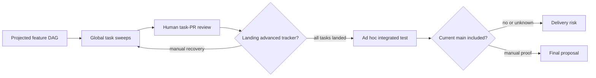

# Feature implementation drive — PRD

| Field | Value |
|---|---|
| **In one line** | A feature-scoped drive that routes a frozen task DAG through exclusive local or remote execution, human-reviewed integration, candidate-merge e2e verification, and one final proposal to main. |
| **Relevant-when** | planning, building, or reviewing feature-scoped implementation drives; triaging split execution, blocked DAG progression, feature-branch integration, review-feedback repair, or stale e2e evidence; changing implement-now dispatch, execution ownership, tracker readiness, proposal landing, e2e orchestration, or final delivery verification |
| **Status** | Draft — problem review pending |
| **Tier** | T3 — factory-control routing and delivery integrity; incorrect behavior can split execution ownership or promote an unverified feature |
| **Owner** | @mdarabi |
| **Approver(s)** | @mdarabi via the introducing PR's operator review |
| **Contributors** | product/engineering: @mdarabi + factory |
| **Informed** | Pyxis operators and implement-now/fleet maintainers |
| **Date** | 2026-07-25 created · 2026-07-25 last updated |
| **Appetite** | One complete one-repository/one-feature vertical slice: one human problem/solution/launch review; machine work for feature resolution, exclusive ownership, repeated DAG sweeps, feedback repair, candidate-merge e2e, repair loops, and delivery verification; dogfood both local and remote modes. Excludes multi-repository drives, automatic merge/takeover, a unified dashboard, and fleet-wide fairness. |
| **Target release** | After the e2e-verification authoring line is available to supply a reviewed e2e design and ordered plan; this feature is its named implementation-and-run follow-on. |
| **Tracking** | — |
| **Artifacts** | `docs/brainstorms/feature-implementation-drive.md` |
| **Template version** | prd-template/v2 |

## 0. Read to rule — the human reviewer's section (~8 min)

*The body is the contract; this section only routes attention — on any conflict the body governs; machines ignore it.*

**Judge these**

| # | The call | Could have gone | If you disagree |
|---|---|---|---|
| 1 | One feature integrates on a remote feature branch before one final proposal to main | Merge task PRs directly to main and repair there | Veto the isolation boundary and the entire chosen approach → §4.1, FR-3, FR-15 |
| 2 | Every task PR remains human-reviewed and human-merged | Auto-admit green task PRs to the feature branch | Veto the trust boundary and rescope v1 authority → FR-7, NG-1 |
| 3 | Kickoff explicitly assigns exclusive local or remote ownership | Let local and remote executors race, or default by timeout | Veto the locality guarantee and require a different routing contract → FR-1, FR-2, FR-11 |
| 4 | Terminal e2e verifies the candidate merge with current main | Test only the isolated feature head | Accept mainline-integration risk or require another pre-merge proof → FR-16, FR-17 |
| 5 | The executor stays feature-blind; the drive owns lifecycle semantics | Teach each worker about feature identity and state | Veto the local/remote portability boundary → FR-5, NR-1 |
| 6 | Final PR creation is not completion; verified mainline ancestry is | Release ownership when the PR opens or receives a merged badge | Veto goal-object delivery proof → FR-22, FR-23 |

**Sanity-check the numbers** — the acceptance fixture is one six-task DAG with parallel roots and dependencies, exercised once in local-owned mode and once in remote-owned mode; zero cross-owner implementation attempts, zero premature dependent pickups, and only SHA-current e2e evidence may authorize the final proposal (§3.2 M1–M4; §5.8).

**The author's open questions** — none — §7.2 contains design-owned mechanics that do not alter the product behavior or block solution approval.

**Skip the rest** — template structure and EARS form are backstopped by docgate and PRD review; implementation mechanics route to technical design; code defects route to implementation verification and CI.

## 1. Summary — the one-pager

- **Problem** — A frozen feature plan is implemented as independent task proposals, but no durable feature-level owner assembles those proposals off main, advances the dependency graph through human review, and proves the complete result before delivery. Task-level claims prevent duplicate issues but cannot guarantee that every present and future task remains on the human-selected local or remote execution domain.
- **For whom** — Primarily a human engineer driving and reviewing one planned feature; secondarily an autonomous driver using the same contract unattended. Standalone issues outside a frozen feature DAG remain generic executor work.
- **Why now** — `implement-now` already supplies the reusable one-sweep task executor, and e2e-verification has fixed terminal once-per-feature verification while explicitly deferring its build/run adaptation. The missing lifecycle now blocks a coherent stage-8-through-stage-10 path.
- **Direction** — Create a durable feature integration drive around the feature-blind executor. Explicit kickoff assigns exclusive execution ownership and a remote feature branch; each ready task produces a human-reviewed PR to that branch, and verified landing unlocks dependents. The complete candidate merge with current main is e2e-verified, repaired through new task PRs when red, and presented as one final human-merged proposal.
- **Appetite** — One complete single-repository vertical slice proving both local and remote ownership; no automatic merges/takeover, multi-repository DAG, unified dashboard, or fleet scheduling redesign.
- **Success** — At the dogfood checkpoint, both the local-owned and remote-owned six-task fixtures reach verified delivery with 100% of implementation attempts in the selected domain, 100% of task PRs human-reviewed before feature-branch landing, and zero invalid DAG unlocks.
- **Guardrail** — Zero final proposals may be raised from stale, skipped, inconclusive, or feature-head-only e2e evidence; zero ownership transitions may overlap active implementation attempts.
- **Top risks** — feature ownership disagrees across machines; tracker state advances without feature-branch landing; main changes invalidate a passing feature-only test without being detected.

## 2. Problem space

### 2.1 Problem statement

A human with an approved dependency-ordered feature plan cannot currently choose one execution location and rely on the factory to carry that feature through individually reviewed tasks, integrated verification, and final delivery. The available executor works one ready frontier at a time and intentionally leaves landing and re-invocation to a driver; without a feature-level lifecycle, unrelated work can share its label, future-unblocked tasks can execute elsewhere, and the complete feature has no committed candidate on which terminal e2e can make a delivery decision.

### 2.2 Users and segments

| Segment | Role and context | Domain exp. | Tech exp. | Key goals | Pain today | Evidence |
|---|---|---|---|---|---|---|
| **P1 (primary)** | Human engineer driving one approved feature and reviewing each task proposal | journeyman–master | journeyman–master | choose local or remote execution; review every increment; accept one verified feature | manually scopes sweeps, sequences merges, reconstructs integration/e2e state | `brainstorm:feature-implementation-drive#D-2/#D-3` |
| P2 (secondary) | Autonomous driver operating the same feature lifecycle unattended | master | master | resume from durable state; act only within delegated ownership | executor primitives do not define the feature lifecycle | `brainstorm:feature-implementation-drive#D-2` |
| **Anti-segment** | Ad hoc standalone issue outside a frozen feature DAG | — | — | generic issue execution | feature lifecycle would add irrelevant branch/e2e ceremony | `brainstorm:feature-implementation-drive#D-2`; NG-5 |

### 2.3 Jobs and desired outcomes

| # | When… (situation) | I want to… (motivation) | So I can… (outcome) | Today's workaround | Evidence |
|---|---|---|---|---|---|
| J1 | I have an approved, projected feature DAG | explicitly choose local or remote execution for the whole feature | keep every implementation and feedback repair in the selected domain | race task claims or manually police labels | `brainstorm:feature-implementation-drive#D-3/#D-8` |
| J2 | ready tasks produce proposals | review, request changes, and merge each task before dependents advance | control every implementation increment without breaking DAG order | inspect global issue/PR state and rerun sweeps manually | `brainstorm:feature-implementation-drive#D-3/#D-9` |
| J3 | all feature tasks have landed | verify the exact result that would combine with current main | know the complete feature works before proposing it to main | test a feature branch that may not include concurrent main changes | `brainstorm:feature-implementation-drive#D-11/#D-12` |
| J4 | integrated e2e fails | route the evidence into reviewable repair work and re-verify | correct the feature without rewriting merged history | reopen or patch prior work ad hoc | `brainstorm:feature-implementation-drive#D-10` |
| J5 | the final feature proposal merges | verify delivery and release durable ownership safely | finish with proof rather than a badge or assumption | manually inspect ancestry and clean state | `brainstorm:feature-implementation-drive#D-13` |

### 2.4 Evidence

| Claim | Source (research, data, tickets, interviews) | Confidence |
|---|---|---|
| The executor is a one-sweep, label/base-configured, feature-blind primitive whose driver owns landing and re-invocation. | `brainstorm:feature-implementation-drive#F-2/#F-3`; current executor code | High |
| Cross-machine task claims prevent duplicate issue execution but cannot reserve future tasks of a feature to one domain. | `brainstorm:feature-implementation-drive#F-4` | High |
| Terminal e2e is once per integrated feature, and its build/run adaptation is explicitly deferred follow-on work. | `brainstorm:feature-implementation-drive#F-5`; `prd:e2e-verification` | High |
| The entity model has task, proposal, feedback, node, and e2e concepts but no feature-drive ownership lifecycle. | `brainstorm:feature-implementation-drive#F-6` | High |
| Non-default-base proposal landing may not advance tracker closure automatically, so the drive must verify and advance state explicitly. | `brainstorm:feature-implementation-drive#F-7` | Medium |

### 2.5 The journey today

| Phase | User does | User feels / pain | Frontstage (what user sees) | Backstage (systems, people, processes) |
|---|---|---|---|---|
| Choose execution | runs an executor or leaves tagged work for a fleet | no feature-wide ownership guarantee | one command or tagged issues | independent task claims only |
| Implement roots | reviews ready-task PRs | global pool and base obscure feature scope | task PRs | one executor sweep |
| Advance DAG | merges blockers and reruns | manually correlates landing, closure, and readiness | tracker + PRs | blocker openness drives readiness |
| Verify feature | assembles and tests complete work | no canonical candidate against current main | local branch/CI | e2e build/run lifecycle absent |
| Repair/deliver | patches failures and opens final PR | evidence and ownership can drift | repair PRs/final PR | no durable feature completion state |

### 2.6 Opportunity and why now

- **Size** — Every multi-task feature implemented by the native executor needs one owner across task review, DAG advancement, integration, and terminal verification; the dogfood acceptance uses both execution modes on the same representative DAG shape.
- **Alternatives users have** — merge task PRs directly to main and fix forward; manually maintain a feature branch and rerun executor sweeps; use only a remote generic task pool; hold all work in one shared worktree.
- **Why us / strategic fit** — Pyxis already owns the dependency graph, executor ports, proposal evidence, and e2e authoring line; composing them behind medium-neutral contracts closes the pipeline without privileged substrate.
- **Why now** — The reusable executor is built, and the e2e contract names this implementation/run adaptation as its follow-on.
- **Cost of doing nothing** — Humans continue operating the stage boundaries, local/remote choice remains best-effort, and feature-level verification cannot reliably authorize delivery.

**Decision:** Problem gate — pending the introducing PR's operator review.

| Reviewer | Role | Date | Verdict |
|---|---|---|---|
| @mdarabi | operator/product/engineering | — | pending |

## 3. Goals, metrics, and guardrails

### 3.1 Goals as falsifiable hypotheses

| # | We believe that… | Will result in… | Measured by… |
|---|---|---|---|
| G1 | a durable feature drive with explicit ownership will keep a feature's implementation in the selected domain | zero split-domain task or feedback-repair attempts | M1 |
| G2 | verified task landing as the only DAG-advance event will preserve dependency order through human review | every eligible transition corresponds to a landed blocker and no premature pickup | M2 |
| G3 | candidate-merge e2e with repair work will prevent unverified integrated features from reaching final proposal | every final proposal binds to current accepted evidence and every seeded failure repairs before proposal | M3 |
| G4 | one drive contract over a feature-blind executor will preserve local/remote behavioral equivalence | both modes complete the same acceptance fixture with the same review and verification semantics | M4 |

### 3.2 Goals → signals → metrics

| Metric | Goal | Signal | Baseline | Target (at checkpoint) | Feeds from |
|---|---|---|---|---|---|
| M1 (primary) | G1 | implementation attempt executes in recorded owner domain | task claims prevent duplicate issue work but feature-domain affinity is absent | 100% in-domain and zero overlapping ownership across both dogfood drives | EVT-2, EVT-3 |
| M2 | G2 | task readiness transition follows verified blocker landing | driver-managed, not feature-contract measured | 100% valid transitions and zero premature dependent pickups in the six-task fixtures | EVT-4 |
| M3 | G3 | final-proposal eligibility is backed by accepted current candidate evidence | terminal implementation/run loop absent | 100% current evidence; seeded failure produces repair and no premature final proposal | EVT-5, EVT-6, EVT-7 |
| M4 | G4 | equivalent fixture outcome in local and remote ownership modes | no feature-drive modes | both fixtures reach verified delivery with identical required state transitions | EVT-1, EVT-8 |

### 3.3 Guardrails and decision rule

| Guardrail metric | Threshold | Action if breached |
|---|---|---|
| Cross-owner implementation attempts | any attempt in a domain other than the current recorded owner, or any overlapping handoff | stop the drive, preserve artifacts, require human recovery |
| Premature DAG advancement | any dependent becomes executable before every blocker is verified landed on the feature branch | stop routing and fail the release fixture |
| Stale verification authorization | any final proposal raised after feature head or main head changed from accepted evidence | close/draft-block the proposal, invalidate evidence, rerun verification |
| Unauthorized merge | any task or final proposal merged by the drive | disable the drive and escalate as a factory-control defect |

**Ship rule (pre-registered):** both dogfood modes satisfy M1–M4, the seeded e2e failure is repaired through a reviewed PR, and no guardrail is breached; otherwise do not ship.

### 3.4 Non-goals and waiting room

| ID | Non-goal | Why refused |
|---|---|---|
| NG-1 | Automatically merge task proposals | Human review and merge is a binding trust boundary. |
| NG-2 | Send task proposals directly to main | The feature branch is the integration and isolation boundary. |
| NG-3 | Share one literal worker worktree | Workers stay isolated; committed state is reproducible and portable. |
| NG-4 | Redesign the e2e authoring line | This feature consumes its reviewed design and ordered plan. |
| NG-5 | Orchestrate generic standalone issues | Generic work remains in the ordinary executor pool. |
| NG-6 | Automatically take over stale local ownership | Recovery and handoff are explicit human acts. |
| NG-7 | Automatically merge the final feature proposal | Final acceptance and merge remain human authority. |
| NG-8 | Coordinate multi-repository feature DAGs | V1 is one feature in one repository. |
| NG-9 | Optimize fleet-wide fairness and capacity | That is umbrella fleet policy, not feature lifecycle behavior. |
| NG-10 | Build a unified feature dashboard | Native action surfaces plus minimal recovery diagnostics suffice for v1. |

| ID | Waiting room | Revisit when / intended version |
|---|---|---|
| WR-1 | Automatic low-risk task-PR admission | A future autonomy-level policy explicitly grants it and evidence shows human review can graduate safely. |
| WR-2 | Automatic stale-owner failover | A recovery policy can prove no split brain and the operator authorizes automatic transfer. |
| WR-3 | Multi-repository feature drives | The single-repository lifecycle is stable and a real cross-repository contract exists. |
| WR-4 | Unified feature progress surface | Native surfaces produce repeated, measured navigation or recovery failures. |
| WR-5 | Fleet-wide scheduling and fairness | Multiple remote feature drives demonstrate starvation or capacity contention beyond existing fleet policy. |

## 4. Solution space

### 4.1 Approach and alternatives considered

The feature integration drive is the durable stage-8-through-stage-10 lifecycle. It resolves one frozen feature DAG to a remote feature branch and an exclusive execution owner, invokes the feature-blind executor for ready tasks, waits for human-reviewed landing, advances only from verified integrated state, verifies a candidate merge with current main, routes failures into repair work, and proves delivery before releasing ownership.

| Option | Sketch | Why not chosen |
|---|---|---|
| A (chosen) | Feature-aware integration drive over feature-blind task execution, with mandatory ownership and durable branch/evidence state | — |
| B | Feature-level execution reservation as the product center | Too narrow: prevents split execution but does not own review, integration, e2e, repair, and delivery. |
| C | Durable feature delivery workspace as the product center | Describes the state substrate but not the user job or lifecycle. |
| Merge directly to main | Integrate all task PRs on main and run e2e afterward | Makes incomplete or red feature state shared/releasable history. |
| Literal single worktree | Serialize all tasks in one mutable checkout | Loses task isolation, clean-SHA reproducibility, and portable local/remote execution. |
| Do nothing | Keep one-sweep task execution and manual driver work | Leaves locality, terminal verification, and completion as human-operated gaps. |

### 4.2 Scope perimeter

- **In (plan of record)** — feature resolution; remote feature branch; explicit local/remote ownership; non-preemptive handoff; machine-affine resumable local sweeps; feature-blind executor assignment; human-reviewed task PRs; same-PR feedback repair; verified DAG advancement; candidate-merge e2e; manual-route attestations; e2e repair tasks; final proposal; verified main delivery; cancellation, explicit resume/permanent abandonment, and safe cleanup; action-oriented reporting and minimal diagnostics.
- **Future (believed next, not committed)** — risk-governed automatic task admission; automatic stale-owner recovery; multi-repository drives; unified status surface; fleet fairness.
- **Out** — automatic task/final merges; direct-to-main task PRs; shared worker worktree; e2e authoring redesign; generic issue orchestration; implicit timeout routing.

### 4.3 Experience: flows and states

**Flow F1 — Kick off and implement a feature (serves J1, J2)**

| Step | User does | System responds | States covered | Design |
|---|---|---|---|---|
| 1 | selects local or remote execution for a frozen feature | records exclusive owner and remote feature-branch target, or refuses a conflicting owner | ideal · conflict · invalid feature | technical design owed |
| 2 | reviews ready-task proposals | keeps dependents blocked; routes requested changes to the current owner on the same proposal | awaiting review · changes requested · approved · error | code-host review surface |
| 3 | merges an approved task proposal | verifies feature-branch landing, advances tracker state, and exposes newly ready tasks | merged · partial DAG · complete DAG · verification failure | tracker/code-host surfaces |

- **Empty** — an unowned frozen feature presents the explicit local/remote kickoff choices; no worker may start.
- **Loading** — the attended command reports the active sweep; review waits checkpoint and exit rather than keeping a process alive.
- **Partial** — independent DAG branches may be in implementation, review, or landed states simultaneously.
- **Error** — conflicting ownership, failed landing verification, or stale owner stops routing and preserves all artifacts.
- **Accessibility** — CLI output and code-host/tracker action surfaces retain their existing accessibility contracts; no new visual UI ships.
- **Localization** — machine-facing states and operator CLI text are English-only in v1; no customer-facing strings ship.

**Flow F2 — Verify, repair, and deliver (serves J3–J5)**

| Step | User does | System responds | States covered | Design |
|---|---|---|---|---|
| 1 | completes all task reviews/merges | constructs a non-mutating candidate merge from exact feature/main heads | ready · merge conflict · stale input | technical design owed |
| 2 | supplies any required manual-human scenario result | binds accepted attestation to the candidate; blocks on skipped/inconclusive routes | running · manual pending · failed · accepted | e2e evidence surface |
| 3 | reviews repair proposals after a failure | integrates repairs and reruns the full e2e set on a new candidate | repair pending · re-verifying | tracker/code-host surfaces |
| 4 | reviews and merges the final proposal | verifies mainline ancestry, marks delivered, releases ownership, and cleans disposable state | final review · feedback · merged · delivered | code-host surface |

- **Empty** — no terminal verification begins until every feature task is verified landed.
- **Loading** — scenario progress appears through the configured e2e runner; the drive owns no dashboard.
- **Partial** — manual-human routes may remain pending while automated routes have settled; the final proposal stays blocked.
- **Error** — merge conflict, red/skipped/inconclusive scenario, or stale input produces repair or a decision brief, never green.

### 4.4 Scenarios

**Local-owned common case.** A human starts a six-task feature locally. Two roots produce separate PRs, the human requests changes on one and approves both, and verified merges unlock their respective dependents. The process exits during review waits but every later implementation attempt resumes on the same registered machine. After all tasks land, candidate-merge e2e passes and one final proposal is raised for human merge.

**Remote-owned equivalent.** The human explicitly assigns an unowned feature to remote execution. The remote scheduler supplies routing scope and base to the same feature-blind executor; PR review, DAG advancement, e2e evidence, and final delivery are behaviorally identical to the local case.

**Integrated failure.** The candidate merge fails a required scenario. The failure is bound to its exact heads, a new repair task cites implicated work, and a human-reviewed repair PR lands on the feature branch. All required scenarios rerun on the new candidate before a final proposal may exist.

**Ownership conflict and recovery.** A remote-owned feature is invoked locally. The local command refuses and reports the owner. The human requests handoff; active attempts checkpoint or finish, ownership transfers, and future implementation resumes locally with no overlap or artifact loss.

**Decision:** Solution gate — pending the introducing PR's operator review.

| Reviewer | Role | Date | Verdict |
|---|---|---|---|
| @mdarabi | operator/product/engineering | — | pending |

## 5. System requirements

### 5.1 Functional requirements

| ID | Requirement (EARS) | Rationale | Priority | Risk | Fit criterion | Verify | Traces to |
|---|---|---|---|---|---|---|---|
| FR-1 | When an eligible frozen feature is kicked off, the feature drive shall require an explicit local or remote execution assignment before exposing any task for execution. | Prevent routing races. | Must | critical | Across both acceptance modes, zero task attempts occur before assignment; an unowned fixture remains idle. | Test | G1, J1, F1 |
| FR-2 | While a feature has an execution owner, the feature drive shall expose implementation and feedback-repair tasks only to that owner domain. | Guarantee locality. | Must | critical | In both six-task fixtures, 100% of implementation attempts identify the recorded domain and zero attempts execute elsewhere. | Test | G1, J1, F1 |
| FR-3 | When a feature is first assigned, the feature drive shall establish a remote feature integration branch as the base and proposal target for its tasks. | Isolate incomplete integration from main. | Must | high | Every task proposal in both fixtures targets the feature branch; zero targets main. | Test | G2, J2, F1 |
| FR-4 | The feature drive shall maintain a routing scope that selects exactly the feature's executable task set. | Isolate concurrent features and generic work. | Must | critical | Concurrent fixtures with unrelated routed issues show zero cross-feature pickup and zero generic-pool pickup by the drive. | Test | G1, J1, F1 |
| FR-5 | When the feature drive assigns a ready task, it shall provide the feature-blind executor only the ordinary task charter, routing scope, target base, and execution policy needed for that attempt. | Preserve executor portability. | Must | high | Interface inspection and local/remote conformance show workers consume no feature-lifecycle state. | Inspection, Test | G4, J1, F1 |
| FR-6 | While a task has an open proposal, the feature drive shall keep that task incomplete for dependency readiness. | Review is part of completion. | Must | high | Open, changes-requested, and approved-but-unmerged fixtures each keep all dependents blocked. | Test | G2, J2, F1 |
| FR-7 | When an implementation task becomes proposal-ready, the feature drive shall present a distinct proposal for human review and human merge into the feature branch. | Preserve task-level human control. | Must | critical | Every implementation/repair task in dogfood has one proposal, a human review event, and a human merge event before landing. | Demo, Inspection | G2, J2, F1 |
| FR-8 | When review requests changes within the task charter, the feature drive shall route the feedback to the current owner for repair on the same task proposal. | Avoid duplicate proposals and retain context. | Must | high | Seeded feedback updates the same proposal, refreshes revision-bound evidence, and creates no second proposal. | Test, Demo | G2, J2, F1 |
| FR-9 | When review feedback requires work outside the task charter, the feature drive shall keep the task blocked and create a new dependency-linked work item. | Keep scope explicit. | Must | high | Seeded out-of-charter feedback creates exactly one linked task and does not silently widen the proposal. | Test | G2, J2, F1 |
| FR-10 | When a task proposal merges, the feature drive shall verify its revision landed on the feature branch before advancing tracker completion or dependency readiness. | Do not trust badge/default-branch semantics. | Must | critical | A false merged badge/non-ancestor fixture advances nothing; verified ancestry advances exactly the valid dependents. | Test | G2, J2, F1 |
| FR-11 | When a different execution domain requests an owned feature, the feature drive shall refuse concurrent start and report the current owner. | Prevent split brain. | Must | critical | 100 simultaneous conflicting requests yield one owner, zero foreign attempts, and explicit refusal to every loser. | Test | G1, J1, F1 |
| FR-12 | When the human requests ownership handoff, the feature drive shall transfer ownership only after every active implementation attempt has finished or checkpointed. | Preserve work and exclusivity. | Must | critical | Failure-injection across each attempt state produces zero overlap, zero lost checkpoint, and only post-transfer work in the new domain. | Test | G1, J1, F1 |
| FR-13 | While a feature awaits human review, the feature drive shall persist ownership and progress without requiring a live implementation process. | Human waits may span sessions. | Must | high | Process termination/restart during every review state preserves owner, proposal, DAG state, and same-machine local affinity. | Test | G1, J2, F1 |
| FR-14 | When all implementation and repair tasks are verified landed, the feature drive shall begin terminal verification only if no feature task remains incomplete. | Verify the whole integrated feature. | Must | high | A fixture with any open task cannot create terminal evidence; the fully landed fixture can. | Test | G3, J3, F2 |
| FR-15 | The feature drive shall keep all implementation and repair changes off main until a final feature proposal is eligible. | Keep main releasable. | Must | critical | Main ancestry inspection before final eligibility contains none of the fixture's task revisions. | Test | G3, J3, F2 |
| FR-16 | When terminal verification begins, the feature drive shall construct a non-mutating candidate merge from the exact feature head and current target-main head. | Test the deliverable under concurrent main changes. | Must | critical | Both input branches remain byte-identical; evidence records both heads and the resulting candidate identity. | Test | G3, J3, F2 |
| FR-17 | While terminal evidence is pending or accepted, the feature drive shall invalidate that evidence when either candidate input head changes. | Prevent stale authorization. | Must | critical | All feature-head and main-head mutation fixtures invalidate prior evidence and block final eligibility. | Test | G3, J3, F2 |
| FR-18 | Where an e2e scenario is declared manual-human, the feature drive shall accept only an explicit human attestation bound to the current candidate identity. | Preserve manual route integrity. | Must | high | Wrong-SHA, missing-identity, and machine-authored attestations are refused; a valid human attestation settles only its scenario. | Test | G3, J3, F2 |
| FR-19 | The feature drive shall require an accepted outcome for every required e2e scenario before making the final proposal eligible. | “Could not run” is not green. | Must | critical | Failed, skipped, unavailable, inconclusive, and manual-pending fixtures each block; all accepted outcomes unblock. | Test | G3, J3, F2 |
| FR-20 | When terminal e2e fails, the feature drive shall create feature-scoped repair work carrying the failed candidate identity, evidence, and links to implicated work. | Make integrated defects traceable. | Must | high | Seeded failure yields one repair item with all required references and no mutation of merged task history. | Test, Inspection | G3, J4, F2 |
| FR-21 | When a repair proposal lands, the feature drive shall rerun every required e2e scenario on a new candidate merge before restoring final eligibility. | Re-prove the complete feature. | Must | critical | The seeded repair invalidates old evidence; partial rerun cannot unblock; full accepted rerun can. | Test | G3, J4, F2 |
| FR-22 | When all required candidate evidence is current and accepted, the feature drive shall raise one final human-reviewed proposal from the feature branch to main without merging it. | Present one complete result. | Must | critical | Exactly one final proposal exists, identifies the accepted candidate inputs/evidence, and has no drive-authored merge event. | Test, Inspection | G3, J5, F2 |
| FR-23 | When the final proposal merges, the feature drive shall verify the delivered feature revision is an ancestor of main before marking the drive complete. | Badge is not delivery proof. | Must | critical | Merged-but-wrong-base fixture remains incomplete; verified main ancestry transitions exactly once to delivered. | Test | G3, J5, F2 |
| FR-24 | When delivery is verified, the feature drive shall release execution ownership and routing before cleaning disposable state according to retention policy. | End safely and prevent new work. | Must | high | No post-delivery attempt is routable; cleanup never precedes ancestry verification; retained artifacts follow policy. | Test | G1, J5, F2 |
| FR-25 | When cancellation is requested, the feature drive shall quiesce active attempts, release ownership and executable routing, and preserve all durable work artifacts pending a separate cleanup decision. | Stop without data loss. | Must | high | Cancellation drills in each active state yield zero continued attempts and zero branch/commit/PR/evidence deletion. | Test | J1, F1 |
| FR-26 | Where a specialized e2e runner is declared, the feature drive shall route the scenario to that runner while retaining candidate-bound evidence and runner identity. | Support real test environments. | Must | high | Local- and remote-owned fixtures can use a declared runner; evidence identifies it and binds the same candidate. | Test | G3, J3, F2 |
| FR-27 | The feature drive shall surface action-required state through the existing proposal, tracker, command, and notification surfaces and provide a minimal durable-state diagnostic. | Put information where action occurs. | Should | med | Dogfood exposes every human action at its native surface; restart diagnostic reconstructs owner, next action, and evidence status. | Demo | J1–J5, F1, F2 |
| FR-28 | When the human explicitly resumes a cancelled feature, the feature drive shall require a new execution assignment before restoring executable routing. | Resume must not infer stale ownership. | Must | critical | Cancel-then-resume fixtures remain inert until assignment and then route 100% of attempts to the newly recorded owner. | Test | G1, J1, F1 |
| FR-29 | When the human explicitly abandons a cancelled feature, the feature drive shall mark the drive terminal while preserving durable artifacts until separately confirmed cleanup. | Separate stopping from destruction. | Must | high | Abandonment creates no executable work and deletes no branch, commit, proposal, task history, or evidence. | Test | J1, F1 |
| FR-30 | Where no specialized e2e runner is declared, the feature drive shall execute terminal e2e in the current execution-owner domain. | Give every drive a deterministic verification route. | Must | high | Local-owned and remote-owned fixtures with no runner configuration execute every automatic scenario in their respective owner domain and record runner identity. | Test | G3, J3, F2 |

**Non-regression (NR-n)**

| ID | Existing behavior protected | Why protected | Risk | Fit criterion | Verify | Traces to |
|---|---|---|---|---|---|---|
| NR-1 | The single-task executor remains feature-blind and reusable for generic local/fleet work. | Feature lifecycle must not fork the worker core. | critical | Existing executor conformance suites pass unchanged; generic-label/main-base execution requires no feature-drive state. | Test, Inspection | FR-5, G4 |
| NR-2 | Cross-machine task claims continue to prevent duplicate issue execution. | Feature ownership complements rather than weakens task safety. | critical | Existing lease conformance passes; overlap fixture yields at most one task claimant even under misrouting. | Test | FR-2, FR-11 |
| NR-3 | Generic standalone routed issues remain executable without feature branches or terminal feature e2e. | Anti-segment continuity. | high | Existing generic executor e2e passes with no feature-drive artifact created. | Test | NG-5 |
| NR-4 | Existing e2e design/review/plan artifacts and routes remain unchanged. | This feature is the deferred build/run consumer. | high | Byte-level inspection shows no contract change to the e2e authoring line; its output is accepted as input. | Inspection, Test | FR-14, FR-18 |
| NR-5 | Existing human merge authority and repository gates remain in force. | The drive gains no merge authority. | critical | Authorization tests show zero drive merges and unchanged required review/check behavior. | Test | FR-7, FR-22 |
| NR-6 | Main remains free of incomplete feature task revisions before final human merge. | Preserve releasability. | critical | Ancestry inspection across dogfood shows zero task revision on main before final merge. | Test | FR-15 |

### 5.2 Unwanted behavior and failure handling

| ID | If… (trigger) | Then the system shall… | User sees | Priority | Risk | Fit criterion | Verify | Traces to |
|---|---|---|---|---|---|---|---|---|
| UB-1 | If kickoff names a missing, ungated, or non-frozen feature plan | refuse ownership and task execution with the failed precondition and remedy | invalid-feature error | Must | high | 100% invalid fixtures refuse with zero durable execution artifacts. | Test | F1, FR-1 |
| UB-2 | If ownership state is missing, malformed, conflicting, or unverifiable | fail closed and route no work | ownership diagnostic + human recovery action | Must | critical | Every malformed/conflict fixture produces zero task attempts. | Test | F1, FR-2 |
| UB-3 | If the current owner becomes unavailable | preserve ownership and stop new work until explicit resume, handoff, cancellation, or abandonment | stale-owner action required | Must | critical | Simulated disappearance produces zero automatic takeover and zero foreign execution. | Test | F1, FR-11, NG-6 |
| UB-4 | If handoff cannot quiesce an active attempt | keep the old owner and refuse transfer | handoff blocked with active attempt reference | Must | critical | Timeout/failure fixtures show no owner mutation and no overlapping attempt. | Test | F1, FR-12 |
| UB-5 | If task-proposal landing cannot be verified on the feature branch | keep the task and dependents incomplete | landing-verification failure | Must | critical | Wrong-base, stale-head, and missing-revision fixtures advance nothing. | Test | F1, FR-10 |
| UB-6 | If the candidate merge conflicts | create no terminal green evidence and surface conflict repair work | merge-conflict repair required | Must | high | Conflict fixtures preserve both branches and block final eligibility. | Test | F2, FR-16 |
| UB-7 | If any required e2e route is failed, skipped, unavailable, inconclusive, or awaiting manual attestation | keep the final proposal ineligible and surface the exact blocking route | verification blocked | Must | critical | Each route state independently blocks in the verdict matrix. | Test | F2, FR-19 |
| UB-8 | If feature or main changes after accepted e2e | invalidate the accepted verdict before any final-proposal action | verification stale; rerun required | Must | critical | Race tests at every action boundary produce zero stale-authorized proposal. | Test | F2, FR-17 |
| UB-9 | If final-PR feedback changes the feature head | return to candidate construction and full terminal verification | final review waiting on re-verification | Must | critical | Seeded feedback invalidates evidence and prevents merge-ready state until full rerun. | Test | F2, FR-17, FR-21 |
| UB-10 | If a merged final proposal does not place the verified revision on main | remain incomplete and issue a delivery-verification escalation | delivery not proven | Must | critical | Wrong-base/partial-merge fixtures never release ownership. | Test | F2, FR-23 |
| UB-11 | If cancellation occurs while work is active | checkpoint or finish the attempt before de-routing, preserving durable artifacts | cancellation pending, then cancelled | Must | high | Failure drills show no mid-write destruction and no post-cancel pickup. | Test | F1, FR-25 |

### 5.3 Permissions and abuse cases

| Function / data | Human operator | Current execution owner | Non-owner executor | Unauthenticated |
|---|---|---|---|---|
| Select initial execution domain | authorize | read | none | none |
| Execute/repair feature tasks | observe/review | execute assigned tasks | none | none |
| Request handoff/cancel/abandon | authorize | checkpoint/acknowledge | none | none |
| Review and merge task/final proposals | review/merge | propose/update only | none | none |
| Submit manual-human e2e attestation | attest | record/verify binding | none | none |

| ID | Actor and intent | Vector | Impact | Severity | Mitigated by | Verify |
|---|---|---|---|---|---|---|
| ABUSE-1 | Remote executor tries to steal a local-owned feature | claims a newly ready issue before local resume | locality breach and split feature history | critical | FR-2, FR-4, FR-11, NFR-1 | concurrent ownership drill |
| ABUSE-2 | Owner or injected worker attempts to bypass human review | merges or marks complete from proposal/label state alone | unauthorized feature integration | critical | FR-7, FR-10, NR-5 | authorization + wrong-base tests |
| ABUSE-3 | Actor replays passing e2e evidence for another revision | copies verdict without current input identities | unverified feature reaches main | critical | FR-16–FR-19, NFR-2 | replay/race corpus |
| ABUSE-4 | Stale owner resumes after handoff | uses old local state or task ref | overlapping implementation | critical | FR-11–FR-13, NFR-1 | stale-owner recovery drill |
| ABUSE-5 | Machine submits a human-route attestation | forges or omits acting identity | manual requirement falsely passes | high | FR-18, NFR-2 | attribution-negative tests |

### 5.4 Data

| Entity / field | Meaning | Source of truth | Retention | Integrity rules | Privacy class |
|---|---|---|---|---|---|
| Feature drive identity | stable join from frozen feature plan to lifecycle state | configured work tracker / drive state adapter | through delivery or explicit abandonment; audit according to repo policy | one active drive per feature/repository | internal |
| Execution ownership | domain, registered machine when local, state, transition evidence | shared ownership store adapter | active through verified delivery/cancel; transition history retained by policy | exclusive; holder/transition authenticated; fail closed on ambiguity | internal |
| Feature integration ref | durable committed integration state | code host / git adapter | until verified delivery plus branch-retention policy | target and head identities explicit; never inferred from checkout state | internal |
| Task/proposal state | charter, blockers, review/head/landing evidence | work tracker + code host adapters | existing medium policy | completion only after verified feature-branch landing | internal |
| Candidate evidence | feature head, main head, candidate identity, scenario outcomes, runner/actor identity | e2e evidence adapter | through delivery/abandonment plus audit policy | immutable per candidate; any input change creates new evidence | internal |
| Delivery proof | final proposal and mainline ancestry result | code host adapter | existing proposal/audit policy | goal-object verified before completion | internal |

- **Migration** — none; feature drives begin only for newly kicked-off frozen features in v1. Existing in-flight task pools remain on their current path.
- **Parallel-run / cutover** — generic executor behavior remains available in parallel; a feature enters the new path only through explicit kickoff.
- **Rollback** — disable new feature-drive kickoff, preserve all durable branches/proposals/evidence, and return unstarted work to its prior explicit routing only by human action.
- **Decommission** — remove the drive only after no active ownership remains and every retained artifact has an explicit disposition.
- **Privacy check** — no DPIA trigger identified: no personal/sensitive data, profiling, monitoring of people, or new external data use.
- **Egress** — code/task/e2e content follows the configured executor, code-host, tracker, and runner adapters already selected by the repository; this feature adds no destination and records runner identity so operators can inspect where verification ran.

### 5.5 Interfaces and integrations

| Interface | Direction | Purpose | Contract (format, ranges, timing) | Failure modes | Owner |
|---|---|---|---|---|---|
| Frozen feature-plan resolver | in | resolve feature identity and exact task DAG | one feature/repository; rejects ungated/non-frozen input | missing, ambiguous, stale projection | planning adapter owner |
| Feature ownership store | both | exclusive assignment, handoff, release, cancellation | durable cross-machine state; one owner; transition evidence | conflict, stale owner, malformed state | feature-drive design |
| Work tracker | both | read DAG/readiness; record completion/repair work | existing task and blocked-by dialect; state advances after verified landing | non-default-base closure mismatch, stale read | tracker adapter owner |
| Code host / git | both | feature refs, task/final proposals, review and ancestry evidence | revision-pinned proposals/reviews; remote branch required | conflict, wrong base, head race, auth failure | code-host adapter owner |
| implement-now executor | out/in | implement one ready frontier in selected domain | existing task/label/base/runtime policies; feature-blind worker | claim loss, worker failure, red proposal | executor owner |
| E2e design/plan/evidence | in/both | execute required scenarios and decide final eligibility | reviewed design + ordered tasks; outcomes bound to candidate and runner/actor | unavailable route, stale/replayed evidence | e2e-verification owner |
| Notification/action surfaces | out | surface human review, manual scenario, ownership, and recovery actions | existing medium-native notifications; instruction-free wake content | lost signal, duplicate signal | trigger/medium adapter owner |

### 5.6 Non-functional requirements

| ID | Area | Requirement | Fit criterion | Verify |
|---|---|---|---|---|
| NFR-1 | Concurrency integrity | The feature drive shall preserve single-owner execution under concurrent kickoff, resume, handoff, cancellation, and task-readiness races. | In 100 repetitions of each race fixture, zero overlapping owners and zero foreign implementation attempts. | Test |
| NFR-2 | Evidence integrity | The feature drive shall bind every review, manual attestation, e2e outcome, and delivery proof to the acting identity and exact revision identities required by its decision. | Replay, wrong-head, missing-identity, and stale-input corpus: 100% refused; clean controls: 100% accepted. | Test |
| NFR-3 | Resumability | The feature drive shall reconstruct every non-terminal state from durable adapter state after process loss. | Restart injected at every lifecycle transition resumes to the same owner, DAG, proposal, and evidence state with zero duplicate proposals. | Test |
| NFR-4 | Portability | The feature-drive core shall express tracker, code-host, ownership, executor, e2e, and notification dependencies through medium-neutral contracts. | GitHub/Git binding passes conformance; inspection finds no medium SDK/CLI import in the core. | Test, Inspection |
| NFR-5 | Idle cost | While awaiting human review or manual action, the feature drive shall require no live model session or worker process. | A full review-wait fixture records zero model calls and zero worker processes until a wake/re-invocation. | Test, Analysis |
| NFR-6 | Operability | The feature drive shall provide enough diagnostic state to identify owner, lifecycle state, exact blocking condition, and next human action without a unified dashboard. | Every failure fixture produces one named condition and remedy; restart diagnostic agrees with durable state. | Demo, Test |
| NFR-7 | Cost | The feature drive shall add no model inference to idle, ownership, DAG, evidence-validity, or delivery-verification decisions. | Instrumentation attributes zero tokens to deterministic lifecycle transitions; model spend comes only from configured implementation/review/e2e judgment steps. | Analysis |
| NFR-8 | Security | The feature drive shall fail closed on ambiguous authority, ownership, revision, or evidence state and preserve artifacts on destructive paths. | All ambiguity/destructive-path fixtures stop work and delete no durable artifact without explicit human confirmation. | Test |

### 5.7 Instrumentation — the tracking plan

| ID | Event name | Fires when | Properties (typed) | Source | Feeds |
|---|---|---|---|---|---|
| EVT-1 | feature_drive_transition | lifecycle state changes | feature_id: string, from: enum, to: enum, owner_domain: enum(local·remote·none), reason: enum | drive core | M4 |
| EVT-2 | feature_ownership_transition | ownership is acquired, handed off, released, or refused | feature_id: string, old_owner: string?, new_owner: string?, outcome: enum, active_attempts: int | ownership adapter | M1 |
| EVT-3 | feature_task_attempt | implementation/repair attempt starts or stops | feature_id: string, task_id: string, owner_domain: enum, machine_id: string?, outcome: enum | executor boundary | M1 |
| EVT-4 | feature_task_advanced | verified landing changes task/DAG state | feature_id: string, task_id: string, proposal_ref: string, landed_revision: string, unlocked_count: int | drive core | M2 |
| EVT-5 | candidate_created | candidate merge is constructed | feature_id: string, feature_head: string, main_head: string, candidate_id: string, outcome: enum | e2e boundary | M3 |
| EVT-6 | e2e_scenario_settled | one required scenario settles | feature_id: string, candidate_id: string, scenario_id: string, route: enum, outcome: enum, runner_id: string, actor_id: string? | e2e adapter | M3 |
| EVT-7 | e2e_repair_created | failed evidence becomes repair work | feature_id: string, candidate_id: string, repair_task_id: string, implicated_refs: string[] | tracker boundary | M3 |
| EVT-8 | feature_delivery_verified | final delivery ancestry settles | feature_id: string, proposal_ref: string, verified_revision: string, main_head: string, outcome: enum | code-host boundary | M4 |

### 5.8 Definition of Done

| ID | Done criterion | Source | Verify | Required evidence | Blocking? |
|---|---|---|---|---|---|
| DOD-1 | All Must functional and failure requirements pass their fit criteria. | FR-1..FR-30, UB-1..UB-11 | Test, Demo, Inspection | conformance and acceptance-suite report | yes |
| DOD-2 | Existing executor, task-claim, generic-pool, e2e-authoring, merge-authority, and mainline-isolation behavior remains intact. | NR-1..NR-6 | Test, Inspection | non-regression suite + boundary inspection | yes |
| DOD-3 | The local-owned six-task dogfood completes through human-reviewed task PRs, seeded feedback, seeded e2e failure/repair, accepted candidate, and verified delivery with no guardrail breach. | M1–M4, §3.3, FR-1..FR-24 | Demo, Analysis | local drive journal, PR/evidence refs, metric rollup | yes |
| DOD-4 | The equivalent remote-owned dogfood completes with the same lifecycle semantics and no feature-aware worker behavior. | M1–M4, FR-2, FR-5, NFR-4 | Demo, Inspection | remote drive journal, conformance result, boundary inspection | yes |
| DOD-5 | Ownership race, stale owner, handoff, process-loss, cancellation, wrong-base landing, stale evidence, candidate conflict, and wrong-main delivery drills fail closed without artifact loss. | UB-2..UB-11, NFR-1..NFR-3, NFR-8 | Test | failure-injection matrix | yes |
| DOD-6 | Manual-human e2e routes accept only current candidate-bound human attestations; all non-accepted route states block. | FR-18, FR-19, NFR-2 | Test | attribution/replay verdict corpus | yes |
| DOD-7 | Required events produce an auditable feature trace and deterministic transitions consume zero inference. | EVT-1..EVT-8, NFR-7 | Analysis, Test | event-schema fixtures + token attribution report | yes |
| DOD-8 | Operator accepts the problem, solution, launch boundary, and six-call §0 routing through the introducing PR review. | §2.6, §4.4, §6.6 | Human judgment — @mdarabi, rubric: all three gate tables approved and no unresolved veto on §0 calls | introducing PR review record | yes |

### 5.9 AI behavior and evals

Skipped: the feature drive's lifecycle and ownership decisions are deterministic; model-driven implementation and e2e authoring retain their existing eval contracts.

## 6. Delivery

### 6.1 Phasing and milestones

| Phase | Purpose | Scope | Exit criterion |
|---|---|---|---|
| A — contracts and deterministic lifecycle | prove the state/ownership boundaries without external side effects | core contracts, state model, ownership/race/cancellation fixtures, feature-blind executor conformance | NFR-1..NFR-4 and UB-1..UB-5 green in hermetic adapters |
| B — GitHub/Git local-owned dogfood | prove human review, DAG integration, candidate e2e, repair, and delivery | first adapters + local machine affinity + full local acceptance fixture | DOD-3 and DOD-5 local paths green |
| C — remote-owned parity | prove the same lifecycle on a separate execution domain | remote scheduler binding, handoff, remote e2e/default runner path | DOD-4 and remaining DOD rows green; ship rule passes |

### 6.2 Dependencies

| Dependency | Type (team / system / vendor / approval) | Needed by | Status | Owner |
|---|---|---|---|---|
| Frozen feature DAG and tracker projection | system | Phase B | existing; feature-scoped resolution behavior must be designed | plan-new / tracker owners |
| implement-now executor ports and adapters | system | Phase A | existing | implement-now owner |
| Proposal feedback capture/resumption | system | Phase B | existing adjacent capability; exact consuming seam must be validated | review-feedback owner |
| E2e design/review/plan artifacts | system | Phase B | PRD exists; implementation availability gates dogfood | e2e-verification owner |
| Feature ownership store and candidate-evidence contracts | design decision | Phase A | open design-owned mechanics (`brainstorm:feature-implementation-drive#P-1/#P-3/#P-4`) | technical design |
| Human review and merge authority | approval/system | Phases B–C | existing repository policy | @mdarabi |

### 6.3 Risks, assumptions, and rabbit holes

| # | Risk / assumption / rabbit hole | Likelihood | Impact | Mitigation or test | Owner |
|---|---|---|---|---|---|
| R1 | Cross-machine ownership and task claims disagree during races or handoff. | M | H | one authoritative ownership predicate; NFR-1 race corpus; task claims remain backstop | technical design |
| R2 | Tracker closure semantics for non-default-base merges falsely unlock dependents. | M | H | verify landing at the goal object before explicit tracker advancement; wrong-base fixtures | tracker/code-host design |
| R3 | Candidate evidence is replayed or becomes stale between check and final-proposal action. | M | H | revision-bound evidence, act-time reread, NFR-2 replay/race corpus | e2e/code-host design |
| R4 | Human review waits turn the drive into a daemon or lose local-machine affinity after restart. | M | M | durable ownership, zero-process wait, resume fixtures at every transition | ownership/trigger design |
| R5 | Main changes frequently enough to cause repeated full e2e and high cost. | M | M | measure invalidation rate/cost in dogfood; preserve correctness; optimization requires later evidence | product/technical design |
| R6 | The integration drive accidentally absorbs feature semantics into the worker core. | L | H | consumer-side contracts and NR-1/NFR-4 import/conformance checks | architecture review |
| R7 | Existing e2e authoring artifacts are unavailable when this feature reaches dogfood. | M | H | dependency gate in Phase B; do not invent an alternate e2e contract | @mdarabi |

### 6.4 Release criteria

| Lens | Criterion | Evaluated by |
|---|---|---|
| Functionality | All Must FRs and UBs pass, including both execution modes and repair loop. | acceptance and conformance suites |
| Usability | The human can complete kickoff, task review/feedback, manual e2e action, final review, and recovery through native action surfaces without a hidden operational step. | dogfood observation against J1–J5 |
| Reliability | Ownership/race/restart/cancellation/evidence failure matrix records zero split execution, premature advancement, stale authorization, or artifact loss. | failure injection |
| Performance/cost | Review waits use zero live model/worker processes; deterministic lifecycle transitions consume zero inference. | process and token attribution analysis |
| Supportability | Minimal diagnostic names owner, lifecycle state, exact blocker, and next action for every failure fixture. | support/recovery drill |

### 6.5 Rollout and reversibility

- **Flag** — feature-drive kickoff is an explicit per-feature choice; generic execution remains unchanged and is the fallback for unstarted work.
- **Kill switch** — disable new feature-drive kickoff and new task routing; preserve active artifacts and require explicit cancel/handoff/complete disposition.
- **Experiment** — none; deterministic dogfood fixtures and real local/remote drives are the evidence.
- **Cutover/migration steps** — no migration of in-flight work; only newly kicked-off frozen features enter the drive.

| Stage | Audience | Minimum evidence | Advance when | Roll back when |
|---|---|---|---|---|
| Hermetic | maintainers | all Phase-A race, failure, and conformance fixtures | deterministic contracts and guardrails green | any split ownership, destructive path, or worker-boundary breach |
| Local dogfood | @mdarabi | one full six-task local-owned drive including feedback and repair | DOD-3 and local failure drills green | any §3.3 breach or hidden manual machinery step |
| Remote dogfood | @mdarabi + configured remote engine | equivalent remote-owned drive and explicit handoff drill | ship rule and all DOD rows green | semantic mismatch, foreign execution, stale evidence, or unbounded idle cost |

### 6.6 Launch readiness

| Area | Item | Owner | Status |
|---|---|---|---|
| Support | recovery states and explicit cancel/handoff/diagnostic guidance | @mdarabi | ☐ |
| Docs | command and lifecycle documentation, including human review and evidence semantics | @mdarabi | ☐ |
| Enablement | n/a — internal factory capability; operator dogfood is the enablement path | — | n/a |
| Legal & privacy | confirm no new egress destination or personal-data processing | @mdarabi | ☐ |
| Pricing & billing | n/a — no product packaging or billing surface | — | n/a |
| Marketing & comms | n/a — no external launch surface in v1 | — | n/a |
| Platform | adapter conformance and versioning notes | @mdarabi | ☐ |
| Localization | n/a — operator CLI and machine-state surface only | — | n/a |

**Decision:** Launch gate — pending §6.4 evidence, checked applicable readiness rows, and operator approval.

| Reviewer | Role | Date | Verdict |
|---|---|---|---|
| @mdarabi | operator/product/engineering | — | pending |

### 6.7 Post-launch review

- **Review trigger** — both dogfood drives delivered plus the next three real feature drives reach a terminal state (delivered, cancelled, or abandoned) · **Owner** — @mdarabi
- **Verdict recorded** — adopt / iterate / kill, with M1–M4, guardrail, invalidation-cost, and intervention evidence on the header's Tracking ref once assigned.

## 7. Alignment

### 7.1 FAQ

**Customer**

- **Q:** Will every task still have its own PR for me to review? — **A:** Yes. Each implementation and repair task has a separate PR into the feature branch; only after all reviewed work and terminal e2e pass is one final PR raised to main.
- **Q:** Can I choose whether implementation runs on my machine or remotely? — **A:** Yes. The choice is explicit at kickoff and remains exclusive until you request a safe handoff.
- **Q:** Does a local drive need to keep my terminal open while I review PRs? — **A:** No. It checkpoints and exits while preserving affinity to the same registered machine for later implementation work.
- **Q:** What happens when e2e fails? — **A:** The failed candidate and evidence become new feature-scoped repair work; the repair gets its own reviewed PR, and the complete e2e set reruns.

**Internal**

- **Q:** Why not merge task PRs to main and test there? — **A:** That makes incomplete or red feature integration shared mainline state; the feature branch keeps main unchanged until the complete candidate is verified.
- **Q:** Does the remote executor need feature logic? — **A:** No. The drive resolves routing/base/ownership; the executor receives ordinary task assignments and remains reusable for generic work.
- **Q:** Why test a candidate merge rather than the feature branch? — **A:** Current main may have advanced; delivery evidence must prove the exact combination proposed to main.
- **Q:** Why is this T3? — **A:** It controls execution ownership, task routing, human review boundaries, and the evidence that authorizes a final proposal; failures can compromise factory control even without user data.

### 7.2 Open questions

| # | Question | Owner | Needed by | Status |
|---|---|---|---|---|
| Q1 | What medium-neutral ownership contract and first Git/GitHub binding satisfy exclusivity, machine affinity, checkpointed handoff, and explicit stale-owner recovery? (`brainstorm:feature-implementation-drive#P-1`) | technical design | Phase A design gate | open — design-owned; product behavior fixed by FR-2/FR-11..FR-13 |
| Q2 | How does the GitHub binding verify non-default-base landing and advance tracker state without relying on default-branch closing semantics? (`brainstorm:feature-implementation-drive#P-2`; F-7) | technical design | Phase B design gate | open — adapter-owned; product behavior fixed by FR-10 |
| Q3 | What evidence schema and deterministic candidate-construction mechanism bind feature head, main head, candidate identity, runner, actor, and scenario outcomes? (`brainstorm:feature-implementation-drive#P-3/#P-4`) | technical design | Phase A design gate | open — design-owned; product behavior fixed by FR-16..FR-19 |
| Q4 | Which existing wake/notification adapters resume local and remote drives after review events while preserving zero idle inference and instruction-free signals? | technical design | Phase B design gate | open — design-owned; product behavior fixed by FR-13/FR-27/NFR-5 |
| Q5 | What repository retention policy controls post-delivery feature-branch and evidence cleanup? | operator/config design | launch gate | open — policy-owned; delivery proof and cleanup ordering are fixed by FR-24 |

### 7.3 Decision log

| Date | Decision | Alternatives considered | Why | Who |
|---|---|---|---|---|
| 2026-07-25 | Center the feature on the integration drive, with mandatory ownership and durable workspace state. (`brainstorm:feature-implementation-drive#D-1`) | ownership protocol alone; workspace alone | the user job spans review, integration, verification, and delivery | @mdarabi |
| 2026-07-25 | Serve human feature owners first, autonomous drivers second; exclude standalone issues. (`brainstorm:feature-implementation-drive#D-2`) | one universal issue workflow | generic work does not need feature lifecycle ceremony | @mdarabi |
| 2026-07-25 | Bind the primary job from frozen DAG through every task review to one verified final proposal. (`brainstorm:feature-implementation-drive#D-3`) | separate optional workflows | the stages must compose into one outcome | @mdarabi |
| 2026-07-25 | Prove equivalent local and remote drives on a six-task DAG with seeded feedback and e2e repair. (`brainstorm:feature-implementation-drive#D-4`) | local-only v1 proof | both modes are part of the claimed value | @mdarabi |
| 2026-07-25 | Keep automatic merges, direct-to-main task PRs, shared worktrees, e2e redesign, generic issues, and automatic takeover outside v1. (`brainstorm:feature-implementation-drive#D-5`) | broaden authority and substrate | preserve human and adjacent-contract boundaries | @mdarabi |
| 2026-07-25 | Ship one complete one-repository vertical slice with medium-neutral contracts and GitHub/Git first. (`brainstorm:feature-implementation-drive#D-6`) | partial ownership-only slice; multi-repo | prove the full job within a bounded appetite | @mdarabi |
| 2026-07-25 | Make handoff explicit, non-preemptive, checkpointed, and symmetric. (`brainstorm:feature-implementation-drive#D-7`) | automatic preemption | prevent split brain and artifact loss | @mdarabi |
| 2026-07-25 | Require explicit local or remote assignment; leave unowned features inert. (`brainstorm:feature-implementation-drive#D-8`) | timeout default; racing claims | preserve auditable human choice | @mdarabi |
| 2026-07-25 | Treat review as task completion: same-PR repair, no DAG advance until verified landing. (`brainstorm:feature-implementation-drive#D-9`) | unlock on proposal/approval | human review must actually gate dependencies | @mdarabi |
| 2026-07-25 | Turn e2e failures into new traceable repair work and rerun the full suite. (`brainstorm:feature-implementation-drive#D-10`) | rewrite/reopen merged PR history; partial rerun | preserve auditability and re-prove the feature | @mdarabi |
| 2026-07-25 | Verify an exact candidate merge with current main and stale evidence on either input change. (`brainstorm:feature-implementation-drive#D-11`) | test feature head alone | catch concurrent-main integration failures | @mdarabi |
| 2026-07-25 | Require accepted SHA-bound outcomes for all automatic and manual routes. (`brainstorm:feature-implementation-drive#D-12`) | count unavailable/skipped as green | inability to verify is not verification | @mdarabi |
| 2026-07-25 | Complete only after verified mainline ancestry, then release and clean. (`brainstorm:feature-implementation-drive#D-13`) | complete on final PR creation or badge | prove delivery at the goal object | @mdarabi |
| 2026-07-25 | Use action-native reporting and minimal diagnostics; defer a unified dashboard. (`brainstorm:feature-implementation-drive#D-14`) | comprehensive status view | no established user problem justifies it | @mdarabi |
| 2026-07-25 | Preserve local machine affinity across process-free review waits. (`brainstorm:feature-implementation-drive#D-15`) | one long-lived process | zero idle cost without weakening locality | @mdarabi |
| 2026-07-25 | Keep implementation locality strict but route e2e independently to declared runners. (`brainstorm:feature-implementation-drive#D-16`) | force all e2e onto owner machine | real e2e may require specialized environments | @mdarabi |
| 2026-07-25 | Cancel by quiescing and preserving; cleanup is separately confirmed. (`brainstorm:feature-implementation-drive#D-17`) | destructive cancellation | stop safely without losing recoverable work | @mdarabi |
| 2026-07-25 | Keep feature semantics in the drive and the executor feature-blind. (`brainstorm:feature-implementation-drive#D-18`) | feature-aware workers | preserve one reusable local/remote/fleet worker core | @mdarabi |

### 7.4 Changelog

| Date | Change | Author |
|---|---|---|
| 2026-07-25 | Created 000-base from gated `brainstorm:feature-implementation-drive`. | @mdarabi + factory |

## 8. Contract readiness — the executability gate

| Check | Pass? | Notes |
|---|---|---|
| Problem basis accepted — §1 problem accepted (T1); §2 problem gate signed (T2/T3) | ☐ | pending introducing PR operator review |
| Zero solution-blocking TBDs or open questions (§7.2) | ☑ | all Q1–Q5 are design/policy mechanics with product behavior fixed by cited FRs |
| Every Must FR has a fit criterion and a verification method (§5.1) | ☑ | FR-1..FR-26 |
| Every requirement row carries a risk tier; high/critical rows have a declared safety plan | ☑ | explicit kickoff, fail-closed guards, manual handoff/recovery, preserved artifacts, staged dogfood |
| Non-goals drawn (§3.4); non-regression rows named (§5.1) | ☑ | NG-1..NG-10; NR-1..NR-6 |
| Every primary job (§2.3) is covered by a requirement, a non-goal, or a waiting-room entry | ☑ | J1–J5 trace through FR rows and flows |
| Every key flow (§4.3) has functional, failure, and non-regression coverage (§5.1–5.2) | ☑ | F1/F2 covered by FR, UB, NR rows |
| Every primary metric (§3.2) has instrumentation (§5.7) or an explicit measurement plan | ☑ | M1–M4 map to EVT-1..EVT-8 |
| Every blocking DoD row traces to a requirement, guardrail, release criterion, or human-judgment rubric (§5.8) | ☑ | DOD-1..DOD-8 |
| Risks and assumptions have owners (§6.3) | ☑ | R1–R7 |
| Human-judgment criteria name an owner and a rubric (§5.8) | ☑ | DOD-8 |
| DoD complete: every blocking row sourced and evidenced; every n/a explained (§5.8) | ☑ | all rows blocking; evidence named |
