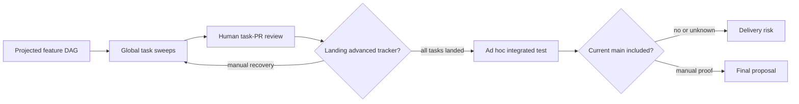

# Feature implementation drive — PRD *(effective view)*

---

**GENERATED — DO NOT EDIT.** Sole writer: `docgate fold`. As of: **001**. Content fingerprint: `sha256:21ff1c7841e4754da06e4ae3723f73de7456d4a66d1c82592f3ed8e357ae6153`. Tool version (recorded, never hashed): `docgate/v1`.

---

| Field | Value |
|---|---|
| **In one line** | A feature-scoped drive that routes a frozen task DAG through exclusive local or remote execution, human-reviewed integration, candidate-merge e2e verification, and one final proposal to main. |
| **Relevant-when** | planning, building, or reviewing feature-scoped implementation drives; triaging split execution, blocked DAG progression, feature-branch integration, review-feedback repair, or stale e2e evidence; changing implement-now dispatch, execution ownership, tracker readiness, proposal landing, e2e orchestration, or final delivery verification |
| **Status** | Draft — problem review pending |
| **Tier** | T3 — factory-control routing and delivery integrity; incorrect behavior can split execution ownership or promote an unverified feature |
| **Owner** | @mdarabi |
| **Approver(s)** | @mdarabi via the introducing PR's operator review |
| **Contributors** | product/engineering: @mdarabi + factory |
| **Informed** | Pyxis operators and implement-now/fleet maintainers |
| **Date** | 2026-07-25 created · 2026-07-25 last updated |
| **Appetite** | One complete one-repository/one-feature vertical slice: one human problem/solution/launch review; machine work for feature resolution, exclusive ownership, repeated DAG sweeps, feedback repair, candidate-merge e2e, repair loops, and delivery verification; dogfood both local and remote modes. Excludes multi-repository drives, automatic merge/takeover, a unified dashboard, and fleet-wide fairness. |
| **Target release** | After the e2e-verification authoring line is available to supply a reviewed e2e design and ordered plan; this feature is its named implementation-and-run follow-on. |
| **Tracking** | — |
| **Artifacts** | `docs/brainstorms/feature-implementation-drive.md` |
| **Template version** | prd-template/v2 |

## 0. Read to rule — the human reviewer's section (~8 min)

*The body is the contract; this section only routes attention. Machines ignore it.*

**Judge these**

| # | The call | Could have gone | If you disagree |
|---|---|---|---|
| 1 | Tasks integrate on a feature branch before one final proposal to main | Task proposals land directly on main | Change isolation → FR-3, FR-15 |
| 2 | Hosted merges remain authenticated; explicit local-git landings follow a declared operator procedure with retained exact evidence | Independent signing key and protected local host | Change the accepted trust limit → FR-31, FR-32, NR-7, §5.3 |
| 3 | The human explicitly assigns exclusive local or remote execution ownership | Timeout assignment or racing executors | Change routing authority → FR-1, FR-2, FR-11 |
| 4 | Terminal e2e verifies exact feature and current-main inputs; manual routes retain human attribution | Feature-head-only tests or receipt as manual attestation | Change verification → FR-16..FR-19 |
| 5 | The drive requests and observes proposals; the operator invokes landing | Drive automatically lands green proposals | Change the command boundary → FR-31, FR-32, NR-7 |
| 6 | Only verified delivered revision, candidate tree, and current-main ancestry complete the feature | Complete on proposal or receipt | Change delivery proof → FR-23, FR-24 |

**Sanity-check the numbers** — both execution-owner dogfoods still use a six-task DAG; zero invalid dependent pickups; every required scenario has accepted current evidence. Local task and final evidence survives a fresh clone; each receipt nonce is consumed once; any leased-ref movement rejects the entire landing transaction.

**Open review** — exact T14 source approval remains pending. This amendment enables no runtime path; its independent merge precedes T6.

**Skip the rest** — substantive contract review and later adapter acceptance establish these claims. The approved Pyxis source legacy-document-gate bypass remains in force.

## 1. Summary — the one-pager

- **Problem** — Task execution alone cannot carry a dependency graph through reviewed integration, current-main candidate tests, repair, and verified delivery. The original hosted merge contract also cannot describe the accepted local bare origin honestly.
- **For whom** — A human engineer driving one feature, with an autonomous driver requesting and observing reviewable work. Standalone tasks remain generic executor work.
- **Direction** — Keep one durable drive, exclusive execution owner, feature-blind task executor, feature integration branch, candidate-evidence contract, and delivery proof. Hosted proposals retain authenticated human review/merge and enforced checks. Explicit local-git proposals use operator-declared receipts and an operator-invoked atomic landing route with retained current task or candidate evidence.
- **Appetite** — One repository and feature; local and remote execution ownership remain separate from code-host selection. No automatic merges, takeover, e2e redesign, or shared worker worktree.
- **Success** — Both execution-owner dogfoods satisfy M1–M4 and the selected medium's review route; the local binding also proves parallel-root integration, leased atomic updates, and recovery with origin-retained proof.
- **Guardrail** — The drive performs no approval or landing action. No dependent unlocks or delivered transition occurs from receipt, badge, or local cache alone. Every required scenario remains current and accepted.
- **Accepted local limit** — The operator and agent share an OS account able to edit hooks and refs. The normal route verifies consistency; it cannot authenticate human authorship or prevent direct outside-route Git writes. No independent signing key or protected host is required.
- **Contract order** — Exact source review and an independent T14 merge precede enabling code. Pyxis source's approved disabled legacy document checks remain disabled; applicable installed checks and frozen-document authoring rules retain their existing scope.

## 2. Problem space

### 2.1 Problem statement

A human with an approved dependency-ordered feature plan cannot currently choose one execution location and rely on the factory to carry that feature through individually reviewed tasks, integrated verification, and final delivery. The available executor works one ready frontier at a time and intentionally leaves landing and re-invocation to a driver; without a feature-level lifecycle, unrelated work can share its label, future-unblocked tasks can execute elsewhere, and the complete feature has no committed candidate on which terminal e2e can make a delivery decision.

### 2.2 Users and segments

| Segment | Role and context | Domain exp. | Tech exp. | Key goals | Pain today | Evidence |
|---|---|---|---|---|---|---|
| **P1 (primary)** | Human engineer driving one approved feature and reviewing each task proposal | journeyman–master | journeyman–master | choose local or remote execution; review every increment; accept one verified feature | manually scopes sweeps, sequences merges, reconstructs integration/e2e state | `brainstorm:feature-implementation-drive#D-2/#D-3` |
| P2 (secondary) | Autonomous driver operating the same feature lifecycle unattended | master | master | resume from durable state; act only within delegated ownership | executor primitives do not define the feature lifecycle | `brainstorm:feature-implementation-drive#D-2` |
| **Anti-segment** | Ad hoc standalone issue outside a frozen feature DAG | — | — | generic issue execution | feature lifecycle would add irrelevant branch/e2e ceremony | `brainstorm:feature-implementation-drive#D-2`; NG-5 |

### 2.3 Jobs and desired outcomes

| # | When… (situation) | I want to… (motivation) | So I can… (outcome) | Today's workaround | Evidence |
|---|---|---|---|---|---|
| J1 | I have an approved, projected feature DAG | explicitly choose local or remote execution for the whole feature | keep every implementation and feedback repair in the selected domain | race task claims or manually police labels | `brainstorm:feature-implementation-drive#D-3/#D-8` |
| J2 | ready tasks produce proposals | review, request changes, and merge each task before dependents advance | control every implementation increment without breaking DAG order | inspect global issue/PR state and rerun sweeps manually | `brainstorm:feature-implementation-drive#D-3/#D-9` |
| J3 | all feature tasks have landed | verify the exact result that would combine with current main | know the complete feature works before proposing it to main | test a feature branch that may not include concurrent main changes | `brainstorm:feature-implementation-drive#D-11/#D-12` |
| J4 | integrated e2e fails | route the evidence into reviewable repair work and re-verify | correct the feature without rewriting merged history | reopen or patch prior work ad hoc | `brainstorm:feature-implementation-drive#D-10` |
| J5 | the final feature proposal merges | verify delivery and release durable ownership safely | finish with proof rather than a badge or assumption | manually inspect ancestry and clean state | `brainstorm:feature-implementation-drive#D-13` |

### 2.4 Evidence

| Claim | Source (research, data, tickets, interviews) | Confidence |
|---|---|---|
| The executor is a one-sweep, label/base-configured, feature-blind primitive whose driver owns landing and re-invocation. | `brainstorm:feature-implementation-drive#F-2/#F-3`; current executor code | High |
| Cross-machine task claims prevent duplicate issue execution but cannot reserve future tasks of a feature to one domain. | `brainstorm:feature-implementation-drive#F-4` | High |
| Terminal e2e is once per integrated feature, and its build/run adaptation is explicitly deferred follow-on work. | `brainstorm:feature-implementation-drive#F-5`; `prd:e2e-verification` | High |
| The entity model has task, proposal, feedback, node, and e2e concepts but no feature-drive ownership lifecycle. | `brainstorm:feature-implementation-drive#F-6` | High |
| Non-default-base proposal landing may not advance tracker closure automatically, so the drive must verify and advance state explicitly. | `brainstorm:feature-implementation-drive#F-7` | Medium |

### 2.5 The journey today

| Phase | User does | User feels / pain | Frontstage (what user sees) | Backstage (systems, people, processes) |
|---|---|---|---|---|
| Choose execution | runs an executor or leaves tagged work for a fleet | no feature-wide ownership guarantee | one command or tagged issues | independent task claims only |
| Implement roots | reviews ready-task PRs | global pool and base obscure feature scope | task PRs | one executor sweep |
| Advance DAG | merges blockers and reruns | manually correlates landing, closure, and readiness | tracker + PRs | blocker openness drives readiness |
| Verify feature | assembles and tests complete work | no canonical candidate against current main | local branch/CI | e2e build/run lifecycle absent |
| Repair/deliver | patches failures and opens final PR | evidence and ownership can drift | repair PRs/final PR | no durable feature completion state |

### 2.6 Opportunity and why now

- **Size** — Every multi-task feature implemented by the native executor needs one owner across task review, DAG advancement, integration, and terminal verification; the dogfood acceptance uses both execution modes on the same representative DAG shape.
- **Alternatives users have** — merge task PRs directly to main and fix forward; manually maintain a feature branch and rerun executor sweeps; use only a remote generic task pool; hold all work in one shared worktree.
- **Why us / strategic fit** — Pyxis already owns the dependency graph, executor ports, proposal evidence, and e2e authoring line; composing them behind medium-neutral contracts closes the pipeline without privileged substrate.
- **Why now** — The reusable executor is built, and the e2e contract names this implementation/run adaptation as its follow-on.
- **Cost of doing nothing** — Humans continue operating the stage boundaries, local/remote choice remains best-effort, and feature-level verification cannot reliably authorize delivery.

**Decision:** Problem gate — pending the introducing PR's operator review.

| Reviewer | Role | Date | Verdict |
|---|---|---|---|
| @mdarabi | operator/product/engineering | — | pending |

## 3. Goals, metrics, and guardrails

### 3.1 Goals as falsifiable hypotheses

| # | We believe that… | Will result in… | Measured by… |
|---|---|---|---|
| G1 | a durable feature drive with explicit ownership will keep a feature's implementation in the selected domain | zero split-domain task or feedback-repair attempts | M1 |
| G2 | verified task landing as the only DAG-advance event will preserve dependency order through human review | every eligible transition corresponds to a landed blocker and no premature pickup | M2 |
| G3 | candidate-merge e2e with repair work will prevent unverified integrated features from reaching final proposal | every final proposal binds to current accepted evidence and every seeded failure repairs before proposal | M3 |
| G4 | one drive contract over a feature-blind executor will preserve local/remote behavioral equivalence | both modes complete the same acceptance fixture with the same review and verification semantics | M4 |

### 3.2 Goals → signals → metrics

| Metric | Goal | Signal | Baseline | Target (at checkpoint) | Feeds from |
|---|---|---|---|---|---|
| M1 (primary) | G1 | implementation attempt executes in recorded owner domain | task claims prevent duplicate issue work but feature-domain affinity is absent | 100% in-domain and zero overlapping ownership across both dogfood drives | EVT-2, EVT-3 |
| M2 | G2 | task readiness transition follows verified blocker landing | driver-managed, not feature-contract measured | 100% valid transitions and zero premature dependent pickups in the six-task fixtures | EVT-4 |
| M3 | G3 | final-proposal eligibility is backed by accepted current candidate evidence | terminal implementation/run loop absent | 100% current evidence; seeded failure produces repair and no premature final proposal | EVT-5, EVT-6, EVT-7 |
| M4 | G4 | equivalent fixture outcome in local and remote ownership modes | no feature-drive modes | both fixtures reach verified delivery with identical required state transitions | EVT-1, EVT-8 |

### 3.3 Guardrails and decision rule

| Guardrail metric | Threshold | Action if breached |
|---|---|---|
| Cross-owner implementation attempts | any attempt in a domain other than the current recorded owner, or any overlapping handoff | stop the drive, preserve artifacts, require human recovery |
| Premature DAG advancement | any dependent becomes executable before every blocker is verified landed on the feature branch | stop routing and fail the release fixture |
| Stale verification authorization | any final proposal raised after feature head or main head changed from accepted evidence | close/draft-block the proposal, invalidate evidence, rerun verification |
| Unauthorized merge | any task or final proposal merged by the drive | disable the drive and escalate as a factory-control defect |

**Ship rule (pre-registered):** both dogfood modes satisfy M1–M4, the seeded e2e failure is repaired through a reviewed PR, and no guardrail is breached; otherwise do not ship.

These guardrails apply to the drive and selected landing route. In explicit local-git mode an operator-declared receipt is not evidence of authenticated human authorship, and direct writes made through the shared OS account can bypass the route. The route still refuses inconsistent generation, missing or altered retained proof, unsatisfied current ReviewGate, unaccepted candidate result, and moved target/proposal refs. Hosted enforcement and manual-human e2e attribution are unchanged (NR-7).

### 3.4 Non-goals and waiting room

| ID | Non-goal | Why refused |
|---|---|---|
| NG-1 | Automatically merge task proposals | Hosted human review/merge and the local operator procedure remain the selected review boundary (FR-31, NR-7). |
| NG-2 | Send task proposals directly to main | The feature branch is the integration and isolation boundary. |
| NG-3 | Share one literal worker worktree | Workers stay isolated; committed state is reproducible and portable. |
| NG-4 | Redesign the e2e authoring line | This feature consumes its reviewed design and ordered plan. |
| NG-5 | Orchestrate generic standalone issues | Generic work remains in the ordinary executor pool. |
| NG-6 | Automatically take over stale local ownership | Recovery and handoff are explicit human acts. |
| NG-7 | Automatically merge the final feature proposal | Final acceptance and landing remain operator acts through the selected review route (FR-32, NR-7). |
| NG-8 | Coordinate multi-repository feature DAGs | V1 is one feature in one repository. |
| NG-9 | Optimize fleet-wide fairness and capacity | That is umbrella fleet policy, not feature lifecycle behavior. |
| NG-10 | Build a unified feature dashboard | Native action surfaces plus minimal recovery diagnostics suffice for v1. |

| ID | Waiting room | Revisit when / intended version |
|---|---|---|
| WR-1 | Automatic low-risk task-PR admission | A future autonomy-level policy explicitly grants it and evidence shows human review can graduate safely. |
| WR-2 | Automatic stale-owner failover | A recovery policy can prove no split brain and the operator authorizes automatic transfer. |
| WR-3 | Multi-repository feature drives | The single-repository lifecycle is stable and a real cross-repository contract exists. |
| WR-4 | Unified feature progress surface | Native surfaces produce repeated, measured navigation or recovery failures. |
| WR-5 | Fleet-wide scheduling and fairness | Multiple remote feature drives demonstrate starvation or capacity contention beyond existing fleet policy. |

## 4. Solution space

### 4.1 Approach and alternatives considered

The feature integration drive is the durable stage-8-through-stage-10 lifecycle. It resolves one frozen feature DAG to a remote feature branch and an exclusive execution owner, invokes the feature-blind executor for ready tasks, waits for human-reviewed landing, advances only from verified integrated state, verifies a candidate merge with current main, routes failures into repair work, and proves delivery before releasing ownership.

| Option | Sketch | Why not chosen |
|---|---|---|
| A (chosen) | Feature-aware integration drive over feature-blind task execution, with mandatory ownership and durable branch/evidence state | — |
| B | Feature-level execution reservation as the product center | Too narrow: prevents split execution but does not own review, integration, e2e, repair, and delivery. |
| C | Durable feature delivery workspace as the product center | Describes the state substrate but not the user job or lifecycle. |
| Merge directly to main | Integrate all task PRs on main and run e2e afterward | Makes incomplete or red feature state shared/releasable history. |
| Literal single worktree | Serialize all tasks in one mutable checkout | Loses task isolation, clean-SHA reproducibility, and portable local/remote execution. |
| Do nothing | Keep one-sweep task execution and manual driver work | Leaves locality, terminal verification, and completion as human-operated gaps. |

### 4.2 Scope perimeter

- **In** — feature resolution; durable origin feature branch; exclusive local/remote execution ownership and explicit quiesced handoff; resumable sweeps; feature-blind assignment; distinct task/repair proposals; same-proposal feedback; verified tracker/DAG progression; canonical candidate e2e with existing manual-human attestations; repair/full rerun; final proposal; verified main delivery; cancellation/resume/abandonment and ordered cleanup.
- **Code-host routes** — hosted authenticated operator review/merge with required checks and current-base candidate enforcement; explicit local-git operator-declared review and separately invoked atomic landing, complete current origin-retained evidence, once-only receipts, and shared-account disclosure. Code-host selection does not assign execution ownership.
- **Future** — risk-governed automatic admission, automatic stale-owner recovery, multi-repository drives, unified status surface, fleet fairness.
- **Out** — drive approval/landing, direct-to-main task proposals, shared worker worktree, e2e-authoring redesign, implicit timeout routing, authenticated local landing actor, independent copied-origin identity, and host-level local mainline protection.

### 4.3 Experience: flows and states

**Flow F1 — Kick off and integrate (serves J1, J2)**

| Step | User does | System responds | States covered | Design |
|---|---|---|---|---|
| 1 | explicitly selects local or remote execution for a frozen feature | records exclusive owner and feature-branch target, or refuses conflict | ideal, conflict, invalid feature | design:feature-implementation-drive-local-git |
| 2 | reviews a distinct current task/repair proposal | keeps dependents blocked; same-proposal feedback invalidates old head-bound evidence | awaiting review, changes requested, approved | selected review surface |
| 3 | merges on the hosted surface, or invokes the local operator landing command | verifies current review evidence and landed revision on the feature branch before RecordLanding and new routing | landing requested, landed-unverified, partial/complete DAG, failure | design:feature-implementation-drive-local-git#3.6 |

Local task landing requires the complete satisfied ReviewGate for the current proposal generation/head/base, including the exact code gate and every required green check. Its immutable origin aggregate and declared receipt are verified before the atomic leased transaction. Concurrent root proposals at the same old base cannot both land: the second rebases, reruns the complete aggregate, and obtains a fresh receipt. Review waits persist and exit with zero live workers/model sessions. Errors preserve artifacts and block progression; status names the remedy and local trust limit. CLI/action-surface accessibility and English-only operator text remain unchanged.

**Flow F2 — Verify, repair, and deliver (serves J3–J5)**

| Step | User does | System responds | States covered | Design |
|---|---|---|---|---|
| 1 | completes all task reviews and verified landings | constructs candidate C from exact feature F and main M without moving either branch | ready, conflict, stale input | retained candidate builder |
| 2 | supplies any required manual-human result | retains the existing authenticated, candidate-bound attestation contract; blocks on every non-accepted route | running, manual pending, failed, accepted | existing e2e evidence surface |
| 3 | reviews and lands repair proposals | rebuilds candidate and reruns the entire required scenario set | repair pending, re-verifying | selected task review route |
| 4 | reviews final proposal and invokes its selected hosted/local landing route | checks accepted current proof; verifies L's accepted base, candidate tree, and current-main ancestry before delivery, release, and cleanup | final review, feedback, landed-unverified, delivered | design:feature-implementation-drive-local-git#3.9 |

Local final landing atomically leases main, feature, the distinct final-proposal branch, and proposal/archive state. Any moved input or absent/altered retained evidence refuses all changes. The local receipt is approval metadata, never a replacement for a required scenario result or manual-human attestation. Neither an open final proposal nor an unverified landed record completes the feature.

### 4.4 Scenarios

**Execution ownership with hosted review.** The local-owned and remote-owned six-task fixtures retain the same task review, feedback, integrated failure/repair, current candidate, and authenticated human final merge contract. Local ownership does not imply a local code host.

**Explicit local-git common case.** The operator selects local-git against an initialized bare origin with mainline. Argus presents two root proposals. After current ReviewGate evidence and operator-declared review, the operator lands the first. The second's old-base lease refuses all updates; it rebases, reruns the complete ReviewGate, obtains a fresh receipt, and lands without losing the first root. Dependents unlock only from verified landed revisions. All tasks land, every required scenario on C is accepted, and the operator reviews then lands one final proposal with exact retained candidate proof and atomic ref leases. Delivery is verified at L on main.

**Recovery and stale inputs.** Losing the review worktree or restarting cannot replace origin-retained evidence with a green badge. A fresh clone verifies canonical retained and embedded envelopes. Changed feature/main/proposal generation or missing proof blocks landing and progress; candidate input changes require reconstruction and a full rerun. Retry of an already committed exact transaction returns the same L without another target update.

**Solution review for this amendment** — pending exact T14 source approval and its independently merged contract-only PR. Runtime acceptance is not claimed complete.

## 5. System requirements

### 5.1 Functional requirements

| ID | Requirement (EARS) | Rationale | Priority | Risk | Fit criterion | Verify | Traces to |
|---|---|---|---|---|---|---|---|
| FR-1 | When an eligible frozen feature is kicked off, the feature drive shall require an explicit local or remote execution assignment before exposing any task for execution. | Prevent routing races. | Must | critical | Across both acceptance modes, zero task attempts occur before assignment; an unowned fixture remains idle. | Test | G1, J1, F1 |
| FR-2 | While a feature has an execution owner, the feature drive shall expose implementation and feedback-repair tasks only to that owner domain. | Guarantee locality. | Must | critical | In both six-task fixtures, 100% of implementation attempts identify the recorded domain and zero attempts execute elsewhere. | Test | G1, J1, F1 |
| FR-3 | When a feature is first assigned, the feature drive shall establish a remote feature integration branch as the base and proposal target for its tasks. | Isolate incomplete integration from main. | Must | high | Every task proposal in both fixtures targets the feature branch; zero targets main. | Test | G2, J2, F1 |
| FR-4 | The feature drive shall maintain a routing scope that selects exactly the feature's executable task set. | Isolate concurrent features and generic work. | Must | critical | Concurrent fixtures with unrelated routed issues show zero cross-feature pickup and zero generic-pool pickup by the drive. | Test | G1, J1, F1 |
| FR-5 | When the feature drive assigns a ready task, it shall provide the feature-blind executor only the ordinary task charter, routing scope, target base, and execution policy needed for that attempt. | Preserve executor portability. | Must | high | Interface inspection and local/remote conformance show workers consume no feature-lifecycle state. | Inspection, Test | G4, J1, F1 |
| FR-6 | While a task has an open proposal, the feature drive shall keep that task incomplete for dependency readiness. | Review is part of completion. | Must | high | Open, changes-requested, and approved-but-unmerged fixtures each keep all dependents blocked. | Test | G2, J2, F1 |
| FR-31 *(001 ← FR-7)* | When an implementation or repair task becomes proposal-ready, the feature drive shall present a distinct proposal for operator review and landing into the feature branch through the selected code host's review route. | Keep task review and integration separate from implementation authority. | Must | critical | Hosted mode retains authenticated human review and human merge with all existing required checks. Explicit local-git mode requires a complete satisfied ReviewGate for the current task, proposal generation, head, and feature base; an operator-declared once-only receipt binds that aggregate's retained origin ref, object id, and digest. Only the separate operator route may land; it atomically publishes the reviewed task tree at the leased feature base, final proposal/evidence/archive state, and real leased proposal-branch deletion. No task or dependent advances until the retained proof and landed revision are verified on the freshly fetched feature branch. Local output discloses unauthenticated actor and shared-account limits. | Test, Demo, Inspection | G2, J2, F1 |
| FR-8 | When review requests changes within the task charter, the feature drive shall route the feedback to the current owner for repair on the same task proposal. | Avoid duplicate proposals and retain context. | Must | high | Seeded feedback updates the same proposal, refreshes revision-bound evidence, and creates no second proposal. | Test, Demo | G2, J2, F1 |
| FR-9 | When review feedback requires work outside the task charter, the feature drive shall keep the task blocked and create a new dependency-linked work item. | Keep scope explicit. | Must | high | Seeded out-of-charter feedback creates exactly one linked task and does not silently widen the proposal. | Test | G2, J2, F1 |
| FR-10 | When a task proposal merges, the feature drive shall verify its revision landed on the feature branch before advancing tracker completion or dependency readiness. | Do not trust badge/default-branch semantics. | Must | critical | A false merged badge/non-ancestor fixture advances nothing; verified ancestry advances exactly the valid dependents. | Test | G2, J2, F1 |
| FR-11 | When a different execution domain requests an owned feature, the feature drive shall refuse concurrent start and report the current owner. | Prevent split brain. | Must | critical | 100 simultaneous conflicting requests yield one owner, zero foreign attempts, and explicit refusal to every loser. | Test | G1, J1, F1 |
| FR-12 | When the human requests ownership handoff, the feature drive shall transfer ownership only after every active implementation attempt has finished or checkpointed. | Preserve work and exclusivity. | Must | critical | Failure-injection across each attempt state produces zero overlap, zero lost checkpoint, and only post-transfer work in the new domain. | Test | G1, J1, F1 |
| FR-13 | While a feature awaits human review, the feature drive shall persist ownership and progress without requiring a live implementation process. | Human waits may span sessions. | Must | high | Process termination/restart during every review state preserves owner, proposal, DAG state, and same-machine local affinity. | Test | G1, J2, F1 |
| FR-14 | When all implementation and repair tasks are verified landed, the feature drive shall begin terminal verification only if no feature task remains incomplete. | Verify the whole integrated feature. | Must | high | A fixture with any open task cannot create terminal evidence; the fully landed fixture can. | Test | G3, J3, F2 |
| FR-15 | The feature drive shall keep all implementation and repair changes off main until a final feature proposal is eligible. | Keep main releasable. | Must | critical | Main ancestry inspection before final eligibility contains none of the fixture's task revisions. | Test | G3, J3, F2 |
| FR-16 | When terminal verification begins, the feature drive shall construct a non-mutating candidate merge from the exact feature head and current target-main head. | Test the deliverable under concurrent main changes. | Must | critical | Both input branches remain byte-identical; evidence records both heads and the resulting candidate identity. | Test | G3, J3, F2 |
| FR-17 | While terminal evidence is pending or accepted, the feature drive shall invalidate that evidence when either candidate input head changes. | Prevent stale authorization. | Must | critical | All feature-head and main-head mutation fixtures invalidate prior evidence and block final eligibility. | Test | G3, J3, F2 |
| FR-18 | Where an e2e scenario is declared manual-human, the feature drive shall accept only an explicit human attestation bound to the current candidate identity. | Preserve manual route integrity. | Must | high | Wrong-SHA, missing-identity, and machine-authored attestations are refused; a valid human attestation settles only its scenario. | Test | G3, J3, F2 |
| FR-19 | The feature drive shall require an accepted outcome for every required e2e scenario before making the final proposal eligible. | “Could not run” is not green. | Must | critical | Failed, skipped, unavailable, inconclusive, and manual-pending fixtures each block; all accepted outcomes unblock. | Test | G3, J3, F2 |
| FR-20 | When terminal e2e fails, the feature drive shall create feature-scoped repair work carrying the failed candidate identity, evidence, and links to implicated work. | Make integrated defects traceable. | Must | high | Seeded failure yields one repair item with all required references and no mutation of merged task history. | Test, Inspection | G3, J4, F2 |
| FR-21 | When a repair proposal lands, the feature drive shall rerun every required e2e scenario on a new candidate merge before restoring final eligibility. | Re-prove the complete feature. | Must | critical | The seeded repair invalidates old evidence; partial rerun cannot unblock; full accepted rerun can. | Test | G3, J4, F2 |
| FR-32 *(001 ← FR-22)* | When all required candidate evidence is current and accepted, the feature drive shall raise one final operator-reviewed proposal from the feature branch to main without approving or landing it. | Present one complete result while keeping landing outside the drive. | Must | critical | Exactly one final proposal identifies current F, M, C and the scenario-set fingerprint. Hosted mode retains authenticated human merge and the required candidate verdict with current-base enforcement. Explicit local-git mode requires the complete accepted candidate-evidence/v1 envelope and every required scenario result, retained at an immutable origin ref and embedded in the final proposal. The declared once-only receipt binds proposal generation, head, target, F/M/C, scenario set, and evidence ref/object id/digest. The operator route atomically leases main M to a child L with tree(C), feature F to its retained child marker with tree(C), and a distinct final-proposal branch at F to deletion, together with final proposal/archive evidence. Any moved ref, absent/altered evidence, unaccepted result, or inconsistent receipt refuses landing and post-crash completion. The drive invokes zero local landing operations. | Test, Inspection | G3, J5, F2 |
| FR-23 | When the final proposal merges, the feature drive shall verify the delivered feature revision is an ancestor of main before marking the drive complete. | Badge is not delivery proof. | Must | critical | Merged-but-wrong-base fixture remains incomplete; verified main ancestry transitions exactly once to delivered. | Test | G3, J5, F2 |
| FR-24 | When delivery is verified, the feature drive shall release execution ownership and routing before cleaning disposable state according to retention policy. | End safely and prevent new work. | Must | high | No post-delivery attempt is routable; cleanup never precedes ancestry verification; retained artifacts follow policy. | Test | G1, J5, F2 |
| FR-25 | When cancellation is requested, the feature drive shall quiesce active attempts, release ownership and executable routing, and preserve all durable work artifacts pending a separate cleanup decision. | Stop without data loss. | Must | high | Cancellation drills in each active state yield zero continued attempts and zero branch/commit/PR/evidence deletion. | Test | J1, F1 |
| FR-26 | Where a specialized e2e runner is declared, the feature drive shall route the scenario to that runner while retaining candidate-bound evidence and runner identity. | Support real test environments. | Must | high | Local- and remote-owned fixtures can use a declared runner; evidence identifies it and binds the same candidate. | Test | G3, J3, F2 |
| FR-27 | The feature drive shall surface action-required state through the existing proposal, tracker, command, and notification surfaces and provide a minimal durable-state diagnostic. | Put information where action occurs. | Should | med | Dogfood exposes every human action at its native surface; restart diagnostic reconstructs owner, next action, and evidence status. | Demo | J1–J5, F1, F2 |
| FR-28 | When the human explicitly resumes a cancelled feature, the feature drive shall require a new execution assignment before restoring executable routing. | Resume must not infer stale ownership. | Must | critical | Cancel-then-resume fixtures remain inert until assignment and then route 100% of attempts to the newly recorded owner. | Test | G1, J1, F1 |
| FR-29 | When the human explicitly abandons a cancelled feature, the feature drive shall mark the drive terminal while preserving durable artifacts until separately confirmed cleanup. | Separate stopping from destruction. | Must | high | Abandonment creates no executable work and deletes no branch, commit, proposal, task history, or evidence. | Test | J1, F1 |
| FR-30 | Where no specialized e2e runner is declared, the feature drive shall execute terminal e2e in the current execution-owner domain. | Give every drive a deterministic verification route. | Must | high | Local-owned and remote-owned fixtures with no runner configuration execute every automatic scenario in their respective owner domain and record runner identity. | Test | G3, J3, F2 |

**Non-regression (NR-n)**

| ID | Existing behavior protected | Why protected | Risk | Fit criterion | Verify | Traces to |
|---|---|---|---|---|---|---|
| NR-1 | The single-task executor remains feature-blind and reusable for generic local/fleet work. | Feature lifecycle must not fork the worker core. | critical | Existing executor conformance suites pass unchanged; generic-label/main-base execution requires no feature-drive state. | Test, Inspection | FR-5, G4 |
| NR-2 | Cross-machine task claims continue to prevent duplicate issue execution. | Feature ownership complements rather than weakens task safety. | critical | Existing lease conformance passes; overlap fixture yields at most one task claimant even under misrouting. | Test | FR-2, FR-11 |
| NR-3 | Generic standalone routed issues remain executable without feature branches or terminal feature e2e. | Anti-segment continuity. | high | Existing generic executor e2e passes with no feature-drive artifact created. | Test | NG-5 |
| NR-4 | Existing e2e design/review/plan artifacts and routes remain unchanged. | This feature is the deferred build/run consumer. | high | Byte-level inspection shows no contract change to the e2e authoring line; its output is accepted as input. | Inspection, Test | FR-14, FR-18 |
| NR-7 *(001 ← NR-5)* | Hosted human merge authority and required review/check/current-base enforcement remain unchanged; explicit local-git task and final landings use only the operator procedure in FR-31/FR-32 with the accepted unauthenticated shared-account limit. | The drive gains no approval or landing operation; the local route must not claim guarantees its origin cannot enforce. | critical | Hosted authorization and ruleset fixtures retain prior outcomes. Local fixtures prove generation/evidence/ref consistency and zero drive-invoked landings, while status and landing output state that the operator and agent share an OS account that can directly edit hooks and refs. No independent approval signing key, copied-origin identity, or host-level mainline protection is required. Existing signed execution ownership, task claims, e2e runner authentication, and manual-human candidate attestations retain their contracts; a local receipt cannot stand in for them. No implicit local fallback or re-enabling of Pyxis source's disabled legacy document checks occurs. | Test, Inspection | FR-31, FR-32, FR-18 |
| NR-6 | Main remains free of incomplete feature task revisions before final human merge. | Preserve releasability. | critical | Ancestry inspection across dogfood shows zero task revision on main before final merge. | Test | FR-15 |

### 5.2 Unwanted behavior and failure handling

| ID | If… (trigger) | Then the system shall… | User sees | Priority | Risk | Fit criterion | Verify | Traces to |
|---|---|---|---|---|---|---|---|---|
| UB-1 | If kickoff names a missing, ungated, or non-frozen feature plan | refuse ownership and task execution with the failed precondition and remedy | invalid-feature error | Must | high | 100% invalid fixtures refuse with zero durable execution artifacts. | Test | F1, FR-1 |
| UB-2 | If ownership state is missing, malformed, conflicting, or unverifiable | fail closed and route no work | ownership diagnostic + human recovery action | Must | critical | Every malformed/conflict fixture produces zero task attempts. | Test | F1, FR-2 |
| UB-3 | If the current owner becomes unavailable | preserve ownership and stop new work until explicit resume, handoff, cancellation, or abandonment | stale-owner action required | Must | critical | Simulated disappearance produces zero automatic takeover and zero foreign execution. | Test | F1, FR-11, NG-6 |
| UB-4 | If handoff cannot quiesce an active attempt | keep the old owner and refuse transfer | handoff blocked with active attempt reference | Must | critical | Timeout/failure fixtures show no owner mutation and no overlapping attempt. | Test | F1, FR-12 |
| UB-5 | If task-proposal landing cannot be verified on the feature branch | keep the task and dependents incomplete | landing-verification failure | Must | critical | Wrong-base, stale-head, and missing-revision fixtures advance nothing. | Test | F1, FR-10 |
| UB-6 | If the candidate merge conflicts | create no terminal green evidence and surface conflict repair work | merge-conflict repair required | Must | high | Conflict fixtures preserve both branches and block final eligibility. | Test | F2, FR-16 |
| UB-7 | If any required e2e route is failed, skipped, unavailable, inconclusive, or awaiting manual attestation | keep the final proposal ineligible and surface the exact blocking route | verification blocked | Must | critical | Each route state independently blocks in the verdict matrix. | Test | F2, FR-19 |
| UB-8 | If feature or main changes after accepted e2e | invalidate the accepted verdict before any final-proposal action | verification stale; rerun required | Must | critical | Race tests at every action boundary produce zero stale-authorized proposal. | Test | F2, FR-17 |
| UB-9 | If final-PR feedback changes the feature head | return to candidate construction and full terminal verification | final review waiting on re-verification | Must | critical | Seeded feedback invalidates evidence and prevents merge-ready state until full rerun. | Test | F2, FR-17, FR-21 |
| UB-10 | If a merged final proposal does not place the verified revision on main | remain incomplete and issue a delivery-verification escalation | delivery not proven | Must | critical | Wrong-base/partial-merge fixtures never release ownership. | Test | F2, FR-23 |
| UB-11 | If cancellation occurs while work is active | checkpoint or finish the attempt before de-routing, preserving durable artifacts | cancellation pending, then cancelled | Must | high | Failure drills show no mid-write destruction and no post-cancel pickup. | Test | F1, FR-25 |

### 5.3 Permissions and abuse cases

| Function / data | Human operator | Current execution owner / Argus drive | Non-owner executor | Unauthenticated |
|---|---|---|---|---|
| Select execution ownership; handoff/cancel/abandon | existing authenticated authorization | read/checkpoint | none | none |
| Execute/repair feature tasks | observe/review | assigned execution | none | none |
| Request/observe task or final proposals | review | propose/update/observe | none | none |
| Hosted approval/merge | authenticated review/merge | no approval or merge operation | none | none |
| Local declared approval and landing | separate operator procedure | request/observe only; no landing operation in drive composition | none through supported route | no authenticated local actor proof |
| Manual-human e2e attestation | existing authenticated, candidate-bound attestation | record/verify only | none | rejected by existing e2e contract |

The local operator command boundary is procedural: the shared OS account can invoke commands, forge declarations, or write refs directly. Receipt validity proves consistency of the normal route, not who ran it. The drive cannot call landing through its supported ports, but this is not an OS-level capability barrier (NR-7).

| ID | Actor and intent | Vector | Impact | Severity | Mitigated by | Verify |
|---|---|---|---|---|---|---|
| ABUSE-1 | Remote executor tries to steal a local-owned feature | claims a newly ready issue before local resume | locality breach and split feature history | critical | FR-2, FR-4, FR-11, NFR-1 | concurrent ownership drill |
| ABUSE-6 *(001 ← ABUSE-2)* | Drive bypasses review/progression | lands or marks complete from proposal/receipt alone | premature integration | critical | FR-31, FR-32, FR-10, NR-7 inside normal route; direct shared-account writes remain outside its guarantee | composition, retained-proof, and wrong-base fixtures |
| ABUSE-3 | Actor replays passing e2e evidence for another revision | copies verdict without current input identities | unverified feature reaches main | critical | FR-16–FR-19, NFR-2 | replay/race corpus |
| ABUSE-4 | Stale owner resumes after handoff | uses old local state or task ref | overlapping implementation | critical | FR-11–FR-13, NFR-1 | stale-owner recovery drill |
| ABUSE-5 | Machine submits a human-route attestation | forges or omits acting identity | manual requirement falsely passes | high | FR-18, NFR-2 | attribution-negative tests |

### 5.4 Data

| Entity / field | Meaning | Source of truth | Retention | Integrity rules | Privacy class |
|---|---|---|---|---|---|
| Feature drive identity | stable join from frozen feature plan to lifecycle state | configured work tracker / drive state adapter | through delivery or explicit abandonment; audit according to repo policy | one active drive per feature/repository | internal |
| Execution ownership | domain, registered machine when local, state, transition evidence | shared ownership store adapter | active through verified delivery/cancel; transition history retained by policy | exclusive; holder/transition authenticated; fail closed on ambiguity | internal |
| Feature integration ref | durable committed integration state | code host / git adapter | until verified delivery plus branch-retention policy | target and head identities explicit; never inferred from checkout state | internal |
| Task/proposal state | charter, blockers, review/head/landing evidence | work tracker + code host adapters | existing medium policy | completion only after verified feature-branch landing | internal |
| Candidate evidence | feature head, main head, candidate identity, scenario outcomes, runner/actor identity | e2e evidence adapter | through delivery/abandonment plus audit policy | immutable per candidate; any input change creates new evidence | internal |
| Delivery proof | final proposal and mainline ancestry result | code host adapter | existing proposal/audit policy | goal-object verified before completion | internal |

- **Migration** — none; feature drives begin only for newly kicked-off frozen features in v1. Existing in-flight task pools remain on their current path.
- **Parallel-run / cutover** — generic executor behavior remains available in parallel; a feature enters the new path only through explicit kickoff.
- **Rollback** — disable new feature-drive kickoff, preserve all durable branches/proposals/evidence, and return unstarted work to its prior explicit routing only by human action.
- **Decommission** — remove the drive only after no active ownership remains and every retained artifact has an explicit disposition.
- **Privacy check** — no DPIA trigger identified: no personal/sensitive data, profiling, monitoring of people, or new external data use.
- **Egress** — code/task/e2e content follows the configured executor, code-host, tracker, and runner adapters already selected by the repository; this feature adds no destination and records runner identity so operators can inspect where verification ran.

- **Local review proof** — complete canonical task ReviewGate or candidate-evidence/v1 plus every required result is retained on a create-only origin evidence ref. The request and receipt bind ref, full object id, digest, and proposal generation; final proposal state embeds identical bytes and pins that ref. Both retained and embedded proof are verified before landing and post-crash progression. Proposal lineage, receipt, evidence, and archive records remain reachable after real proposal-branch deletion; local cache/logs are not their source of truth. Cleanup cannot remove proof still needed for RecordLanding or delivery recovery.
- **Local identity limit** — declared receipt actor is unauthenticated metadata; it does not change authenticated execution ownership, runner identity, or manual-human attestation requirements. Independent copied-origin identity is not supplied.

### 5.5 Interfaces and integrations

| Interface | Direction | Purpose | Contract (format, ranges, timing) | Failure modes | Owner |
|---|---|---|---|---|---|
| Frozen feature-plan resolver | in | resolve feature identity and exact task DAG | one feature/repository; rejects ungated/non-frozen input | missing, ambiguous, stale projection | planning adapter owner |
| Feature ownership store | both | exclusive assignment, handoff, release, cancellation | durable cross-machine state; one owner; transition evidence | conflict, stale owner, malformed state | feature-drive design |
| Work tracker | both | read DAG/readiness; record completion/repair work | existing task and blocked-by dialect; state advances after verified landing | non-default-base closure mismatch, stale read | tracker adapter owner |
| Code host / git | both | feature refs, task/final proposals, review and ancestry evidence | revision-pinned proposals/reviews; remote branch required | conflict, wrong base, head race, auth failure | code-host adapter owner |
| implement-now executor | out/in | implement one ready frontier in selected domain | existing task/label/base/runtime policies; feature-blind worker | claim loss, worker failure, red proposal | executor owner |
| E2e design/plan/evidence | in/both | execute required scenarios and decide final eligibility | reviewed design + ordered tasks; outcomes bound to candidate and runner/actor | unavailable route, stale/replayed evidence | e2e-verification owner |
| Notification/action surfaces | out | surface human review, manual scenario, ownership, and recovery actions | existing medium-native notifications; instruction-free wake content | lost signal, duplicate signal | trigger/medium adapter owner |

Explicit local-git replaces only code-host proposal/review/landing transport. Its operator command is outside the drive/executor composition. The drive can request and observe local proposal state; no port lets it invoke approval or landing. Evidence publication, ref leases, and atomic-push capability are deterministic normal-route prerequisites. A local adapter with missing capabilities refuses activation or landing; it never silently falls back to hosted transport or a non-atomic write sequence.

### 5.6 Non-functional requirements

| ID | Area | Requirement | Fit criterion | Verify |
|---|---|---|---|---|
| NFR-1 | Concurrency integrity | The feature drive shall preserve single-owner execution under concurrent kickoff, resume, handoff, cancellation, and task-readiness races. | In 100 repetitions of each race fixture, zero overlapping owners and zero foreign implementation attempts. | Test |
| NFR-2 | Evidence integrity | The feature drive shall bind every review, manual attestation, e2e outcome, and delivery proof to the acting identity and exact revision identities required by its decision. | Replay, wrong-head, missing-identity, and stale-input corpus: 100% refused; clean controls: 100% accepted. | Test |
| NFR-3 | Resumability | The feature drive shall reconstruct every non-terminal state from durable adapter state after process loss. | Restart injected at every lifecycle transition resumes to the same owner, DAG, proposal, and evidence state with zero duplicate proposals. | Test |
| NFR-4 | Portability | The feature-drive core shall express tracker, code-host, ownership, executor, e2e, and notification dependencies through medium-neutral contracts. | GitHub/Git binding passes conformance; inspection finds no medium SDK/CLI import in the core. | Test, Inspection |
| NFR-5 | Idle cost | While awaiting human review or manual action, the feature drive shall require no live model session or worker process. | A full review-wait fixture records zero model calls and zero worker processes until a wake/re-invocation. | Test, Analysis |
| NFR-6 | Operability | The feature drive shall provide enough diagnostic state to identify owner, lifecycle state, exact blocking condition, and next human action without a unified dashboard. | Every failure fixture produces one named condition and remedy; restart diagnostic agrees with durable state. | Demo, Test |
| NFR-7 | Cost | The feature drive shall add no model inference to idle, ownership, DAG, evidence-validity, or delivery-verification decisions. | Instrumentation attributes zero tokens to deterministic lifecycle transitions; model spend comes only from configured implementation/review/e2e judgment steps. | Analysis |
| NFR-8 | Security | The feature drive shall fail closed on ambiguous authority, ownership, revision, or evidence state and preserve artifacts on destructive paths. | All ambiguity/destructive-path fixtures stop work and delete no durable artifact without explicit human confirmation. | Test |

### 5.7 Instrumentation — the tracking plan

| ID | Event name | Fires when | Properties (typed) | Source | Feeds |
|---|---|---|---|---|---|
| EVT-1 | feature_drive_transition | lifecycle state changes | feature_id: string, from: enum, to: enum, owner_domain: enum(local·remote·none), reason: enum | drive core | M4 |
| EVT-2 | feature_ownership_transition | ownership is acquired, handed off, released, or refused | feature_id: string, old_owner: string?, new_owner: string?, outcome: enum, active_attempts: int | ownership adapter | M1 |
| EVT-3 | feature_task_attempt | implementation/repair attempt starts or stops | feature_id: string, task_id: string, owner_domain: enum, machine_id: string?, outcome: enum | executor boundary | M1 |
| EVT-4 | feature_task_advanced | verified landing changes task/DAG state | feature_id: string, task_id: string, proposal_ref: string, landed_revision: string, unlocked_count: int | drive core | M2 |
| EVT-5 | candidate_created | candidate merge is constructed | feature_id: string, feature_head: string, main_head: string, candidate_id: string, outcome: enum | e2e boundary | M3 |
| EVT-6 | e2e_scenario_settled | one required scenario settles | feature_id: string, candidate_id: string, scenario_id: string, route: enum, outcome: enum, runner_id: string, actor_id: string? | e2e adapter | M3 |
| EVT-7 | e2e_repair_created | failed evidence becomes repair work | feature_id: string, candidate_id: string, repair_task_id: string, implicated_refs: string[] | tracker boundary | M3 |
| EVT-8 | feature_delivery_verified | final delivery ancestry settles | feature_id: string, proposal_ref: string, verified_revision: string, main_head: string, outcome: enum | code-host boundary | M4 |

### 5.8 Definition of Done

| ID | Done criterion | Source | Verify | Required evidence | Blocking? |
|---|---|---|---|---|---|
| DOD-9 *(001 ← DOD-1)* | All active Must functional and failure requirements pass their fit criteria in the applicable selected code-host mode. | FR-1..FR-6, FR-8..FR-21, FR-23..FR-32, UB-1..UB-11 | Test, Demo, Inspection | conformance and acceptance-suite report, including local retained-evidence and atomic-landing fixtures | yes |
| DOD-10 *(001 ← DOD-2)* | Existing executor, task-claim, generic-pool, signed ownership, e2e-authoring/attribution, and mainline-isolation behavior remains intact; hosted enforcement is unchanged and local code-host selection is explicit. | NR-1..NR-4, NR-6, NR-7 | Test, Inspection | non-regression suite, composition inspection, and local trust-limit disclosure | yes |
| DOD-11 *(001 ← DOD-3)* | The local-owned six-task dogfood completes through reviewed task proposals, seeded feedback, seeded e2e failure/repair, accepted candidate, and verified delivery with no guardrail breach. The explicit local-git binding additionally proves operator task/final landing, parallel roots, origin-retained proof after clone/process loss, and all-or-nothing ref leases. | M1–M4, §3.3, FR-1..FR-6, FR-8..FR-21, FR-23, FR-24, FR-31, FR-32, NR-7 | Demo, Analysis, Test | drive journal, proposal/evidence refs, metric rollup, local transaction and fresh-clone transcripts | yes |
| DOD-4 | The equivalent remote-owned dogfood completes with the same lifecycle semantics and no feature-aware worker behavior. | M1–M4, FR-2, FR-5, NFR-4 | Demo, Inspection | remote drive journal, conformance result, boundary inspection | yes |
| DOD-5 | Ownership race, stale owner, handoff, process-loss, cancellation, wrong-base landing, stale evidence, candidate conflict, and wrong-main delivery drills fail closed without artifact loss. | UB-2..UB-11, NFR-1..NFR-3, NFR-8 | Test | failure-injection matrix | yes |
| DOD-6 | Manual-human e2e routes accept only current candidate-bound human attestations; all non-accepted route states block. | FR-18, FR-19, NFR-2 | Test | attribution/replay verdict corpus | yes |
| DOD-7 | Required events produce an auditable feature trace and deterministic transitions consume zero inference. | EVT-1..EVT-8, NFR-7 | Analysis, Test | event-schema fixtures + token attribution report | yes |
| DOD-8 | Operator accepts the problem, solution, launch boundary, and six-call §0 routing through the introducing PR review. | §2.6, §4.4, §6.6 | Human judgment — @mdarabi, rubric: all three gate tables approved and no unresolved veto on §0 calls | introducing PR review record | yes |
| DOD-12 *(001)* | The operator reviews the precise amendment and successor source and its contract-only PR merges independently before local task or final landing is enabled. | FR-31, FR-32, NR-7; [local Git D-5](../../../memory/design/local-git-codehost/Decision-01M3N1MMJP92P3D7Q6C1CNBXN9.json); [local Git D-7](../../../memory/design/local-git-codehost/Decision-01M3N1MMJR02WDP45HVH4HS9Q1.json); issue:1337 | Human judgment — @mdarabi, rubric: exact source approves the operator route, current retained evidence, shared-account limit, and unchanged hosted enforcement; Inspection | source approval record and independently merged contract revision cited by enabling code | yes |

### 5.9 AI behavior and evals

Skipped: the feature drive's lifecycle and ownership decisions are deterministic; model-driven implementation and e2e authoring retain their existing eval contracts.

## 6. Delivery

### 6.1 Phasing and milestones

| Phase | Purpose | Scope | Exit criterion |
|---|---|---|---|
| Contract — T14 | authorize the local exception before code | precise amendment and successor source; independent contract-only PR after T13 | DOD-12; no local activation in this phase |
| A — deterministic lifecycle | retain state, ownership, and executor boundaries | existing aggregate/ownership/race/cancellation conformance | NFR-1..NFR-4 and UB-1..UB-5 green |
| B — hosted local-owned dogfood | retain hosted review, integration, candidate tests, repair, and delivery | hosted adapters and local execution affinity | applicable DOD-11 and DOD-5 paths green |
| C — remote-owned parity | retain equivalent lifecycle under separate execution owner | remote binding, handoff, runner routing | DOD-4 and all remaining applicable blocking rows green |
| Local binding — T6..T10 | implement the independently approved local route | distinct operator boundary; retained task/candidate proof; atomic leases and recovery | FR-31/FR-32, NR-7, DOD-9..DOD-12 and local successor acceptance green before activation |

### 6.2 Dependencies

| Dependency | Type (team / system / vendor / approval) | Needed by | Status | Owner |
|---|---|---|---|---|
| Frozen feature DAG and tracker projection | system | Phase B | existing; feature-scoped resolution behavior must be designed | plan-new / tracker owners |
| implement-now executor ports and adapters | system | Phase A | existing | implement-now owner |
| Proposal feedback capture/resumption | system | Phase B | existing adjacent capability; exact consuming seam must be validated | review-feedback owner |
| E2e design/review/plan artifacts | system | Phase B | PRD exists; implementation availability gates dogfood | e2e-verification owner |
| Feature ownership store and candidate-evidence contracts | design decision | Phase A | open design-owned mechanics (`brainstorm:feature-implementation-drive#P-1/#P-3/#P-4`) | technical design |
| Human review and merge authority | approval/system | Phases B–C | existing repository policy | @mdarabi |

### 6.3 Risks, assumptions, and rabbit holes

| # | Risk / assumption / rabbit hole | Likelihood | Impact | Mitigation or test | Owner |
|---|---|---|---|---|---|
| R1 | Cross-machine ownership and task claims disagree during races or handoff. | M | H | one authoritative ownership predicate; NFR-1 race corpus; task claims remain backstop | technical design |
| R2 | Tracker closure semantics for non-default-base merges falsely unlock dependents. | M | H | verify landing at the goal object before explicit tracker advancement; wrong-base fixtures | tracker/code-host design |
| R3 | Candidate evidence is replayed or becomes stale between check and final-proposal action. | M | H | revision-bound evidence, act-time reread, NFR-2 replay/race corpus | e2e/code-host design |
| R4 | Human review waits turn the drive into a daemon or lose local-machine affinity after restart. | M | M | durable ownership, zero-process wait, resume fixtures at every transition | ownership/trigger design |
| R5 | Main changes frequently enough to cause repeated full e2e and high cost. | M | M | measure invalidation rate/cost in dogfood; preserve correctness; optimization requires later evidence | product/technical design |
| R6 | The integration drive accidentally absorbs feature semantics into the worker core. | L | H | consumer-side contracts and NR-1/NFR-4 import/conformance checks | architecture review |
| R7 | Existing e2e authoring artifacts are unavailable when this feature reaches dogfood. | M | H | dependency gate in Phase B; do not invent an alternate e2e contract | @mdarabi |
| R8 *(001)* | A shared-account receipt is mistaken for authenticated human approval or protected mainline. | H | H | accepted explicit local limit; procedural operator boundary; no identity/protection claim; hosted unchanged | operator/code-host design |
| R9 *(001)* | Missing retained proof or a failed lease is treated as recoverable success. | M | H | verify exact canonical proof before landing and post-crash progress; atomic rejection and idempotent result observation | local code-host design |

### 6.4 Release criteria

| Lens | Criterion | Evaluated by |
|---|---|---|
| Functionality | All active Must FRs and UBs and every active blocking DoD pass for the applicable selected medium: FR-1..FR-6, FR-8..FR-21, FR-23..FR-32; UB-1..UB-11; DOD-4..DOD-12. No retired row stands in for its replacement. | acceptance, conformance, and exact source/contract-merge evidence |
| Compatibility | NR-1..NR-4, NR-6, NR-7 pass; hosted review/check/current-base enforcement and existing manual-human attestation remain unchanged. | regression and composition inspection |
| Usability | Operator can review exact proposals, retained evidence, target refs and local trust limits, then invoke landing/recovery through documented action surfaces. | dogfood observation against J1–J5 |
| Reliability | Race, restart, evidence, parallel-root, and ref-lease fixtures produce zero premature advancement, stale authorization inside the normal route, partial transaction, or evidence loss. | failure injection and fresh-clone drills |
| Performance/cost | Review waits hold zero model/Worker processes and deterministic transitions consume zero inference. | process and token attribution |
| Supportability | Status names exact phase, owner, blocker, retained evidence, next action, and the selected medium's guarantee. | recovery drill |

### 6.5 Rollout and reversibility

- **Flag** — feature-drive kickoff is an explicit per-feature choice; generic execution remains unchanged and is the fallback for unstarted work.
- **Kill switch** — disable new feature-drive kickoff and new task routing; preserve active artifacts and require explicit cancel/handoff/complete disposition.
- **Experiment** — none; deterministic dogfood fixtures and real local/remote drives are the evidence.
- **Cutover/migration steps** — no migration of in-flight work; only newly kicked-off frozen features enter the drive.

| Stage | Audience | Minimum evidence | Advance when | Roll back when |
|---|---|---|---|---|
| Hermetic | maintainers | all Phase-A race, failure, and conformance fixtures | deterministic contracts and guardrails green | any split ownership, destructive path, or worker-boundary breach |
| Local dogfood | @mdarabi | one full six-task local-owned drive including feedback and repair | DOD-11 and local failure drills green | any §3.3 breach or hidden manual machinery step |
| Remote dogfood | @mdarabi + configured remote engine | equivalent remote-owned drive and explicit handoff drill | ship rule and all DOD rows green | semantic mismatch, foreign execution, stale evidence, or unbounded idle cost |

Local-git is an explicit code-host selection, independent of local/remote execution ownership. T13 and this T14 contract land independently before local landing code activates. Validate initialized origin/mainline, atomic-push support, retained proof, and required gates before selecting it. Unsupported capability refuses; hosted mode remains the default and has no local fallback. Rollback preserves proposal/receipt/evidence/archive refs and already landed revisions. This amendment does not restore the approved Pyxis source legacy document gate; installed checks apply only under their existing pipeline scope.

### 6.6 Launch readiness

| Area | Item | Owner | Status |
|---|---|---|---|
| Support | recovery states and explicit cancel/handoff/diagnostic guidance | @mdarabi | ☐ |
| Docs | command and lifecycle documentation, including human review and evidence semantics | @mdarabi | ☐ |
| Enablement | n/a — internal factory capability; operator dogfood is the enablement path | — | n/a |
| Legal & privacy | confirm no new egress destination or personal-data processing | @mdarabi | ☐ |
| Pricing & billing | n/a — no product packaging or billing surface | — | n/a |
| Marketing & comms | n/a — no external launch surface in v1 | — | n/a |
| Platform | adapter conformance and versioning notes | @mdarabi | ☐ |
| Localization | n/a — operator CLI and machine-state surface only | — | n/a |

**Decision:** Launch gate — pending §6.4 evidence, checked applicable readiness rows, and operator approval.

| Reviewer | Role | Date | Verdict |
|---|---|---|---|
| @mdarabi | operator/product/engineering | — | pending |

Local activation additionally needs DOD-12's exact source approval and independent contract merge, implemented successor acceptance, operator-procedure documentation with the shared-account disclosure, and retained-evidence/atomic-push conformance. All are launch evidence to be supplied later; this Draft records none as completed.

### 6.7 Post-launch review

- **Review trigger** — both dogfood drives delivered plus the next three real feature drives reach a terminal state (delivered, cancelled, or abandoned) · **Owner** — @mdarabi
- **Verdict recorded** — adopt / iterate / kill, with M1–M4, guardrail, invalidation-cost, and intervention evidence on the header's Tracking ref once assigned.

## 7. Alignment

### 7.1 FAQ

- Each implementation and repair task still has a distinct reviewable proposal to the feature branch. Hosted review and merge are authenticated; local review and landing follow the separately invoked operator procedure.
- Local or remote execution is chosen explicitly and remains exclusive until a safe handoff. This choice is independent of GitHub or local-git code-host selection.
- Review waits checkpoint and exit; the selected execution owner resumes without a live terminal or Worker.
- Failed e2e creates reviewed repair work followed by a full new candidate run. A local receipt cannot approve a manual-human scenario.
- Main stays outside task integration. Final delivery requires exact accepted candidate evidence and verified L on current main, not a receipt or merged badge.
- Shared-account local mode does not authenticate the person issuing a receipt or stop direct writes to hooks/refs. Its normal route still checks proposal generation, current head/base, complete retained proof, once-only nonce, and atomic leases. A stronger host or independent signing key is outside this accepted scope.
- Frozen document features keep their existing evolution rules. Pyxis source's approved legacy-check bypass remains in force; this local amendment does not introduce a new document-gate ceremony.

### 7.2 Open questions

| # | Question | Owner | Needed by | Status |
|---|---|---|---|---|
| Q1 | What medium-neutral ownership contract and first Git/GitHub binding satisfy exclusivity, machine affinity, checkpointed handoff, and explicit stale-owner recovery? (`brainstorm:feature-implementation-drive#P-1`) | technical design | Phase A design gate | open — design-owned; product behavior fixed by FR-2/FR-11..FR-13 |
| Q2 | How does the GitHub binding verify non-default-base landing and advance tracker state without relying on default-branch closing semantics? (`brainstorm:feature-implementation-drive#P-2`; F-7) | technical design | Phase B design gate | open — adapter-owned; product behavior fixed by FR-10 |
| Q3 | What evidence schema and deterministic candidate-construction mechanism bind feature head, main head, candidate identity, runner, actor, and scenario outcomes? (`brainstorm:feature-implementation-drive#P-3/#P-4`) | technical design | Phase A design gate | open — design-owned; product behavior fixed by FR-16..FR-19 |
| Q4 | Which existing wake/notification adapters resume local and remote drives after review events while preserving zero idle inference and instruction-free signals? | technical design | Phase B design gate | open — design-owned; product behavior fixed by FR-13/FR-27/NFR-5 |
| Q5 | What repository retention policy controls post-delivery feature-branch and evidence cleanup? | operator/config design | launch gate | open — policy-owned; delivery proof and cleanup ordering are fixed by FR-24 |

### 7.3 Decision log

| Date | Decision | Alternatives considered | Why | Who |
|---|---|---|---|---|
| 2026-07-25 | Center the feature on the integration drive, with mandatory ownership and durable workspace state. (`brainstorm:feature-implementation-drive#D-1`) | ownership protocol alone; workspace alone | the user job spans review, integration, verification, and delivery | @mdarabi |
| 2026-07-25 | Serve human feature owners first, autonomous drivers second; exclude standalone issues. (`brainstorm:feature-implementation-drive#D-2`) | one universal issue workflow | generic work does not need feature lifecycle ceremony | @mdarabi |
| 2026-07-25 | Bind the primary job from frozen DAG through every task review to one verified final proposal. (`brainstorm:feature-implementation-drive#D-3`) | separate optional workflows | the stages must compose into one outcome | @mdarabi |
| 2026-07-25 | Prove equivalent local and remote drives on a six-task DAG with seeded feedback and e2e repair. (`brainstorm:feature-implementation-drive#D-4`) | local-only v1 proof | both modes are part of the claimed value | @mdarabi |
| 2026-07-25 | Keep automatic merges, direct-to-main task PRs, shared worktrees, e2e redesign, generic issues, and automatic takeover outside v1. (`brainstorm:feature-implementation-drive#D-5`) | broaden authority and substrate | preserve human and adjacent-contract boundaries | @mdarabi |
| 2026-07-25 | Ship one complete one-repository vertical slice with medium-neutral contracts and GitHub/Git first. (`brainstorm:feature-implementation-drive#D-6`) | partial ownership-only slice; multi-repo | prove the full job within a bounded appetite | @mdarabi |
| 2026-07-25 | Make handoff explicit, non-preemptive, checkpointed, and symmetric. (`brainstorm:feature-implementation-drive#D-7`) | automatic preemption | prevent split brain and artifact loss | @mdarabi |
| 2026-07-25 | Require explicit local or remote assignment; leave unowned features inert. (`brainstorm:feature-implementation-drive#D-8`) | timeout default; racing claims | preserve auditable human choice | @mdarabi |
| 2026-07-25 | Treat review as task completion: same-PR repair, no DAG advance until verified landing. (`brainstorm:feature-implementation-drive#D-9`) | unlock on proposal/approval | human review must actually gate dependencies | @mdarabi |
| 2026-07-25 | Turn e2e failures into new traceable repair work and rerun the full suite. (`brainstorm:feature-implementation-drive#D-10`) | rewrite/reopen merged PR history; partial rerun | preserve auditability and re-prove the feature | @mdarabi |
| 2026-07-25 | Verify an exact candidate merge with current main and stale evidence on either input change. (`brainstorm:feature-implementation-drive#D-11`) | test feature head alone | catch concurrent-main integration failures | @mdarabi |
| 2026-07-25 | Require accepted SHA-bound outcomes for all automatic and manual routes. (`brainstorm:feature-implementation-drive#D-12`) | count unavailable/skipped as green | inability to verify is not verification | @mdarabi |
| 2026-07-25 | Complete only after verified mainline ancestry, then release and clean. (`brainstorm:feature-implementation-drive#D-13`) | complete on final PR creation or badge | prove delivery at the goal object | @mdarabi |
| 2026-07-25 | Use action-native reporting and minimal diagnostics; defer a unified dashboard. (`brainstorm:feature-implementation-drive#D-14`) | comprehensive status view | no established user problem justifies it | @mdarabi |
| 2026-07-25 | Preserve local machine affinity across process-free review waits. (`brainstorm:feature-implementation-drive#D-15`) | one long-lived process | zero idle cost without weakening locality | @mdarabi |
| 2026-07-25 | Keep implementation locality strict but route e2e independently to declared runners. (`brainstorm:feature-implementation-drive#D-16`) | force all e2e onto owner machine | real e2e may require specialized environments | @mdarabi |
| 2026-07-25 | Cancel by quiescing and preserving; cleanup is separately confirmed. (`brainstorm:feature-implementation-drive#D-17`) | destructive cancellation | stop safely without losing recoverable work | @mdarabi |
| 2026-07-25 | Keep feature semantics in the drive and the executor feature-blind. (`brainstorm:feature-implementation-drive#D-18`) | feature-aware workers | preserve one reusable local/remote/fleet worker core | @mdarabi |

### 7.4 Changelog

| Date | Change | Author |
|---|---|---|
| 2026-07-25 | Created 000-base from gated `brainstorm:feature-implementation-drive`. | @mdarabi + factory |

## 8. Contract readiness — the executability gate

| Check | Pass? | Notes |
|---|---|---|
| Exact local source approved | ☐ | T14 source review pending; no runtime activation is authorized by Draft status |
| Independent contract merged before enabling local landing | ☐ | DOD-12 precedes T6 |
| Zero solution-blocking TBDs | ☑ | local trust limit accepted in the locked local-git contract; retained mechanics are specified by the successor; existing retention-policy question remains launch-owned |
| All active Must FRs have fit criteria and verification | ☑ | FR-1..FR-6, FR-8..FR-21, FR-23..FR-32 |
| Risks and permission boundaries explicit | ☑ | critical landing/evidence predicates, operator procedure, hosted enforcement, shared-account disclosure |
| Non-goals and non-regression named | ☑ | NG-1..NG-10; NR-1..NR-4, NR-6, NR-7 |
| Jobs, flows, metrics, and instrumentation retained | ☑ | J1–J5, F1/F2, M1–M4, EVT-1..EVT-8 |
| Every active blocking DoD sourced and evidenced | ☑ | DOD-4..DOD-12; required evidence is specified, not claimed complete |
| Human judgment has owner and rubric | ☑ | @mdarabi; retained DOD-8 and exact local source/contract DOD-12 |
| Existing e2e attribution and signed ownership unaffected | ☑ | FR-18, NFR-2, NR-7; local approval receipt is not those proofs |
| No implicit local fallback or disabled-gate restoration | ☑ | NR-7, §6.5 |

## Superseded & retired

- **FR-7** *(superseded by FR-31 (001))* — `FR-7 | When an implementation task becomes proposal-ready, the feature drive shall present a distinct proposal for human review and human merge into the feature branch. | Preserve task-level human control. | Must | critical | Every implementation/repair task in dogfood has one proposal, a human review event, and a human merge event before landing. | Demo, Inspection | G2, J2, F1`
- **FR-22** *(superseded by FR-32 (001))* — `FR-22 | When all required candidate evidence is current and accepted, the feature drive shall raise one final human-reviewed proposal from the feature branch to main without merging it. | Present one complete result. | Must | critical | Exactly one final proposal exists, identifies the accepted candidate inputs/evidence, and has no drive-authored merge event. | Test, Inspection | G3, J5, F2`
- **NR-5** *(superseded by NR-7 (001))* — `NR-5 | Existing human merge authority and repository gates remain in force. | The drive gains no merge authority. | critical | Authorization tests show zero drive merges and unchanged required review/check behavior. | Test | FR-7, FR-22`
- **DOD-1** *(superseded by DOD-9 (001))* — `DOD-1 | All Must functional and failure requirements pass their fit criteria. | FR-1..FR-30, UB-1..UB-11 | Test, Demo, Inspection | conformance and acceptance-suite report | yes`
- **DOD-2** *(superseded by DOD-10 (001))* — `DOD-2 | Existing executor, task-claim, generic-pool, e2e-authoring, merge-authority, and mainline-isolation behavior remains intact. | NR-1..NR-6 | Test, Inspection | non-regression suite + boundary inspection | yes`
- **DOD-3** *(superseded by DOD-11 (001))* — `DOD-3 | The local-owned six-task dogfood completes through human-reviewed task PRs, seeded feedback, seeded e2e failure/repair, accepted candidate, and verified delivery with no guardrail breach. | M1–M4, §3.3, FR-1..FR-24 | Demo, Analysis | local drive journal, PR/evidence refs, metric rollup | yes`
- **ABUSE-2** *(superseded by ABUSE-6 (001))* — `ABUSE-2 | Owner or injected worker attempts to bypass human review | merges or marks complete from proposal/label state alone | unauthorized feature integration | critical | FR-7, FR-10, NR-5 | authorization + wrong-base tests`
