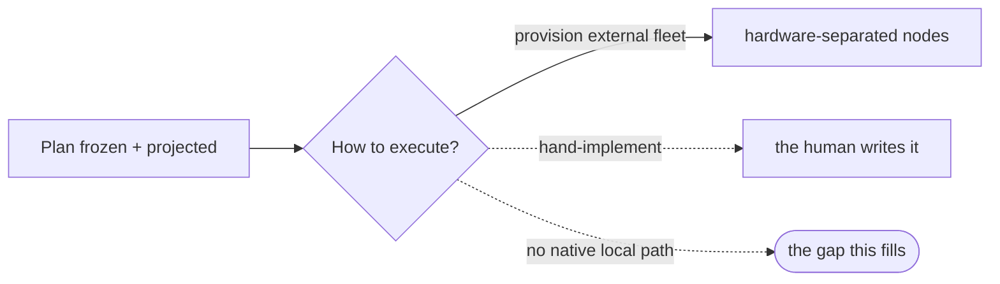

# implement-now — the pyxis-native local execution engine — PRD

| Field | Value |
|---|---|
| **In one line** | Pipeline stage 8, native and local: after a plan is projected, `/implement-now` claims its automated-implementation-tagged tasks and drives each to a genuinely-green PR on the invoking machine — the first native binding of the executor seam, built local-first so it ports to the remote/Docker fleet unchanged. |
| **Relevant-when** | planning, building, or reviewing the pyxis-native implementation executor (stage 8, local/synchronous runtime); its single-task worker, CLI adapters, claim/worktree isolation, or CI self-heal; triaging a stuck, looping, charter-bleed, hollow, or duplicate-claim failure; changing the plan/charter consumption or the tracker, merge-lane, or argus contracts it rides |
| **Status** | Draft — problem review pending |
| **Tier** | T3 — autonomous code execution with credential handling on the factory control plane |
| **Owner** | @mdarabi |
| **Approver(s)** | @mdarabi (operator) |
| **Contributors** | — *(solo operator; gate tables record the introducing PR's review, rule 15)* |
| **Informed** | — |
| **Date** | 2026-07-15 created · 2026-07-15 last updated |
| **Appetite** | Build the native local execution core well — the single-task worker, the four-CLI runtime adapter, the claim + worktree isolation, the dispatch layer, and the local + CI self-heal loop — and dogfood it on one real pyxis feature. Excludes the remote/Docker runtime, hardware separation, umbrella policies, and any landing/merge work. A budget bounded by the reusability bet, not a task count. |
| **Target release** | pyxis's first execution-stage capability — turns the stage-8 binding from "external fleet only" to "native local runtime + external fleet." |
| **Tracking** | — *(the introducing PR)* |
| **Artifacts** | `brainstorm:implement-now` — the gated brainstorm record (rides this PR) |
| **Template version** | prd-template/v2 |

## 0. Read to rule — the human reviewer's section (~6 min)

*The body is the contract; this section only routes attention — on any conflict the body governs; machines ignore it.*

**Judge these**

| # | The call | Could have gone | If you disagree |
|---|---|---|---|
| 1 | Opens PRs, **never merges** — landing is out of scope | Drive each task to *merged* end-to-end | The executor would hold merge authority, colliding with merge-lane DINV-5 and the vision's trust level 2 → §3.4 NG-1, FR-7 |
| 2 | **Full tracker-mediated** — projects via the planning stage and claims the same tagged items as the external fleet | A tracker-bypass local loop reading only the plan JSON | A second projection path (fleet-bridge DINV-1) and loss of idempotency/coexistence with the fleet → §4.1, FR-1, FR-2 |
| 3 | **Fresh non-interactive session per task**, no warm-session reuse | Reuse a warm session across tasks to amortize startup | Re-imports the same-session charter-bleed failure class the prior factory's newest incidents record → FR-5, UB-3 |
| 4 | Autonomous bypass-permission workers run on the **same hardware under ambient/local policy** | A sandbox / hardware-separated / policy-governed runtime | The security posture rests on worktree isolation + the never-merge boundary, not on host isolation → §5.3, §3.4 NG-2/NG-3 |
| 5 | On unrecoverable task failure: **skip-and-continue + escalate** | Halt the whole run on first failure | The run keeps building independent tasks and leaves a recovery surface, rather than stalling on one → FR-15, UB-1 |
| 6 | Build the **durable engine core** (worker + ports), local runtime first | A throwaway local script, remote rebuilt later | The remote/Docker fleet becomes another adapter set, not a rewrite; the up-front port cost is the bet → §4.1, §3.1 G3 |
| 7 | **Bounded-parallel** local dispatch by default | Sequential single-worker | Parallelism exercises the claim/isolation seams the remote fleet depends on; a wrong cap only affects local resource use → FR-11 |

**Sanity-check the numbers** — the caps that bound cost and looping (worker turn cap, CI self-heal attempt cap, parallel-dispatch width) are **design-owned policy**, not fixed here (§7.2 Q-2, rule 14); the only product-level success bar is the **dogfood** acceptance — a real pyxis feature's tasks all reach genuinely-green PRs (§3.2 M1) — plus four-CLI coverage (DOD-6).

**The author's open questions** — one genuine unknown: whether Claude Code's headless mode (`claude -p` / SDK) fully covers an autonomous multi-tool run, given the prior factory deliberately avoided it (§7.2 Q-1). The remaining §7.2 rows are design mechanics, owned by the technical design, none solution-blocking.

**Skip the rest** — structure/ID/fold correctness → docgate; substance and coherence → the unmanned `/prd-review`; implementation and mechanism choices → the technical design (the §7.2 design-owned rows); merge safety → merge-lane; plan→tracker projection correctness → plan-new.

## 1. Summary

- **Problem** — Once a plan is frozen and projected, pyxis has no way of its own to build it: the only path to green PRs is to stand up the external fleet, which needs separated hardware and fleet-wide policy. There is nothing that turns a plan into PRs on the same machine the plan was made on.
- **For whom** — The operator with a pyxis-installed repo who has just planned in-session (attended), and argus driving the same core unattended.
- **Why now** — Planning ships (a frozen plan projects to tracked, tagged tasks); the executor is the next pipeline stage and the last big native gap. The reusable prior art and its hard-won failure catalog are in hand.
- **Direction** — A self-contained single-task worker — claim → isolated worktree → implement → drive to a genuinely-green PR → release — behind one backend-agnostic runtime (four CLIs), driven by a swappable dispatch layer. Local-synchronous is the first runtime; the remote/Docker fleet is a later adapter set over the same core.
- **Appetite** — The native local execution core + a dogfood proof; excludes the remote runtime, hardware separation, umbrella policies, and landing.
- **Success** — `/implement-now` implements a real small pyxis feature end-to-end locally: every task reaches a genuinely-green PR with the operator only reviewing/merging (§3.2 M1).
- **Guardrail** — It never merges, never mutates the parent checkout, and never double-claims a task the external fleet holds (§3.3).
- **Top risks** — (1) same-session charter bleed if any state leaks across tasks; (2) unbounded loops / token runaway from a drifted predicate; (3) "green" that isn't green — a task counted done on a red or absent proposal.

## 2. Problem space

### 2.1 Problem statement

An operator (or argus) with a frozen, projected plan has no native way to execute it. Today implementation happens only through the external fleet — a set of hardware-separated, policy-governed nodes that must be provisioned and run apart from the session that authored the plan. On a single machine, in the session that just designed and planned, there is no lightweight path from "plan is ready" to "green PRs I can review." The cost of doing nothing is that pyxis cannot deliver software with its own engine at all — the pipeline's final productive stage lives entirely outside it.

### 2.2 Users and segments

| Segment | Role and context | Domain exp. | Tech exp. | Key goals | Pain today | Evidence |
|---|---|---|---|---|---|---|
| **P1 (primary)** | The operator with a pyxis-installed repo, in the session that just planned; drives `/implement-now` attended and watches | master | master | plan → green PRs on this machine, now; keep judgment at hand | no native executor; must stand up the external fleet | `brainstorm:implement-now#D-6`, `#D-9` |
| P2 (secondary) | **argus**, the AI Engineer, driving the same core unattended as its hands | — | master | execute a plan it has driven, without self-implementing | it can drive the external fleet but has no native local executor to drive | `brainstorm:implement-now#D-6`, `#O-4` |
| **Anti-segment** | A workload that requires hardware separation or fleet umbrella policies (isolated/other machines, container security posture, org/fleet governance) | — | — | — | served by the remote/Docker fleet, deliberately not by this | `brainstorm:implement-now#D-7` |

### 2.3 Jobs and desired outcomes

| # | When… | I want to… | So I can… | Today's workaround | Evidence |
|---|---|---|---|---|---|
| J1 | I have a frozen, projected plan and I am in the session that made it | turn its tasks into green, reviewable PRs on this machine, now | ship without provisioning a fleet or leaving the session | stand up the external fleet, or hand-implement | `brainstorm:implement-now#D-9` |
| J2 | argus has driven a plan to freeze and must materialize it | execute the plan's tasks unattended, as the hands, without self-implementing | keep the principal/hands split while still delivering | drive the external fleet only | `brainstorm:implement-now#D-6` |
| J3 | a task's proposal is red (local gate or CI) | have the executor fix it to green before counting it done | trust that "done" means a mergeable proposal | manual fix, or a task falsely counted done | `brainstorm:implement-now#D-3` |

### 2.4 Evidence

| Claim | Source | Confidence |
|---|---|---|
| Stage 8 today is "external fleet; pyxis-native engine not built" | `brainstorm:implement-now#F-1` (product-vision §4, pipeline map) | High |
| The executor is explicitly-deferred, uncovered work (nativizing stage 8) | `brainstorm:implement-now#F-2` (`brainstorm:autonomous-developer#O-4`) | High |
| Same-session reuse of a warm agent session bleeds one task's charter into another's work | `brainstorm:implement-now#F-10` (prior-factory incidents I18/I19) | High |
| Two predicates that should be one drift into unbounded, costly loops | `brainstorm:implement-now#F-10` (principle P1; incidents I2/I3) | High |
| A worker can return cleanly having shipped no proposal ("hollow") | `brainstorm:implement-now#F-4`, `#F-10` (IMPL-2, principle P3) | High |
| A single-task worker + a scheduler is a proven, portable shape | `brainstorm:implement-now#F-4`, `#F-5` (IMPL-* corpus; domain model, kind-blind Node) | High |

### 2.5 The journey today

| Phase | User does | User feels / pain | Frontstage | Backstage |
|---|---|---|---|---|
| Plan ready | freezes + projects a plan | ready to build | tracked, tagged tasks | plan-new / plangate |
| Execute | must choose: provision the fleet, or hand-implement | friction — the work is right here but there's no native path | fleet setup, or manual coding | external nodes (hardware + policy), or the human |
| Verify | reviews whatever lands | disconnected from the session that planned it | PRs (eventually) | external fleet |

### 2.6 Opportunity and why now

- **Size** — Every pyxis-planned feature needs execution; today none can be executed natively. This is the pipeline's final productive stage.
- **Alternatives users have** — The external fleet (heavy: hardware + policy); hand-implementation (defeats the factory); do nothing (no native delivery).
- **Why us / strategic fit** — The single-task worker is the reusable core the remote fleet also needs; building it once, local-first, is the cheapest path to both runtimes.
- **Why now** — Planning ships; the executor is the natural next stage; the prior art and its failure catalog are available to build against.
- **Cost of doing nothing** — pyxis remains unable to deliver software with its own engine.

**Decision:** Problem gate — sign before §3–§4 are read in review.

| Reviewer | Role | Date | Verdict |
|---|---|---|---|
| @mdarabi | operator (via the introducing PR's review) | — | — |

## 3. Goals, metrics, and guardrails

### 3.1 Goals as falsifiable hypotheses

| # | We believe that… | Will result in… | Measured by… |
|---|---|---|---|
| G1 | a native local executor for the operator + argus | plans become green PRs on the invoking machine with no fleet | M1 |
| G2 | driving each task to genuinely-green (local + CI) before counting it done | "done" means a reviewable, mergeable proposal — not a red or absent one | M2 |
| G3 | a self-contained single-task worker behind swappable dispatch | the remote/Docker fleet later reuses the worker core unchanged | M3 |
| G4 *(qualitative)* | an attended run reads as "watch my plan get built" | the operator trusts and stays with the in-session loop | interview / usage verbatims |

### 3.2 Goals → signals → metrics

| Metric | Goal | Signal | Baseline | Target (at checkpoint) | Feeds from |
|---|---|---|---|---|---|
| M1 (primary) | G1 | a real pyxis feature's tasks reach green PRs via `/implement-now` | 0 features (no native executor) | 1 dogfood feature fully implemented locally, operator only reviewing/merging, at the dogfood checkpoint | EVT-5, EVT-6 |
| M2 | G2 | tasks counted done that are genuinely green (PR exists + all required checks green) | n/a | 100% of succeeded tasks carry a green proposal; zero hollow-as-succeeded | EVT-4, EVT-6 |
| M3 | G3 | the worker core runs unchanged behind a second (remote) dispatch adapter | n/a | the worker + ports pass their conformance suite behind a fake and the local dispatch adapter, with no worker change required for a second adapter (reusability check) | EVT-2, EVT-6 |

### 3.3 Guardrails and decision rule

| Guardrail metric | Threshold | Action if breached |
|---|---|---|
| Parent-checkout mutation | any mutation of the parent clone / engine checkout outside a worktree | fail-closed; the run halts the offending worker and alarms |
| Double-claim with the external fleet | any task worked concurrently by both a local worker and a fleet node | fail-closed; the claim mechanism must prevent it — a breach blocks release |
| Self-merge | any merge performed by the executor | structurally impossible (holds no merge credential); a breach is a critical defect |
| Idle cost | any model spend on a run with an empty ready frontier | investigate the gate predicate (P1/P9 regression) |

**Ship rule (pre-registered):** M1 met (a dogfood feature reaches all-green PRs) AND no guardrail breached → the capability is proven; any guardrail breach → not shippable until closed.

### 3.4 Non-goals and waiting room

| ID | Non-goal | Why refused |
|---|---|---|
| NG-1 | Merging / landing proposals | landing is merge-lane's, gated by a human or the AUTO lane; the executor holds no merge credential (`brainstorm:implement-now#O-1`) |
| NG-2 | Hardware separation (isolated/other machines, containers, the deny-by-omission security posture) | the remote/Docker fleet's value-add; this runs on the same hardware (`brainstorm:implement-now#O-2`) |
| NG-3 | Fleet umbrella policies (org/managed-set governance, risk & size caps, resource limits, node leases/heartbeats) | the remote runtime's layer; this runs under ambient/local policy (`brainstorm:implement-now#O-3`) |
| NG-4 | A new work substrate or projection path | it reuses the planning stage's projection and the tracker convention unchanged (`brainstorm:implement-now#D-4`) |

| ID | Waiting room | Revisit when / intended version |
|---|---|---|
| WR-1 | The remote/Docker runtime (a second dispatch adapter + hardware isolation + umbrella policy over the same worker core) | when hardware separation or fleet governance is needed; the worker core is built to receive it |
| WR-2 | Auto-landing (the executor triggers merge-lane AUTO after green) | when merge-lane AUTO is activated for the repo and the operator wants it |

## 4. Solution space

### 4.1 Approach and alternatives considered

The chosen shape is a **durable execution core run in its simplest runtime**: a self-contained single-task worker — given one task charter and repo access it claims the task, prepares an isolated worktree off the freshly-fetched mainline, launches an implementing agent (one of four CLIs) behind a backend-agnostic runtime contract, drives the result to a genuinely-green proposal (fixing the local gate and remote CI), and releases the claim. A dispatch layer, separate from the worker, walks the plan's ready frontier and runs workers; the local runtime's dispatcher runs a bounded-parallel default in-process. Everything the worker does is runtime-agnostic, so the remote/Docker fleet is later a second dispatch adapter (plus hardware isolation and umbrella policy) over the same core.

| Option | Sketch | Why not chosen |
|---|---|---|
| A (chosen) | durable worker core + swappable dispatch, local runtime first | — |
| B | a throwaway local script hardcoding one-machine assumptions | the remote runtime would be a rewrite, and the failure lessons would be re-learned in an untestable place (`brainstorm:implement-now#D-5`) |
| C | tracker-bypass local loop (read the plan JSON, skip projection) | a second projection path (fleet-bridge DINV-1); loses idempotency, verification, and fleet coexistence (`brainstorm:implement-now#D-4`) |
| Do nothing | — | pyxis cannot execute a plan natively (§2.6) |

### 4.2 Scope perimeter

- **In (plan of record)** — the single-task worker; the four-CLI backend-agnostic runtime (fresh non-interactive sessions); claim + worktree isolation; the frontier walk + local dispatch (bounded-parallel); drive-to-green (local gate + bounded CI self-heal); hollow/failure handling; resumability; attended and argus-driven invocation.
- **Future (believed next, not committed)** — the remote/Docker dispatch adapter; hardware isolation; umbrella policy; auto-landing (WR-1, WR-2).
- **Out** — merging, hardware separation, fleet policy (mirrors §3.4).

### 4.3 Experience: flows and states

**Flow F1 — an in-session run (serves J1, J3)**

| Step | User does | System responds | States covered | Design |
|---|---|---|---|---|
| 1 | invokes `/implement-now` on a frozen, projected plan | reports the ready frontier and begins claiming + dispatching | ideal · empty · loading · partial · error | tech design |
| 2 | watches (attended) | shows per-task progress: claimed → implementing → proposal → green | ideal · partial · error | tech design |
| 3 | reviews the final report | a succeeded / failed / blocked summary with proposal links | ideal · partial · error | tech design |

- **Empty** — no ready tasks (all done, blocked, or claimed): report the frontier state and exit at ≈0 model cost; no worker spawned.
- **Loading** — a worker is implementing / awaiting CI: live per-task status; the run continues other tasks.
- **Partial** — some tasks green, some blocked on an unmerged blocker, some failed: the report names each class.
- **Error** — a task can't reach green after the cap: marked failed, escalated, its WIP preserved; the run continues.
- **Accessibility** — n/a: a terminal/agent-driven command surface, no new UI pages/processes in scope.
- **Localization** — n/a: developer-facing, English-only tooling.

### 4.4 Scenarios

**Common case.** The operator freezes a plan (a foundation task and two file-disjoint leaves), types `/implement-now`, and watches: the foundation task is claimed, implemented in its worktree, its PR driven to green; the two leaves then run in parallel, each to a green PR. The run reports three succeeded; the operator reviews and merges.

**Failure mid-run.** One leaf's tests won't pass after the bounded self-heal cap. It is marked failed, escalated, its draft PR left for the human; the other leaf still lands green. The report reads two succeeded, one failed.

**Unattended (argus).** argus, having driven the plan to freeze, invokes `/implement-now` as its hands; workers run headless; progress and any failures land on argus's journal; argus never implements a task itself.

**Decision:** Solution gate — zero TBDs may pass.

| Reviewer | Role | Date | Verdict |
|---|---|---|---|
| @mdarabi | operator (via the introducing PR's review) | — | — |

## 5. System requirements

### 5.1 Functional requirements

| ID | Requirement (EARS) | Rationale | Priority | Risk | Fit criterion | Verify | Traces to |
|---|---|---|---|---|---|---|---|
| FR-1 | When invoked on a frozen plan, the executor shall build the ready frontier of tasks that are open, dependency-unblocked, and unclaimed. | the DAG defines what may run | Must | med | given a fixture plan+tracker state, the computed frontier equals the open∧unblocked∧unclaimed set | Test | G1, J1, F1 |
| FR-2 | Before working a task, the executor shall acquire an at-most-one-worker claim through the same automated-implementation claim mechanism the external fleet uses. | one worker per task, and coexistence with the fleet | Must | high | in a concurrent local+fleet race fixture, exactly one worker ever holds a task; the loser skips | Test | G1, NR-2 |
| FR-3 | The executor shall run each task as a self-contained worker that, given one task charter and repo access, completes the task with no dependence on the invoking session's memory or on any sibling task. | the worker is the portable, remote-reusable unit | Must | high | the worker runs to a green proposal in a harness supplying only a task charter + repo; no sibling/session state is read | Test | G3, J1 |
| FR-4 | The executor shall run each worker in an isolated workspace branched from the freshly-fetched mainline, and shall not mutate the parent checkout. | isolation + correct base (avoids stale-base conflicts) | Must | high | a worker's writes appear only in its workspace; the base is the fetched mainline tip; a parent-checkout write is blocked | Test | G1, §3.3 |
| FR-5 | The executor shall launch the implementing agent through one backend-agnostic runtime contract supporting Claude Code, Codex, Cursor, and OpenCode, each as a fresh non-interactive session per task. | one contract, four backends; fresh sessions avoid charter bleed | Must | high | each of the four backends drives a task to a green proposal through the identical runtime contract; no session is reused across tasks | Test | G1, DOD-6, UB-3 |
| FR-6 | The executor shall select each worker's capability tier (model and effort) from the task's frozen rung, resolved per backend. | judge-once routing; native model IDs stay in the adapter | Should | med | a task's rung maps to the backend's declared (model, effort); native IDs appear only in the adapter | Inspection | G1 |
| FR-7 | The executor shall drive each task to a proposal whose local gate and required remote CI are green before counting the task done, and shall not merge any proposal. | "done" = mergeable; landing stays downstream | Must | high | a task counts done only when its proposal exists and all required checks are green; the executor performs zero merges | Test | G2, NG-1, J3 |
| FR-8 | The executor's local gate shall run the same deterministic checks required by CI. | prevent "passed local, failed CI" | Must | high | a change failing a required CI check also fails the local gate on the same input | Test | G2, UB-5 |
| FR-9 | When a proposal's checks are red, the executor shall attempt recovery through a bounded self-heal loop and, on exhausting the bound, escalate. | recover routine CI failures without unbounded looping | Must | high | red→fix→re-check converges or, at the bound, stops and escalates; the attempt count is bounded and observable | Test | G2, UB-1 |
| FR-10 | The executor shall count a task succeeded only on a verified proposal artifact, and shall report a worker that returned without one as hollow. | success is an artifact, never self-report | Must | high | a worker that exits without a proposal is reported hollow, never succeeded | Test | G2, UB-4 |
| FR-11 | The executor shall dispatch tasks through a dispatch layer separate from the worker; the local runtime shall run a bounded, configurable number of workers concurrently without changing the worker. | concurrency is a dispatch concern, not a worker property | Should | med | changing the local concurrency bound changes only dispatch config; the worker code is unchanged | Inspection | G3 |
| FR-12 | While the ready frontier is empty, the executor shall consume no model tokens. | idle is free (P9) | Must | med | a run over an empty frontier emits no model call | Test | §3.3 |
| FR-13 | The executor shall bound each worker's turns mechanically; a non-converging worker shall checkpoint, exit resumably, and be respawned up to a cap, then escalated. | bound per-task spend; a model can't count its own turns | Must | high | a worker exceeding the turn bound checkpoints and exits; respawns are capped; at the cap it escalates | Test | UB-6 |
| FR-14 | When re-invoked or resumed after interruption, the executor shall re-probe the tracker and continue from pushed work, producing no duplicate proposal for a task. | crash/rerun resumability without duplication | Must | high | after a mid-run kill, a re-invocation resumes in-flight tasks from their pushed branches; no task yields two proposals | Test | G1, UB-2 |
| FR-15 | If a task cannot reach green within the self-heal bound, the executor shall mark it failed, escalate it, preserve its work, continue the other independent ready tasks, and end with a succeeded/failed/blocked report. | one failure never stalls the whole run | Must | med | in a fixture where one task fails, independent tasks still complete and the report classes every task | Test | J1, UB-1 |
| FR-16 | Before consuming an attempt, the executor shall preflight each backend's auth and inject the backend's credential into the worker session; on a missing credential it shall degrade with a stated, actionable reason and not count a success. | an unauthenticated child looks like a fast success | Must | high | with a backend unauthenticated, the run reports the missing-credential reason and spawns no counted worker | Test | UB-7 |
| FR-17 | The executor shall be drivable by the operator (attended, with live progress) or by argus (unattended, reporting to its journal) over the same worker core. | both consumers, one core (attendedness is a mode) | Must | med | the same run completes under an attended invocation and under an unattended (journal-only) invocation | Demo | J1, J2 |
| FR-18 | The executor shall evaluate each run-control predicate (task readiness, claim state, task-done, proposal-shipped) through a single implementation. | drifted duplicate predicates cause phantom loops (P1) | Must | high | each predicate has exactly one implementation; a fixture that would diverge two copies cannot (there is one) | Inspection | §3.3, UB-1 |
| FR-19 | The executor shall provide each worker its full task charter and the relevant context inline at spawn. | a context-starved worker re-discovers at the most expensive rate | Should | med | the spawn input carries the charter and cited context; the worker performs no avoidable context re-discovery | Inspection | NFR-10 |
| FR-20 | The executor's stage-8 binding shall be introduced by moving the pipeline map's stage-8 row and re-pinning the binding through the sanctioned hook, not by a second pipeline. | the operational binding lives on the map; introduce via the reserved re-pin | Must | med | the pipeline map's stage-8 row states the native-local binding; the change rides this feature's implementation | Inspection | NR-1 |

*Priority bar: Must = the executor does not ship without it. FR-6, FR-11, FR-19 are Should — valuable, degradable for a first cut without breaking correctness.*

**Non-regression (NR-n)**

| ID | Existing behavior protected | Why protected | Risk | Fit criterion | Verify | Traces to |
|---|---|---|---|---|---|---|
| NR-1 | The plan→tracker projection contract (single projection path) | fleet-bridge DINV-1: no second projection path | high | the executor invokes the existing projection unchanged; adds no projection path | Inspection | FR-1, FR-20 |
| NR-2 | The external fleet keeps working; local and fleet share one claim mechanism | coexistence without double-grab | high | with the fleet enabled, a shared claim fixture shows no task worked by both | Test | FR-2 |
| NR-3 | The merge-lane landing path is unchanged; the executor holds no merge credential | merge-lane DINV-5 | critical | the executor exposes/holds no approving or merging credential; landing routes through merge-lane as before | Inspection | FR-7, NG-1 |
| NR-4 | The argus principal/hands split — the executor is the hands; argus never self-implements | argus DINV-6 | high | when argus drives, argus issues no implementation itself; the executor performs all task work | Inspection | FR-17, J2 |

### 5.2 Unwanted behavior and failure handling

| ID | If… | Then the executor shall… | User sees | Priority | Risk | Fit criterion | Verify | Traces to |
|---|---|---|---|---|---|---|---|---|
| UB-1 | a task's proposal stays red past the self-heal bound | stop that task, mark it failed, escalate, and continue independent tasks | task in the failed class; WIP preserved | Must | high | independent tasks still complete; the failed task is escalated with its work intact | Test | FR-9, FR-15 |
| UB-2 | the session is interrupted mid-run | leave every claim/worktree/PR recoverable and resume from pushed work on re-invocation | a resumed run continues, no duplicates | Must | high | a killed run resumes with zero duplicate proposals | Test | FR-14 |
| UB-3 | task state or context from one task could reach another's session | prevent it by construction — a fresh session per task, no cross-task reuse, no all-files staging | no cross-task contamination in proposals | Must | critical | in a two-task fixture, neither proposal contains the other's changes | Test | FR-5 |
| UB-4 | a worker exits without producing a proposal | report the task hollow, never succeeded, and leave it re-claimable | task in the hollow/failed class | Must | high | a no-proposal worker is never counted succeeded | Test | FR-10 |
| UB-5 | a change passes the local gate but would fail required CI | fail it at the local gate too (the gate mirrors required CI) | red local gate before push | Must | high | a CI-failing change fails locally on the same input | Test | FR-8 |
| UB-6 | a worker does not converge within its turn bound | make it checkpoint, exit resumably, respawn up to a cap, then escalate | bounded per-task effort; then escalation | Must | high | turn-bound is enforced mechanically; respawns capped; then escalated | Test | FR-13 |
| UB-7 | a backend is uninstalled or unauthenticated | detect it at preflight, degrade with the exact remedy, and consume no attempt | a stated missing-credential/install reason | Must | high | no counted worker spawns; the remedy is reported | Test | FR-16 |
| UB-8 | more than one carrier is found for a task's identity (a duplicate) | halt that task, flag the duplicate, withhold routing, and require operator resolution — never auto-repair | duplicate flagged for resolution | Must | high | a duplicate-carrier fixture halts and flags, creating nothing new | Test | FR-2 |

### 5.3 Permissions and abuse cases

*Access: `/implement-now` runs under the invoking identity (the operator's, attended; argus's grant, unattended). Workers run headless with bypass-permission autonomy inside their worktrees. The executor holds no merge/approve credential (NR-3).*

| Function / data | Operator | argus (granted) | Unauthenticated |
|---|---|---|---|
| invoke a run | invoke | invoke (under grant) | none |
| worker: modify code in its worktree | via worker | via worker | none |
| merge a proposal | none (executor never merges) | none | none |

| ID | Actor and intent | Vector | Impact | Severity | Mitigated by | Verify |
|---|---|---|---|---|---|---|
| ABUSE-1 | tracker/repo/CI content bends a worker into acting on injected instructions | untrusted text read during a task treated as instruction | worker does attacker-directed work | high | FR-3, FR-19 (charter is the instruction; read content is data) + NG-1 (can't merge) + FR-4 (worktree-bounded) | drill: injected content in a fixture task changes no behavior |
| ABUSE-2 | a worker escapes its worktree to mutate the parent checkout or engine | writing outside the workspace | corrupts the shared clone / engine | high | FR-4 + §3.3 guardrail (fail-closed on parent mutation) | Test: parent-mutation attempt is blocked |
| ABUSE-3 | secrets exfiltrate through failed-CI logs piped to a fixer worker | unredacted logs in fixer context | credential/secret leak | high | FR-9 (redact + clamp failed-CI logs before inlining) | drill: seeded secret is redacted before it reaches the fixer |
| ABUSE-4 | a bypass-permission worker performs a destructive/outward act | autonomous execution on local hardware | local damage / unwanted egress | med | worktree isolation (FR-4) + never-merge (NG-1) + ambient/local policy is the stated posture (NG-2/NG-3); hardware/policy separation is the fleet's job | Inspection: the posture and its boundary are stated and bounded |

### 5.4 Data

| Entity / field | Meaning | Source of truth | Retention | Integrity rules | Privacy class |
|---|---|---|---|---|---|
| task claim | the at-most-one-worker lease on a task | the shared claim mechanism (tracker/git) | until release/reap | acquire-or-skip; released on every terminal path | internal |
| worker workspace | the isolated worktree + branch for a task | local git | until reaped (done/aged) | branched off fetched mainline; parent never mutated | internal |
| proposal | the PR carrying a task's change + evidence | the code host | per host | one per task identity; verified green before done | internal |

- **Migration** — none: the executor creates no persistent store of its own; state lives on the tracker, in git, and on the code host.
- **Parallel-run / cutover** — n/a (additive capability alongside the external fleet).
- **Rollback** — the capability is invocation-gated; not invoking it leaves the pipeline exactly as before.
- **Decommission** — n/a.
- **Privacy check** — no personal/sensitive data; no DPIA trigger.
- **Egress** — a worker sends repo content (code, diffs, the task charter, failed-CI logs) to the selected agent-CLI backend, an external service. Redaction applies to failed-CI logs before they are inlined (FR-9/ABUSE-3); backend choice and its data handling are the operator's ambient configuration (NG-3). This is the material egress surface and is named here as a reviewed decision.

### 5.5 Interfaces and integrations

| Interface | Direction | Purpose | Contract | Failure modes | Owner |
|---|---|---|---|---|---|
| frozen plan + projected tasks | in | the work to execute | the planning stage's plan/charter + tracker projection (unchanged) | absent/unmerged plan → refuse; unprojected → nothing to claim | plan-new |
| agent-CLI runtime | out | run a task's implementation | one backend-agnostic contract (launch / await / kill / auth-check / tier-map) across four CLIs | backend down/unauth → preflight degrade (FR-16); non-convergence → turn bound (FR-13) | this feature |
| code host (proposals + CI) | both | open PRs, read check state | the host's proposal + checks surface | check API lag → bounded waits; malformed → treat as not-green | this feature |
| merge-lane | out | landing (downstream) | opens proposals; never merges (NR-3) | none owned here — landing is merge-lane's | merge-lane |

### 5.6 Non-functional requirements

| ID | Area | Requirement | Fit criterion | Verify |
|---|---|---|---|---|
| NFR-1 | Security | The executor shall hold no merge/approve credential and shall confine every worker mutation to its workspace. | zero merge credential present; zero parent-checkout writes across the abuse drills | Test |
| NFR-2 | Security (injection) | The executor shall treat all tracker/repo/CI content read during a task as data, never as instruction. | the ABUSE-1 injection drill changes no behavior | Test |
| NFR-3 | Cost | The executor shall bound per-task spend and keep an idle run at zero model cost. | the turn bound holds (FR-13); an empty-frontier run emits no model call (FR-12) | Test |
| NFR-4 | Operability | The executor shall end every run with a machine-readable succeeded/failed/blocked report and leave failed/blocked tasks recoverable. | the report classes every task; a resumed run continues from it | Test |
| NFR-5 | Maintainability / portability | The executor shall keep the worker core free of runtime-specific (local vs remote) code, so a second dispatch adapter needs no worker change. | the worker + ports compile and pass conformance behind a fake and the local adapter, with no worker edit for a second adapter | Analysis |
| NFR-6 | Reliability | The executor shall make claim acquisition and release structurally paired on every terminal path (fire-or-release). | no code path leaves a claim held after a terminal outcome (audit + fault-injection) | Test |

### 5.7 Instrumentation — the tracking plan

| ID | Event name | Fires when | Properties (typed) | Source | Feeds |
|---|---|---|---|---|---|
| EVT-1 | run_started | a run begins | plan_ref: str, frontier_size: int, driver: enum(operator,argus) | executor | — |
| EVT-2 | task_dispatched | a worker is spawned for a claimed task | task_id: str, backend: enum, rung: int | executor | M3 |
| EVT-3 | ci_fix_attempt | a self-heal iteration runs | task_id: str, attempt: int, bound: int | executor | — |
| EVT-4 | task_verified | a proposal is verified green (or hollow) | task_id: str, proposal_ref: str, green: bool, hollow: bool | executor | M2 |
| EVT-5 | task_outcome | a task reaches a terminal class | task_id: str, class: enum(succeeded,failed,blocked), tokens: int, turns: int | executor | M1 |
| EVT-6 | run_finished | a run ends | succeeded: int, failed: int, blocked: int, tokens: int | executor | M1, M2, M3 |

### 5.8 Definition of Done

| ID | Done criterion | Source | Verify | Required evidence | Blocking? |
|---|---|---|---|---|---|
| DOD-1 | All Must FRs pass their fit criteria | FR-1..FR-20 (Must) | Test | CI run link | yes |
| DOD-2 | No non-regression row broken | NR-1..NR-4 | Test / Inspection | suite result + review note | yes |
| DOD-3 | All UB rows handled as specified | UB-1..UB-8 | Test | failure-injection suite | yes |
| DOD-4 | Security posture proven | NFR-1, NFR-2, ABUSE-1..ABUSE-4 | Test / drill | drill records | yes |
| DOD-5 | No guardrail breachable | §3.3 | Test | guardrail fixtures | yes |
| DOD-6 | Each of the four CLIs drives a task to a green proposal through the one runtime contract | FR-5 | Demo | four per-backend run records | yes |
| DOD-7 | Dogfood: `/implement-now` implements one real small pyxis feature end-to-end locally, operator only reviewing/merging | M1, G1 | Demo | the dogfood run + its merged proposals | yes |
| DOD-8 | Reusability check: the worker core needs no change for a second (fake/remote-shaped) dispatch adapter | NFR-5, G3 | Analysis | conformance run behind the fake adapter | yes |
| DOD-9 | The pipeline map's stage-8 row states the native-local binding | FR-20 | Inspection | the map diff | yes |

### 5.9 AI behavior and evals

*The worker's implementation is model-driven; its acceptance is behavioral, exercised end-to-end rather than on a static answer set.*

| ID | Behavior | Eval set / harness | Threshold | Negative examples |
|---|---|---|---|---|
| EVAL-1 | a worker turns a task charter into a genuinely-green proposal | a fixture set of small, well-charter'd tasks run through the real runtime (per backend) + the dogfood feature | every fixture task reaches a green proposal or a bounded, escalated failure; zero hollow-as-succeeded; zero cross-task contamination | a hollow return counted green; a proposal carrying another task's diff; an unbounded fix loop |

## 6. Delivery

### 6.1 Phasing and milestones

| Phase | Purpose | Scope | Exit criterion |
|---|---|---|---|
| Core | build the worker + ports + one backend, drive one task to green | single-task worker, runtime contract, claim, worktree, local+CI self-heal | one task reaches a green proposal via the real runtime |
| Breadth | prove the contract across all four CLIs + the frontier walk + dispatch | four backends; frontier + bounded-parallel dispatch; failure/hollow/resume | all four CLIs pass DOD-6; a multi-task plan runs with failure handling |
| Dogfood | prove the capability on a real feature | a real small pyxis feature end-to-end | DOD-7 met |

### 6.2 Dependencies

| Dependency | Type | Needed by | Status | Owner |
|---|---|---|---|---|
| the planning stage's plan/charter + tracker projection | system | Core | confirmed (shipped) | plan-new |
| the shared claim mechanism + automated-implementation tag | system | Core | confirmed (shipped) | plan-new / fleet convention |
| merge-lane (for downstream landing) | system | post-run | as-is | merge-lane |
| the four agent CLIs (installed + authenticated) | vendor | Breadth | operator-provisioned | operator |
| headless-Claude viability confirmation (Q-1) | approval/spike | Core (Claude backend) | open (§7.2 Q-1) | technical design |

### 6.3 Risks, assumptions, and rabbit holes

| # | Risk / assumption / rabbit hole | Likelihood | Impact | Mitigation or test | Owner |
|---|---|---|---|---|---|
| R1 | same-session charter bleed if any state leaks across tasks | M | H | fresh session per task (FR-5); no cross-task reuse; UB-3 drill | design |
| R2 | unbounded loop / token runaway from a drifted predicate | M | H | single-source predicates (FR-18); idle-free gate (FR-12); bounded loops (FR-9/FR-13) | design |
| R3 | "green" that isn't green — a task counted done on a red/absent proposal | M | H | verify by artifact (FR-10); local gate mirrors CI (FR-8); EVAL-1 | design |
| R4 | headless-Claude does not fully cover an autonomous run (assumption) | M | M | Q-1 spike before committing the Claude adapter shape; the other three are natively headless | design |
| R5 | stacked/dependent tasks under never-merge create rework | M | M | dependency-ordering mechanism is a design choice (Q-3); doesn't move the never-merge boundary | design |

### 6.4 Release criteria

| Lens | Criterion | Evaluated by |
|---|---|---|
| Functionality | all Must FRs pass their fit criteria | CI / test suite |
| Reliability | UB drills pass; no claim leaked; resumable with no duplicates | failure injection |
| Security | ABUSE drills pass; no merge credential; worktree-bounded | drills + inspection |
| Supportability | every run emits a classed report; failed/blocked tasks recoverable | inspection |
| Capability | four-CLI coverage (DOD-6) + dogfood (DOD-7) | demo |

### 6.5 Rollout and reversibility

- **Flag** — the capability is invocation-gated: it does nothing unless invoked. No repo-wide mode.
- **Kill switch** — do not invoke it; the pipeline is unchanged (the external fleet path is untouched). An in-run stop cancels workers and releases claims.
- **Experiment** — none.
- **Cutover/migration steps** — none (additive).

| Stage | Audience | Minimum evidence | Advance when | Roll back when |
|---|---|---|---|---|
| 1 | operator, this repo (dogfood) | one real feature's tasks reach green PRs | DOD-7 met, guardrails clean | any §3.3 breach |
| 2 | operator + argus, real features | repeated clean runs | steady green-rate, no guardrail breach | any §3.3 breach |

### 6.6 Launch readiness

*Most launch rows are n/a for internal factory tooling with no external customers.*

| Area | Item | Owner | Status |
|---|---|---|---|
| Support | operator runbook: invoke, read the report, recover a failed/blocked task | @mdarabi | ☐ |
| Docs | the `/implement-now` authoring guide + pipeline-map stage-8 update | @mdarabi | ☐ |
| Platform | the four-CLI provisioning + auth note | @mdarabi | ☐ |
| Enablement · Legal · Pricing · Marketing · Localization | n/a — internal factory tooling, no external customers | — | n/a |

**Decision:** Launch gate — §6.4 green, runbook owned, rollback (don't-invoke) trivially rehearsed.

| Reviewer | Role | Date | Verdict |
|---|---|---|---|
| @mdarabi | operator (via the introducing PR's review) | — | — |

### 6.7 Post-launch review

- **Review trigger** — the dogfood feature merged through `/implement-now`, plus the next real feature run. · **Owner** — @mdarabi
- **Verdict recorded** — adopt / iterate / kill, with the run evidence, on the header's Tracking ref (post-merge lifecycle lives in the tracker, not as edits to this frozen document).

## 7. Alignment

### 7.1 FAQ

**Customer** *(the operator)*

- **Q:** Does it merge my PRs? — **A:** No. It opens genuinely-green PRs; you (or merge-lane AUTO, or argus) merge them (NG-1).
- **Q:** Do I need to set up a fleet or containers? — **A:** No — it runs on this machine, in this session, under your ambient setup (NG-2/NG-3).
- **Q:** What if a task can't be made to pass? — **A:** It's marked failed and escalated with its work preserved; the rest of your plan still gets built (FR-15).

**Internal**

- **Q:** How is this not the async `local-agent` pool? — **A:** That's fleet execution (hardware-separated, policy-governed). This is an *in-session run* on the same hardware; both claim the same tagged items (`brainstorm:implement-now#D-2`, `#T-1`).
- **Q:** Can argus use it, or is it operator-only? — **A:** Both — argus drives it as its hands, unattended, never self-implementing (FR-17, NR-4).
- **Q:** Biggest way this fails? — **A:** Same-session charter bleed, runaway loops, or false-green — the top three obituaries (§1); each has a named requirement (FR-5/UB-3, FR-18/FR-12, FR-10/FR-8).

### 7.2 Open questions

| # | Question | Owner | Needed by | Status |
|---|---|---|---|---|
| Q-1 | Does Claude Code's headless mode (`claude -p` / SDK) fully cover an autonomous multi-tool run (permissions, tools, MCP, model/effort)? The prior factory deliberately used the warm TUI instead. | technical design | design gate (Claude backend) | open — `brainstorm:implement-now#P-1` |
| Q-2 | The concrete caps: worker turn bound, CI self-heal attempt cap, parallel-dispatch width (and their config home). | technical design | design gate | open — `brainstorm:implement-now#P-4`, `#P-5` |
| Q-3 | The dependency-ordering mechanism under never-merge (stack on the blocker's branch · pause-and-resume · frontier-only-then-reinvoke). | technical design | design gate | open — `brainstorm:implement-now#P-3` |
| Q-4 | Per-task CLI routing (default backend + per-repo config + optional per-task override); the charter carries a rung but no CLI hint. | technical design | design gate | open — `brainstorm:implement-now#P-2` |
| Q-5 | The attended vs unattended surface (live progress + intervention vs journal + fail-closed escalation) over the same worker core. | technical design | design gate | open — `brainstorm:implement-now#P-6` |

*All §7.2 rows are design-owned; none is solution-blocking for this PRD (they choose mechanisms behind settled requirements).*

### 7.3 Decision log

| Date | Decision | Alternatives considered | Why | Who |
|---|---|---|---|---|
| 2026-07-15 | Build the durable execution core (worker + ports), local runtime first | throwaway local script; tracker-bypass loop | remote fleet reuses the core, not a rewrite | @mdarabi (`brainstorm:implement-now#D-5`, `#D-11`) |
| 2026-07-15 | Four CLIs behind one backend-agnostic runtime, fresh-headless | Claude-only first; warm-session reuse | one contract for N backends; fresh sessions kill charter bleed | @mdarabi (`brainstorm:implement-now#D-1`) |
| 2026-07-15 | Name `/implement-now`; reserve "fleet execution" for the async path | keep `/implement local` | "local" never distinguished the paths — the axis is synchronicity | @mdarabi (`brainstorm:implement-now#D-2`) |
| 2026-07-15 | Stop at genuinely-green PRs (fix local + CI); never merge | drive to merged | honors trust level 2 + merge-lane DINV-5; keeps the run fast | @mdarabi (`brainstorm:implement-now#D-3`) |
| 2026-07-15 | Full tracker-mediated — an executor binding of the fleet seam | tracker-bypass; hybrid | reuses the one projection path; coexists with the fleet | @mdarabi (`brainstorm:implement-now#D-4`) |
| 2026-07-15 | Operator (attended) and argus (unattended) drive one core | operator-only | attendedness is a mode, not the feature | @mdarabi (`brainstorm:implement-now#D-6`) |
| 2026-07-15 | Hardware separation + umbrella policies are the fleet's value-add, out of scope | build them in | that's the remote runtime, added additively later | @mdarabi (`brainstorm:implement-now#D-7`) |
| 2026-07-15 | On unrecoverable failure: skip-and-continue + escalate | halt the run | one failure never stalls independent work | @mdarabi (`brainstorm:implement-now#D-12`) |

### 7.4 Changelog

| Date | Change | Author |
|---|---|---|
| 2026-07-15 | 000-base authored from the gated brainstorm record `brainstorm:implement-now` | @mdarabi |

## 8. Contract readiness — the executability gate

| Check | Pass? | Notes |
|---|---|---|
| Problem basis accepted — §2 problem gate signed (T3) | ☐ | pending the introducing PR's review |
| Zero solution-blocking TBDs or open questions (§7.2) | ☑ | all §7.2 rows are design-owned mechanism choices behind settled requirements |
| Every Must FR has a fit criterion and a verification method (§5.1) | ☑ | |
| Every requirement row carries a risk tier; high/critical rows have a declared safety plan (§5.1, §6.5) | ☑ | never-merge (NG-1/NR-3), worktree isolation (FR-4), bounded loops (FR-9/FR-13), invocation-gated rollout (§6.5) |
| Non-goals drawn (§3.4); non-regression rows named (§5.1) | ☑ | NG-1..4; NR-1..4 |
| Every primary job (§2.3) covered by a requirement, non-goal, or waiting-room entry | ☑ | J1→FR-1/7/15; J2→FR-17/NR-4; J3→FR-7/8/9 |
| Every key flow (§4.3) has functional, failure, and non-regression coverage (§5.1–5.2) | ☑ | F1 → FR-1..20, UB-1..8, NR-1..4 |
| Every primary metric (§3.2) has instrumentation (§5.7) or a measurement plan | ☑ | M1→EVT-5/6; M2→EVT-4; M3→EVT-2/6 |
| Every blocking DoD row traces to a requirement, guardrail, release criterion, or rubric (§5.8) | ☑ | |
| Risks and assumptions have owners (§6.3) | ☑ | |
| Human-judgment criteria name an owner and a rubric (§5.8) | ☑ | none used — DoD rows are Test/Demo/Analysis/Inspection |
| DoD complete: every blocking row sourced and evidenced; every n/a explained (§5.8) | ☑ | |
