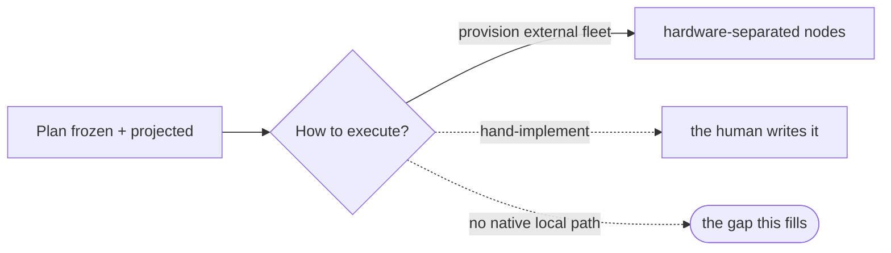

# implement-now — the pyxis-native local execution engine — PRD *(effective view)*

---

**GENERATED — DO NOT EDIT.** Sole writer: `docgate fold`. As of: **008**. Content fingerprint: `sha256:fe30060db56225482bd76725fde9cffd880045f9def6e68b5af59f4c94c75b12`. Tool version (recorded, never hashed): `docgate/v1`.

---

| Field | Value |
|---|---|
| **In one line** | Pipeline stage 8, native and local: after a plan is projected, `/implement-now` claims its automated-implementation-tagged tasks and drives each to a genuinely-green PR on the invoking machine — the first native binding of the executor seam, built local-first so it ports to the remote/Docker fleet unchanged. |
| **Relevant-when** | planning, building, or reviewing the pyxis-native implementation executor (stage 8, local/synchronous runtime); its single-task worker, CLI adapters, claim/worktree isolation, or CI self-heal; triaging a stuck, looping, charter-bleed, hollow, or duplicate-claim failure; changing the plan/charter consumption or the tracker, merge-lane, or argus contracts it rides |
| **Status** | Draft — problem review pending |
| **Tier** | T3 — autonomous code execution with credential handling on the factory control plane |
| **Owner** | @mdarabi |
| **Approver(s)** | @mdarabi (operator) |
| **Contributors** | — *(solo operator; gate tables record the introducing PR's review, rule 15)* |
| **Informed** | — |
| **Date** | 2026-07-15 created · 2026-07-15 last updated |
| **Appetite** | Build the native local execution core well — the single-task worker, the four-CLI runtime adapter, the claim + worktree isolation, the dispatch layer, and the local + CI self-heal loop — and dogfood it on one real pyxis feature. Excludes the remote/Docker runtime, hardware separation, umbrella policies, and any landing/merge work. A budget bounded by the reusability bet, not a task count. |
| **Target release** | pyxis's first execution-stage capability — turns the stage-8 binding from "external fleet only" to "native local runtime + external fleet." |
| **Tracking** | — *(the introducing PR)* |
| **Artifacts** | `brainstorm:implement-now` — the gated brainstorm record (rides this PR) |
| **Template version** | prd-template/v2 |

## 0. Read to rule — the human reviewer's section (~6 min)

*The body is the contract; this section only routes attention — on any conflict the body governs; machines ignore it.*

**Judge these**

| # | The call | Could have gone | If you disagree |
|---|---|---|---|
| 1 | One bounded issue can enter without planning artifacts; the invoking agent supplies portable intake | Require the whole feature pipeline for every issue | retain plan-only entry → FR-50, J1 |
| 2 | Exact provider-qualified selection and native blocker reads scope every execution/review action | Filter the ordinary label frontier | accept unrelated work or omitted blockers → FR-51, UB-22 |
| 3 | Admission freezes one Git-backed contract; changed source stops | Execute mutable tracker text | accept silent contract drift → FR-52 |
| 4 | Reuse the worker and authenticated reviewer; verified PR means exact current revision | New issue executor or green-only completion | weaken review or change implementation truth → FR-53, FR-35/FR-40..FR-49 |
| 5 | Basic observed attribution; unknown counters are unavailable and command duration has a stated boundary | Promise full intake-to-delivery telemetry now | require harness transcript instrumentation → FR-54 |
| 6 | Existing activation, human landing, and no-merge authority remain | Activate or merge as recovery | enlarge release/landing authority → FR-55, FR-26/FR-48, NR-3 |

**Sanity-check the proof** — exactly one selected issue; zero unselected repairs/claims/launches; same admitted contract retains one identity; head/local/CI/review revisions must agree; no unknown-as-zero usage (FR-51..FR-54, DOD-37).

**The author's open questions** — the concrete issue-entry design and its existing production-readiness dependencies require operator approval. Existing configured-review publication/authentication and activation requirements still govern (FR-35/FR-40..FR-49, §6.2).

**Skip the rest** — structure/fold → docgate; requirements substance → `/prd-review`; entry mechanism → technical design; implementation/review mechanics → existing executor and impl-review contracts; merge → merge-lane.

## 1. Summary

- **Problem** — Once a plan is frozen and projected, pyxis can execute it locally, but implementation routing can still lose semantic demand and a configured post-green review can be skipped, forged, drift to a later proposal head, consume implementation capacity, or disappear after one red invocation.
- **For whom** — The operator with a pyxis-installed repo who has just planned in-session (attended), and argus driving the same core unattended.
- **Why now** — Plan-new freezes complete semantic demand on every plan/v2 task; the parent routing contract requires harness-specific native mappings; the e2e line projects ordinary tasks; and live configured review must now produce durable, attributable evidence without changing green implementation truth.
- **Direction** — Preserve the single-task worker and upstream harness choice. Recover or conservatively translate demand before claim; resolve qualified implementation and review roles through the selected harness; drive implementation to a genuinely-green exact revision; persist its review obligation before EVT-10, release implementation resources, and reconcile it through an isolated bounded reviewer whose exact artifact authenticates the launched attempt. Fail unsupported routing and review evidence in closed typed classes while retaining the implementation terminal.
- **Appetite** — The native local execution core, implementation-routing seam, e2e task consumption, and configured-review obligation/admission/verification/driver-consumer seam. Excludes harness selection policy, impl-review's internal pass/blindness/aggregation process, the remote runtime, hardware separation, umbrella policies, landing, and systematic e2e anti-gaming beyond the named scope.
- **Success** — `/implement-now` implements a real feature with every plan demand preserved, at least three native profiles reaching verified EVT-10 outcomes, one real e2e plan reaching genuine green, and every configured green proposal retaining one exact-revision obligation that becomes authenticated verified or remains visibly pending under one of three closed failure classes without implementation redispatch.
- **Guardrail** — It never merges, mutates the parent or another workspace, double-claims, downgrades demand, switches harnesses, rewrites plan/v1, launches under invalid routing, changes e2e subject behavior, re-derives a review revision, accepts worker-authored/replayed evidence, lets review consume implementation width, or launders pending review to green.
- **Top risks** — stale/unqualified native mappings; demand loss; mutable legacy inference; e2e anti-patterns and flake; charter bleed and unbounded loops; false green; lost/duplicated review obligations; forged or unreadable artifacts; shared reviewer state; and unattended retry laundering.

## 2. Problem space

### 2.1 Problem statement

An operator (or argus) with a frozen, projected plan has no native way to execute it. Today implementation happens only through the external fleet — a set of hardware-separated, policy-governed nodes that must be provisioned and run apart from the session that authored the plan. On a single machine, in the session that just designed and planned, there is no lightweight path from "plan is ready" to "green PRs I can review." The cost of doing nothing is that pyxis cannot deliver software with its own engine at all — the pipeline's final productive stage lives entirely outside it.

### 2.2 Users and segments

| Segment | Role and context | Domain exp. | Tech exp. | Key goals | Pain today | Evidence |
|---|---|---|---|---|---|---|
| **P1 (primary)** | The operator with a pyxis-installed repo, in the session that just planned; drives `/implement-now` attended and watches | master | master | plan → green PRs on this machine, now; keep judgment at hand | no native executor; must stand up the external fleet | `brainstorm:implement-now#D-6`, `#D-9` |
| P2 (secondary) | **argus**, the AI Engineer, driving the same core unattended as its hands | — | master | execute a plan it has driven, without self-implementing | it can drive the external fleet but has no native local executor to drive | `brainstorm:implement-now#D-6`, `#O-4` |
| **Anti-segment** | A workload that requires hardware separation or fleet umbrella policies (isolated/other machines, container security posture, org/fleet governance) | — | — | — | served by the remote/Docker fleet, deliberately not by this | `brainstorm:implement-now#D-7` |

### 2.3 Jobs and desired outcomes

| # | When… | I want to… | So I can… | Today's workaround | Evidence |
|---|---|---|---|---|---|
| J1 | I have a frozen projected plan, or one bounded GitHub, Forgejo, or Carina issue | turn the selected work into green, independently reviewed PRs on this machine | ship without provisioning a fleet or manually authoring planning artifacts for a small issue | stand up the external fleet, create a plan, or hand-implement | `brainstorm:implement-now#D-9`; operator decision 2026-10-01 |
| J2 | argus has driven a plan to freeze and must materialize it | execute the plan's tasks unattended, as the hands, without self-implementing | keep the principal/hands split while still delivering | drive the external fleet only | `brainstorm:implement-now#D-6` |
| J3 | a task's proposal is red (local gate or CI) | have the executor fix it to green before counting it done | trust that "done" means a mergeable proposal | manual fix, or a task falsely counted done | `brainstorm:implement-now#D-3` |

### 2.4 Evidence

| Claim | Source | Confidence |
|---|---|---|
| Stage 8 today is "external fleet; pyxis-native engine not built" | `brainstorm:implement-now#F-1` (product-vision §4, pipeline map) | High |
| The executor is explicitly-deferred, uncovered work (nativizing stage 8) | `brainstorm:implement-now#F-2` (`brainstorm:autonomous-developer#O-4`) | High |
| Same-session reuse of a warm agent session bleeds one task's charter into another's work | `brainstorm:implement-now#F-10` (prior-factory incidents I18/I19) | High |
| Two predicates that should be one drift into unbounded, costly loops | `brainstorm:implement-now#F-10` (principle P1; incidents I2/I3) | High |
| A worker can return cleanly having shipped no proposal ("hollow") | `brainstorm:implement-now#F-4`, `#F-10` (IMPL-2, principle P3) | High |
| A single-task worker + a scheduler is a proven, portable shape | `brainstorm:implement-now#F-4`, `#F-5` (IMPL-* corpus; domain model, kind-blind Node) | High |

### 2.5 The journey today

| Phase | User does | User feels / pain | Frontstage | Backstage |
|---|---|---|---|---|
| Plan ready | freezes + projects a plan | ready to build | tracked, tagged tasks | plan-new / plangate |
| Execute | must choose: provision the fleet, or hand-implement | friction — the work is right here but there's no native path | fleet setup, or manual coding | external nodes (hardware + policy), or the human |
| Verify | reviews whatever lands | disconnected from the session that planned it | PRs (eventually) | external fleet |

### 2.6 Opportunity and why now

- **Size** — Every pyxis-planned feature needs execution; today none can be executed natively. This is the pipeline's final productive stage.
- **Alternatives users have** — The external fleet (heavy: hardware + policy); hand-implementation (defeats the factory); do nothing (no native delivery).
- **Why us / strategic fit** — The single-task worker is the reusable core the remote fleet also needs; building it once, local-first, is the cheapest path to both runtimes.
- **Why now** — Planning ships; the executor is the natural next stage; the prior art and its failure catalog are available to build against.
- **Cost of doing nothing** — pyxis remains unable to deliver software with its own engine.

**Decision:** Problem gate — sign before §3–§4 are read in review.

| Reviewer | Role | Date | Verdict |
|---|---|---|---|
| @mdarabi | operator (via the introducing PR's review) | — | — |

## 3. Goals, metrics, and guardrails

### 3.1 Goals as falsifiable hypotheses

| # | We believe that… | Will result in… | Measured by… |
|---|---|---|---|
| G1 | a native local executor accepts projected plans and directly admitted bounded issues | selected work becomes green, independently reviewed PRs on the invoking machine with no fleet | M1 |
| G2 | driving each task to genuinely-green (local + CI) before counting it done | "done" means a reviewable, mergeable proposal — not a red or absent one | M2 |
| G3 | a self-contained single-task worker behind swappable dispatch | the remote/Docker fleet later reuses the worker core unchanged | M3 |
| G4 *(qualitative)* | an attended run reads as "watch my work get built" | the operator trusts and stays with the in-session loop | interview / usage verbatims |

### 3.2 Goals → signals → metrics

| Metric | Goal | Signal | Baseline | Target (at checkpoint) | Feeds from |
|---|---|---|---|---|---|
| M1 (primary) | G1 | a real pyxis feature's tasks reach green PRs via `/implement-now` | 0 features under demand-aware routing | 1 dogfood feature fully implemented locally, operator only reviewing/merging | EVT-10, EVT-16 |
| M2 | G2 | tasks counted done that are genuinely green | n/a | 100% of succeeded tasks carry a green proposal; zero hollow-as-succeeded | EVT-4, EVT-10, EVT-16 |
| M3 | G3 | worker core and runtime adapters retain portability | one coarse rung mapper | the worker passes unchanged behind fake/local dispatch; every supported harness passes implementation-role routing conformance | EVT-7, EVT-8, EVT-16 |
| M4 | G1 | requested semantic profiles whose plan/v2 fields are identical to frozen demand or whose plan/v1 origin is a typed FR-22 translation, followed by a satisfying or explicit unsupported result | optional rung can be absent and demand can be lost | 100% exact origin/transport/resolution; zero inferred, downgraded, native-in-plan, or cross-harness substitutions | EVT-7, EVT-8, EVT-9, EVT-16 |
| M5 | G1 | distinct native implementation profiles exercised by dogfood attempts that succeed with `verification=verified` | hardcoded/implicit route can converge on one pin | at least 3 before production activation; failed/blocked attempts never count | EVT-7, EVT-10 |
| M6 | G2 | routing attempts with exactly one origin, one resolution terminal, and—when resolved—one worker outcome | no complete decision chain | 100% in conformance and dogfood before activation; remains 100% over production attempts after activation; zero orphan/duplicate/cross-class terminals | EVT-7..EVT-10, EVT-16 |
| M7 *(007 ← 005 ← 004)* | G2 | configured green proposals with one exact-green-revision obligation and append-only attempts: verified only by an exact artifact authenticated to the launched reviewer and one field-identical EVT-13↔EVT-17 publication pair, otherwise three-way closed-class failed and still pending | configured review can be silently absent, forged, process-exit-derived, drifted to a later head, or represented by similar but unjoinable publication records | 100% of configured green proposals; zero absent/drifted obligations, duplicate attempts, worker-authored or replayed accepted artifacts, artifact-free or unpaired verified terminals, receipt/proof overloads, unclassified failures, pending-with-exit-zero runs, implementation redispatches, or pending obligations laundered by a later empty frontier | prd:impl-review/EVT-13, EVT-15..EVT-17 |

### 3.3 Guardrails and decision rule

| Guardrail metric | Threshold | Action if breached |
|---|---|---|
| Parent/workspace mutation | any implementation or reviewer mutation of the parent clone, engine checkout, another task workspace, or repository code outside its own implementation charter | fail-closed; halt the offending process, retain evidence, and alarm |
| Double-claim with the external fleet | any task worked concurrently by both a local worker and a fleet node | fail-closed; block release until the claim mechanism is fixed |
| Self-merge | any merge performed by the executor | critical defect; executor holds no merge credential |
| Idle cost | any implementation routing/claim/model spend when its frontier is empty, any reviewer spend when no review obligation is pending, or any model spend when both frontiers are empty | investigate the combined-frontier gate and block release on an unauthorized launch |
| Semantic downgrade or harness switch | any native launch fails to satisfy one requested component, uses an unqualified mapping, or changes the selected harness | stop affected claims; block/rollback immediately; repair policy and rerun affected attempts |
| Frozen-plan mutation or post-freeze inference | any plan/v1 rewrite or plan/v2 assessment/profile reinterpretation | invalidate affected evidence; require no-rewrite translation or field-identical transport before retry |
| Routing evidence break | any attempt lacks exactly one origin/terminal or a resolved attempt lacks exactly one outcome | do not count it succeeded or toward release; preserve artifacts and repair the evidence chain |
| Configured review integrity break | any configured green proposal lacks one exact-green-revision obligation, re-derives a later head, launches before claim/width release, runs in the parent/shared workspace or beyond review capacity, verifies without the exact launched-attempt receipt and proof, lacks exactly one field-identical EVT-13↔EVT-17 publication pair, infers that join from EVT-15 or similar values, aliases native receipt with attempt proof, fails without a three-way class/escalation/tally/exit 1, duplicates an attempt, or becomes clean while still pending | preserve EVT-10, reject unauthentic or unjoinable artifacts, block release/activation, and reconcile the same obligation/revision through the bounded review-only path |

**Ship rule (pre-registered):** M1–M7 meet their pre-release targets, every live blocking DoD row (DOD-5, DOD-8..DOD-9, DOD-11..DOD-12, DOD-14, DOD-18..DOD-19, DOD-27..DOD-30, DOD-32..DOD-34, DOD-36) is green, every guardrail stays clean, every required §6.2 dependency is satisfied, the §6.6 support/docs/platform readiness rows are owned and complete, and §6.5 rollback is rehearsed through complete pre-release proof → activate every supported production implementation and configured review path in one cutover; post-launch M4–M7 and every guardrail remain continuously evaluated; any breach → no activation or immediate strongest-profile fallback, affected-attempt invalidation, and exact-revision review-only reconciliation where applicable. This is the only activation predicate; no narrower metric, DoD, dependency, stage, or launch subset may authorize production.

### 3.4 Non-goals and waiting room

| ID | Non-goal | Why refused |
|---|---|---|
| NG-1 | Merging / landing proposals | landing is merge-lane's, gated by a human or the AUTO lane; the executor holds no merge credential (`brainstorm:implement-now#O-1`) |
| NG-2 | Hardware separation (isolated/other machines, containers, the deny-by-omission security posture) | the remote/Docker fleet's value-add; this runs on the same hardware (`brainstorm:implement-now#O-2`) |
| NG-3 | Fleet umbrella policies (org/managed-set governance, risk & size caps, resource limits, node leases/heartbeats) | the remote runtime's layer; this runs under ambient/local policy (`brainstorm:implement-now#O-3`) |
| NG-5 | Authoring or revising e2e coverage — scenarios, routes, mock strategies, harness choice, or the coverage map | those are e2e-design's decisions, settled by e2e-review and the operator's approval; the executor consumes the approved document and never edits or reinterprets it (`prd:e2e-verification/FR-1`, `FR-4`) |

| ID | Waiting room | Revisit when / intended version |
|---|---|---|
| WR-1 | The remote/Docker runtime (a second dispatch adapter + hardware isolation + umbrella policy over the same worker core) | when hardware separation or fleet governance is needed; the worker core is built to receive it |
| WR-2 | Auto-landing (the executor triggers merge-lane AUTO after green) | when merge-lane AUTO is activated for the repo and the operator wants it |
| WR-3 | The rest of the e2e execution follow-on: systematic run-time anti-gaming (falsification sweeps and e2e test-delta beyond DOD-19's per-scenario broken-subject check), driving the harder app shapes such as web UI to green in CI, and the dedicated no-regression gate | when the e2e authoring line has produced plans across more than one app shape and this amendment's consumption path is proven on a real plan (`prd:e2e-verification/WR-1`, `WR-5`) |
| WR-4 | A distinct code-host reviewer principal, separate from the implementation/operator transport identity | when teams want identity-level separation and a provisioning, rotation, onboarding, author-verification, and local-only fallback contract is approved; this version deliberately authenticates the impl-review-owned broker receipt plus fresh attempt proof and treats author identity as non-authoritative transport metadata |

## 4. Solution space

### 4.1 Approach and alternatives considered

The chosen shape remains a **durable execution core run in its simplest runtime**, extended by deterministic routing boundaries and a second durable review frontier. A self-contained single-task worker consumes one task charter plus its frozen plan/v2 demand—or a typed no-rewrite plan/v1 translation—and repo access. The invoking configuration has already selected one of the four harnesses. That harness's adapter resolves the implementation-role semantic minimum through closed qualified policy to the least-cost satisfying native profile, records exact/promotion/unsupported evidence, and only a resolved route may proceed to claim → isolated worktree → fresh agent → genuinely-green proposal.

At each configured green boundary, the executor captures the verified revision into a durable obligation before EVT-10, releases the task's claim and implementation slot, and admits that obligation immediately under separately bounded review capacity. A fresh isolated reviewer process receives attribution material minted only after the implementation worker terminates and returns one completed report through a one-way handoff. The **review artifact broker** is impl-review's host-side persistence adapter: as part of the reviewer program it performs impl-review FR-6's medium-appropriate proposal write, returns the native receipt, and exact-reads that object for authentication; implement-now integrates this boundary but does not become a second publisher. Only the broker-receipted exact artifact with matching attempt proof and protected canonical state clears the obligation. Code-host author identity is transport metadata and is not required to differ from the implementation identity. Missing evidence, unauthentic evidence, and broken infrastructure remain distinct, pending, and run-red. The Dispatcher still owns implementation capacity; the review frontier owns its own capacity; neither path chooses or switches harnesses, and impl-review continues to own its internal pass/blindness/aggregation/persistence program.

| Option | Sketch | Why not chosen |
|---|---|---|
| A (chosen) | frozen demand → qualified implementation → exact-green obligation → released implementation resources → isolated attributed reviewer → impl-review-owned broker publish/receipt → authenticated artifact | preserves plan meaning, implementation throughput, exact revision, sibling publication ownership, and independent review evidence |
| B | hardcoded native model/effort | collapses independent needs and cannot satisfy least-powerful-that-suffices |
| C | infer complexity from charter/repo at claim time | re-judges with less context after freeze and produces unauditable drift |
| D | store native settings or harness choice in the plan | couples frozen artifacts to vendor catalogs and credential/egress policy |
| E | switch harnesses when unsupported | violates the operator's credential and egress decision |
| F | launch all reviews after the implementation sweep in the parent clone | delays outcomes, re-derives mutable heads, and races reviewers in operator state |
| G | accept any matching proposal comment | lets the implementing worker forge the sole evidence that independent review occurred |
| H | treat review exit code as success or failure of the implementation task | confuses process health with artifact truth and rewrites green implementation history |
| Do nothing | — | routing and configured review remain silent, unauthenticated, and unrecoverable |

### 4.2 Scope perimeter

- **In (plan of record)** — the single-task worker; four-CLI backend-agnostic runtime with fresh sessions; claim + worktree isolation; bounded implementation dispatch; drive-to-green; demand integrity/translation; selected-harness qualified implementation and review-role resolution; immutable routing/outcome evidence; per-task exact-green review obligations; isolated attributed reviewer admission under separate capacity; authenticated exact-artifact reconciliation; three review failure classes; review-only driver recovery; strongest-profile fallback; test-then-direct activation.
- **Future (believed next, not committed)** — the remote/Docker dispatch adapter; hardware isolation; umbrella policy; auto-landing (WR-1, WR-2).
- **Out** — merging; hardware separation; fleet umbrella policy; choosing or switching harnesses; planner assessment/derivation; proposal-risk classification; impl-review pass count, blindness, lens prompts, candidate screening, and aggregation; adaptive routing or cross-harness optimization.

### 4.3 Experience: flows and states

**Flow F1 — an in-session run (serves J1, J3)**

| Step | User does | System responds | States covered | Design |
|---|---|---|---|---|
| 1 | invokes `/implement-now` on a frozen, projected plan with an explicitly selected/ambient harness | preflights configured implementation/review backends, reports ready implementation plus pending review frontiers, and exits idle only when both are empty | ideal · empty · review-only · infrastructure | superseding tech design |
| 2 | watches (attended) or supplies the journal (argus) | validates/translates demand, resolves the selected harness's implementation mapping, and refuses invalid/unsupported tasks before claim | ideal · unsupported · integrity error · legacy error | superseding tech design |
| 3 | — | claims only resolved tasks and drives them to green; for each configured proposal, atomically captures the exact verified revision, emits EVT-10, releases the claim and implementation width, then admits review without waiting for the sweep | loading · partial · infrastructure | superseding tech design |
| 4 | — | exact-reads pending obligations; otherwise launches at most one qualified reviewer attempt in an isolated exact-revision workspace under separate capacity with fresh attribution; the reviewer returns one completed report to impl-review's persistence broker, and only that broker's receipted exact artifact with matching attempt proof clears pending, independent of code-host author | review-only · verified · artifact-unverified · artifact-untrusted · infrastructure | superseding tech design + driver consumer amendment |
| 5 | reviews the final report | receives independent implementation classes plus review completed/failed/pending and three failure counts; the unattended driver consumes pending as bounded review-only incomplete work | ideal · partial · review-pending · error | superseding tech design + driver consumer amendment |

- **Empty** — both frontiers empty: report and exit with zero routing, claim, reviewer launch, or model work.
- **Review-only** — pending review with no ready implementation: exact-read/review only; zero implementation route, claim, worker, or proposal activity.
- **Loading** — a resolved worker implements or awaits CI; live status names harness/native profile but no prompt/code payload.
- **Partial** — implementation terminal classes and review verified/pending classes remain separate; independent valid work continues.
- **Error** — implementation routing/execution follows its existing path; review preserves EVT-10 and emits exactly `artifact_unverified`, `artifact_untrusted`, or `infrastructure`, leaving the obligation pending and exit 1 through bounded recovery.
- **Accessibility / localization** — unchanged terminal/agent-driven, English-only surface.

### 4.4 Scenarios

**Common implementation case.** A plan/v2 foundation task and two leaves carry different semantic profiles. The selected harness resolves exact or promoted qualified native profiles, emits joined EVT-7/EVT-10 evidence, and drives each to genuine green.

**Configured review case.** At each green boundary, the executor captures that verified head before EVT-10, releases the task claim and implementation slot, then reviews the captured revision in an isolated workspace while later implementation tasks continue. The launched reviewer process returns exactly one completed report to the review artifact broker. That broker is the impl-review-owned persistence adapter executing impl-review FR-6: it publishes the report on the proposal and returns the native receipt. Implement-now supplies the attempt binding and consumes the receipt but neither performs nor reimplements the write. Matching attempt proof exact-read verifies it and clears only that obligation regardless of which authenticated code-host account transported it.

**Moving head and forgery.** A contributor pushes after green while the implementing worker has already written a schema-valid comment. The obligation remains pinned to the original green revision; the prewritten comment fails `artifact_untrusted`; no later head lookup or implementation redispatch occurs; only a fresh launched reviewer artifact can verify.

**Interrupted review-only recovery.** The reviewer is killed after implementation succeeds. EVT-10 remains succeeded, EVT-15 records infrastructure, EVT-16 reports pending, and exit is 1. The next invocation has an empty implementation frontier, exact-reads the same obligation, performs only bounded review work, and cannot exit 0 until authenticated verification.

**Unsupported implementation task.** The selected harness cannot satisfy demand. EVT-8 fires before claim/invocation; another harness is never tried and independent work continues.

**Legacy task.** A frozen plan/v1 task with no rung translates as `legacy_unassessed` without rewriting source bytes; an unknown explicit rung fails before claim.

**Cutover and fallback.** After the full implementation/review conformance, dogfood, forgery, moving-head, isolation, failure-class, and recovery matrices pass, one switch activates all supported paths. A defective mapping uses the strongest qualified profile within the selected harness or fails before claim/admission.

**Decision:** Solution gate — zero TBDs may pass.

| Reviewer | Role | Date | Verdict |
|---|---|---|---|
| @mdarabi | operator (via the introducing PR's review) | — | — |

## 5. System requirements

### 5.1 Functional requirements

| ID | Requirement (EARS) | Rationale | Priority | Risk | Fit criterion | Verify | Traces to |
|---|---|---|---|---|---|---|---|
| FR-1 | When invoked on a frozen plan, the executor shall build the ready frontier of tasks that are open, dependency-unblocked, and unclaimed. | the DAG defines what may run | Must | med | given a fixture plan+tracker state, the computed frontier equals the open∧unblocked∧unclaimed set | Test | G1, J1, F1 |
| FR-2 | Before working a task, the executor shall acquire an at-most-one-worker claim through the same automated-implementation claim mechanism the external fleet uses. | one worker per task, and coexistence with the fleet | Must | high | in a concurrent local+fleet race fixture, exactly one worker ever holds a task; the loser skips | Test | G1, NR-2 |
| FR-3 | The executor shall run each task as a self-contained worker that, given one task charter and repo access, completes the task with no dependence on the invoking session's memory or on any sibling task. | the worker is the portable, remote-reusable unit | Must | high | the worker runs to a green proposal in a harness supplying only a task charter + repo; no sibling/session state is read | Test | G3, J1 |
| FR-4 | The executor shall run each worker in an isolated workspace branched from the freshly-fetched mainline, and shall not mutate the parent checkout. | isolation + correct base | Must | high | a worker's writes appear only in its workspace; the base is the fetched mainline tip; a parent-checkout write is blocked | Test | G1, §3.3 |
| FR-5 | The executor shall launch the implementing agent through one backend-agnostic runtime contract supporting Claude Code, Codex, Cursor, and OpenCode, each as a fresh non-interactive session per task. | one contract, four backends; fresh sessions avoid charter bleed | Must | high | each backend drives a task to a green proposal through the identical runtime contract; no session is reused across tasks | Test | G1, DOD-11, UB-3 |
| FR-21 *(001 ← FR-6)* | When a ready plan/v2 task is considered for implementation, the executor shall recover the task's complete frozen assessment, evidence citations, execution profile, derivation-policy version, and planner-raise evidence from the projected carrier, compare them field-for-field with the frozen plan record, and pass them into the implementation attempt without reinterpretation. | planning owns task semantics; execution transports and consumes the frozen minimum rather than inferring complexity from charter prose | Must | critical | every supported tracker projection round-trips every demand field byte-identically; missing, changed, or native dispatch data produces zero task claims and names the boundary and field; a mechanical task follows the same path | Test | G1, J1, NR-1 |
| FR-22 *(001)* | When a ready frozen plan/v1 task is considered for implementation, the executor shall translate an explicit rung through the applicable versioned compatibility table or classify an absent rung as `legacy_unassessed` with frontier capability, maximum deliberation, extended context, and an assurance floor that existing risk signals may raise, while preserving the original plan bytes and a typed legacy origin. | merged v1 plans cannot be reassessed or rewritten, but execution must fail safe rather than default cheap | Must | high | explicit-rung corpus entries translate exactly; absent-rung entries receive the conservative profile; unknown rungs fail under UB-11; every source artifact remains byte-identical | Test + Inspection | G1, J1, NR-5 |
| FR-23 *(001)* | When the already-selected harness receives a plan/v2 or translated plan/v1 execution profile for the implementation role, that harness adapter shall select the least-cost qualified native profile satisfying every capability, deliberation, context, and assurance minimum under the effective closed, version-compatible routing policy; an exact result is preferred and a stronger result is permitted only as a recorded promotion naming every promoted component. | harness catalogs differ, while the frozen semantic floor and least-powerful-that-suffices policy must remain stable | Must | critical | exhaustive harness×derivable-profile implementation-role conformance proves every resolved cell selects the cheapest qualified dominating native profile; exact and promoted fixtures record the expected result; native identifiers appear only in adapter policy and attempt evidence | Test + Analysis | G1, G3, FR-5 |
| FR-24 *(001)* | If the effective implementation-role routing policy is missing, malformed, unqualified, weakening, or has no native profile satisfying the requested execution profile, the executor shall emit a named unsupported or policy-invalid result and stop that task before claim or model invocation without trying another harness. | an underpowered launch or silent backend switch violates both the frozen plan and the operator's credential/egress decision | Must | critical | every negative policy and unsatisfied-profile fixture performs zero claims and zero model invocations, retains the selected harness, and names harness, role, policy version, reason, and unmet components | Test | G1, §3.3, NR-6 |
| FR-25 *(001)* | For every implementation routing attempt, the executor shall record exactly one plan/v2 frozen-demand or typed plan/v1 translation origin, the selected harness and implementation role, requested profile, effective policy version, and exactly one resolution terminal: an exact/promoted EVT-7 with native profile identity and exactly one connected EVT-10 verified, failed, or blocked worker outcome with available usage, or an unsupported/policy-invalid EVT-8 with no worker outcome; the bounded records shall be immutable and contain no prompt or code payload. | native choices need auditability without fabricating a worker outcome for a pre-claim failure or pretending legacy provenance | Must | high | every conformance and dogfood attempt joins exactly one origin to exactly one EVT-7 or EVT-8; every EVT-7 joins exactly one EVT-10 and every EVT-8 joins zero EVT-10; missing, duplicate, and cross-class terminals fail; retries append rather than overwrite; payload inspection is clean | Test + Analysis + Inspection | G2, J3, NFR-4 |
| FR-26 *(001)* | Where the strongest-profile kill switch is engaged for implementation, the selected harness adapter shall prefer its strongest approved native implementation profile only when that profile satisfies every requested semantic minimum; otherwise FR-24 applies, with harness selection and frozen demand unchanged. | fallback may spend more but may never weaken or escape the task contract | Must | critical | per-harness drills prove the fallback dominates every resolved request, never switches harness, and produces an unsupported result with zero claim/invocation when even the strongest qualified profile is insufficient | Test + Demo | G1, §6.5, NR-6 |
| FR-47 *(005 ← FR-39)* | While the ready implementation frontier and applicable review frontier are both empty, the executor shall consume no model tokens. A normal invocation may process the durable in-scope review frontier created during that invocation; a review-only recovery invocation shall process only FR-46's non-empty selected set and shall perform zero implementation routing, claims, workers, or proposal operations. An empty selected recovery set is invalid rather than idle success. | zero work stays free without letting a recovery request widen, redispatch, or misclassify an invalid empty selection | Must | high | combined-empty normal fixtures emit zero work; normal pending-review fixtures reconcile only applicable obligations; selected recovery fixtures touch only members and no implementation path; empty selection fails before preflight/model work | Test + Failure injection | §3.3, FR-35, FR-46, NR-10 |
| FR-7 | The executor shall drive each task to a proposal whose local gate and required remote CI are green before counting the task done, and shall not merge any proposal. | "done" = mergeable; landing stays downstream | Must | high | a task counts done only when its proposal exists and all required checks are green; the executor performs zero merges | Test | G2, NG-1, J3 |
| FR-8 | The executor's local gate shall run the same deterministic checks required by CI. | prevent "passed local, failed CI" | Must | high | a change failing a required CI check also fails the local gate on the same input | Test | G2, UB-5 |
| FR-9 | When a proposal's checks are red, the executor shall attempt recovery through a bounded self-heal loop and, on exhausting the bound, escalate. | recover routine CI failures without unbounded looping | Must | high | red→fix→re-check converges or, at the bound, stops and escalates; the attempt count is bounded and observable | Test | G2, UB-1 |
| FR-10 | The executor shall count a task succeeded only on a verified proposal artifact, and shall report a worker that returned without one as hollow. | success is an artifact, never self-report | Must | high | a worker that exits without a proposal is reported hollow, never succeeded | Test | G2, UB-4 |
| FR-11 | The executor shall dispatch tasks through a dispatch layer separate from the worker; the local runtime shall run a bounded, configurable number of workers concurrently without changing the worker. | concurrency is a dispatch concern, not a worker property | Should | med | changing the local concurrency bound changes only dispatch config; the worker code is unchanged | Inspection | G3 |
| FR-13 | The executor shall bound each worker's turns mechanically; a non-converging worker shall checkpoint, exit resumably, and be respawned up to a cap, then escalated. | bound per-task spend; a model cannot count its own turns | Must | high | a worker exceeding the turn bound checkpoints and exits; respawns are capped; at the cap it escalates | Test | UB-6 |
| FR-14 | When re-invoked or resumed after interruption, the executor shall re-probe the tracker and continue from pushed work, producing no duplicate proposal for a task. | crash/rerun resumability without duplication | Must | high | after a mid-run kill, a re-invocation resumes in-flight tasks from their pushed branches; no task yields two proposals | Test | G1, UB-2 |
| FR-15 | If a task cannot reach green within the self-heal bound, the executor shall mark it failed, escalate it, preserve its work, continue the other independent ready tasks, and end with a succeeded/failed/blocked report. | one failure never stalls the whole run | Must | med | in a fixture where one task fails, independent tasks still complete and the report classes every task | Test | J1, UB-1 |
| FR-16 | Before consuming an attempt, the executor shall preflight each backend's auth and inject the backend's credential into the worker session; on a missing credential it shall degrade with a stated, actionable reason and not count a success. | an unauthenticated child looks like a fast success | Must | high | with a backend unauthenticated, the run reports the missing-credential reason and spawns no counted worker | Test | UB-7 |
| FR-17 | The executor shall be drivable by the operator or by argus over the same worker core. | both consumers, one core | Must | med | the same run completes under an attended invocation and under an unattended journal-only invocation | Demo | J1, J2 |
| FR-18 | The executor shall evaluate each run-control predicate through a single implementation. | drifted duplicate predicates cause phantom loops | Must | high | each predicate has exactly one implementation | Inspection | §3.3, UB-1 |
| FR-19 | The executor shall provide each worker its full task charter and the relevant context inline at spawn. | a context-starved worker re-discovers at the most expensive rate | Should | med | the spawn input carries the charter and cited context; the worker performs no avoidable context re-discovery | Inspection | NFR-10 |
| FR-20 | The executor's stage-8 binding shall be introduced by moving the pipeline map's stage-8 row and re-pinning the binding through the sanctioned hook, not by a second pipeline. | the operational binding lives on the map | Must | med | the pipeline map's stage-8 row states the native-local binding; the change rides this feature's implementation | Inspection | NR-1 |
| FR-48 *(006 ← FR-27)* | When the parent routing contract's complete pre-release gate is green, `/implement-now` shall activate the validated execution-demand resolver for every supported production implementation path in one switch with no shadow or canary cohort, and shall retire the hardcoded rung/model/effort path only after the direct-cutover and strongest-profile fallback rehearsals pass. | mixed routing semantics would make production outcomes incomparable and preserve the hardcoded pin indefinitely | Must | critical | one production configuration covers the complete supported harness/profile implementation domain; inspection finds no cohort logic or reachable hardcoded selection path after activation; cutover and fallback drills pass | Inspection + Demo | G1, §6.5 |
| FR-28 *(002)* | When a ready task's originating plan names a feature's approved e2e design doc in the plan's own governing-document header, the executor shall establish that e2e origin before claim from that recorded reference — never by inference over charter prose — resolve the task to exactly one scenario or to the harness slot in that document, and carry the resolved basis into the attempt, adding no e2e-specific task type and no additional required charter field. | e2e tasks are ordinary tracker tasks by upstream contract, so the origin must be read from a recorded machine-readable reference in a field the plan class already requires; inferring it from prose is exactly the free-form cross-boundary signal AP-6 forbids, and it cannot deliver the exclusivity this row states | Must | high | in a fixture repo carrying both a feature-implementation plan and an e2e plan for the same feature, every e2e task resolves to exactly one scenario or the harness slot and every non-e2e task resolves to none; a plan whose header names no e2e design doc yields zero e2e classifications regardless of charter wording; the task and charter schemas are byte-unchanged; an unresolvable or ambiguous basis refuses under UB-14 | Test + Inspection | G1, J1, NR-8 |
| FR-29 *(002)* | When spawning a worker for a recognized e2e task, the executor shall supply alongside the charter the resolved basis from the feature's approved e2e design doc — the task's own scenario flow, its recorded route, its mock strategy, the setup/teardown lifecycle, the harness-libraries selection, and the coverage-map rows that scenario proves — together with the governing-design revision(s) that document's `Basis` names and the feature's traced PRD requirement rows, all carried as data and never as instruction. | the reviewed coverage decisions live in a document the trace grammar cannot cite, so without an explicit brief the worker either rediscovers them at the most expensive rate or silently ignores them | Must | high | every spawned e2e attempt's input carries each named basis element for its own scenario and no other scenario's; a spawn missing any element does not proceed and refuses under UB-14; the ABUSE-1 injection drill run over basis content changes no behavior | Test + Inspection | G1, J1, FR-19, NFR-2 |
| FR-30 *(002)* | While working a recognized e2e task, the executor's deliverable shall be the automated test the scenario names — or, for the harness slot, the harness that scenario tasks depend on — exercising behavior the feature has already built, and the executor shall not implement or alter the behavior under test in order to make the scenario pass. | an e2e task proves existing behavior; a worker that changes that behavior to reach green has destroyed the only thing the test was for | Must | critical | a fixture whose scenario fails against genuinely-broken feature behavior yields a failing test and an escalated task, never a feature edit that makes it pass; a proposal altering behavior under test outside the charter's stated scope is reported under UB-16 and never counted succeeded | Test | G2, J3, NR-8 |
| FR-31 *(002)* | When working a recognized e2e task, the executor shall honor the scenario's single recorded route: a `run-for-real` scenario shall be exercised against the real subject rather than mocked away, a `mocked` scenario shall mock only the surfaces its recorded mock strategy names and each such double shall satisfy the real dependency's observed contract, and a `manual-human` scenario shall be handed to its recorded owner under UB-15 with no worker spawned. | routes were chosen and reviewed per scenario; substituting a cheaper one at execution time produces a green proposal that proves less than the approved design says it proves, and a double built to the worker's own guess about a dependency is the never-working-feature failure AP-14 already paid for | Must | critical | per-route fixtures show a run-for-real scenario failing when its subject is broken, a mocked scenario mocking only its named surfaces, and a manual-human scenario spawning zero workers; each double is checked against the real dependency's observed contract, and a stub encoding a wrong guess about that contract fails rather than going green; a route substitution is reported under UB-16 and never counted succeeded | Test | G2, J3, FR-30 |
| FR-32 *(002)* | Before counting a recognized e2e task succeeded, the executor shall establish that the test it authored is hermetic — a pure function of its declared inputs, yielding the same verdict on any machine and any run — and shall route a test that cannot be made hermetic to UB-17 rather than to the self-heal loop. | the executor's whole deliverable here is new blocking checks, and a check whose verdict depends on wall-clock, network, load, or ambient repository state is a measurement rather than a correctness claim; neither the e2e authoring line nor FR-8's CI mirror carries this duty | Must | high | each authored test returns the same verdict across repeated runs on differently-loaded machines before the task is counted succeeded; seeded wall-clock, network, ordering, and ambient-git fixtures are detected and routed to UB-17 with zero self-heal iterations consumed | Test | G2, J3, FR-7, FR-8 |
| FR-40 *(005 ← FR-33)* | When a configured task proposal is verified genuinely green, the executor shall atomically capture the exact verified head revision into one durable review obligation before emitting the implementation terminal, then release that task's implementation claim and dispatcher width slot and admit the obligation to the review frontier without waiting for the implementation sweep to finish; no later proposal-head lookup may change the obligation's revision, and inability to persist or recover it shall still release both resources, preserve the succeeded implementation truth, and fail the run as review infrastructure. | per-task capture removes the sweep-long drift window and delayed outcomes without allowing review latency to consume implementation capacity | Must | critical | an ordering trace proves green verification → exact-revision obligation persistence → succeeded EVT-10 → claim/width release → review launch for each task; concurrent head movement after green never changes the reviewed revision; crash points at every edge recover one obligation, release both resources, and never redispatch implementation | Test + Failure injection | G2, J1, FR-10, FR-15, FR-35 |
| FR-44 *(005 ← FR-34)* | After discovering non-empty implementation or selected review work, when and only when an `executor.review` block is present, the executor shall determine every distinct effective review backend needed by that frontier—the explicit `review.backend` for new tasks, each task's selected implementation backend when inherited, and each selected persisted obligation's frozen backend—then build its typed factory and authenticate its reviewer service identity exactly once per distinct backend before any implementation dispatch or review attempt. An absent block installs no review seam/preflight. Factory/auth/config failure takes FR-42's run-level `not_created` path for new work and its obligation-scoped `pending` path for selected persisted obligations, spawning no task/reviewer. A persisted obligation never switches backend. | optional review remains uninstalled by default; invalid setup fails before avoidable task/review spend; recovery cannot erase or switch a frozen backend | Must | critical | absent-config/combined-empty perform zero build/auth; explicit and mixed inherited new-work fixtures preflight each backend once before task dispatch; pending A plus current B preflights the union without switching A; new-work failure emits one run-level not-created terminal and zero task/pending work; selected-pending failure emits one pending infrastructure terminal per obligation and zero launch | Test + Failure injection + Inspection | G2, FR-16, FR-42, FR-47, NR-10 |
| FR-35 *(004)* | When a pending review obligation has no exact current artifact at its pre-launch read, the executor shall launch at most one bounded sibling reviewer attempt for that obligation in one invocation, assign a fresh attempt identity, and deduplicate concurrent or repeated invocations against the stable obligation identity. | retries are legitimate across invocations, but duplicate reviewers in one invocation or after a late artifact appears waste spend and race persistence | Must | high | duplicate-invocation and replica-lag fixtures produce at most one launch per obligation per invocation, a late exact artifact suppresses a second launch, and each actual retry has one distinct attempt ID joined to the same obligation | Test + Failure injection | G2, J1, FR-9 |
| FR-41 *(005 ← FR-36)* | When a configured review attempt is admitted, the executor shall mint fresh attempt-scoped attribution material only after the implementation worker has terminated and its resources are released and bind its non-secret proof to the obligation, attempt identity, proposal, and revision. The launched reviewer process shall return exactly one schema-valid completed report to the **review artifact broker**: the impl-review-owned host-side persistence adapter that performs `prd:impl-review/FR-6`'s medium-appropriate proposal write and returns the exact native receipt; implement-now shall invoke and verify through that boundary but shall neither publish the artifact itself nor redefine impl-review's artifact contract. The review path shall remain inactive and implementation shall not proceed unless the live impl-review contract and design explicitly authorize that host-side adapter to perform FR-6 on the reviewer program's behalf and expose exactly-one publication returning that receipt; absent or ambiguous performer authority, receipt capability, or exactly-once semantics requires a sibling impl-review amendment and design first. The executor shall mark the obligation verified only after exact-reading that receipted artifact and authenticating its launched-attempt proof against canonical obligation/attempt/receipt state whose producer-signing authority is unavailable to every implementation and reviewer child process and workspace; generic repository/ref write credentials shall never authorize canonical state. The code-host author is transport metadata, need not differ from the implementation identity, and shall not participate in verification; raw attribution material shall never enter the implementation charter, workspace, event stream, or repository; and process exit, output text, a pre-existing or worker-authored artifact without that fresh proof, replayed proof, malformed artifact, a different proposal/revision, or worker-substituted evidence state shall never establish completion. | the artifact is the goal object only if the impl-review persistence boundary publishes it and its protected receipt proves which fresh reviewer invocation produced it, independent of the account used to transport it; transport affordances cannot substitute for sibling-contract authority and capability | Must | critical | sibling-contract inspection blocks implementation and activation when host-adapter performer authority, receipt-returning publication, or exactly-once semantics is absent or ambiguous; once explicit, the launched reviewer has no direct proposal credential and hands exactly one completed report to the impl-review-owned broker; one broker proposal write returns one native receipt and its exact launched-attempt artifact verifies under either the same or a different code-host author; implement-now contains no second publisher; syntactically valid comments prewritten by the implementation worker, copied across attempts, replayed across proposal/revision, not matching the receipt, or paired with attempted obligation/attempt/receipt-store mutation fail as `artifact_untrusted`; missing/malformed/stale artifacts fail as `artifact_unverified`; write/read transport failure is infrastructure; capability and secret-scan fixtures find no raw attribution material or canonical producer-signing authority in either child launch | Test + Failure injection + Inspection + Security review | G2, FR-10, ABUSE-6, prd:impl-review/FR-6 |
| FR-42 *(005 ← FR-37)* | If configured-review setup or an attempt cannot authenticate and verify its obligation, the executor shall append an escalated EVT-15 terminal with `failure_class=artifact_unverified` when the launched reviewer settles but no exact schema-valid artifact exists, `failure_class=artifact_untrusted` when a structurally eligible artifact fails broker-receipt, attempt-proof, or protected-state authentication, or `failure_class=infrastructure` for obligation-store, factory, auth, routing, launch, runtime, truncation, cancellation, attribution-service, broker-publication, or read-transport failure; it shall preserve every succeeded EVT-10, increment only the matching class plus `review_failed`, retain any created obligation in `review_pending`, and exit 1 rather than a backend-specific code. A factory/auth preflight failure for a frontier with no existing obligation shall emit one run-level EVT-15 with `obligation_status=not_created`, invent no pending work, spawn no implementation/reviewer, and fail no task; the same failure while selected persisted obligations already exist shall emit one infrastructure EVT-15 per selected obligation with `obligation_status=pending` and no invented attempt identity, retain them pending, and launch nothing. | opposite evidence failures need different repair paths, while setup failure before obligation creation and setup failure during durable recovery must not be conflated | Must | critical | one fixture per failure family preserves EVT-10, emits typed escalated EVT-15, increments only infrastructure/unverified/untrusted plus `review_failed`, retains every created obligation, and exits 1; new-work preflight failure is run-level/not-created with zero task terminals/launches/pending; selected-pending preflight failure is obligation-scoped/pending with zero launch and exact pending count; same-author and different-author transport behave identically when proof matches; a verified attempt has no failure class | Test + Failure injection | G2, J1, FR-15, FR-16, UB-20, UB-21 |
| FR-46 *(005 ← FR-38)* | When the executor is invoked for review-only recovery, it shall require a `drive_round_id` and closed non-empty set of selected in-scope review-obligation IDs, exact-read only that selected frontier, perform at most the FR-35 attempt for each selected obligation, and reconcile every selected member before a clean terminal; IDs that are unknown, verified, out of scope, duplicated, or not pending shall fail the invocation closed without widening the scan. The unattended driver owns durable recovery counts/bounds and issues at most one such invocation per round; the executor shall never infer eligibility from exit code, scan unselected pending obligations, redispatch succeeded implementation, or report clean while any selected obligation remains pending. | the provider owns attempts but not driver spend/exhaustion; an unbounded scan defeats mixed eligible/exhausted recovery and creates N-sweep races | Must | critical | multi-obligation fixtures prove one invocation/round, one attempt maximum per selected member, zero attempts for unselected/exhausted members, exact failure for empty/duplicate/unknown/verified/out-of-scope IDs, zero implementation activity, exit 1 while any selected member remains pending, and exit 0 only when every selected member verifies | Test + Failure injection + Demo | G1, G2, J1, FR-35, FR-47, UB-21 |
| FR-45 *(005)* | When a pending review obligation is admitted after FR-44 succeeds, the executor shall use that configured backend's qualified review-role catalog and policy, resolve the obligation's assurance-band demand without a hardcoded weakest profile, and pass the resolved native model and effort without implementation-only controls, another backend's settings, repository-specific qualification assumptions, or wall-clock expiry of compiled policy. | review is a separately qualified semantic role, not an implementation rung, a universal strongest-profile request, or a reason to switch credential/egress boundaries | Must | critical | every supported adapter resolves every required review assurance band for a non-pyxis repository and an injected future clock, propagates model/effort into launch, rejects unauthorized policy, omits worker-only controls, and never switches the configured backend | Test + Analysis + Failure injection | G2, G3, FR-5, FR-35, NR-6 |
| FR-43 *(005)* | When launching a configured reviewer, the executor shall run it in a fresh disposable workspace pinned to the obligation's exact revision, separate from the parent checkout and every implementation/reviewer workspace, with a review-only brief and only the one-way completed-report handoff required by FR-41; reviewer attempts shall use a separately bounded review capacity and shall never consume implementation width, receive proposal credentials or canonical-evidence producer-signing authority, or mutate repository code, the parent checkout, or another workspace. | release-before-launch is insufficient if reviewers remain mutually concurrent in the live operator clone or can write around the protected persistence boundary | Must | critical | concurrent-review fixtures never exceed the review bound, hold zero implementation slots, see the exact captured revision, produce no cross-attempt file change, and leave parent/implementation workspaces byte-unchanged; direct proposal/store mutation attempts fail closed while proposal-artifact persistence remains available only through the impl-review-owned broker | Test + Failure injection + Inspection | G2, G3, FR-4, FR-35, ABUSE-2 |
| FR-49 *(007)* | When an impl-review-owned host persistence adapter emits `prd:impl-review/EVT-13` for a completed-report publication attempt initiated from an implement-now review obligation, the executor shall append exactly one EVT-17 for the same publication moment. The terminal statuses and, when failed, failure classes shall agree, and the terminals shall carry these field-identical pairs with the same grammar and value: `review_process_id = review_attempt_id`, `review_obligation_id = review_obligation_id`, `proposal_id = proposal_ref`, `reviewed_revision = revision`, `artifact_ref = artifact_ref`, `native_receipt = native_receipt`, and `attempt_proof_ref = attempt_proof_ref`. The first four pairs shall be present on every paired terminal; the last three shall have identical presence, and all three shall be present when status is `verified`. `publication_attempt_id` shall remain impl-review's distinct child identity with no implement-now alias. EVT-15 shall remain the broader review-lifecycle terminal: its `artifact_proof_ref`, when present, shall equal EVT-17 `attempt_proof_ref`, shall never carry a native receipt, and shall not substitute for EVT-17 in cross-contract evidence. A missing, duplicate, orphaned, status/failure-class disagreement, field mismatch, or receipt/proof-overloaded pair shall remain non-evidentiary, preserve the review obligation as pending, and take FR-42's infrastructure class for absent/append failure or artifact-untrusted class for conflicting/substituted evidence. | exact field identity is the only reliable proof that impl-review's artifact publication and implement-now's review outcome describe one real reviewer attempt rather than two similar records | Must | critical | verified and each failed-class fixture produce exactly one EVT-13↔EVT-17 pair with the same status, the same failure class when failed, the four required identities, and equal optional-field presence/value; every cross-class mismatch while status and all seven pairs match, plus missing, duplicate, orphaned, status/grammar/value mismatch, optional-presence mismatch, receipt/proof overload, and EVT-15-only fixtures never count toward M7 or clear pending and emit the required FR-42 class; verified pairs carry separate native receipt and attempt proof; `publication_attempt_id` never appears as an obligation or attempt alias | Test + Analysis + Failure injection + Inspection | G2, M7, FR-35, FR-41, FR-42, prd:impl-review/FR-35, prd:impl-review/EVT-13 |
| FR-50 *(008)* | When an operator invokes implement-now for one issue on the repository's configured GitHub, Forgejo, or Carina tracker, the invoking agent shall read that issue and prepare a bounded goal, scope, acceptance criteria, and independent implementation/review requirements; the executor shall accept that intake without requiring a draft, PRD, technical design, or plan for the issue. | a small existing issue should enter the reusable worker directly | Must | high | each supported tracker admits a bounded issue with none of the planning artifacts present; unresolved product decisions or work requiring decomposition are reported before implementation spend; plan invocation remains available | Test + Demo + Inspection | G1, G3, J1 |
| FR-51 *(008)* | When direct issue entry is selected, the executor shall verify the tracker instance, repository or Carina root, issue identity, open executable state, and every native dependency's readiness through exact reads; it shall repair, claim, implement, or review only that issue and obligations belonging to its admitted contract. Read-only exact source-comment and native-dependency facts, plus shared metadata/index reads needed to select that scope, are permitted; unrelated proposal/artifact lookups are prohibited. An unreadable or open blocker shall block entry even when outside the selected set or agent label. | filtering a label frontier can launch unrelated work or mistake an omitted blocker for completed work | Must | critical | same-number cross-provider/repository issues, pull requests, closed items, Carina rollups, missing items, open/unreadable blockers, unrelated malformed task capsules, and unrelated review obligations produce zero unauthorized launches or repairs; ready exact selection works without an agent label | Test + Failure injection | FR-50, FR-2, NR-10 |
| FR-52 *(008)* | Before claiming a directly selected issue, the executor shall compile the intake through the current native task requirements codec, bind it to a canonical issue snapshot and provider-qualified identity, and persist an immutable, digest-addressed contract in shared Git evidence. Retries of the same contract shall retain one task, claim, branch, and proposal identity. An existing different native capsule or changed intake/source shall stop with an explicit conflict rather than silently replacing an admitted contract. | ordinary issue text is mutable and is not a frozen execution authority | Must | critical | restart and fresh-clone fixtures reproduce identical contract/task identities; cross-provider identity, changed title/body/cited comments/dependencies/intake, conflicting capsules, and failed persistence refuse claim; no synthetic plan or native model choice appears in portable requirements | Test + Inspection + Failure injection | FR-50, FR-51, FR-5, FR-14, NR-6 |
| FR-53 *(008)* | After direct issue admission, the executor shall reuse the existing bounded implementation worker, isolated workspaces, claims, routing, verification, code-host publication, and authenticated review machinery. Direct entry shall require a configured, usable independent reviewer before implementation spend, and shall report a verified PR only when the published proposal's current revision equals both the verified local/CI revision and its authenticated successful review revision. Implementation success and pending review shall retain their existing distinct truth. | a new input should not create a weaker executor or success predicate | Must | critical | selected issue traverses the existing worker on each tracker and supported code host; disabled/unusable review fails before implementation; stale head/check/review or pending review never yields a verified-PR result; no merge occurs; existing activation controls are neither enabled nor bypassed | Test + Demo + Failure injection + Inspection | FR-50, FR-7, FR-35, FR-40..FR-49, NR-3 |
| FR-54 *(008)* | For a direct issue proposal, the host shall publish a schema-versioned execution summary correlated to the admitted contract, attempts, and exact proposal revision, containing observed harness/model/effort by execution role, available token totals, attempt counts, and command-start-to-terminal elapsed time with that boundary stated. Every unavailable counter, including tool counts and intake-session usage when unobservable, shall be explicitly unavailable; unknown shall never be rendered as zero. | the host can report a useful baseline without reconstructing harness transcripts or inventing full end-to-end attribution | Must | high | GitHub and Forgejo summaries round-trip closed typed JSON and readable text; observed and unavailable counter fixtures remain distinct; launch choices match captured execution rather than declared preferences; elapsed-time boundary is explicit | Test + Inspection | FR-53, G2, J1 |
| FR-55 *(008)* | When direct issue entry encounters ambiguous scope, changed source, blocked dependencies, unsupported routing evidence, exhausted implementation/review bounds, or a publication/verification failure, the executor shall preserve existing work and shared evidence, return a typed non-success result, and stop within the existing budgets. It shall not author a planning pipeline, recursively split work, watch later comments, or merge as an implicit recovery action. | bounded first delivery can grow later without hiding additional agents or authority | Must | high | failure fixtures terminate with a reason and resumable references; no unselected work, watcher, decomposition, planning artifacts, or merge action is created; unsupported activated routing evidence refuses before claim | Test + Failure injection + Inspection | FR-50..FR-54, FR-9, FR-14, NG-1 |

*Priority bar: Must = the executor does not ship without it. FR-11 and FR-19 are the only Should rows. Demand transport, compatibility, native resolution, evidence, fallback, and cutover (FR-21..FR-26 and FR-48) are Must because any silent absence or downgrade changes autonomous execution.*

**Non-regression (NR-n)**

| ID | Existing behavior protected | Why protected | Risk | Fit criterion | Verify | Traces to |
|---|---|---|---|---|---|---|
| NR-11 *(008 ← NR-1)* | The existing plan→tracker projection remains the only plan projection; direct issue admission uses the current native task codec and the same claims, worker, and provider bindings. | add an input without a parallel execution substrate or changing planning semantics | high | existing plan projection and execution fixtures remain unchanged; issue mode constructs no plan and instantiates no second worker or tracker binding | Inspection + Test | FR-1, FR-20, FR-21, FR-50..FR-53 |
| NR-2 | The external fleet keeps working; local and fleet share one claim mechanism. | coexistence without double-grab | high | shared claim fixture shows no task worked by both | Test | FR-2 |
| NR-3 | The merge-lane landing path is unchanged; the executor holds no merge credential. | landing is a separate authority | critical | zero approving/merging credential; landing routes as before | Inspection | FR-7, NG-1 |
| NR-4 | The argus principal/hands split remains: executor implements, argus never self-implements. | preserve agency boundary | high | argus-driven fixture shows all task work in executor attempts | Inspection | FR-17, J2 |
| NR-5 *(001)* | Frozen plan/v1 artifacts remain byte-immutable and executable through only FR-22's versioned compatibility path. | merge freezes planning judgment | critical | v1 corpus executes or fails with typed compatibility result and remains byte-identical | Test + Inspection | FR-22, UB-11 |
| NR-6 *(001)* | Harness selection remains the invoking configuration's explicit upstream decision; semantic routing never changes harnesses or scans installed CLIs to choose one. | credentials, availability, and egress policy are not model-capacity decisions | critical | exact, promoted, unsupported, and kill-switch fixtures retain the selected harness | Test + Inspection | FR-23, FR-24, FR-26 |
| NR-10 *(005 ← NR-9)* | A normal run with no ready implementation and no applicable review obligation performs no routing, claim, reviewer, or model work; a review-only recovery run never routes/claims implementation and never scans or attempts an unselected obligation. | zero combined work remains zero inference, while recovery cannot launder pending work or widen the driver's bound | critical | combined-empty fixtures emit zero work; selected/unselected/exhausted fixtures prove byte-identical task/proposal identities, zero implementation launches, and zero unselected review reads/attempts | Test + Inspection + Failure injection | FR-46, FR-47 |
| NR-8 *(002)* | e2e tasks reach the executor through the unchanged frontier, claim, task, and charter path; no e2e-specific task type, required charter field, or second projection path is introduced, and plan-new and plangate are not edited — FR-28's origin reference is carried in the governing-document header the plan class already requires of every plan. | the upstream contract makes e2e tasks ordinary tracker tasks precisely so the executor consumes them unchanged; an e2e-specific schema would fork the planner and the projection it already owns, and an already-required field carries the signal without one | critical | the task and charter schemas and plan-new's pipeline are byte-unchanged; the e2e origin reference occupies an existing required plan header field and adds no new one; an e2e plan's tasks pass the existing frontier and claim mechanisms unmodified; a frontier mixing e2e and feature-implementation tasks dispatches through one path | Test + Inspection | FR-1, FR-2, FR-28 |

### 5.2 Unwanted behavior and failure handling

| ID | If… | Then the executor shall… | User sees | Priority | Risk | Fit criterion | Verify | Traces to |
|---|---|---|---|---|---|---|---|---|
| UB-1 | a task's proposal stays red past the self-heal bound | stop that task, mark it failed, escalate, and continue independent tasks | task in the failed class; WIP preserved | Must | high | independent tasks still complete; the failed task is escalated with its work intact | Test | FR-9, FR-15 |
| UB-2 | the session is interrupted mid-run | leave every claim/worktree/PR recoverable and resume from pushed work on re-invocation | a resumed run continues, no duplicates | Must | high | a killed run resumes with zero duplicate proposals | Test | FR-14 |
| UB-3 | task state or context from one task could reach another's session | prevent it by construction — a fresh session per task, no cross-task reuse, no all-files staging | no cross-task contamination in proposals | Must | critical | in a two-task fixture, neither proposal contains the other's changes | Test | FR-5 |
| UB-4 | a worker exits without producing a proposal | report the task hollow, never succeeded, and leave it re-claimable | task in the hollow/failed class | Must | high | a no-proposal worker is never counted succeeded | Test | FR-10 |
| UB-5 | a change passes the local gate but would fail required CI | fail it at the local gate too (the gate mirrors required CI) | red local gate before push | Must | high | a CI-failing change fails locally on the same input | Test | FR-8 |
| UB-6 | a worker does not converge within its turn bound | make it checkpoint, exit resumably, respawn up to a cap, then escalate | bounded per-task effort; then escalation | Must | high | turn-bound is enforced mechanically; respawns capped; then escalated | Test | FR-13 |
| UB-7 | a backend is uninstalled or unauthenticated | detect it at preflight, degrade with the exact remedy, and consume no attempt | a stated missing-credential/install reason | Must | high | no counted worker spawns; the remedy is reported | Test | FR-16 |
| UB-8 | more than one carrier is found for a task's identity (a duplicate) | halt that task, flag the duplicate, withhold routing, and require operator resolution — never auto-repair | duplicate flagged for resolution | Must | high | a duplicate-carrier fixture halts and flags, creating nothing new | Test | FR-2 |
| UB-9 *(001)* | a plan/v2 projected task is missing any frozen demand field, differs from the frozen plan, contains an unknown semantic value, or contains native dispatch data | refuse the task before claim and identify the carrier, field, expected value or vocabulary, and remedy | task remains unclaimed with a plan-boundary integrity error | Must | critical | one fixture per missing/changed/unknown/native class performs zero claims and names every offending field; mixed task sets continue only independent valid tasks | Test | FR-21, NFR-7 |
| UB-18 *(003 ← UB-10)* | an effective native mapping or qualification is missing, malformed, incompatible, weakening, injected, or unable to satisfy the task profile | apply FR-24 and stop before any claim or worker invocation; before coordinated parent activation, retain the existing zero-network refusal-evidence path; after activation, append and exact-read EVT-8 through the canonical git evidence store before reporting the refusal; if append or exact-read fails, assert no verified canonical EVT-8, report a routing-evidence-admission failure, leave the task unclaimed and retryable, and perform no other inference or network operation | named policy-invalid or unsupported result with selected harness and unmet components, or after activation a named evidence-admission failure with the task and attempted terminal identity | Must | critical | before parent activation every trigger records its refusal with zero claims/invocations and zero network I/O; after activation, with a healthy evidence store every trigger records exactly one verified EVT-8 before refusal, performs zero claims/invocations and no harness substitution, and records no network activity except canonical append/exact-read; append-failure and exact-read-failure fixtures assert no verified canonical EVT-8, produce zero claims/invocations, expose the named evidence-admission failure, and leave the task retryable; a successful retry appends exactly one immutable EVT-8; independent satisfiable tasks may continue | Test + Failure injection | FR-23, FR-24, NFR-9 |
| UB-11 *(001)* | a frozen plan/v1 explicit rung is unknown to the applicable compatibility table or the table version is unavailable | stop the task before claim without rewriting or guessing, and name the plan version, original rung, compatibility version, and remedy | legacy compatibility error; plan unchanged | Must | high | unknown-rung and missing-version fixtures perform zero claims/invocations and zero source writes | Test | FR-22, NR-5 |
| UB-12 *(001)* | a routing decision or worker outcome cannot connect to exactly one frozen/translated origin and attempt identity | treat the attempt as failed and non-evidentiary, preserve its artifacts, and surface an audit-integrity escalation | task is not counted succeeded; orphaned identity and missing edge named | Must | high | orphan, duplicate-terminal, and missing-origin fixtures never count toward M1/M4/M6 or release and never overwrite prior evidence | Test + Analysis | FR-25 |
| UB-13 *(001)* | an effective implementation mapping or native-profile qualification is found defective after production activation | engage FR-26 for new work, stop new affected claims, append EVT-11 marking every affected in-flight or unaccepted attempt `rerun_required`, preserve unaffected work, and require replacement evidence on the exact affected task/proposal revision; for already accepted artifacts, preserve shipped state and emit an operator remediation brief without destructive rollback | exact policy/profile versions, attempts, tasks, proposals, revisions, and disposition are named; affected open work cannot be accepted until replacement evidence passes | Must | critical | a seeded defect marks every affected open attempt non-evidentiary, permits unaffected work to continue, reruns the exact affected revision successfully, and produces one complete operator brief for an accepted artifact without mutating it | Failure injection + Inspection | FR-25, FR-26, §6.5 |
| UB-14 *(002)* | a task originates from an e2e plan but its feature has no e2e design doc, that document is not `approved`, it is malformed against its class checklist, or the task resolves to no scenario or to more than one | refuse the task before claim, name the feature, the expected document, and the defect, spawn no worker, and continue the other independent ready tasks | task unclaimed with a named e2e-basis error | Must | high | one fixture per missing, not-approved, malformed, unresolvable, and ambiguous class performs zero claims and zero model invocations and names the defect; independent valid tasks in the same run still complete | Test | FR-28, FR-29 |
| UB-15 *(002)* | a recognized e2e task's scenario carries the `manual-human` route | spawn no worker, perform no claim and no model invocation, class the task as human-execution-required naming the route's recorded owner, and report it in the run's final classes | task listed as awaiting its named human, never as succeeded or failed | Must | high | a manual-human fixture spawns zero workers, consumes zero tokens, names the recorded owner, and is never counted succeeded; repeated runs report it identically without claim churn | Test | FR-31, NFR-3 |
| UB-16 *(002)* | a recognized e2e task's proposal changes the feature behavior under test outside the charter's stated scope, or exercises a route other than the scenario's recorded one | withhold the succeeded class, mark the task failed naming the violated mandate or route, preserve its work, escalate, and continue the independent tasks | task in the failed class with the scenario, the recorded route, and the offending change named | Must | critical | seeded feature-edit and route-substitution fixtures are never counted succeeded even with every required check green; each violation names the scenario, the recorded route, and the offending change | Test + Inspection | FR-30, FR-31, FR-10 |
| UB-17 *(002)* | an authored e2e test's verdict varies across runs on identical input, or depends on wall-clock, network, load, ordering, or ambient repository state | stop that task before consuming further self-heal iterations, mark it failed naming the non-hermetic dependency, preserve its work, escalate, and never count it succeeded or wire it into required checks | task in the failed class with the non-hermetic dependency named | Must | high | seeded flaky and environment-dependent fixtures stop with the dependency named, consume no self-heal iterations beyond detection, and are never counted succeeded; a hermetic test in the same run is unaffected | Test + Failure injection | FR-32, FR-9, FR-13 |
| UB-21 *(005 ← UB-19)* | a configured review is interrupted, fails infrastructure, produces no authenticated exact artifact, or remains pending when a later invocation has no ready implementation task | retain the immutable exact-green obligation, release all implementation resources, append the typed three-way failed attempt when one occurred, exact-read before any selected retry, and let the driver perform only consumer-bounded FR-46 review-only invocations; never re-derive a head, widen the selected frontier, redispatch succeeded implementation, or report clean while a selected obligation remains pending | implementation stays succeeded; the review obligation stays pending/run-red as `artifact_unverified`, `artifact_untrusted`, or `infrastructure` until authenticated verification; consumer recovery exhaustion remains explicit outside the provider | Must | critical | kill, auth, factory, route, runtime, truncation, malformed/absent artifact, forgery/replay, transport, selected empty-frontier restart, and exhausted-driver-budget fixtures retain exact obligations, launch zero implementation, never touch unselected obligations, keep one closed failure class, and exit 1 until every selected member verifies | Test + Failure injection | FR-35, FR-40..FR-47, EVT-15, EVT-16 |
| UB-20 *(005)* | a candidate review artifact is pre-existing, worker-authored without the fresh launched-attempt proof, bound to another attempt/proposal/revision, not the broker-receipted artifact, or carries missing, replayed, mismatched, or otherwise unauthentic attribution proof | reject it without clearing the obligation, append EVT-15 with `failure_class=artifact_untrusted`, preserve the succeeded EVT-10, retain review-only pending work, and expose the expected versus observed non-secret receipt/proof identities without exposing raw attribution material | implementation remains succeeded; review remains pending and run-red with an attributable security failure | Must | critical | one adversarial fixture per trigger is rejected, same-author and different-author transport are accepted when receipt/proof match, no secret is emitted, `review_artifact_untrusted` increments, implementation never relaunches, and verification occurs only after a newly launched reviewer produces an authentic exact-revision artifact | Test + Failure injection + Security review | FR-41, FR-42, EVT-15, EVT-16 |
| UB-22 *(008)* | a direct issue reference mismatches configured authority, readiness cannot be proved, the admitted source/contract differs, or independent review cannot be verified | stop the selected run with a typed refusal or pending-review result, retain existing immutable evidence and work, and perform zero unrelated proposal/artifact lookups, repairs, claims, or model launches; permit only exact selected-source/comment/blocker facts and bounded shared metadata/index reads needed for selection | exact reason, issue/contract reference, and recovery action; never a verified-PR claim | Must | critical | negative selection, dependency, source mutation, capsule conflict, review setup, exact-head, and pending-obligation fixtures cannot widen execution or count as verified | Test + Failure injection | FR-51..FR-55 |

### 5.3 Permissions and abuse cases

*Access: `/implement-now` runs under the invoking identity (the operator's, attended; argus's grant, unattended). Implementing workers run headless with bypass-permission autonomy only inside their task worktrees. Reviewer child processes run in fresh exact-revision disposable workspaces with no repository-code mutation mandate, direct proposal credential, or canonical-evidence producer authority; they return one completed report to the impl-review-owned host broker. Attempt attribution is minted after implementation termination and withheld from implementation surfaces. Only the executor-side evidence adapter receives the producer-signing capability for canonical obligation/attempt/receipt state; generic repository/ref credentials cannot authorize it. The executor holds no merge/approve credential (NR-3).*

| Function / data | Operator | argus (granted) | Unauthenticated |
|---|---|---|---|
| invoke a run | invoke | invoke (under grant) | none |
| implementing worker: modify code | via worker, task worktree only | via worker, task worktree only | none |
| reviewer child: read exact revision + return attempt-bound completed report | via isolated reviewer and one-way broker handoff; no direct proposal, canonical producer-signing, code, or parent write authority | same under grant | none |
| impl-review persistence broker: publish completed report + exact-read receipt | via preflighted host adapter acting for the reviewer program under impl-review FR-6 | same under grant | none |
| canonical review obligation/attempt/receipt state | executor-side evidence adapter producer-signing authority only; generic repository/ref credentials held by a child cannot authorize state | same under grant | none |
| review attribution material | raw material executor-only; derived proof to the isolated reviewer attempt only; never implementation worker | same under grant | none |
| merge a proposal | none (executor never merges) | none | none |

| ID | Actor and intent | Vector | Impact | Severity | Mitigated by | Verify |
|---|---|---|---|---|---|---|
| ABUSE-1 | tracker/repo/CI content bends a worker into acting on injected instructions | untrusted text read during a task treated as instruction | worker does attacker-directed work | high | FR-3, FR-19 (charter is the instruction; read content is data) + NG-1 (can't merge) + FR-4 (worktree-bounded) | drill: injected content in a fixture task changes no behavior |
| ABUSE-2 | an implementation worker or reviewer escapes its workspace to mutate the parent checkout, engine, or another attempt | writing outside the isolated workspace | corrupts shared state or contaminates another result | high | FR-4, FR-43, configured review guardrail | Test: parent/cross-workspace mutation attempts are blocked |
| ABUSE-3 | secrets exfiltrate through failed-CI logs piped to a fixer worker | unredacted logs in fixer context | credential/secret leak | high | FR-9 (redact + clamp failed-CI logs before inlining) | drill: seeded secret is redacted before it reaches the fixer |
| ABUSE-4 | a bypass-permission worker performs a destructive/outward act | autonomous execution on local hardware | local damage / unwanted egress | med | worktree isolation (FR-4/FR-43) + never-merge (NG-1) + ambient/local policy is the stated posture (NG-2/NG-3); hardware/policy separation is the fleet's job | Inspection: the posture and its boundary are stated and bounded |
| ABUSE-5 *(001)* | repository contributor, compromised worker, or mistaken operator seeking cheaper or arbitrary execution | adds a weakening/unqualified mapping, unknown launch key, raw CLI argument, or self-declared native capability to routing policy | a worker launches below demand or with attacker-controlled egress/permissions | critical | FR-23 requires qualified dominance; FR-24/UB-18 fail before claim; NFR-7 closed parsing; operator-authorized policy and reviewed qualification evidence | contributor-only, worker-authored, weakening, unknown-key, argument-injection, and self-qualification fixtures all produce zero claims/invocations |
| ABUSE-6 *(005)* | implementing worker, reviewer child, or repository contributor seeking to manufacture review completion | writes a schema-valid proposal comment before or after green, copies a prior proof, substitutes an artifact outside the broker receipt, or mutates/substitutes canonical obligation, attempt, or receipt state | a proposal appears independently reviewed when no launched reviewer produced the accepted artifact | critical | FR-41 fresh attribution plus an impl-review-owned single-write broker; canonical review evidence producer-signing capability owned only by the executor-side evidence adapter and absent from every child process/workspace, so generic ref-write access has no semantic authority; FR-43 isolated reviewer workspace and one-way report handoff; UB-20 fail-closed classification; raw attribution material excluded from worker/repository/event surfaces | worker-authored prewrite, direct reviewer proposal write, receipt/state substitution, unsigned/generic-ref store mutation, replay, and cross-revision drills all remain pending and emit `artifact_untrusted`; same-author transport through the broker with the launched proof verifies |

### 5.4 Data

| Entity / field | Meaning | Source of truth | Retention | Integrity rules | Privacy class |
|---|---|---|---|---|---|
| plan/v2 execution demand | frozen assessment, citations, semantic profile, derivation version, raise evidence | frozen plan; projected copy is transport | with plan | field-identical through executor boundary; immutable; no native identifiers | internal |
| plan/v1 legacy origin | original rung presence/value plus compatibility version and translated profile | immutable source plan + typed EVT-9 | forever with routing evidence | source never rewritten; explicit or `legacy_unassessed`; unknown fails | internal |
| e2e scenario basis | the scenario flow, route, mock strategy, setup/teardown, harness selection, and coverage rows a recognized e2e task must satisfy | approved `e2e-design/v1` at the recorded revision | with feature e2e artifacts | read-only; exactly one scenario/harness slot; malformed or ambiguous refuses | internal |
| native routing policy | qualified harness×role mappings plus authorized repo overrides | released defaults + validated repo policy | current + repository history | closed/version-compatible; qualification evidence; no weakening/raw arguments | internal |
| routing attempt | selected harness/role, requested profile, policy version, result, native identity | immutable EVT-7 or EVT-8 | forever in git evidence | exactly one terminal; connected to one origin | internal |
| e2e origin decision | resolved/refused/not-e2e basis join | immutable EVT-12 | forever in git evidence | append-only; one per ready task/run; before claim | internal |
| worker outcome | verified/failed/blocked implementation terminal and usage | immutable EVT-10 + proposal evidence | forever in git evidence | one per resolved attempt; never rewritten by review state | internal |
| review obligation | requirement to obtain one authenticated review artifact for the exact revision observed by green verification | durable medium-neutral canonical obligation store + authoritative proposal verification result | pending until verified, then forever | stable identity; exact revision captured once before EVT-10/release; never re-derived; only the executor-side evidence adapter holds producer-signing authority; generic repository/ref credentials cannot authorize a mutation; only FR-41 verification clears pending | internal |
| review attempt attribution | attempt/proposal/revision binding, broker receipt, and one-way proof reference; only the derived non-secret proof crosses executor→isolated reviewer | durable canonical attempt/receipt store under the executor-side evidence adapter; raw minting entropy is ephemeral executor-only state | non-secret proof forever; raw entropy destroyed immediately after derivation | fresh per attempt after implementation termination; raw entropy unavailable to every child/repo/event; canonical producer-signing authority unavailable to every worker/reviewer child; unsigned/direct-push, receipt/proof replay, mismatch, mutation, or substitution fails; code-host author is non-authoritative transport metadata | secret while minting; internal after one-way derivation |
| review artifact broker receipt | exact native locator returned by the impl-review-owned host-side persistence write | impl-review persistence adapter + exact code-host object | forever with attempt evidence | exactly one schema-valid completed-report publish per attempt; bound to attempt/proposal/revision; implement-now and child processes cannot mint or replace it; exact-read before verification | internal |
| review attempt terminal | append-only authenticated-verified or three-way failed result | immutable EVT-15 + authenticated proposal artifact when verified | forever with review evidence | fresh attempt identity; stable obligation join; at most one launch/obligation/invocation; failure never mutates EVT-10 or clears pending | internal |
| evidence invalidation | affected implementation evidence and disposition | immutable EVT-11 | forever | append-only; exact identities; never rewrites accepted artifact | internal |
| task claim | at-most-one-worker lease | shared claim mechanism | until release/reap | paired release; never held by review | internal |
| implementation workspace | isolated worktree + branch | local git | until reaped | fetched-mainline base; parent never mutated | internal |
| reviewer workspace | disposable read-oriented workspace pinned to obligation revision | executor workspace adapter | until attempt settles/reaped | separate from parent and all attempts; no repository-code mutation; separate capacity | internal |
| proposal | task change + verification/review evidence | code host | per host | one per task; green before succeeded; review artifact binds exact revision and reviewer attempt | internal |

- **Migration** — no artifact is rewritten. Pending obligations created under 004 remain pending and receive fresh attribution on their next attempt; an old unauthenticated comment never auto-verifies. Existing green proposals derive one exact-revision obligation from authoritative green evidence, never the mutable current head.
- **Parallel-run / cutover** — no production shadow/canary. Pre-release conformance and dogfood exercise exact-green capture, isolated review, all three failure classes, and authenticated persistence before one direct cutover.
- **Rollback** — pending obligations, non-secret proof references, and append-only attempts survive rollback; raw attribution material is never retained or reconstructed.
- **Decommission** — remove sweep-end head re-derivation, parent-clone reviewer launch, unauthenticated artifact acceptance, and invocation-local-only review only after the replacement drills pass.
- **Privacy check** — no personal/sensitive data added; any reviewer principal retained in runtime telemetry is an existing operational identity and is not verifier input.
- **Egress** — the selected harness and proposal medium remain the only model/code-host boundaries; attribution adds non-secret proof metadata, never prompts/code or raw material.

### 5.5 Interfaces and integrations

| Interface | Direction | Purpose | Contract | Failure modes | Owner |
|---|---|---|---|---|---|
| frozen plan/v2 + projected task | in | supply charter and complete semantic demand | versioned closed schema; projected fields identical to frozen record | missing/changed/native field → UB-9 before claim | plan-new + tracker adapters |
| frozen plan/v1 | in | legacy execution without rewrite | explicit rung through versioned table or absent-rung `legacy_unassessed` | unknown rung/version → UB-11 | compatibility owner + executor |
| feature e2e design doc (`e2e-design/v1`) | in | supply reviewed scenario basis | approved, well-formed, exact recorded revision; read as data | missing/not-approved/malformed/ambiguous → UB-14 | e2e-design + e2e-review |
| projected e2e plan task | in | deliver e2e work through ordinary frontier | unchanged plan/task/charter schema | absent basis → UB-14; schema fork breaches NR-8 | e2e-plan + plan-new |
| harness selection | in | choose implementation and optional review credential/egress/runtime boundaries | implementation backend explicit/ambient; review block absent means uninstalled, otherwise explicit backend or typed inheritance; no installed-CLI inference | absent/unauthenticated → FR-16/FR-44 | operator/invoker |
| executor → harness adapter (implementation) | out | resolve implementation profile | qualified implementation-role mapping | invalid/unsatisfied → FR-24/UB-18 | runtime adapters |
| harness adapter → canonical evidence store | out | append/exact-read implementation route terminal | configured git evidence ref; immutable exact-read proof | unavailable/unverifiable → no claim/invocation | evidence adapter |
| harness adapter → AgentRuntime (implementation) | out | launch resolved worker | native settings from adapter policy only | injection/mismatch → UB-18/ABUSE-5 | runtime adapter |
| executor ↔ review obligation/attempt/receipt store | both | persist/recover exact-green proposal revision, attempt proof, broker receipt, and terminal state | closed versioned canonical record; stable obligation; pending/verified; only executor-side evidence adapter receives producer-signing authority; no raw attribution material or producer key reaches a child, and generic repository/ref credentials cannot authorize a canonical event | unavailable/unverifiable → infrastructure, resources released; unsigned/direct-push mutation or substitution → artifact-untrusted; re-derive only from authoritative green evidence | executor + obligation-store adapter |
| executor → reviewer workspace adapter | out | create/reap isolated exact-revision workspace under separate review capacity | one disposable workspace per attempt; parent/all other workspaces immutable; no implementation slot | create/reap/mutation/concurrency failure → EVT-15 infrastructure + pending | executor workspace/dispatch owners |
| executor → harness adapter (review) | out | preflight, resolve, and launch one attributed reviewer child | qualified review-role policy; concrete model/effort; review-only brief; fresh derived non-secret attempt proof delivered only to isolated launch; raw minting entropy and proposal/canonical-store credentials remain host-local | auth/factory/policy/launch/runtime/truncation → EVT-15 infrastructure + pending; preflight before avoidable task spend | runtime adapters |
| review orchestration host → impl-review review artifact broker | out | hand one completed attempt-bound report to impl-review's medium-specific publisher and receive its exact native receipt | available only after the live sibling contract and design explicitly authorize the impl-review-owned persistence adapter to perform `prd:impl-review/FR-6` for the reviewer program and accept exactly one schema-valid completed report for the frozen attempt/proposal/revision while returning its native receipt; implement-now supplies binding and consumes receipt but neither owns nor reimplements publication | absent or ambiguous performer authority, receipt-returning capability, or exactly-once semantics → dependency block before implementation/activation; invalid/surplus report → artifact_unverified; write/receipt/auth failure → infrastructure; no second/direct publisher path | impl-review persistence |
| impl-review persistence adapter ↔ code host | both | publish then exact-read the broker-receipted review artifact | medium-appropriate proposal write under impl-review FR-6; schema-valid proposal/revision/attempt artifact pinned to returned native receipt; attempt proof matches protected canonical verifier state; code-host author ignored for completion; pagination/lag bounded; malformed/unrelated candidates skipped | missing/malformed → artifact_unverified; receipt/proof/replay/state mismatch → artifact_untrusted; transport/auth → infrastructure | impl-review persistence + code host |
| driver → executor review-only request | in | reconcile one consumer-selected eligible frontier | closed non-empty obligation-ID set + `drive_round_id`; exact-read selected members only; no widening/inference | empty/duplicate/unknown/verified/out-of-scope selection fails closed; setup failure emits selected pending infrastructure terminals | self-drive/feature-drive consumer + executor |
| executor → driver/report sinks | out | expose implementation truth separately from authenticated review state | EVT-10 implementation; EVT-15 carries optional `drive_round_id` and review terminal; EVT-16 completed/failed/pending/three classes; pending means review-only incomplete | absent/unknown fields fail closed; consumer exhaustion stays red | executor + self-drive/feature-drive consumer |
| runtime → implementation evidence stream | out | preserve origin, route, worker outcome | EVT-7..EVT-10 and EVT-12 | orphan/duplicate/missing edge → UB-12 | executor + evidence owner |
| code host | both | proposals, CI, authenticated review artifacts | existing proposal/check/comment surface; impl-review persistence is the artifact publisher under FR-6; exact revision, broker receipt, and attempt proof bind completion; author is observational only | lag bounded; stale/unauthentic never verifies | impl-review persistence + this feature's verifier |
| merge-lane | out | landing downstream | proposals only; never merges here | no landing behavior owned | merge-lane |

### 5.6 Non-functional requirements

| ID | Area | Requirement | Fit criterion | Verify |
|---|---|---|---|---|
| NFR-1 | Security | The executor shall hold no merge/approve credential and shall confine every worker mutation to its workspace. | zero merge credential present; zero parent-checkout writes across the abuse drills | Test |
| NFR-2 | Security (injection) | The executor shall treat all tracker/repo/CI content read during a task as data, never as instruction. | the ABUSE-1 injection drill changes no behavior | Test |
| NFR-3 | Cost | The executor shall bound per-task spend and keep an idle run at zero model cost. | the turn bound holds (FR-13); an empty-frontier run emits no model call (FR-12) | Test |
| NFR-4 | Operability | The executor shall end every run with a machine-readable succeeded/failed/blocked report and leave failed/blocked tasks recoverable. | the report classes every task; a resumed run continues from it | Test |
| NFR-5 | Maintainability / portability | The executor shall keep the worker core free of runtime-specific (local vs remote) code, so a second dispatch adapter needs no worker change. | the worker + ports compile and pass conformance behind a fake and the local adapter, with no worker edit for a second adapter | Analysis |
| NFR-6 | Reliability | The executor shall make claim acquisition and release structurally paired on every terminal path (fire-or-release). | no code path leaves a claim held after a terminal outcome (audit + fault-injection) | Test |
| NFR-7 *(001)* | Portability / integrity | The executor shall parse plan/v2 demand, plan/v1 compatibility, default mappings, and repository overrides as closed versioned schemas; frozen semantic demand shall contain no harness, vendor product, native model, native effort, provider-specific context, or raw launch-argument identifier, and native identifiers shall exist only in harness-adapter policy and attempt evidence. | every unknown key/enum, incompatible version, native-in-plan, and raw-argument fixture fails before claim; every harness adapter consumes the same semantic profile schema | Test + Inspection |
| NFR-9 *(003 ← NFR-8)* | Determinism / cost | For identical frozen or translated demand, selected harness, implementation role, effective mapping policy, and qualification evidence, routing resolution shall return one identical least-cost exact/promoted/unsupported result using zero model inference and zero network I/O. Until the coordinated parent append-first policy is effective, the compatibility path shall retain the existing zero-network pre-claim boundary. Once that parent policy is effective, after every terminal result exists and before task claim or selected worker invocation, the executor shall durably append that terminal to the configured canonical git evidence store and exact-read it successfully. The append and exact-read are then the only network operations permitted in that interval: no policy lookup, qualification lookup, harness probe, model call, or other outbound operation may occur. | repeated and reordered-input fixtures are byte-identical; exhaustive candidate-order tests select the same cheapest qualified dominating result; dependency inspection and boundary traces record zero inference/network I/O through resolution and prove the pre-parent compatibility path remains zero-network; after parent activation every healthy-path trace contains a successful canonical append and exact-read before claim or invocation and no other network operation; a zero-evidence healthy path fails, and unavailable or unverifiable evidence produces zero claim and zero worker invocation | Test + Analysis + Inspection + Failure injection |

### 5.7 Instrumentation — the tracking plan

| ID | Event name | Fires when | Properties (typed) | Source | Feeds |
|---|---|---|---|---|---|
| EVT-1 | `run_started` | a run begins | `plan_ref:string`, `frontier_size:int`, `driver:enum{operator,argus}` | executor | — |
| EVT-7 *(001 ← EVT-2)* | `routing_resolved` | an implementation route resolves before claim | `attempt_id:string`, `demand_id:string`, `task_id:string`, `harness:string`, `role:implementation`, `requested_profile:closed object`, `native_profile_id:string`, `resolution:enum{exact,promoted}`, `promoted_components:enum[]`, `policy_version:string` | selected harness adapter | M3, M4, M5, M6 |
| EVT-8 *(001)* | `routing_resolution_failed` | routing stops before claim/invocation | `attempt_id:string`, `demand_id:string`, `task_id:string`, `harness:string`, `role:implementation`, `requested_profile:closed object`, `policy_version:string`, `unmet_components:enum[]`, `reason:enum{policy_invalid,unsupported,integrity_error,legacy_incompatible}` | executor + harness adapter | M4, M6 + health alert |
| EVT-9 *(001)* | `legacy_execution_demand_translated` | a frozen plan/v1 task translates without rewrite | `demand_id:string`, `task_id:string`, `plan_version:string`, `rung_present:boolean`, `original_rung:string?`, `compatibility_version:string`, `translation:enum{explicit_rung,legacy_unassessed}`, `translated_profile:closed object`, `policy_version:string` | legacy translator | M4, M6 |
| EVT-11 *(001)* | `implementation_routing_evidence_invalidated` | UB-13 identifies implementation evidence produced under a defective policy/profile | `policy_version:string`, `native_profile_id:string`, `attempt_ids:string[]`, `task_ids:string[]`, `proposal_refs:string[]`, `disposition:enum{rerun_required,operator_remediation}`, `evidence_ref:string` | executor + evidence owner | UB-13 audit + health alert |
| EVT-3 | `ci_fix_attempt` | a self-heal iteration runs | `task_id:string`, `attempt:int`, `bound:int` | executor | — |
| EVT-4 | `task_verified` | a proposal is verified green or hollow | `task_id:string`, `proposal_ref:string`, `green:boolean`, `hollow:boolean` | executor | M2 |
| EVT-10 *(001 ← EVT-5)* | `routed_task_outcome` | a resolved implementation attempt reaches a terminal worker class | `attempt_id:string`, `demand_id:string`, `task_id:string`, `proposal_ref:string?`, `class:enum{succeeded,failed,blocked}`, `verification:enum{verified,failed,not_reached}`, `usage:closed object`, `turns:int`, `evidence_ref:string` | executor | M1, M2, M5, M6 |
| EVT-12 *(002)* | `e2e_task_basis_resolved` | a ready task's e2e origin is established or refused, before claim | `task_id:string`, `feature_id:string`, `plan_ref:string`, `basis_ref:string?`, `slot:enum{scenario,harness}?`, `scenario_id:string?`, `route:enum{run_for_real,mocked,manual_human}?`, `resolution:enum{resolved,refused,not_e2e}`, `reason:enum{missing_doc,not_approved,malformed,unresolvable,ambiguous}?` | executor | DOD-19 audit + M2 |
| EVT-15 *(005 ← EVT-13)* | `impl_review_terminal` | configured-review preflight/setup fails or one review-obligation attempt reaches an authenticated-verified or failed terminal | `drive_round_id:string?`, `review_attempt_id:string?`, `review_obligation_id:string?`, `task_id:string?`, `proposal_ref:string?`, `revision:string?`, `backend:string`, `reviewer_principal:string?`, `native_profile:string?`, `catalog:string?`, `policy:string?`, `model:string?`, `effort:string?`, `phase:enum{preflight,obligation,routing,launch,await,artifact,attribution}`, `status:enum{verified,failed}`, `obligation_status:enum{verified,pending,not_created}`, `failure_class:enum{artifact_unverified,artifact_untrusted,infrastructure}?`, `artifact_ref:string?`, `artifact_proof_ref:string?`, `reason:string?`, `escalated:boolean` | executor | M7, FR-35, FR-40..FR-47, UB-20, UB-21 |
| EVT-16 *(005 ← EVT-14 ← EVT-6)* | `run_finished` | a run ends after implementation work and configured-review reconciliation settle for that invocation | `succeeded:int`, `failed:int`, `blocked:int`, `tokens:int`, `routing_exact:int`, `routing_promoted:int`, `routing_unsupported:int`, `routing_invalid:int`, `review_completed:int`, `review_failed:int`, `review_pending:int`, `review_artifact_unverified:int`, `review_artifact_untrusted:int`, `review_infrastructure_failed:int` | executor | M1, M2, M4, M6, M7, FR-42, FR-46 |
| EVT-17 *(007)* | `hosted_review_publication_terminal` | the executor records the same completed-report publication terminal emitted as `prd:impl-review/EVT-13` | `review_attempt_id:string`, `review_obligation_id:string`, `proposal_ref:string`, `revision:string`, `status:enum{verified,failed}`, `artifact_ref:string?`, `native_receipt:string?`, `attempt_proof_ref:string?`, `failure_class:enum{artifact_unverified,artifact_untrusted,infrastructure}?`, `reason:string?`, `escalated:boolean`; the first four identity fields are always required; `verified` requires all three distinct artifact/receipt/proof fields and forbids failure fields; `failed` requires failure fields, the same failure class, and exact optional-field presence from EVT-13; every field pair and grammar is governed by FR-49 | executor evidence adapter | M7, FR-49, DOD-36, cross-contract publication audit |

### 5.8 Definition of Done

| ID | Done criterion | Source | Verify | Required evidence | Blocking? |
|---|---|---|---|---|---|
| DOD-36 *(007 ← DOD-35)* | Every live Must functional requirement passes its fit criterion, including field-identical plan transport, least-cost satisfying routing, immutable implementation evidence, exact-green durable review obligations, authenticated exact-artifact completion, the exact EVT-13↔EVT-17 reciprocal publication join with distinct native-receipt and attempt-proof fields, three-way failure significance, isolated bounded reviewers, selected-frontier review-only recovery, combined-frontier zero work, and direct activation. | FR-1..FR-5, FR-7..FR-10, FR-13..FR-18, FR-20..FR-26, FR-28..FR-32, FR-35, FR-40..FR-49 | Test + Demo + Inspection + Analysis + Failure injection + Security review | per-requirement evidence index including exact/promoted/unsupported/legacy/cutover, ordering/revision, setup/auth, assurance-band routing, attempt-attribution/receipt-substitution, EVT-13↔EVT-17 required/optional/status/failure-class/grammar/value joins, receipt-versus-proof non-alias, missing/duplicate/orphan/mismatch refusal, isolation/concurrency, failure-class, combined-empty, selected-frontier/driver-exhaustion, direct-cutover, fallback, and unreachable-hardcoded-path cases | yes |
| DOD-33 *(005 ← DOD-26)* | No live non-regression row is broken. | NR-1..NR-6, NR-8, NR-10 | Test + Inspection + Failure injection | one result per live NR row, including v1 byte identity, selected-harness retention, e2e integrity, normal combined-empty zero work, selected-recovery zero implementation, and zero unselected review access | yes |
| DOD-30 *(005 ← DOD-24)* | Every live unwanted-behavior row is handled. | UB-1..UB-9, UB-11..UB-18, UB-20, UB-21 | Test + Failure injection + Analysis + Inspection + Security review | failure-injection matrix with one result per live UB row, including canonical-evidence unavailability, durable review recovery, driver exhaustion, artifact forgery/provenance rejection, and zero omitted critical path | yes |
| DOD-29 *(005 ← DOD-17)* | The complete local-runtime, native-routing, and configured-review security posture is proven. | ABUSE-1..ABUSE-6 | Test + Failure injection + Inspection + Security review | abuse-drill report covering every actor/vector, including worker-authored routing policy, artifact forgery/replay/receipt or canonical-state substitution, denied obligation/attempt/receipt-store mutation by both child roles, attribution-secret exclusion, parent/workspace mutation, and reviewer-capability confinement | yes |
| DOD-5 | No guardrail breachable | §3.3 | Test | guardrail fixtures | yes |
| DOD-11 *(001 ← DOD-6)* | Every supported harness and derivable execution profile resolves through that harness's implementation-role adapter to its qualified least-cost satisfying native profile or the explicit unsupported result, with launch/failure capture. | FR-5, FR-23, FR-24, EVAL-2 | Test + Human judgment — @mdarabi; rubric: every required cell has current qualification evidence and its expected exact/promoted/unsupported outcome | complete implementation-role conformance matrix and operator sign-off | yes |
| DOD-12 *(001 ← DOD-7)* | Dogfood: `/implement-now` implements one real pyxis feature end-to-end locally using at least three distinct resolved native implementation profiles that each connect to a succeeded EVT-10 with `verification=verified`; failed and blocked attempts remain in the evidence chain but do not count toward the three-profile threshold, and the operator only reviews/merges. | M1, M5, M6, FR-7, FR-25, EVAL-3 | Demo + Analysis | dogfood run, proposal links, joined routing/outcome report, and verified profile-diversity count | yes |
| DOD-8 | Reusability check: the worker core needs no change for a second (fake/remote-shaped) dispatch adapter | NFR-5, G3 | Analysis | conformance run behind the fake adapter | yes |
| DOD-9 | The pipeline map's stage-8 row states the native-local binding | FR-20 | Inspection | the map diff | yes |
| DOD-34 *(006 ← DOD-13)* | The one-switch production activation and strongest-profile fallback pass rehearsal for every supported harness without a harness switch or semantic downgrade; an unsatisfiable strongest profile still fails before claim. | FR-24, FR-26, FR-48, NR-6, §6.5 | Test + Demo | direct-cutover configuration, fallback drill, and unreachable hardcoded-path inspection | yes |
| DOD-14 *(001)* | The frozen plan/v1 corpus translates through the versioned compatibility table, absent-rung cases receive the conservative profile, unknown cases fail before claim, and all source bytes remain unchanged. | FR-22, NR-5, UB-11 | Test + Inspection | compatibility report and byte-identity manifest | yes |
| DOD-18 *(001)* | A post-cutover qualification-defect drill stops affected claims, invalidates every affected in-flight or unaccepted implementation artifact, preserves unaffected work, reruns replacement evidence on the exact affected task/proposal revision, and produces an operator remediation brief for already accepted artifacts without destructive rollback. | UB-13, FR-25, FR-26, §6.5 | Failure injection + Inspection | defect-disposition drill record plus EVT-11 evidence, exact-revision replacement result, and accepted-artifact brief | yes |
| DOD-19 *(002)* | One real pyxis feature's approved e2e plan runs through `/implement-now`: every task resolves to its scenario or the harness slot from the plan's recorded e2e reference, every automatable scenario reaches a genuinely-green proposal that fails when its subject is deliberately broken and returns the same verdict on repeat runs across differently-loaded machines, every `manual-human` scenario is handed to its named owner with zero worker spawns, and no proposal changes the behavior under test. | FR-28..FR-32, NR-8, UB-14..UB-17, EVT-12 | Demo + Test + Inspection | the e2e-plan run record, per-task basis resolution from EVT-12, proposal links, one broken-subject falsification result per automatable scenario, a repeat-run verdict-stability record per authored test, and a diff inspection showing no change to behavior under test | yes |
| DOD-27 *(005 ← DOD-21)* | Every configured green proposal captures one durable obligation at the verified revision before its EVT-10; that task's claim and width slot release before review admission; no sweep-end head re-read occurs; one invocation launches at most one uniquely identified attempt and deduplicates concurrent/repeated starts. | FR-35, FR-40 | Test + Failure injection + Inspection | executable green→persist→EVT-10→release→launch ordering trace, moving-head fixture, obligation persistence/recovery record, crash-point matrix, duplicate-invocation fixture, and distinct retry-attempt identities | yes |
| DOD-28 *(005 ← DOD-22)* | The live sibling contract and design explicitly authorize impl-review's host adapter to perform FR-6 for the reviewer program through exactly-one publication returning a native receipt; every supported adapter then preflights and launches the qualified review-role model/effort without worker controls; reviewers run in isolated exact-revision workspaces under separate bounded capacity and return one completed report to that broker; only its exact proposal artifact authenticated to the launched attempt and protected canonical receipt verifies, independent of code-host author; every failure emits EVT-15 with the correct three-way class and EVT-16 carries exact completed/failed/pending/class counts without changing EVT-10. | FR-41..FR-45, EVT-10, EVT-15, EVT-16, prd:impl-review/FR-6 | Test + Failure injection + Inspection + Security review | sibling-contract capability inspection plus absent/ambiguous-performer, missing-receipt, and missing-exactly-once refusal fixtures; absent/empty/factory/auth admission matrix; four-adapter assurance-band route/launch matrix; isolated-workspace/concurrency trace; exactly-one broker publish/native-receipt trace with no implement-now or child publisher; worker-prewrite/direct-write/receipt-or-state-substitution/store-mutation/replay/same-author/different-author/secret-leak matrix; malformed/stale/paginated/lagged/transport matrix; attended+JSONL wire assertions; task-outcome non-regression, tally, and exit assertions | yes |
| DOD-32 *(005 ← DOD-23)* | A killed, failed, or unauthentic review remains durably pending on its captured revision; an empty-implementation recovery invocation exact-reads only the driver's closed selected frontier, performs at most one attempt per selected member, touches no unselected/exhausted obligation, and performs zero implementation work. The consumer owns durable recovery counts/bounds, issues at most one invocation per round, exits clean only when every selected member authenticates, and keeps exhaustion visibly red. | FR-41, FR-42, FR-46, FR-47, NR-10, UB-20, UB-21, EVT-15, EVT-16 | Test + Failure injection + Demo + Security review | multi-obligation selected/unselected/exhausted truth table; kill/restart/forgery/setup-failure fixtures; empty/duplicate/unknown/verified/out-of-scope selection rejection; `drive_round_id` joins; zero-implementation trace; exact-revision retry; consumer-budget/exhaustion evidence; authenticated selected-to-verified transition; three-class counts | yes |
| DOD-37 *(008)* | Direct issue entry passes every new Must fit criterion and the inherited executor/review gates without weakening plan mode or activating a previously inactive evidence plane. | FR-50..FR-55, NR-11, UB-22 | Test + Demo + Inspection + Failure injection | exact-read conformance for GitHub/Forgejo/Carina; GitHub/Forgejo publication fixtures; restart/fresh-clone identity proof; real CLI-to-worker proof; authenticated exact-revision review and CI proof; unavailable-usage golden; existing plan regression checks; explicit record of any production-readiness prerequisite still unmet | yes |

### 5.9 AI behavior and evals

*The worker's implementation remains model-driven and is accepted behaviorally. Demand validation, compatibility translation, and native resolution are deterministic and exhaustively tested; they never use an inference call to decide routing.*

| ID | Behavior | Eval set / harness | Threshold | Negative examples |
|---|---|---|---|---|
| EVAL-3 *(001 ← EVAL-1)* | a worker turns a positive task charter into a genuinely-green proposal under the resolved native profile and reaches only the designated bounded terminal for an adversarial/failure case | versioned positive and adversarial task corpus through the real runtime per harness; at least five decode-pinned positive runs per supported harness per release candidate | 100% of required positive runs reach green with launch matching EVT-7; 100% of designated adversarial cases reach their expected bounded terminal; zero hollow-as-succeeded or cross-task contamination; the report records required/executed counts and per-case outcomes | nominal task always escalates; hollow counted green; another task's diff; unbounded loop; launch differs from route; adversarial case falsely succeeds |
| EVAL-2 *(001)* | each supported harness's implementation adapter maps every derivable execution profile to its qualified least-cost satisfying native profile or explicit unsupported result, preserving harness and avoiding `no_inference`, hardcoded global pins, or charter-derived inference | exhaustive harness×profile implementation corpus plus exact, promotion, override, fallback, legacy, and invalid-policy capture | every required cell yields its declared result; every resolved launch matches; zero omitted/unqualified/downgraded/switched/no-inference/hardcoded cases | omitted cell; cost inversion; underpowered mapping; missing effort; native plan ID; bad override; harness fallback; invalid/absent legacy rung; mechanical inference bypass |

## 6. Delivery

### 6.1 Phasing and milestones

| Phase | Purpose | Scope | Exit criterion |
|---|---|---|---|
| Demand boundary | consume without re-judging | plan/v2 integrity/transport, plan/v1 translation, origin identities, negative fixtures | FR-21/FR-22, NR-5, UB-9/UB-11 green; frozen input byte-identity proven |
| Native resolution | resolve through every selected harness | implementation/review mappings, qualification, overrides, least-cost resolver, promotions, unsupported, append-first implementation evidence | FR-23..FR-26/FR-44/FR-45, NFR-7/NFR-9, EVAL-2, DOD-11/DOD-14/DOD-28 green |
| Worker integration | preserve implementation and review truth separately | exact-green obligation capture before EVT-10/release; isolated exact-revision reviewer admission; authenticated artifact persistence; EVT-15 without EVT-10 rewrite | FR-25/FR-35/FR-40..FR-45, EVT-7..EVT-12/EVT-15 green; DOD-27/DOD-28 ordering, attribution, isolation, and failure matrices complete |
| Driver integration | make review-red durable across invocations | combined frontier, consumer recovery ledger, one closed selected-frontier invocation per round, EVT-15 round joins, EVT-16 counts, exhaustion | FR-46/FR-47, NR-10, UB-20/UB-21, DOD-32/DOD-33 green; empty-implementation restart does zero implementation work and cannot launder pending/untrusted review |
| Pre-release dogfood | falsify the full seam | one real feature, three profiles, route/evidence/fallback, authenticated review, three failure classes, interruption/retry/exhaustion, forgery/replay, isolation/concurrency | M1–M7, every live blocking DoD row (DOD-5, DOD-8..DOD-9, DOD-11..DOD-12, DOD-14, DOD-18..DOD-19, DOD-27..DOD-30, DOD-32..DOD-35), and every §3.3 guardrail green |
| Production | replace implicit routing and unauthenticated ephemeral review | every supported implementation/configured-review path plus driver consumer | one direct cutover succeeds; old pin, sweep-end head derivation, parent-clone reviewer, unauthenticated acceptance, silent review, and next-sweep laundering are unreachable |

### 6.2 Dependencies

| Dependency | Type | Needed by | Status | Owner |
|---|---|---|---|---|
| plan-new plan/v2 demand and checkpoint contract (`prd:plan-new/FR-28..FR-30`) | approval / data contract | Demand boundary | available through merged amendment 004 | plan-new owner |
| planner-driven routing semantics, compatibility, resolver, evidence, and rollout (`prd:planner-driven-model-routing/FR-7..FR-12`, `FR-15`, `FR-17`, `FR-20..FR-24`, `FR-27`) | policy / contract | all phases | approved parent contract; canonical append-first activation remains ancestry-gated | routing policy owner |
| superseding implement-now technical design | docs | Demand boundary + review integration | required after this amendment; must replace rung/hardcoded routing, define the obligation state machine and atomic green-boundary handoff, isolated review workspace/capacity, attribution primitive, three failure classes, EVT-10/EVT-15 independence, and authenticated exact-read recovery while preserving Worker/Dispatcher ownership; before planning or code it must also replace the frozen `design:implement-now-routed-execution` `prd:implement-now/FR-27` Serves and acceptance lineage with FR-48 | @mdarabi |
| e2e-plan governing-document reference + approved `e2e-design/v1` | data contract | e2e consumption | available through merged e2e authoring line; malformed/unapproved basis refuses under UB-14 | e2e-plan + e2e-design owners |
| impl-review amendment 004 and host-persistence successor design | approval / docs | review-role assurance and proposal-medium artifact production | contract available through merged amendment 004: FR-32 authorizes the impl-review-owned host adapter as the sole FR-6 performer acting for the reviewer program, FR-33 requires exactly-one publication returning the exact native receipt, and FR-35 defines the reciprocal terminal join that FR-49/EVT-17 complete on the host side. The remaining blocker is the approved impl-review host-persistence successor design realizing that authority, receipt, exactly-once, proof, and reciprocal-event boundary before integration code or activation | impl-review + implement-now owners |
| self-drive-wake consumer amendment + superseding watch design (or feature-drive absorption with the same contract) | approval / docs | unattended review-only recovery | required before production activation; consumes EVT-16 `review_pending` and three failure counts, schedules bounded review-only re-invocations, preserves exhaustion as red/escalated, and never redispatches implementation | self-drive-wake / feature-drive owner |
| shared claim mechanism + automated-implementation tag | system | Worker integration | confirmed | plan-new / fleet convention |
| qualified current native model roster and cost metadata per harness implementation and review roles | vendor / policy | Native resolution + release | required; mappings without reviewed qualification fail | @mdarabi + runtime adapter owners |
| four agent CLIs plus configured reviewer service identities authenticated | vendor / identity | Worker + review integration | operator-provisioned; configured review preflight occurs once before avoidable implementation spend and failures emit run-level EVT-15 infrastructure/exit 1 without failing a task | operator |
| merge-lane | system | post-run | as-is; executor never lands proposals | merge-lane |

### 6.3 Risks, assumptions, and rabbit holes

| # | Risk / assumption / rabbit hole | Likelihood | Impact | Mitigation or test | Owner |
|---|---|---|---|---|---|
| R1 | same-session charter bleed if state leaks across tasks | M | H | fresh implementation/reviewer sessions and isolated workspaces; UB-3/ABUSE-2 drills | design |
| R2 | unbounded loop/token runaway | M | H | single predicates; combined-idle gate; per-task/review/driver bounds | design |
| R3 | green is red or absent | M | H | proposal artifact verification, CI mirror, EVAL-3 | design |
| R4 | selected harness mapping goes stale | H | H | closed policy, qualification, EVAL-2, unsupported refusal, fallback | runtime adapter owners |
| R5 | tracker carrier mutates demand | M | H | field-identity conformance | plan projection + executor owners |
| R6 | legacy translation becomes inference | L | H | versioned table, conservative absent rung, unknown fail, byte identity | compatibility owner |
| R7 | direct activation exposes mapping defect | M | H | pre-release proof, fallback, UB-13/DOD-18 disposition | @mdarabi |
| R8 | routing becomes harness selection/review orchestration | M | H | NR-6; selected harness input; impl-review owns internal assurance process | @mdarabi + design reviewer |
| R9 | headless harness cannot cover autonomous run | M | M | design spike; no weakening/harness fallback | design |
| R10 *(005 ← 004)* | crash, concurrent invocation, mutable proposal head, forged/replayed artifact, worker-accessible evidence state, shared reviewer workspace, or driver restart loses/corrupts/duplicates review truth | M | H | exact-green obligation capture; fresh attempt attribution after implementation termination; impl-review-owned single-write broker; canonical store outside child write surfaces; isolated bounded reviewer workspace; broker-receipt+proof verification; three failure classes; EVT-15/EVT-16; UB-20/UB-21 kill/restart/moving-head/forgery/store-mutation/replay/concurrency/exhaustion drills | executor obligation, runtime, persistence, and driver-consumer owners |

### 6.4 Release criteria

| Lens | Criterion | Evaluated by |
|---|---|---|
| Functionality | DOD-35 and every live Must fit criterion green; every configured green proposal captures one exact-green obligation before EVT-10/release and reaches authenticated verified or typed pending review evidence | CI + compatibility suite + DOD-27/DOD-28/DOD-35 reports |
| Routing conformance | every supported implementation/review cell resolves qualified least-cost/unsupported; review preflight occurs before avoidable task spend; resolved launches match events | EVAL-2 + DOD-11 rubric + DOD-28 matrix |
| Reliability | DOD-30 UB drills; no claim leak, head drift, duplicate attempt, pending laundering, implementation redispatch, or class/exit mismatch | failure injection + EVT-10/EVT-15/EVT-16 joins + driver report |
| Security | DOD-29; no merge credential, parent/cross-workspace mutation, child-accessible canonical-state write capability, attribution-secret exposure, worker-prewritten/direct-published/receipt-or-state-substituted/replayed accepted artifact, unqualified mapping, or raw argument | abuse matrix + capability/secret scan + security review |
| Compatibility | DOD-14 v1 translation/byte identity; plan/v2 carrier identity | corpus and round-trip conformance |
| Dogfood | one real feature uses three verified EVT-10 profiles; every configured review is authenticated exact-revision verified or three-way pending/run-red; one killed review recovers review-only and forged evidence is rejected | DOD-12, DOD-27..DOD-29, DOD-32 reports |
| Rollout | direct cutover/fallback pass; sweep-end derivation, parent/shared reviewer, unauthenticated acceptance, duplicate attempt, and pending laundering are unreachable | DOD-34/DOD-18/DOD-27..DOD-29/DOD-32 drills + inspection |

### 6.5 Rollout and reversibility

- **Flag** — one production routing/review switch, owned by @mdarabi, activates only when the single §3.3 ship rule passes; no narrower DoD or dependency subset is an activation predicate.
- **Kill switch** — strongest qualified profile within the selected harness/role; never changes harness, weakens demand, bypasses attribution, or clears pending review.
- **Experiment** — none; no shadow/canary production decision.
- **Cutover** — validate policy/auth, exact-green obligation persistence, canonical-state denial to child processes, isolated reviewer workspaces/capacity, fresh attribution, exactly-one impl-review-owned broker publish, broker-receipt/attempt-proof verification independent of code-host author, driver consumption, three failure classes, moving-head/forgery/store-mutation/replay/secret-leak/kill/retry/exhaustion drills, and fallback; then activate all supported paths in one switch. Remove sweep-end revision lookup, parent-clone review, unauthenticated acceptance, and invocation-local review only after successful activation.
- **Rollback** — engage fallback and stop affected new claims; preserve frozen demand, EVT-10, exact-green obligations, non-secret proof references, EVT-15 attempts, and pending review. Destroy raw attribution material at settle. A failed/untrusted review remains pending/escalated/run-red and reconciles review-only.

| Stage | Audience | Minimum evidence | Advance when | Roll back when |
|---|---|---|---|---|
| Pre-release only | conformance fixtures + repository dogfood | every live blocking DoD row (DOD-5, DOD-8..DOD-9, DOD-11..DOD-12, DOD-14, DOD-18..DOD-19, DOD-27..DOD-30, DOD-32..DOD-35), §6.4 report, all required §6.2 dependencies, §6.6 readiness, parent seam gate, and driver proof | the single §3.3 ship rule passes | any failed criterion blocks activation |
| 100% production | all supported implementation/review/driver paths | policy/obligation/proof snapshots + cutover/fallback/moving-head/forgery/replay/kill-retry rehearsals | post-launch M4–M7 and guardrails remain complete | downgrade, switch, evidence break, unauthentic acceptance, workspace mutation, duplicate, or pending laundering engages fallback and exact-revision review-only reconciliation |

### 6.6 Launch readiness

*Most launch rows are n/a for internal factory tooling with no external customers.*

| Area | Item | Owner | Status |
|---|---|---|---|
| Support | operator runbook: invoke, distinguish implementation truth from review lifecycle, and recover failed or pending review without implementation redispatch | @mdarabi | ☐ |
| Docs | the `/implement-now` authoring guide + pipeline-map stage-8 update | @mdarabi | ☐ |
| Platform | the four-CLI provisioning + auth note | @mdarabi | ☐ |
| Enablement · Legal · Pricing · Marketing · Localization | n/a — internal factory tooling, no external customers | — | n/a |

**Decision:** Launch gate — the single §3.3 ship rule passes, the runbook is owned, and §6.5 rollback is rehearsed by stopping new claims while preserving EVT-10, exact-green obligations, non-secret proof references, EVT-15 lifecycle evidence, pending review, and exact-revision review-only reconciliation.

| Reviewer | Role | Date | Verdict |
|---|---|---|---|
| @mdarabi | operator (via the introducing PR's review) | — | — |

### 6.7 Post-launch review

- **Review trigger** — the dogfood feature merged through `/implement-now`, plus the next real feature run. · **Owner** — @mdarabi
- **Verdict recorded** — adopt / iterate / kill, with the run evidence, on the header's Tracking ref (post-merge lifecycle lives in the tracker, not as edits to this frozen document).

## 7. Alignment

### 7.1 FAQ

**Customer** *(the operator)*

- **Q:** Does it merge my PRs? — **A:** No. It opens genuinely-green PRs; you (or merge-lane AUTO, or argus) merge them (NG-1).
- **Q:** Do I need to set up a fleet or containers? — **A:** No — it runs on this machine, in this session, under your ambient setup (NG-2/NG-3).
- **Q:** What if a task can't be made to pass? — **A:** It's marked failed and escalated with its work preserved; the rest of your plan still gets built (FR-15).

**Internal**

- **Q:** How is this not the async `local-agent` pool? — **A:** That's fleet execution (hardware-separated, policy-governed). This is an *in-session run* on the same hardware; both claim the same tagged items (`brainstorm:implement-now#D-2`, `#T-1`).
- **Q:** Can argus use it, or is it operator-only? — **A:** Both — argus drives it as its hands, unattended, never self-implementing (FR-17, NR-4).
- **Q:** Biggest way this fails? — **A:** Same-session charter bleed, runaway loops, or false-green — the top three obituaries (§1); each has a named requirement (FR-5/UB-3, FR-18/FR-12, FR-10/FR-8).

### 7.2 Open questions

| # | Question | Owner | Needed by | Status |
|---|---|---|---|---|
| Q-1 | Does Claude Code's headless mode fully cover an autonomous multi-tool run under the native profile/effort settings its adapter must expose? | superseding tech design | design gate | open — must not weaken or switch harness if unsupported |
| Q-2 | The concrete worker turn, CI self-heal, implementation width, review capacity, and retry caps and their config homes. | superseding tech design | design gate | open — review capacity is separate and bounded; neither model counts its own budget |
| Q-3 | Dependency ordering under never-merge: pause/reinvoke versus another non-stacking mechanism. | superseding tech design | design gate | open — never-merge remains fixed |
| Q-4 | How the invoker chooses the explicit/ambient implementation harness and resolves an explicit or inherited review backend without installed-CLI inference. | superseding tech design | design gate | open — selection is upstream of FR-23/FR-44/FR-45 and cannot be changed by resolution |
| Q-5 | Attended live progress versus unattended journal rendering over the same EVT-10/EVT-15/EVT-16 stream. | superseding tech design | design gate | open — behavior and evidence semantics are identical |
| Q-6 | Which medium-neutral durable store and atomic transition implement exact-green obligation capture, per-task release, concurrent deduplication, and crash recovery? | superseding tech design | design gate | open — revision is captured once; no later head read may alter it |
| Q-7 | Which attribution primitive authenticates the impl-review-owned broker's native receipt plus attempt/proposal/revision proof without exposing raw material or canonical-state write capability to either child role? Before that primitive can be chosen, the live sibling contract and design must explicitly authorize the host-side impl-review persistence adapter to perform `prd:impl-review/FR-6` for the reviewer program and expose exactly-one publication returning the native receipt; implement-now supplies binding and consumes the receipt but cannot transfer or duplicate that write. Code-host author identity is explicitly outside the predicate. | impl-review sibling amendment/design + superseding implement-now design | sibling contract gate → design gate | blocked — absent or ambiguous performer authority, receipt-returning capability, or exactly-once semantics, and any ownership or performer transfer, requires a sibling impl-review amendment and design before code; only then may design choose the proof primitive |
| Q-8 | Which workspace/capability adapter gives every reviewer an isolated exact-revision disposable workspace, blocks parent/cross-workspace/repo-code mutation, and still permits only proposal-artifact persistence? | superseding tech design | design gate | open — hardware separation remains out, but shared parent state is forbidden |
| Q-9 | Which driver owns bounded review-only retry and how does it consume pending/three-class EVT-16 without treating exit 1 as implementation work? | stacked self-drive-wake amendment 004 + superseding watch design | consumer design gate | answered at contract — consumer-owned git recovery ledger, one closed selected-frontier invocation per durable round, immutable exhaustion/rearm; design must realize it before activation |

*None is product-decision-blocking: each selects a mechanism behind FR-21..FR-26/FR-48 and FR-35/FR-40..FR-47. A mechanism that re-derives revision, exposes attribution material to implementation, accepts unauthentic evidence, shares mutable reviewer state, consumes implementation width, widens a selected recovery frontier, or launders pending review requires a new amendment rather than a design choice.*

### 7.3 Decision log

| Date | Decision | Alternatives considered | Why | Who |
|---|---|---|---|---|
| 2026-07-15 | Build durable worker core + swappable dispatch, local runtime first | throwaway script; tracker bypass | remote fleet reuses the core | @mdarabi (`brainstorm:implement-now#D-5`, `#D-11`) |
| 2026-07-15 | Four fresh-headless CLIs behind one runtime | Claude-only; warm sessions | portable contract; no charter bleed | @mdarabi (`brainstorm:implement-now#D-1`) |
| 2026-07-15 | Stop at genuinely-green PRs and never merge | drive to merged | preserves merge authority | @mdarabi (`brainstorm:implement-now#D-3`) |
| 2026-07-15 | Full tracker-mediated execution | tracker bypass; hybrid | one projection and shared claims | @mdarabi (`brainstorm:implement-now#D-4`) |
| 2026-07-15 | Operator and argus drive one core | operator-only | attendedness is a mode | @mdarabi (`brainstorm:implement-now#D-6`) |
| 2026-07-15 | Hardware separation and umbrella policy stay in fleet | build them here | separate runtime concern | @mdarabi (`brainstorm:implement-now#D-7`) |
| 2026-07-15 | Unrecoverable task failure skips-and-continues with escalation | halt whole run | independent work continues | @mdarabi (`brainstorm:implement-now#D-12`) |
| 2026-07-27 | Consume frozen plan/v2 demand verbatim; translate plan/v1 without rewrite; selected harness implementation adapter maps to least-cost qualified native profile and may promote but never downgrade or switch harness. (`prd:planner-driven-model-routing/FR-7`, `FR-8`, `FR-10`, `FR-15`) | keep optional rung/hardcoded pin; infer complexity at claim; store native settings in plan; cross-harness fallback | preserves richest-context judgment, artifact portability, explicit credential/egress choice, and fail-closed execution | @mdarabi |
| 2026-07-27 | Test the complete seam pre-release, then activate every supported production path directly with strongest-profile fallback. (`prd:planner-driven-model-routing/FR-17`, `FR-27`) | shadow/canary production; mixed old/new paths | one auditable semantics after full proof; bounded emergency overprovision without weakening | @mdarabi |

### 7.4 Changelog

| Date | Change | Author |
|---|---|---|
| 2026-07-15 | 000-base authored from the gated brainstorm record `brainstorm:implement-now` | @mdarabi |

## 8. Contract readiness — the executability gate

| Check | Pass? | Notes |
|---|---|---|
| Problem basis accepted — §2 problem gate signed (T3) | ☐ | base gate remains pending the introducing review; amendments do not rewrite history |
| Zero solution-blocking TBDs or open questions (§7.2) | ☐ | Q-7 is blocked until a sibling impl-review amendment and design explicitly authorize host-adapter FR-6 performance plus exactly-one receipt-returning publication; only after that are attribution primitive, storage, workspace adapter, and bounds design mechanisms constrained by FR-40..FR-46 |
| Every live Must FR has fit criterion/verification | ☑ | FR-1..FR-5, FR-7..FR-10, FR-13..FR-18, FR-20..FR-26, FR-28..FR-32, FR-35, FR-40..FR-48 |
| Every requirement carries risk; high/critical rows have safety plan | ☑ | includes exact-green capture, fresh attribution, three failure classes, isolated bounded review, durable recovery |
| Non-goals/non-regressions named | ☑ | NG-1..NG-5; NR-1..NR-6, NR-8, NR-10; review isolation is workspace/capability confinement, not fleet hardware policy |
| Every primary job covered | ☑ | J1→FR-1/7/15/21..26/28..32/35/40..48; J2→FR-17/NR-4; J3→FR-7/8/9/25/30..32/40..42/46 |
| Every key flow has functional/failure/non-regression coverage | ☑ | FR live set, UB-1..UB-9/UB-11..UB-18/UB-20..UB-21, NR live set; moving-head, auth/factory, forgery/replay, isolated mutation/concurrency, three failure classes, interruption/retry/exhaustion explicit |
| Every primary metric instrumented | ☑ | M1–M6→EVT-4/EVT-7..EVT-10/EVT-16; M7→EVT-15/EVT-16 with attempt/receipt/proof refs and three-way pending denominator |
| Every blocking DoD traces to source/rubric | ☑ | DOD-5, DOD-8..DOD-9, DOD-11..DOD-12, DOD-14, DOD-18..DOD-19, DOD-27..DOD-30, DOD-32..DOD-35 |
| Risks/assumptions owned | ☑ | R1..R10 include lost/forged/drifted review, shared workspace, and driver laundering with named owners |
| Human-judgment criteria name owner/rubric | ☑ | DOD-11 names @mdarabi; security review evidence is mechanical plus named PR approval |
| DoD complete; n/a explained | ☑ | exact-green ordering, attribution, isolation, three-class events, driver recovery, live UB/Must/NR/security proofs separately blocking |

## Superseded & retired

- **FR-6** *(superseded by FR-21 (001))* — `FR-6 | The executor shall select each worker's capability tier (model and effort) from the task's frozen rung, resolved per backend. | judge-once routing; native model IDs stay in the adapter | Should | med | a task's rung maps to the backend's declared (model, effort); native IDs appear only in the adapter | Inspection | G1`
- **EVT-2** *(superseded by EVT-7 (001))* — `EVT-2 | task_dispatched | a worker is spawned for a claimed task | task_id: str, backend: enum, rung: int | executor | M3`
- **EVT-5** *(superseded by EVT-10 (001))* — `EVT-5 | task_outcome | a task reaches a terminal class | task_id: str, class: enum(succeeded,failed,blocked), tokens: int, turns: int | executor | M1`
- **DOD-1** *(superseded by DOD-10 (001))* — `DOD-1 | All Must FRs pass their fit criteria | FR-1..FR-20 (Must) | Test | CI run link | yes`
- **DOD-6** *(superseded by DOD-11 (001))* — `DOD-6 | Each of the four CLIs drives a task to a green proposal through the one runtime contract | FR-5 | Demo | four per-backend run records | yes`
- **DOD-7** *(superseded by DOD-12 (001))* — `DOD-7 | Dogfood: `/implement-now` implements one real small pyxis feature end-to-end locally, operator only reviewing/merging | M1, G1 | Demo | the dogfood run + its merged proposals | yes`
- **DOD-2** *(superseded by DOD-15 (001))* — `DOD-2 | No non-regression row broken | NR-1..NR-4 | Test / Inspection | suite result + review note | yes`
- **DOD-3** *(superseded by DOD-16 (001))* — `DOD-3 | All UB rows handled as specified | UB-1..UB-8 | Test | failure-injection suite | yes`
- **DOD-4** *(superseded by DOD-17 (001))* — `DOD-4 | Security posture proven | NFR-1, NFR-2, ABUSE-1..ABUSE-4 | Test / drill | drill records | yes`
- **EVAL-1** *(superseded by EVAL-3 (001))* — `EVAL-1 | a worker turns a task charter into a genuinely-green proposal | a fixture set of small, well-charter'd tasks run through the real runtime (per backend) + the dogfood feature | every fixture task reaches a green proposal or a bounded, escalated failure; zero hollow-as-succeeded; zero cross-task contamination | a hollow return counted green; a proposal carrying another task's diff; an unbounded fix loop`
- **NFR-8** *(superseded by NFR-9 (003))* — `NFR-8 *(001)* | Determinism / cost | For identical frozen or translated demand, selected harness, implementation role, effective mapping policy, and qualification evidence, routing shall return one identical least-cost exact/promoted/unsupported result using zero model inference and no network call before the selected worker invocation. | repeated and reordered-input fixtures are byte-identical; exhaustive candidate-order tests always select the same cheapest qualified dominating result; dependency inspection records zero pre-invocation inference/network call | Test + Analysis + Inspection`
- **UB-10** *(superseded by UB-18 (003))* — `UB-10 *(001)* | an effective native mapping or qualification is missing, malformed, incompatible, weakening, injected, or unable to satisfy the task profile | apply FR-24 and record EVT-8 before any claim or invocation | named policy-invalid or unsupported result with selected harness and unmet components | Must | critical | every trigger produces zero claims/invocations and no harness substitution; independent satisfiable tasks may continue | Test | FR-23, FR-24, NFR-8`
- **DOD-16** *(superseded by DOD-20 (003))* — `DOD-16 *(001 ← DOD-3)* | Every live unwanted-behavior row is handled. | UB-1..UB-13 | Test + Failure injection + Analysis + Inspection | failure-injection matrix with one result per live UB row and zero omitted critical path | yes`
- **FR-12** *(superseded by FR-39 (004))* — `FR-12 | While the ready frontier is empty, the executor shall consume no model tokens. | idle is free (P9) | Must | med | a run over an empty frontier emits no model call | Test | §3.3`
- **NR-7** *(superseded by NR-9 (004))* — `NR-7 *(001)* | An empty ready frontier performs no routing resolution, claim, or model invocation. | every executable task is model-backed, but zero work remains zero inference | high | empty-frontier fixtures emit zero EVT-7/EVT-8 records, zero claims, and zero model launches | Test | FR-12`
- **EVT-6** *(superseded by EVT-14 (004))* — `EVT-6 | run_finished | a run ends | succeeded: int, failed: int, blocked: int, tokens: int | executor | M1, M2, M3`
- **DOD-20** *(superseded by DOD-24 (004))* — `DOD-20 *(003 ← DOD-16)* | Every live unwanted-behavior row is handled. | UB-1..UB-9, UB-11..UB-18 | Test + Failure injection + Analysis + Inspection | failure-injection matrix with one result per live UB row, including canonical-evidence unavailability and zero omitted critical path | yes`
- **DOD-10** *(superseded by DOD-25 (004))* — `DOD-10 *(001 ← DOD-1)* | Every live Must functional requirement passes its fit criterion, including field-identical plan/v2 transport, no-rewrite plan/v1 translation, least-cost satisfying implementation resolution, immutable evidence, fallback, and direct activation. | FR-1..FR-5, FR-7..FR-10, FR-12..FR-18, FR-20..FR-27 | Test + Demo + Inspection + Analysis | per-requirement evidence index including exact, promoted, unsupported, legacy, and cutover cases | yes`
- **DOD-15** *(superseded by DOD-26 (004))* — `DOD-15 *(001 ← DOD-2)* | No live non-regression row is broken. | NR-1..NR-7 | Test + Inspection | one result per live NR row, including v1 byte identity, selected-harness retention, and empty-frontier zero work | yes`
- **FR-33** *(superseded by FR-40 (005))* — `FR-33 *(004)* | When an explicitly configured review applies to a genuinely-green proposal, the executor shall establish exactly one durable pending review obligation keyed to the task, proposal, current revision, backend, and effective review policy, then release the implementation claim and dispatcher width slot before any reviewer launch; inability to persist or recover that obligation shall still release both resources and fail the run as review infrastructure while leaving the proposal discoverable for reconciliation. | review latency must not suppress implementation throughput, and a crash after green must not erase the obligation | Must | critical | crash-point fixtures before and after resource release recover one pending obligation for the exact revision, never hold a claim or width slot during review, and classify an obligation-store failure as run-red infrastructure without redispatching the implementation | Test + Failure injection | G2, J1, FR-10, FR-15`
- **FR-36** *(superseded by FR-41 (005))* — `FR-36 *(004)* | When a configured review attempt settles, the executor shall mark its obligation verified only after exact-reading one schema-valid review artifact bound to the obligation's proposal and revision; process exit, output text, a malformed or foreign artifact, and a different revision shall never establish completion. | the artifact is the review's goal object and clean exit is not evidence that it landed | Must | critical | CRLF, malformed, foreign-proposal, stale-revision, duplicate, pagination, and replica-lag fixtures accept only the exact current artifact; clean process exit without it leaves the obligation pending | Test + Failure injection | G2, FR-10`
- **FR-37** *(superseded by FR-42 (005))* — `FR-37 *(004)* | If review setup or an attempt cannot verify its obligation, the executor shall append an escalated EVT-13 terminal with `failure_class=artifact_unverified` when the reviewer completed but no exact artifact can be verified, or `failure_class=infrastructure` for obligation-store, auth, routing, launch, runtime, truncation, cancellation, or read-transport failure; it shall preserve the implementation's succeeded EVT-10, increment the matching failure count and `review_failed`, retain every unresolved obligation in `review_pending`, and exit non-zero. | operators and unattended consumers must distinguish missing review output from broken review machinery without rewriting green implementation truth | Must | critical | one fixture per failure family retains a succeeded EVT-10, emits one typed escalated EVT-13, increments only its matching class plus `review_failed`, reports the unresolved obligation in `review_pending`, and exits 1; a verified attempt has no failure class and exits 0 when no other work is red | Test + Failure injection | G2, J1, FR-15, FR-16`
- **FR-34** *(superseded by FR-44 (005))* — `FR-34 *(004)* | When a pending review obligation is eligible for an attempt, the executor shall use the already-selected harness's qualified review-role catalog and policy, preflight the configured review backend before avoidable implementation spend, and pass the resolved native model and effort without implementation-only controls or another harness's settings. | review is a separately qualified role, not an implementation rung or a reason to switch credential/egress boundaries | Must | critical | every supported adapter resolves the expected review-role profile for a non-pyxis repository and a future injected clock, propagates model/effort into launch, rejects unauthorized policy, omits worker-only controls, and reports missing auth before task dispatch where preflight can know it | Test + Analysis + Failure injection | G2, G3, FR-5, FR-16, NR-6`
- **FR-38** *(superseded by FR-46 (005))* — `FR-38 *(004)* | When the executor or its unattended driver is re-invoked, it shall reconcile every in-scope pending review obligation before a clean terminal even when the implementation frontier is empty: exact-read first, otherwise perform only the bounded review attempt allowed by FR-35; the driver shall treat `review_pending>0` as review-only incomplete work, schedule bounded review-only re-invocations under its retry budget, never redispatch the succeeded implementation, and keep the drive red and escalated when that budget exhausts. | a one-run red signal is not durable if the next empty implementation sweep launders it to green | Must | critical | a kill-after-green fixture restarts with an empty implementation frontier, launches zero implementation workers, retries the exact proposal revision, remains exit 1 while pending, clears to exit 0 only after artifact verification, and remains visibly red after driver retry exhaustion | Test + Failure injection + Demo | G1, G2, J1, FR-14, UB-2`
- **FR-39** *(superseded by FR-47 (005))* — `FR-39 *(004 ← FR-12)* | While both the ready implementation frontier and the pending review-obligation frontier are empty, the executor shall consume no model tokens; when only review obligations are pending, it may perform only FR-35 review attempts and shall perform zero implementation routing, claims, or worker launches. | zero work stays free without misclassifying durable review repair as an empty run | Must | med | combined-empty fixtures emit zero routing, claim, review, or model activity; review-only fixtures emit only the bounded reviewer activity and zero implementation activity | Test | §3.3, NR-9, FR-38`
- **NR-9** *(superseded by NR-10 (005))* — `NR-9 *(004 ← NR-7)* | A run with no ready implementation task and no pending review obligation performs no routing resolution, claim, reviewer launch, or model invocation; a review-only run never routes or claims implementation work. | zero combined work remains zero inference, while review repair cannot be laundered as idle | high | combined-empty fixtures emit zero work; pending-review fixtures launch no implementation worker and leave every task/proposal identity unchanged | Test + Inspection | FR-38, FR-39`
- **DOD-26** *(superseded by DOD-33 (005))* — `DOD-26 *(004 ← DOD-15)* | No live non-regression row is broken. | NR-1..NR-6, NR-8..NR-9 | Test + Inspection | one result per live NR row, including v1 byte identity, selected-harness retention, e2e path integrity, combined-frontier zero work, and review-only zero implementation work | yes`
- **UB-19** *(superseded by UB-21 (005))* — `UB-19 *(004)* | a configured review is interrupted, fails infrastructure, produces no verifiable artifact, or remains pending when a later invocation has no ready implementation task | preserve or re-derive the exact proposal-revision obligation, release all implementation resources, append the typed failed attempt when one occurred, exact-read before any retry, and let the driver perform only bounded review-only re-invocations; never redispatch the succeeded task or report a clean run while the obligation remains pending | the implementation stays succeeded, the review obligation stays pending and run-red until exact artifact verification, and retry-budget exhaustion remains an explicit escalation | Must | critical | kill, auth, route, runtime, truncation, artifact-lag, empty-frontier restart, and exhausted-driver-budget fixtures preserve one obligation, zero duplicate proposals or implementation launches, closed failure classification, and non-zero exit until verified | Test + Failure injection | FR-33..FR-39, EVT-13, EVT-14`
- **EVT-13** *(superseded by EVT-15 (005))* — `EVT-13 *(004)* | `impl_review_terminal` | configured-review setup fails or one review-obligation attempt reaches a verified or failed terminal | `review_attempt_id:string`, `review_obligation_id:string?`, `task_id:string?`, `proposal_ref:string?`, `revision:string?`, `backend:string`, `native_profile:string?`, `catalog:string?`, `policy:string?`, `model:string?`, `effort:string?`, `phase:enum{setup,obligation,routing,launch,await,artifact}`, `status:enum{verified,failed}`, `obligation_status:enum{verified,pending,not_created}`, `failure_class:enum{artifact_unverified,infrastructure}?`, `artifact_ref:string?`, `reason:string?`, `escalated:boolean` | executor | M7, FR-33..FR-38, UB-19`
- **EVT-14** *(superseded by EVT-16 (005))* — `EVT-14 *(004 ← EVT-6)* | `run_finished` | a run ends after implementation work and configured-review reconciliation settle for that invocation | `succeeded:int`, `failed:int`, `blocked:int`, `tokens:int`, `routing_exact:int`, `routing_promoted:int`, `routing_unsupported:int`, `routing_invalid:int`, `review_completed:int`, `review_failed:int`, `review_pending:int`, `review_artifact_unverified:int`, `review_infrastructure_failed:int` | executor | M1, M2, M4, M6, M7, FR-37, FR-38`
- **DOD-21** *(superseded by DOD-27 (005))* — `DOD-21 *(004)* | Every configured green proposal materializes one durable exact-revision review obligation; the implementation claim and width slot release before review; one invocation launches at most one uniquely identified attempt for that obligation and deduplicates concurrent/repeated starts. | FR-33, FR-35 | Test + Failure injection + Inspection | obligation persistence/recovery record, claim/width ordering trace, crash-point matrix, duplicate-invocation fixture, and distinct retry-attempt identities | yes`
- **DOD-22** *(superseded by DOD-28 (005))* — `DOD-22 *(004)* | Every supported adapter resolves and launches the qualified review-role model/effort without implementation controls; only an exact current artifact verifies; every failed attempt emits EVT-13 with the correct closed failure class and EVT-14 carries exact class, failure, and pending counts without changing EVT-10. | FR-34, FR-36, FR-37, EVT-10, EVT-13, EVT-14 | Test + Failure injection + Inspection | four-adapter route/launch matrix, non-pyxis/future-clock/auth fixtures, malformed/foreign/stale/paginated/lagged artifact matrix, attended+JSONL wire assertions, task-outcome non-regression, tally, and exit assertions | yes`
- **DOD-17** *(superseded by DOD-29 (005))* — `DOD-17 *(001 ← DOD-4)* | The complete local-runtime and native-routing security posture is proven. | ABUSE-1..ABUSE-5 | Test + Inspection | abuse-drill report covering every actor/vector, including contributor-only and worker-authored mapping changes | yes`
- **DOD-24** *(superseded by DOD-30 (005))* — `DOD-24 *(004 ← DOD-20)* | Every live unwanted-behavior row is handled. | UB-1..UB-9, UB-11..UB-19 | Test + Failure injection + Analysis + Inspection | failure-injection matrix with one result per live UB row, including canonical-evidence unavailability, durable review recovery, driver exhaustion, and zero omitted critical path | yes`
- **DOD-25** *(superseded by DOD-31 (005))* — `DOD-25 *(004 ← DOD-10)* | Every live Must functional requirement passes its fit criterion, including field-identical plan/v2 transport, no-rewrite plan/v1 translation, least-cost satisfying implementation routing, immutable evidence, fallback/direct activation, durable review obligations, exact-artifact completion, closed failure significance, review-only recovery, and combined-frontier zero work. | FR-1..FR-5, FR-7..FR-10, FR-13..FR-18, FR-20..FR-39 | Test + Demo + Inspection + Analysis + Failure injection | per-requirement evidence index including exact, promoted, unsupported, legacy, cutover, obligation/retry, artifact/failure-class, driver-exhaustion, and combined-empty cases | yes`
- **DOD-23** *(superseded by DOD-32 (005))* — `DOD-23 *(004)* | A killed or failed review remains durably pending; an empty-implementation re-invocation exact-reads then performs only bounded review work; the unattended driver consumes `review_pending`, retries review-only under a bound, never redispatches implementation, exits 0 only after verification, and stays visibly red when the bound exhausts. | FR-38, FR-39, NR-9, UB-19, EVT-14 | Test + Failure injection + Demo | kill/restart and empty-frontier fixtures, no-implementation-launch trace, exact-revision retry, driver retry-budget drill, pending-to-verified transition, and exhausted-budget escalation | yes`
- **FR-27** *(superseded by FR-48 (006))* — `FR-27 *(001)* | When the parent routing contract's complete pre-release gate is green, `/implement-now` shall activate the validated execution-demand resolver for every supported production implementation path in one switch with no shadow or canary cohort, and shall retire the hardcoded rung/model/effort path only after the direct-cutover and strongest-profile fallback rehearsals pass. | mixed routing semantics would make production outcomes incomparable and preserve the hardcoded pin indefinitely | Must | critical | one production configuration covers the complete supported harness/profile implementation domain; inspection finds no cohort logic or reachable hardcoded selection path after activation; cutover and fallback drills pass | Inspection + Demo | G1, §6.5`
- **DOD-13** *(superseded by DOD-34 (006))* — `DOD-13 *(001)* | The one-switch production activation and strongest-profile fallback pass rehearsal for every supported harness without a harness switch or semantic downgrade; an unsatisfiable strongest profile still fails before claim. | FR-24, FR-26, FR-27, NR-6, §6.5 | Test + Demo | direct-cutover configuration, fallback drill, and unreachable hardcoded-path inspection | yes`
- **DOD-31** *(superseded by DOD-35 (006))* — `DOD-31 *(005 ← DOD-25)* | Every live Must functional requirement passes its fit criterion, including field-identical plan transport, least-cost satisfying routing, immutable implementation evidence, exact-green durable review obligations, authenticated exact-artifact completion, three-way failure significance, isolated bounded reviewers, selected-frontier review-only recovery, and combined-frontier zero work. | FR-1..FR-5, FR-7..FR-10, FR-13..FR-18, FR-20..FR-32, FR-35, FR-40..FR-47 | Test + Demo + Inspection + Analysis + Failure injection + Security review | per-requirement evidence index including exact/promoted/unsupported/legacy/cutover, ordering/revision, setup/auth, assurance-band routing, attempt-attribution/receipt-substitution, isolation/concurrency, failure-class, selected-frontier/driver-exhaustion, and combined-empty cases | yes`
- **DOD-35** *(superseded by DOD-36 (007))* — `DOD-35 *(006 ← DOD-31)* | Every live Must functional requirement passes its fit criterion, including field-identical plan transport, least-cost satisfying routing, immutable implementation evidence, exact-green durable review obligations, authenticated exact-artifact completion, three-way failure significance, isolated bounded reviewers, selected-frontier review-only recovery, combined-frontier zero work, and direct activation. | FR-1..FR-5, FR-7..FR-10, FR-13..FR-18, FR-20..FR-26, FR-28..FR-32, FR-35, FR-40..FR-48 | Test + Demo + Inspection + Analysis + Failure injection + Security review | per-requirement evidence index including exact/promoted/unsupported/legacy/cutover, ordering/revision, setup/auth, assurance-band routing, attempt-attribution/receipt-substitution, isolation/concurrency, failure-class, combined-empty, selected-frontier/driver-exhaustion, direct-cutover, fallback, and unreachable-hardcoded-path cases | yes`
- **NG-4** *(rescoped (008))* — `NG-4 | A new work substrate or projection path | it reuses the planning stage's projection and the tracker convention unchanged (`brainstorm:implement-now#D-4`)`
- **NR-1** *(superseded by NR-11 (008))* — `NR-1 | The plan→tracker projection contract (single projection path) | fleet-bridge DINV-1: no second projection path | high | the executor invokes the existing projection unchanged; adds no projection path | Inspection | FR-1, FR-20`
