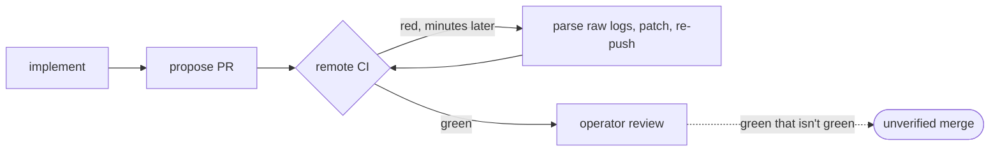

# implementation-verification — the local CI verification harness — PRD *(effective view)*

---

**GENERATED — DO NOT EDIT.** Sole writer: `docgate fold`. As of: **001**. Content fingerprint: `sha256:cf720e4497788aaf595f1e5048bc3ae71e4b6cc47ba664211d0251758937f857`. Tool version (recorded, never hashed): `docgate/v1`.

---

| Field | Value |
|---|---|
| **In one line** | The stage-8 verification harness: a latency-ordered, technology-neutral ladder of deterministic checks the implementing agent climbs *during* implementation — compact findings, incremental re-verification, anti-gaming checks at the top — whose full pass is the local proposal bar implement-now drives to; agent-free and headless so the identical harness later runs as the remote CI gate. |
| **Relevant-when** | planning, building, or reviewing the verification harness — the ladder/rungs, verification manifest, ecosystem defaults, falsification / test-delta / baseline / machinery-protection checks, verdict schema, or implement-now's local gate; triaging a wrong-block, missed-catch, gamed-baseline, verb-timeout, or slow-fix-cycle defect; changing the host↔harness feedback contract, verb bindings, or the future remote-gate wiring |
| **Status** | Problem + solution gates signed (2026-07-16) — launch review pending (post-implementation); merge freezes the base |
| **Tier** | T3 — verification machinery on the factory control plane: it executes repo-supplied commands and adjudicates what the factory may propose; gaming it compromises factory control |
| **Owner** | @mdarabi |
| **Approver(s)** | @mdarabi (operator) |
| **Contributors** | — *(solo operator; gate tables record the introducing PR's review, rule 15)* |
| **Informed** | — |
| **Date** | 2026-07-16 created · 2026-07-16 last updated |
| **Appetite** | Build the harness core well — ladder execution, the bounded verb runner, the verdict schema, the five v1 rungs including the anti-gaming checks, the verification manifest + ecosystem defaults, the joint feedback contract, incremental re-verification, the catch-test suite, multi-stack fixture repos, and one advisory CI dry-run — bounded by serving as implement-now's local gate for its dogfood. Excludes remote enforcement, detection onboarding, judgment/coverage/e2e rungs, autonomy pricing, and real second-repo onboarding. Budget follows the reusability bet (this same core is the future remote gate), not a task count. |
| **Target release** | implement-now's dogfood dependency — the executor of the local proposal bar its worker drives to; the composite "genuinely-green" definition stays in implement-now's contract and gains the harness verdict at integration. |
| **Tracking** | agenticlab-ai/pyxis#356 *(the introducing PR)* |
| **Artifacts** | `brainstorm:implementation-verification` — the gated brainstorm record (rides this PR) · `review:implementation-verification-000` — the unmanned reviewer's report (rides this PR) |
| **Template version** | prd-template/v2 |

## 0. Read to rule — the human reviewer's section (~7 min)

*The body is the contract; this section only routes attention — on any conflict the body governs; machines ignore it.*

**Judge these**

| # | The call | Could have gone | If you disagree |
|---|---|---|---|
| 1 | **Agent-free harness; drive-side stays in implement-now** — this feature runs checks and returns findings; launching/prompting the agent, fix caps, and escalation belong to the host | The harness embeds the fix loop itself (verify → prompt → re-verify as one component) | The seam moves: implement-now's contract gains the loop, the remote gate becomes a stripped variant instead of the identical artifact → §4.1, NG-1 |
| 2 | **Anti-gaming checks ship in v1** — falsification, test-delta audit, machinery protection are rungs, not future work | Parity minimum (mirror repo lint/build/test only), novel checks later | "Green that isn't green" — implement-now's named top risk — stays open through its dogfood; rung 3 rows fall out → FR-11, FR-12, FR-8, M2 |
| 3 | **v1 is fully deterministic** — zero LLM judgment in any rung | Include judgment lenses (scope/spec fidelity) from the start | Verdicts gain a non-reproducible component before trust exists; cost per cycle stops being ~zero → §3.4 WR-2, NFR-5 |
| 4 | **Remote CI is design-binding, not delivered** — the harness must be portable unchanged, proven by one advisory dry-run; enforcement ships later | Ship the remote required-check now | The bypass hole (hand-written PRs landing unchecked) stays open longer — that is the accepted cost → §3.4 WR-5, FR-15, M4 |
| 5 | **Manifest is declared, never runtime-detected** — hand-authored closed schema + ecosystem defaults; absent verb ⇒ skip-with-record; the seed verb (FR-20) is a one-shot authoring aid writing the declared artifact for the operator to own | Runtime stack detection (zero-config) | Runtime guessing changes what green means without a human act (judge-once violated); ambiguity has no resolution surface → FR-5, FR-6, FR-20 |
| 6 | **No-new-failures baseline from day one** — red-main repos bind honestly; ratchet is shrink-only, baseline writes are human-lane | Require a green main to adopt (all-or-nothing) | Brownfield repos get no test gate at all until someone cleans up first → FR-10, ABUSE-3 |
| 7 | **The implementing agent is P1** — latency ordering, compact findings, incremental re-runs optimize the machine's loop; the operator is P2 | Operator-first segmentation (implement-now's choice) | Efficiency trade-offs flip toward human-facing polish; the "minimize back-and-forth" requirement loses its tiebreaker → §2.2, D-7 in §7.3 |

**Sanity-check the numbers** — the catch test demands **3/3 seed families blocked** (M2); fix-cycle economy demands **p50 re-verification wall-time ≤ 50% of a full ladder run** on the dogfood repo (M3); rung-0 feedback lands in **p95 ≤ 10 s** on the dogfood repo (NFR-1); the guardrail tolerates **zero unresolved wrong-blocks** at the dogfood checkpoint (§3.3). Retry caps, turn caps, and parallelism are the host's numbers, not this document's.

**The author's open questions** — whether a repo with no bindable exec-probe should ever count as more than green-degraded long-term (§7.2 Q5, launch-gate-bound); the remote gate's enforcement semantics are deliberately unresolved (§7.2 Q1, remote-phase-bound). The remaining §7.2 rows are design-owned mechanics.

**Skip the rest** — structure/ID/fold correctness → docgate; substance and coherence → the unmanned `/prd-review`; finding-schema, incremental strategy, weakened-test detection depth → the technical design (§7.2 design-owned rows); fix loops, caps, escalation → implement-now's PRD; merge safety and landing → merge-lane.

## 1. Summary — the one-pager

- **Problem** — When an agent turns a task into code, "green" today means only "whatever checks happened to exist passed" — nothing defines what *must* be checked, feedback arrives late and verbose (PR-time CI logs instead of in-loop findings), and nothing anywhere defends against tests that lie: a test written by the same mind as the code can pass while proving nothing, a deleted test silences a failure, a padded baseline hides one.
- **For whom** — P1: the implementing agent (via its host — implement-now's worker now, the fleet worker later), which runs the verify-fix cycle many times per task. P2: the operator who must trust a green proposal enough to review substance instead of re-deriving everything.
- **Why now** — implement-now (the stage-8 native executor) is in review with "green that isn't green" as its named top risk; its dogfood needs a real local gate to drive to. Nothing in the corpus claims this ground: the merge floor consumes "required checks green" without defining the checks, and the predecessor shipped only mirrors of what a repo already had.
- **Direction** — A verification harness the host invokes each cycle: checks run as a latency-ordered ladder (instant checks → build → tests → anti-gaming → execution reality), stop at the first failure, and return compact machine-parseable findings; re-verification after a fix is incremental. Technology-neutrality comes from a per-repo verification manifest binding abstract verbs to the repo's own commands; brownfield honesty from no-new-failures baselines and skip-with-record degradation. The harness is agent-free and headless, so the identical artifact later runs as the remote CI gate.
- **Appetite** — The header's budget: harness core + five rungs + manifest + feedback contract + catch suite + multi-stack fixtures + one advisory CI dry-run, bounded by implement-now's dogfood. Excludes remote enforcement, detection onboarding, judgment rungs, pricing.
- **Success** — 100% of implement-now's dogfood tasks reach green proposals through the harness (M1), with all three seeded adversarial families blocked (M2).
- **Guardrail** — Zero unresolved wrong-blocks: every disputed finding gets a disposition; an unresolved false positive blocks shipping (§3.3).
- **Top risks** — (1) falsification wrong-blocks legitimate diffs and trains red-blindness; (2) the ladder is too slow and the loop gets bypassed or burns the budget it was meant to save; (3) the verb abstraction leaks and the harness quietly works only on Go/pyxis, falsifying the technology-independence claim.

## 2. Problem space

### 2.1 Problem statement

The factory is about to implement tasks autonomously at stage 8, and the actor deciding "this code is done" is the same optimizer that wrote it. Its proposals are judged by whatever checks the repo happens to have — undefined in floor policy, unexecutable mid-loop, and blind to the failure modes specific to agent-written code (tests that pass without proving anything, weakened assertions, padded baselines). Feedback that should steer implementation arrives after it, as raw CI logs at PR time. The cost of doing nothing compounds with every automated task: proposals whose green badge certifies nothing, reviewed by a human who cannot tell the difference.

### 2.2 Users and segments

| Segment | Role and context | Domain exp. | Tech exp. | Key goals | Pain today | Evidence |
|---|---|---|---|---|---|---|
| **P1 (primary)** | The implementing agent, via its host (implement-now's in-session worker now; the fleet worker later); runs the verify-fix cycle many times per task, headless | master | master | precise failure feedback in seconds; one definitive done-verdict | guesses which commands verify; parses raw logs; discovers failures at PR time | `brainstorm:implementation-verification#D-7` |
| P2 (secondary) | The operator of a pyxis-onboarded repo: authors the manifest at onboarding, reads verdicts and findings at review time | master | master | trust that green means verified; adopt on repos as they are | no defense against gamed tests; all-or-nothing gates refuse red-main repos | `brainstorm:implementation-verification#D-7` |
| **Anti-segment** | Human engineers as gate subjects — nothing checks their PRs in v1 (remote deferred, `#D-4`); repos without a pyxis operator — no one to author the manifest (`#D-5`) | — | — | — | — | — |

### 2.3 Jobs and desired outcomes

| # | When… (situation) | I want to… (motivation) | So I can… (outcome) | Today's workaround | Evidence |
|---|---|---|---|---|---|
| J1 | a check fails mid-implementation | get compact, actionable feedback in seconds | fix and advance without burning turns on log archaeology | parse raw tool/CI output; or discover at PR time | `brainstorm:implementation-verification#D-8` |
| J2 | the task looks done | get one definitive verdict that the proposal clears the local bar | raise the proposal knowing it clears the bar | "required checks pass" — whatever those happen to be | `brainstorm:implementation-verification#D-8` |
| J3 | reviewing an agent proposal | trust that green already means verified — gaming caught before review | spend review on substance, not re-derivation | none — job goes undone; the risk is named, undefended | `brainstorm:implementation-verification#D-8`, `#F-1` |
| J4 | operating a repo with a red main or missing capability | have verification bind honestly anyway | adopt without a cleanup campaign first | none — all-or-nothing; a red main means no test gate | `brainstorm:implementation-verification#D-8` |

### 2.4 Evidence

| Claim | Source (research, data, tickets, interviews) | Confidence |
|---|---|---|
| implement-now counts a task done only on a green proposal, where green = "PR exists + all required checks green" — the checks themselves are consumed as given, never defined; its top-3 risk list names "green that isn't green" | `docs/prds/implement-now/effective.md` §1, §3.2 M2, §1 top risks · `brainstorm:implementation-verification#F-1` | High |
| The merge floor (floor-clearing) requires "every required mechanical check green" — it consumes required checks, defines none | `docs/wiki/glossary.md` (floor-clearing) · argus-unattended-drive FR-2/FR-3 · `brainstorm:implementation-verification#F-4` | High |
| The predecessor's quality layer mirrors and calibrates what a repo already has (GATE-2 local CI mirror, GATE-7 required-checks calibration, SCAF-3 language profiles); checks the factory itself brings exist nowhere | `docs/prds/README.md` baseline index · `brainstorm:implementation-verification#F-6` | High |
| Stage-10 e2e verification and evals-as-primitive are named, unclaimed gaps — no covering capability to reuse or conflict with | `docs/prds/README.md` §Not in the baseline · `brainstorm:implementation-verification#F-7` | High |
| Agent-written tests can pass while proving nothing (same-mind tautology, weakened assertions, padded baselines), and this failure class is defended nowhere in the corpus | brainstorm Orientation overlap scan (claimed-nowhere finding); reasoned analysis, not yet locally measured | Med |

### 2.5 The journey today

| Phase | User does | User feels / pain | Frontstage (what user sees) | Backstage (systems, people, processes) |
|---|---|---|---|---|
| implement | agent writes code, guesses which commands verify | blind — no declared contract of "what green means here" | ad-hoc command output | repo CI config it never reads; conventions undeclared |
| propose | agent raises the PR | done, prematurely | a PR with pending checks | remote CI queues the real verdict |
| discover | CI turns red minutes later | whiplash — failure arrives after the context is gone | red badges, raw logs | PR-time CI as the *first* complete check run |
| self-heal | agent parses logs, patches, re-pushes, repeats | expensive back-and-forth, whole-suite reruns | commit noise, repeated full CI runs | bounded retry loops burning tokens and wall-time |
| review | operator reads a green badge | unease — green certifies only that the existing checks passed | a green checkmark | nothing examined whether the tests prove anything |

### 2.6 Opportunity and why now

- **Size** — every automated task × every verify-fix cycle within it: the harness sits on the hottest loop in the factory; at fleet scale, each avoided full-suite rerun and each avoided PR-time round trip multiplies across every task of every feature.
- **Alternatives users have** — rely on each repo's existing CI alone (late, loud, blind to gaming); rebuild the predecessor's mirror (parity, adds no defense); manual review of every test an agent writes (does not scale past a handful of tasks).
- **Why us / strategic fit** — the factory owns the whole loop (planner → worker → gate → merge), so it can place verification *inside* implementation rather than after it; the agent-free/headless design makes the same artifact the future remote gate — a compounding asset, per the vision's stage-10 and trust-model ground.
- **Why now** — implement-now is in review and its dogfood needs a defined bar to drive to; every task shipped before this exists is a proposal whose green means "unchecked assumptions held."
- **Cost of doing nothing** — the factory scales its output while its verification stays undefined: unverifiable green at increasing volume, review load that grows linearly with distrust, and a brownfield adoption story that begins "first clean up your repo."

**Decision:** Problem gate — do not proceed to §3–§4 until every contributor signs. *(sign-off table below)*

| Reviewer | Role | Date | Verdict |
|---|---|---|---|
| @mdarabi | operator (via the introducing review session — rendered read + chat approval) | 2026-07-16 | approved |

*capture: lineless miss (review time not recorded) · items: none — this collapsed review signs the problem and solution gates in one event; zero surface annotations, approval given in session.*

## 3. Goals, metrics, and guardrails

### 3.1 Goals as falsifiable hypotheses

| # | We believe that… | Will result in… | Measured by… |
|---|---|---|---|
| G1 | giving the implementing agent latency-ordered, compact, incremental verification feedback during implementation | tasks reaching a green proposal without PR-time discovery loops, at lower per-cycle cost | M1, M3 |
| G2 | running deterministic anti-gaming checks (falsification, test-delta, machinery protection) on every proposal | gamed diffs — tautological tests, silenced tests, padded baselines — blocked mechanically before any review | M2 |
| G3 | binding checks to repos through declared verbs + ecosystem defaults instead of per-language engine code | the identical harness verifying repos of different stacks, and porting unchanged to remote CI | M4, FR-16 |
| G4 *(qualitative)* | verdicts that enumerate what ran, what passed, and what was skipped-with-reason | the operator reviewing substance and trusting the badge — unprompted reliance on verdict evidence in review | verdict-consultation observed in dogfood and post-launch review sessions (§6.7) |

### 3.2 Goals → signals → metrics

| Metric | Goal | Signal | Baseline | Target (at checkpoint) | Feeds from |
|---|---|---|---|---|---|
| M1 (primary) | G1 | dogfood tasks whose proposals reach genuinely-green (implement-now's composite bar) with the harness as their local gate | 0 (no harness exists) | 100% of the dogfood feature's tasks, at the dogfood checkpoint (implement-now's dogfood run complete) | EVT-1, joined to tasks via the host's dogfood run record (DOD-3's evidence) |
| M2 | G2 | seeded adversarial diffs blocked by the ladder | n/a (suite does not exist) | 3/3 seed families blocked (tautological test · silenced test — deletion, skip-marker, assertion-removal · machinery edit), permanent in the harness's CI from the catch-suite checkpoint | EVT-4, EVT-2 |
| M3 | G1 | fix-cycle economy: re-verification cost after a fix vs a full ladder run | n/a (no incremental path exists) | p50 re-verification wall-time ≤ 50% of the same workspace's full-ladder time on the dogfood repo, measured across the dogfood run | EVT-1 (runs paired by workspace identity) |
| M4 | G3 | local↔remote verdict parity on the same commit | n/a | 1 advisory GitHub Actions run whose verdict matches the local verdict rung-for-rung, by the portability checkpoint (before launch gate) | EVT-5 |

### 3.3 Guardrails and decision rule

| Guardrail metric | Threshold | Action if breached |
|---|---|---|
| Unresolved wrong-blocks (a finding the operator disputes, still undispositioned) | 0 at the dogfood checkpoint; every disputed finding gets a disposition (check fixed, or finding upheld) before the run closes | demote the offending check via a **human-lane manifest change to skip-with-record** until fixed — the rung skips, verdicts become green-degraded per FR-6/FR-17; tasks verified under the demotion count toward M1 as green-degraded, and the demotion is recorded in the disposition (EVT-3) |
| Harness-caused dogfood stall (a task blocked by harness error — not by a genuine red) | 0 unresolved at the dogfood checkpoint | triage within the run: harness defect fixed or the rung's result honestly reported as error (fail-closed), never worked around by skipping the harness; the disposition is recorded (EVT-3) |

**Ship rule (pre-registered):** M1 and M2 met AND both guardrails clean → the capability is proven. M3 missed while M1/M2 hold → discuss (efficiency iterates; correctness shipped). Any unresolved wrong-block or stall → not shippable until dispositioned.

### 3.4 Non-goals and waiting room

| ID | Non-goal | Why refused |
|---|---|---|
| NG-1 | Owning any drive-side behavior: launching/prompting the implementing agent, fix-attempt counts, self-heal caps, escalation, PR raising | that is implement-now's contract (its PRD, in review, owns those caps as design policy); the harness stays agent-free so the remote gate is the identical artifact (`brainstorm:implementation-verification#D-2`) |
| NG-2 | Autonomy/trust pricing economics — capability-priced lanes, gap-report-as-trust-instrument, capability-building backlog generation | a later, separate feature; this harness's skip-with-record verdicts are its future input, not its implementation (`#O-1`) |
| NG-3 | Merge, approval, or landing authority of any kind — the harness emits verdicts only | landing belongs to merge-lane and humans; a verifier that can also merge is the self-adjudication this feature exists to prevent (`#D-1`, glossary: floor-clearing) |

| ID | Waiting room | Revisit when / intended version |
|---|---|---|
| WR-1 | Changed-line coverage and AC↔test traceability rungs | when structured-DoD/charter plumbing (VNEXT-2 schema) exists to bind ACs to tests (`#O-2`); until then a proposal adding code with no tests passes rung 3 vacuously — the residual is named here, not hidden |
| WR-2 | LLM judgment rungs (scope fidelity vs charter, spec fidelity) | when a judgment-check calibration corpus exists and deterministic-rung trust is established (`#O-2`) |
| WR-3 | Mutation testing and fuzzing rungs | when risk-tier policy demands depth beyond the falsification check (`#O-2`) |
| WR-4 | Stage-10 feature-level e2e and evals-as-primitive | when the stage-10 phase starts; this harness's exec-probe verdicts are its seed material (`#O-2`) |
| WR-5 | Remote CI delivery: workflow wiring, required-check registration, enforcement rollout, bypass-PR surfacing | when the operator opens the remote-gate phase; until then portability is design-binding (FR-15, M4) and enforcement questions stay parked (`#O-3`, §7.2 Q1) |
| WR-6 | Detection-assisted onboarding (probe the repo, propose bindings, capture baselines from observed runs) and manifest drift checks | when a second repo onboards (`#O-4`) |
| WR-7 | Custom check bindings — the manifest binds repo-specific required checks (e.g. a docs gate) as ladder members, so ladder-green can subsume the repo's required CI | at implement-now integration or the remote phase, whichever first; until then ladder-green complements — never replaces — the repo's required CI, which the host still drives green (`review:implementation-verification-000#FND-4`) |
| WR-8 | Generated-code sync rung — regenerate-and-diff for declared codegen surfaces | when a repo with codegen onboards, or at the technical design if the dogfood repo's own generated projections warrant it (`review:implementation-verification-000#FND-28`) |

## 4. Solution space

### 4.1 Approach and alternatives considered

The chosen shape is an **agent-free verification harness invoked by a host**: checks compose into a latency-ordered ladder; an invocation runs the ladder against a workspace + diff, stops at the first failing rung, and returns compact machine-parseable findings; re-invocation after a fix re-verifies incrementally; every completed invocation emits one structured verdict enumerating every rung's result including skips-with-reason. Repo binding is data: a hand-authored closed-schema verification manifest plus shipped ecosystem defaults. The harness holds no agent, no session, and no factory-metadata dependency — the same artifact runs in-loop locally today and as the remote CI gate later.

| Option | Sketch | Why not chosen |
|---|---|---|
| A (chosen) | agent-free ladder harness + declared manifest, hosted by implement-now's worker | — |
| B | the harness embeds the fix loop (verify → prompt agent → re-verify as one component) | swallows implement-now's claimed ground (its self-heal caps are mid-review design policy); couples check-running to agent-driving; the remote gate becomes a stripped variant, not the identical artifact (`brainstorm:implementation-verification#D-2`) |
| C | zero-config runtime stack detection instead of a manifest | runtime guessing changes what green means without a human act; ambiguity (two plausible test targets) has no resolution surface; exec-probe is undetectable in principle, so declared config must exist anyway (`#D-5`) |
| D | parity minimum — mirror the repo's existing lint/build/test only | ships no defense against agent-code failure modes; "green that isn't green" stays fully open through the dogfood (`#D-3`) |
| Do nothing | — | implement-now dogfoods against an undefined bar; §2.6's cost compounds with every automated task |

### 4.2 Scope perimeter

- **In (plan of record)** — the harness core (ladder execution; bounded verb runner: workspace-scoped, time-bounded, env-stripped; closed verdict schema); the v1 ladder — rung 0 instant (format + lint verbs, secret scan, forbidden-artifact hygiene, machinery protection), rung 1 build, rung 2 tests + no-new-failures baseline, rung 3 falsification + test-delta audit, rung 4 exec-probe; the verification manifest + ecosystem defaults; the compact-findings feedback contract (designed jointly with implement-now); incremental re-verification; the catch-test suite as permanent tests; multi-stack fixture repos; one advisory headless CI dry-run.
- **Future (believed next, not committed)** — the waiting room: remote enforcement (WR-5), detection onboarding (WR-6), coverage/traceability/judgment/mutation/e2e rungs (WR-1..4), custom check bindings (WR-7), generated-code sync (WR-8); evidence-package integration (VNEXT-5 consumes verdicts).
- **Out** — drive-side behavior (NG-1); pricing economics (NG-2); merge authority (NG-3); real second-repo onboarding (fixtures stand in for it).

### 4.3 Experience: flows and states

*The harness has no human UI; its "screens" are verdict and finding payloads consumed by the host. The five state classes here are verdict states: **green** (all bound rungs pass, zero skips) · **green-degraded** (all bound rungs pass, ≥1 skip-with-record) · **red** (a rung failed; findings attached) · **error** (a rung could not run — infra fault, fail-closed) · **configuration-error** (manifest/baseline/invocation defect; zero rungs ran). Accessibility and localization: skipped — no human-facing surface ships in this feature; findings surface through the host's own UX.*

**Flow F1 — the fix cycle (serves J1)**

| Step | Actor does | Harness responds | States covered | Design |
|---|---|---|---|---|
| 1 | host invokes the harness on the task's workspace + diff base | runs the ladder cheapest-first; stops at the first failing rung | red · error | tech design |
| 2 | host feeds the findings to the implementing agent | — (findings are self-contained: check id, location, message) | — | joint feedback contract (§5.5) |
| 3 | agent fixes; host re-invokes | re-verifies incrementally — failed rung first, unchanged work not repeated | green · green-degraded · red | tech design |

**Flow F2 — the done-verdict (serves J2):** the host requests a full-ladder verdict; the harness returns one structured verdict enumerating every rung (pass / fail / skip:reason / error) bound to the exact revision it evaluated, and the host attaches it to the proposal as evidence.

**Flow F3 — brownfield bind (serves J4):** the operator authors the manifest (ecosystem defaults reduce it to the repo's specifics); on a red-main repo the operator captures the baseline by a documented procedure — run the test verb, record the failure identities (detection-assisted capture is WR-6) — and the test rung binds as no-new-failures against it; from then on verification is honest — new failures block, pre-existing ones are enumerated, the baseline only shrinks.

**Flow F4 — the catch (serves J3):** an adversarial diff — a test that passes without its implementation, a silenced test (deleted, skip-marked, or hollowed), or an edit to the manifest/baseline riding a proposal diff — produces a red verdict with a named finding at rung 3 (falsification, test-delta) or rung 0 (machinery protection).

### 4.4 Scenarios

**The common case.** A dogfood task's worker invokes the harness after its first implementation pass: rung 0 returns a lint finding in four seconds; the agent fixes it; incremental re-verification passes rung 0 and proceeds; rung 2 catches one failing test with a file:line finding; the agent fixes; the full ladder completes green. The worker raises the PR with the verdict attached. Two fix cycles, neither of which re-ran the world.

**The tautological test.** An agent, optimizing to pass, writes a test that asserts its mock's return value. Rung 3 reverts the non-test half of the diff and runs the new test — it passes without the implementation. The verdict is red with a falsification finding naming the test; the finding tells the agent exactly what a real test must do: fail when the implementation is absent.

**The brownfield repo.** A repo with twelve historically-red tests binds the test rung as no-new-failures. A task's proposal introduces no new failures: rung 2 passes, the verdict notes the baseline in force. A later proposal breaks a thirteenth test: red, with the delta named. Nobody was asked to fix twelve legacy tests before adopting.

**The missing probe.** A repo binds no exec-probe verb. Rung 4 skips with `skip:verb-absent`; the verdict is green-degraded, and the skip is enumerated — visible to the host, the reviewer, and any future pricing policy. Nothing pretends reality was checked.

**Decision:** Solution gate — contributors sign that this shape, at this appetite, is the bet. Zero TBDs may pass this gate.

| Reviewer | Role | Date | Verdict |
|---|---|---|---|
| @mdarabi | operator (via the introducing review session — same collapsed event as §2.6) | 2026-07-16 | approved |

## 5. System requirements

*Terms used by the rows below: a **proposal diff** is the full diff under verification, whatever its composition; its **non-test half** is that diff excluding test files (test files identified by the manifest's test globs).*

### 5.1 Functional requirements

| ID | Requirement (EARS) | Rationale | Priority | Risk | Fit criterion | Verify | Traces to |
|---|---|---|---|---|---|---|---|
| FR-1 | When invoked on a workspace with a diff base, the harness shall execute rungs in latency order and stop at the first failing rung, returning that rung's findings. | earliest possible feedback; no wasted work past a known failure | Must | med | on the fixture suite, a rung-0 failure returns with zero rung-1+ verb executions recorded | Test | G1, J1, F1 |
| FR-2 | When a rung fails, the harness shall return machine-parseable findings — each carrying check id, location (file:line where the check class has one), and a one-line message — with full tool output attached by reference, never as the primary payload. | compact feedback is the loop's fuel; log dumps burn the agent's context | Must | med | 100% of fixture-produced findings validate against the finding schema and carry check id + message; lint/build/test findings carry file:line; no finding payload embeds more than the schema's bounded excerpt | Test | G1, J1, F1 |
| FR-3 | When re-invoked on the same workspace after a change with an unchanged manifest and baseline, the harness shall re-verify incrementally — the previously-failed rung first, work whose inputs are provably unchanged not repeated; a changed manifest or baseline invalidates incremental state and the next run is full. | fix cycles dominate the loop; re-running the world per fix is the cost this feature exists to remove — but never at the price of verifying against stale bindings | Must | med | on the fixture fix-cycle, re-verification executes strictly fewer verb runs than the initial full ladder; the changed-manifest fixture re-runs the full ladder; on the dogfood repo, p50 re-verification wall-time ≤ 50% of full-ladder time (M3) | Test, Analysis | G1, J1, F1, M3 |
| FR-4 | When an invocation completes — at whatever rung it stopped — the harness shall emit one structured verdict (closed schema) that enumerates every configured rung's result (pass, fail, skip with reason, `skip:not-reached`, or error), states the overall verdict per §4.3's five states, and records the identity of what it evaluated: workspace revision, diff base, manifest content hash, baseline content hash, and harness version. | the verdict is the trust artifact reviewers and future consumers read — and a verdict that does not name what it certifies can be true about the wrong tree (AP-13; incident I2) | Must | high | every fixture run's verdict — including first-rung-failure runs — validates against the schema and enumerates all configured rungs; no execution path emits a verdict omitting a rung; the revision-mismatch fixture (verdict from commit A presented against commit B) is detected by the recorded identity | Test | G4, J2, F2 |
| FR-5 | The harness shall read verb bindings exclusively from the repo's verification manifest (closed schema — unknown keys are errors), with the shipped ecosystem defaults supplying bindings only for fields the manifest's declared stack leaves to them. | green's definition is frozen human-confirmed data, never a runtime guess | Must | high | a manifest with an unknown key fails closed-parse in fixtures; a minimal manifest on a common-stack fixture resolves the full verb set from defaults; removing the manifest yields configuration-error (UB-3), never a defaults-only run | Test | G3, J4, F3 |
| FR-6 | If a rung's verb is absent from the resolved bindings, then the harness shall skip that rung and record the skip with its reason in the verdict — never silently. | honest degradation is what makes brownfield adoption trustworthy | Must | high | the probe-less fixture yields `skip:verb-absent` on rung 4 and overall green-degraded; zero fixture paths produce a verdict lacking a record for a configured-but-unbound rung | Test | G4, J4, F3, F2 |
| FR-7 | When rung 0 runs, the harness shall execute the repo's format and lint verbs and its own neutral checks — secret scan and forbidden-artifact hygiene (committed binaries, baked absolute paths) — none of which require any repo-supplied capability beyond the manifest's verb bindings. | the instant rung: broadest catches at lowest latency, available on every repo | Must | med | fixture diffs containing a seeded secret and a committed binary each produce a red rung-0 verdict with the class-named finding; rung-0 wall-time on the dogfood repo meets NFR-1 | Test | G1, G2, F1 |
| FR-8 | If a proposal diff modifies verification machinery — the manifest, a baseline, or harness configuration — then rung 0 shall fail with a machinery finding naming the path. | the implementer must not adjudicate its own gate; baselines are the most gameable artifact in a brownfield setup | Must | critical | catch seed 3 (a baseline addition riding a proposal diff) is blocked in the permanent catch suite; fixture diffs not touching machinery paths never trigger the finding | Test | G2, J3, F4, M2 |
| FR-9 | When rung 1 runs, the harness shall execute the build verb and fail the rung on a non-zero exit, attaching the build diagnostics by reference. | nothing downstream is meaningful on a broken build | Must | low | a fixture with a seeded compile error reds rung 1 with the diagnostic reference; a clean fixture passes | Test | G1, F1 |
| FR-10 | When rung 2 runs, the harness shall execute the test verb and fail the rung on any test failure; while a baseline is bound for the repo, the rung shall instead evaluate no-new-failures against it — failing on any failure absent from the baseline and recording observed baseline shrinkage. | full regression on healthy repos by default; honest binding on red-main repos; the ratchet only tightens | Must | high | a clean fixture passes and one seeded failing test reds rung 2 (no baseline bound); the red-main fixture (K pre-existing failures) passes with zero new failures and fails when one new failure is seeded; a baseline-shrink run records the shrink in the verdict | Test | G1, G2, J4, F3 |
| FR-11 | When a proposal diff whose non-test half is non-empty adds or modifies test files, rung 3 shall verify the new or changed tests fail with that non-test half reverted; tests that pass without it shall fail the rung with a falsification finding naming each tautological test. | a test written by the code's own author must be demonstrated to bite; this is the smallest deterministic defense against same-mind tautology | Must | critical | catch seed 1 (a tautological test) is blocked in the permanent catch suite; the legitimate-diff fixtures (refactor-only change, mixed change with genuine tests) pass without a falsification finding; the test-only fixture follows FR-18 | Test | G2, J3, F4, M2 |
| FR-12 | When a proposal diff deletes a test, adds a skip/exclusion marker, or removes assertions from an existing test, rung 3 shall fail with a test-delta finding naming each affected test. | silencing a failure must cost a named, visible finding — never be a free pass to green | Must | high | catch seed 2 is blocked in each of its three trigger classes — a deleted failing test, an added skip/exclusion marker, and an assertion-removal (a hollowed test); the rename/move-refactor fixture passes without a test-delta finding | Test | G2, J3, F4, M2 |
| FR-13 | Where the manifest binds an exec-probe verb, rung 4 shall execute it against the built artifact and fail the rung on a non-zero exit. | tests passing is not the artifact working; the probe is the execution-reality floor | Must | med | a fixture whose probe exits non-zero reds rung 4; the probe-less fixture follows FR-6 | Test | G1, F2 |
| FR-14 | When executing any verb, the harness shall run it scoped to the workspace, bounded by a per-verb time limit, and with a stripped environment passing only the variables the manifest declares for that verb. | repo-supplied commands are untrusted input; ambient credentials must be unreachable by construction | Must | critical | a fixture verb reading an ambient environment variable observes it absent; a hanging fixture verb is terminated at its bound with rung result error-timeout; a fixture verb writing outside the workspace fails the run with a scope finding | Test | G3, NFR-4 |
| FR-15 | The harness shall run headless from a clean checkout with no agent, interactive-session, or factory-metadata dependency, producing its exit code, verdict artifact, and structured run log as its sole outputs. | portability by construction — the identical artifact is the future remote gate | Must | high | the advisory CI dry-run: on the same commit, the GitHub Actions invocation and the local invocation produce rung-for-rung identical verdicts (M4) | Demo, Test | G3, M4 |
| FR-16 | The harness shall bind and run the full ladder on fixture repos of at least three distinct stacks (Go plus two others) using only their manifests and the ecosystem defaults — with zero per-stack code in the harness itself. | technology-independence is a tested property, not a claim | Must | high | the fixture matrix is green in the harness's CI; inspection confirms stack-specific behavior lives only in manifest data and the ecosystem table | Test, Inspection | G3, J4 |
| FR-17 | When all bound rungs pass, the harness shall report green if no rung was skipped and green-degraded if any skip-with-record occurred. | the two-tier pass keeps degradation visible while letting brownfield repos function | Must | high | the probe-less fixture yields green-degraded, never green; the fully-bound clean fixture yields green | Test | G4, J2, J4 |
| FR-18 | While a proposal diff's non-test half is empty or it adds and modifies no test files, the falsification check shall record not-applicable and emit no finding (the test-delta audit of FR-12 still applies on its own trigger). | test-only and no-new-test diffs are not falsifiable; blocking them would be the wrong-block class R1 names — the not-applicable record keeps the vacuous pass visible | Must | low | the test-only fixture records falsification not-applicable with no finding while its test-delta audit still evaluates; the code-only (no-test-change) fixture records not-applicable and can reach green — the WR-1 residual, named | Test | G2, F4 |
| FR-19 | While any rung result is fail or error, the harness shall report the overall verdict as red or error respectively. | the safety invariant: a pass-class verdict can never coexist with a failed or errored rung | Must | high | schema-level invariant tests: no verdict instance combines green or green-degraded with any fail or error rung result | Test | G4, J2 |
| FR-20 *(001)* | Where a repository holds recognized stack marker files (the ecosystem defaults' marker set — one detection source) and no verification manifest, the codegate seed verb shall write a closed-schema-valid template manifest declaring the detected stack — verb commands filled from the ecosystem defaults where real defaults exist, and as named to-be-edited placeholders otherwise — for the operator to own and edit; the harness's runtime reading is unchanged (FR-5). | the authoring aid that closes the fresh-operand gap while the manifest stays declared, human-owned data | Must | med | on manifest-less fixtures per supported stack, seed writes a manifest that closed-parses (FR-5's parser), declares the marker-matched stack, carries real defaults where the ecosystem ships them and named placeholders otherwise; the harness consumes the seeded manifest identically to a hand-authored one | Test | G3, J4, F3 |

*Rank within Must: the set is the irreducible bet (`brainstorm:implementation-verification#D-9`); the only sanctioned mid-build cut is §3.3's M3 branch — a proposal to cut any other row reopens the contract.*

**Non-regression (NR-n)**

| ID | Existing behavior protected | Why protected | Risk | Fit criterion | Verify | Traces to |
|---|---|---|---|---|---|---|
| NR-1 | The repo's existing CI contexts (docs-gate, Go build/test) stay green when the harness lands | the harness is additive; landing it must not perturb the doc system or existing tooling | med | all pre-existing required contexts green on the introducing and implementing PRs | Test | — |
| NR-2 | implement-now's **drive-side** contract — claims, worktree isolation, agent driving, self-heal caps, escalation, PR raising — is untouched by integration | the seam (D-2) confines this feature to the verify side; integration redefines only the sibling's local-gate slot, and since its PRD is still a draft, that lands as a draft-phase edit to its contract (adding the invocation seam and the composite genuinely-green definition), never a post-merge amendment | med | the integration change to implement-now's contract is confined to its local-gate rows (a draft-phase edit); its drive-side rows are byte-untouched | Inspection | NG-1 |

### 5.2 Unwanted behavior and failure handling

| ID | If… (trigger) | Then the harness shall… | Host sees | Priority | Risk | Fit criterion | Verify | Traces to |
|---|---|---|---|---|---|---|---|---|
| UB-1 | a verb cannot be spawned (missing binary, exec failure) | record the rung as error (infra), distinct from fail (check), and stop the run fail-closed | error verdict with an infra-classed finding | Must | med | the missing-binary fixture yields rung result error with class `infra`, overall verdict error — never fail, never green | Test | F1, FR-4 |
| UB-2 | a verb exceeds its time bound | terminate it and record error-timeout for the rung, fail-closed | error verdict naming the verb and its bound | Must | med | the hanging-verb fixture terminates within its bound plus the runner's declared termination grace (a constant the verdict schema records) and records error-timeout | Test | FR-14 |
| UB-3 | the manifest is missing, unparseable, or contains unknown keys | emit a configuration-error verdict naming the defect, with zero rungs executed | configuration-error verdict | Must | high | the three malformed-manifest fixtures each yield configuration-error with the defect named; no verb executes | Test | FR-5, F3 |
| UB-4 | rung 3's revert cannot apply cleanly (conflicting hunks, binary paths) | record rung 3 as error with the reason — never a false pass, never a silent skip | error verdict; the finding names the revert failure | Must | high | the conflicting-diff fixture yields rung-3 error, overall not-green | Test | FR-11 |
| UB-5 | a bound baseline is missing or malformed | emit a configuration-error verdict naming the baseline defect (fail-closed; no baseline-less fallback run) | configuration-error verdict | Must | high | the malformed-baseline fixture yields configuration-error; rung 2 does not run | Test | FR-10 |
| UB-6 | the harness process is interrupted mid-ladder | leave no partial verdict behind and start clean on re-invocation (idempotent; no stale incremental state corrupts the next run) | absence of a verdict = no verdict; next run behaves as documented | Must | med | the kill-mid-run fixture leaves no verdict artifact; the subsequent run's verdict equals an uninterrupted run's | Test | FR-3, FR-4 |
| UB-7 | the invocation is invalid — unknown mode, missing or ambiguous diff base or workspace, or a flag-like positional argument | refuse with a usage error before any rung executes, emitting only a configuration-error verdict | configuration-error verdict naming the invocation defect | Must | high | the malformed-invocation fixtures (each defect class, including a flag-like positional) yield refusal with zero verbs executed — the incident-I3 discipline | Test | F1, FR-1 |
| UB-8 | invoked while another invocation holds the same workspace | refuse the second invocation with a busy error — no interleaved rung execution or shared incremental state | busy refusal (no verdict consumed) | Must | med | the concurrent-invocation fixture: the second invocation refuses; the first completes with a verdict equal to an uncontended run's | Test | F1, FR-3 |
| UB-9 | the test verb's output cannot be parsed for failure identities while a baseline is bound | record rung 2 as error (fail-closed) — never pass, never fall back to exit-code-only evaluation | error verdict naming the parse failure | Must | high | the garbage-output fixture with a bound baseline yields rung-2 error; the same output with no baseline bound follows FR-10's exit-code path | Test | FR-10, F3 |
| UB-10 *(001)* | the seed verb runs where a verification manifest already exists | refuse by name and change nothing — a declared manifest is operator-owned, never overwritten | a named refusal citing the existing manifest path | Must | med | on a manifest-bearing fixture the verb exits non-zero naming the path; the manifest is byte-identical | Test | FR-20 |
| UB-11 *(001)* | the seed verb finds no recognized marker files, or markers matching multiple stacks ambiguously | write nothing and name the hand-authoring remedy (the manifest path and the declared-stack requirement) | a named refusal carrying the authoring instruction | Must | low | on an empty fixture and on a mixed-marker fixture the verb writes nothing; the remedy names the manifest path | Test | FR-20 |

### 5.3 Permissions and abuse cases

*No roles or user-facing access surface ship in v1: the harness is a local binary invoked by the host; its data (manifest, baselines) is repo content governed by review. Access rows reduce to: verbs execute only under the harness's bounded runner (FR-14); manifest and baseline writes are human-lane repo changes (FR-8 flags them in proposal diffs). The abuse table is the heart of this section — the adversary is the optimizing implementer.*

| ID | Actor and intent | Vector | Impact | Severity | Mitigated by | Verify |
|---|---|---|---|---|---|---|
| ABUSE-1 | implementing agent optimizing to pass | writes tests that assert without exercising the implementation (tautology) | green certifies nothing; defect ships | high | FR-11 (falsification). Named residual: FR-11 proves the new tests discriminate presence/absence of the implementation — a test that actively detects the revert environment and fails conditionally defeats it; that class waits for mutation-depth checks (WR-3) | catch seed 1, permanent suite |
| ABUSE-2 | implementing agent clearing a red | deletes, skips, or hollows out the failing test | regression silenced invisibly | high | FR-12 (test-delta audit, all three trigger classes) | catch seed 2 — deletion, skip-marker, and assertion-removal cases, permanent suite |
| ABUSE-3 | implementing agent clearing a red | adds its new failure to the baseline, or unbinds a verb in the manifest, inside the proposal diff | the gate is redefined by the thing it gates | critical | FR-8 (machinery protection); baseline writes human-lane by convention until remote enforcement (WR-5) | catch seed 3, permanent suite |
| ABUSE-4 | a malicious or careless repo verb (or agent-authored code run by one) | reads ambient credentials or writes outside the workspace during verification | secret exfiltration; cross-task contamination | critical | FR-14 (env-strip, workspace scope, time bounds) | FR-14 fixtures |
| ABUSE-5 | implementing agent or misconfigured host | never invokes the harness, or fabricates a "green" claim without a verdict artifact | the bar is bypassed wholesale | high | honestly residual in v1: absence is visible **to the human lane** reviewing the proposal (the verdict artifact is the evidence; none attached = not verified); the future AUTO lane merges on required-checks-green and would not notice — until WR-5 lands, the AUTO class ratification must exclude harness-hosted task proposals or verdict presence must join the floor (the recorded interim guard); the unbypassable point is the remote gate (WR-5) | Inspection (integration); closed at WR-5 |

### 5.4 Data

| Entity / field | Meaning | Source of truth | Retention | Integrity rules | Privacy class |
|---|---|---|---|---|---|
| verification manifest | verb→command bindings, test globs, baseline location, per-verb env allowlist | the repo (`pyxis-config/`), human-authored | repo lifetime | closed schema; unknown keys are errors (FR-5); writes flagged in proposal diffs (FR-8) | internal |
| baseline | the grandfathered failure set the test rung evaluates against; captured v1 by an operator-run documented procedure (run the test verb, record failure identities — detection-assisted capture is WR-6) | the repo, human-lane writes | until it shrinks to empty | no-new-failures evaluation (FR-10); growth inside proposal diffs flagged (FR-8); growth outside proposals is human-lane by convention until WR-5; malformed ⇒ fail-closed (UB-5) | internal |
| verdict artifact | one run's structured rung-by-rung result, bound to what it evaluated | the harness (emitted per run) | rides the proposal as evidence | closed schema (FR-4); records workspace revision, diff base, manifest hash, baseline hash, harness version (FR-4); pass-states never coexist with fail/error (FR-19); a verdict whose recorded revision differs from the proposal head is treated as absent (§5.5) | internal |
| ecosystem defaults table | per-stack default bindings, test globs, and failure-identity parsers for test output | the harness distribution (versioned data) | per harness release | versioned with the harness; manifest overrides win (FR-5); unparseable output with a bound baseline fails closed (UB-9) | internal |

- **Migration** — none: all entities are new.
- **Parallel-run / cutover** — none: the harness is additive; the host adopts it by invocation (NR-2).
- **Rollback** — stop invoking the harness (host-side); repo data (manifest, baselines) is inert without it.
- **Decommission** — n/a for v1 (no persistent services; artifacts are repo/PR content).
- **Privacy check** — no personal data; no DPIA trigger.
- **Egress** — none: the harness makes no network calls and sends nothing anywhere (NFR-2, NFR-5); verbs run env-stripped (FR-14).

### 5.5 Interfaces and integrations

| Interface | Direction | Purpose | Contract (format, ranges, timing) | Failure modes | Owner |
|---|---|---|---|---|---|
| host ⇄ harness invocation | in/out | the fix cycle and done-verdict (F1, F2) | in: workspace + diff base + mode; out: verdict + findings (closed schemas); the finding schema is the **joint feedback contract** designed with implement-now; consumer rule: a verdict whose recorded revision differs from the proposal head is treated as absent | UB-1..9; contract drift between the two features | this feature + implement-now, jointly (§7.2 Q2) |
| verification manifest | in | repo binding (F3) | closed schema, versioned; ecosystem defaults fill declared-stack gaps | UB-3 | this feature (schema); repo operator (content) |
| genuinely-green (implement-now's composite bar) | out | the harness verdict joins the sibling's done-definition at integration | "genuinely-green" is defined in implement-now's contract (today: PR exists + required checks green); the integration edit to its still-draft contract adds "+ a matching harness verdict" — one definition, one owner, there | definition drift if restated elsewhere — this document deliberately does not define it | implement-now (definition); this feature (the verdict it consumes) |
| advisory CI dry-run | out | portability proof (M4) | a GitHub Actions job invoking the identical harness headless; explicitly non-blocking | workflow red = advisory signal only, by declared design (D-4) | this feature |
| evidence packages (VNEXT-5) | out (future) | verdicts feed per-proposal evidence rows | deferred; the verdict schema anticipates it (`brainstorm:implementation-verification#P-7`) | — | future feature |
| merge-lane required check | out (future) | the remote enforcement point | deferred to WR-5 | — | remote-gate phase |

### 5.6 Non-functional requirements

| ID | Area | Requirement | Fit criterion | Verify |
|---|---|---|---|---|
| NFR-1 | Performance | Rung 0 shall complete within 10 s at p95 on the reference (dogfood) repo. | p95 rung-0 wall-time ≤ 10 s on the dogfood repo across the dogfood run | Test |
| NFR-2 | Determinism | Given the same workspace, diff, manifest, and baseline, the harness shall produce an identical verdict — no network access, no clock- or randomness-dependent check behavior. | repeated fixture runs byte-identical in verdict content (modulo timing fields — timestamps and durations — segregated to declared fields); a network-access attempt by the harness itself fails the determinism suite | Test |
| NFR-3 | Operability | The harness shall ship as a single self-contained executable with no runtime dependencies beyond the repo's own declared verbs. | inspection of the release artifact; a clean-machine fixture run with no toolchain beyond the fixture's own | Inspection, Test |
| NFR-4 | Security | Verb execution shall be default-deny for environment and filesystem beyond the workspace. | FR-14's fixtures; zero ambient variables observable; zero writes outside workspace | Test |
| NFR-5 | Cost | Harness operation shall consume zero model tokens — every v1 check is deterministic. | inspection: no model/API client linked; the dogfood run's harness spend is exactly zero tokens | Inspection, Analysis |
| NFR-6 | Maintainability | Adding a neutral check shall land as a new self-contained unit discovered by derivation — self-registration, scan, or build — with no edit to any shared list or existing rung code (AP-27). | demonstrated in-tree: the catch-suite's seeded checks and at least one neutral check land via the derived-registration seam; inspection confirms the demonstration diffs touch no central aggregate | Inspection |

### 5.7 Instrumentation — the tracking plan

| ID | Event name | Fires when | Properties (typed) | Source | Feeds |
|---|---|---|---|---|---|
| EVT-1 | harness_run | every invocation completes (any verdict state) | run_id: string, workspace_id: string, invocation_context: string (opaque, host-supplied), head_sha: string, diff_base: string, manifest_hash: string, baseline_hash: string, mode: full·incremental, verdict: enum, per-rung: result+duration_ms, verb_runs: int, wall_ms: int | harness structured log + verdict artifact | M1 (joined to tasks via the host's dogfood run record), M3 (runs paired by workspace_id) |
| EVT-2 | finding_emitted | a rung produces a finding | check_id: string, class: enum, path: string, rung: int | harness structured log | M2, §3.3 |
| EVT-3 | disposition_record | a dispute is opened, and again when it is dispositioned | finding_ref: string, status: opened·dispositioned, verdict: upheld · wrong_block · stall_defect_fixed · stall_upheld_error, action: string | operator record (review thread / tracker item) | §3.3 guardrails (both), DOD-7 |
| EVT-4 | catch_suite_run | the permanent catch suite executes in CI | seed_family: enum(tautology·silenced_test·machinery), case: string, blocked: bool | harness CI | M2 |
| EVT-5 | portability_dry_run | the advisory Actions job completes | commit: sha, parity: bool (rung-for-rung vs local verdict) | CI workflow | M4 |

### 5.8 Definition of Done

| ID | Done criterion | Source | Verify | Required evidence | Blocking? |
|---|---|---|---|---|---|
| DOD-1 | Every Must FR passes its fit criterion | §5.1 Must rows | Test | harness CI run (fixture suite) link | yes |
| DOD-2 | The catch suite blocks all three seed families (every case) and runs as a permanent CI suite | FR-8, FR-11, FR-12; M2 | Test | catch-suite CI link (EVT-4) | yes |
| DOD-3 | implement-now's dogfood tasks reach genuinely-green with the harness as their local gate | M1; NR-2 | Demo, Analysis | dogfood run record + attached verdicts (EVT-1) | yes |
| DOD-4 | Fix-cycle economy met on the dogfood repo | M3; FR-3 | Analysis | EVT-1 measurement summary | no — §3.3's ship rule owns the M3-miss disposition (discuss; correctness ships, efficiency iterates) |
| DOD-5 | The advisory CI dry-run demonstrates rung-for-rung verdict parity | M4; FR-15 | Demo | workflow run link (EVT-5) | yes |
| DOD-6 | The multi-stack fixture matrix is green with zero per-stack harness code | FR-16 | Test, Inspection | CI link + inspection note | yes |
| DOD-7 | Zero unresolved wrong-blocks and zero unresolved harness-caused stalls at the dogfood checkpoint | §3.3 | Analysis | disposition records (EVT-3, both statuses) | yes |
| DOD-8 | No non-regression row broken | NR-1..2 | Test, Inspection | CI + integration inspection note | yes |
| DOD-9 | Unwanted-behavior rows demonstrated | §5.2 rows | Test | failure-injection fixture results | yes |
| DOD-10 | Living rollups updated for the shipped capability (techspec/prd) | repo convention (AGENTS.md rule 3) | Inspection | the implementing PRs | yes |

### 5.9 AI behavior and evals

Skipped: v1 ships no model-driven behavior — every rung is deterministic by ruling (`brainstorm:implementation-verification#D-3`); judgment rungs are WR-2, and an amendment adding one must add this section's eval rows.

## 6. Delivery

### 6.1 Phasing and milestones

| Phase | Purpose | Scope | Exit criterion |
|---|---|---|---|
| A — core + fixtures | prove the harness on controlled ground | harness core, five rungs, manifest + defaults, verdict schema, catch suite, multi-stack fixtures | the fixture-verifiable clauses of DOD-1, plus DOD-2/6/9, green in the harness's CI (dogfood-bound fit clauses — FR-3's M3 leg, FR-7's NFR-1 leg — land at B; the CI-bound FR-15 fit lands at C) |
| B — integration + dogfood | prove it as the real local gate | joint feedback contract, host invocation, incremental path under real fix cycles | M1 met + guardrails clean (DOD-3/7/8); M3 measured and dispositioned per §3.3 (DOD-4) |
| C — portability dry-run | prove the remote-gate constraint cheaply | one advisory headless Actions job | M4 evidence recorded (DOD-5) |

### 6.2 Dependencies

| Dependency | Type (team / system / vendor / approval) | Needed by | Status | Owner |
|---|---|---|---|---|
| implement-now — the host: invocation seam + joint feedback contract | system (in-review sibling PRD) | Phase B | its PRD in problem review; the seam confines integration to its local-gate rows (NR-2) | @mdarabi |
| Go toolchain + repo CI | system | Phase A | confirmed (repo standard) | @mdarabi |
| GitHub Actions | system | Phase C | confirmed (repo already runs CI there); advisory-only | @mdarabi |

### 6.3 Risks, assumptions, and rabbit holes

| # | Risk / assumption / rabbit hole | Likelihood | Impact | Mitigation or test | Owner |
|---|---|---|---|---|---|
| R1 | Falsification wrong-blocks legitimate diffs (test-only PRs, refactors) and trains red-blindness | M | H | paired fixtures (catch + legitimate) in FR-11's fit; FR-18's explicit not-applicable disposition; §3.3 disposition guardrail; the skip-demotion path (human-lane manifest change) pre-declared | @mdarabi |
| R2 | The ladder is too slow for in-loop use; hosts skip it or budgets burn | M | H | NFR-1 latency bar; FR-3 incremental bar (M3); latency ordering is the architecture, not a tuning pass | @mdarabi |
| R3 | The verb abstraction leaks — harness quietly works only on Go/pyxis | M | H | FR-16 multi-stack fixtures in Phase A, before integration work compounds on a false assumption | @mdarabi |
| R4 | The joint feedback contract slips while implement-now is mid-review | M | M | the contract is an early named deliverable this PRD cites (§5.5) and implement-now's integration edit adopts; NR-2 confines the seam to its local-gate rows | @mdarabi |
| R5 | Machinery-path coverage is incomplete — a gameable file class goes unflagged | L | H | machinery paths derive from the manifest's own declarations (baseline location, config paths), not a hand-kept list; catch seed 3 exercises it | @mdarabi |
| A1 | *Assumption (from §2.4, Med):* same-mind tautology and test-weakening occur at meaningful rates in real agent work | M | M | the dogfood run's EVT-2/EVT-4 data measures it; if near-zero, rung 3's cost stays justified as insurance priced by the catch suite | @mdarabi |
| A2 | *Assumption:* a revert-based falsification check is implementable per-ecosystem via git operations + the test verb alone (no language tooling) | M | H | Phase A spike on the three fixture stacks before the rung's contract is considered stable; UB-4 owns the inapplicable-revert case | @mdarabi |

### 6.4 Release criteria

| Lens | Criterion | Evaluated by |
|---|---|---|
| Functionality | every Must FR passes its fit criterion (DOD-1) | harness CI |
| Usability (machine) | findings are actionable in practice: dogfood fix cycles converge without human interpretation of raw logs (M1 path) | dogfood run analysis |
| Reliability | §5.2 rows demonstrated by failure injection (DOD-9); determinism suite green (NFR-2) | fixture CI |
| Performance | NFR-1 and M3 within targets on the dogfood repo | EVT-1 analysis |
| Supportability | the verdict is self-describing (FR-4/FR-6/FR-17/FR-19); a troubleshooting section ships in the living techspec (DOD-10) | inspection |

### 6.5 Rollout and reversibility

*Local-only tooling: no staged user exposure exists to percentage-roll. Reversibility is structural — the host invokes the harness or does not.*

- **Flag** — n/a (no runtime population); adoption is the host's invocation configuration (NR-2).
- **Kill switch** — the host stops invoking the harness; behavior reverts to the pre-existing path (repo CI only). Tested as an integration fixture: harness-absent = prior behavior.
- **Experiment** — none.
- **Cutover/migration steps** — none (§5.4).
- **Stages** — n/a with reason: the dogfood (Phase B) is the exposure; the advisory CI dry-run (Phase C) is declared non-blocking (D-4), so no enforcement rollout exists in this version — that is WR-5's question (§7.2 Q1).

### 6.6 Launch readiness

| Area | Item | Owner | Status |
|---|---|---|---|
| Docs | living techspec/prd rollup entries + a usage/troubleshooting section (DOD-10) | @mdarabi | ☐ |
| Support | verdict-state reference (the five states, finding classes) in the techspec section above | @mdarabi | ☐ |
| Enablement / Legal / Pricing / Marketing / Platform / Localization | n/a — internal factory capability; no external launch surface | — | n/a |

**Decision:** Launch gate — §6.4 criteria green, §6.6 owned and checked, rollback rehearsed.

| Reviewer | Role | Date | Verdict |
|---|---|---|---|
| @mdarabi | operator (via the introducing PR's review) | — | pending |

### 6.7 Post-launch review

- **Review trigger** — 20 tasks across at least two features have run through the harness after the dogfood checkpoint · **Owner** — @mdarabi
- **Verdict recorded** — adopt / iterate / kill, with M1–M4 + guardrail evidence, A1's measured rate, and G4's observed verdict-consultation during dogfood and post-launch reviews — **on the header's Tracking ref** (post-merge lifecycle lives in the tracker; contract consequences travel as amendments citing the verdict)

## 7. Alignment

### 7.1 FAQ

**Customer (repo operator / engineer)**

- **Q:** What happens on my repo with no e2e suite — or no tests at all? — **A:** Nothing refuses you. Rungs whose verbs your manifest doesn't bind skip with a recorded reason; a red main binds the test rung as no-new-failures against a baseline that can only shrink. The verdict always says exactly what was and wasn't checked.
- **Q:** Does it modify my repo? — **A:** No. It reads your manifest and baselines, executes your declared commands in a bounded runner, and emits a verdict. Manifest and baseline changes are ordinary human-reviewed PRs — and a proposal diff that touches them is *flagged*, by design.
- **Q:** Which languages does it support? — **A:** Any, by declaration: you bind verbs (lint, build, test, exec-probe) to your repo's own commands; shipped defaults cover common stacks so the manifest stays a few lines. The harness carries no per-language code — that property is itself tested (FR-16).
- **Q:** Does it call a model or the network? — **A:** No. Every v1 check is deterministic, local, and token-free (NFR-2, NFR-5).

**Internal**

- **Q:** Why not just rely on each repo's CI? — **A:** It's late (PR-time), loud (raw logs), and blind to the adversary (nothing in conventional CI asks whether a test proves anything). The harness moves verification into the implementation loop and adds the checks CI never had.
- **Q:** Who defines "genuinely-green"? — **A:** implement-now. Its contract defines the composite done-bar (today: PR + required checks green; at integration: + a matching harness verdict). This document defines only the harness's own verdict states — one definition, one owner (§5.5).
- **Q:** How is this not GATE-2 parity rebuilt? — **A:** The parity ancestors mirror what exists. The novel ground is the checks pyxis brings (falsification, test-delta, machinery protection), the declared-verb binding, brownfield baselines, and the portable-by-construction remote-gate path. Ladder-green complements the repo's required CI in v1; subsuming it is WR-7.
- **Q:** What if the falsification check wrong-blocks? — **A:** Paired legitimate-diff fixtures gate its own correctness (FR-11/FR-18 fits), the wrong-block guardrail (§3.3) forces same-run dispositions, and the pre-declared degrade path is a human-lane skip-demotion of the offending check — never silent removal.
- **Q:** The top three obituaries? — **A:** (1) "It wrongly blocked; workers and operator learned to ignore it." (2) "It was slow; hosts stopped invoking it and green went back to meaning nothing." (3) "It only ever really worked on the pyxis repo; the neutrality claim died at the second repo."

### 7.2 Open questions

| # | Question | Owner | Needed by | Status |
|---|---|---|---|---|
| Q1 | Remote-gate enforcement semantics: required-vs-advisory rollout, what "no regression" binds to remotely on brownfield repos, how bypass-PR verdicts surface (`brainstorm:implementation-verification#G-1`) | @mdarabi | WR-5 (remote-gate phase) | open — deliberately parked (D-4) |
| Q2 | The finding schema's exact shape — the joint feedback contract with implement-now's worker prompting (`#P-5`) | technical design | design handoff | open — design-owned |
| Q3 | Incremental re-verification strategy: affected-only vs cheap-first-full; rung-restart rules when a fix regresses an earlier rung (`#P-6`) | technical design | design handoff | open — design-owned; product bar fixed by FR-3/M3 |
| Q4 | Weakened-test detection depth beyond FR-12's floor (assertion-removal heuristics vs structural diff) (`#D-3` boundary) | technical design | design handoff | open — design-owned; FR-12's floor is delete/skip/assertion-removal, each fit-verified |
| Q5 | Should a repo with no bindable exec-probe ever count as more than green-degraded long-term — or does pricing (NG-2's future feature) own that? | @mdarabi | launch gate | open |

*None of these blocks the solution gate: Q1 is remote-phase-bound by ruling, Q5 is launch-gate-bound, Q2–Q4 are design-owned mechanics whose product bars are fixed in §5.*

### 7.3 Decision log

| Date | Decision | Alternatives considered | Why | Who |
|---|---|---|---|---|
| 2026-07-16 | The identity: one verification capability, two surfaces — local loop + future remote gate, one check implementation (`brainstorm:implementation-verification#D-1`) | substrate-port framing; proposal-gate-bar framing; trust-pricing framing | verification and implementation go hand in hand; the remote gate is real because humans can bypass the factory | @mdarabi |
| 2026-07-16 | The seam: agent-free harness here; drive-side (agent, caps, escalation) in implement-now (`#D-2`) | harness embeds the fix loop; thin stateless check-runner | matches implement-now's in-review PRD; the remote gate stays the identical artifact; co-location satisfies "merged together" | @mdarabi |
| 2026-07-16 | v1 ladder: five deterministic rungs including falsification + test-delta + baselines; judgment/coverage/e2e deferred (`#D-3`) | parity minimum; fuller contract with coverage + AC↔test | deterministic verdicts first; smallest set addressing "green that isn't green"; brownfield-ready day one | @mdarabi |
| 2026-07-16 | Remote CI: not day-one — design-binding constraint only; enforcement decided at its own phase (`#D-4`) | full-ladder shadow→required now; subset required now | delivery sequencing, not identity change; D-2's split makes deferral safe | @mdarabi |
| 2026-07-16 | Verb binding: hand-authored closed-schema manifest + ecosystem defaults; absent verb ⇒ skip-with-record (`#D-5`) | runtime detection; detection-assisted onboarding in v1 | runtime never guesses (judge-once); detection buys nothing before a second repo | @mdarabi |
| 2026-07-16 | The bet + observables: dogfood, 3-seed catch test, cheap cycles, portability dry-run; wrong-block guardrail (`#D-6`) | dogfood-only success bar | dogfood alone can pass without exercising the novel rung; each observable maps to a stated motivation | @mdarabi |
| 2026-07-16 | Segments: implementing agent P1, operator P2; human engineers anti-segment until remote (`#D-7`) | operator-first (implement-now's segmentation) | the machine runs the loop hundreds of times; efficiency must win design trade-offs unambiguously | @mdarabi |
| 2026-07-16 | The four jobs: fast feedback · definitive verdict · trustable green · brownfield-honest (`#D-8`) | agent-jobs-only trim | J3 anchors rung 3; J4 anchors baselines — trimming would orphan live rulings | @mdarabi |
| 2026-07-16 | Appetite: core + multi-stack fixtures + CI dry-run, bounded by implement-now's dogfood (`#D-9`) | pyxis-repo-only lean scope | dropping fixtures ships tech-independence as an untested claim and silently drops an observable | @mdarabi |

### 7.4 Changelog

| Date | Change | Author |
|---|---|---|
| 2026-07-16 | 000-base created from `brainstorm:implementation-verification` (gated ready-for-prd) | @mdarabi + factory |
| 2026-07-16 | prd-review round-1 findings applied, 29/29 (`review:implementation-verification-000`) — FR-18/FR-19, UB-7..9, WR-7/WR-8 added; FR-3/4/10/11/12/15/17, NR-2, §3.3, §5.4–5.7, DOD-4, §6.1 revised | @mdarabi + factory |
| 2026-07-16 | problem + solution gates signed (collapsed introducing review; zero annotations); status advanced | @mdarabi |

## 8. Contract readiness — the executability gate

| Check | Pass? | Notes |
|---|---|---|
| Problem basis accepted — §1 problem accepted (T1); §2 problem gate signed (T2/T3) | ✓ | signed 2026-07-16 via the introducing review session (§2.6) |
| Zero solution-blocking TBDs or open questions (§7.2) | ✓ | Q1 remote-phase-bound by ruling; Q5 launch-gate-bound; Q2–Q4 design-owned with product bars fixed |
| Every Must FR has a fit criterion and a verification method (§5.1) | ✓ | every §5.1 Must row carries both |
| Every requirement row carries a risk tier; high/critical rows have a declared safety plan (§5.1, §6.5) | ✓ | critical rows (FR-8, FR-11, FR-14): catch suite + paired legitimate fixtures + FR-18's not-applicable disposition + §3.3 disposition guardrail + the human-lane skip-demotion path; kill switch = host stops invoking (§6.5) |
| Non-goals drawn (§3.4); non-regression rows named (§5.1) | ✓ | NG-1..3; NR-1..2 |
| Every primary job (§2.3) is covered by a requirement, a non-goal, or a waiting-room entry | ✓ | J1→FR-1/2/3; J2→FR-4/17/19; J3→FR-8/11/12; J4→FR-6/10 |
| Every key flow (§4.3) has functional, failure, and non-regression coverage (§5.1–5.2) | ✓ | F1→FR-1/2/3+UB-1/2/6/7/8; F2→FR-4/13/17/19; F3→FR-5/6/10+UB-3/5/9; F4→FR-8/11/12/18+UB-4 |
| Every primary metric (§3.2) has instrumentation (§5.7) or an explicit measurement plan | ✓ | M1←EVT-1 joined via the host's dogfood run record (the stated plan); M3←EVT-1 paired by workspace_id; M2←EVT-2/4; M4←EVT-5; guardrails←EVT-3 (opened and dispositioned) |
| Every blocking DoD row traces to a requirement, guardrail, release criterion, or human-judgment rubric (§5.8) | ✓ | DOD rows each cite their source column; DOD-4 is non-blocking with its §3.3 reason stated |
| Risks and assumptions have owners (§6.3) | ✓ | R1–R5, A1–A2 owned |
| Human-judgment criteria name an owner and a rubric (§5.8) | ✓ | vacuously — no human-judgment DoD rows in v1 (deterministic scope) |
| DoD complete: every blocking row sourced and evidenced; every n/a explained (§5.8) | ✓ | DOD-4's non-blocking status carries its reason; §6.6 n/a rows carry theirs |

## Superseded & retired

None — no unit has been superseded or retired; the ledger is its base.
