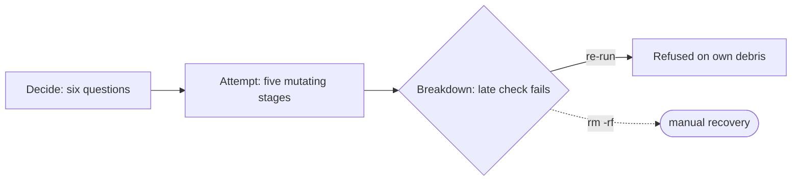

# Init hardening — PRD *(effective view)*

---

**GENERATED — DO NOT EDIT.** Sole writer: `docgate fold`. As of: **001**. Content fingerprint: `sha256:988eb495a7bad8b701aaadf1dd26396f31f6f18d5172f21d6e392b42a967f968`. Tool version (recorded, never hashed): `docgate/v1`.

---

| Field | Value |
|---|---|
| **In one line** | `pyxis init` becomes check-first and truthful: every prerequisite verified before any write, only empty targets admitted (everything else routed to `adopt`/`apply` by name), full rollback on failure, `ci_mode` made real, and a question surface a newcomer answers unaided. |
| **Relevant-when** | planning, building, or reviewing `pyxis init`'s admission, up-front checks, interactive prompts, GitHub coordinate resolution, failure rollback, or init↔adopt routing; triaging a failed, stranded, or destructive install; changing `ci_mode` semantics, the welcome/doctor truth surface, or the installer's refusal texts |
| **Status** | Draft — problem review pending |
| **Tier** | T2 |
| **Owner** | @mdarabi |
| **Approver(s)** | @mdarabi (operator — every gate) |
| **Contributors** | operator + factory agents (solo-operator collapse, template rule 15) |
| **Informed** | — |
| **Date** | 2026-07-28 created · 2026-07-28 last updated |
| **Appetite** | One contract, ~8–12 tracer-bullet tasks — one plan, one PR train at the scale existing-repo-onboarding landed at (`brainstorm:init-hardening#D-12`). Human attention: the review gates plus one unaided-install observation. Machine work: the task train plus opportunistic fixtures (`#D-11`). Rollout burden: none beyond the normal release pin. Cut-line: anything beyond the ruled checks/admission/routing/rollback/truth rows parks. |
| **Target release** | the first system release after plan-freeze — no external dependency |
| **Tracking** | — *(filed with the introducing PR)* |
| **Artifacts** | `docs/brainstorms/init-hardening.md` (the gated stage-1 record; the 2026-07-28 init-flow audit is distilled into its F-1..F-16) |
| **Template version** | prd-template/v2 |

## 0. Read to rule — the human reviewer's section (~7 min)

*The body is the contract; this section only routes attention — on any conflict the body governs; machines ignore it.*

**Judge these** *(ranked by irreversibility × blast radius)*

| # | The call | Could have gone | If you disagree |
|---|---|---|---|
| 1 | Checks-then-go: no plan artifact, no confirmation ceremony, no readiness verb — checks front-loaded, refusals fail-fast (`#D-7`) | plan→confirm→apply init, or a standalone `preflight` verb | veto reshapes FR-9's ordering invariant and re-opens NG-2 → §4.1, FR-9 |
| 2 | Empty-only admission; every other target routed to `adopt`/`apply` by name (`#D-7`) | a collision-diff init that negotiates with content | veto collides with adopt's charter and re-opens NG-1 → FR-1, FR-2 |
| 3 | Full rollback: as-found or fully-installed — with one ruled exception: a permission-classified wiring failure completes green and hands off instead of rolling back (`#D-5`; UB-4, the amendment-001 ruling) | debris-aware refusal, or a resumable pipeline; rollback-on-permission-too | veto rewrites FR-10 and UB-2..4's recovery shape → §5.2 |
| 4 | `ci_mode` wired real under its existing key name (`#D-3`) | rename (`docs_gate_mode`) or delete the knob | veto = FR-11 + the Q3 migration question → §7.2 |
| 5 | GitHub coordinate asked interactively when no origin exists; init sets origin itself (`#D-8`) | require the remote pre-set; or drop `repo=create` | veto = FR-6..FR-8 and the F4 flow → §4.3 |
| 6 | The primary metric is the unaided-install trial, human-judged; fixtures ride opportunistically (`#D-11`) | a contracted fixture-matrix gate | veto flips M1's verify method and DOD-6's blocking bit → §3.2, §5.8 |
| 7 | Code gate seeded at first use; init ships only the truth surface (`#D-4`) | a sixth init-time stack knob | veto adds a knob against `brainstorm:installer#D-6` → FR-14, Q1 |

**Sanity-check the numbers** — appetite ~8–12 tasks (header, `#D-12`); interactive re-ask bound: 3 attempts per question then a reported abort (FR-13); §0 itself and every fit criterion carry no other numeric targets — the trial is pass/fail (M1).

**The author's open questions** — Q1 first-use seeding owner · Q2 non-git remedy shape · Q3 `ci_mode` converge migration · Q4 gh scope-probe depth — all design-blocking, none solution-blocking → §7.2.

**Skip the rest** — structure/immutability → docgate; substance, coherence, upstream alignment → `/prd-review` (report rides this PR); prose/gloss quality → the conversation review; implementation defects → the design and its gates.

## 1. Summary — the one-pager

- **Problem** — First contact with pyxis fails people: init half-installs then dies on prerequisites it never stated, silently overwrites files in directories it should never have admitted, asks a question whose answer changes nothing, and refuses with instructions that are stale in its own binary. The operator's own first real install ended stranded, requiring manual deletion to retry.
- **For whom** — The first-contact installer: anyone at an empty folder standing up a new factory repo — the operator today, the external adopter by design. Every future repo passes through this door.
- **Why now** — The 2026-07-28 audit verified every failure live against the shipped release (record F-1..F-12); and `adopt`/`apply` shipped, so the division of labor between the two doors is finally decidable.
- **Direction** — Checks-then-go: every prerequisite verified before the first question or write; admission by content (empty → init; anything else → a refusal naming the adoption path); full rollback on any failure; `ci_mode` wired to real behavior; glossed, re-asking prompts; welcome/doctor state truthfully what is gated and what is not yet.
- **Appetite** — One contract, ~8–12 tasks (header). Excludes: any collision handling in init, plan/confirm ceremony, python/node verb content, upgrade UX.
- **Success** — The unaided-install trial: a person who has never seen pyxis, fresh machine, empty folder → green factory, zero questions asked of the operator (M1).
- **Guardrail** — Promptless parity: flag/answers runs keep completing with zero interactive prompts, and the existing empty-target install suites stay green (§3.3).
- **Top risks** — (1) gh permission probes prove unreliable across token types, pushing failures late — survivable only because rollback exists; (2) rollback misses a write class and leaves debris — the exact defect this feature exists to kill; (3) wiring `ci_mode` surprises already-installed repos at converge.

## 2. Problem space

### 2.1 Problem statement

The person standing at an empty folder — the operator this morning, an external adopter next month — cannot get a truthful first contact from `pyxis init`. Prerequisites are checked mid-pipeline, after mutation begins, so a missing remote or logged-out `gh` kills the run six stages in and strands the target behind init's own debris; a directory that merely lacks `.git` is admitted with no content check and its files silently overwritten, unrecoverably; one of the asked knobs changes no installed behavior; and the refusal that should route to the shipped adoption path still claims adoption is deferred. The cost of doing nothing: every fresh install is a gamble, first-contact abandonment for outsiders, and real data loss for anyone who runs init one directory too high.

### 2.2 Users and segments

| Segment | Role and context | Domain exp. | Tech exp. | Key goals | Pain today | Evidence |
|---|---|---|---|---|---|---|
| **P1 (primary)** | The first-contact installer: a person at an empty folder standing up a new factory repo at the terminal — no pyxis vocabulary assumed | novice (of pyxis) | journeyman | a green factory without reading source; truthful refusals; no damage on failure | mid-run death, stranded targets, unglossed jargon questions | `brainstorm:init-hardening#D-9`, `#F-3`, `#F-8` |
| P2 (secondary) | Automation/CI provisioning repos promptlessly (flags/answers) | — | master | zero prompts; machine-parseable refusals | a coordinate gap surfaces only at the wiring stage | `#D-8`, `#F-3` |
| **Anti-segment** | Anyone whose repository already has content — served by `pyxis adopt`, never by init; init redirects by name | — | — | — | — | `#D-7`, `#D-9` |

### 2.3 Jobs and desired outcomes

| # | When… (situation) | I want to… (motivation) | So I can… (outcome) | Today's workaround | Evidence |
|---|---|---|---|---|---|
| J1 | I run init on a fresh machine | have it end green or refuse before anything is written, naming the fix | never inherit a half-built tree | read the source; retry blind | `brainstorm:init-hardening#F-3`, `#F-7` |
| J2 | an install fails midway | find the folder exactly as it was | just fix the cause and re-run | manual `rm -rf` of the debris | `#F-8`, `#D-5` |
| J3 | init asks me a question | understand it unaided and trust the answer changes real behavior | configure without vocabulary or archaeology | guess; accept defaults blind | `#F-9`, `#F-12`, `#D-10` |
| J4 | I bring the wrong target (a repo with content) | be walked to the right door | end up in `adopt` without a dead end | stale refusal text; folk knowledge | `#F-11`, `#D-7` |

### 2.4 Evidence

| Claim | Source | Confidence |
|---|---|---|
| Init admits a non-git directory with content and silently overwrites files, unrecoverably, then reports green | `brainstorm:init-hardening#F-1`, `#F-2` — verified live on the shipped release | High |
| Prerequisite checks fire mid-pipeline, after mutations begin; a missing remote kills the run at the wiring stage | `#F-3`, `#F-7` — the operator's own install died exactly here | High |
| A failed init strands the target: the retry refusal fires on init's own debris | `#F-8` — verified twice | High |
| `ci_mode` has no behavioral consumer; a `local` install still ships the hosted workflow | `#F-9` — source + live | High |
| The non-empty refusal claims adoption is deferred while `adopt`/`apply` ship in the same binary | `#F-11` | High |
| Prompts are flag-help strings; one typo aborts the run; one prompt hides its legal values | `#F-12` | High |
| The stranger-shaped goal ("install unaided", installer G4) is declared and unmet | `#F-15` + this audit | High |

### 2.5 The journey today

| Phase | User does | User feels / pain | Frontstage | Backstage |
|---|---|---|---|---|
| Decide | runs `pyxis init`, answers six unglossed questions | uncertain what answers mean | flag-help strings as prompts | answers folded into knobs; no checks yet |
| Attempt | watches converge/payload/hooks run | confident — it's working | stage log lines | git init, config writes, payload fetch, hooks — all before wiring's checks |
| Breakdown | hits the stage-7 refusal (no remote) | betrayed — why now? | "operation carries no repository slug" | pre-action guard fires after five mutating stages |
| Recover | re-runs init | stuck — refused again | "target is not an empty repository" | UB-1 trips on init's own debris; manual deletion is the only path |

### 2.6 Opportunity and why now

- **Size** — Every future repo, internal or external, passes through this door; installability is the adoption funnel's first step (the installer PRD's own sizing, inherited).
- **Alternatives users have** — Read the source; ask the operator; abandon. None survive an external adopter.
- **Why us / strategic fit** — The factory's credibility rests on its own front door behaving like the software it promises to produce.
- **Why now** — The audit made every failure concrete and reproducible; `adopt`/`apply` shipped, making the routing rule decidable for the first time.
- **Cost of doing nothing** — Continued first-contact failures for every fresh machine; a standing data-loss hazard; a knob that teaches users to distrust the questions.

**Decision:** Problem gate — via the introducing PR's operator review.

| Reviewer | Role | Date | Verdict |
|---|---|---|---|
| @mdarabi | operator | — | pending |

## 3. Goals, metrics, and guardrails

### 3.1 Goals as falsifiable hypotheses

| # | We believe that… | Will result in… | Measured by… |
|---|---|---|---|
| G1 | front-loading every check before any write | installs that end green or refuse pre-write with a named remedy — zero mid-run corpses | M2 |
| G2 | a glossed, truthful question-and-refusal surface | a pyxis-naïve person completing an install unaided | M1 |
| G3 *(qualitative)* | routing every wrong-door arrival by name | no dead ends: content-holders land in `adopt` without folk knowledge | M2 (refusal classes) + trial verbatims |

### 3.2 Goals → signals → metrics

| Metric | Goal | Signal | Baseline | Target (at checkpoint) | Feeds from |
|---|---|---|---|---|---|
| M1 (primary) | G2 | a first-attempt unaided install session by a pyxis-naïve person on a fresh machine | fails today (the operator's own run died mid-pipeline) | pass — green factory, zero operator interventions — at the first such attempt after release | session verbatim (measurement plan §5.7 note) |
| M2 | G1, G3 | refusal quality across the audit's failure classes | checks fire post-mutation; one refusal text stale | 100% of refusal classes refuse pre-write with remedy (and route, where a route exists) — at release | EVT-2 |

### 3.3 Guardrails and decision rule

| Guardrail metric | Threshold | Action if breached |
|---|---|---|
| Promptless parity | zero interactive prompts in any flag/answers run of the existing e2e matrix | block release |
| Empty-target install parity | existing installer/init suites pass unchanged | block release |
| Adoption-path parity | existing adopt/apply suites pass unchanged | block release |

**Ship rule (pre-registered):** all Must fits green and guardrails clean → release; M1's trial then runs post-release — pass → adopt; fail → iterate on the named breakdown (§6.7); any guardrail breach → fix before release, no exceptions.

### 3.4 Non-goals and waiting room

| ID | Non-goal | Why refused |
|---|---|---|
| NG-1 | Init serving any non-empty target — adopt-lite modes, partial adoption, collision handling of any kind | the rule is *empty → init; anything else → route to `adopt`/`apply`*; collision policy lives in adopt alone (`brainstorm:init-hardening#O-4`, honoring `prd:installer` NG-3) |
| NG-2 | A plan artifact, confirmation ceremony, or standalone readiness verb for init | checks are init-internal, front-loaded, fail-fast; init never negotiates (`#O-3`) |
| NG-3 | Folding init onto the adoption machinery | relitigates the just-merged onboarding contract for gaps the front-loaded checks close more cheaply (`#O-1`) |
| NG-4 | Authoring real python/node default verb sets | that content belongs to `prd:implementation-verification`; this feature only tells the truth about the gap (`#O-2`) |

| ID | Waiting room | Revisit when / intended version |
|---|---|---|
| WR-1 | Deepening gh permission probes from advisory to per-operation scope prediction | observed late permission failures in the field (`#P-7`) |
| WR-2 | Renaming `ci_mode` to a truth-carrying key | the next breaking config-schema version, riding its dual-read window (`#D-3`) |

## 4. Solution space

### 4.1 Approach and alternatives considered

Checks-then-go (`brainstorm:init-hardening#D-7`): init front-loads every environmental and admission check before the first question (interactive) and before any write (both modes); any failure is a named, remedied refusal with nothing touched. Admission is by content — an empty directory or an empty repository — and every other target is refused with the adoption path named. Failures after mutation begins roll the target back to as-found. The question surface is glossed, shows its value sets, and re-asks on bad input; `ci_mode` gains its real semantics; the completion and doctor surfaces state what is gated and what is not yet.

| Option | Sketch | Why not chosen |
|---|---|---|
| A (chosen) | checks-then-go: front-loaded checks, empty-only admission, rollback, truth surface | — |
| B | plan→confirm→apply init (a plan artifact + confirmation gate, the adopt shape) | re-grows adopt's negotiation inside init for a target class (empty) that has nothing to negotiate (`#D-7` superseding `#D-6`) |
| C | fold init onto adopt's machinery entirely | relitigates a just-merged contract; guarded by its NR row (`#O-1`) |
| Do nothing | — | the audit's failure classes keep firing; §2.6's cost |

### 4.2 Scope perimeter

- **In (plan of record)** — content-based admission + named routing; front-loaded checks (toolchain floors, GitHub-mode auth/coordinate/repo checks, artifact-source reachability, ordering invariant); interactive coordinate elicitation + origin setup; full rollback; `ci_mode` wiring; the glossed/re-asking prompt surface; truthful refusal texts; welcome/doctor truth about the code-gate boundary; promptless parity throughout.
- **Future (believed next, not committed)** — WR-1 scope-probe deepening; WR-2 key rename; first-use code-gate seeding lands wherever Q1 resolves.
- **Out** — everything in §3.4; upgrade UX; org sweeps; non-GitHub hosts.

### 4.3 Experience: flows and states

**Flow F1 — interactive install, empty folder (serves J1, J3)**

| Step | User does | System responds | States covered | Design |
|---|---|---|---|---|
| 1 | runs `pyxis init` | runs every check; prints the check summary | ideal · error (named refusal, nothing run) | — |
| 2 | answers each knob | question shows value set + one-line gloss + default (and a derived default's basis); bad input re-asks | ideal · error (re-ask; bounded abort reports answers so far) | — |
| 3 | — | pipeline runs; completion states knobs, writes, and the gating boundary (docs gated; code gate pending with its step named) | ideal · error (rollback + named stage refusal) | — |

**Flow F2 — wrong door (serves J4)**: a target with content → refusal names `pyxis adopt`/`apply`; a non-git target with content → refusal names the runnable adoption remedy (exact shape per Q2). No mutation in any branch.

**Flow F3 — failure mid-apply (serves J2)**: any stage failure after mutation begins → target restored to as-found; refusal names the failed stage and remedy; a subsequent run proceeds past admission.

**Flow F4 — GitHub coordinate (serves J1; `#D-8`)**: GitHub mode with an origin → parsed, nothing asked. Without one: interactive elicits `owner/name` (shape-validated, re-asks on bad shape) and sets origin; `create` creates the repository there; `use` verifies existence and access during the checks. Promptless supplies the coordinate by flag/answers or receives the named pre-write refusal.

- **Empty / loading / partial** — terminal verb; not applicable beyond the states above (no persistent UI).
- **Error** — every refusal: cause + remedy (+ route where one exists); exit-code grammar preserved (NFR-3).
- **Accessibility / Localization** — terminal text, English-only at this stage; no change to either posture (reviewed omission, §5.6).

### 4.4 Scenarios

1. **The morning replayed.** Fresh laptop, empty folder, GitHub mode, no remote. Checks run first: gh is authenticated, but there is no origin — init asks `GitHub repository (owner/name):`, creates it, sets origin, and lands a green factory. The old world: five mutating stages, then "operation carries no repository slug", then a stranded tree.
2. **The 400-commit Python repo.** `pyxis init` in a working project: one refusal, no writes — "this repository has content — init is for empty repositories; run `pyxis adopt`." The user is in the right flow one command later.
3. **The provisioning script.** Flags + `--yes`: zero prompts; a missing coordinate refuses pre-write with the flag remedy; exit codes classify the refusal for the pipeline.
4. **The network dies mid-converge.** Fetch fails after mutation began: the folder is byte-identical to before the run; the refusal names the fetch and the retry; the re-run succeeds.

**Decision:** Solution gate — via the introducing PR's operator review. Zero TBDs at this gate.

| Reviewer | Role | Date | Verdict |
|---|---|---|---|
| @mdarabi | operator | — | pending |

## 5. System requirements

### 5.1 Functional requirements

| ID | Requirement (EARS) | Rationale | Priority | Risk | Fit criterion | Verify | Traces to |
|---|---|---|---|---|---|---|---|
| FR-1 | When init runs, the system shall admit only a target that is an empty directory or a repository empty of tracked and untracked content, refusing every other target by name before any write. | the destructive class dies at admission (`#D-7`, closing `#F-1`/`#F-2`) | Must | high | across the admission fixtures (empty dir · empty repo · repo+content · non-git+content · dirty repo), exactly the two empty shapes proceed; every refusal performs zero filesystem and zero remote mutation | Test | G1, J1, J4, F2 |
| FR-2 | If the target holds content, then the refusal shall name the adoption path and a runnable remedy. | wrong door → right door (`#D-7`, `#F-11`) | Must | med | both refusal classes (repo, non-git) name `adopt`; no refusal text contradicts shipped capability | Test | G3, J4, F2 |
| FR-3 | When init starts, the system shall verify every toolchain executable the resolved knobs imply — git always, the others per the release's documented floor set — for presence and floor version, refusing with a per-check remedy on any miss. | today's checks fire post-mutation (`#F-7`) | Must | med | for each executable in the implied set, a seeded absence and a seeded below-floor version each refuse pre-write naming that check's remedy | Test | G1, J1, F1 |
| FR-4 | Where the resolved or prospective knobs imply any GitHub-transport operation, the system shall verify gh presence and an authenticated identity — and, for `wiring repo=use`, that the coordinate's repository exists and is accessible — before any write. | auth was never probed (`#F-6`) | Must | high | logged-out gh, and `use` against a missing/inaccessible repo, each refuse pre-write with the remedy; carina-mode runs perform zero GitHub calls | Test | G1, J1, F1, F4 |
| FR-5 | Where the release artifacts are not verifiably cached, the system shall verify artifact-source reachability under the resolved credential before any write. | fetch failures currently land mid-pipeline (`#F-7`) | Must | med | an unreachable source refuses pre-write naming host and credential remedy; a warm cache skips the probe | Test | G1, J1 |
| FR-6 | Where GitHub mode is resolved and an origin remote exists, the system shall derive the coordinate from it; where none exists interactively, the system shall elicit a shape-validated `owner/name` and configure origin itself. | the coordinate died six stages in (`#D-8`, `#F-3`) | Must | med | origin-present runs ask nothing; origin-absent interactive runs elicit, validate the shape (re-ask on failure), and leave origin configured | Test | J1, F4 |
| FR-7 | If a promptless GitHub-mode run resolves neither an origin remote nor a supplied coordinate, then the system shall refuse by name before any write. | promptless parity with the same fail-fast (`#D-8`) | Must | med | the flag/answers matrix row with no coordinate refuses pre-write naming the flag and answers-file remedies | Test | J1, F4 |
| FR-8 | Where `wiring repo=create` is resolved with a coordinate, the system shall create the repository at that coordinate and set it as origin before dependent wiring operations run. | create-from-empty was impossible (`#F-4`) | Must | med | the bare-folder create scenario ends green with repo, origin, and wiring landed (hermetic transport); the pre-run check summary names the coordinate before any creation | Test | J1, F4 |
| FR-9 | When any front-loaded check fails, the system shall have performed zero writes and zero remote mutations. | the ordering invariant — refusal before action | Must | high | the full check-failure injection matrix asserts a byte-identical target and an empty transport transcript after every refusal | Test | G1, J1, F1, F2 |
| FR-10 | If any stage fails after mutation begins, then the system shall restore the target to its pre-run state — removing exactly the writes it performed and the repository it created, where it created one, preserving any foreign entry that appeared during the run and naming it in the report — and report the failed stage with its remedy. | as-found or fully-installed, nothing between (`#D-5`, closing `#F-8`); restore must never delete what init did not write | Must | high | per-stage failure injection leaves the target byte-identical to pre-run (created-repo case: the folder returns to empty); a foreign file planted mid-apply survives the rollback and is named; a subsequent init proceeds past admission | Test | G1, J2, F3 |
| FR-11 | Where `knobs.ci_mode` excludes hosted CI, the system shall not install the hosted docs-gate workflow; where it includes hosted CI, the system shall install it; desk hooks install in every mode. | the knob answers changed nothing (`#D-3`, `#F-9`) | Must | med | `local` installs ship no workflow file; `actions`/`both` ship it; hooks present and active in all modes | Test | G2, J3 |
| FR-12 | When eliciting any knob interactively, the system shall present its closed value set, a one-line plain-language gloss of what the answer changes, and its default — including the basis of a derived default. | prompts were flag-help strings (`#F-12`) | Must | low | every asked question renders value set + gloss + default; the tracker-derived CI default names its basis | Demo | G2, J3, F1 |
| FR-13 | If an interactive answer falls outside the value set, then the system shall re-ask up to 3 attempts before aborting with the collected answers reported. | one typo killed the run (`#F-12`) | Must | low | out-of-enum input re-asks without process exit; the bounded abort lists every answer given; a closed input stream takes the default without entering the re-ask loop (today's EOF semantics preserved) | Test | G2, J3, F1 |
| FR-14 | When an install completes, the completion output shall state the gating boundary: the gates active on the operand and the code gate's pending status with its enabling step named. | the welcome advertised a dead ladder (`#D-4`, `#F-10`) | Must | low | completion output names the active docs gates and the manifest step; no advertised capability refuses on a fresh operand without that caveat | Inspection | G2, J3 |
| FR-15 | While an operand holds recognized code files without a verification manifest, doctor shall report the absence with the seeding or authoring remedy. | the gap surfaces at implement-time otherwise (`#D-4`) | Should | low | the code-without-manifest fixture yields the advisory; manifest-present and code-free fixtures stay silent | Test | G2, J3 |
| FR-16 | When init refuses for any reason, the refusal shall name the failing check or stage, the remedy, and the route where one exists. | refusal quality is the product at first contact | Must | med | an inspection sweep over every refusal class finds cause + remedy present; stale-capability claims absent | Inspection | G1, G3, J1, J4 |

*Within each priority class, rows rank in table order (FR-1 highest); cuts consume a class from the bottom up.*

**Non-regression (NR-n)**

| ID | Existing behavior protected | Why protected | Risk | Fit criterion | Verify | Traces to |
|---|---|---|---|---|---|---|
| NR-1 | Promptless runs (flags/answers/`--yes`) complete with zero interactive prompts | CI parity is a frozen contract (installer heritage) | high | the existing promptless e2e matrix passes unchanged | Test | F1, F4 |
| NR-2 | The empty-target install path lands the same green factory as today | this feature hardens the door, never the house behind it | high | existing installer/init suites pass unchanged | Test | F1, F3 |
| NR-3 | `adopt`/`apply`/`undo` behavior is untouched | routing points at it; nothing here may reshape it | med | existing onboarding suites pass unchanged | Test | F2 |

### 5.2 Unwanted behavior and failure handling

| ID | If… (trigger) | Then the system shall… | User sees | Priority | Risk | Fit criterion | Verify | Traces to |
|---|---|---|---|---|---|---|---|---|
| UB-4 *(001 ← UB-1)* | a wiring operation fails for permission after the checks passed (scope gaps are not fully pre-probeable) | complete every remaining operation the credential allows, finish green, and record the handed-off operations with their exact remedial commands — the installer's non-admin hand-off; no rollback occurs for a permission-classified wiring failure | a green install + the hand-off block naming each remaining operation and its command | Must | high | injected permission failure at wiring → the run ends green with the hand-off recorded (operations + runnable commands) and the target NOT rolled back; every non-permission post-mutation failure still restores as-found (FR-10) | Test | F3, FR-10 |
| UB-2 | the artifact source becomes unreachable after mutation begins | roll back per FR-10 and name the fetch failure and retry | as-found folder + a named network refusal | Must | med | injected mid-converge fetch failure → byte-identical target; re-run succeeds once restored | Test | F3, FR-10 |
| UB-3 | the run is interrupted (signal or closed input) during elicitation or apply | write nothing (elicitation) or roll back (apply) | a clean folder either way | Must | med | interrupt fixtures at both phases leave the target byte-identical to pre-run | Test | F1, F3, FR-10 |

### 5.3 Permissions and abuse cases

Privilege posture is unchanged: every GitHub mutation runs under the user's own ambient gh credential; no token is stored, no new role exists. The one new input surface:

| ID | Actor and intent | Vector | Impact | Severity | Mitigated by | Verify |
|---|---|---|---|---|---|---|
| ABUSE-1 | a hostile or careless coordinate answer smuggling flags or metacharacters toward gh/git argv | the interactive `owner/name` elicitation (F4) | command-shape corruption or surprise repo targets | med | FR-6's shape validation (strict `owner/name` grammar; everything else re-asks) | Test |

### 5.4 Data

Skipped: no new persistent entities — init's write set is unchanged in kind (config, seeds, hooks); rollback state is transient and in-process; nothing new is retained or egressed.

### 5.5 Interfaces and integrations

| Interface | Direction | Purpose | Contract (format, ranges, timing) | Failure modes | Owner |
|---|---|---|---|---|---|
| gh CLI | out | auth probe, repo existence probe, repo create, wiring ops | existing exec transport; probes are read-only pre-write | absent, logged-out, permission, transient — each a named class (FR-4, UB-1) | this feature |
| git | out | admission read, floors probe, origin configure, rollback | existing exec surface; admission and probes read-only | absent/floor miss → FR-3 refusal | this feature |
| artifact host | out | reachability probe under the resolved credential | probe-only pre-write; verification contract unchanged | unreachable → FR-5 refusal; mid-run → UB-2 | this feature |

### 5.6 Non-functional requirements

| ID | Area | Requirement | Fit criterion | Verify |
|---|---|---|---|---|
| NFR-1 | Performance | The full check pass shall fit within the install budget the installer contract already binds. | the existing install-budget measurement stays green with checks included | Analysis |
| NFR-2 | Security | The system shall send each credential only to the service that owns it during checks (gh→GitHub; the artifact door credential→its host), and no probe shall transmit repository content. | inspection of probe calls; the credential-containment tests extend to the probes | Test |
| NFR-3 | Operability | Every refusal shall keep the exit-code grammar and emit its structured event (§5.7). | refusal fixtures assert exit class + event | Test |

*Accessibility and localization rows deleted as a reviewed decision: a terminal verb, English-only at this stage — unchanged posture, no page or process surface.*

### 5.7 Instrumentation — the tracking plan

*M1 is measured by a recorded session verbatim (a human observation on the header's Tracking ref), not by telemetry — pyxis emits no egress; the events below are local structured logs.*

| ID | Event name | Fires when | Properties (typed) | Source | Feeds |
|---|---|---|---|---|---|
| EVT-1 | init_checks_passed | every front-loaded check succeeded | checks: list, duration_ms: int | init | M2 (denominator) |
| EVT-2 | init_refused | any pre-write refusal | check: string, remedy_present: bool, route_present: bool | init | M2 |
| EVT-3 | init_rolled_back | FR-10 restored a target | failed_stage: string, restored: bool | init | M2 |

### 5.8 Definition of Done

| ID | Done criterion | Source | Verify | Required evidence | Blocking? |
|---|---|---|---|---|---|
| DOD-1 | Every Must FR passes its fit criterion | FR-1..FR-16 | Test | CI run | yes |
| DOD-2 | No non-regression row broken | NR-1..NR-3 | Test | suite result | yes |
| DOD-3 | The failure-injection set green: every check-refusal leaves zero writes; every post-mutation failure restores as-found | FR-9, FR-10, UB-1..3 | Test | injection suite result | yes |
| DOD-4 | Truth-surface inspection: refusal texts, prompt glosses, completion boundary statement all present and current | FR-2, FR-12, FR-14, FR-16 | Inspection | review record on the PR | yes |
| DOD-5 | The installer ledger's alignment amendments landed (its preview/admission/`ci_mode` rows no longer contradict this contract) | §6.2 | Inspection | ledger diff | yes |
| DOD-6 | The unaided-install trial passes | M1 | Human judgment — @mdarabi; rubric: pyxis-naïve person, fresh machine, empty folder → green factory, zero operator interventions, verbatim recorded | session verbatim on the Tracking ref | no — post-launch observable by design (`#D-11`); §6.7 owns the verdict |

### 5.9 AI behavior and evals

Skipped: no model-driven behavior ships in this feature.

## 6. Delivery

### 6.1 Phasing and milestones

| Phase | Purpose | Scope | Exit criterion |
|---|---|---|---|
| Build | land the contract | the full §4.2 "In" as one task train | DOD-1..5 green |
| Prove | the trial | first pyxis-naïve fresh-machine install after release | DOD-6 verdict recorded (§6.7) |

### 6.2 Dependencies

| Dependency | Type | Needed by | Status | Owner |
|---|---|---|---|---|
| Installer ledger alignment amendments — its five-knob/no-sixth-question fit (its FR-3), preview (its FR-19), admission (its UB-1), and `ci_mode` rows | approval (typed amendments) | Build | planned — rides the same effort (`#D-2`) | @mdarabi |
| Onboarding contract touch, if Q2 resolves to amending its non-git refusal | approval (one typed amendment) | design gate | open — Q2 | @mdarabi |
| First-use seeding owner (Q1) | team decision | design gate | open — Q1 | @mdarabi |

### 6.3 Risks, assumptions, and rabbit holes

| # | Risk / assumption / rabbit hole | Likelihood | Impact | Mitigation or test | Owner |
|---|---|---|---|---|---|
| R1 | gh permission probes are unreliable across token types, so some failures stay late | M | M | advisory-depth probes (Q4) + UB-1's rollback survivability — J1's promise holds via FR-10 | @mdarabi |
| R2 | rollback misses a write class and leaves debris — the defect this feature exists to kill | M | H | single-source the write-set enumeration; per-stage injection in DOD-3; treat any miss as a release blocker | @mdarabi |
| R3 | wiring `ci_mode` surprises already-installed repos at converge | M | M | Q3 decides the disposition before build; doctor advisory precedes any removal behavior | @mdarabi |
| R4 | *(assumption)* no real segment needs init-with-content | L | M | adopt exists and is the routed answer; watch trial verbatims for contradiction | @mdarabi |

### 6.4 Release criteria

| Lens | Criterion | Evaluated by |
|---|---|---|
| Functionality | every Must FR fit green | CI |
| Reliability | DOD-3's injection set green | failure injection |
| Usability | truth-surface inspection (DOD-4) clean | PR review record |
| Performance | NFR-1 within the inherited budget | Analysis |
| Supportability | refusal grammar + doctor advisory verified (NFR-3, FR-15) | test + inspection |

### 6.5 Rollout and reversibility

- **Flag** — none: behavior ships in the versioned release binary; exposure is choosing to upgrade.
- **Kill switch** — the release-pin rollback the installer contract already provides: repin the prior version, converge restores it (tested there; unchanged here).
- **Experiment** — none.
- **Cutover/migration** — none for fresh installs; Q3's disposition governs the one migration-adjacent surface (`ci_mode` on existing operands) and lands in the design.

| Stage | Audience | Minimum evidence | Advance when | Roll back when |
|---|---|---|---|---|
| Release | operator repos | DOD-1..5 green | first fresh install green | any guardrail breach → repin prior release |
| Field | external-shaped installs | the M1 trial | §6.7 verdict: adopt | trial reveals a §3.3 breach |

### 6.6 Launch readiness

| Area | Item | Owner | Status |
|---|---|---|---|
| Docs | README's install section states the prerequisites and the empty-target rule; refusal texts double as docs | @mdarabi | ☐ |
| Support | the refusal grammar + doctor advisories are the runbook (solo-operator collapse) | @mdarabi | ☐ |
| Other areas | n/a — no pricing, legal, marketing, localization, or platform surface | — | n/a |

**Decision:** Launch gate — via the introducing PR's operator review + DOD rows.

| Reviewer | Role | Date | Verdict |
|---|---|---|---|
| @mdarabi | operator | — | pending |

### 6.7 Post-launch review

- **Review trigger** — the first pyxis-naïve, fresh-machine install attempt after release (observable session, not a date) · **Owner** — @mdarabi
- **Verdict recorded** — adopt / iterate / kill, with the session verbatim and M2's refusal evidence, on the header's Tracking ref.

## 7. Alignment

### 7.1 FAQ

**Customer**

- **Q:** Init refused my folder — is something wrong? — **A:** No: init only sets up empty folders. Your folder has content, so the right command is `pyxis adopt`, which negotiates with existing files instead of overwriting anything. The refusal message names the exact command.
- **Q:** It failed halfway — is my folder damaged? — **A:** No. A failed init puts everything back exactly as it found it; fix the named cause and re-run.
- **Q:** What does `ci_mode` actually change? — **A:** Where the docs gate runs: `local` = git hooks on your machine only; `actions` = hosted CI only; `both` = both. It has real effect now — a `local` install ships no hosted workflow.

**Internal**

- **Q:** Why two doors instead of folding init into adopt? — **A:** The onboarding contract deliberately shipped adopt as its own negotiation; init's empty-only rule makes the overlap zero. Folding them relitigates fresh contract for no gap (`#O-1`).
- **Q:** Why isn't the primary metric a test suite? — **A:** Operator ruling (`#D-11`): the bet is about a human completing first contact unaided; fixtures verify requirements opportunistically but the metric is the trial.
- **Q:** Top failure modes? — **A:** §1's three: late permission failures (R1), an incomplete rollback (R2), `ci_mode` migration surprise (R3).

### 7.2 Open questions

| # | Question | Owner | Needed by | Status |
|---|---|---|---|---|
| Q1 | Which surface owns first-use code-gate seeding — implement-now's preflight, a doctor remedy, or plan-new's projection? (`brainstorm:init-hardening#G-1`) | @mdarabi | tech-design gate | open |
| Q2 | The non-git-with-content remedy: a two-step message (`git init`, then adopt) or an onboarding amendment letting adopt admit non-git targets? (`#P-6`) | @mdarabi | tech-design gate | open |
| Q3 | `ci_mode` on already-installed repos: does converge remove a now-excluded workflow, or advise only? (`#P-5`) | @mdarabi | tech-design gate | open |
| Q4 | gh probe depth: auth-only, or best-effort scope prediction — and where advisory degradation is acceptable? (`#P-7`) | @mdarabi | tech-design gate | open |

The technical design additionally consumes the record's parked constraints (`brainstorm:init-hardening#P-1`..`#P-7`) directly: Q1–Q4 surface the decision-shaped four; P-2 (the existing floor-probe pattern) and P-4 (the `MarkerFiles` detection groundwork) travel as design inputs without a question.

### 7.3 Decision log

| Date | Decision | Alternatives considered | Why | Who |
|---|---|---|---|---|
| 2026-07-28 | The feature is the safe front door held to truthful first contact (`brainstorm:init-hardening#D-1`) | fold into adopt; truth-theme only | hard invariant for the data-loss rows; measurable home for honesty rows | @mdarabi |
| 2026-07-28 | One new feature PRD + installer alignment amendments (`#D-2`) | amendment train only; two features | coherent new subsystem; single-amendment gate makes a pure train ~10 PRs | @mdarabi |
| 2026-07-28 | `ci_mode` wired real, key name kept (`#D-3`) | rename; delete | semantics without schema migration; deletion forces workflows on offline repos | @mdarabi |
| 2026-07-28 | Code gate seeded at first use; init ships the truth surface (`#D-4`) | sixth stack knob; truth only | nothing to detect in an empty repo; first use has files | @mdarabi |
| 2026-07-28 | Full rollback on failure (`#D-5`) | resume; debris-aware refusal | as-found-or-installed is the only honest invariant | @mdarabi |
| 2026-07-28 | *(superseded)* interactive plan confirmation (`#D-6`) | always; never | superseded by `#D-7` — plan ceremony removed | @mdarabi |
| 2026-07-28 | Checks-then-go; empty → init, else route to adopt; no verb, no plan, no confirm (`#D-7`) | plan→confirm→apply; readiness verb | empty admission leaves nothing to negotiate; ceremony re-grows adopt inside init | @mdarabi |
| 2026-07-28 | GitHub coordinate asked when unparseable; init sets origin (`#D-8`) | require origin pre-set; drop create | smoothest brand-new flow; closes create-from-nothing | @mdarabi |
| 2026-07-28 | P1 = first-contact installer; anti-segment = any content-holder (`#D-9`) | operator-only; automation-first | every audit failure is a first-contact failure | @mdarabi |
| 2026-07-28 | Four jobs (`#D-10`) | three; five | routing is its own journey; code-gate truth lives in J3 | @mdarabi |
| 2026-07-28 | Primary metric = the unaided-install trial (`#D-11`) | fixture-matrix gate; register-closure | the bet is human; fixtures ride opportunistically | @mdarabi |
| 2026-07-28 | Appetite: one contract, ~8–12 tasks (`#D-12`) | minimal sweep; two waves | rulings interlock; wave-splitting doubles ceremony | @mdarabi |

### 7.4 Changelog

| Date | Change | Author |
|---|---|---|
| 2026-07-28 | 000-base created from `brainstorm:init-hardening` (gated ready-for-prd same day) | @mdarabi + factory |

## 8. Contract readiness — the executability gate

| Check | Pass? | Notes |
|---|---|---|
| Problem basis accepted — §2 problem gate signed | ☐ | signs via the introducing PR's operator review |
| Zero solution-blocking TBDs or open questions (§7.2) | ☑ | Q1–Q4 are design-blocking, none solution-blocking |
| Every Must FR has a fit criterion and a verification method (§5.1) | ☑ | |
| Every requirement row carries a risk tier; high/critical rows have a declared safety plan | ☑ | high rows ride FR-9/FR-10's injection proof + release-pin rollback (§6.5) |
| Non-goals drawn (§3.4); non-regression rows named (§5.1) | ☑ | NG-1..4; NR-1..3 |
| Every primary job (§2.3) covered by a requirement, non-goal, or waiting-room entry | ☑ | J1 → FR-3..FR-9, FR-16; J2 → FR-10, UB-1..3; J3 → FR-11..FR-15; J4 → FR-1, FR-2 |
| Every key flow (§4.3) has functional, failure, and non-regression coverage | ☑ | F1 → FR-3..FR-9, FR-12..13, NR-2; F2 → FR-1..2, NR-3; F3 → FR-10, UB-1..3; F4 → FR-6..8, ABUSE-1, NR-1 |
| Every primary metric (§3.2) has instrumentation or a measurement plan | ☑ | M1 → the verbatim plan (§5.7 note); M2 → EVT-1..3 |
| Every blocking DoD row traces to a requirement, guardrail, release criterion, or rubric | ☑ | DOD-1..5 |
| Risks and assumptions have owners (§6.3) | ☑ | |
| Human-judgment criteria name an owner and a rubric (§5.8) | ☑ | DOD-6 |
| DoD complete: every blocking row sourced and evidenced; every n/a explained | ☑ | DOD-6's non-blocking bit carries its `#D-11` reason |

## Superseded & retired

- **UB-1** *(superseded by UB-4 (001))* — `UB-1 | a wiring operation fails for permission after the checks passed (scope gaps are not fully pre-probeable) | roll back per FR-10 and report the permission classification with its remedy | as-found folder + a named permission refusal | Must | high | injected permission failure at wiring → byte-identical target + classified report | Test | F3, FR-10`
