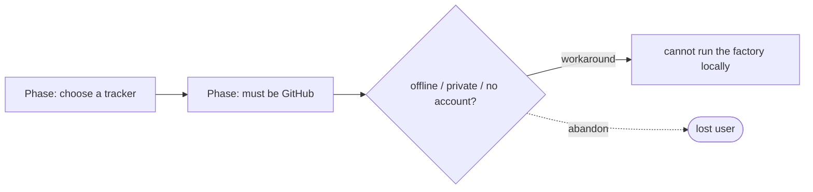

# Local work tracker — the file-based WorkTracker adapter — PRD *(effective view)*

---

**GENERATED — DO NOT EDIT.** Sole writer: `docgate fold`. As of: **001**. Content fingerprint: `sha256:de06f6e92d39c9293348ca93d4cbaa2c597b0b055ece52ff98be08d29c816691`. Tool version (recorded, never hashed): `docgate/v1`.

---

| Field | Value |
|---|---|
| **In one line** | A dependency-free, file-based work-item store and CLI — the WorkTracker port's minimal-local adapter — that replicates GitHub Issues' capability surface as plain files alongside a repo, so the factory runs with no tracker service. |
| **Relevant-when** | planning, building, or reviewing the local (file-based) work-item store, the WorkTracker port's minimal-local adapter, or the work-item CLI; triaging defects in local work-item create / read / update / transition / link / search or ready-set / triage-set discovery; changing the WorkTracker port contract, its conformance kit, or anything that binds the tracker medium |
| **Status** | Problem review ✓ · Solution review ✓ (2026-07-07) — launch review pending, post-implementation |
| **Tier** | T2 |
| **Owner** | @mdarabi |
| **Approver(s)** | @mdarabi (operator) |
| **Contributors** | operator (product) · factory agents (implementation) |
| **Informed** | future WorkTracker adapter authors (GitHub, Linear); conformance-kit authors |
| **Date** | 2026-07-07 created · 2026-07-07 last updated |
| **Appetite** | medium: the first port adapter + its conformance kit + a human CLI, bounded to the WorkTracker medium only — the sibling minimal-local ports (lease, code host, proposal) are out of budget; a few review rounds; no rollout/support surface (local tooling). |
| **Target release** | the first artifact of the factory-in-a-box (RW-4): precedes any real-world WorkTracker adapter and unblocks hermetic engine tests. |
| **Tracking** | introducing PR (filed on approval) |
| **Artifacts** | domain-model.md §7/§8 (WorkTracker port + minimal-local medium) · system-design.md D6 (work-item schema & projections) · harbormaster gh-coupling capability sweep (2026-07-07) · WorkTracker conformance kit (arrives with implementation) |
| **Template version** | prd-template/v1 |

## 1. Summary — the one-pager

- **Problem** — Running the factory requires a work-item medium, and today the only one that exists is GitHub Issues: a hosted, networked, third-party service. An engineer who is offline, air-gapped, privacy-bound, or simply unwilling to hand their backlog to GitHub cannot run the factory at all, and the engine's own claim of medium-independence is untested because no second medium exists.
- **For whom** — engineers running the factory without a hosted tracker (solo, private, or offline); the engine itself, which discovers and mutates work through the WorkTracker port; and factory authors, who need a hermetic, network-free medium to test every engine behavior against.
- **Why now** — RW-4 makes the minimal-local set the *first* thing built, and the domain model already names this adapter ("one file per work item"); the swap test (AP-1) and the factory-in-a-box (RW-4) both block on a second WorkTracker medium existing.
- **Direction** — a work-item store that lives as plain, human-readable files alongside a repo — no server, no database, no network — reachable identically by the engine (through the WorkTracker port) and by a human (through a CLI that creates, reads, edits, transitions, links, and searches work items). One store, one set of predicates, two front doors.
- **Appetite** — as header: the WorkTracker medium and its CLI only; the lease, code-host, and proposal minimal-local adapters are separate features.
- **Success** — the WorkTracker conformance kit passes 100% for the local adapter at the checkpoint "kit green in CI," and the factory-in-a-box execution loop completes end-to-end with zero network syscalls.
- **Guardrail** — binding this adapter requires zero changes to the kernel or judgment planes (INV-37), and no work-item data leaves the machine.
- **Top risks** — strong-read + crash-safety under concurrency (a filesystem is not a database); stable identifiers under parallel creation across nodes; scope creep into the sibling ports.

## 2. Problem space

### 2.1 Problem statement

The factory cannot function without somewhere to keep work items — features, milestones, epics, tasks, their states, signals, hierarchy, dependencies, and decision records. The only such medium built today is GitHub Issues, which presupposes a GitHub account, network connectivity, third-party data custody, and per-operation authentication. That excludes an entire class of users (offline, air-gapped, privacy-bound, or GitHub-averse) from running the factory at all, and it leaves the product's foundational promise — that every medium is a swappable adapter (AP-1) — as an untested assertion, because there is exactly one WorkTracker medium in existence. It also means the engine cannot be exercised hermetically: every test of leasing, readiness, triage, or merge authority reaches across a network to a service the test does not control. The cost of doing nothing is that medium-independence stays aspirational, the factory-in-a-box (RW-4) cannot be built, and users who will not or cannot use a hosted tracker have no product.

### 2.2 Users and segments

| Segment | Role and context | Domain exp. | Tech exp. | Key goals | Pain today | Evidence |
|---|---|---|---|---|---|---|
| **P1 (primary)** | an engineer running the factory on one machine without a hosted tracker — solo, offline, air-gapped, or privacy-bound | journeyman | master | run the full pipeline with no tracker service; keep work-item data on their own disk | GitHub Issues is the only medium; no local option exists | product-vision §2 ("a local file"); domain-model §2.1 test 2 |
| P2 | the engine — Scheduler, Triager, Planner, Arbiter — reading and mutating work through the WorkTracker port | — | master | discover the ready set / triage set; transition state; append decision records — identically to any medium | only a GitHub adapter is conceivable; the port has one implementation | domain-model §7 (WorkTracker port row) |
| P3 | factory authors needing a hermetic test harness | master | master | exercise every engine invariant with no network, no tokens, no mocks | tests reach a live service they do not control | domain-model §8; RW-4 |
| **Anti-segment** | teams operating happily on GitHub / Linear at scale, who want the hosted UI, notifications, and multi-party collaboration | — | — | — | — | this feature does not replace their medium; they keep their adapter |

### 2.3 Jobs and desired outcomes

| # | When… | I want to… | So I can… | Today's workaround | Evidence |
|---|---|---|---|---|---|
| J1 | I am setting up the factory with no GitHub account or no network | bind a purely local work-item medium | run the pipeline offline and keep my backlog on my own disk | none — the job goes undone | product-vision §2 |
| J2 | I am managing the backlog by hand | create, view, edit, label, comment on, link, transition, and search work items from a terminal | run the backlog without a web UI | use GitHub's web UI or `gh` against a hosted repo | harbormaster gh-coupling sweep §1–2 |
| J3 | the engine takes a scheduling tick | discover the ready set, the undecided set, sub-issue rollups, and blocked-by status through the port | run the pipeline unchanged on the local medium | none — no local adapter exists | IMPL-1/10; PLAN-8; domain-model §7 |
| J4 | I want to review or recover backlog history | read, grep, diff, and version work items with ordinary file tools | use the same tools I use for code, with no export step | scrape the GitHub API | domain-model §8 (files-as-state) |
| J5 | I am writing an engine test | run leasing, readiness, triage, and merge-authority behavior against a controlled medium | verify invariants hermetically, with no network call | integration-test against a live service | RW-4; domain-model §8 |

### 2.4 Evidence

| Claim | Source | Confidence |
|---|---|---|
| The product vision requires "a local file" as a first-class work-item medium and a complete "minimal form" installation | product-vision §2; domain-model §2.1 (swap test, minimal form) | High |
| The minimal-local WorkTracker adapter is the *first* artifact to build, and doubles as the hermetic test harness | RW-4; domain-model §8 | High |
| Today's factory is totally coupled to GitHub Issues — no seam exists; every `gh` call is inline | harbormaster gh-coupling sweep §5 ("ZERO abstraction layer") | High |
| The full capability surface to replicate is bounded and known (create/edit/close/comment/label, sub-issues, dependencies, decision markers, ready/triage queries) | harbormaster gh-coupling sweep §1–4 (capability checklist) | High |
| A filesystem trivially provides the strong, exact reads that destructive decisions require — the weakness that forced GitHub read-workarounds does not exist here | AP-15 / INV-7; RW-3; harbormaster sweep §2.5 (GH_REST_FRESH workarounds) | High |

### 2.5 The journey today

| Phase | User does | User feels / pain | Frontstage | Backstage |
|---|---|---|---|---|
| Decide | picks a tracker to run the factory against | "why must this be GitHub?" | only GitHub is documented | engine speaks only the GitHub adapter |
| Set up | creates a GitHub account, repo, and App auth | friction; privacy concern; blocked if offline | GitHub web + `gh auth` | network + tokens required per operation |
| Operate | lets the engine drive work items on GitHub | data lives with a third party; no offline path | GitHub Issues UI/API | inline `gh` calls, ETag read-workarounds |
| Recover / review | scrapes the API to inspect or back up history | history is not local; no `grep`/`diff` | GitHub search | API pagination, rate limits |

### 2.6 Opportunity and why now

- **Size** — every factory installation needs a work-item medium; a local one is the entry point for every user who cannot or will not use a hosted service, and the substrate every engine test stands on.
- **Alternatives users have** — a hosted tracker (GitHub/Linear: network, account, third-party custody); do nothing (no local factory exists).
- **Why us / strategic fit** — RW-4: substrate first. The minimal-local medium is simultaneously the simplest installation and the engine's hermetic test harness; it is the proof that AP-1 is real.
- **Why now** — the domain model, ports map, and principles are settled and already name this adapter; nothing downstream (conformance kit, first real adapter, factory-in-a-box) can proceed until a second WorkTracker medium exists.
- **Cost of doing nothing** — medium-independence remains an assertion; hermetic testing is impossible; a whole user segment has no product.

**Decision:** Problem gate — do not proceed to §3–§4 until signed.

| Reviewer | Role | Date | Verdict |
|---|---|---|---|
| @mdarabi | operator | 2026-07-07 | approved |

## 3. Goals, metrics, and guardrails

### 3.1 Goals as falsifiable hypotheses

| # | We believe that… | Will result in… | Measured by… |
|---|---|---|---|
| G1 | a file-based work-item store + CLI | the factory runs with no tracker service — offline, private, dependency-free | M2 |
| G2 | satisfying the shared WorkTracker port contract with a second, radically different medium | medium-independence proven, not asserted (the swap test passes) | M1 |
| G3 *(qualitative)* | the store is "just files" | a human reads, greps, edits, and versions work items with ordinary tools, unaided | qual: operator lifecycle demo (DOD-5) |

### 3.2 Goals → signals → metrics

| Metric | Goal | Signal | Baseline | Target (at checkpoint) | Feeds from |
|---|---|---|---|---|---|
| M1 (primary) | G2 | the WorkTracker conformance kit passes for the local adapter | n/a (no adapter, no kit) | 100% at "kit green in CI" | measurement plan: conformance-kit results in CI |
| M2 | G1 | the factory-in-a-box execution loop completes end-to-end offline | n/a | zero network syscalls in the tracker path at "first hermetic e2e green" | measurement plan: syscall trace of the e2e harness |

*(§5.7 tracking plan skipped with reason — no product analytics in local, hermetic tooling; both metrics are measured from CI and a syscall trace, plans stated above.)*

### 3.3 Guardrails and decision rule

| Guardrail metric | Threshold | Action if breached |
|---|---|---|
| kernel/judgment changes required to bind this adapter (INV-37) | any (> 0) | design defect — the port contract leaks the medium; fix the port, not the core |
| work-item data leaving the machine (egress) | any byte | the store is local by definition — treat as a defect and block |
| data loss or torn write under the crash-injection suite | any single occurrence | durability bug — fix before enforcement widens |
| false verdict on a destructive-decision read (stale/incorrect) | any single occurrence in the kit | strong-read bug — sweep every read of that class (AP-15) |

**Ship rule (pre-registered):** conformance kit 100% green AND crash-injection + strong-read suites clean AND the factory-in-a-box e2e passes offline → bind as the default local WorkTracker medium; any guardrail breach → unbind, fix, re-verify.

### 3.4 Non-goals and waiting room

| ID | Non-goal | Why refused |
|---|---|---|
| NG-1 | Any web UI, GUI, or graphical surface | the medium is files + a CLI by design; "without any UI" is a stated constraint |
| NG-2 | A database, server, or embedded store (SQLite, etc.) as the source of truth | the stated constraint is "no db, no dependency"; the files are the store (Q1 leaning: stateless-over-files) |
| NG-3 | The sibling minimal-local adapters — LeaseStore, CodeHost, ProposalService | separate ports, separate PRDs; the factory-in-a-box needs them, but each is its own feature (WR-2) |
| NG-4 | Multi-user authentication, roles, or access control | single-tenant local tool; the OS filesystem is the permission boundary |
| NG-5 | Live network sync, webhooks, or a remote protocol | that is the Trigger / remote concern; this medium is local files |
| NG-6 | Replicating GitHub's pull-request / code-review surface | that is the ProposalService port, not the tracker |

| ID | Waiting room | Revisit when / intended version |
|---|---|---|
| WR-1 | A GitHub Issues import/export bridge (one-time migration in or out) | when a team adopts or leaves the local medium |
| WR-2 | The sibling minimal-local adapters that complete the factory-in-a-box | immediately after this medium proves out (RW-4 sequence) |
| WR-3 | A richer query language and saved/named queries | when backlog scale or usage evidence demands it |
| WR-4 | Cross-repo dependency resolution beyond the reference form | when multi-repo local operation is in scope |

## 4. Solution space

### 4.1 Approach and alternatives considered

The chosen shape is a single work-item store that persists as human-readable files on the local filesystem, adjacent to (and versionable with) a repo, reachable through two front doors over one implementation: the engine calls it through the WorkTracker port; a human and scripts call it through a CLI whose verbs cover the whole life of a work item — create, show, edit, transition, comment, signal, link (hierarchy and dependencies), record decisions, list, and search. The GitHub-era mechanisms that existed only because the medium was weak — HTML-comment marker grammars, label-encoded state, cache-defeating read tricks — are absorbed into typed structured data and exact reads (RW-3), not rebuilt.

| Option | Sketch | Why not chosen |
|---|---|---|
| A (chosen) | files on disk + one CLI, both behind the WorkTracker port; the store is the source of truth | — |
| B | an embedded database (SQLite) with the files as an export | violates the "no db, no dependency" constraint; changes the consistency story and the swap test (domain-model Q1) |
| C | a thin local wrapper that shells GitHub-CLI syntax against local files | rebuilds a medium's accidents (marker grammars, label-state) the port exists to shed (RW-3) |
| Do nothing | keep GitHub Issues as the only medium | medium-independence unproven; no offline/private path; no hermetic harness (§2.6) |

### 4.2 Scope perimeter

- **In (plan of record)** — work-item CRUD and state; signals (the governed label vocabulary); comments; hierarchy (parent/child, epic rollup); dependency edges (incl. cross-repo reference form); typed decision records; list/filter; full-text search; the ready-set and triage-set predicates; exact strongly-consistent reads; machine-readable output; the WorkTracker port implementation; the conformance kit for that port.
- **Future (believed next, not committed)** — WR-1 (GitHub import/export), WR-2 (sibling local adapters), WR-3 (query language).
- **Out** — NG-1..6.

### 4.3 Experience: flows and states

**Flow F1 — the human backlog loop (serves J2, J4)**

| Step | User does | System responds | States covered | Design |
|---|---|---|---|---|
| 1 | creates a work item from the CLI | assigns a stable identifier; writes an inspectable file; returns the id | ideal · error (bad input) | tech design (D6) |
| 2 | signals, links (parent / blocker), comments, records a disposition | mutates the item; appends records; names any invalid reference | ideal · partial · error | tech design |
| 3 | lists / filters / full-text searches | returns matching items, stable-sorted, in human and machine-readable form | ideal · empty (no matches) | tech design |
| 4 | transitions or closes | changes state idempotently; a repeat is a no-op | ideal · error (invalid target) | tech design |

**Flow F2 — the engine loop (serves J3, J5)**

| Step | Engine does | System responds | States covered | Design |
|---|---|---|---|---|
| 1 | asks for the ready set / triage set | evaluates the shared predicate; returns bounded, stable-sorted results | ideal · empty | tech design |
| 2 | reads one item for a destructive/dispatch decision | returns an exact, strongly-consistent view reflecting all prior writes | ideal · error (absent) | tech design |
| 3 | transitions state / appends a decision record | converges idempotently; a losing racer records a no-op, never an error | ideal · concurrent | tech design |

*(five-UI-states bullets condensed to the per-step "States covered" column — a CLI/port's states are exit codes, empty results, and named defects, specified in §5.2; accessibility and localization skipped — terminal tool, English-only repo convention.)*

### 4.4 Scenarios

A privacy-bound engineer with no network runs `init`, creates a handful of work items, links two as blockers, and lets the engine drive them to done — every byte stays on disk. — The engine takes a tick, asks for the ready set, and gets an exact answer that already reflects a work item closed one second earlier by a racing node; it never rebuilds already-shipped work. — A human opens a work-item file in an editor, fixes a typo in the body, commits it with the rest of a branch; the next CLI read and the next engine read both see the edit, and the store stays valid. — Two processes create a work item at the same instant; the identifier scheme refuses a collision and each gets a distinct, never-reused id.

**Decision:** Solution gate — contributors sign that this shape, at this appetite, is the bet. Zero TBDs may pass.

| Reviewer | Role | Date | Verdict |
|---|---|---|---|
| @mdarabi | operator | 2026-07-07 | approved |

## 5. System requirements

### 5.1 Functional requirements

| ID | Requirement (EARS) | Rationale | Priority | Risk | Fit criterion | Verify | Traces to |
|---|---|---|---|---|---|---|---|
| FR-1 | When asked to create a work item with a type, title, and optional body and signals, the tracker shall persist it as an inspectable local file and return a stable, unique, human-referenceable identifier that is never reused. | the atomic unit of work must be creatable and durably named | Must | med | 1,000 creates yield 1,000 distinct ids, each resolvable by a subsequent read; no id recurs after deletion | Test | J1, J2, G1 |
| FR-2 | When asked to show a work item by id, the tracker shall return all of its fields — type, state, title, body, signals, assignees, parent, dependency edges, comments, and decision records. | the item is the read surface for humans and the engine | Must | low | every field written in FR-1/3/5/6/7/8/9 round-trips through show | Test | J2, J3 |
| FR-3 | When asked to edit a work item's title or body, the tracker shall update the persisted item and record the change time, leaving all other fields unchanged. | items evolve as work is understood | Must | low | edited fields change; a diff shows no unrelated field mutated | Test | J2 |
| FR-4 | When asked to transition a work item's state (open ↔ closed, with an optional reason), the tracker shall apply the transition idempotently, such that repeating an already-applied transition is a recorded no-op, not an error. | lifecycle must be raceable and re-runnable (INV-8/AP-22) | Must | med | closing a closed item returns success + no-op; state and reason persist | Test | J3, FR-14 |
| FR-5 | When asked to append a comment to a work item, the tracker shall add it to an append-only, time-ordered comment record without rewriting prior comments. | human and agent dialogue is preserved history | Must | low | N appended comments all present and ordered; none overwritten | Test | J2, J4 |
| FR-6 | The tracker shall maintain a governed signal (label) vocabulary — each signal having a name, a role (routing, authorization, status, or classification), and presentation attributes — and shall add or remove a signal on a work item idempotently. | signals are typed control state (routing, authorization, status, classification), not decoration (GOV-5) | Must | med | the defined vocabulary round-trips; add/remove are idempotent; adding an undefined signal is a named error | Test | J3, GOV-5 |
| FR-7 | When asked to set or clear a work item's parent, the tracker shall maintain the parent/child relation both directions, and shall report, for any epic, the count and identity of its open children. | Feature→Milestone→Epic→Task hierarchy and epic rollup (PLAN-4/5) | Must | med | child appears under its parent and vice versa; an epic with K open children reports exactly K | Test | J3, PLAN-4 |
| FR-8 | When asked to add or remove a dependency edge (`blocked_by`, including a cross-repo reference form), the tracker shall maintain the edge both directions, and shall refuse any edge that would create a cycle, naming the cycle. | dependency order at every level; a cycle would deadlock readiness | Must | med | blockers and blocking both resolve; a cycle-forming edge is refused with the cycle named | Test | J3, FR-12 |
| FR-9 | When asked to append a decision record under a named namespace (e.g. triage disposition, worker charter, classification), the tracker shall store it as typed, schema-versioned structured data with latest-wins-per-namespace semantics, gated so an identical repeat is a no-op. | decision records replace the HTML-comment marker grammar with contractual data (INV-39/RW-3); marker-gating keeps sweeps idempotent (PLAN-8) | Must | med | a namespace's latest record is authoritative; a repeat writes nothing; records parse against their schema | Test | J3, PLAN-8, GOV-5 |
| FR-10 | When asked to list work items filtered by state and by signal (by name or by role), the tracker shall return the matching set, bounded and stably sorted, in a deterministic order (e.g. creation order). | the discovery primitive under readiness and triage; fair rotation needs a stable order (INV-12) | Must | low | a known corpus returns the exact expected set and order for each filter, including selection of the factory-implementable set by its routing/authorization signal (the local-agent analog) | Test | J3, FR-12, FR-13 |
| FR-11 | When asked to search work items by text over titles, bodies, and comments, the tracker shall return every matching item and only matching items, using exact substring or token matching (not fuzzy full-text). | the human "search" job; fuzzy matching false-positives on issue references (harbormaster sweep §2.6) | Must | med | seeded matches all returned; a near-miss token does not match; zero false positives on the fixture corpus | Test | J2 |
| FR-12 | The tracker shall expose the ready-set predicate — open ∧ carries the authorization signal ∧ has no open blocker ∧ is not a structural rollup (epic/plan) ∧ has no closing disposition — as one implementation shared by the engine and the CLI. | one predicate, one place (AP-11/INV-30); readiness drove a token-burning re-fire loop when it diverged | Must | high | the ready set matches a hand-computed expectation over a fixture corpus; the CLI and port return byte-identical sets | Test | J3, IMPL-1, IMPL-10 |
| FR-13 | The tracker shall expose the triage (undecided) set — open ∧ no triage decision record ∧ not a structural rollup ∧ no open blocker ∧ not in flight — as a shared predicate. | backlog triage discovery (PLAN-8) | Must | med | the triage set matches expectation over the fixture corpus | Test | J3, PLAN-8 |
| FR-14 | When a read feeds a destructive or dispatch decision, the tracker shall return an exact, strongly-consistent view that reflects every prior write, never a stale, cached, or index-derived value. | a stale read once made a shipped item invisible and a second worker rebuilt it (AP-15/INV-7) | Must | high | after a write, an immediate strong read reflects it in 100% of an interleave suite; no destructive-path read consults an index that can lag | Test | J3, G2 |
| FR-15 | When asked for any read or query, the tracker shall additionally emit schema-versioned, machine-readable structured output; and every mutation shall be scriptable and return the affected identifier(s). | scripts and the engine consume structured data, never scraped prose (AP-6); `gh --json` parity the factory depends on (harbormaster sweep §2) | Must | med | every read/query verb's JSON parses against its golden schema; mutations return ids parseable by a script | Test | J3, J2 |
| FR-16 | The tracker shall present the engine (through the WorkTracker port) and the human (through the CLI) with one store and one predicate implementation, never a separate machine store and human store. | divergent twin stores drift; single source of truth (AP-11) | Must | high | a CLI mutation is visible to the port immediately and vice versa; ready/triage predicates share one code path (inspection) | Test | J2, J3, FR-12 |
| FR-17 | The tracker shall operate entirely from local files adjacent to a repo, requiring no network, no database server, and no external service at any point in any operation. | the stated constraint — "no db, no dependency, filesystem alongside a repo"; the RW-4 minimal form | Must | med | a full lifecycle (create → link → transition → search → close) completes with zero network syscalls and no service process | Test | J1, G1 |
| FR-18 | The local adapter shall satisfy the WorkTracker port contract such that the engine runs against it unchanged and it passes the port's conformance kit. | the adapter is one implementation of a medium-agnostic port (AP-1/AP-3/INV-37) | Must | high | the conformance kit passes 100% for this adapter; the kit imports no adapter-specific type (inspection) | Test | J3, G2 |
| FR-19 *(001)* | When asked to list a work item's direct children — optionally filtered by state — the tracker shall return every item whose parent is the given item, across all states by default, through one implementation shared by the engine (port) and the human (CLI). | the parent→children direction must be directly queryable, not only reachable as the open-children rollup (FR-7) or by a hand scan; a completed epic must still surface its full task set, and the port and CLI must not diverge (FR-16) | Should | low | over a fixture corpus, a parent-scoped query returns exactly the given item's direct children in every state, byte-identical from the CLI and the port; a state filter narrows the set to the expected members; a parent with no children returns empty, not an error | Test | J2, J3, FR-7, FR-16 |

*Priority bar: every row above is Must — the medium is not usable if any is absent. Ranking within Must: FR-1/2/4 (lifecycle) > FR-12/14/16/18 (contract integrity) > FR-6/7/8/9 (graph & signals) > FR-10/11/13/15 (query & output) > FR-3/5 (edit & comment).*

**Non-regression (NR-n)**

| ID | Existing behavior protected | Why protected | Risk | Fit criterion | Verify | Traces to |
|---|---|---|---|---|---|---|
| NR-1 | The WorkTracker port contract and its conformance kit stay medium-agnostic — binding this adapter changes no kernel or judgment code, and any future adapter (GitHub, Linear) passes the identical kit | AP-1/AP-3/INV-37: the medium is swappable, the port is not specialized | high | zero diff to `internal/kernel` or `internal/judgment` to bind the adapter; the kit contains no `localfs`-specific symbol | Test + Inspection | FR-18, G2 |
| NR-2 | A human-edited work-item file leaves the store valid and queryable, or is rejected with a named defect — the CLI and engine never silently discard a human edit | files are the product (J4); silent loss would break the "just files" promise | med | after a valid hand-edit, reads reflect it and the kit stays green; an invalid hand-edit yields a named defect, not corruption | Test | NG-2, G3 |

### 5.2 Unwanted behavior and failure handling

| ID | If… | Then the system shall… | User sees | Priority | Risk | Fit criterion | Verify | Traces to |
|---|---|---|---|---|---|---|---|---|
| UB-1 | If a mutation targets a nonexistent or malformed work item | abort with a defect naming the id, the operation, the reason, and the remedy, writing nothing | named defect, no partial write | Must | med | every fixture case names the quadruple; the store is unchanged after the abort | Test | F1, FR-1 |
| UB-2 | If a signal, parent, or blocker names a nonexistent target | refuse the edge and name the missing target | named defect | Must | med | each reference class refused with the target named; no dangling edge persists | Test | FR-6, FR-7, FR-8 |
| UB-3 | If a dependency edge would create a cycle | refuse it and name the cycle path | named defect | Must | med | a cycle-forming fixture is refused with the path; readiness never deadlocks on the corpus | Test | FR-8, FR-12 |
| UB-4 | If two writers mutate one work item concurrently, or a write is interrupted mid-flight (crash, power loss) | leave the item either fully at its prior value or fully at the new value — never torn — and lose no appended comment or decision record | consistent item; no corruption | Must | high | a crash-injection suite over N interleavings yields zero torn or lost writes | Test | FR-4, FR-14 |
| UB-5 | If two processes or nodes create a work item at the same instant | assign distinct, never-reused identifiers or serialize, never colliding or reusing an id | two distinct ids | Must | high | a parallel-create stress test yields zero collisions and zero reuse | Test | FR-1, Q2 |
| UB-6 | If a list or search runs over a large backlog | return within the §5.6 latency bound without a full rescan that stalls a scheduling pass | bounded result | Should | med | NFR-1 latency holds at the NFR-2 capacity | Test | FR-10, FR-11 |

### 5.3 Permissions and abuse cases

Skipped: single-tenant local tool with no roles and no network surface — the OS filesystem is the access boundary (NG-4), and the store's own change path is governed by this repo's review rules. No new authenticated surface is introduced.

### 5.4 Data

*The files are the product's state; this section is the crux, not an afterthought.*

| Entity / field | Meaning | Source of truth | Retention | Integrity rules | Privacy class |
|---|---|---|---|---|---|
| WorkItem {id, type, state, title, body, signals[], assignees[], parent, blocked_by[], created, updated} | the atomic unit of work | the local files (the store *is* the database — no external authority) | lives with the repo; deletion is an explicit archive/remove | stable id never reused; atomic writes; closed-schema fields | internal (local only) |
| Comment {author, time, text} | append-only dialogue | the item's files | with the item | append-only; never rewritten | internal |
| DecisionRecord {namespace, schema-version, payload, time} | typed disposition / charter / classification | the item's files | with the item | append-only; latest-wins per namespace; schema-versioned (INV-39) | internal |
| Signal vocabulary {name, role, presentation} | the governed label set (GOV-5) | a store-level definition | with the store | closed vocabulary; unknown signal is an error | internal |

- **Migration** — none required to start (a fresh store is empty). Bidirectional import/export with GitHub Issues is deferred (WR-1); when built, fidelity is verified by round-trip equality on a fixture corpus.
- **Parallel-run / cutover** — the medium is chosen per installation by configuration; a user may run the local medium and a hosted medium on different installations. No in-place cutover of an existing store is in scope.
- **Rollback** — retreating to a hosted medium leaves the local files intact and readable; nothing is destroyed by unbinding the adapter.
- **Decommission** — removing the store is deleting its files; no external state to reclaim.
- **Privacy check** — no DPIA surface: no personal or sensitive data beyond what a user writes locally; no profiling; no monitoring.
- **Egress** — none. No content leaves the machine; this is a defining property (§3.3 guardrail), and the contrast with hosted trackers (which transmit work-item data to a third party) is a reason the medium exists.

### 5.5 Interfaces and integrations

| Interface | Direction | Purpose | Contract (format, ranges, timing) | Failure modes | Owner |
|---|---|---|---|---|---|
| WorkTracker port | in | the engine's only doorway to the medium | the consumer-side Go interface + its conformance kit (the executable contract) | a contract gap fails the kit, not production | FR-18, NR-1 |
| work-item CLI | out | the human + script surface | verbs over the same store; exit codes; human text + schema-versioned `--json` | a bad invocation yields a named defect and a nonzero exit | FR-15, J2 |
| git (optional) | both | history, review, sync of the files | the files are ordinary tracked artifacts; layout minimizes merge conflict (AP-23) | a merge conflict is resolved as ordinary file conflict; the store stays valid | NR-2 |
| EventSink port | out | state transitions emit domain events with trace context (AP-5) | one structured event per transition | a sink outage never blocks a tracker mutation (fail-open additive, AP-17) | AP-5 |

### 5.6 Non-functional requirements

| ID | Area | Requirement | Fit criterion | Verify |
|---|---|---|---|---|
| NFR-1 | Performance | The tracker shall complete single-item reads/writes and the ready/triage/search queries fast enough for interactive CLI use and a scheduling tick. | p95: single-item op < 20 ms; ready/triage/search over the capacity corpus < 200 ms, p99 < 500 ms, on developer hardware | Test |
| NFR-2 | Capacity / scale | The tracker shall sustain a realistic backlog without degradation past NFR-1. | NFR-1 holds at 10,000 work items | Analysis |
| NFR-3 | Consistency | The tracker shall serve strongly-consistent reads for all decision-feeding paths (the general form of FR-14). | zero stale reads across the interleave suite | Test |
| NFR-4 | Durability | The tracker shall survive process crash and power loss without corrupting or losing committed state. | zero torn/lost writes across the crash-injection suite (UB-4) | Test |
| NFR-5 | Operability | The tracker shall run as a single static binary over inspectable files, and every error shall name file, operation, reason, and remedy. | no runtime dependency beyond the binary; 100% of fixture defects name the quadruple | Analysis + Test |
| NFR-6 | Portability | The tracker shall run on macOS and Linux with no external service. | the conformance kit passes on both platforms in CI | Test |
| NFR-7 | Maintainability | The repo's Go rules apply in full. | gofmt / go vet / golangci-lint clean; `go test -race` green; standard-library-first | Inspection |
| NFR-8 *(001)* | Performance / Scale | The tracker shall resolve a work item's direct children (FR-19) and its open-children rollup (FR-7) in time bounded by the number of children, not by the size of the whole store — with no full-corpus scan on the children or rollup query path — while the child's `parent` field remains the sole authoritative record of the edge. | children/rollup latency for a parent with a fixed k children stays within NFR-1 and does not grow with total item count N, measured at N = 10³, 10⁴, and 10⁵; any index that backs the path is rebuildable from the item files and is bypassed by decision-path reads (NFR-3) | Test |

### 5.7 Instrumentation — the tracking plan

Skipped with reason: see §3.2 — this is local, hermetic tooling with no product analytics; the two metrics are measured from CI results and a syscall trace, and transition events are the EventSink port's concern (§5.5), not a product tracking plan.

### 5.8 Definition of Done

| ID | Done criterion | Source | Verify | Required evidence | Blocking? |
|---|---|---|---|---|---|
| DOD-1 | All Must FRs pass their fit criteria | FR-1..18 | Test | conformance-kit + CI run | yes |
| DOD-2 | No unwanted-behavior or non-regression row broken | UB-1..6, NR-1..2 | Test | suite result | yes |
| DOD-3 | The factory-in-a-box execution loop runs end-to-end against this medium with zero network syscalls | FR-17, M2 | Test | hermetic e2e link + syscall trace | yes |
| DOD-4 | Strong-read, idempotency, crash-safety, and no-collision invariants proven | FR-4, FR-14, UB-4, UB-5 | Test | interleave + crash-injection + parallel-create suites | yes |
| DOD-5 | An operator drives the full lifecycle (create → signal → link → comment → transition → search → close) from the CLI unaided, and the resulting files are human-readable and greppable | J2, J4, G3 | Human judgment — @mdarabi, rubric: all seven verbs succeed and the files are legible without tooling | review record | yes |
| DOD-6 | Every read/query verb's machine-readable output parses against its golden schema | FR-15 | Test | schema-golden suite | yes |
| DOD-7 | Binding the adapter changed no kernel or judgment code, and the conformance kit is medium-agnostic | FR-18, NR-1 | Inspection | diff + kit-import audit | yes |

### 5.9 AI behavior and evals

Skipped: the tracker is a deterministic store — it invokes no model. The intelligence that *consumes* it (triage disposition, planning) lives in the judgment plane and its own PRDs; this medium only persists and serves their frozen results (FR-9).

## 6. Delivery

### 6.1 Phasing and milestones

| Phase | Purpose | Scope | Exit criterion |
|---|---|---|---|
| Contract-first | pin the executable contract before code | the WorkTracker conformance kit + golden fixtures, medium-agnostic | kit reviewed and committed; imports no adapter symbol |
| Core store | the item and its lifecycle | FR-1..6, FR-15, FR-17; UB-1, UB-4 | core kit green; durability suite passes |
| Graph & query | relationships and discovery | FR-7..14; UB-2, UB-3, UB-5, UB-6 | graph/query kit green; strong-read + no-collision suites pass |
| Bind & prove | make it the engine's local medium | FR-16, FR-18; wire the port binding; factory-in-a-box e2e | DOD-3, DOD-7 |

### 6.2 Dependencies

| Dependency | Type | Needed by | Status | Owner |
|---|---|---|---|---|
| approved technical design (RW-5) settling the work-item schema & projection contract (D6) | docs | Contract-first | next step after this PRD | @mdarabi |
| port-contract-v1 decision (D3) and engine-state decision (D1 — stateless-over-files leaning) | docs | Contract-first | design queue (system-design §11) | @mdarabi |
| Go toolchain + repo scaffolding (`cmd/pyxis`, `pkg/ports`, `internal/adapters/localfs`) | system | Core store | not yet begun (no engine code) | @mdarabi |

### 6.3 Risks, assumptions, and rabbit holes

| # | Risk / assumption / rabbit hole | Likelihood | Impact | Mitigation or test | Owner |
|---|---|---|---|---|---|
| R1 | strong-read + crash-safety under concurrency — a filesystem is not a database; this is the integrity rabbit hole | M | H | atomic write discipline; interleave + crash-injection fixtures in the kit; fail-closed on destructive paths (AP-17) | implementation |
| R2 | stable, collision-free identifiers under parallel creation across processes and nodes | M | H | decide the id scheme in design (Q2); a parallel-create stress test is a kit fixture (UB-5) | implementation |
| R3 | search at the capacity target may tempt a local index whose staleness would violate strong reads | M | M | if indexed, decision-feeding reads bypass the index (FR-14); tests exercise the production read path, no freshness bypass (AP-15) | tech design |
| R4 | scope creep into the sibling ports (lease, code host, proposal) | M | H | hold the WorkTracker boundary; NG-3 + WR-2 make the sequence explicit | @mdarabi |
| R5 | assumption: files-as-source-of-truth (no db) satisfies every WorkTracker invariant | — | H | test the assumption directly — the conformance kit *is* that test; a failure reopens Q1 for this medium | implementation |

### 6.4 Release criteria

| Lens | Criterion | Evaluated by |
|---|---|---|
| Functionality | DOD-1, DOD-6 | conformance + schema suites in CI |
| Reliability | DOD-4 (strong-read, idempotency, crash-safety, no-collision) | fault-injection suites |
| Performance | NFR-1..2 at capacity | timed suite |
| Portability | NFR-6 on macOS + Linux | CI matrix |
| Supportability | every defect names file, op, reason, remedy; the defect catalog doubles as the runbook | fixture review |

### 6.5 Rollout and reversibility

Safety plan (staged product rollout n/a — local tooling with no staged exposure): the medium is selected by installation configuration, so binding is the switch — an installation that does not choose the local medium is unaffected, and unbinding reverts to any other WorkTracker adapter with the local files left intact (§5.4 rollback). The high-risk rows (FR-12/14/16/18, UB-4/5) are gated behind the conformance kit and the fault-injection suites before the adapter may be bound as a default; a strong-read or durability breach unbinds it (§3.3). There is no destructive migration and no external state to reverse.

### 6.6 Launch readiness

| Area | Item | Owner | Status |
|---|---|---|---|
| Docs | the WorkTracker adapter-authoring guide references this adapter as the reference implementation; system-design D6 updated on design acceptance | @mdarabi | ☐ |
| Support | the defect-message catalog committed beside the fixtures (doubles as the runbook) | implementation | ☐ |

*(remaining rows skipped: no pricing, marketing, legal, localization, enablement, or platform-API surface — local tooling)*

**Decision:** Launch gate — §6.4 criteria green, §6.6 owned, rollback (unbind) confirmed.

| Reviewer | Role | Date | Verdict |
|---|---|---|---|
| @mdarabi | operator | — | pending |

### 6.7 Post-launch review

- **Review trigger** — the factory-in-a-box e2e runs green on this medium in CI, and one real backlog is driven through the pipeline locally · **Owner** — @mdarabi
- **Verdict recorded** — adopt / iterate / kill, with M1/M2 and guardrail evidence

## 7. Alignment

### 7.1 FAQ

**Customer (an engineer):** **Q:** Where does my backlog live, and does anything leave my machine? — **A:** In plain files next to your repo, versionable with git; nothing leaves the machine — no server, no account, no network (§5.4 egress). **Q:** Can I edit a work item by hand? — **A:** Yes; a valid edit is picked up by the next read, an invalid one is rejected with a named defect (NR-2).

**Internal:** **Q:** A filesystem is not a database — how do strong reads and crash-safety hold? — **A:** They are requirements (FR-14, UB-4) proven by interleave and crash-injection fixtures in the conformance kit; failing either blocks the release (§3.3). **Q:** Why not SQLite? — **A:** The stated constraint is no db, no dependency (NG-2); the files are the store, which also keeps the swap test and the "just files" promise (Q1 leaning, domain-model §10).

### 7.2 Open questions

| # | Question | Owner | Needed by | Status |
|---|---|---|---|---|
| Q1 | The canonical work-item state schema and the projection contract each tracker adapter implements (system-design D6 / domain-model Q2) — the PRD names the requirement; the design decides the schema | tech design | Contract-first phase | open |
| Q2 | The identifier scheme — global monotonic vs per-repo, and how it stays stable and collision-free under parallel creation across nodes (AP-23) | tech design | Core-store phase | open |
| Q3 | Whether the capacity target requires a local index for search, and if so how strong-read consistency is preserved on decision paths (AP-15) | tech design | Graph-&-query phase | open |
| Q4 | The human CLI verb surface and naming (canonical `work`-vocabulary verbs vs a GitHub-Issues-familiar surface) | tech design / UX | Core-store phase | open |

*(none block the solution gate — all block downstream design/implementation phases.)*

### 7.3 Decision log

| Date | Decision | Alternatives considered | Why | Who |
|---|---|---|---|---|
| 2026-07-07 | scope the PRD to the WorkTracker medium + its CLI only | include the sibling minimal-local adapters | one atomic feature per PRD; the ports are independent (NG-3, WR-2) | @mdarabi |
| 2026-07-07 | files are the source of truth; no database | embedded store (SQLite) | the stated constraint, and it keeps the swap test and hermetic-harness properties (NG-2) | @mdarabi |
| 2026-07-07 | replace the GitHub marker/label state-encoding with typed decision records + a governed signal vocabulary | port the HTML-comment marker grammar as-is | RW-3: medium workarounds die at the port boundary; contractual data (INV-39) | @mdarabi |

### 7.4 Changelog

| Date | Change | Author |
|---|---|---|
| 2026-07-07 | 000-base drafted for review | @mdarabi |
| 2026-07-07 | problem + solution gates signed (operator review); FR-6/FR-10 clarified that the routing/authorization signal is a searchable field | @mdarabi |

## 8. Contract readiness — the executability gate

| Check | Pass? | Notes |
|---|---|---|
| Problem basis accepted — §2 problem gate signed (T2) | pass | gates signed 2026-07-07 (operator review session) |
| Zero solution-blocking TBDs or open questions (§7.2) | pass | Q1–Q4 block design/implementation phases, not the solution gate |
| Every Must FR has a fit criterion and a verification method (§5.1) | pass | FR-1..18 each carry both |
| Every requirement row carries a risk tier; high/critical rows have a declared safety plan (§5.1, §6.5) | pass | high rows FR-12/14/16/18, NR-1, UB-4/5 gated behind the kit + fault-injection suites; unbind switch is the reversibility plan |
| Non-goals drawn (§3.4); non-regression rows named (§5.1) | pass | NG-1..6; NR-1..2 |
| Every primary job (§2.3) is covered by a requirement, non-goal, or waiting-room entry | pass | J1→FR-1/17; J2→FR-2/3/5/6/11/15; J3→FR-7..16/18; J4→FR-2/5, NR-2; J5→FR-18, DOD-3 |
| Every key flow (§4.3) has functional, failure, and non-regression coverage (§5.1–5.2) | pass | F1/F2 → FR-1..18 / UB-1..6 / NR-1..2 |
| Every primary metric (§3.2) has instrumentation or an explicit measurement plan | pass | measurement plans stated in §3.2 (CI results + syscall trace) |
| Every blocking DoD row traces to a requirement, guardrail, release criterion, or human-judgment rubric (§5.8) | pass | DOD-1..7 sourced; DOD-5 names owner + rubric |
| Risks and assumptions have owners (§6.3) | pass | R1..R5 owned |
| Human-judgment criteria name an owner and a rubric (§5.8) | pass | DOD-5: @mdarabi, seven-verb rubric |
| DoD complete: every blocking row sourced and evidenced; every n/a explained (§5.8) | pass | no n/a rows; §5.7/5.9 skips are reasoned |

## Superseded & retired

None — no unit has been superseded or retired; the ledger is its base.
