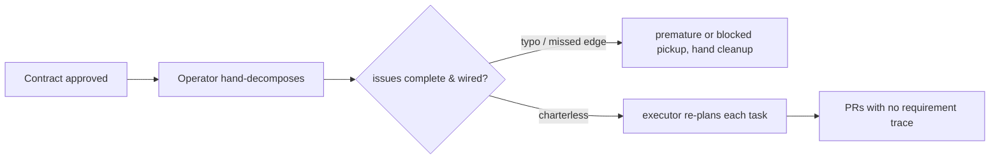

# Implementation planning (plan-new) — approved contract → executable task graph — PRD *(effective view)*

---

**GENERATED — DO NOT EDIT.** Sole writer: `docgate fold`. As of: **004**. Content fingerprint: `sha256:72fc5a98b3e383ac8752b6b32dfbbc7fd5cbce0149024733be9e592499d55b70`. Tool version (recorded, never hashed): `docgate/v1`.

---

| Field | Value |
|---|---|
| **In one line** | The bootstrap slice of pipeline stage 7: decompose an approved feature contract (PRD + technical design) into a frozen, schema-validated plan — dependency-ordered, sized, vertically-sliced tasks each carrying a frozen worker charter — projected idempotently onto the repo's issue tracker so the executor fleet implements them without re-planning. |
| **Relevant-when** | planning, building, or reviewing the plan-new skill, the plan/charter/report schemas, decomposition and sizing rules, or the tracker projection; triaging defects in planner output (bad decomposition, oversize tasks, unwired dependencies, charterless or vague tasks, duplicate issues); changing the PRD-ledger/tech-design surfaces it consumes or the executor dialect it emits |
| **Status** | Problem review ✓ · Solution review ✓ (2026-07-09) — launch review pending, post-implementation |
| **Tier** | T3 *(upgraded from T2 at review, 2026-07-09 — factory-control surface: model-driven output steers autonomous workers and triggers fleet spend)* |
| **Owner** | @mdarabi |
| **Approver(s)** | @mdarabi (operator) |
| **Contributors** | operator (product) · factory agents (authoring + implementation) |
| **Informed** | executor-fleet operators (harbormaster today); future engine-Planner designers; PR reviewers consuming task traceability |
| **Date** | 2026-07-09 created · 2026-07-09 last updated |
| **Appetite** | medium: the planning skill, its deterministic validation/projection tooling, and three schemas (plan, charter, report), for one repo and one executor dialect; one plan-review checkpoint per feature thereafter; steady-state machine cost ≈ zero (runs only on demand, AP-19). Excludes the engine's Planner service, scheduling/execution, and every other pipeline stage. |
| **Target release** | the first planning artifact of the self-development loop: from here, every remaining pyxis feature is planned by pyxis and implemented by the executor fleet. |
| **Tracking** | introducing PR (filed on approval) |
| **Artifacts** | system-design.md §2.3 (Planner) + F2 · domain-model.md §3.1 (work hierarchy) · harbormaster planning study 2026-07-09 (feature-plan skill; plan-umbrella / default-kickoff / completion-monitor / reviewable-diff-budget / conflict-magnet-prevention / multi-repo-scheduler-execution designs; incidents I2/I3/I4/I12/I14/I15; the 525-PR sizing evidence) · decomposition/charter craft borrowings (operator-supplied skills corpus: to-tickets, wayfinder, agent-brief) · pyxis#58 → PR #61 (the executor smoke test) |
| **Template version** | prd-template/v1 |

## 1. Summary — the one-pager

- **Problem** — Approved designs pile up with no executable work behind them: converting a contract into tracker issues is manual operator toil, and the result is lossy — no requirement traceability, no sizing discipline, charterless issues that force the executor to re-plan, and no portable task-complexity contract from which the selected harness can choose implementation and review capacity.
- **For whom** — the operator (today's only planner), the executor fleet that implements tasks, and the PR reviewer who needs to know which requirement authorized which change.
- **Why now** — the execution half of the self-development cycle is live and proven, the document system is gated, and planner-driven model routing now requires every plan/v2 task to carry a complete evidence-backed semantic demand before `/implement-now` can consume it.
- **Direction** — a planning skill plus deterministic tooling: judgment decomposes the approved PRD + design into vertically-sliced, size-gated tasks with frozen charters and closed workload/consequence assessments; policy mechanically derives the vendor-neutral execution profile; a deterministic gate recomputes it; a non-skippable operator checkpoint approves the complete plan; projection then writes idempotently in the executor's dialect with every edge wired before routing.
- **Appetite** — as header: one skill + tooling + schemas, one repo, one executor dialect; no engine service and no native model/effort selection in planning.
- **Success** — plans execute without fixup: zero human edits to projected issues before pickup across the first three plans, 100% of dogfood-plan tasks dispatched spec-valid without an executor planning phase, and 100% of plan/v2 tasks pass the complete-demand/recomputation gate plus the evidence-support checkpoint.
- **Guardrail** — zero tracker writes before approval, zero duplicate issues, zero mutations of pre-existing tracker items, zero plan/v2 tasks with absent/invalid/native execution demand, and zero writes to frozen plan/v1 artifacts.
- **Top risks** — plausible-but-wrong decomposition or assessment passing a tired checkpoint; derivation or schema drift creating under-routing; executor dialect drift; external foreign-repo dispatch readiness.

## 2. Problem space

### 2.1 Problem statement

A feature contract that has passed its reviews is still inert: nothing implements a PRD or a design document. Turning it into work the factory can execute means someone decomposes it into tasks, sizes them, orders them by dependency, writes each task's brief, creates the issues, wires the edges, and routes them — today that someone is the operator, by hand. Hand conversion is slow, unrepeatable, and lossy in exactly the ways that matter downstream: tasks carry no requirement IDs (so reviewers and future drift detection cannot trace a change to its authorization), sizing is instinct (the predecessor's measured result: 11% of task PRs exceeded 600 lines and were rubber-stamped unread in ~6 minutes), and issues arrive charterless — the smoke test showed the executor then generates its own machine charter per task, re-judging with less context than the planning session had and paying for planning twice. The cost of doing nothing is that the self-development loop stays half-open: execution is autonomous, planning is toil, and by the inversion test every operator-minute spent converting documents into issues is a factory gap.

### 2.2 Users and segments

| Segment | Role and context | Domain exp. | Tech exp. | Key goals | Pain today | Evidence |
|---|---|---|---|---|---|---|
| **P1 (primary)** | the operator holding approved contracts for this repo | master | master | turn an approved contract into a running backlog in one gated pass; keep final say over the decomposition | hand-writes every issue; no traceability or sizing discipline survives the conversion | pyxis#58 (hand-written); backlog: approved-but-unbuilt design |
| P2 | the executor fleet — workers picking up ready tasks days later in a changed codebase | — | master | a frozen, self-sufficient charter per task: goal, acceptance, scope, boundaries, trace refs | charterless issues → executor-side re-planning (nospec path), double judgment cost | pyxis#58 nospec charter; harbormaster single-issue-worker runtime |
| P3 | the PR reviewer at stage 9 | master | master | know which requirement/design decision authorized this diff; review a diff a human can actually read | no requirement links on tasks; oversized PRs go effectively unreviewed | harbormaster 525-PR evidence (99%+ zero inline review) |
| **Anti-segment** | teams wanting a general-purpose project-management or estimation tool | — | — | — | — | this is the factory's stage-7 contract, not a PM product; scope is factory-executable plans |

### 2.3 Jobs and desired outcomes

| # | When… | I want to… | So I can… | Today's workaround | Evidence |
|---|---|---|---|---|---|
| J1 | a feature contract (PRD + design) is approved | decompose it into dependency-ordered, agent-ready tasks in one pass | have the fleet implementing within one executor tick | hand-write issues one by one | pyxis#58; inversion test (vision §1) |
| J2 | I am about to fan tasks out to the tracker | review and edit the whole plan — tasks, sizes, edges, flags — before anything is written | catch wrong decomposition at the only cheap point | none — issues appear as they are typed | harbormaster Phase-4 gate ("the most expensive failure mode is silent wrong decomposition") |
| J3 | a worker picks up a task days after planning | read one frozen charter that says what to build, how done is proven, and what is out of scope | implement without re-reading the whole corpus or re-planning | executor generates its own charter per task (nospec) | pyxis#58 charter comment; agent-brief durability rules |
| J4 | I review a task's PR | see which PRD requirement and design decision the task serves | judge spec faithfulness, not just code quality | grep the docs and guess | VNEXT-3; PLAN-4 |
| J5 | a projection run fails partway or is re-run | have it converge — finish the remainder, duplicate nothing | trust the planner with the tracker | manual cleanup of half-created sets | harbormaster §5 halt-on-failure story; AP-22 |

### 2.4 Evidence

| Claim | Source | Confidence |
|---|---|---|
| The execution half already works end-to-end for this repo: labeled issue → charter → PR → gate → merge | pyxis#58 → PR #61 (2026-07-08), docs-gate SUCCESS | High |
| Charterless issues cause executor-side re-planning with less context (paying twice, judging worse) | pyxis#58 `plan-nospec-attempt-1` path; AP-21 | High |
| Plan-time sizing discipline is the only cheap enforcement point, and its absence produces an unreviewable fat tail | harbormaster reviewable-diff-budget §2: 525 merged PRs — 11% of task PRs >600 lines; >4 acceptance criteria → 36% oversize; one leaf swallowing 68–77% of an epic; §10 names plan-stage gating as the pyxis port | High |
| Duplicated readiness predicates and unwired-before-routable races produce loops and premature dispatch | harbormaster I2/I3 (predicate divergence, ~2M tokens/hr), I15 (verification leaf ran early — verified-done voided), default-kickoff D3 (label-after-wiring) | High |
| Vertical-slice decomposition with explicit blocking edges is a proven task shape for AFK agent consumption | operator-supplied skills corpus (to-tickets vertical-slice rules; agent-brief durability rules; wayfinder frontier/fog) | Med |
| An operator-authored `local-agent` issue in this repo is dispatched by the executor when its foreign-repo path is enabled | harbormaster multi-repo-scheduler-execution (acceptance case: pyxis#58); flag `RIG_SCHED_FOREIGN` default-off | High |

### 2.5 The journey today

| Phase | User does | User feels / pain | Frontstage | Backstage |
|---|---|---|---|---|
| Contract approved | operator closes the design review | "now I have to type it all in" | approved docs in the repo | no consumer of the approval event |
| Decompose | operator invents tasks in their head | unrepeatable; instinct-sized | — | no sizing rules, no coverage check |
| Create | operator hand-writes issues, links, labels | slow; error-prone (edges forgotten) | GitHub issue forms | no idempotency; a mistake is hand-cleaned |
| Execute | fleet picks tasks up | charter quality varies per issue | executor's own plan phase fires per task | double planning cost; judgment with less context |
| Review | reviewer reads PRs cold | "which requirement is this?" | PR diff | no task→requirement trace |

### 2.6 Opportunity and why now

- **Size** — every future pyxis feature passes through stage 7; the queued backlog starts with one approved-but-unbuilt design and grows with each contract the doc system approves.
- **Alternatives users have** — keep hand-writing issues (status quo toil, no traceability); adopt the predecessor's planner (coupled to its own doc conventions — it cannot parse pyxis ledgers/designs); wait for the full engine Planner (blocks self-development on the largest build).
- **Why us / strategic fit** — stage 7 is the named missing link: the doc system (upstream) and the executor fleet (downstream) both exist and are proven; this is the smallest feature that closes the loop, and its schemas (plan, charter) seed VNEXT-2/VNEXT-3 ground the later stages stand on.
- **Why now** — the smoke test just proved the downstream path; the upstream doc system just froze; the compounding is earliest here: once planning is factory work, every remaining engine feature is dogfood.
- **Cost of doing nothing** — the self-development loop stays half-open; planning toil scales linearly with the backlog; traceability and sizing discipline never exist (retrofitting them onto hand-written issues is the drift VNEXT-4 would then have to catch).

**Decision:** Problem gate — do not proceed to §3–§4 until signed.

| Reviewer | Role | Date | Verdict |
|---|---|---|---|
| @mdarabi | operator | 2026-07-09 | approved |

## 3. Goals, metrics, and guardrails

### 3.1 Goals as falsifiable hypotheses

| # | We believe that… | Will result in… | Measured by… |
|---|---|---|---|
| G1 | freezing all planning judgment at the richest-context site (the planning session) into charters the executor reads verbatim | tasks executing with zero re-planning and zero human fixup | M1, M2 |
| G2 | enforcing sizing as a structural gate at plan time (thresholds as data) | task PRs a human can actually review — the fat tail cut | M3 |
| G3 *(qualitative)* | a non-skippable whole-plan checkpoint before any write | operator trust: approval rounds per plan trend down while edits move from the tracker to the checkpoint | qual: checkpoint edit counts on the first plans (§6.7) |

### 3.2 Goals → signals → metrics

| Metric | Goal | Signal | Baseline | Target (at checkpoint) | Feeds from |
|---|---|---|---|---|---|
| M1 (primary) | G1 | projected issues need no human repair before pickup | n/a (no planner) | 0 human edits to projected issues between projection and first executor pickup, across the first 3 plans (checkpoint: "3 plans executed") | measurement plan: issue edit-history audit per plan |
| M2 | G1 | the executor dispatches on the planner's charter, never its own | nospec path fired on pyxis#58 | 100% of dogfood-plan tasks dispatched spec-valid — executor plan phase fires 0 times (checkpoint: "first dogfood plan executed") | measurement plan: executor dispatch events / absence of nospec markers |
| M3 | G2 | resulting task PRs stay reviewable | predecessor: 11% of task PRs >600 changed lines; largest-task epic share median 35% | ≤5% of task PRs >600 changed lines AND no task's actual size >50% of its plan's total (checkpoint: "first 20 task PRs merged") | measurement plan: PR-size sweep over merged task PRs |

*(§5.7 tracking plan skipped with reason — no analytics plane exists yet; all three measurement plans read artifacts already produced: tracker histories, executor markers, and merged-PR listings.)*

### 3.3 Guardrails and decision rule

| Guardrail metric | Threshold | Action if breached |
|---|---|---|
| tracker writes before plan approval | any (> 0) | defect — the checkpoint is the consent point (FR-17); block until fixed |
| duplicate issues across re-runs of one plan | any | halt projection for that plan class; fix idempotency before any further projection (FR-18) |
| mutations of tracker items the planner did not create (beyond additive parent linkage) | any | defect — the planner's blast radius is its own plan (NR-2) |
| plan/v2 task with missing, invalid, underived, unsupported, or native execution demand; or any plan/v1 rewrite | any | block checkpoint/freeze/projection; apply UB-7 or NR-4 and require a complete revalidated plan before proceeding |
| docgate `gate` on any planner-produced repo artifact | any red | fix before the plan lands; the doc system's gates outrank the planner (NR-1) |

**Ship rule (pre-registered):** M1 and M2 at target, 100% of plan/v2 tasks satisfy FR-28/FR-29/FR-30, and all guardrails stay clean through the dogfood plan → adopt plan-new as the standing planning path for this repo; any guardrail breach → fall back to plan-only mode (no projection) until the breach class is fixed and re-verified.

### 3.4 Non-goals and waiting room

| ID | Non-goal | Why refused |
|---|---|---|
| NG-1 | Executing, scheduling, claiming, or merging tasks | the executor's job (today the predecessor fleet; later the engine's F1 loop); the planner's contract ends at "routable, wired, charter-carrying tasks" |
| NG-2 | Contract *validation* beyond planability (stage 6 — classifying contracts executable/ambiguous/contradictory) | VNEXT-1 is its own capability; upstream human approval is the interim gate — the planner checks it can *state* tasks precisely, not that the contract is globally sound |
| NG-3 | Re-triaging or re-judging planner output downstream | tasks are agent-ready by construction and carry that state as data (FR-21); re-evaluation would re-open AP-21 |
| NG-4 | A general-purpose PM/estimation surface (velocity, burndown, calendars) | metric targets bind to checkpoints, never dates; the factory's progress metrics live in the vision (§10), not per-plan tooling |
| NG-5 | Editing a frozen plan in place | frozen means frozen (AP-7 discipline applied to plans); a wrong plan is superseded (WR-5), never mutated |
| NG-6 | The GitHub-Actions/cloud kickoff mode of the predecessor | no such trigger surface exists in this repo; routing modes are local (routing signal) or plan-only |

| ID | Waiting room | Revisit when / intended version |
|---|---|---|
| WR-1 | Multi-epic clustering, the plan umbrella, and the terminal verification epic (predecessor PLAN-5 parity) | first plan whose dependency graph splits into independent clusters, or a second always-on executor node |
| WR-2 | The milestone layer of the Feature → Milestone → Epic → Task hierarchy | first feature whose plan needs staged delivery below the feature and above the epic |
| WR-4 | Completion monitoring / progress reporting after kickoff (PLAN-7 parity) | when plans routinely outlive a session; the tracker itself is the interim status surface |
| WR-5 | Plan supersession mechanics (retire unstarted tasks of a replaced plan mechanically) | first materially-wrong approved plan; until then the projection report (FR-24) guides manual retirement |
| WR-6 | Eval-backed acceptance of decomposition quality (golden plans, regression sets) | when the checkpoint's human approval is to be relaxed toward higher autonomy (vision §6 ladder) |
| WR-7 | Cross-repo plans (per-repo epics with manual cross-repo sequencing) | first feature spanning two repos |
| WR-8 | Stage-6 integration: consume a compiled Executable Contract instead of raw PRD + design | VNEXT-1 ships |

## 4. Solution space

### 4.1 Approach and alternatives considered

The chosen shape: **judgment in the session, determinism in tooling, one freeze point between them.** A planning skill reads the approved PRD projection and technical design, decomposes them into vertically-sliced, size-gated tasks with frozen per-task charters and explicit dependency edges, and assembles a schema-validated plan artifact carrying a requirement↔task coverage matrix and explicit flags. A contract any portion of which is fog — not yet precisely specifiable — bounces back whole, with a named report: all or nothing, never a partial plan. A non-skippable operator checkpoint reviews the whole plan; approval freezes it. Deterministic tooling then projects the frozen plan onto the tracker — create, link, wire, then route — idempotently, in the executor's dialect, and emits a machine-readable projection report. The predecessor's planner and its incident history supply the mechanics; the decomposition-craft borrowings supply the task shape; pyxis's doc system supplies what the predecessor never had — real requirement IDs to trace to.

| Option | Sketch | Why not chosen |
|---|---|---|
| A (chosen) | frozen plan artifact + idempotent projection; charters authored at plan time | — |
| B | tracker-only planning (skill writes issues directly, no plan artifact) — the predecessor's shape | no frozen judgment record, no coverage check, resume/idempotency ad hoc; the predecessor's own incidents (I2/I3/I15) trace to plan state living only in the tracker |
| C | thin issues; the executor authors each charter at dispatch (the nospec path as the design) | re-judges with less context (AP-21), pays for planning twice per task — measured on pyxis#58 |
| D | wait for the engine's Planner service (stage 7 in the F1/F2 loops proper) | blocks self-development on the largest build; this slice's schemas are the engine Planner's future input contract anyway |
| Do nothing | operator keeps hand-writing issues | §2.6 — toil scales with backlog; traceability and sizing never exist |

### 4.2 Scope perimeter

- **In (plan of record)** — input gating on approved contracts; decomposition rules (vertical slice, sizing gate from policy data, mechanical quarantine, expand–contract, prefactoring); dependency graph with cycle refusal and overlap sequencing; per-task frozen charters; complete evidence-backed workload/consequence assessment plus mechanically derived vendor-neutral execution profile on every plan/v2 task; deterministic recomputation; coverage matrix; fog handling; the operator checkpoint + plan freeze; idempotent tracker projection in the executor dialect with labels, stamps, and a projection report; single-feature/single-epic plans in this repo.
- **Future (believed next, not committed)** — WR-1..8.
- **Out** — NG-1..6; harness selection, native model/effort mapping, proposal-risk classification, and review-process orchestration remain downstream execution/review responsibilities.

### 4.3 Experience: flows and states

**Flow F1 — author and approve a plan (serves J1, J2)**

| Step | User does | System responds | States covered | Design |
|---|---|---|---|---|
| 1 | invokes plan-new with a feature's design | runs the contract gate, verifies both governing inputs are approved, and refuses with a named defect otherwise | ideal · error (unclean/unapproved/missing input) | tech design |
| 2 | — | drafts tasks: slices, sizes, charters, edges, flags, coverage, and evidence-backed execution assessments; mechanically derives each profile — or detects fog and prepares the whole-contract bounce | ideal · error (fog → zero tasks) | tech design |
| 3 | — | validates the entire plan/v2 structure, recomputes every execution profile, and refuses the whole plan on any structural, citation-resolution, derivation, or portability defect before presenting a checkpoint | ideal · error (UB-7 structural class → zero checkpoint-ready plan) | tech design |
| 4 | reviews the checkpoint: task table, dependency graph, sizes, flags, matrix, and execution demand; applies FR-30's task-by-task support rubric | records the rubric, applies edits (merge/split/reword/re-edge/reassess), and revalidates/re-presents until the operator approves or cancels; irrelevant, contradictory, or partial support returns the whole plan to this edit loop | ideal · edit loop · semantic-support refusal · cancel (zero writes) | tech design |
| 5 | approves | freezes the plan/v2 artifact; nothing on the tracker yet | ideal | tech design |

**Flow F2 — project the frozen plan (serves J5)**

| Step | User does | System responds | States covered | Design |
|---|---|---|---|---|
| 1 | requests projection (or approves with projection) | validates the frozen plan against current contract/tracker state; creates missing tasks only | ideal · empty (all exist — no-op) | tech design |
| 2 | — | links hierarchy, wires every dependency edge, ensures labels; only then applies the routing signal | ideal · partial (halt names created set) | tech design |
| 3 | — | emits the projection report (task ↔ tracker id ↔ status) | ideal · error (report names failures) | tech design |

**Flow F3 — the fleet consumes (serves J3, J4; context, not this feature's surface)**

| Step | Actor | Behavior | States covered | Design |
|---|---|---|---|---|
| 1 | executor | dispatches any open, unblocked, unclaimed routable task on the frozen charter and execution demand — its own plan phase never fires | ideal | executor contract (§5.5) |
| 2 | reviewer | reads the task's trace refs and planned assurance beside the PR; downstream review logic may raise but never lower it | ideal | downstream review contract |

*(five-UI-states condensed to the per-step "States covered" column — a skill/tooling surface's states are named defects, empty results, edit loops, and partial-failure reports, specified in §5.2; accessibility and localization skipped — terminal and markdown surfaces, English-only repo convention.)*

### 4.4 Scenarios

The operator invokes plan-new on an approved design; the checkpoint shows nine tasks with edges, sizes, coverage, and each task's six-axis evidence-backed assessment plus four-part derived profile. A first-of-kind cross-boundary task derives strong/deep/large demand; a simple system-core policy task receives critical assurance despite `apply` reasoning; a mechanical fixture task still carries model-backed demand rather than `no_inference`. The operator merges two tasks, which forces reassessment and recomputation before the plan can reappear; the operator then completes FR-30's evidence-support rubric, approval freezes plan/v2, issues project wired and routable, and the selected harness later maps each semantic minimum to its own native model/effort. — A tampered profile, unresolved citation, or native model name refuses the whole plan before checkpoint presentation with the task and field named; a resolvable but irrelevant, contradictory, or partially supporting citation is surfaced at the checkpoint and prevents approval or freeze. — A projection dies partway: the report names created tasks and re-run converges without duplicates. — A worker starts days later from durable charter/interface semantics and the frozen demand, not stale paths or a new complexity judgment. — A fogged design still bounces whole with no partial plan.

**Decision:** Solution gate — contributors sign that this shape, at this appetite is the bet. Zero TBDs may pass.

| Reviewer | Role | Date | Verdict |
|---|---|---|---|
| @mdarabi | operator | 2026-07-09 | approved |

### 4.5 The task contract — what every projected task carries

*The product contract for task content: **what information** exists on every projected task and who consumes it. This is the one authoritative enumeration — FR-12 binds the charter layer; FR-10/19/20/21/22 bind the tracker and stamp layers; FR-28/29 bind execution demand. The wire format is the technical design's decision; every rendering derives from these fields and carries no information absent from them.*

**Layer 1 — tracker surface** (native tracker structures; what the fleet's gates and a backlog scan read):

| # | Field | What it holds | Primary consumer |
|---|---|---|---|
| 1 | Title | one imperative sentence naming the behavior delivered, in the repo's domain vocabulary | backlog scans; the checkpoint table |
| 2 | Parent link | the feature (epic) this task belongs to, via the tracker's native hierarchy | rollup; executor epic scoping (FR-20) |
| 3 | Dependency edges | this task's blockers, as native blocked-by relations (restated in the charter for the worker) | the frontier — open ∧ unblocked ∧ unclaimed (FR-10) |
| 4 | Routing signal | the agent-ready marker that makes the task dispatchable — applied only after every edge exists | executor pickup (FR-19, FR-21) |
| 5 | Flags | recorded decisions riding as signals: `mechanical` · `size-accepted` · `unresolved-overlap` | reviewer attention; sizing accounting (FR-5/7/11) |

**Layer 2 — the charter** (the frozen behavior contract the worker executes; FR-12's field set, written under FR-13's durability rules):

| # | Field | What it holds | Primary consumer |
|---|---|---|---|
| 6 | Goal | the one behavior this task delivers, end to end | worker |
| 7 | Current behavior | what the system does today at this seam | worker |
| 8 | Desired behavior | what it does once this task is done, edge cases named | worker |
| 9 | Scope | the work included, stated behaviorally | worker |
| 10 | Out of scope | what this task must not change, even though adjacent | worker; reviewer |
| 11 | Acceptance criteria | independently verifiable checks, each decidable in isolation | worker; gates; stage-9 review |
| 12 | Key interfaces | durable anchors — types, signatures, contracts, config shapes; never file paths or line numbers | worker |
| 13 | Trace references | the PRD requirement IDs and design section anchors this task serves | reviewer; coverage matrix |

**Layer 3 — execution demand** (frozen plan/v2 semantic judgment; downstream adapters consume it verbatim):

| # | Field | What it holds | Primary consumer |
|---|---|---|---|
| 14 | Assessment | closed `reasoning`, `coupling`, `novelty`, `verification`, `impact_scope`, and `architectural_role` values | plan gate; executor/reviewer routing |
| 15 | Assessment evidence | resolvable citations that substantively support every recorded assessment value | plan checkpoint; audit; eval |
| 16 | Execution profile | mechanically derived `capability`, `deliberation`, `context`, and `assurance` minimums | implementation/review native resolver |
| 17 | Derivation provenance | routing-policy version plus any evidence-backed planner assurance raise | plan gate; audit; compatibility |

**Layer 4 — machine stamps** (plan-derived data downstream tooling reads verbatim):

| # | Field | What it holds | Primary consumer |
|---|---|---|---|
| 18 | Foundation level | root / has-dependents / leaf, derived from the dependency graph | PR-time risk classification (FR-22) |
| 19 | Size band | the estimated logic-size band, graded later against actuals | sizing accounting; M3 drift (FR-22) |
| 20 | Dialect markers | executor-grammar rendering of charter and execution-demand fields | executor spec/demand gates (FR-21, FR-28) |

## 5. System requirements

*The named subject is "the planner" — the plan-new capability as a whole (skill + deterministic tooling); the split of responsibilities between them is the technical design's decision.*

### 5.1 Functional requirements

| ID | Requirement (EARS) | Rationale | Priority | Risk | Fit criterion | Verify | Traces to |
|---|---|---|---|---|---|---|---|
| FR-1 | When invoked to plan a feature, the planner shall accept as governing input only an approved technical design together with its approved PRD projection, refusing any other input with a defect naming what is missing or unapproved. | plans derive from human-approved contracts only — the interim stage-6 gate (NG-2) | Must | high | fixture matrix (missing design / draft design / missing PRD / approved pair): the first three refused with the named defect, the last accepted | Test | J1, G1 |
| FR-2 | When reading the governing inputs, the planner shall resolve the PRD's requirement IDs and the design's stable section anchors, and shall use only resolvable references as trace targets in every output. | traceability is real only if links resolve | Must | med | zero dangling trace references across all fixtures and the dogfood plan | Test | J4, FR-26 |
| FR-3 | When an open plan or epic in the target tracker plausibly covers the same feature, the planner shall surface it at the checkpoint before drafting further, offering extend-or-supersede — never silently creating a parallel plan. | duplicate plans pollute the tracker | Must | med | overlapping-epic fixture is surfaced; zero parallel plans without an explicit operator decision | Test | J2, G3 |
| FR-4 | When decomposing, the planner shall emit tasks that each deliver one behavior end-to-end, such that each completed task is verifiable against its own acceptance criteria without reference to sibling tasks. | horizontal layer-slices and kitchen-sink tasks are the measured failure unit | Must | high | checkpoint rubric per task: acceptance criteria self-contained and behavior-stating; zero failures | Human judgment — @mdarabi, rubric per task | J3, G2 |
| FR-5 | When a drafted task exceeds any sizing threshold, the planner shall split it or attach an explicit oversize-acceptance naming why it is unsplittable — a silently oversized task shall not validate. | sizing enforced structurally at the only cheap point | Must | high | over-threshold task without acceptance is rejected; with acceptance validates carrying the flag | Test | G2, M3 |
| FR-6 | The planner shall read its sizing thresholds from a closed-schema, versioned policy artifact, such that changing a threshold is a data change requiring no behavior-code change. | policy as data | Must | med | unknown key errors; threshold edit flips a fixture with zero behavior-code diff | Test | G2 |
| FR-7 | When work is provenance-only, the planner shall emit it as dedicated mechanical-flagged tasks whose charters state the provenance to verify, and a task mixing mechanical and behavior work shall not validate. | provenance is verified, not read; mixing launders review | Must | med | mixed task rejected; mechanical task validates with provenance charter and still satisfies FR-28 | Test | G2, FR-28 |
| FR-8 | When a single mechanical change's blast radius is too broad to land green as one task, the planner shall decompose it as one expand task, bounded migrate batches blocked by expand, and one contract task blocked by every batch. | the one case vertical slicing fails, encoded | Must | med | wide-refactor fixture yields exactly expand → batches → contract | Test | G2 |
| FR-9 | Where preparatory refactoring would materially shrink following behavior tasks, the planner should emit it separately before them. | make the change easy, then make the easy change | Should | low | no approved charter contains refactor-then-implement compound scope | Human judgment — @mdarabi, rubric | G2 |
| FR-10 | The planner shall declare every ordering constraint as an explicit task-level dependency edge, such that a task with no open blockers is safely startable by any executor. | edges are first-class data | Must | high | computed frontier matches hand expectation; every charter ordering exists as an edge | Test | J5, F3 |
| FR-11 | When two tasks' declared touched surfaces overlap on a non-test surface, the planner shall sequence them, insert shared prep, or attach an unresolved-overlap flag surfaced at checkpoint. | prevent silently colliding parallel tasks | Must | med | every overlap fixture resolves by one named outcome | Test | J5, AP-23 |
| FR-12 | When emitting a task, the planner shall attach a charter as schema-versioned structured data carrying every charter field of §4.5 layer 2. | the charter is the behavior contract the worker executes | Must | high | every charter validates; each layer-2 field class is exercised | Test | J3, FR-2 |
| FR-13 | While authoring charter text, the planner shall describe behavior and interfaces and shall not reference file paths or line numbers, except a marked prototype/design snippet. | durability across codebase movement | Must | med | zero forbidden path/line patterns except marked carve-outs | Test | J3 |
| FR-28 *(004 ← FR-14)* | When emitting a task in a plan/v2 plan for `/implement-now`, the planner shall record a complete vendor-neutral execution demand containing the closed `reasoning`, `coupling`, `novelty`, `verification`, `impact_scope`, and `architectural_role` assessment, resolvable evidence citations supporting those values, the mechanically derived `capability`, `deliberation`, `context`, and `assurance` minimums, the derivation-policy version, and any evidence-backed planner assurance raise; every executable task, including a mechanical-flagged task, shall carry this model-backed demand. | the planning session owns task semantics; native model/effort selection belongs to the selected harness adapter | Must | critical | every plan/v2 and dogfood task carries all six assessment axes, all four profile components, supporting citations, a policy version, and any raise evidence; mechanical fixtures carry complete demand; none reaches checkpoint/freeze absent or partial | Test + Eval (EVAL-2) | G1, J2, J3, F1 |
| FR-29 *(004)* | When validating a plan/v2 plan before checkpoint presentation or freeze, the plan gate shall validate the closed assessment and non-empty resolvable citation set, mechanically recompute the execution profile under the recorded policy version, and reject any missing/unknown value, absent/unresolved citation set, derived-profile mismatch, downward assurance change, or harness, vendor-product, native-model, native-effort, or provider-specific context identifier. | deterministic validation enforces structure, citation resolution, derivation, and portability; EVAL-2 plus the checkpoint judge substantive support | Must | critical | missing/unknown, absent/unresolved citation, tamper, assurance-lowering, harness, vendor-product, native-model, native-effort, and provider-context fixtures fail before checkpoint/freeze with exact defects; valid demand is byte-identical across repeats; EVAL-2/checkpoint reject irrelevant, contradictory, or partial support | Test + Eval (EVAL-2) | G1, J2, J3, F1 |
| FR-30 *(004)* | Before approving or freezing a plan/v2 plan, the operator shall apply a task-by-task evidence-support rubric requiring one or more cited anchors to substantively support every recorded assessment axis and any planner assurance raise, shall reject the whole plan on irrelevant, contradictory, or partially supporting evidence, and shall persist the completed rubric with the checkpoint decision. | citation resolution proves only that evidence exists; the accountable operator must judge whether it actually supports the frozen semantic demand | Must | critical | @mdarabi's checkpoint rubric records pass/fail for all six axes and any assurance raise on every task; an irrelevant, contradictory, or partial-support fixture returns the whole plan to the edit loop with zero approval/freeze/projection; a passing checkpoint persists the completed rubric beside the frozen plan | Human judgment — @mdarabi, task-by-task support rubric + Inspection | J2, G3, FR-17, FR-28, FR-29 |
| FR-26 *(002 ← FR-15)* | When a plan is assembled, the planner shall check coverage against the plan's in-scope slice, mapping every slice requirement to at least one task and every task to at least one requirement or design anchor; prior-plan coverage is not re-demanded, while feature-level Must completeness is the union across the feature's plans and a live Must in no slice is a named defect. | plan slices avoid re-planning shipped work without dropping feature-level Musts | Must | high | amendment-slice, frozen-base, missing-live-Must, dropped-slice, and rogue-task fixtures produce the specified result | Test | J4, G1 |
| FR-16 | If any in-scope portion cannot be stated as precisely specified tasks, the planner shall refuse the whole contract with a fog report and freeze/project nothing. | partial planning ships guesses beside gaps | Must | high | fog fixtures produce zero plan/projection and a complete named report | Test | J2, NG-2, FR-26 |
| FR-17 | Before any tracker write, the planner shall present the complete plan for operator approval, apply edits and re-present, and proceed only on explicit approval, at which point the plan freezes and projection reads only the frozen form. | checkpoint is consent and freeze | Must | critical | cancel/dry-run write nothing; projection byte-derives from frozen artifact | Test + Inspection | J2, G3 |
| FR-18 | When projecting an approved plan, the planner shall create each task at most once across any number of runs; partial reruns converge and duplicate nothing. | idempotent projection | Must | critical | kill-mid-projection fixtures converge with one task each | Test | J5, §3.3 |
| FR-19 | When projecting, the planner shall create tasks and wire every hierarchy/dependency edge before applying any routing signal. | prevent premature claim | Must | critical | polling consumer observes zero routable-with-missing-edges instants | Test | FR-10, F2 |
| FR-20 | When projecting, the planner shall link tasks to the parent feature, embed the frontier rule, and not non-additively mutate any pre-existing item. | planner blast radius is its own plan | Must | med | linkage/frontier present; mutation audit clean | Test | J1, NR-2 |
| FR-21 | Where the executor requires a charter/routing dialect, the planner shall render the frozen charter, execution demand, routing state, and agent-ready markers so the executor dispatches directly with no planning phase. | judge-once bridge | Must | high | every projected task passes charter and demand validity; dogfood executor planning fires zero times | Test + Demo | J3, M2, FR-28 |
| FR-22 | When projecting, the planner shall stamp each task with foundation level and estimated size band. | downstream risk and size accounting consume plan-time data | Must | med | stamps parse; foundation matches DAG | Test | FR-5, M3 |
| FR-23 | When projecting, the planner shall ensure every signal it emits exists canonically before use, idempotently. | operate in any repo state | Must | low | fresh tracker creates all labels; rerun no-ops | Test | J5 |
| FR-24 | When projection completes or halts, the planner shall emit a schema-versioned report mapping tasks to tracker IDs/status and naming failures. | success is verified and resumable | Must | med | report validates and matches tracker reality | Test | J5, UB-4 |
| FR-25 *(001)* | When targeting the local file medium, `plangate project` shall bind the unchanged plan through the WorkTracker local adapter with equivalent hierarchy, edges, signals, and charters. | prove medium independence | Should | med | local and GitHub bindings preserve equivalent structure and idempotency with unchanged planner/decomposition/schema code | Test + Inspection | J5, FR-18, FR-19 |
| FR-27 *(003)* | Before drafting, freezing, or projecting, the planner shall run `docgate contract-gate <feature>` and refuse any non-clean verdict, surfacing the report; only clean permits planning. | planning begins from a mechanically clean contract | Must | high | bouncing contract produces no output; clean proceeds; precondition precedes coverage/fog | Test | J1, G1, NG-2 |

*Priority bar: every Must row above is required to ship. The two Should rows are FR-9 and FR-25. Ranking within Must: FR-17/18/19 and FR-28/29/30 (consent, idempotency, wiring, trustworthy demand) > FR-1/4/5/16/26/27 (input and decomposition integrity) > FR-10/11/12/21 (graph and task contract) > the rest.*

**Non-regression (NR-n)**

| ID | Existing behavior protected | Why protected | Risk | Fit criterion | Verify | Traces to |
|---|---|---|---|---|---|---|
| NR-1 | The document system's gates stay green: planner output edits no governing/frozen/generated document and `docgate gate` passes. | doc system outranks planner | high | dogfood branches green; zero planner diffs under governing document paths | Test + Inspection | FR-1 |
| NR-2 | Pre-existing tracker items behave exactly as before projection. | tracker shared with humans/executor | high | zero non-additive mutations; no label semantic repurposing | Test | FR-20, FR-23 |
| NR-3 | Executor handling of non-planner work is unchanged; planner markers use only documented namespaces. | prevent dialect collisions | med | namespace inspection and non-planner smoke route unchanged | Inspection + Demo | FR-21 |
| NR-4 *(004)* | Frozen plan/v1 artifacts remain byte-immutable and valid inputs to their existing downstream compatibility path; from §6.5's Stage-0 plan/v2 schema cutover onward, plan-new creates only plan/v2 and never backfills or infers execution-demand fields into plan/v1. | merge freezes planning judgment; post-freeze inference violates provenance | critical | frozen plan/v1 corpus byte-identical and accepted; zero v1 writes; every plan frozen from Stage 1 onward is v2 and satisfies FR-28/FR-29/FR-30 | Test + Inspection | G1, NG-5, FR-28, FR-29, FR-30 |

### 5.2 Unwanted behavior and failure handling

| ID | If… | Then the planner shall… | User sees | Priority | Risk | Fit criterion | Verify | Traces to |
|---|---|---|---|---|---|---|---|---|
| UB-1 | If a governing input changes between plan approval and projection (anchor moved, requirement superseded, doc re-merged) | detect the drift against the frozen plan's recorded references and halt with a defect naming the drifted references — never project a stale plan silently | named defect listing drifted refs | Must | high | drift fixtures (moved anchor, superseded FR): projection refuses, names each drifted reference; unchanged inputs project normally | Test | FR-2, FR-17 |
| UB-2 | If a trace target cannot be resolved at authoring time (design lacks stable anchors; PRD projection missing) | refuse to emit the affected tasks, naming each unresolvable reference and the document that must change | named defect per reference | Must | med | fixtures per reference class refused with the target named; no task with a dangling reference validates | Test | FR-2 |
| UB-3 | If a declared dependency set contains a cycle | refuse the plan, naming the cycle path | named defect with the cycle | Must | med | cycle fixture refused with the full path named; no cyclic plan reaches the checkpoint as valid | Test | FR-10 |
| UB-4 | If projection fails partway (tracker API error, permission refusal, interruption) | halt without retry storms, emit the projection report naming what exists and what failed, and leave the tracker in a state from which re-running converges | partial report + resumable state | Must | high | injected failures at each projection step: report accurate, re-run converges (FR-18's fixtures), zero retry loops beyond a stated bound | Test | FR-18, FR-24 |
| UB-5 | If an executor tick fires during the projection window | observe no routable task with missing edges — blocked and unwired tasks are invisible to dispatch until wiring completes | no premature pickup | Must | critical | the FR-19 probing consumer, run as a race fixture: zero premature-dispatch-eligible observations | Test | FR-19 |
| UB-6 | If plan or charter content contains strings that would fire tracker automations on creation (executor trigger phrases) | neutralize them so rendering is visually preserved and no automation fires | identical-looking text, no side effects | Must | med | trigger-string fixtures: zero automation events fired; rendered text visually identical | Test | FR-21 |
| UB-7 *(004)* | a plan/v2 task's execution demand is absent, partial, unknown, lacks a non-empty resolvable citation set, is inconsistent with deterministic derivation, is lowered below its assurance floor, contains any identifier forbidden by NFR-7, or has irrelevant, contradictory, or partially supporting evidence | for structural, resolution, derivation, or portability defects, refuse checkpoint presentation; for semantic-support defects found by FR-30, refuse approval and return the whole plan to the checkpoint edit loop; in every case refuse freeze and projection and name every offending task, field, and rule | a demand defect that identifies the task, invalid field or unsupported assessment value, expected semantic contract, and remedy | Must | critical | one fixture per structural trigger produces zero checkpoint-ready artifact; one fixture per semantic-support trigger reaches the rubric but produces zero approval/freeze/projection; mixed valid/invalid task sets fail as a whole, and every defect carries task+field/value+rule+remedy | Test + Eval (EVAL-2) + Human judgment — @mdarabi, FR-30 rubric | FR-28, FR-29, FR-30, NFR-7 |

### 5.3 Permissions and abuse cases

The planner writes to the tracker with the invoking operator's (or the factory bot's) existing credentials; it introduces no new roles, identities, or authenticated surfaces. The abuse surface is *influence*: the planner turns documents into instructions autonomous workers execute.

| ID | Actor and intent | Vector | Impact | Severity | Mitigated by | Verify |
|---|---|---|---|---|---|---|
| ABUSE-3 *(004 ← ABUSE-1)* | an author trying to steer workers toward unauthorized or underpowered changes | poison an approved design/PRD so charter content, assessment values, or evidence citations authorize unreviewed intent or minimize execution demand | the fleet implements unapproved scope or routes it below the scrutiny its real workload/consequence requires | critical | FR-1 admits only approved inputs; FR-26 rejects untraceable task scope; FR-28/FR-29 require cited closed assessment and deterministic floors; EVAL-2 rejects semantically unsupported/minimizing evidence; FR-17 exposes the complete task and demand at the operator checkpoint | adversarial fixtures inject untraceable instructions, minimized consequence values, irrelevant/contradictory/partial evidence, and a lowered profile; each fails coverage, eval/gate, or the checkpoint with zero freeze/projection |
| ABUSE-2 | anything (bug, compromise, retry storm) turning projection into tracker flooding | unbounded or repeated creation | tracker unusable; fleet burns cycles | med | FR-17 (writes gated on approval), FR-18 (converging idempotency caps total writes at the approved task count), UB-4 (bounded retries) | re-run storm fixture: total created items == approved task count regardless of run count |

### 5.4 Data

| Entity / field | Meaning | Source of truth | Retention | Integrity rules | Privacy class |
|---|---|---|---|---|---|
| Plan/v2 {feature ref, version, status, tasks[] (charter + execution demand + stamps per §4.5), edges[], flags[], coverage matrix} | the frozen stage-7 output for new plans | plan artifact plus persisted checkpoint rubric frozen at approval | permanent; supersession only | closed schema; immutable after approval; every trace/evidence ref resolves; zero fog; each task satisfies FR-28/FR-29/FR-30; no native dispatch identifiers | internal (public repo) |
| Frozen plan/v1 | legacy plan artifact created before mandatory execution demand | its original frozen artifact | permanent; byte-immutable | never rewritten/backfilled by plan-new; downstream compatibility owns translation | internal (public repo) |
| Fog report {fogged portions[], missing, unblocks} | whole-contract refusal; no plan freezes beside it | authoring session | with planning record | names every fogged portion and unblock | internal (public repo) |
| Charter (per task) {goal, current, desired, scope[], out_of_scope[], acceptance[], key_interfaces[], deps[], traces{requirement_ids[], design_anchors[]}} | frozen behavior contract | part of plan; tracker copy is projection | with plan | schema-versioned; durable; no secrets/credentials | internal (public repo) |
| Execution demand (per plan/v2 task) {assessment{reasoning,coupling,novelty,verification,impact_scope,architectural_role}, assessment_evidence_refs[], profile{capability,deliberation,context,assurance}, policy_version, assurance_raise?, assurance_raise_evidence?} | frozen vendor-neutral capacity minimum and its judgment provenance | mechanically validated plan/v2 task | with plan | closed enums; complete; cited; reproducible under policy version; raise-only assurance; no harness/vendor/native identifiers | internal (public repo) |
| Projection record {task ↔ tracker id, status} | what exists where | projection report | per plan | matches tracker reality | internal |
| Sizing policy {thresholds} | split gates | repo policy file | versioned | closed schema | internal |

- **Migration** — the plan/v2 schema cutover occurs when the FR-28/FR-29-capable implementation enters §6.5 Stage 0, before any Stage-1 real-plan freeze. Frozen plan/v1 remains byte-immutable and is translated only by the downstream compatibility contract; no plan-new backfill exists.
- **Parallel-run / cutover** — plan-only mode may coexist with hand-written issues during pre-release proof, but every plan frozen from Stage 1 onward is plan/v2 and must pass FR-28/FR-29/FR-30. These capability stages are not production audience cohorts; the parent routing contract still activates once for all supported production paths after pre-release proof.
- **Rollback** — routing can be withheld, but a frozen plan/v2 is never downgraded or stripped of demand; supersede the plan if judgment changes.
- **Decommission** — stop invoking; artifacts remain readable.
- **Privacy check** — no personal/sensitive data; evidence refs resolve only to repo contract/task context.
- **Egress** — charter and semantic demand metadata project to the configured tracker; no prompts, code payload, credentials, or native provider selection are added.

### 5.5 Interfaces and integrations

| Interface | Direction | Purpose | Contract (format, ranges, timing) | Failure modes | Owner |
|---|---|---|---|---|---|
| PRD ledger projection (`effective.md` + source) | in | governing requirements | generated projection; IDs are trace namespace | missing/stale/unclean → refusal | doc system |
| Technical design | in | governing decisions | approved doc with stable anchors | missing anchors → UB-2 | doc system |
| Planner-driven routing derivation policy | in | define closed assessment/profile vocabularies, mechanical floors/promotions, and policy version | versioned closed policy governed by `prd:planner-driven-model-routing`; deterministic local read | missing/incompatible policy, unknown key/value, non-reproducible version → FR-29/UB-7 | routing policy owner |
| Sizing policy | in | split thresholds | closed versioned schema | unknown key → error | plan-new |
| Frozen plan/v2 → tracker/executor | out | hand off charter plus complete execution demand without reinterpretation | lossless versioned projection of §4.5; every task validated before checkpoint/freeze | field loss, native identifier, dialect mismatch → UB-7 or blocked projection | plan projection + tracker adapters |
| GitHub Issues / WorkTracker | out | projection target | configured adapter; create/link/wire/route only | adapter/API error → UB-4 | plan-new |
| Executor dialect | out | direct dispatch without downstream re-planning | pinned version; renders charter, demand, routing state, and agent-ready markers; native model/effort absent | drift → contract test red; full mode blocked | plan-new ↔ executor |
| Operator checkpoint | human | consent, semantic evidence judgment, reassessment, and freeze | complete structurally validated plan/v2; FR-30 rubric records support for every axis and raise and persists with the decision | cancel or irrelevant/contradictory/partial support → zero approval/freeze/writes and whole-plan edit loop | @mdarabi + plan-new |

### 5.6 Non-functional requirements

| ID | Area | Requirement | Fit criterion | Verify |
|---|---|---|---|---|
| NFR-1 | Determinism | Given one frozen plan and one tracker state, projection shall produce one outcome: identical create/link/wire sets and an identical report, independent of run count or interleaving. | property fixtures: byte-identical reports (modulo timestamps/ids) across repeated and interrupted runs | Test |
| NFR-8 *(004 ← NFR-2)* | Performance measurement | The planner shall record validation and projection duration as non-blocking measurements, separating local computation from tracker wait time where observable; elapsed time shall never change a validation, projection, or release verdict for otherwise identical semantic inputs and external outcomes. | dogfood and 30-task fixture runs record both duration classes; injected local and tracker delay leave the semantic verdict unchanged; reports compare the measurements with the descriptive 5-second validation and 5-minute projection baselines without treating either baseline as pass/fail | Measurement + Test |
| NFR-3 | Cost | The capability shall spend nothing at rest and state its per-use cost. | zero scheduled/recurring processes (runs only on invocation); the checkpoint presents the plan's task count and the session records its own token spend in the plan artifact | Analysis |
| NFR-4 | Operability | Every defect shall name the document or task, the reference or rule violated, the reason, and the remedy. | 100% of fixture defects carry the quadruple | Test |
| NFR-5 | Maintainability | The repo's Go language rules apply in full to every executable artifact this feature ships. | gofmt / go vet / golangci-lint clean; `go test -race` green; stdlib-first | Inspection |
| NFR-6 | Portability | The tooling shall run on macOS and Linux. | CI matrix green on both | Test |
| NFR-7 *(004)* | Portability / integrity | The plan/v2 assessment and execution-profile schemas shall contain no harness, vendor product, native model, native effort, or provider-specific context identifiers; only the closed semantic values and policy version governed by planner-driven model routing are permitted. | schema inspection finds zero native identifiers; negative fixtures for every forbidden class fail under FR-29; every supported harness consumes the same frozen semantic structure downstream | Inspection + Test |

### 5.7 Instrumentation — the tracking plan

Skipped with reason: see §3.2 — no analytics plane exists yet; M1–M3 are measured from artifacts the feature already produces (tracker edit histories, executor dispatch markers, merged-PR listings), with the measurement plans stated inline. The engine's Ledger (AP-5) adopts these signals when it exists.

### 5.8 Definition of Done

| ID | Done criterion | Source | Verify | Required evidence | Blocking? |
|---|---|---|---|---|---|
| DOD-9 *(004 ← DOD-1)* | Every live Must functional requirement passes its fit criterion, including complete model-backed execution demand, deterministic recomputation, and the evidence-support checkpoint on every plan/v2 task. | FR-1..FR-13, FR-16..FR-24, FR-26..FR-30 | Test + Eval + Demo + Inspection + Human judgment | per-requirement evidence index including mechanical-task, tampered-demand, and completed checkpoint-rubric cases | yes |
| DOD-10 *(004 ← DOD-2)* | No live unwanted-behavior, non-regression, or abuse row is broken, including whole-plan refusal for invalid demand and zero mutation of frozen plan/v1. | UB-1..UB-7, NR-1..NR-4, ABUSE-2..ABUSE-3 | Test + Inspection | suite results, plan/v1 byte-identity report, and audit notes | yes |
| DOD-3 | The dogfood plan runs end-to-end: one real approved pyxis feature planned, approved at the checkpoint, projected, and fully implemented by the executor fleet with zero human edits to projected issues and zero executor-side plan phases | M1, M2, FR-21 | Demo | plan artifact + projection report + tracker/PR links | yes |
| DOD-4 | Idempotency, wiring-before-routing, and consent-gating proven under interruption and races | FR-17, FR-18, FR-19, UB-4, UB-5 | Test | interruption + race suites | yes |
| DOD-11 *(004 ← DOD-5)* | The dogfood plan's coverage matrix is complete, every trace and assessment-evidence reference resolves and substantively supports its recorded values, and every task's profile matches deterministic recomputation. | FR-2, FR-26, FR-28, FR-29, FR-30 | Test + Eval + Human judgment | coverage validation, execution-demand/evidence conformance report, and persisted task-by-task checkpoint rubric | yes |
| DOD-6 | Operator judges the dogfood plan's decomposition acceptable | FR-4, FR-9, G3 | Human judgment — @mdarabi, rubric: every task vertical-slice-verifiable per the FR-4 rubric; fog honestly recorded; no compound refactor-and-implement scope | checkpoint record | yes |
| DOD-7 | The skill and its authoring guide live on the vendor-neutral surface, with vendor dirs holding pointers only | AP-25 | Inspection | tree listing | yes |
| DOD-12 *(004 ← DOD-8)* | The structural-and-demand envelope eval is green. | EVAL-2 | Eval | versioned eval-suite CI run covering every execution-demand value and negative class | yes |

### 5.9 AI behavior and evals

*The model-driven half (decomposition, charter authoring, and semantic assessment) terminates at the mandatory human checkpoint. Deterministic validation recomputes every derived profile and checks closed structure/citation resolution before presentation; the operator then applies FR-30's substantive-support rubric before approval or freeze. EVAL-2 binds both the structural and demand floors. Broader comparative judgment-quality evals remain WR-6 and are required before the human gate can relax.*

| ID | Behavior | Eval set / harness | Threshold | Negative examples |
|---|---|---|---|---|
| EVAL-2 *(004 ← EVAL-1)* | Decomposition output always lands inside the structural envelope and every plan/v2 task carries a complete evidence-backed assessment plus exact mechanically derived vendor-neutral profile; no task-level `no_inference` or native dispatch identifier is emitted. | versioned corpus covering every accepted assessment/profile value, consequence floor, promotion, planner raise, mechanical-looking task, wide refactor, fog, overlap, and oversize; each family runs at least 5 times per release on a decode-pinned configuration recorded in the eval report | every required run passes structural validation; 100% exact output on unambiguous goldens; zero unresolved/irrelevant/contradictory/partial citation sets; zero missing demand, `no_inference`, native identifier, or under-floor outcomes; the report records required/executed counts and any failed run keeps its family red | layer slice; kitchen sink; charter path; partial plan beside fog; mechanical task missing demand; simple system-core task under-assured; unknown enum; bad evidence; tampered profile; native model/effort |

## 6. Delivery

### 6.1 Phasing and milestones

| Phase | Purpose | Scope | Exit criterion |
|---|---|---|---|
| Contract-first | pin data before behavior | plan/v2, charter, execution-demand, and report schemas; sizing/routing policy inputs; validation fixtures | schemas + validation committed; FR-28/FR-29 and EVAL-2 green |
| Authoring | judgment half | skill input gate, decomposition, evidence-backed assessment, mechanical derivation, checkpoint + freeze | fixture yields approvable plan/v2; FR-1..FR-13, FR-16, FR-17, FR-26..FR-30 green with persisted checkpoint rubric |
| Projection | deterministic handoff | idempotent projection, lossless demand transport, wiring order, dialect rendering, stamps, reports | FR-18..FR-25 plus UB-4..UB-7 suites green against both configured tracker media |
| Dogfood | prove loop | plan and execute the next approved feature | DOD-3, DOD-6, and DOD-9..DOD-12 green; zero fixup/under-demand |

### 6.2 Dependencies

| Dependency | Type | Needed by | Status | Owner |
|---|---|---|---|---|
| planner-driven-model-routing semantic vocabulary and derivation policy (`prd:planner-driven-model-routing/FR-3..FR-6`, `FR-22..FR-23`) | policy / contract | Contract-first + Authoring | available through merged amendment 002; native harness mappings intentionally not consumed by plan-new | routing policy owner |
| approved/superseding technical design for plan-new — plan/v2 schema and task-demand validation/transport | docs | Contract-first | required after this amendment | @mdarabi |
| executor sibling amendment consuming plan/v2 demand and preserving plan/v1 translation | approval / document system | Projection + Dogfood | required before end-to-end activation | @mdarabi + implement-now owner |
| executor foreign-repo dispatch enabled and soaked | external system | Dogfood | flag default-off; canary pending | executor operator |
| merge-lane governance decision for this repo | approval | Dogfood | open | @mdarabi |
| tracker capability probe | system | Projection | resolved at first projection | plan-new |

### 6.3 Risks, assumptions, and rabbit holes

| # | Risk / assumption / rabbit hole | Likelihood | Impact | Mitigation or test | Owner |
|---|---|---|---|---|---|
| R1 | decomposition or semantic assessment quality falls below the bar — a plausible-but-wrong plan or weak citation set passes a tired checkpoint | M | H | structural gates carry what they can (FR-5/7/8/16/26/29); EVAL-2 challenges clear and adversarial assessment cases at least five times; FR-30 requires @mdarabi's task-by-task support rubric and preserves the decision evidence; M1/M3 measure residue; WR-6 must land before the human gate can relax | @mdarabi |
| R2 | executor dialect drift — the fleet's grammar or gates change under us | M | H | dialect pinned by version + contract test (FR-21, NR-3); red contract test blocks full mode, plan-only continues | @mdarabi |
| R3 | size estimates are unfalsifiable at plan time | M | M | estimates are predictions graded later: stamps (FR-22) + the M3 sweep expose drift; thresholds are data (FR-6), retuned from evidence | this feature |
| R4 | scope creep into execution — "just also spawn the worker" | M | H | NG-1 and the F3 boundary; the projection report is the handoff artifact | @mdarabi |
| R5 | assumption: the executor honors task-level dependency edges before dispatch | — | H | verified in the dogfood plan (a deliberately blocked task must not be picked up early); if violated, edges are additionally rendered in the dialect's body convention (UB-5's probe catches it) | this feature |
| R6 | staleness between approval and execution — the repo moves under a frozen plan | M | M | UB-1 re-validates references at projection; charter durability rules (FR-13) bound what can rot; supersession (WR-5) is the escape | this feature |
| R7 | routing derivation policy or its version drifts between authoring, validation, and projection, producing an unreproducible or under-floor profile | L | H | every task records the policy version; FR-29 recomputes under that exact version before presentation/freeze and the projection boundary preserves it verbatim; missing or incompatible versions fail under UB-7; dogfood proves round-trip identity | routing policy owner + plan-new |

### 6.4 Release criteria

| Lens | Criterion | Evaluated by |
|---|---|---|
| Functionality | DOD-9, DOD-11, and 100% of plan/v2 tasks satisfy FR-28/FR-29/FR-30 | CI + EVAL-2 + persisted operator rubric |
| Reliability | DOD-4 and DOD-10: consent/idempotency/race/resume, invalid-demand refusal, and plan/v1 byte immutability | interruption, race, compatibility, and negative-demand suites |
| Performance evidence | NFR-8 records local-validation and tracker-wait durations against descriptive baselines without changing the release verdict | dogfood + 30-task measurement report; delay-injection non-gating test |
| Supportability | every defect names task/document, field/rule, reason, and remedy; projection report remains recovery runbook | NFR-4 and UB-7 goldens |
| Portability | plan/v2 carries zero native identifiers and the same semantic demand round-trips through every tracker medium | NFR-7 inspection + adapter conformance |
| Usability | operator approves a real plan with demand visible and no checkpoint fight | DOD-6 dogfood session |

### 6.5 Rollout and reversibility

The **plan/v2 schema cutover** occurs when the FR-28/FR-29/FR-30-capable plan-new implementation enters Stage 0. Stage 0 freezes no real plan; every plan frozen from Stage 1 onward is plan/v2 and must satisfy FR-28, FR-29, and FR-30. These are pre-release *capability modes*, not audience cohorts or production shadow/canary stages. After Stage 3 and the parent routing contract's pre-release criteria are green, routing activates once for every supported production implementation and review path under `prd:planner-driven-model-routing/FR-17`.

- **Stage 0 — dry-run:** authoring + validation only; projection prints what it would write. Exit: fixture suites green; no real plan freezes.
- **Stage 1 — plan-only:** the first real plan/v2 authors, passes FR-28/FR-29/FR-30, and freezes; no projection. Exit: its persisted operator checkpoint and rubric are approved.
- **Stage 2 — project, routing withheld:** plan/v2 issues are created and wired, no routing signal — the fleet cannot see them. Exit: projection report matches tracker reality; UB-5 probe clean.
- **Stage 3 — full pre-release dogfood:** routing is applied after wiring and the fleet executes the approved plan/v2. Exit: §3.3's ship rule and the parent routing contract's pre-release gate are green, permitting the one direct production cutover.

**Kill switch** — withholding the routing signal (Stage-2 behavior) stops plan-new dogfood pickup without deleting anything; the production routing fallback is the parent contract's strongest-profile kill switch, which preserves all semantic minima. **Fallback** — retire a projected plan by closing its unstarted tasks per the projection report (tested on a scratch plan before Stage 3). Frozen plan/v1 and plan/v2 artifacts remain byte-immutable; a changed judgment requires supersession. The guardrail table (§3.3) is the rollback contract.

### 6.6 Launch readiness

| Area | Item | Owner | Status |
|---|---|---|---|
| Docs | the plan-new authoring guide on the vendor-neutral surface (AP-25); README pointer | @mdarabi | ☐ |
| Support | the defect catalog beside the fixtures (doubles as the runbook); the projection report documented as the recovery surface | implementation | ☐ |
| Platform | executor dialect version pin + contract test wired into CI | implementation | ☐ |

*(remaining rows skipped: no pricing, marketing, legal, localization, or enablement surface — repo tooling)*

**Decision:** Launch gate — §6.4 criteria green, §6.6 owned, kill switch and fallback rehearsed.

| Reviewer | Role | Date | Verdict |
|---|---|---|---|
| @mdarabi | operator | — | pending |

### 6.7 Post-launch review

- **Review trigger** — the dogfood plan fully executed AND the first 20 planner-originated task PRs merged · **Owner** — @mdarabi
- **Verdict recorded** — adopt / iterate / kill, with M1–M3 and guardrail evidence; checkpoint edit-count trend (G3) reviewed alongside

## 7. Alignment

### 7.1 FAQ

**Customer (the operator):** **Q:** What if I approve a plan and it turns out wrong? — **A:** A frozen plan is never edited: supersede it with a new plan and retire the old one's unstarted tasks using the projection report (WR-5 mechanizes this; until then it is a guided manual step). **Q:** Can the fleet start before I've seen the plan? — **A:** No — zero tracker writes exist before your approval (FR-17), and nothing is routable until every edge is wired (FR-19).

**Internal:** **Q:** Why GitHub Issues and not the WorkTracker port with the local adapter first (RW-4)? — **A:** A deliberate, recorded ordering deviation: the execution half lives on GitHub today and self-development is the priority; the projection is specified port-shaped (one verb surface, §5.5) so WR-3 rebinding is adapter work. The technical design records the deviation-with-reason formally. **Q:** Why author charters at plan time instead of letting the executor plan per task? — **A:** AP-21: the planning session holds the PRD + design; the executor's per-task phase re-judges with less context and pays twice — measured on pyxis#58. **Q:** What happens when the executor's grammar changes? — **A:** The dialect is version-pinned with a contract test (FR-21/NR-3); red blocks full mode, plan-only continues.

### 7.2 Open questions

| # | Question | Owner | Needed by | Status |
|---|---|---|---|---|
| Q1 | Where the frozen plan artifact lives (repo path, per-feature dir, or tracker-attached) and its lifecycle relative to the doc system's gates | tech design | Contract-first | open |
| Q2 | The idempotency mechanism for projection (deterministic probe of the tracker vs a repo-resident projection record) and its race story | tech design | Projection | open |
| Q3 | How the Feature → Milestone → Epic → Task hierarchy maps onto the tracker's parent/child depth for N=1 plans (and later WR-1/WR-2 shapes) | tech design | Contract-first | open |
| Q4 | Dialect pinning mechanics: how the executor grammar version is declared, tested, and upgraded without breaking in-flight plans | tech design | Projection | open |
| Q5 | Sizing-policy home (repo root vs the sanctioned per-repo config surface, AP-8) and the recalibration cadence once M3 data exists | tech design | Contract-first | open |

*(none block the solution gate — all block downstream design/implementation phases.)*

### 7.3 Decision log

| Date | Decision | Alternatives considered | Why | Who |
|---|---|---|---|---|
| 2026-07-09 | Target GitHub Issues first; specify projection port-shaped for later WorkTracker rebinding | local medium first | execution already live on GitHub; self-development closes earliest | @mdarabi |
| 2026-07-09 | Charters authored and frozen at plan time | executor-side per-task planning | richest context is planning; avoid double judgment | @mdarabi |
| 2026-07-09 | Plan is a frozen schema-validated artifact; issues are its projection | tracker-only planning | source + projection avoids predecessor incident family | @mdarabi |
| 2026-07-09 | v1 plans single-feature/single-epic; clustering deferred | full hierarchy now | current scale does not require it | @mdarabi |
| 2026-07-09 | Name the skill `plan-new` | feature-plan; planner | artifact-first family consistency | @mdarabi |
| 2026-07-09 | Tier T3 | remain T2 | model-driven factory-control surface | @mdarabi |
| 2026-07-09 | Fog is all-or-nothing | partial planning | partial plans mix guesses with commitments | @mdarabi |
| 2026-07-27 | Every newly frozen plan/v2 task carries complete evidence-backed semantic execution demand; plan-new derives and validates the profile but never chooses native model/effort. (`prd:planner-driven-model-routing/FR-22`, `FR-3`, `FR-23`) | keep optional rung/runtime; store raw dimensions only; let executor infer complexity from charter prose; store native settings in the plan | preserves richest-context judgment and deterministic validation while keeping harness-specific selection at the adapter boundary and frozen plan/v1 immutable | @mdarabi |

### 7.4 Changelog

| Date | Change | Author |
|---|---|---|
| 2026-07-09 | 000-base drafted for review | @mdarabi (factory-assisted) |
| 2026-07-09 | review session (operator review): §4.5 task-contract table added, FR-12 + §5.4 bound to it; Tier T2→T3 with EVAL-1 + DOD-8; fog refusal made all-or-nothing (FR-16 reworded; FR-17, §4.1, §4.3 F1, §4.4, §5.4 aligned) | @mdarabi (factory-assisted) |
| 2026-07-09 | problem + solution gates signed in the review session; Status advanced | @mdarabi |

## 8. Contract readiness — the executability gate

| Check | Pass? | Notes |
|---|---|---|
| Problem basis accepted — §2 problem gate signed (T3) | pass | problem + solution gates signed 2026-07-09 |
| Zero solution-blocking TBDs or open questions (§7.2) | pass | Q1–Q5 block design/implementation, not solution gate; plan/v2 demand semantics and checkpoint accountability are fixed by FR-28..FR-30 |
| Every live Must FR has a fit criterion and verification method (§5.1) | pass | FR-1..FR-13, FR-16..FR-24, and FR-26..FR-30 carry both |
| Every requirement row carries risk; high/critical rows have safety plans | pass | consent/idempotency/wiring plus FR-28..FR-30/UB-7 fail-before-freeze, pre-release capability modes, routing-withheld fallback, and plan/v1 immutability cover critical surfaces |
| Non-goals drawn; non-regression rows named | pass | NG-1..NG-6; NR-1..NR-4 |
| Every primary job is covered | pass | J1→FR-1/FR-3/FR-20/FR-27; J2→FR-3/FR-16/FR-17/FR-28..FR-30; J3→FR-12/FR-13/FR-21/FR-28; J4→FR-2/FR-22/FR-26; J5→FR-10/FR-18/FR-23/FR-24/UB-4 |
| Every key flow has functional, failure, and non-regression coverage | pass | F1→FR-1..FR-13/FR-16/FR-17/FR-26..FR-30/UB-1..UB-3/UB-7/NR-4; F2→FR-18..FR-25/UB-4..UB-7; F3→FR-21/FR-28/NR-3/UB-5 |
| Every primary metric has instrumentation or plan | pass | M1–M3 artifact-derived as stated in §3.2; complete-demand release denominator is enforced by FR-28..FR-30 and DOD-9/11; NFR-8 records timing without gating correctness |
| Every blocking DoD row traces to source/rubric | pass | DOD-3, DOD-4, DOD-6, DOD-7, and DOD-9..DOD-12 cite live sources; DOD-6 names owner/rubric |
| Risks and assumptions have owners | pass | R1..R7 owned; R1 covers semantic-assessment quality and R7 covers policy/version drift, guarded by FR-29/FR-30/EVAL-2 |
| Human-judgment criteria name owner and rubric | pass | DOD-6 and FR-4/FR-9 name @mdarabi + decomposition rubric; FR-30 names @mdarabi, the task-by-task evidence-support rubric, and its persisted artifact |
| DoD complete; n/a explained | pass | all live DoD rows block and name evidence; §5.7 skip remains reasoned; EVAL-2 supplies the structural-and-demand envelope |

## Superseded & retired

- **WR-3** *(rescoped (001))* — `WR-3 | Local WorkTracker (file) medium projection | the local-work-tracker adapter ships; the projection then binds through the WorkTracker port`
- **FR-15** *(superseded by FR-26 (002))* — `FR-15 | When a plan is assembled, the planner shall emit a coverage matrix mapping every in-scope requirement of the governing PRD to at least one task and every task to at least one requirement or design anchor, and shall report any unmapped item as a named defect blocking plan completion. | the completion criterion is coverage, not "a change list" — and the input stage-9 spec-faithfulness review needs | Must | high | fixtures: a dropped requirement → defect naming it; a rogue task → defect naming it; complete plan validates with a full matrix | Test | J4, G1`
- **FR-14** *(superseded by FR-28 (004))* — `FR-14 | Where routing judgment is available at plan time, the planner should record a per-task capability-routing proposal (e.g. rung) as frozen data, subject to the executor's enforcement envelope. | judge once, clamp downstream (IMPL-7 heritage; AP-21's envelope) | Should | low | when present, the proposal parses and never exceeds the envelope on fixtures; absence is valid | Test | J3`
- **ABUSE-1** *(superseded by ABUSE-3 (004))* — `ABUSE-1 | an author sneaking instructions into a design/PRD so charters steer workers to unauthorized changes | poisoned governing input → injected charter content | fleet implements unreviewed intent | med | FR-1 (only human-approved merged docs are inputs) + FR-15 (every task traces to a requirement — untraceable content fails the matrix) + FR-17 (operator reads the whole plan before any write) | adversarial fixture: injected instruction either fails the matrix or is visibly surfaced at the checkpoint (review drill)`
- **NFR-2** *(superseded by NFR-8 (004))* — `NFR-2 | Performance | Validation and projection shall complete within an interactive session's patience. | plan validation < 5 s; projection of a 30-task plan < 5 min on developer hardware incl. tracker API time | Test`
- **DOD-1** *(superseded by DOD-9 (004))* — `DOD-1 | All Must FRs pass their fit criteria | FR-1..24 | Test | CI suite run | yes`
- **DOD-2** *(superseded by DOD-10 (004))* — `DOD-2 | No unwanted-behavior, non-regression, or abuse row broken | UB-1..6, NR-1..3, ABUSE-1..2 | Test + Inspection | suite results + audit notes | yes`
- **DOD-5** *(superseded by DOD-11 (004))* — `DOD-5 | The dogfood plan's coverage matrix is complete and every trace reference resolves | FR-2, FR-15 | Test | matrix validation output | yes`
- **DOD-8** *(superseded by DOD-12 (004))* — `DOD-8 | The structural-envelope eval is green | EVAL-1 | Eval | eval-suite CI run | yes`
- **EVAL-1** *(superseded by EVAL-2 (004))* — `EVAL-1 | Decomposition output always lands inside the structural envelope: coverage complete, sizing gates clean or explicitly accepted, charters schema-valid and durability-lint-clean, edges acyclic, fog handled all-or-nothing | the fixture contract corpus (incl. the wide-refactor, fog, overlap, and oversize fixtures), decomposition re-run K times per release | 100% of runs pass the full validation suite; zero structural-gate bypasses | a layer-sliced decomposition, a kitchen-sink task, a charter carrying file paths, a partial plan beside fog — each rejected by the gates, never silently approved`
