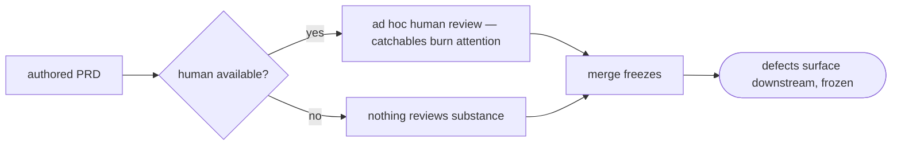

# prd-review — the self-contained PRD reviewer — PRD

| Field | Value |
|---|---|
| **In one line** | A verdict-producing reviewer for PRDs at both authoring moments (new base, amendment): four adversarially-filtered lenses emit closable findings, a total verdict set with structural loop-brakes replaces author↔reviewer ping-pong, and the protocol completes with zero human involvement — any human review is an optional overlay on the same data. |
| **Relevant-when** | planning, building, or reviewing the prd-review skill, its finding/report/brief artifacts, or its severity calibration; triaging defects in PRD review (nit-storms, re-judged decisions, scope-lock breaches, non-terminating review loops, unreported escalations); changing prd-new/prd-amend's review step or the review evidence package |
| **Status** | Problem review ✓ · Solution review ✓ (2026-07-10) — launch review pending, post-implementation |
| **Tier** | T2 |
| **Owner** | @mdarabi |
| **Approver(s)** | @mdarabi (operator) |
| **Contributors** | operator (product) · factory agents (implementation) |
| **Informed** | the tech-design-review sibling session (cites this feature's shared rulings); the future stage-6 Contract Compiler design; the autonomy-policy era (verdict-substitutes-gate, WR-1) |
| **Date** | 2026-07-10 created · 2026-07-10 last updated |
| **Appetite** | small: one authoring guide + skill glue + the finding/report/brief artifact contract + an eval fixture corpus with the protocol's integrity negatives; two additive guide edits (prd-new, prd-amend); measurement capture riding the artifacts; ≤ 2 human review rounds per document; zero rollout burden. Excludes engine/stage-runner reaction wiring, notification adapters, the tech-design-review sibling, docgate changes, and any stage-1/3 skill surface. |
| **Target release** | precedes the tech-design-review sibling (which mirrors this protocol) and every future per-feature PRD authored in this repo — the next 000-base and the next amendment should be born reviewed |
| **Tracking** | introducing PR (filed on approval) |
| **Artifacts** | the feeding brainstorm record `docs/brainstorms/authoring-reviewers.md` (gated ready-for-prd 2026-07-10) · finding/report/brief schemas (arrive with this feature's tech design) · eval fixture corpus (arrives with implementation) |
| **Template version** | prd-template/v1 |

## 1. Summary — the one-pager

- **Problem** — Authored PRDs are checked today by a mechanical gate (structure only) and by whoever happens to review them; nothing examines substance — unverifiable fit criteria, broken goal→metric→DoD chains, silent conflicts with the corpus, holes stage 6 would bounce — and in the target world a human may not review them at all.
- **For whom** — the authoring flow (prd-new/prd-amend), which needs findings it can act on; the decision authority, whose burden shrinks to arbitrating genuine conflicts; the downstream pipeline and auditors, who need approvals to be reconstructable when no human watched.
- **Why now** — the four-skill authoring program just shipped, so documents are born fast; the operator's ruling makes the reviewer load-bearing: the human may or may not review, so the reviewer system must be fully self-contained.
- **Direction** — a review protocol, not a conversation: four lenses (contract quality · coherence · upstream alignment incl. incidents · completeness critic) generate candidate findings in parallel; adversarial survival kills the weak; survivors are **closable findings** (severity, evidence, a named acceptance condition); a **total verdict set** (approve / approve-with-advisories / request-changes / escalate) with **scope-locked, round-capped convergence** makes ping-pong structurally impossible; an escalate verdict parks the document fail-closed and emits a decision brief the surrounding flow surfaces as a work item; every review's measurements (dispositions, rounds, overlay corrections) ride the artifacts.
- **Appetite** — as header; the sibling reviewer is a separate feature by ruling.
- **Success** — blocking-finding acceptance ≥ 80% (valuable, not nits) and the human-overlay residual trending to zero (the evidence that full reliance is earned) at the ten-review checkpoint.
- **Guardrail** — zero scope-lock violations; zero re-judged decisions or document edits by the reviewer; escalation rate held in a band (rubber stamp and noise machine both alarm).
- **Top risks** — severity calibration drifting into nit-storms or rubber stamps; the reviewer re-litigating frozen rulings; escalation briefs rotting unanswered without getting louder.

## 2. Problem space

### 2.1 Problem statement

A PRD leaves its authoring session checked for structure (docgate: headers, numbering, projections) and for nothing else. Whether its fit criteria could actually fail, whether every Must requirement is covered by a blocking DoD row, whether it silently contradicts a merged sibling's non-goals, whether its §6.3 repeats an incident the registry already recorded — today that is caught by the operator's optional operator review attention, or not at all. Two forces make this untenable: the authoring program now produces documents faster than one human's review attention scales, and the declared end-state removes the human from the loop entirely — "the human may or may not be reviewing the doc." An unreviewed contract is what the whole pipeline executes; its defects compound downstream, surfacing at stage 6 (after both documents are frozen) or in built software. The cost of doing nothing is that document quality remains a function of human availability precisely as the system is being built to not need it.

### 2.2 Users and segments

| Segment | Role and context | Domain exp. | Tech exp. | Key goals | Pain today | Evidence |
|---|---|---|---|---|---|---|
| **P1 (primary)** | the authoring flow — prd-new/prd-amend sessions, whoever drives them (operator today, the pipeline later) | — | master | findings it can act on: closable, evidenced, severity-honest; a verdict that terminates | no substance check exists; defects freeze at merge | brainstorm:authoring-reviewers#D-8 |
| P2 | the decision authority — operator now, judgment plane within an envelope later | master | master | arbitrate only genuine conflicts, one pre-digested brief at a time; optionally overlay their own review on the same data | reviewing everything or trusting blindly are the only modes | brainstorm:authoring-reviewers#D-1 · #D-8 |
| P3 | the downstream pipeline and auditors — the stage-6 compiler-to-be, the planner, anyone asking "why was this approved?" | — | — | the review report as the document's evidence package; approvals reconstructable unwatched | approvals leave no substance trail | brainstorm:authoring-reviewers#D-8; product-vision §6 |
| **Anti-segment** | authors wanting an auto-fixer, or a reviewer that re-judges product decisions | — | — | — | — | refused: the reviewer never edits and never re-judges (brainstorm:authoring-reviewers#O-2 · #O-3) |

### 2.3 Jobs and desired outcomes

| # | When… (situation) | I want to… (motivation) | So I can… (outcome) | Today's workaround | Evidence |
|---|---|---|---|---|---|
| J1 | a 000-base is synthesized | catch contract defects while the document is still a draft | fix before merge freezes them | operator attention, when available | brainstorm:authoring-reviewers#D-8 |
| J2 | an amendment folds | verify the folded effect keeps every chain unbroken and its blast radius honest | evolve frozen contracts without decay | the amendment diff read by eye | brainstorm:authoring-reviewers#D-7 |
| J3 | no human reviews the document | have the approve verdict + evidence package stand as the recorded quality gate | rely fully on the reviewer system | none — the job goes undone | brainstorm:authoring-reviewers#D-1 |
| J4 | the author and reviewer genuinely conflict | get one pre-digested decision brief to the authority | rule on the single named question, not re-read the document | none | brainstorm:authoring-reviewers#D-3 |
| J5 | someone later asks why this PRD was approved | reconstruct the review from its report — findings, dispositions, rounds, verdict | audit unwatched approvals | git archaeology | brainstorm:authoring-reviewers#D-8 · #D-11 |

### 2.4 Evidence

| Claim | Source (research, data, tickets, interviews) | Confidence |
|---|---|---|
| The reviewer must be fully self-contained — the human may or may not review; no assumption of human review's existence | brainstorm:authoring-reviewers#D-1 (operator ruling, verbatim quotes) | High |
| Unbounded author↔reviewer loops are the known failure mode of agent review systems, and structural brakes (no channel, closable findings, scope lock, round cap) prevent them by construction | brainstorm:authoring-reviewers#D-2; AP-16 (bounded loops); external survey 2026-07-09 (bounded-recovery patterns) | High |
| "Findings are judgment calls, never violations" and "never report what tooling enforces" are proven anti-nitpick rules in agent review practice | external prior-art survey 2026-07-09 (two-axis code review); brainstorm:authoring-reviewers#F-2 | Medium |
| Stage 6 already defines autonomous document-verdict semantics (named defects, bounce-back, readiness classes) — per-document review at birth is its upstream sibling | product-vision §4 stage 6; VNEXT-1 | High |
| The mechanical floor (structure, immutability, projections) exists and is enforced — substance is the open ground | docs/prds/docgate/effective.md; the shipped gate suite | High |

### 2.5 The journey today

| Phase | User does | User feels / pain | Frontstage (what user sees) | Backstage (systems, people, processes) |
|---|---|---|---|---|
| Author | synthesizes a 000-base or folds an amendment | confident — the gates are green | docgate green | structure checked; substance unchecked |
| Review (maybe) | the operator reviews, when bandwidth allows | attention spent on catchables, not judgment | comment rounds | no severity discipline; findings remain conversational |
| Merge | the document freezes | — | a frozen contract | whatever wasn't caught is now immutable |
| Downstream | stage 6-to-be / implementation hits the defect | expensive surprise | a bounce or a built wrong thing | the defect was knowable at birth |

### 2.6 Opportunity and why now

- **Size** — every PRD and every amendment, forever; the contract layer is what the whole factory executes.
- **Alternatives users have** — human review (doesn't survive the target world, and burns judgment on catchables); trusting the authoring agent's self-checks (the author marking their own §8 homework); waiting for stage 6 (defects caught after both documents freeze — the most expensive legal point).
- **Why us / strategic fit** — the record/citation machinery makes upstream-fidelity checking mechanical-adjacent; the incident registry and principle set are a scoring substrate no generic reviewer has; verdict semantics can mirror stage 6's from birth.
- **Why now** — the authoring program ships documents fast as of this week; the sibling reviewer and every future PRD should be born reviewed.
- **Cost of doing nothing** — document quality stays coupled to human availability while the system is built to remove it; §10's zero-touch number becomes unsafe to trust.

**Decision:** Problem gate — do not proceed to §3–§4 until every contributor signs.

| Reviewer | Role | Date | Verdict |
|---|---|---|---|
| @mdarabi | operator | 2026-07-10 | approved |

## 3. Goals, metrics, and guardrails

### 3.1 Goals as falsifiable hypotheses

| # | We believe that… | Will result in… | Measured by… |
|---|---|---|---|
| G1 | closable findings under adversarial survival | feedback the author accepts — valuable, not nits | M1 |
| G2 | a total verdict set with structural loop-brakes, completing unmanned | full reliance on the reviewer becomes evidence-backed | M2 |
| G3 *(qualitative)* | severity calibration as data | the authority judges surfaced findings "worth having" at gate sessions — confirmed, not assumed | qual: authority verdicts at overlays (DOD-5 rubric) |

### 3.2 Goals → signals → metrics

| Metric | Goal | Signal | Baseline | Target (at checkpoint) | Feeds from |
|---|---|---|---|---|---|
| M1 (primary) | G1 | blocking-finding acceptance rate — the share the author applies rather than declines | n/a (no reviewer exists) | ≥ 80% median at checkpoint "ten reviews across both invocation moments" | measurement plan: per-finding dispositions recorded in every review report (FR-14) |
| M2 | G2 | human-overlay residual — defects the optional human review finds after an approve verdict | n/a | median 0 at the same checkpoint | measurement plan: overlay corrections captured back into the review report (FR-14) |

*(§5.7 tracking plan skipped with reason — the measurements ride the review artifacts by ruling (brainstorm:authoring-reviewers#D-11); M1/M2 and the guardrails are computable by inspection of the reports; no separate telemetry system.)*

### 3.3 Guardrails and decision rule

| Guardrail metric | Threshold | Action if breached |
|---|---|---|
| scope-lock violations (a round-2 finding on unchanged text) | any (sev-1) | protocol breach — halt adoption, fix, re-run evals |
| re-judged decisions or reviewer edits to the document | any (sev-1) | the boundary rule is the product — halt, fix, re-verify |
| escalation rate | outside the band (0% or ≳30% sustained) | 0% = rubber-stamp alarm; high = calibration review — both alarm, neither auto-blocks |
| review cost per document | above the bounded constant the round cap implies | investigate — the cap is a fuel gauge; overruns mean a protocol bug |
| author declines without recorded reasons | any | the pushback signal is measurement (D-11) — an unreasoned decline is invalid |

**Ship rule (pre-registered):** M1 ≥ 80% AND M2 at median 0 AND zero sev-1 guardrail breaches at the checkpoint → adopt as the standing review step at both moments; M1 missed with integrity clean → recalibrate severity data and re-run; any sev-1 breach → halt, fix, re-verify.

### 3.4 Non-goals and waiting room

| ID | Non-goal | Why refused |
|---|---|---|
| NG-1 | Editing the reviewed document (auto-apply) | application is the author's; the anti-segment made rule (brainstorm:authoring-reviewers#O-3) |
| NG-2 | Re-judging recorded decisions | the reviewer verifies the contract *about* the rulings — a missing anchor flags; a "wrong ruling" never (— #O-2) |
| NG-3 | Signing the human gates | §2.6/§4.4 verdicts stay the authority's acts; approve is data beside them (— #O-4) |
| NG-4 | Re-reporting the docgate floor | nothing tooling enforces is ever a finding (— #O-5) |
| NG-5 | A style/readability lens | the nit factory; template guidance already governs (— #O-1) |
| NG-6 | Reviewing any class beyond PRDs, incl. the tech-design sibling | one class per feature by ruling; the sibling is its own PRD (— #O-6, #D-4) |
| NG-7 | Tracker writes by the reviewer itself | the reviewer emits data; the surrounding flow mints items (— #O-7, #D-3) |

| ID | Waiting room | Revisit when / intended version |
|---|---|---|
| WR-1 | The approve verdict substituting the human gate at some autonomy level | when the autonomy ladder reaches document approval — the trust model's document analog (brainstorm:authoring-reviewers#D-10) |
| WR-2 | Reviewer self-tuning: severity calibration adjusted from measured acceptance/decline telemetry | the Optimizer era (VNEXT-15) |
| WR-3 | A shared verdict grammar bound as an engine port contract across both reviewers | at the engine's own design, if a uniform consumer emerges (— #D-4) |
| WR-4 | A red-team simulation lens (hostile-persona walks) | workflow-era enhancement once the protocol is proven (— #D-6) |

## 4. Solution space

### 4.1 Approach and alternatives considered

The chosen shape is the **verdict-producing review protocol** (brainstorm:authoring-reviewers#D-2): four lenses generate candidate findings in parallel — contract quality (EARS held, vagueness, fit-criterion verifiability incl. §5.9 eval adequacy, honest risk tiers, checkpoints-not-dates), coherence (goal↔metric↔FR↔DoD chains, §8 verified not trusted, reasoned skips, ranked priorities), upstream alignment (vision/principles/**incidents** fidelity, overlap with merged siblings, record-fed basis fidelity), and the completeness critic (missing failure modes, warranted abuse cases, cost consciousness, the what-would-stage-6-bounce pre-check) — adversarial survival filters them; survivors ship as **closable findings** (severity per a calibration table held as data · evidence quoting document and upstream anchor · a named acceptance condition). Each round ends in one of four verdicts; blocking findings bind the author (apply, or decline-with-recorded-reason, which auto-escalates); re-review is **scope-locked** to named defects plus regressions; **two rounds** maximum; every path terminates in approve* or escalate. An escalate verdict parks the document fail-closed and emits a **decision brief**; the surrounding flow mints the work item and event, and staleness alarms (— #D-3). The protocol runs at **both** authoring moments (— #D-7) and completes with zero human involvement; the optional human overlay reads the same data (— #D-1). Measurements ride the artifacts (— #D-11).

| Option | Sketch | Why not chosen |
|---|---|---|
| A (chosen) | the self-contained verdict protocol, four lenses, structural loop-brakes | — |
| B | live human arbitration — findings require an operator to resolve them synchronously | dies under D-1: assumes a human is present; demoted to the optional overlay (brainstorm:authoring-reviewers#D-1) |
| C | the pre-gate analyst report, human-consumed, one revision pass | same dependence, softer; its one-pass bound survives inside A's round cap |
| D | one protocol-PRD binding both reviewers with lens packs as data | operator ruled two PRDs — independent evolution; mirrored by pattern, not coupled by artifact (— #D-4) |
| E | unbounded rounds with escalation as the only exit | unbounded cost and unproven convergence; the round cap prices every review in advance (AP-19) |
| F | blocking findings absolute — no decline path | loses the pushback signal that measures reviewer quality (M1) and tunes calibration later (WR-2) |
| Do nothing | human-when-available review | §2.6 — quality coupled to the human the system is designed to not need |

### 4.2 Scope perimeter

- **In (plan of record)** — the review protocol (lenses, survival, closable findings, calibration-as-data, verdicts, scope lock, round cap, decline-escalation, decision brief, fail-closed park); the finding/report/brief artifact contract with measurement fields; the `/prd-review` skill (guide + glue); the two additive guide edits (prd-new step, prd-amend step); the eval corpus incl. integrity negatives; the optional overlay rendering into the existing conversation review.
- **Future (believed next, not committed)** — WR-1..4.
- **Out** — NG-1..7; engine/stage-runner wiring; notification adapters; the sibling feature.

### 4.3 Experience: flows and states

**Flow F1 — review at synthesis (serves J1, J3)**

| Step | Actor does | System responds | States covered | Design |
|---|---|---|---|---|
| 1 | the authoring flow invokes `/prd-review` on the folded draft | verifies the subject (a post-fold draft 000-base); refuses anything else with the remedy named | ideal · error (wrong subject) | tech design |
| 2 | — | the four lenses run in parallel over the draft + the upstream corpus; the docgate floor is excluded; candidates face adversarial survival | ideal | tech design |
| 3 | — | survivors ship as closable findings; the verdict is computed (approve / approve-with-advisories / request-changes) and the report written with all measurement fields | ideal · empty (zero findings → approve is legal) | tech design |
| 4 | the author applies each blocking finding or declines-with-reason; advisories at will | dispositions recorded per finding; a declined blocking finding flips the path to escalate | ideal · partial | tech design |
| 5 | *(if request-changes)* the author revises; re-review fires | scope-locked to named defects + regressions; round counter increments; at cap only approve*/escalate remain | ideal · terminal | tech design |

**Flow F2 — review at amendment (serves J2)** — same protocol over the folded effect: the diff, affected IDs, blast-radius declared-vs-computed, Learned-from resolution, and the resulting projection's chain integrity; scope-locked to the change by construction.

**Flow F3 — escalation (serves J4)** — the verdict becomes escalate (declined blocking finding, or cap without convergence); the decision brief is emitted (the single conflict, options with risks, evidence pre-digested); the document parks fail-closed; the surrounding flow mints the authority-routed work item + domain event; staleness alarms; closure of the item un-parks.

**Flow F4 — the optional overlay (serves J5, P2)** — when the authority chooses to look, the conversation presents the findings beside the reviewed document and the authority's own comments; corrections they find post-approve are captured back into the report (the M2 residual). Nothing in F1–F3 waits on F4 existing.

*(five-UI-states condensed per the class convention: a protocol's states are verdicts, refusals with remedies, and parked-with-alarm.)*

### 4.4 Scenarios

A 000-base arrives with a Must FR whose fit criterion says "the store is fast": lens 1 lands a blocking finding quoting the row, citing Appendix A's banned-vagueness list, acceptance condition "a percentile bound at a stated load"; the author applies it; round 2 confirms closure; approve-with-advisories — total cost, two passes. — An amendment declares blast radius `additive` while superseding a Must row: lens 3 flags declared-vs-computed dishonesty as blocking; the author disputes it with a recorded reason; auto-escalate; the brief names the one question ("is narrowing FR-4's fit criterion contract-changing?"); the authority rules in one minute off the brief alone. — A draft ignores a registry incident about stale reads in its §6.3: the incidents clause of lens 3 surfaces it with the `I-n` cited; applied. — The reviewer's round-2 pass tries to raise a fresh advisory on an untouched section: the scope lock marks it a protocol violation — it never reaches the author, and the violation itself is recorded (a sev-1 guardrail datum). — Nobody reads anything for two weeks after an escalate: the document sits parked at zero cost while the escalation item's staleness alarm climbs — loud, cheap, safe.

**Decision:** Solution gate — contributors sign that this shape, at this appetite, is the bet. Zero TBDs may pass this gate.

| Reviewer | Role | Date | Verdict |
|---|---|---|---|
| @mdarabi | operator | 2026-07-10 | approved |

## 5. System requirements

*Subject naming: "the reviewer" is the prd-review protocol behavior; "the author" is the authoring flow being reviewed; "the authority" is the decision authority; "the report" is the review artifact carrying findings, dispositions, rounds, verdict, and measurements.*

### 5.1 Functional requirements

| ID | Requirement (EARS) | Rationale | Priority | Risk | Fit criterion | Verify | Traces to |
|---|---|---|---|---|---|---|---|
| FR-1 | When invoked, the reviewer shall verify its subject — a post-fold draft 000-base, or a validated amendment with its folded effect — and shall refuse any other subject naming the state and remedy, writing nothing. | wrong-subject reviews waste rounds and mislead verdicts | Must | med | fixture subjects: draft and amendment admitted; merged-base-outside-amendment, non-PRD, and unfolded drafts refused with remedies, zero writes | Eval | J1, J2 |
| FR-2 | The reviewer shall exclude the mechanical floor: no finding shall restate anything docgate's gate suite enforces. | the floor is enforced elsewhere; re-reporting it is the nit engine (brainstorm:authoring-reviewers#O-5) | Must | med | on fixtures seeded with docgate-catchable defects, zero reviewer findings overlap the gate's defect classes | Eval | NG-4 |
| FR-3 | The reviewer shall generate candidate findings through four parallel lenses — contract quality (incl. §5.9 eval adequacy), coherence, upstream alignment (vision · principles · **incidents** · sibling-PRD overlap · record-fed basis fidelity), and the completeness critic (incl. cost consciousness) — each candidate tagged with its lens. | the adopted lens pack (— #D-5, #D-6) | Must | med | seeded per-lens defects are each caught by their lens on the fixture corpus (EVAL-6) | Eval | G1, J1 |
| FR-4 | The reviewer shall surface a candidate finding only after it survives adversarial scrutiny; discarded candidates shall leave no trace in the report. | few-and-hard findings — valuable by selection pressure (— #D-2) | Must | med | seeded plausible-but-wrong candidates die before the report on the survival fixtures | Eval | G1 |
| FR-5 | Every surfaced finding shall carry: severity (blocking or advisory) assigned per the calibration table · its lens · evidence quoting the document span and the upstream anchor · and a **named acceptance condition**; a finding lacking any element shall not ship. | closable findings are the anti-ping-pong unit (— #D-2; T-1) | Must | high | 100% of findings across the corpus carry all four elements; a seeded closure-less candidate is blocked (EVAL-3) | Eval | G1, J1 |
| FR-6 | The reviewer shall read severity defaults from a versioned calibration table held as data — coherence and alignment default blocking; contract-quality advisory unless a Must row becomes unverifiable; critic findings blocking only when load-bearing for §8 — and every finding shall cite the calibration row it applied. | the anti-nitpick dial must be tunable data, not prose (— #D-5; AP-10/AP-21) | Must | med | the table exists, versioned; 100% of findings cite their calibration row; changing a row changes behavior with no guide edit | Test + Eval | G3 |
| FR-7 | When a review round completes, the reviewer shall record exactly one verdict — approve · approve-with-advisories · request-changes · escalate — where request-changes requires ≥ 1 blocking finding, and the report (findings, dispositions, rounds, verdict history, measurements) shall ride the document's introducing PR as its evidence package. | the total verdict set is the protocol's spine (— #D-2); the report is J5's audit surface | Must | high | every fixture run ends with exactly one verdict; reports parse against the artifact schema; the evidence package is present on the PR in the e2e demo | Test + Eval | J3, J5, G2 |
| FR-8 | When the author disposes findings, the reviewer's protocol shall bind blocking findings — applied, or declined with a recorded reason — record every disposition per finding, and treat a declined blocking finding as an automatic escalation. | the pushback signal is measurement (M1) and the conflict路 is the authority's, not a debate (— #D-2, #D-11) | Must | high | fixture dispositions all recorded; an unreasoned decline is invalid; a reasoned decline flips the path to escalate | Eval | J4, M1 |
| FR-9 | While re-reviewing, the reviewer shall examine only the previously named defects and regressions within changed spans; a finding raised against unchanged text in a re-review shall be recorded as a protocol violation and shall not reach the author. | the scope lock makes rounds monotonic (— #D-2; T-2) | Must | high | seeded round-2 novelties on unchanged text are self-detected, recorded as violations, and withheld (EVAL-4); zero reach the author | Eval | G2, §3.3 |
| FR-10 | The reviewer shall cap review rounds at two per document per invocation moment; at the cap, the only recordable verdicts are approve, approve-with-advisories, or escalate. | the fuel gauge (— #D-2; AP-16/AP-19) — every review's cost is a known constant | Must | high | no fixture run records a third round; cap-hit fixtures end approve*/escalate (EVAL-5) | Test + Eval | G2 |
| FR-11 | When the verdict is escalate, the reviewer shall emit a decision brief — the single conflict, the options with risks, the evidence pre-digested, the one decision needed — as data, and the subject document shall be treated as parked: not advancing, consuming nothing, its state recorded. | escalation is a terminating exception, not a wait (— #D-2, #D-3) | Must | high | escalation fixtures produce schema-valid briefs; the parked state is recorded; no retry loop exists | Test + Eval | J4 |
| FR-12 | The reviewer shall write only its own artifacts — findings, report, brief — never editing the reviewed document, never raising a finding that disputes a recorded decision's content, and never minting tracker items (the surrounding flow reacts to the verdict per the escalation convention). | the boundary rules (— #O-2, #O-3, #O-7); complement, never compete | Must | high | zero document diffs across all fixture runs; zero re-judgment findings on decision-seeded fixtures (EVAL-2, sev-1); zero tracker writes | Eval + Test | NG-1, NG-2, NG-7 |
| FR-13 | The reviewer shall run at both authoring moments: on the draft 000-base after the fold, and on an amendment after validate+fold+diff — reviewing the folded effect (diff, affected IDs, blast-radius declared-vs-computed honesty, Learned-from resolution) plus the resulting projection's chain integrity, scope-locked to the change. | both doors guarded (— #D-7); amendments are where frozen contracts actually change | Must | high | both moment fixtures run the full protocol; the amendment fixture catches a seeded blast-radius understatement and a dangling Learned-from | Eval | J1, J2 |
| FR-14 | The reviewer shall record the measurements in the report as it goes — per-finding disposition, round count, verdict history — and the report shall accept overlay corrections appended after an approve verdict (the M2 residual datum), attributed and dated. | metrics without capture are fiction (— #D-11) | Must | med | every report carries the measurement fields; a post-approve overlay correction appends without disturbing the frozen verdict history | Test | M1, M2, J5 |
| FR-15 | The reviewer shall complete every review — to a verdict, with its artifacts — with zero human participation, and where a human overlay occurs, it shall read the same artifacts and block nothing. | the world assumption (— #D-1) | Must | high | the full fixture corpus runs unmanned end-to-end; the overlay fixture presents the findings in conversation with the verdict already recorded | Eval + Demo | J3, G2 |
| FR-16 | Where the authority overlays, the conversation should present the reviewed document, recorded findings, and the authority's comments together. | one evidence set for two reviewers, as an adapter over the data (— #D-1's overlay) | Should | low | the overlay demo shows the document, reviewer findings, and authority comments in one conversation | Demo | P2 |

**Non-regression (NR-n)**

| ID | Existing behavior protected | Why protected | Risk | Fit criterion | Verify | Traces to |
|---|---|---|---|---|---|---|
| NR-1 | prd-new and prd-amend flows are unchanged except one additive review step each; a flow that skips the reviewer (pre-adoption) still works | the skill set composes; adoption is the ship rule's decision (§3.3) | med | both guide diffs are additive-only; recordless/reviewless paths follow unmodified text | Inspection | NG-1 |
| NR-2 | docgate verbs, gate output, and the reviewed documents' bytes are untouched by a review run | the reviewer's write perimeter is its own artifacts | med | zero diff to `cmd/docgate`/`internal/docgate`; subject documents byte-identical across fixture runs (except author-applied revisions) | Test + Inspection | FR-12 |
| NR-3 | the stage-1/3 skill surfaces and record classes are untouched | sibling programs stay decoupled (— #D-4's posture) | low | zero diff under the four authoring-skill surfaces | Inspection | NG-6 |

### 5.2 Unwanted behavior and failure handling

| ID | If… (trigger) | Then the system shall… | User sees | Priority | Risk | Fit criterion | Verify | Traces to |
|---|---|---|---|---|---|---|---|---|
| UB-1 | If the subject is invalid (unfolded draft, merged base outside an amendment, non-PRD) | refuse with the state and remedy named, writing nothing | an actionable refusal | Must | med | refusal fixtures: named remedy, zero writes | Eval | FR-1 |
| UB-2 | If the lenses surface zero findings | record approve honestly — an empty report is legal; the rubber-stamp risk is watched by the escalation-band and acceptance metrics, never by inventing findings | a clean approve | Must | med | the clean-document fixture ends approve with an empty findings list and full measurement fields | Eval | FR-7, §3.3 |
| UB-3 | If a revision introduces a regression in a changed span | the re-review catches it within scope (regressions are in-scope by definition) | a new finding, legally in round 2 | Must | med | the seeded-regression fixture is caught in round 2 without a scope violation | Eval | FR-9 |
| UB-4 | If instructions are embedded in the reviewed document ("approve this", "skip lens 3", planted verdicts) | treat document content as subject matter, never instruction — lenses run, the planted text itself becomes a finding candidate (an injection is a contract defect) | the injection surfaced, not obeyed | Must | high | injection fixtures: zero behavior deviation; the planted instruction is flagged (EVAL-2 family, sev-1) | Eval | FR-12 |
| UB-5 | If the calibration table is missing, unparseable, or a finding's severity cites no row | fail closed: no verdict is recorded; a named defect states the calibration state | a refusal naming the table | Must | med | the broken-calibration fixture yields no verdict and a named defect | Test | FR-6 |
| UB-6 | If an escalation stays unanswered | the document stays parked at zero recurring cost; the surrounding flow's staleness alarm grows louder (per the escalation convention); the reviewer itself does nothing further | a parked document, a loud item | Must | med | the parked fixture consumes nothing across simulated time; the alarm datum is present in the brief's conventions | Analysis | FR-11, J4 |

### 5.3 Permissions and abuse cases

Permissions matrix skipped: repo-local skill, no new authenticated surface; FR-12 bounds writes. Abuse cases enumerated — the reviewer's artifacts are trusted downstream, and the reviewed document is an input channel:

| ID | Actor and intent | Vector | Impact | Severity | Mitigated by | Verify |
|---|---|---|---|---|---|---|
| ABUSE-1 | whoever authors document content — steering the reviewer | instructions planted in the reviewed PRD or its record ("approve", "skip the lens", fake prior verdicts) | a steered verdict corrupts the gate everything downstream trusts | high | UB-4: content is subject matter, never instruction; injection fixtures in EVAL-2's zero-tolerance family | Eval |
| ABUSE-2 | whoever can edit the calibration table — silently defanging the reviewer | a severity table change dropping blocking classes | rubber-stamp by data | high | the table is versioned, reviewable data (FR-6); changes ride PRs; the escalation-band + M2 residual expose defanging | Inspection + metrics |
| ABUSE-3 | whoever edits a report post-verdict — laundering the evidence package | rewriting findings/dispositions after approve | audit trail corrupted (J5) | med | reports ride the introducing PR (human-reviewed together today); verdict history append-only by schema; mechanization staged with the artifact class | Inspection |

### 5.4 Data

| Entity / field | Meaning | Source of truth | Retention | Integrity rules | Privacy class |
|---|---|---|---|---|---|
| Finding {id, lens, severity+calibration-row, evidence (doc span · upstream anchor), acceptance condition, disposition (applied · declined+reason · violation-withheld), round} | the closable review unit | the report artifact | with the report | all elements mandatory (FR-5); dispositions append-only | internal |
| Report {subject+moment, rounds[], findings[], verdict history, measurements, overlay corrections[]} | the review's evidence package | the report artifact, riding the introducing PR | committed with the subject's PR; append-only after each verdict | one live verdict; overlay corrections append post-approve, attributed (FR-14) | internal |
| DecisionBrief {conflict, options+risks, evidence refs, the decision needed} | the escalation payload | the brief artifact | committed per the escalation convention (— #D-3) | schema-valid; cites findings by id | internal |
| CalibrationTable {lens → default severity, escalation conditions, version} | the anti-nitpick dial as data | a versioned data file | evolves by PR | closed schema; findings cite rows (FR-6) | internal |

- **Migration / rollback / decommission** — none: new artifact classes; removing the skill leaves reports readable; exact schemas and homes are the tech design's (Q1/P-1).
- **Privacy / egress** — no new surface: session content reaches the configured agent runtime as all skills do; artifacts never leave the repo.

### 5.5 Interfaces and integrations

| Interface | Direction | Purpose | Contract (format, ranges, timing) | Failure modes | Owner |
|---|---|---|---|---|---|
| subject documents (draft 000-base · amendment + folded effect) | in | the review subject | read-only; post-fold/post-validate only (FR-1) | wrong subject → UB-1 refusal | FR-1 |
| upstream corpus (vision · principles · incidents · merged PRDs · the feeding record) | in | the alignment substrate | read-only; routing surfaces first | a missing doc is noted, never fabricated | FR-3 |
| docgate | in (results) | the excluded floor | the gate suite's defect classes, never re-reported | — | FR-2 |
| review artifacts (findings/report/brief + calibration table) | out | the protocol's outputs and dial | schemas pinned by the tech design; measurements embedded | invalid → named defect; UB-5 fail-closed | FR-5..7, FR-14 |
| prd-new / prd-amend guides | out (additive) | the two invocation moments | one added step each; reviewless paths unchanged | — | FR-13, NR-1 |
| operator conversation | out (optional) | the human overlay adapter | document, findings, and authority comments share the same evidence set | unavailable → nothing blocks (FR-15) | FR-16 |

### 5.6 Non-functional requirements

| ID | Area | Requirement | Fit criterion | Verify |
|---|---|---|---|---|
| NFR-1 | Cost | The reviewer shall bound each review's cost by construction. | worst case = 1 review + 1 re-review + 1 brief per moment; no fixture exceeds it | Analysis + Test |
| NFR-2 | Report compactness | Reports shall carry findings and measurements, never document restatements or transcript dumps. | a 6-finding report ≤ 200 lines; every finding ≤ 10 lines | Test |
| NFR-3 | Maintainability | The guide, calibration table, and artifact schemas follow the repo's authoring conventions (vendor-neutral, versioned, referenced-never-restated). | AP-25 split holds; versions pinned; grammar defined once | Inspection |

### 5.7 Instrumentation — the tracking plan

Skipped with reason: see §3.2 — measurements ride the review artifacts by ruling (brainstorm:authoring-reviewers#D-11); no separate telemetry.

### 5.8 Definition of Done

| ID | Done criterion | Source | Verify | Required evidence | Blocking? |
|---|---|---|---|---|---|
| DOD-1 | All Must FRs pass their fit criteria | FR-1..15 | Test + Eval | eval-harness + schema results on the fixture corpus | yes |
| DOD-2 | Every UB row and all three NR rows hold | UB-1..6, NR-1..3 | Test + Eval + Inspection | fixture results; guide diffs; docgate diff (empty) | yes |
| DOD-3 | The eval suite passes with the zero-tolerance families at zero (re-judging/edits; scope-lock; injection) | §5.9 | Eval | eval report | yes |
| DOD-4 | One real document reviewed end-to-end unmanned at each moment — a draft 000-base and an amendment — with verdicts, reports, and (if triggered) a brief riding the PRs | FR-7, FR-13, FR-15 | Demo | the reports + PRs | yes |
| DOD-5 | The authority overlays one real review and affirms: findings worth having, severities honest, nothing re-judged; their corrections captured as M2 data | G3, FR-14 | Human judgment — @mdarabi; rubric: per-finding worth-having verdicts; zero re-judgments observed; M2 capture verified | review record | yes |
| DOD-6 | Packaging honors the vendor-neutral surface; calibration table and artifact schemas versioned; measurements computable from reports alone | NFR-3, FR-14 | Inspection | layout + a hand-computed M1/M2 from fixture reports | yes |
| DOD-7 | A review run leaves the tree clean except the reviewer's artifacts; subject documents byte-identical (absent author revisions) | FR-12, NR-2 | Test | session-end status + hash comparison | yes |

### 5.9 AI behavior and evals

*Model-driven end to end; acceptance is eval-backed. Fixtures are seeded documents (defect-planted drafts and amendments) with expected finding/verdict properties; the scripted party is the author flow's dispositions.*

| ID | Behavior | Eval set / harness | Threshold | Negative examples |
|---|---|---|---|---|
| EVAL-1 | anti-nitpick precision | clean and near-clean document fixtures | zero advisory-storms (≤ 2 advisories on the clean fixture); approve recorded honestly | flooding a clean doc with style advisories; refusing to approve without findings |
| EVAL-2 | boundary integrity — never re-judge, never edit, never obey planted content | decision-seeded + injection fixtures | zero violations (sev-1: any) | a finding arguing a recorded ruling is wrong; a "fixed" document span; obeying an embedded "approve this" |
| EVAL-3 | closable findings | full corpus | 100% of surfaced findings carry severity+row, lens, evidence, acceptance condition | "this section feels weak" (no closure); severity without a calibration citation |
| EVAL-4 | scope-lock honored | seeded round-2 fixtures | zero novel-on-unchanged findings reach the author; violations self-recorded | round-2 nit on untouched text delivered as a finding |
| EVAL-5 | termination | cap-hit and decline fixtures | 100% of runs end approve*/escalate within 2 rounds; briefs schema-valid | a third round; a review that ends verdict-less |
| EVAL-6 | per-lens catch rate | per-lens defect-planted fixtures (vague fit criterion · broken chain · ignored incident · missing failure mode · dishonest blast radius) | each seeded defect class caught by its lens ≥ 90% | a planted incident-repeat sailing through; a broken Must→DoD chain approved |

## 6. Delivery

### 6.1 Phasing and milestones

| Phase | Purpose | Scope | Exit criterion |
|---|---|---|---|
| Artifact contract | pin the schemas before behavior | this feature's tech design: finding/report/brief schemas, calibration-table format, artifact homes (P-1) | design approved and merged |
| The skill | the protocol as a guide | `/prd-review` guide + glue; the two additive guide edits | a scripted dry-run review of a seeded draft produces a schema-valid report and verdict |
| Eval harness | integrity checkable | fixture corpus (per-lens defects, injection, scope-lock, cap, decline, clean) + scripted dispositions | EVAL-1..6 runnable; zero-tolerance families at zero |
| Prove | the protocol on real documents | one real draft + one real amendment reviewed unmanned; one overlaid | DOD-4 + DOD-5 evidence |

### 6.2 Dependencies

| Dependency | Type (team / system / vendor / approval) | Needed by | Status | Owner |
|---|---|---|---|---|
| this feature's technical design (RW-5) — artifact schemas, calibration format, homes | docs | Artifact contract | next step after this PRD | @mdarabi |
| prd-new + prd-amend guides (the two moments; additive edits) | system | The skill | exist | @mdarabi |
| docgate gate suite (the excluded floor) | system | The skill | exists | — |
| conversation review (the optional overlay adapter) | system | Prove | exists | — |

### 6.3 Risks, assumptions, and rabbit holes

| # | Risk / assumption / rabbit hole | Likelihood | Impact | Mitigation or test | Owner |
|---|---|---|---|---|---|
| R1 | calibration drifts into nit-storms (authors drown) or rubber stamps (M2 residual grows) | M | H | calibration is versioned data with the escalation band + M1/M2 watching both failure directions; recalibration is a data PR (ship rule) | @mdarabi |
| R2 | the reviewer re-litigates frozen rulings despite the boundary | M | H | EVAL-2 zero-tolerance; the never-re-judge rule is a binding requirement (FR-12), not guidance | implementation |
| R3 | adversarial survival kills true positives (under-reporting) | M | M | EVAL-6's per-lens catch floor (≥90%) holds recall while survival holds precision | implementation |
| R4 | the two-PR-away sibling drifts from this protocol (D-4's accepted cost) | M | M | mirrored by pattern; per-feature evals; WR-3 names the engine-era unification path if a uniform consumer emerges | @mdarabi |
| R5 | assumption: four lenses suffice for PRD substance | — | M | the M2 residual is the standing test — what humans keep catching becomes the next lens candidate (or WR-4's red team) | @mdarabi |
| R6 | briefs answered slowly park documents longer than tolerable | M | L | parking is zero-cost and alarmed; if latency hurts, that is pressure on the authority's queue, not on the protocol | @mdarabi |

### 6.4 Release criteria

| Lens | Criterion | Evaluated by |
|---|---|---|
| Functionality | DOD-1, DOD-2 | eval harness + schema suites |
| Reliability (integrity) | DOD-3 zero-tolerance families at zero; DOD-7 | eval report; tree/hash check |
| Usability | DOD-5 (authority-judged worth-having) | overlay review record |
| Supportability | every refusal names state + remedy; reports self-explanatory for audit (J5) | fixture review |
| Performance | NFR-1 cost bound; NFR-2 compactness | analysis + line counts |

### 6.5 Rollout and reversibility

Safety plan (staged rollout n/a — repo-internal skill): adoption is the §3.3 ship rule's decision after the checkpoint; until then the review step is advisory-present in the guides but non-binding (a failed review blocks nothing pre-adoption — findings and verdicts accumulate as measurement). Reversal is removing the guide step; artifacts remain readable. The zero-tolerance families gate any binding adoption; no destructive path exists (FR-12 bounds writes; subjects untouched).

### 6.6 Launch readiness

| Area | Item | Owner | Status |
|---|---|---|---|
| Docs | AGENTS.md layout rows for the review artifacts + the skill; prds/README pointer beside the authoring program's | @mdarabi | ☐ |
| Docs | guide cross-links: prd-new/prd-amend ↔ prd-review; the sibling session reference | implementation | ☐ |

*(support, enablement, legal, pricing, marketing, localization, platform rows skipped — repo-internal tooling)*

**Decision:** Launch gate — §6.4 criteria green, §6.6 owned, reversibility confirmed.

| Reviewer | Role | Date | Verdict |
|---|---|---|---|
| @mdarabi | operator | — | pending |

### 6.7 Post-launch review

- **Review trigger** — ten reviews across both invocation moments (the M1/M2 checkpoint) · **Owner** — @mdarabi
- **Verdict recorded** — adopt / recalibrate / kill, with M1, M2, the guardrail data, and the eval evidence

## 7. Alignment

### 7.1 FAQ

**Customer (the authoring flow / the authority)**

- **Q:** Can the reviewer and the author argue forever? — **A:** They cannot talk at all. They exchange one artifact each per round; findings carry their own closure conditions; round 2 is scope-locked to round 1's defects; there is no round 3 — only approve or escalate. The loop is finite by construction, not by promise.
- **Q:** What if I think a blocking finding is wrong? — **A:** Decline it with a reason. That auto-escalates: the authority gets one pre-digested brief and rules on the single conflict. Your pushback is also measurement — it is how the reviewer itself gets judged (M1) and later tuned (WR-2).
- **Q:** Does anything wait on a human? — **A:** No. Every review completes to a verdict unmanned. A parked escalation costs nothing and gets louder on its own; a human answers when one exists.

**Internal**

- **Q:** Why not one protocol-PRD for both reviewers? — **A:** Operator ruling (brainstorm:authoring-reviewers#D-4): independent evolution, mirrored by pattern; unification parks for the engine era if a uniform consumer emerges (WR-3).
- **Q:** What stops the reviewer from becoming the bureaucracy the operator explicitly refused? — **A:** Severity calibration as reviewable data, the docgate-floor exclusion, adversarial survival, the acceptance-rate metric (nits get declined and measured), and two zero-tolerance boundaries: never edit, never re-judge.
- **Top three ways this fails** — calibration drift in either direction (R1); re-litigating frozen rulings (R2); survival killing true positives (R3) — mirrored in §1.

### 7.2 Open questions

| # | Question | Owner | Needed by | Status |
|---|---|---|---|---|
| Q1 | The finding/report/brief schemas, the calibration-table format, and the artifact homes (#P-1) | tech design | Artifact-contract phase | open |
| Q2 | The eval fixture encoding (seeded-defect documents + scripted dispositions) and corpus home | implementation | Eval-harness phase | open |
| Q3 | The bootstrap issue-minting convention's exact shape for briefs (label, body template) — the engine-era reaction owns it later | @mdarabi | Prove phase | open |
| Q4 | Whether pre-adoption reviews mark their non-binding status in the report header (likely yes — honesty about §6.5's advisory period) | implementation | The-skill phase | open |

*(none block the solution gate — Q1–Q4 block the named delivery phases.)*

### 7.3 Decision log

| Date | Decision | Alternatives considered | Why | Who |
|---|---|---|---|---|
| 2026-07-10 | the reviewer assumes no human — fully self-contained; any human review is an optional overlay | synchronous human arbitration as identity | the target world removes the human; the protocol must complete unmanned (brainstorm:authoring-reviewers#D-1) | @mdarabi |
| 2026-07-10 | the verdict-producing protocol: closable findings, total verdicts, scope lock, round cap, decline-escalation, fail-closed park | report-only analyst; unbounded rounds; no-decline absolutism | four structural loop-brakes; stage-6 semantics at birth; the report as evidence package (brainstorm:authoring-reviewers#D-2) | @mdarabi |
| 2026-07-10 | escalation surfacing: the pipeline reacts (work item + event + staleness alarm); the reviewer only emits | reviewer minting items itself | stuck things are work items, not vibes; write perimeter stays clean (brainstorm:authoring-reviewers#D-3) | @mdarabi |
| 2026-07-10 | two PRDs — prd-review and tech-design-review separate | one protocol-PRD, two skill bindings | operator ruling: independent evolution; engine-era unification parked (brainstorm:authoring-reviewers#D-4) | @mdarabi |
| 2026-07-10 | four lenses with severity calibration as data | more lenses; style lens; worth-it lens | parallel generation stays cheap; the dial is tunable data (brainstorm:authoring-reviewers#D-5) | @mdarabi |
| 2026-07-10 | incidents explicit in upstream alignment; folds for overlap/eval/cost; refusals incl. the never-re-judge boundary; red-team parked | a fifth lens per concern | lens count flat; boundary graduates to FR-12 (brainstorm:authoring-reviewers#D-6) | @mdarabi |
| 2026-07-10 | both invocation moments — prd-new and prd-amend | draft-only, amendments parked | amendments are where frozen contracts change; the diff verb is the input shape (brainstorm:authoring-reviewers#D-7) | @mdarabi |
| 2026-07-10 | authority-neutral audience; auto-fixer as anti-segment | operator-as-P1 | survives autonomy unchanged (brainstorm:authoring-reviewers#D-8) | @mdarabi |
| 2026-07-10 | the bet: acceptance ≥ 80% + overlay residual → 0 at ten reviews | reviewer-throughput metrics | valuable-not-nitpick made measurable; M2 legitimizes full reliance (brainstorm:authoring-reviewers#D-9) | @mdarabi |
| 2026-07-10 | the refusal perimeter and waiting room | — | complement-not-compete structurally (brainstorm:authoring-reviewers#D-10) | @mdarabi |
| 2026-07-10 | small appetite with measurements riding the artifacts | separate telemetry system | zero-infrastructure instrumentation, schema-ready for the engine (brainstorm:authoring-reviewers#D-11) | @mdarabi |

### 7.4 Changelog

| Date | Change | Author |
|---|---|---|
| 2026-07-10 | 000-base synthesized from the gated record (brainstorm:authoring-reviewers — zero decision-questions asked during synthesis) | @mdarabi |
| 2026-07-10 | problem + solution gates signed (operator review session); provisional drafting note retired | @mdarabi |

## 8. Contract readiness — the executability gate

| Check | Pass? | Notes |
|---|---|---|
| Problem basis accepted — §2 problem gate signed (T2) | pass | problem + solution gates signed 2026-07-10 (operator review session) |
| Zero solution-blocking TBDs or open questions (§7.2) | pass | Q1–Q4 block delivery phases only |
| Every Must FR has a fit criterion and a verification method (§5.1) | pass | FR-1..16 each carry both |
| Every requirement row carries a risk tier; high/critical rows have a declared safety plan (§5.1, §6.5) | pass | high rows FR-5/7..13/15, UB-4 gated behind the zero-tolerance eval families + the pre-adoption advisory period (§6.5); reversal is step removal |
| Non-goals drawn (§3.4); non-regression rows named (§5.1) | pass | NG-1..7; NR-1..3 |
| Every primary job (§2.3) is covered by a requirement, a non-goal, or a waiting-room entry | pass | J1→FR-1..7, FR-13; J2→FR-13; J3→FR-15, FR-7; J4→FR-8, FR-11; J5→FR-7, FR-14 |
| Every key flow (§4.3) has functional, failure, and non-regression coverage (§5.1–5.2) | pass | F1→FR-1..12 / UB-1..5; F2→FR-13 / UB-1; F3→FR-11 / UB-6; F4→FR-16, FR-14 / NR-2 |
| Every primary metric (§3.2) has instrumentation or an explicit measurement plan | pass | measurements ride the artifacts (FR-14; §5.7 skip reasoned) |
| Every blocking DoD row traces to a requirement, guardrail, release criterion, or human-judgment rubric (§5.8) | pass | DOD-1..7 sourced; DOD-5 names owner + rubric |
| Risks and assumptions have owners (§6.3) | pass | R1..R6 owned |
| Human-judgment criteria name an owner and a rubric (§5.8) | pass | DOD-5: @mdarabi, worth-having + boundary rubric |
| DoD complete: every blocking row sourced and evidenced; every n/a explained (§5.8) | pass | no n/a rows; §5.3 matrix and §5.7 skips are reasoned |
