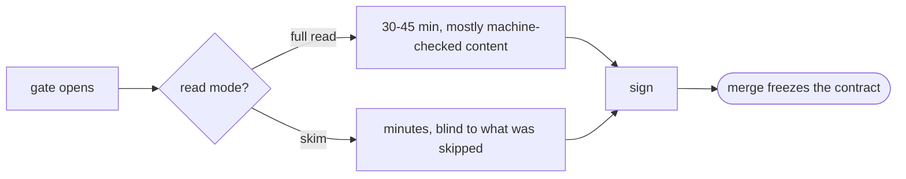

# Read to rule (§0) — the PRD's human-only routing section — PRD *(effective view)*

---

**GENERATED — DO NOT EDIT.** Sole writer: `docgate fold`. As of: **000**. Content fingerprint: `sha256:6fc072661b2d8b4e304a7ed6eb53ed92e3f607a765023ea72467370c4e2f3450`. Tool version (recorded, never hashed): `docgate/v1`.

---

| Field | Value |
|---|---|
| **In one line** | Every new PRD opens with §0 "Read to rule" — a human-only, one-screen routing section (ranked judgment calls · sanity-check numbers · the author's open questions · an informed-skip map) that lets the gate-signing reviewer capture most of the valuable feedback in minutes instead of a full read; informative never normative, authored at synthesis, maintained by amendments, ignored by machines. |
| **Relevant-when** | planning, building, or reviewing the read-to-rule section (§0) contract — prd-template's human-only routing section, the prd-new/prd-amend §0 steps, or the gate capture line and sampled full read; triaging misrouted or overlong gate reviews, stale §0 routing, §0 bloat, or capture-rate misses; changing prd-template's section set, the authoring guides' synthesis steps, or gate sign-off conventions |
| **Status** | Solution review passed — gates signed 2026-07-14; merge freezes the base |
| **Tier** | T2 — a documentation-system convention, reversible by one template PR, but its blast radius is the structure of every future PRD and the honesty of every future gate review |
| **Owner** | @mdarabi |
| **Approver(s)** | @mdarabi — problem and solution gates via the introducing PR's operator review; the launch gate post-implementation, on §6.4 evidence at the prove, recorded in §6.6's table |
| **Contributors** | operator (product) · implementing agent (synthesis) |
| **Informed** | future gate reviewers (read §1); the tech-design-class sibling session (WR-1) |
| **Date** | 2026-07-13 created · 2026-07-13 last updated |
| **Appetite** | Small: prd-template's next version carrying the §0 contract (placement, the four blocks, length cap, selection rule) + two additive guide edits (prd-new synthesizes §0, prd-amend maintains it) + the per-gate capture line and sampled full read riding the existing sign-off surfaces + the glossary entry; ≤ 2 human review rounds on this ledger; zero rollout burden. Excluded: docgate behavior changes, reviewer-protocol changes, renderoperator review in the conversation affordances, the tech-design-class sibling, and any retrofit program over merged ledgers. (brainstorm:gate-attention#D-8) |
| **Target release** | the first new 000-base authored after implementation is born with §0 — the prove; no calendar binding |
| **Tracking** | — *(filled when the epic exists)* |
| **Artifacts** | brainstorm record `gate-attention` (docs/brainstorms/) — the ruled basis, gated ready-for-prd 2026-07-13 |
| **Template version** | prd-template/v1 |

## 1. Summary — the one-pager

- **Problem** — Reviewing a PRD at its human gates costs a full careful read of a rich, dense document, and human attention is the pipeline's scarce resource: as agents author documents faster, the reviewer's only modes are reading everything or trusting blindly. (brainstorm:gate-attention#D-1; prd:prd-review §2.2 P2)
- **For whom** — The gate-signing human reviewer: the operator today, any write-access human reviewer as teams grow. (brainstorm:gate-attention#D-7)
- **Why now** — The authoring program ships documents faster than one human's reading scales; the unmanned reviewers cover substance but not intent; the gates that stay human by definition need their attention cost cut, not their rigor. (brainstorm:gate-attention — Idea, verbatim)
- **Direction** — A section inside the PRD itself, nothing new: §0 "Read to rule", placed before §1 — the judgment calls ranked by irreversibility × blast radius with veto semantics, the numbers to sanity-check, the author's open questions, and an informed-skip map naming what is machine-backstopped. Authored by prd-new, maintained by every amendment that touches a routed call, informative never normative, ignored by machines. (brainstorm:gate-attention#D-1..#D-4, #D-7)
- **Appetite** — As the header: one template version bump, two additive guide edits, the capture line — nothing else. (brainstorm:gate-attention#D-8)
- **Success** — §0-capture rate ≥ 80%, pooled across the window's feedback items (routed by §0 rather than found beyond it), and median gate-review time ≤ 10 minutes, both at the ten-lined-gate checkpoint. (brainstorm:gate-attention#D-5)
- **Guardrail** — Normativity stays absolute: zero conflicts resolved in §0's favor, zero machine consumption — one confirmed breach halts the convention for repair. (brainstorm:gate-attention#D-4, #D-7)
- **Top risks** — (1) maintenance discipline fails and §0 goes stale, misrouting the exact attention it protects; (2) §0 bloats into a second summary and the reading burden returns; (3) capture-rate self-deception — without the sampled full reads the 80% is unfalsifiable.

## 2. Problem space

### 2.1 Problem statement

Every human gate on a PRD — problem, solution, launch, and each amendment re-sign — asks one person to re-derive the document's judgment surface from its whole body. The body is deliberately rich (contract discipline demands it), so the reviewer either spends the full read on content that machines already verify, or skims and hopes. Both modes waste the one input nothing else can supply: intent alignment, external context, and taste on calls that freeze at merge. The cost of doing nothing compounds as authoring accelerates: gate reviews become the pipeline's bottleneck, or its rubber stamp. (brainstorm:gate-attention#D-1, #D-2)

### 2.2 Users and segments

| Segment | Role and context | Domain exp. | Tech exp. | Key goals | Pain today | Evidence |
|---|---|---|---|---|---|---|
| **P1 (primary)** | the gate-signing human reviewer — the operator today; any write-access human reviewer later; on unmanned (Argus-driven) problems the section simply goes unread at zero cost | master | journeyman–master | rule on what only a human can judge, in minutes; know what was skipped and who backstops it | full read or blind trust are the only modes | brainstorm:gate-attention#D-7; prd:prd-review §2.2 P2 |
| **Anti-segment** | machine consumers — compiler, traceability, workers, stage flows (bound by this feature's rule), and the unmanned reviewers (the ruled end-state; their ledgers adopt the skip per Q2, until which their full-document coverage lawfully includes §0): machines ignore §0 and cover the whole document | — | — | — | — | refused: brainstorm:gate-attention#D-7, #O-3 |
| **Anti-segment** | summary-seekers — readers wanting "what is this?" | — | — | — | — | §1's job, not §0's: brainstorm:gate-attention#D-2 |

### 2.3 Jobs and desired outcomes

| # | When… (situation) | I want to… (motivation) | So I can… (outcome) | Today's workaround | Evidence |
|---|---|---|---|---|---|
| J1 | a new 000-base reaches its gates | rule on the ranked judgment calls, the numbers, and the author's questions in minutes | sign (or veto) before merge freezes the base, without a full read | read everything, or skim and hope | brainstorm:gate-attention#D-2, #D-5 |
| J2 | an amendment changes a frozen contract | re-sign off the §0 delta without re-reading the document | keep living contracts cheap to re-approve | re-read, or trust the diff alone | brainstorm:gate-attention#D-3 |
| J3 | I am about to skip most of the body | know exactly what I am skipping and which mechanism backstops each class | skip informed, never blind | nothing names the backstops | brainstorm:gate-attention#D-2 |
| J4 | the convention has run a while | know whether §0 actually captures the feedback that matters | trust the 80% trade-off with evidence, or recalibrate | none — the trade-off would be a slogan | brainstorm:gate-attention#D-5 |

### 2.4 Evidence

| Claim | Source (research, data, tickets, interviews) | Confidence |
|---|---|---|
| The human gates are pipeline stages 2, 5, and 9 plus contract authoring; human approval + merge is what gates stages 2/5 during the reviewers' advisory period | the operational pipeline map — product-vision §4's distributable projection (brainstorm:gate-attention#F-1) | High |
| The decision authority's pain is on record: "reviewing everything or trusting blindly are the only modes" | prd:prd-review §2.2 (P2 row) | High |
| Pre-digestion for the authority exists in exactly one shape today — the DecisionBrief, escalations only | prd:prd-review §5.4, FR-11 (brainstorm:gate-attention#F-2) | High |
| The PRD's judgment surface is already structurally isolated (decision log, non-goals, alternatives, appetite, ship rule, risks, open questions) — §0 routes to it; it does not create it | prd-template (brainstorm:gate-attention#F-3) | High |
| An argus-scale base costs a 30–45 minute careful read; its judgment surface fit one rendered screen | authoring-session measurement over docs/prds/argus/effective.md + the §0 mockup exercise, 2026-07-13 | Med |
| The artifact-borne residual pattern (a human records what a prior pass missed) is proven in this repo | prd:prd-review §3.2 M2, FR-14 (brainstorm:gate-attention#F-6) | High |
| The engineer's two touches (author the contract · accept the result) and design-share-of-engineer-time are the standing north-star frame — gate attention is the cost of the touches that remain | docs/prds/README.md, inherited north star (brainstorm:gate-attention#F-5) | High |

### 2.5 The journey today

| Phase | User does | User feels / pain | Frontstage (what user sees) | Backstage (systems, people, processes) |
|---|---|---|---|---|
| Open | opens `effective.md` at a gate | a wall of rigor | the full projection | fold + gate suite already verified structure |
| Read | reads everything, or skims | attention spent on machine-checkable content | tables, matrices, walks | the unmanned reviewer already checked substance |
| Judge | hunts for the calls that are actually theirs | the judgment surface is scattered | §7.3, §3.4, header, §3.2–3.3 | nothing routes; nothing names the backstops |
| Sign | signs the gate table | uncertain what the skim missed | a verdict row | merge freezes the base |

### 2.6 Opportunity and why now

- **Size** — every human gate on every PRD and amendment, for the life of the factory; the reviewer's minutes are the factory's scarcest input.
- **Alternatives users have** — the full read (rigor at unscalable cost); the blind skim (cheap and dishonest); trusting the unmanned reviewers alone (they verify substance and coherence, never intent, external context, or taste — the human-unique inputs).
- **Why us / strategic fit** — the template already isolates the judgment surface into named, citable sections, and the ledger machinery keeps a maintained section current for free; §0 is routing over structure that exists.
- **Why now** — the authoring program just made documents cheap; review attention did not get cheaper; the gap widens with every unmanned capability (the more Argus drives, the more sign-offs per human hour).
- **Cost of doing nothing** — gates become the bottleneck or the rubber stamp; either way the factory's quality story degrades exactly where it is least observable.

**Decision:** Problem gate — via the introducing PR's operator review.

| Reviewer | Role | Date | Verdict |
|---|---|---|---|
| @mdarabi | operator | 2026-07-14 | approved — operator review, authoring session |

## 3. Goals, metrics, and guardrails

### 3.1 Goals as falsifiable hypotheses

| # | We believe that… | Will result in… | Measured by… |
|---|---|---|---|
| G1 | a ranked, interrogative, anchor-linked §0 | the reviewer's feedback concentrating where routed — valuable input without the full read | M1 |
| G2 | one screen replacing the body as the default gate read | gate-review time dropping to minutes | M2 |
| G3 *(qualitative)* | honest routing (veto semantics, skip map, budget hint) | the reviewer judges §0 worth-having, gate after gate | the DOD-4 rubric at the prove, re-applied at each sampled gate (FR-8); the rubric verdicts feed §6.7 |

### 3.2 Goals → signals → metrics

| Metric | Goal | Signal | Baseline | Target (at checkpoint) | Feeds from |
|---|---|---|---|---|---|
| M1 (primary) | G1 | §0-capture rate — of gate feedback items that led to a change or ruling, the share routed in-§0 rather than found beyond it | n/a (no §0 exists) | ≥ 80%, pooled across all the window's feedback items and computed once, at the checkpoint "ten capture-lined §0 gates" | EVT-1, EVT-2 |
| M2 | G2 | minutes per §0 gate review | full-read scale (30–45 min on an argus-scale base — §2.4) | ≤ 10 median at the same checkpoint | EVT-1 |

### 3.3 Guardrails and decision rule

| Guardrail metric | Threshold | Action if breached |
|---|---|---|
| normativity breaches — a conflict resolved in §0's favor, or a machine this feature's rule binds (compiler, traceability, workers, stage flows per the AGENTS.md line) consuming §0 | 0 (sev-1) | halt the convention, fix template/guides, re-verify before counting resumes — the unmanned reviewers join this clause when their ledgers adopt the skip (Q2) |
| sampling compliance — sampled full reads over §0 gates | ≥ 1 within every five consecutive | checkpoint invalid until restored; extend the window |
| §0 bloat — over-cap sections reaching a gate | 0 uncut | template-conformance defect; cut before the gate proceeds on §0 |

**Ship rule (pre-registered):** M1 (pooled, §3.2's formula) ≥ 80% AND M2 ≤ 10 min AND zero normativity breaches at the checkpoint → adopt as the standing convention; M1 missed with integrity clean → recalibrate the selection rule (a template-guidance PR) and run a fresh window; any normativity breach → halt, fix, re-verify. (brainstorm:gate-attention#D-5)

### 3.4 Non-goals and waiting room

| ID | Non-goal | Why refused |
|---|---|---|
| NG-1 | Any normative status for §0 — it binds nothing, is cited by nothing downstream, and never redefines what the gate signature covers | a routing error must never become a contract error; the body governs (brainstorm:gate-attention#D-4, #O-1) |
| NG-2 | Machine consumption of §0 in any form — reviewers routing or judging by it included | compression is for the scarce resource; machine attention stays exhaustive (brainstorm:gate-attention#D-7, #O-3) |
| NG-3 | Replacing or absorbing §1's one-pager | read-to-understand and read-to-rule are different genres; merging muddies both (brainstorm:gate-attention#D-2) |
| NG-4 | docgate behavior changes | the staleness lint waits in WR-2; this feature is template + guides + convention only — the golden/version-registration accompaniments a template PR owes docgate's own contract are mechanical, not behavior changes (brainstorm:gate-attention#D-8) |
| NG-5 | Edits to the unmanned reviewers' protocols or guides | their ledgers' own evolution channel; this feature ships zero reviewer diffs (brainstorm:gate-attention#D-7, #D-8) |
| NG-6 | A retrofit program over merged ledgers | existing ledgers may adopt §0 at their next natural amendment (introduction mechanics: Q1) — adoption is never an obligation on a pre-§0 document (FR-9); only new bases are born with it (brainstorm:gate-attention#D-8) |

| ID | Waiting room | Revisit when / intended version |
|---|---|---|
| WR-1 | The tech-design-class sibling — the same treatment for design documents | its own brainstorm citing `gate-attention`'s shared rulings, after this feature's checkpoint teaches the selection rule (brainstorm:gate-attention#D-6, #O-2) |
| WR-2 | A mechanical §0-staleness lint (anchors resolve, cited IDs live) as a docgate verb | first observed stale-routing incident, or the checkpoint — whichever first (brainstorm:gate-attention#P-2) |
| WR-3 | Render affordances for §0 on the review surface (emphasis, clickable anchors) | after the adoption verdict, if §0 proves out (brainstorm:gate-attention#P-1) |

## 4. Solution space

### 4.1 Approach and alternatives considered

§0 "Read to rule" is a **section of the PRD itself** — nothing new in the document system: no artifact class, no session protocol, no render mode. It opens with the normativity notice (the body governs) and a reading-budget hint, then four blocks: **ranked judgment calls** (ordered by irreversibility × blast radius; each row carries the call, the alternative it displaced, and what disagreeing means), **sanity-check numbers**, **the author's open questions**, and the **informed-skip map** (each omitted class named with its backstop). It is authored by the synthesis flow from the document's own content — every item anchors into the body — and maintained by any amendment whose ops touch routed content. Machines ignore it entirely. (brainstorm:gate-attention#D-1..#D-4, #D-7, #D-9)

| Option | Sketch | Why not chosen |
|---|---|---|
| A (chosen) | the in-document §0 section, authored + maintained | — |
| B | a generated gate-brief artifact (a derived projection per gate) | a new artifact class against the operator's "nothing new"; the section gets currency from the fold for free (brainstorm:gate-attention#D-1) |
| C | an attention-budget driven session (an agent walks the reviewer through ranked items live) | a protocol where a section suffices; its best content (ranking, recommendations) lives inside §0 (brainstorm:gate-attention#D-1) |
| D | a guided-overlay render mode (dim the machine-backstopped, highlight the judgment surface) | the human still reads the whole document; weakest on the stated trade-off (brainstorm:gate-attention#D-1) |
| E | upgrading §1 to carry routing | conflates read-to-understand with read-to-rule; a summary compresses uniformly — exactly what loses the decision points (brainstorm:gate-attention#D-2) |
| F | a fold-generated §0 (docgate computes it into the projection) | a deterministic fold can verify but never author judgment — ranking and veto semantics degrade to a mechanical index (brainstorm:gate-attention#D-3) |
| Do nothing | full read or blind trust, forever | §2.6 — the bottleneck or the rubber stamp |

### 4.2 Scope perimeter

- **In (plan of record)** — the §0 contract in prd-template's next version (placement before §1, the four blocks, the normativity notice + budget hint, the length cap, the tier rule, the selection and ranking rule as template guidance); the prd-new additive step (synthesize §0, every item anchored); the prd-amend additive step (maintain §0 in the same op set); the capture line + sampled full read as the gate sign-off convention; the glossary entry.
- **Future (believed next, not committed)** — WR-1..WR-3.
- **Out** — NG-1..NG-6.

### 4.3 Experience: flows and states

*§0 is markdown in the repo, read at gates; states below are document conditions, not screens. Accessibility and localization: skipped — repo-internal markdown, no graphical surface.*

**Flow F1 — the gate review (serves J1, J3)**

| Step | User does | System responds | States covered | Design |
|---|---|---|---|---|
| 1 | opens `effective.md` at a gate | §0 sits before §1 with the budget hint and normativity notice | ideal · missing (pre-§0 document → FR-9 full read, unchanged) | template contract |
| 2 | rules the ranked calls (ratify / veto), answers the author's questions, checks the numbers | each item anchors into the body; a veto or answer lands through the normal review channel (operator comment, PR comment) | ideal · stale (a routed item's anchor superseded → UB-2 fallback) | template contract |
| 3 | drills into the body only where an item pulls | the skip map names what was not surfaced and its backstop | ideal | template contract |
| 4 | signs the gate with the capture line (minutes; items in-§0 / outside-§0) | the sign-off record carries the line; the checkpoint counts it | ideal · lineless (UB-4 — gate stands, datum void) | convention |

**Flow F2 — amendment maintenance and re-sign (serves J2)** — an amendment whose ops touch routed content updates §0 in the same op set; the fold projects both; the re-signing reviewer works off the §0 delta and records the capture line. States: ideal · stale (the amendment forgot §0 → UB-2 at the next gate, recorded as a miss).

**Flow F3 — the sampled full read (serves J4)** — at least once within every five consecutive §0 gates (FR-8), the reviewer follows the §0 pass with a full read and records what extra surfaced (possibly nothing) as outside-§0 items. This is the capture rate's denominator; without it M1 is fiction.

### 4.4 Scenarios

1. **The base.** A new feature's 000-base reaches its solution gate. The operator reads §0: five ranked calls, one veto ("this non-goal I actually want — move it to the waiting room"), two questions answered, numbers fine. Eight minutes, capture line recorded, the veto lands as a review annotation, the author revises pre-merge. The full body was read by docgate and the unmanned reviewer; the human read what only a human could rule on.
2. **The amendment.** An amendment narrows a Must requirement. Its ops update the §0 row that routed to it. The re-sign takes two minutes off the delta; the capture line notes one in-§0 item.
3. **The sample.** Every fifth gate, the operator reads the whole document after the §0 pass. This time the full read surfaces a risk §0 had not routed — recorded outside-§0; at the checkpoint that miss becomes a selection-rule recalibration, not a silent erosion.
4. **The breach that isn't.** A §0 row drifts from the body after a sloppy amendment. At the next gate the reviewer hits the dead route, falls back to the body (which governs), records the miss, and the amendment fixing §0 rides the normal channel. No obligation moved; the failure cost minutes, not the contract.

**Decision:** Solution gate — via the introducing PR's operator review. Zero TBDs may pass this gate.

| Reviewer | Role | Date | Verdict |
|---|---|---|---|
| @mdarabi | operator | 2026-07-14 | approved — operator review, authoring session |

## 5. System requirements

*Subject naming: "the template" is prd-template at the version carrying this contract; "the synthesis flow" is prd-new; "the amendment flow" is prd-amend; "the reviewer" is the gate-signing human (P1); "the capture line" is the per-gate measurement record. "A §0 gate" is one human review event that signs at least one gate table on a §0-bearing document — a collapsed review signing several tables at once (the solo-operator norm, template rule 15) is one §0 gate carrying one capture line. "The checkpoint window" opens at the first §0 gate after the flows land (Phase 2 exit) and closes when the tenth capture-lined §0 gate signs; it contains every §0 gate in between — lined or lineless (lineless members are voided from metric arithmetic per UB-4) — together with those gates' documents, §0 instances, and projections; pre-§0 documents' gates are outside it (FR-9).*

### 5.1 Functional requirements

| ID | Requirement (EARS) | Rationale | Priority | Risk | Fit criterion | Verify | Traces to |
|---|---|---|---|---|---|---|---|
| FR-1 | The template shall define the read-to-rule section (§0): a human-only routing section placed before §1, comprising four blocks — ranked judgment calls, sanity-check numbers, the author's open questions, and the informed-skip map — together with its tier rule: which tiers carry §0, and the skip form where permitted. | the section's shape is the product (brainstorm:gate-attention#D-1, #D-2, #D-9) | Must | high | the template's §0 contract names placement, all four blocks, the length cap, the selection rule, and the tier rule; an instantiated document missing a required block is nonconformant at its review | Inspection | G1, J1, F1 |
| FR-2 | The template's §0 contract shall open the section with the normativity notice — on any conflict the body governs — and a reading-budget hint. | the informative boundary must be visible at the point of use (brainstorm:gate-attention#D-4) | Must | med | 100% of §0 instances in the checkpoint window carry both lines | Inspection | J3, F1 |
| FR-3 | When the synthesis flow authors a 000-base under the §0-bearing template, the synthesis flow shall write §0 from the document's own content, with every routed item resolving to an anchor in the same document. | §0 routes to the contract; it never adds to it (brainstorm:gate-attention#D-3) | Must | high | in the checkpoint window, 100% of §0 items resolve to live anchors in their document; zero §0-only claims | Inspection | G1, J1, F1 |
| FR-4 | Each ranked judgment call in §0 shall carry the call, the alternative it displaced, and what disagreeing means for the reviewer, with rows ordered by the template's stated ranking rule (irreversibility × blast radius). | veto semantics make a ruling a one-word act (brainstorm:gate-attention#D-2) | Must | high | 100% of ranked-call rows in the window carry all three elements; row order follows the stated rule at template-conformance review | Inspection | G1, J1, F1 |
| FR-5 | §0's informed-skip map shall name each content class §0 omits and the mechanism that backstops that class. | informed skipping is the honesty that separates routing from blind trust (brainstorm:gate-attention#D-2) | Must | low | the skip map is present in 100% of window §0s; every named class carries its backstop; at each sampled full read (FR-8), zero content classes found covered by the body but neither routed in §0 nor named in the skip map | Inspection | J3, F1 |
| FR-6 | When an amendment's ops change content a §0 item routes to, the amendment flow shall update §0 within the same amendment. | a stale §0 misroutes the attention it exists to protect (brainstorm:gate-attention#D-3) | Must | med | zero live §0 items routing to superseded or retired units across the window's projections | Inspection | J2, F2 |
| FR-7 | When the reviewer signs a gate on a §0-bearing document, the sign-off record shall carry the capture line: minutes spent, and each feedback item marked in-§0 or outside-§0. | metrics without capture are fiction (brainstorm:gate-attention#D-5) | Must | med | every §0 gate in the window carries the line or stands as a recorded lineless miss — zero silent lineless gates; UB-4 voids lineless gates from metric arithmetic only | Inspection | G2, J4, F1 |
| FR-8 | The gate convention shall include the sampled full read: at least one full-document read within every five consecutive §0 gates, performed after that gate's §0 pass, its additional findings recorded as outside-§0 items. | the capture rate needs a denominator; sampling is the standing audit move (brainstorm:gate-attention#D-5) | Must | med | every run of five consecutive §0 gates in the window contains ≥ 1 sampled full read; each sample's outside-§0 items (possibly zero) recorded | Inspection | J4, F3 |
| FR-9 | Where a document predates the §0-bearing template, the gate review shall proceed as today, with no new required step. | adoption never blocks; the convention grows with new bases only (brainstorm:gate-attention#D-8) | Must | low | zero new obligations on pre-§0 documents; their gates sign unchanged | Inspection | F1 |

*Within-Must rank = table order, here and in §5.2 alike (first row highest). The rank owns its floor honestly: FR-7..FR-9 are the measurement's and adoption's integrity — cutting them cuts the bet itself (§3.3), so under appetite pressure the honest cut line sits above them, at FR-5's sampling clause and FR-4's third element.*

**Non-regression (NR-n)**

| ID | Existing behavior protected | Why protected | Risk | Fit criterion | Verify | Traces to |
|---|---|---|---|---|---|---|
| NR-1 | docgate verbs, the gate suite, and projections behave identically; §0 is ordinary section text to the fold | NG-4 — this feature ships zero docgate behavior changes | med | the gate suite runs green across the existing corpus; zero changes to docgate's behavior or verb set — the mechanical accompaniments docgate's own template contract requires of any template PR (updated goldens, template-version registration) are expected and land with Phase 1 | Test + Inspection | NG-4, F2 |
| NR-2 | the unmanned reviewers' guides, fixtures, and protocols are untouched | NG-5 — their evolution channel, not this feature's | med | zero diff under the reviewer skill and authoring surfaces | Inspection | NG-5 |
| NR-3 | §1's one-pager contract is unchanged | NG-3 — §0 routes; §1 summarizes | low | the template diff leaves §1's contract untouched | Inspection | NG-3 |

### 5.2 Unwanted behavior and failure handling

| ID | If… (trigger) | Then the system shall… | User sees | Priority | Risk | Fit criterion | Verify | Traces to |
|---|---|---|---|---|---|---|---|---|
| UB-1 | If a §0 claim conflicts with the body | treat the body as governing; the conflict is a document defect corrected by amendment on the §0 side, never an obligation moved | the defect named at review; the contract unchanged | Must | med | zero conflicts resolved in §0's favor across the window (§3.3 sev-1) | Inspection | FR-2, NG-1 |
| UB-2 | If a §0 item routes to content an amendment superseded (stale routing) | the reviewer falls back to the body for that item, and the miss is recorded as an outside-§0 item | a dead route, a recorded miss | Must | med | staleness incidents appear as recorded misses, never silently | Inspection | FR-6, J4 |
| UB-3 | If §0 exceeds the template's length cap | the document is nonconformant; §0 is cut back before a gate proceeds on it | a conformance defect naming the cap | Must | low | zero over-cap §0s pass a gate uncut in the window (§3.3) | Inspection | FR-1, NFR-1 |
| UB-4 | If a §0 gate signs without its capture line | the gate stands — the line never blocks a merge — and the datum is void: the checkpoint counts lined gates only | nothing blocks; the window extends | Must | low | checkpoint arithmetic excludes lineless gates; the trigger counts ten lined gates | Analysis | FR-7, §6.7 |

### 5.3 Permissions and abuse cases

Permissions matrix skipped: repo-local documentation convention, no new authenticated surface or role. One abuse case is real — §0 is the reviewer's first look, so it is a steering surface:

| ID | Actor and intent | Vector | Impact | Severity | Mitigated by | Verify |
|---|---|---|---|---|---|---|
| ABUSE-1 | an authoring flow (or whoever shapes its output) steering the gate by omitting or downranking a contentious call in §0 | the reviewer rules off §0 and never reaches the buried call | a call that deserved a veto freezes at merge | high | omission: the whole-document signature (NG-1), the sampled full read surfacing omissions as outside-§0 items (FR-8), misses driving recalibration (§3.3 ship rule), and the unmanned reviewer's full-body coverage (NG-2). Burial and in-cap flooding: FR-4's ordering-rule conformance, the ranked-call bound (NFR-1), and the DOD-4/G3 worth-having rubric — a §0 padded to bury is a rubric fail at the prove and at every sampled gate | Analysis + the sampling record |

### 5.4 Data

| Entity / field | Meaning | Source of truth | Retention | Integrity rules | Privacy class |
|---|---|---|---|---|---|
| capture line {minutes, items[{gist, in-§0 · outside-§0}]} | the per-gate measurement record | the gate's sign-off record — the document's gate table during the draft phase, the approving review otherwise (exact format: Q1) | repo history | recorded at signing; never edited after; lineless gates are void data (UB-4) | internal |

§0 itself is document content — no new entity. **Migration** — none. **Rollback** — removing the convention (a template PR) leaves existing §0s and capture lines readable as history. **Decommission** — same as rollback. **Privacy check** — no personal data beyond reviewer handles already in the repo; no DPIA trigger. **Egress** — none new; §0 travels with the document as any section does.

### 5.5 Interfaces and integrations

| Interface | Direction | Purpose | Contract (format, ranges, timing) | Failure modes | Owner |
|---|---|---|---|---|---|
| prd-template | out | the §0 contract (placement, blocks, cap, selection rule) | the template's next version; guidance italics carry the rules (Q1 pins fine print) | nonconformant §0 → review defect (UB-3) | this feature |
| prd-new guide | out (additive) | the synthesis step | one added step; recordless and record-fed paths unchanged otherwise | — | this feature |
| prd-amend guide | out (additive) | the maintenance step | one added step bound to ops touching routed content | forgotten → UB-2 at next gate | this feature |
| gate sign-off surfaces | out (convention) | the capture line + sampling | one line per §0 gate; sampling per FR-8 (≥ 1 full read within every five consecutive gates) | lineless → UB-4 | this feature |
| docs/wiki/glossary.md | out | the term (T-1: read to rule) | wiki entry format | — | this feature |
| docgate | none | untouched | — | — | NR-1 |
| unmanned reviewers | none (transition: Q2) | untouched; the ruled end-state has machines ignoring §0 — the reviewer ledgers adopt the skip via their own channel (Q2); until then their full-document coverage lawfully includes §0 | — | — | NR-2, NG-2 |

### 5.6 Non-functional requirements

*Performance, capacity, availability, accessibility, and localization rows deleted: a markdown section in repo documents — no service surface, no GUI. The deletions are this reviewed decision.*

| ID | Area | Requirement | Fit criterion | Verify |
|---|---|---|---|---|
| NFR-1 | Compactness | The template shall state a hard §0 length cap and a bounded ranked-call count. | the cap and bounds are stated in the template's §0 contract (values pinned at Q1); instance compliance is enforced by UB-3 and the §3.3 bloat guardrail. Rationale: §0 exists to fit one screen | Inspection |
| NFR-2 | Maintainability | The selection rule, ranking rule, cap, and capture-line format shall live in template guidance, tunable by a template PR alone. | a recalibration lands as a template diff with zero guide rewrites | Inspection |
| NFR-3 | Cost | §0 authoring and maintenance shall ride the existing synthesis and amendment sessions, adding no separate session or system. | zero new sessions or infrastructure attributable to §0 in the window | Analysis |

### 5.7 Instrumentation — the tracking plan

*All measurement is artifact-borne — the capture line rides the sign-off records; no telemetry system. (brainstorm:gate-attention#D-5, the standing zero-infrastructure pattern)*

| ID | Event name | Fires when | Properties (typed) | Source | Feeds |
|---|---|---|---|---|---|
| EVT-1 | gate_capture_line | a §0 gate signs | minutes: int · items: list of {gist: string, routing: in-§0 \| outside-§0} | the sign-off record | M1, M2 |
| EVT-2 | full_read_sample | a sampled gate's full read completes | extra_items: list of {gist: string} (possibly empty) | the sign-off record | M1 (denominator integrity) |

### 5.8 Definition of Done

| ID | Done criterion | Source | Verify | Required evidence | Blocking? |
|---|---|---|---|---|---|
| DOD-1 | The template ships the full §0 contract — placement, four blocks, normativity notice + budget hint, cap, tier rule, selection and ranking rule | FR-1, FR-2, FR-4, FR-5, UB-1, UB-3, NFR-1, NFR-2 | Inspection | the template version diff | yes |
| DOD-2 | Both guide edits land, additive-only | FR-3, FR-6, NR-2 | Inspection | the guide diffs | yes |
| DOD-3 | The capture line + sampled full read convention is stated at the sign-off surfaces, including the pre-§0 fallback and the stale-route fallback | FR-7, FR-8, FR-9, UB-2, UB-4 | Inspection | the convention text | yes |
| DOD-4 | The prove: the first §0-born base is gate-reviewed off §0 with the capture line recorded, and the operator rules the section worth-having | G3; FR-1..5, FR-7 | Demo + Human judgment — @mdarabi; rubric: every ranked call worth its slot · nothing material surfaced only by the body read · cap respected · normativity intact | that gate's sign-off record | yes |
| DOD-5 | The glossary entry lands (T-1: read to rule) | §6.6 Docs row (provenance: brainstorm:gate-attention#T-1) | Inspection | the glossary diff | yes |
| DOD-6 | Non-regression holds: gate suite green corpus-wide; zero docgate behavior/verb changes and zero reviewer diffs (template-PR accompaniments per docgate's own contract excepted); §1's contract untouched | NR-1..3 | Test + Inspection | CI result + diff scope | yes |
| DOD-7 | M1/M2 are computable from the sign-off records alone, with §0 having added no separate session or system | §5.7, NFR-3 | Analysis | a hand-computed M1/M2 over the first lined gates | yes |

### 5.9 AI behavior and evals

Skipped: §0 authoring is guide-driven synthesis whose every instance is verified at the exact gate it serves — the reviewer reads it, the capture line measures it, the sampled full read audits it, and M1 misses recalibrate the selection rule (§3.3). A seeded fixture corpus for §0 extraction is deliberately outside the ruled appetite (brainstorm:gate-attention#D-8); if the checkpoint shows systematic extraction misses, an eval corpus is the natural recalibration instrument and enters through an amendment.

## 6. Delivery

### 6.1 Phasing and milestones

| Phase | Purpose | Scope | Exit criterion |
|---|---|---|---|
| 1 — the contract | the section's shape exists as template law | the template version bump (§0 contract) + the glossary entry | the template PR merges with the contract complete (DOD-1, DOD-5) |
| 2 — the flows | the section gets written and kept true | prd-new + prd-amend additive steps; the capture/sampling convention stated | both guide PRs merge additive-only (DOD-2, DOD-3) |
| 3 — the prove | the section earns its place at a real gate | the first born-with-§0 base reviewed off §0 | DOD-4 evidence recorded |

### 6.2 Dependencies

| Dependency | Type (team / system / vendor / approval) | Needed by | Status | Owner |
|---|---|---|---|---|
| prd-template (the version bump vehicle) | system | Phase 1 | exists | this feature |
| prd-new + prd-amend guides | system | Phase 2 | exist | this feature |
| the §0 fine print — block wording, cap value, ranked-call bounds, capture-line format (brainstorm:gate-attention#P-1) | docs (this feature's technical design) | Phase 1 | next step after this PRD | @mdarabi |
| a next new feature to be the prove | organic | Phase 3 | expected — the pipeline supplies new bases | — |

### 6.3 Risks, assumptions, and rabbit holes

| # | Risk / assumption / rabbit hole | Likelihood | Impact | Mitigation or test | Owner |
|---|---|---|---|---|---|
| R1 | maintenance discipline fails: amendments skip §0 and it goes stale (obituary #1) | M | H | FR-6 same-op rule; UB-2 fallback records every miss; WR-2's lint if incidents recur | implementing agent |
| R2 | §0 bloats into a second summary and the reading burden returns (obituary #2) | M | M | NFR-1 cap + UB-3 conformance cut; G3 rubric watches worth-having | implementing agent |
| R3 | capture self-deception: no samples, so M1 flatters (obituary #3) | M | H | FR-8 sampling floor is a §3.3 guardrail — the checkpoint is invalid without it | @mdarabi |
| R4 | the selection rule misses what matters to the reviewer | M | M | every miss is a recorded outside-§0 item; the ship rule routes misses into recalibration, not failure theater | @mdarabi |
| A1 | assumption: ten capture-lined gates accumulate in a reasonable exposure window | M | L | checkpoints are exposure conditions, never dates; a slow window just arrives later (UB-4 extends honestly) | @mdarabi |

### 6.4 Release criteria

| Lens | Criterion | Evaluated by |
|---|---|---|
| Functionality | DOD-1, DOD-2, DOD-3, DOD-5 | inspection of the landing diffs |
| Usability | DOD-4 — the prove's worth-having verdict | operator judgment per the DOD-4 rubric |
| Reliability | DOD-6 — non-regression across docgate, reviewers, §1 | CI + diff inspection |
| Supportability | the §0 contract text suffices to author and review a section without this PRD open; pre-§0 documents unaffected (FR-9) | fixture read of the template contract |
| Performance | skipped: no runtime surface — compactness is NFR-1 under Functionality | — |

### 6.5 Rollout and reversibility

- **Flag** — none needed: adoption is template-version-gated by construction — documents born under the §0-bearing version carry it; older documents never gain obligations (FR-9).
- **Kill switch** — one template PR removes the §0 contract and the guide steps revert additively; existing §0s and capture lines remain readable history (informative content, harmless frozen).
- **Experiment** — none; the checkpoint is the controlled evaluation.
- **Cutover/migration steps** — none (NG-6: no retrofit).

| Stage | Audience | Minimum evidence | Advance when | Roll back when |
|---|---|---|---|---|
| the prove | the first §0-born base's gate | DOD-4 evidence | operator's worth-having verdict | normativity breach (§3.3) |
| standing convention | every new base + natural amendments | capture lines accumulating; sampling floor held | ten lined gates reached → §6.7 verdict | §3.3 breach → halt and fix |

### 6.6 Launch readiness

| Area | Item | Owner | Status |
|---|---|---|---|
| Docs | glossary entry (T-1) rides this introducing PR; AGENTS.md gains the one-line consumer rule (§0 is informative; machines skip it) with the implementation | implementing agent | ☐ |
| Support / enablement / legal / pricing / marketing / platform / localization | skipped: solo-operator open-source repo convention — no support org, no billing, no comms channel | — | n/a |

**Decision:** Launch gate — §6.4 criteria green, reversibility (the one-PR removal) confirmed.

| Reviewer | Role | Date | Verdict |
|---|---|---|---|
| @mdarabi | operator | *(pending)* | *(pending)* |

### 6.7 Post-launch review

- **Review trigger** — ten capture-lined §0 gates across bases and amendments (the D-5 checkpoint) · **Owner** — @mdarabi
- **Verdict recorded** — adopt / recalibrate / kill, with M1, M2, the guardrail data, and the G3 rubric verdicts from the window's sampled gates — on the header's Tracking ref.

## 7. Alignment

### 7.1 FAQ

**Customer (the gate-signing reviewer)**

- **Q:** Can I trust §0 and skip the rest? — **A:** You can rely on it for routing, and the skip map tells you exactly what you are skipping and which mechanism backstops it. Your signature still covers the whole document — §0 changes where you look first, never what you attest. At least once in every five gates you read everything anyway (FR-8); that sampling is what keeps the trust earned rather than assumed.
- **Q:** What if §0 is wrong — a bad ranking, a dead route, a missing call? — **A:** The body governs; nothing contractual moved. The miss costs minutes and gets recorded (outside-§0), and recorded misses are what tune the selection rule at the checkpoint.
- **Q:** Does this make my review less rigorous? — **A:** The mechanical and substance rigor never depended on you — docgate and the unmanned reviewer cover the full document regardless; §0 earns no special weight from them, and once the reviewer ledgers adopt the skip (Q2) it sits outside their scope entirely. §0 concentrates the one rigor only you supply: intent, context, taste.

**Internal**

- **Q:** Why not have prd-review verify §0's honesty? — **A:** The operator ruled machines ignore §0 in both directions — the end-state contract (brainstorm:gate-attention#D-7). Its quality loops are the capture rate, the sampled full reads, and the mechanical staleness guards (WR-2). The reviewer ledgers adopt the skip through their own channel (Q2); until they do, their standing full-document coverage lawfully includes §0, and any §0-anchored findings they raise are ordinary advisory data, not a breach.
- **Q:** Why in-document rather than a generated brief? — **A:** "Nothing new" (brainstorm:gate-attention#D-1): no artifact class, no schema, no home to invent; the ledger's fold keeps a maintained section current for free; the reviewer reads one surface.
- **Top three ways this fails** — R1 staleness, R2 bloat, R3 unsampled self-deception — mirrored in §1.

### 7.2 Open questions

| # | Question | Owner | Needed by | Status |
|---|---|---|---|---|
| Q1 | The §0 fine print: exact block wording (incl. per-block honest-zero forms), the cap value, ranked-call bounds, tier applicability details, the capture-line format (incl. the one-line-per-review-event shape and staged-gate reading), and the amendment-op mechanics for §0 — how typed ops address a section outside the ID namespaces, for maintenance and for introducing a §0 into a pre-§0 ledger (who authors and ranks over a historic ledger); plus the capture line's home relative to the review-feedback-capture ledger (prd:review-feedback-capture) — federate via its cross-citation grammar, or stay a sign-off-surface line (brainstorm:gate-attention#P-1) | this feature's technical design | Phase 1 (the contract) | open |
| Q2 | The reviewer ledgers' adoption of the §0 skip (the D-7 end-state) — event-timed: ruled before the first §0-bearing draft reaches a reviewer moment, or immediately on the first §0-anchored reviewer finding; until adoption, reviewer coverage of §0 is lawful and their §0 findings are ordinary advisory data | the reviewer ledgers (routed; @mdarabi decides timing) | before the prove's synthesis — non-blocking for this contract (NG-5) | open |

*(neither blocks the solution gate — Q1 blocks the named delivery phase; Q2 belongs to another ledger.)*

### 7.3 Decision log

| Date | Decision | Alternatives considered | Why | Who |
|---|---|---|---|---|
| 2026-07-13 | The framing: a human-only section at the top of the PRD itself — nothing new (brainstorm:gate-attention#D-1) | a generated gate-brief artifact; an attention-budget driven session; a guided-overlay render mode | zero new surfaces; the document carries its own review instrument | @mdarabi |
| 2026-07-13 | The genre: a review instrument distinct from §1 — read to rule, not read to understand (brainstorm:gate-attention#D-2) | upgrading §1 to carry both jobs; a pure focus map without solicited answers | a summary compresses uniformly — exactly what loses the decision points | @mdarabi |
| 2026-07-13 | Authored at synthesis, maintained by amendments; the fold keeps the projection current (brainstorm:gate-attention#D-3) | fold-generated §0; a synthesis-time snapshot | ranking is judgment — a deterministic fold can verify, never author; snapshots rot | @mdarabi |
| 2026-07-13 | Informative, never normative: the body governs; no downstream consumer cites §0 (brainstorm:gate-attention#D-4) | semi-binding gate scope; normative summary rows | a routing error must never become a contract error | @mdarabi |
| 2026-07-13 | The bet: §0-capture ≥ 80% and median gate time ≤ 10 min at ten lined gates, with ~every fifth gate full-read-sampled (brainstorm:gate-attention#D-5) | time-only measurement; qualitative-only verdict | both halves of the trade-off measured; misses name the fix | @mdarabi |
| 2026-07-13 | PRDs only; the tech-design-class sibling is its own feature citing this record (brainstorm:gate-attention#D-6) | both classes in one feature | one class per feature — the design class's judgment surface differs; mirrored by pattern | @mdarabi |
| 2026-07-13 | The segment: the human reviewer only; machine reviews ignore §0 and cover the whole document (brainstorm:gate-attention#D-7) | gate-signer + future contributors as designed-for | compression is for the scarce resource; machine attention stays exhaustive | @mdarabi |
| 2026-07-13 | Appetite small, no retrofit: template bump + two additive guide edits + the capture line; existing ledgers adopt at their next amendment (brainstorm:gate-attention#D-8) | adding a batch retrofit; template-only without guides or capture | the checkpoint should prove the bet before any retrofit spend | @mdarabi |
| 2026-07-13 | The name: "Read to rule", at §0 (brainstorm:gate-attention#D-9) | "Operator gate"; "Human reviewer's map" | names the genre and the act; "brief" and "summary" are taken by other machinery | @mdarabi |

### 7.4 Changelog

| Date | Change | Author |
|---|---|---|
| 2026-07-13 | 000-base synthesized from the gated record (brainstorm:gate-attention — zero decision-questions asked during synthesis) | implementing agent, from operator rulings |
| 2026-07-14 | round-1 review findings applied (FND-1..20 of docs/reviews/read-to-rule-000.md: G3 checkpoint rubric wired to §6.7; F2/F3 non-regression legs; DOD-5 re-sourced to §6.6; launch-gate vehicle scoped; within-Must rank declared; FR-7 fit de-tautologized; the checkpoint window and the §0-gate counting unit defined; the reviewer transition scoped and Q2 event-timed; NR-1/DOD-6 narrowed to behavior changes; glossary avoid-term completed; M1 pooled arithmetic; FR-8 consecutive-five sampling; FR-5 skip-map completeness clause; FR-1/3/4 risk raised to high; pronoun subjects fixed; NFR-1 unbundled; §0-introduction mechanics routed to Q1; tier rule added to the contract; ABUSE-1 burial/flooding vector wired); round-2 regressions FND-21..23 applied (reviewer-scope FAQ tense, sampling-cadence restatements aligned to FR-8, the review report landing at its cited path) and FND-1's §6.7 leg completed | implementing agent |
| 2026-07-14 | problem + solution gates signed (authoring-session operator review); Status advanced | implementing agent, per operator approval |

## 8. Contract readiness — the executability gate

| Check | Pass? | Notes |
|---|---|---|
| Problem basis accepted — §2 problem gate signed (T2) | pass | problem + solution gates signed 2026-07-14 (operator review, authoring session) |
| Zero solution-blocking TBDs or open questions (§7.2) | pass | Q1 blocks a delivery phase; Q2 belongs to another ledger |
| Every Must FR has a fit criterion and a verification method (§5.1) | pass | FR-1..9 each carry both |
| Every requirement row carries a risk tier; high/critical rows have a declared safety plan (§5.1, §6.5) | pass | high rows FR-1/FR-3/FR-4 (template-wide blast radius, no mechanical coverage): safety plan = the one-PR reversal (§6.5) + the normativity cap (NG-1 — a §0 defect costs minutes, never obligations); ABUSE-1 (high) mitigated by NG-1 + FR-8 + FR-4 + DOD-4's rubric |
| Non-goals drawn (§3.4); non-regression rows named (§5.1) | pass | NG-1..6, WR-1..3; NR-1..3 |
| Every primary job (§2.3) is covered by a requirement, a non-goal, or a waiting-room entry | pass | J1→FR-1..5, FR-9; J2→FR-6; J3→FR-2, FR-5; J4→FR-7, FR-8, UB-4 |
| Every key flow (§4.3) has functional, failure, and non-regression coverage (§5.1–5.2) | pass | F1→FR-1..5, FR-7, FR-9 / UB-1..4 / NR-3; F2→FR-6 / UB-2 / NR-1 (the fold projects §0 like any section); F3→FR-8 / UB-4 / NR: n/a — the sampled read is the pre-§0 behavior itself (FR-9), no new surface |
| Every primary metric (§3.2) has instrumentation (§5.7) or an explicit measurement plan | pass | M1→EVT-1/EVT-2; M2→EVT-1 — artifact-borne |
| Every blocking DoD row traces to a requirement, guardrail, release criterion, or human-judgment rubric (§5.8) | pass | DOD-1..7 each cite their sources; DOD-4 names owner + rubric |
| Risks and assumptions have owners (§6.3) | pass | R1..R4, A1 owned |
| Human-judgment criteria name an owner and a rubric (§5.8) | pass | DOD-4: @mdarabi, four-part rubric |
| DoD complete: every blocking row sourced and evidenced; every n/a explained (§5.8) | pass | no n/a rows; §5.3 matrix and §5.9 skips are reasoned |

## Superseded & retired

None — no unit has been superseded or retired; the ledger is its base.

## Superseded & retired

None — no unit has been superseded or retired; the ledger is its base.
