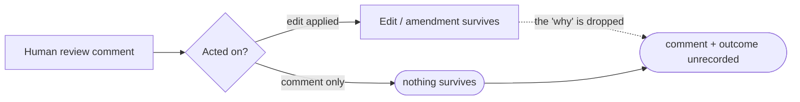

# Review-feedback capture — PRD

| Field | Value |
|---|---|
| **In one line** | A portable, append-only ledger that captures each human review comment (from operator review or the code host), its disposition, and its outcome — so the factory's learning and traceability loops can read what human review taught and what happened next. |
| **Relevant-when** | planning, building, or reviewing how Pyxis captures human review feedback and its resolution; triaging a case where a human comment or its outcome went unrecorded; changing operator review, the code-host adapter, `review-report/v1`, the Argus ledgers, or the amendment `Learned-from` field. |
| **Status** | Draft — problem review pending |
| **Tier** | T2 |
| **Owner** | @mdarabi |
| **Approver(s)** | @mdarabi (operator) |
| **Contributors** | @mdarabi (solo operator; sign-offs collapse to the introducing PR's review — Appendix-A rule 15) |
| **Informed** | — |
| **Date** | 2026-07-12 created · 2026-07-12 last updated |
| **Appetite** | Medium, foundational, hard-capped at "capture + prove one consumer." **Machine work:** one new capture class (schema + coded writer) + two source-capture adapters (operator comment persistence, code-host comment ingestion) + the derived-signal definitions + one consumer wiring + the cross-citation grammar. **Human attention:** the operator authoring + reviewing this contract; ~zero ongoing review toil (capture is automatic). **Rollout/support:** low — additive data, no gate or merge-path change. **Excludes:** the self-optimization engine, backend scorecards, any UI, and any migration of existing captures (§3.4). |
| **Target release** | No fixed release — this is the capture substrate the specified self-optimization and traceability requirements depend on; it unblocks them rather than shipping with them. |
| **Tracking** | — *(the introducing PR/epic, once filed)* |
| **Artifacts** | `brainstorm:review-feedback-capture` — the gated stage-1 record this PRD synthesizes (`docs/brainstorms/review-feedback-capture.md`). |
| **Template version** | prd-template/v1 |

## 1. Summary — the one-pager

- **Problem** — When a human reviews a PRD or design — through operator review or the code host — and leaves feedback, Pyxis records the resulting edit but not the comment or what happened after it. The feedback loop is lost: nothing can learn from it, and no change can be traced to the human judgment that caused it.
- **For whom** — The factory's own learning and traceability subsystems (the reviewer-calibration consumer now; self-optimization and end-to-end traceability later). The human reviewer is the *source* of the signal, not the target.
- **Why now** — The consumers are already specified — self-optimization names the exact signals it learns from (review-rejection rate, human edit-distance, feedback-round counts), traceability is meant to carry the outcome, and the amendment `Learned-from: review-thread` field already points at review threads — but the capture those all assume was never built. The loops run starved; the pointer resolves to nothing.
- **Direction** — One append-only *review-feedback ledger* that captures the comment verbatim with its attribution and subject link, closes each entry to a typed disposition and outcome, and serves derived signals to one wired consumer. It is **federated**: existing partial captures stay untouched and are cross-linked, not migrated.
- **Appetite** — Medium and hard-capped (header). It builds the substrate and proves one consumer; it does not build the optimization loop, scorecards, a UI, or touch the reviewers' or Argus's own captures.
- **Success** — Every captured entry reaches a typed disposition (closability ≈ 100%), and the one wired consumer demonstrably reads the ledger (computes ≥ 1 derived signal from it and cites ≥ 1 entry).
- **Guardrail** — Human review stays an *optional overlay*: the pipeline never gains a dependency on human review being present, and the change adds no ongoing human review toil and no gate/merge-path regression.
- **Top risks** — (1) a write-only ledger nothing actually reads; (2) determining an entry's disposition is unreliable or costly; (3) verbatim comments carry sensitive content.

## 2. Problem space

### 2.1 Problem statement

Human review is one of Pyxis's few remaining human touches (pipeline stages 2, 5, 9), and the judgment it produces is discarded the moment it is acted on. In the operator conversation, a reviewer's comment can drive an edit and then disappear — the edit survives, the reasoning does not. On the code host, review comments live outside the corpus entirely. So the system keeps the *what changed* and loses the *why*, and it keeps nothing at all when a comment changes nothing. The cost of doing nothing compounds: the self-optimization program the vision has already committed to has no signal to consume, provenance cannot answer "which human judgment caused this change," and the amendment ledger's `Learned-from: review-thread` citation is a pointer to content that was never stored.

### 2.2 Users and segments

*This is internal factory infrastructure; the "user" is the consuming subsystem. Attributes are rated on the axes that change a §4/§5 decision.*

| Segment | Role and context | Domain exp. | Tech exp. | Key goals | Pain today | Evidence |
|---|---|---|---|---|---|---|
| **P1 (primary)** | The factory's learning + traceability subsystems, as *consumers* of the signal: the reviewer-calibration path now; self-optimization and traceability later | master | master | read closable, computable feedback signal; resolve a change back to its cause | the signal is never captured; there is nothing to read | `brainstorm:review-feedback-capture#F-1`, `#F-3`, `#F-7` |
| P2 (secondary) | The human reviewer, as the *source* of the signal (and incidental beneficiary — can see what happened to a comment) | — | journeyman·master | leave feedback once; have it acted on and remembered | comment + outcome vanish after the edit | `brainstorm:review-feedback-capture#F-9` |
| **Anti-segment** | Teams wanting a human-review *workflow/management* product — threaded discussions, assignments, review dashboards | — | — | — | — | — *(deliberate: this captures data for the factory to learn from; it is not a review tool for people to operate)* |

### 2.3 Jobs and desired outcomes

| # | When… (situation) | I want to… (motivation) | So I can… (outcome) | Today's workaround | Evidence |
|---|---|---|---|---|---|
| J1 | a human leaves a review comment on a PRD/design (operator review or code host) | record it verbatim, attributed, and linked to its subject | later know exactly what a human said and about what | none — operator review discards it; code-host comments stay off-substrate | `#F-9` |
| J2 | that comment has been acted on (or not) | close the loop — attach a typed disposition and an outcome reference | know *what happened after* every comment, with nothing left dangling | none — only the resulting edit survives, without the link | `#F-7` |
| J3 | a consumer needs to learn from human review | serve derived measures (review-rejection rate, edit-distance, disposition counts) computable from the ledger | improve the factory's own artifacts on real signal | none — signals are named by their consumer but never produced | `#F-1`, `#F-3` |

### 2.4 Evidence

| Claim | Source | Confidence |
|---|---|---|
| Self-optimization is specified to learn from review-rejection rate, human edit-distance, and feedback-round counts — none of which are captured | `brainstorm:review-feedback-capture#F-1` (vnext-self-improvement §VNEXT-15) | High |
| The reviewers capture only their own dispositions + the post-approve "M2 residual"; the general human-review comment is uncaptured | `#F-3` (prd-review-artifacts; brainstorm:authoring-reviewers) | High |
| The amendment envelope already requires `Learned-from`, whose classes include `review-thread`, but the thread content is not stored | `#F-7` (amendment model; glossary) | High |
| conversation review comments are acted on but are not automatically retained as durable evidence | `#F-9` (operator conversation) | High |
| Human review is an optional overlay the reviewers assume absent — capturing it must not become a dependency | `#F-4` (brainstorm:authoring-reviewers) | High |

### 2.5 The journey today

| Phase | User does | User feels / pain | Frontstage | Backstage |
|---|---|---|---|---|
| Review (doc) | comments on a PRD/design in the operator conversation | "did anyone keep why I said this?" | comment → clarified edit → apply | edit applied to the source doc; **comment not durably captured** |
| Review (code host) | comments / requests changes on a PR or issue | "this lives in GitHub, not in Pyxis" | code-host review UI | comment stays on the host; **nothing ingests it** into the corpus |
| After | — | "what happened to my comment?" | the merged change | the edit/amendment survives; the **triggering comment + outcome link do not** |

### 2.6 Opportunity and why now

- **Size** — Every human review of every PRD, design, and code proposal, across every pipeline run — the full width of the remaining human-in-the-loop surface.
- **Alternatives users have** — Read GitHub threads by hand (off-substrate, unqueryable); infer intent from the diff (lossy); do without (today).
- **Why us / strategic fit** — This is the missing upstream node of the traceability chain and the fuel the self-improvement program was designed to burn; only the factory that runs the reviews can capture them portably.
- **Why now** — The consumers are already specified and the `Learned-from: review-thread` seam already exists; building the substrate now — before more partial captures diverge — is the cheapest moment, the same argument the ledger and record conventions each exploited at their birth.
- **Cost of doing nothing** — Self-optimization stays un-fuelled, provenance stays broken, and every review keeps discarding paid-for human judgment.

**Decision:** Problem gate — signed via the introducing PR's operator review (solo operator; Appendix-A rule 15).

| Reviewer | Role | Date | Verdict |
|---|---|---|---|
| @mdarabi | operator | — | pending (via introducing PR) |

## 3. Goals, metrics, and guardrails

### 3.1 Goals as falsifiable hypotheses

| # | We believe that… | Will result in… | Measured by… |
|---|---|---|---|
| G1 | capturing the human-review loop (comment + disposition + outcome) as a closable, computable ledger | the factory can learn from and trace human review instead of discarding it | M1 (closability), M2 (consumer-proof), M4 (provenance) |
| G2 | making capture automatic and additive | no new human review toil and no dependency on human review being present | M3 (coverage) + the §3.3 guardrails |
| G3 *(qualitative)* | closing the loop visibly | reviewers experience their comments as remembered and resolved, not dropped | the operator's own observation at review that a comment's outcome is visible in the ledger (solo operator; Appendix-A rule 15 — no ceremonial interview) |

### 3.2 Goals → signals → metrics

*Checkpoints are observable exposure conditions, never dates.*

| Metric | Goal | Signal | Baseline | Target (at checkpoint) | Feeds from |
|---|---|---|---|---|---|
| **M1 (primary)** | G1 | captured entries that reach a typed disposition | 0 (no ledger) | 100% closable; zero entries unresolved past their subject's merge without a flagged pending state — at the checkpoint *(first cohort of human reviews captured at 100% enablement on the pyxis repo)* | EVT-2 |
| **M2 (primary)** | G1 | the wired consumer actually reads the ledger | none | ≥ 1 derived signal computed from the ledger **and** ≥ 1 consumer datum citing a ledger entry — same checkpoint | EVT-3 |
| M3 | G2 | human review touchpoints at the two sources that produce an entry | 0 | ≥ 99% of touchpoints produce an entry (capture failures — tracked via UB-1 — are the only expected shortfall); any gap is itself visible in the ledger — at the checkpoint cohort | EVT-1 |
| M4 | G1 | human-caused changes that resolve back to a ledger entry | 0 | a human-caused change resolves to its entry (`Learned-from: review-thread` points somewhere real) — same checkpoint | EVT-1, EVT-2 |

*Explicitly not a metric here: "the reviewers' M2 residual falls / the reviewers measurably improve." That is the optimizer's payoff (NG-1), downstream of this feature; claiming it would judge this contract on an outcome it scopes out (`brainstorm:review-feedback-capture#D-5`).*

### 3.3 Guardrails and decision rule

| Guardrail metric | Threshold | Action if breached |
|---|---|---|
| Reviewers' no-human-dependency posture | any pipeline path becomes unable to complete without a human review present | stop — protocol violation (NR-2) |
| Added ongoing human review toil | any new required human step in the review flow | stop / redesign (the feature is capture, automatic) |
| Gate / merge-path behavior | any change to merge authorization, required checks, or the risk lanes | stop — out of scope (NR-3) |
| Capture cost | capture adds a per-review cost above a bounded ceiling set in the technical design | pause; move disposition determination to the cheaper mechanism (P-1) |

**Ship rule (pre-registered):** M1 = 100% closable AND M2 satisfied AND no guardrail breached → adopt; M1 high but M2 unmet → the ledger is write-only, iterate on the consumer wiring before widening; any guardrail breached → roll back capture (additive, so review is unaffected).

### 3.4 Non-goals and waiting room

| ID | Non-goal | Why refused |
|---|---|---|
| NG-1 | The self-optimization *engine* — the measure→propose→trial→adopt loop and its cohort/A-B machinery | a separately-specified program; this feature only *produces* the signal it consumes (`#D-2`, `#O-1`) |
| NG-2 | Backend scorecards / routing intelligence | the routing instance of the optimization loop, not this feature (`#O-2`) |
| NG-3 | Any review-management or analytics UI / dashboard | the ledger is data; a human-facing surface is a separate concern (`#O-3`) |
| NG-4 | Any change to the reviewers' "no human dependency" posture | human review stays an optional overlay; this captures it, never makes the pipeline depend on it (`#O-4`) |
| NG-5 | Migrating or modifying `review-report/v1` or the Argus ledgers | they stay untouched; this feature only *adds* cross-links to them (`#D-6`, `#O-5`) |

| ID | Waiting room | Revisit when / intended version |
|---|---|---|
| WR-1 | A consumer that runs the self-optimization loop on this ledger | when the ledger has accumulated enough captured reviews to be worth optimizing on, and NG-1's engine is scheduled |
| WR-2 | Broadening consumers beyond reviewer-calibration (e.g. code-side proposal signal, Argus authority calibration) | when a second consumer is ready to read the ledger |
| WR-3 | Graduating the ledger to a docgate-governed class (structure lint + CI freeze) | when the schema is stable across the first several real entries (the record/ledger conventions' own staging posture) |

## 4. Solution space

### 4.1 Approach and alternatives considered

The chosen shape is a **federated review-feedback ledger**: one append-only home of record for the genuinely-uncaptured general human-review comment, capturing at the two human sources (operator review, code host), closing every entry to a typed disposition + outcome, and cross-linking to the existing partial captures rather than absorbing them.

| Option | Sketch | Why not chosen |
|---|---|---|
| **A (chosen)** | federated home-of-record ledger + cross-links; existing captures untouched | — |
| B — Subsume | migrate `review-report` M2 and Argus `E-n` to write into one physical ledger | re-opens two merged designs (large blast radius) and couples captures serving different beneficiaries (`#D-6`) |
| C — Event-stream only | capture feedback as `DomainEvent`s in the event log | loses the per-subject, closable comment→disposition→outcome structure that J2 needs |
| D — Extend `review-report/v1` | fold general feedback into the reviewer's own report | couples to the reviewer; doesn't cover non-reviewer-mediated or code-host touchpoints |
| Do nothing | — | the learning loops stay starved and provenance stays broken (§2.6) |

### 4.2 Scope perimeter

- **In (plan of record)** — the ledger + its coded writer; capture from the operator conversation and the code host through independent adapters; closability (typed disposition on every entry); the derived-signal definitions; one consumer wiring (the reviewer-calibration / M2 path); the cross-citation grammar (incl. making `Learned-from: review-thread` resolvable).
- **Future (believed next, not committed)** — the optimization loop (WR-1); further consumers (WR-2); docgate governance of the class (WR-3).
- **Out** — NG-1…NG-5.

### 4.3 Experience: flows and states

*No new human-facing UI ships (NG-3); "experience" here is the capture behavior at each source and its failure states. Accessibility/localization: n/a — no new human surface.*

**Flow F1 — operator review capture (serves J1, J2)**

| Step | User does | System responds | States covered | Design |
|---|---|---|---|---|
| 1 | comments on a document in the operator conversation | applies the clarified edit *(unchanged)* **and** writes a ledger entry: comment verbatim, author, timestamp, subject anchor | ideal · empty · partial · error | tech design |
| 2 | (later) the edit merges / is declined | the entry's disposition + outcome reference are set | ideal · partial | tech design |

**Flow F2 — code-host capture (serves J1, J2)**

| Step | User does | System responds | States covered | Design |
|---|---|---|---|---|
| 1 | comments / requests changes on a proposal or issue | the code-host adapter ingests the comment into a ledger entry with the same fields | ideal · loading · error | tech design |
| 2 | the proposal merges / the comment is resolved | the entry's disposition + outcome reference are set | ideal · partial | tech design |

- **Empty** — no comments on a subject → no entries; absence is not an error.
- **Loading** — ingestion in flight (webhook/poll) → the entry lands eventually; review never blocks on it.
- **Partial** — comment captured, disposition not yet known → entry is *open* with a flagged pending disposition, never dropped.
- **Error** — capture write fails → the review still completes and the comment is not lost (queued/retried); capture is additive, never on the critical path.
- **Accessibility / Localization** — n/a (no new human surface).

### 4.4 Scenarios

- **PRD operator review** — The operator comments on a draft PRD three times in conversation; each comment applies its edit and lands a ledger entry; when the PR merges, each entry closes `applied` with the commit reference. The reviewer-calibration consumer later reads three entries and computes an edit-distance signal.
- **Code PR, changes requested** — A human requests changes on a proposal; the adapter ingests the comment; on merge the entry closes `applied` with the amendment id, and the amendment's `Learned-from: review-thread` resolves to that entry.
- **Comment declined** — A reviewer suggests a change the author declines with a reason; the entry closes `declined-with-reason` — captured, closed, and available as signal, not silently dropped.

**Decision:** Solution gate — signed via the introducing PR's operator review; zero solution-blocking TBDs (the open questions in §7.2 are stage-3 *mechanism*, not product decisions).

| Reviewer | Role | Date | Verdict |
|---|---|---|---|
| @mdarabi | operator | — | pending (via introducing PR) |

## 5. System requirements

### 5.1 Functional requirements

| ID | Requirement (EARS) | Rationale | Priority | Risk | Fit criterion | Verify | Traces to |
|---|---|---|---|---|---|---|---|
| FR-1 | When an operator review comment is explicitly captured from the conversation, the system shall record a ledger entry carrying the comment verbatim, its author, its timestamp, and its subject anchor. | capture the operator review touchpoint (J1) | Must | med | for a session with N captured comments, N entries exist, each with all four fields populated | Test | G1, J1, F1 |
| FR-2 | When a human review comment is left on a code-host proposal or issue, the system shall ingest it, through the code-host adapter, into a ledger entry with the same fields as FR-1. | capture the code-host touchpoint (J1), medium-neutrally | Must | med | a comment left on a test proposal produces one entry with all fields; ingestion goes through the adapter, not host-specific engine code | Test | G1, J1, F2 |
| FR-3 | The system shall require every ledger entry to carry a typed disposition drawn from a closed set — `applied`, `declined-with-reason`, `became-incident`, `no-action` — and an outcome reference where the disposition implies one. | close the loop; no capture-and-forget (J2) | Must | med | 100% of entries carry a disposition value in the closed set; `applied`/`became-incident` entries carry an outcome reference | Test | G1, J2 |
| FR-4 | When a captured comment results in a change, the system shall link its entry to the resolving artifact (commit or amendment id) and make the amendment `Learned-from: review-thread` citation resolve to that entry. | provenance edge; upgrade the dead pointer (J2, M4) | Must | med | for a change driven by a captured comment, the entry names the resolving artifact and the artifact's `Learned-from` resolves to the entry by the citation grammar | Demo | G1, J2, F7 |
| FR-5 | The system shall expose, computable from the ledger alone, the review-rejection rate, human edit-distance, and disposition counts, per subject class. | serve the signal (J3) | Must | med | each of the three measures is computed from ledger contents with no external state, for at least one subject class (their precise definitions — rejection-rate denominator, edit-distance unit — pinned in the tech design, Q5) | Test | G1, J3, F1 |
| FR-6 | The system shall wire the reviewer-calibration / M2-residual path to read the ledger. | prove the substrate is consumed — the anti-write-only guarantee | Must | med | the reviewer-calibration path computes ≥ 1 derived signal from the ledger and cites ≥ 1 ledger entry | Demo | G1, M2 |
| FR-7 | The ledger shall be append-only and repo-portable, holding no dependency on any single code host. | contractual data; no privileged substrate (AP-5, vision §2) | Must | med | the ledger is readable and complete from the repo with no host API; entries are added, never rewritten (a disposition change is an appended transition) | Inspection | G2, F7 |
| FR-8 | The system shall cross-link entries to the reviewer M2 residual and the Argus `E-n` dispositions without modifying `review-report/v1` or the Argus ledgers. | federate, don't subsume (`#D-6`) | Must | med | cross-links resolve in both directions; `review-report/v1` and `argus-artifacts` files are unchanged by this feature | Inspection | J2, NG-5 |
| FR-9 | The system shall write ledger entries only through a coded writer, never by hand-authoring. | corpus discipline (AP-10); integrity | Should | low | no code path or guide instructs a human to hand-write an entry; the writer is the sole producer | Inspection | G1 |

**Non-regression (NR-n)**

| ID | Existing behavior protected | Why protected | Risk | Fit criterion | Verify | Traces to |
|---|---|---|---|---|---|---|
| NR-1 | the operator conversation's clarify-before-edit behavior | capture is additive and must not change how review edits work | med | conversation capture tests show that review can proceed when capture is disabled or fails; capture is a separate write | Test | F1 |
| NR-2 | The reviewers' no-human-dependency posture | human review stays an optional overlay (NG-4) | high | no pipeline path acquires a required human-review step; the reviewers' suites pass unchanged | Test | G2 |
| NR-3 | Merge authorization, required checks, and risk lanes | this feature touches none of the merge path (NG within scope) | high | no change to gate/merge-path code or config; their tests pass unchanged | Test | G2 |
| NR-4 | `review-report/v1` and the Argus ledgers | federation leaves them untouched (NG-5) | med | those files and their tests are unchanged | Inspection | FR-8 |

### 5.2 Unwanted behavior and failure handling

| ID | If… (trigger) | Then the system shall… | User sees | Priority | Risk | Fit criterion | Verify | Traces to |
|---|---|---|---|---|---|---|---|---|
| UB-1 | If a ledger write fails during capture | complete the review normally and preserve the comment for retry | review unaffected; comment not lost | Must | med | in N simulated write failures, zero comments lost and zero reviews blocked | Test | F1, FR-1 |
| UB-2 | If the code host is unavailable during ingestion | queue and retry idempotently | eventual entry; no duplicate | Must | med | comment ingested exactly once after the host recovers | Test | FR-2 |
| UB-3 | If a captured comment produces no change | close the entry `no-action` with a reason | entry closed, not dangling | Must | low | zero entries remain open with no disposition after their subject's merge without a flagged pending state | Test | FR-3 |
| UB-4 | If the same comment arrives twice (webhook + poll) | record it once (idempotent on comment identity) | one entry | Must | med | duplicate delivery yields exactly one entry | Test | FR-2 |
| UB-5 | If a disposition cannot yet be determined | keep the entry open with a flagged pending-disposition state | entry visible as pending | Must | med | such entries are queryable as pending; none is silently closed or dropped | Test | FR-3 |
| UB-6 | If a captured entry's subject anchor no longer resolves (subject superseded/retired, or its branch/PR deleted) | retain the entry and flag the anchor as stale | entry preserved, marked stale-subject | Must | low | a superseded/deleted subject leaves its entries intact and queryable, flagged stale; zero entries dropped | Test | FR-7 |

### 5.3 Permissions and abuse cases

| Function / data | The coded writer | Consumers (reviewer-calibration, later loops) | Humans |
|---|---|---|---|
| Ledger entry | write (append) | read | read |
| Disposition / outcome | write (append transition) | read | read |

| ID | Actor and intent | Vector | Impact | Severity | Mitigated by | Verify |
|---|---|---|---|---|---|---|
| ABUSE-1 | A bad or garbage review comment inflates or poisons the signal | many low-value comments captured verbatim | skewed derived measures | med | attribution on every entry; derived signal is advisory and calibration changes require explicit review, never automatic application (NR-2, and the reviewers' calibration posture) | Inspection |
| ABUSE-2 | A captured verbatim comment leaks sensitive content into the corpus | personal/sensitive text in a comment | unwanted disclosure | med | the redaction/access posture decided in the technical design's Security section (P-3) | Inspection / drill |

### 5.4 Data

| Entity / field | Meaning | Source of truth | Retention | Integrity rules | Privacy class |
|---|---|---|---|---|---|
| ledger entry . comment | the human's review comment, verbatim | the ledger (repo-internal) | append-only, permanent (provenance) | never edited after write | internal (may carry handles) |
| ledger entry . attribution | author + timestamp | the ledger | permanent | immutable | internal |
| ledger entry . subject anchor | the reviewed PRD/design/proposal + anchor | the ledger | permanent | must resolve | internal |
| ledger entry . disposition + outcome-ref | typed disposition and resolving-artifact reference | the ledger | permanent | disposition in the closed set (FR-3); transitions appended, never rewritten | internal |

- **Migration** — none: a new class; existing captures are untouched (NG-5).
- **Parallel-run / cutover** — n/a (additive; nothing is replaced).
- **Rollback** — capture is additive; disabling it stops future entries and affects no review or merge.
- **Decommission** — n/a for the substrate.
- **Privacy check** — verbatim human text may carry identities/@mentions/sensitive context; the redaction and access posture is decided in the technical design's mandatory Security subsection (P-3). Precedent: OBS-6 redacted capture; the Argus ledgers (repo-internal markdown, impact none).
- **Egress** — none new: the ledger is repo-internal. Code-host ingestion is *inbound* (reading comments the host already holds), not egress.

### 5.5 Interfaces and integrations

| Interface | Direction | Purpose | Contract | Failure modes | Owner |
|---|---|---|---|---|---|
| operator conversation | in | source of review comments to capture | explicit comment content + author + timestamp + subject anchor | write fails → UB-1 | this feature + operator |
| code-host adapter | in | ingest review comments medium-neutrally | comment identity, author, body, subject | host down → UB-2; dup → UB-4 | this feature + adapter |
| amendment `Learned-from` | both | make `review-thread` resolve to a ledger entry | the shared citation grammar (P-2); `Learned-from` is defined in the **merged** amendment model, so any change to its resolution semantics evolves by supersession, never a silent edit | dangling citation → flagged | amendment model (merged) + this feature |
| `review-report/v1`, Argus `E-n` | both (read + cross-link) | federate without migration | cross-citation only; no writes into them (FR-8) | broken cross-link → flagged | this feature (read-only side) |
| reviewer-calibration consumer | out | read the ledger, compute signal | derived-signal contract (FR-5) | none — advisory | this feature |

### 5.6 Non-functional requirements

| ID | Area | Requirement | Fit criterion | Verify |
|---|---|---|---|---|
| NFR-1 | Performance | Capture shall run off the review's critical path. | the review flow's completion time is unchanged by capture (no synchronous wait on the ledger write) | Test |
| NFR-2 | Integrity | Entries shall be append-only; a disposition change is an appended transition, not a rewrite. | no entry's captured text or attribution changes after write; history is reconstructable | Inspection |
| NFR-3 | Portability | The ledger shall be readable and complete from the repository with no code-host API. | full read achievable offline from the repo | Inspection |
| NFR-4 | Security / privacy | Captured comments shall follow the redaction/access posture set in the technical design (P-3). | the posture is stated and applied; no un-redacted sensitive class ships without a decision | Inspection |
| NFR-5 | Cost | Capture cost shall stay within a bounded ceiling set in the technical design. | per-review capture cost ≤ the stated ceiling; no unbounded per-comment external call unless the design justifies it | Analysis |

### 5.7 Instrumentation — the tracking plan

| ID | Event name | Fires when | Properties (typed) | Source | Feeds |
|---|---|---|---|---|---|
| EVT-1 | feedback_captured | a ledger entry is written | source: enum(conversation·code-host), subject: string, author: string | writer | M3, M4 |
| EVT-2 | feedback_disposed | an entry receives its typed disposition | disposition: enum, outcome_ref: string? | writer | M1, M4 |
| EVT-3 | feedback_signal_read | a consumer computes a derived signal from the ledger | signal: string, subject_class: string | consumer | M2 |

### 5.8 Definition of Done

| ID | Done criterion | Source | Verify | Required evidence | Blocking? |
|---|---|---|---|---|---|
| DOD-1 | All Must FRs pass their fit criteria | FR-1..FR-8 | Test | CI run link | yes |
| DOD-2 | No non-regression row broken (operator review, reviewers' posture, merge path, existing captures) | NR-1..NR-4 | Test | suite results | yes |
| DOD-3 | Closability: every captured entry reaches a typed disposition or a flagged pending state (M1) | FR-3, UB-3, UB-5 | Test | ledger inspection + test run | yes |
| DOD-4 | Consumer-proof: the reviewer-calibration path computes ≥ 1 signal from and cites ≥ 1 entry (M2) | FR-6 | Demo | demo record | yes |
| DOD-5 | Provenance: a human-caused change resolves back to its ledger entry (M4) | FR-4 | Demo | demo record | yes |
| DOD-6 | The redaction/access posture is decided and applied (P-3) | NFR-4, ABUSE-2 | Inspection | tech-design Security section | yes |
| DOD-7 | No new human-facing UI shipped (NG-3) and no gate/merge-path change (NR-3) | NG-3, NR-3 | Inspection | diff review | yes |

### 5.9 AI behavior and evals

Skipped: the capture substrate is deterministic. If the technical design chooses to *infer* a disposition with a model (one option under P-1), that mechanism carries its own EVAL rows in the design; the PRD does not presume it.

## 6. Delivery

### 6.1 Phasing and milestones

| Phase | Purpose | Scope | Exit criterion |
|---|---|---|---|
| Pilot | prove capture + closability on real reviews | operator review capture on the pyxis repo's own PRD/design reviews | a cohort of real reviews captured; M1 = 100% closable |
| Beta | prove the second source + the consumer | add code-host ingestion; wire the reviewer-calibration consumer | M2 satisfied (signal computed + cited); M3 coverage holding |
| GA | full substrate | both sources + consumer + provenance | §6.4 criteria green |

### 6.2 Dependencies

| Dependency | Type | Needed by | Status | Owner |
|---|---|---|---|---|
| conversation capture adapter | system | Pilot | confirmed (in-repo) | @mdarabi |
| code-host adapter (comment ingestion) | system | Beta | confirmed (in-repo) | @mdarabi |
| amendment model — `Learned-from: review-thread` resolution | system (merged design) | Beta | in-repo; if resolution semantics change, evolves by supersession, not a silent edit | @mdarabi |
| `review-report/v1`, Argus ledgers (cross-link targets) | system | Beta | confirmed (in-repo, read-only) | @mdarabi |

### 6.3 Risks, assumptions, and rabbit holes

| # | Risk / assumption / rabbit hole | Likelihood | Impact | Mitigation or test | Owner |
|---|---|---|---|---|---|
| R1 | Determining a disposition (P-1) balloons the budget | M | M | start with the deterministic path (writer-tags-at-resolution / inferred-from-merge); defer any model inference | @mdarabi |
| R2 | A write-only ledger nothing reads | M | H | FR-6 (consumer wiring) is a Must and DOD-4 blocks on it | @mdarabi |
| R3 | Verbatim comments carry sensitive content | M | M | P-3 redaction posture in the tech design (NFR-4, ABUSE-2) | @mdarabi |
| R4 | Cross-citation grammar (P-2) grows complex | L | M | reuse the existing citation grammar rather than inventing one | @mdarabi |

### 6.4 Release criteria

| Lens | Criterion | Evaluated by |
|---|---|---|
| Functionality | all Must FRs pass their fit criteria | CI / test suite |
| Reliability | zero comment loss and zero blocked reviews across capture-failure drills (UB-1, UB-2) | failure injection |
| Supportability | the ledger is greppable and a coverage gap is visible in it | inspection |
| Data integrity | entries append-only; existing captures unchanged (NFR-2, NR-4) | inspection |

### 6.5 Rollout and reversibility

- **Flag** — per source: operator review capture, and code-host ingestion — each independently enableable; owner @mdarabi.
- **Kill switch** — disable capture; reviews and merges proceed unchanged (capture is additive and off the critical path).
- **Experiment** — none (not an A/B; adoption is measured by M1–M4, not a split).
- **Cutover/migration** — none (§5.4).

| Stage | Audience | Minimum evidence | Advance when | Roll back when |
|---|---|---|---|---|
| pyxis repo (canary) | the factory's own reviews | a cohort of real reviews captured | M1 = 100% closable, guardrails clean | any §3.3 breach |
| all onboarded repos | wider | per-source capture stable | M2 satisfied, M3 holding | §3.3 rule |

### 6.6 Launch readiness

| Area | Item | Owner | Status |
|---|---|---|---|
| Support | the ledger + its query surface documented (AGENTS.md / wiki) | @mdarabi | ☐ |
| Docs | AGENTS.md layout row + glossary term (`review-feedback ledger`) | @mdarabi | ☐ |
| Enablement | n/a (internal infrastructure) | — | n/a |
| Legal & privacy | redaction posture decided (P-3) | @mdarabi | ☐ |
| Pricing & billing | n/a | — | n/a |
| Marketing & comms | n/a | — | n/a |
| Platform | the code-host adapter's comment-ingestion contract | @mdarabi | ☐ |
| Localization | n/a | — | n/a |

**Decision:** Launch gate — §6.4 green, §6.6 owned, kill switch rehearsed. Signed via the introducing PR / tracking ref.

| Reviewer | Role | Date | Verdict |
|---|---|---|---|
| @mdarabi | operator | — | pending |

### 6.7 Post-launch review

- **Review trigger** — a cohort of human reviews captured at full enablement on the pyxis repo · **Owner** — @mdarabi.
- **Verdict recorded** — adopt / iterate / kill, with the M1–M4 evidence, on the header's Tracking ref (post-merge lifecycle lives in the tracker; contract consequences travel as amendments citing the verdict).

## 7. Alignment

### 7.1 FAQ

**Internal**

- **Q:** Does this make the pipeline depend on human review being present? — **A:** No. Human review stays an optional overlay; capture happens when review happens and changes nothing when it doesn't (NG-4, NR-2).
- **Q:** Does it touch the reviewers' reports or the Argus ledgers? — **A:** No — it cross-links to them read-only; they are unchanged (NG-5, FR-8).
- **Q:** Isn't a captured-but-unread ledger just write-only overhead? — **A:** That's the primary risk; FR-6 wires one real consumer and DOD-4 blocks the release on it.
- **Q:** What about sensitive content in comments? — **A:** The redaction/access posture is decided in the technical design's Security section (P-3, NFR-4).
- **Q:** Are we building the self-optimization loop? — **A:** No — that's NG-1; this produces the signal that loop will one day consume.

### 7.2 Open questions

*All are stage-3 mechanism, not product decisions — none blocks the solution gate.*

| # | Question | Owner | Needed by | Status |
|---|---|---|---|---|
| Q1 | How is a disposition/outcome *determined* — writer-tagged at resolution, inferred from the merge/amendment, or human-confirmed? | technical design | technical design | open (`brainstorm:review-feedback-capture#P-1`) |
| Q2 | The cross-citation grammar — how an entry cites the resolving artifact and links reviewer M2 / Argus `E-n`, and how `Learned-from: review-thread` resolves to a ledger anchor | technical design | technical design | open (`#P-2`) |
| Q3 | The privacy/redaction + access posture for captured verbatim comments | technical design | technical design | open (`#P-3`) |
| Q4 | The ledger's physical home and schema (name adopted: `review-feedback ledger`, routed to the glossary) | technical design | technical design | open (`#T-1`) |
| Q5 | Precise definitions of the derived measures — review-rejection-rate denominator, human-edit-distance unit — so FR-5's computation is verifiable | technical design | technical design | open |

### 7.3 Decision log

| Date | Decision | Alternatives considered | Why | Who |
|---|---|---|---|---|
| 2026-07-12 | Hybrid framing: one unified feedback ledger, consumer-gated, entries as provenance nodes | learning-corpus-only; provenance-node-only; unified-ledger-only | the pain is "not stored" (artifact), the corpus rejects write-only ledgers (named consumer), the `Learned-from` seam is cheap to resolve (`brainstorm:review-feedback-capture#D-1`) | @mdarabi |
| 2026-07-12 | Scope = capture substrate + one proven consumer; optimizer/scorecards/UI out | capture-only; capture + full optimizer | capture is the missing piece; the optimizer is a separate program (`#D-2`) | @mdarabi |
| 2026-07-12 | Beneficiary = the factory's learning/traceability loops; human reviewer is the source; anti-segment = review-UX product | human reviewer as primary beneficiary | keeps the feature a learning input, not a review tool (`#D-3`) | @mdarabi |
| 2026-07-12 | Jobs = capture / close-the-loop / serve-the-signal, every entry closable | fewer/looser jobs | closability prevents capture-and-forget (`#D-4`) | @mdarabi |
| 2026-07-12 | Success = closability + consumer-proof + coverage + provenance; the optimizer payoff excluded | judging on "M2 residual falls" | judge on what this builds, not the outcome it scopes out (`#D-5`) | @mdarabi |
| 2026-07-12 | Federate, not subsume — home-of-record + cross-links; existing captures untouched | subsume (migrate M2 + Argus `E-n`) | subsume re-opens two merged designs; federation is "one place to look" via citations (`#D-6`) | @mdarabi |
| 2026-07-12 | Appetite = medium, foundational, hard-capped at "capture + prove one consumer" | larger (include optimizer); smaller (capture-only) | build the substrate well; hard-cap keeps it a bounded learning input (`#D-7`) | @mdarabi |

### 7.4 Changelog

| Date | Change | Author |
|---|---|---|
| 2026-07-12 | 000-base created from `brainstorm:review-feedback-capture` (gated ready-for-prd) | @mdarabi |

## 8. Contract readiness — the executability gate

| Check | Pass? | Notes |
|---|---|---|
| Problem basis accepted — §2 problem gate signed (T2) | ☐ | pending the introducing PR's operator review |
| Zero solution-blocking TBDs or open questions (§7.2) | ☑ | all §7.2 items are stage-3 mechanism, not product decisions |
| Every Must FR has a fit criterion and a verification method (§5.1) | ☑ | FR-1..FR-8 |
| Every requirement row carries a risk tier; high/critical rows have a declared safety plan (§5.1, §6.5) | ☑ | NR-2/NR-3 high → covered by the kill switch (additive capture) + non-regression suites |
| Non-goals drawn (§3.4); non-regression rows named (§5.1) | ☑ | NG-1..NG-5; NR-1..NR-4 |
| Every primary job (§2.3) is covered by a requirement, a non-goal, or a waiting-room entry | ☑ | J1→FR-1/2; J2→FR-3/4; J3→FR-5/6 |
| Every key flow (§4.3) has functional, failure, and non-regression coverage (§5.1–5.2) | ☑ | F1/F2 → FR-1..4, UB-1..5, NR-1 |
| Every primary metric (§3.2) has instrumentation (§5.7) or a measurement plan | ☑ | M1..M4 → EVT-1..3 |
| Every blocking DoD row traces to a requirement, guardrail, release criterion, or rubric (§5.8) | ☑ | DOD-1..7 sourced |
| Risks and assumptions have owners (§6.3) | ☑ | R1..R4 |
| Human-judgment criteria name an owner and a rubric (§5.8) | ☑ | none used (DoD rows are Test/Demo/Inspection) |
| DoD complete: every blocking row sourced and evidenced; every n/a explained (§5.8) | ☑ | DOD-1..7 |
