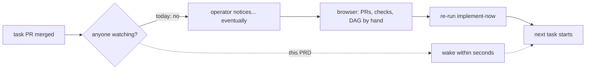

# Self-drive wake — proposal-state reads, the wake channel, and the status verb — PRD

| Field | Value |
|---|---|
| **In one line** | The factory's eyes and alarm: batched, budget-guarded proposal-state reads (merged? commented? checks?) on every supported backend, a wake channel that re-runs a waiting drive within seconds of an awaited transition (timer-only in v1, push channels as reserved plug-in slots), and a status verb that shows each wait's age — so a running drive continues by itself and the operator stops being its clock. |
| **Relevant-when** | planning, building, or reviewing the wake channel, proposal-state reads, the status verb, poll cadence, or API budget guards; triaging a drive that did not continue after a merge, a silent/stale checker, a rate-limit trip, or a wrong proposal-state read; changing the executor ports (CodeHost/WorkTracker state surface), the GitHub or Carina adapters' read paths, or anything consuming wake signals |
| **Status** | Draft — problem review pending |
| **Tier** | T2 — reversible local tooling with no new credential, listener, or egress surface; upgraded scrutiny on two spots: the port shape is a platform contract (adapters must pass its conformance kit), and a misbehaving checker shares the repo's API budget. Not T3: the wake carries zero decision authority by construction — it observes and schedules; verified advancement stays with its consumers. |
| **Owner** | @mdarabi |
| **Approver(s)** | @mdarabi via the introducing PR's operator review |
| **Contributors** | — *(solo operator; gate tables record the introducing PR's review)* |
| **Informed** | Pyxis operators; implement-now / feature-drive / argus maintainers |
| **Date** | 2026-07-29 created · 2026-07-29 last updated |
| **Appetite** | Everything-or-nothing (no internal cut-line — brainstorm:self-drive-wake#D-8): machine work = the state-read port + both adapters (GitHub batched/budget-guarded, Carina file-based) + the timer wake channel with reserved push slots + the status verb with wait ages + the write-side budget guard + conformance kits + the failure drills + the 6-task proof run on both backends. Human attention = this review, one technical-design review, and the proof-run sign-off. Rollout burden = none staged (local tooling; ships through the normal release channel). Excludes: the always-on background driver, any push adapter, any hosted relay, multi-machine coordination, cadence knobs. |
| **Target release** | Unblocks prd:feature-implementation-drive's unattended continuation (its P2 segment) and the argus wake design (brainstorm:argus-unattended-drive#P-2); independently useful the day the status verb lands. |
| **Tracking** | — |
| **Artifacts** | `brainstorm:self-drive-wake` (the gated stage-1 record, rides this PR) · `docs/research/harbormaster-self-drive-failure-taxonomy.md` (the predecessor evidence base) |
| **Template version** | prd-template/v2 |

## 0. Read to rule — the human reviewer's section (~5 min)

*The body is the contract; this section only routes attention — on any conflict the body governs; machines ignore it.*

**Judge these**

| # | The call | Could have gone | If you disagree |
|---|---|---|---|
| 1 | **Never a hosted relay** — pyxis will never run a central notify/webhook service for users | an agenticlab-hosted relay making setup one line shorter | you accept custody of every user's repo activity and a required middleman in every install → NG-3 |
| 2 | **Timer-only v1; push = reserved slots** — no listener, tunnel, or runner ships now | shipping the GitHub Actions listener channel in v1 | v1 gains a per-machine install step and a silently-failable moving part for ~10 s of latency → §4.1, FR-11, WR-1 |
| 3 | **Both backends day one** — the port shape is settled with Carina and GitHub in view | GitHub-first, Carina later | the read surface freezes around the metered medium — the exact history of today's gap → §2.4, FR-1/FR-2 |
| 4 | **Reads are batched, per-check, and marked as the medium's claim — never an aggregate badge, never laundered into goal-state** | per-proposal reads; trusting the platform's rollup and its "merged" flag | N+1 API cost at scale; a badge trusted where a required check is absent; a medium claim mistaken for mainline truth (the I2 class) → FR-2, FR-3, FR-13 |
| 5 | **A failed read means *unknown*, never *no*** | treating a rate-limited/failed probe as absence | a 429 mid-verification reads as "not merged" and drives wrong recovery — the predecessor paid for this → FR-9, UB-2 |
| 6 | **The status verb ships with wait ages** | machine-only reads, humans use the browser | "quiet" stays indistinguishable from "dead" — the predecessor's most repeated failure — and diagnosing means hand-correlating the browser → FR-7, FR-12 |
| 7 | **Everything-or-nothing appetite** — no pre-agreed cut-line; comment reads ship with v1 | cut-line dropping comment reads first | the finish line is fixed instead of the scope; a ballooning build ships late rather than thin → header Appetite, §6.3 R5 |

**Sanity-check the numbers** — merge→wake p95 ≤ 15 s (GitHub, at the ≈10 s cadence advice sized to keep p95 inside the promise) and ≤ 1 s (Carina) at the proof run (M2, NFR-2); one 50-proposal state read in ≤ 2 API round trips (FR-2); zero manual re-invocations (M1) and zero rate-limit trips (M3) across the 6-task proof run; steady-state read cost ≤ 10% of the medium's read budget per driven feature (NFR-1); measured baseline: one batched read costs 1 point of a 5,000-point budget (§2.4, measured 2026-07-29).

**The author's open questions** — Q1: what "too long" means per wait kind for the ⚠ flag (fixed default vs learned) → §7.2; Q2: how argus's contracted wake formally binds to this capability (design sequencing) → §7.2.

**Skip the rest** — structure/IDs/fold → docgate; substance and coherence → the unmanned `/prd-review`; query shapes, the throttle bucket, port homes, event schemas → the technical design (§7.2, parked constraints in the brainstorm record); security depth of the future push slots → that design's security section (v1 adds no listener).

## 1. Summary — the one-pager

- **Problem** — When a task's proposal is merged (or commented on, or fails CI), nothing in the factory notices: the operator re-runs the executor by hand after every merge and reconstructs "what is it waiting on?" from the browser. The operator is the factory's clock.
- **For whom** — Anyone running a pyxis feature drive on any pyxis-installed repo (GitHub-backed or the local Carina tracker), and the machine drivers (the feature drive, the argus unattended drive) contracted to act on completions.
- **Why now** — The consumers exist and are blocked on exactly this: the feature drive contracts "verified landing unlocks dependents" but exits at review waits; argus's wake behavior is contracted with its mechanism parked for design; and the executor ports cannot express "which proposals merged?" at all. Measured this week: the read path costs 1 API point per check for a whole feature — the capability is cheap now.
- **Direction** — Three named parts behind one contract: a **state reader** (batched per-proposal landing/check/comment state on every backend, exact and fresh, budget-guarded), a **wake channel** (timer-driven in v1: checks on the adapter-advised cadence while anything is awaited, zero cost when idle, normalized instruction-free signals, reserved plug-in slots for future push channels), and a **status verb** (one command showing each wait, its age, a too-long flag, and the checker's own liveness).
- **Appetite** — The header's budget, everything-or-nothing: both backends, all three parts, the proof run — no internal cut-line. Excludes the background driver, push adapters, hosted relays, multi-machine coordination, and knobs.
- **Success** — Zero manual re-invocations across a real 6-task feature driven on both backends (baseline today: ~5+ per feature), with merge→wake p95 ≤ 15 s (GitHub) / ≤ 1 s (Carina).
- **Guardrail** — Zero rate-limit trips (429s) across the proof run, bursts included; steady-state reads ≤ 10% of the medium's read budget.
- **Top risks** — (1) a silently-dead checker looks exactly like a quiet repo (the predecessor's #1 failure class) — countered by self-surfacing liveness (FR-12, UB-5); (2) platform API drift makes a read silently wrong or empty — countered by parse-or-defect (UB-2) and conformance against recorded ground truth; (3) comment-read edge cases balloon the build under a no-cut-line appetite — absorbed as schedule, named in R5.

## 2. Problem space

### 2.1 Problem statement

The factory can *write* to its backends — open proposals, post comments — but cannot *see* them: no port answers "which of these proposals merged? which got comments? which failed checks?" So every completion a drive waits on is discovered by a human: the operator re-runs the executor after each merge (~5+ times per feature, per the argus drive ledgers' touch counts) and diagnoses quiet periods by hand-correlating browser tabs. The cost of doing nothing: every delegated feature serializes on operator attention, the feature drive's unattended segment stays fictional, and argus's contracted wake has nothing to stand on.

### 2.2 Users and segments

| Segment | Role and context | Domain exp. | Tech exp. | Key goals | Pain today | Evidence |
|---|---|---|---|---|---|---|
| **P1 (primary)** | The operator running a feature drive on any pyxis-installed repo (GitHub or Carina), reviewing and merging each task PR | journeyman–master | journeyman–master | review + merge only; never re-invoke; see at a glance what's waiting and for how long | is the factory's clock; reconstructs state from the browser | argus drive ledgers (≥5 non-owned touches/drive, prd:argus-unattended-drive §3.2 baseline); brainstorm:self-drive-wake#D-3 |
| P2 (secondary) | Machine drivers: the feature integration drive (prd:feature-implementation-drive P2) and the argus unattended drive (prd:argus-unattended-drive FR-14) | — | — | receive a wake within a bound; read state through a port, not a medium API | no port exists; their contracts park the mechanism | brainstorm:self-drive-wake#F-1/#F-3 |
| **Anti-segment** | Fleets/orgs wanting a centrally-hosted watcher over many repos, or multi-machine shared drives | — | — | — | — | deliberate refusals NG-3, NG-5 (brainstorm:self-drive-wake#D-7) |

### 2.3 Jobs and desired outcomes

| # | When… (situation) | I want to… (motivation) | So I can… (outcome) | Today's workaround | Evidence |
|---|---|---|---|---|---|
| J1 | a task PR I just merged unblocks the next task, while my drive process is running | have the next task start by itself within seconds | keep the feature moving with review+merge as my only acts | re-run `implement-now` by hand after every merge | brainstorm:self-drive-wake#D-2/#D-6 |
| J2 | the drive has been quiet for a while | see in one command what it's waiting on, for how long, and whether that's abnormal | tell "waiting on me" from "waiting on CI" from "silently stuck" | open the browser: PRs tab, checks tab, mental dependency graph | brainstorm:self-drive-wake#D-4; prd:feature-implementation-drive J2 (manual correlating) |
| J3 | (machine) a drive awaits a named completion — a proposal merged, checks settled, a comment landed | receive a normalized wake within the configured bound and re-derive state through fresh reads | continue at the frontier without a human clock | the operator re-invokes; the argus ledgers record every such touch | brainstorm:self-drive-wake#F-1/#F-2 |

### 2.4 Evidence

| Claim | Source (research, data, tickets, interviews) | Confidence |
|---|---|---|
| No executor port can read proposal state: CodeHost = OpenProposal + per-proposal Checks only; WorkTracker.Comment is write-only | `internal/executor/port/{codehost,worktracker}.go` (read 2026-07-29); brainstorm:self-drive-wake#F-3 | High |
| One batched GraphQL read covering 50 proposals × (landing + comments + checks) costs 1 point of a 5,000-point/hr budget; cost is set by the query shape, not the PR count | live measured run, 2026-07-29 (`rateLimit { cost: 1, nodeCount: 350 }`); brainstorm:self-drive-wake#F-4 | High |
| The binding write-side limits are the platform's secondary content-generation caps; batching a review into one call roughly halves-to-thirds a task's write count | platform REST rate-limit + reviews docs (fetched 2026-07-29); brainstorm:self-drive-wake#F-5 | High |
| Zero of the predecessor's 18 recorded self-drive incidents were transport failures; the dominant classes are the silently-dead clock and swallowed evidence | `docs/research/harbormaster-self-drive-failure-taxonomy.md` §2–§3 | High |
| The predecessor built webhook-wake (tunnel + receiver) and never validated it end-to-end; its own trade study: faster polling captures ~80% of the latency win at ~zero cost | research record §4 (hm#1176 open; hm#921 verbatim) | High |
| Platform-scheduled crons are throttled by hours and unusable as a load-bearing cadence; event-dispatched triggers are immediate | research record §3.8/§5 (observed 4.5 h gaps) | Med |
| Operator touch baseline: ≥5 non-owned touches per delegated drive | prd:argus-unattended-drive §3.2 M1 baseline (the three prior drives' ledgers) | High |

### 2.5 The journey today

| Phase | User does | User feels / pain | Frontstage (what user sees) | Backstage (systems, people, processes) |
|---|---|---|---|---|
| merge | reviews and merges task PR in the browser | done my part | GitHub/Carina proposal closes | tracker state advances on the medium |
| silence | nothing — and nothing happens | why isn't it moving? | no signal anywhere | no process observes the transition |
| diagnose | opens PRs tab, checks tab, recalls the DAG | I am doing the machine's bookkeeping | browser tabs | no status surface exists |
| re-invoke | runs the executor again by hand | I am the clock | terminal | a fresh sweep re-derives the frontier and continues |

### 2.6 Opportunity and why now

- **Size** — Every multi-task feature on every pyxis repo, several transitions per task: ~5+ operator touches and unbounded notice-latency per feature, forever, without this.
- **Alternatives users have** — stay the clock (today); shell scripts polling `gh` ad hoc (unbudgeted, per-user, no Carina); the predecessor's webhook-wake (unvalidated, tunnel-bound, GitHub-only).
- **Why us / strategic fit** — the ports/adapters posture (AP-1/AP-3) is exactly what makes one contract serve GitHub and Carina; the consumers are already contracted and waiting.
- **Why now** — the feature drive and argus contracts both landed within the last fortnight and both park exactly this; the read cost was measured this week at 1 point per check; every further feature built without it re-pays the operator-as-clock tax.
- **Cost of doing nothing** — the unattended segments of two merged/drafted contracts stay unserved; adopter repos inherit the manual loop on day one.

**Decision:** Problem gate — do not proceed to §3–§4 until every contributor signs.

| Reviewer | Role | Date | Verdict |
|---|---|---|---|
| @mdarabi | operator (product + engineering) | — | pending — via the introducing PR's operator review |

## 3. Goals, metrics, and guardrails

### 3.1 Goals as falsifiable hypotheses

| # | We believe that… | Will result in… | Measured by… |
|---|---|---|---|
| G1 | giving a running drive eyes (state reads) and an alarm (wake channel) | the operator's only acts on a driven feature being reviews and merges — zero re-invocations | M1 |
| G2 | a status verb with wait ages and a too-long flag | "waiting on me" vs "waiting on CI" vs "stuck" diagnosed in one command, without the browser | M4 (qualitative drill) |
| G3 | budget guards designed in (batched reads, write throttle, unknown-on-failure) | the loop never trips the platform's limits nor mistakes a failed read for state | M3 |

### 3.2 Goals → signals → metrics

| Metric | Goal | Signal | Baseline | Target (at checkpoint) | Feeds from |
|---|---|---|---|---|---|
| M1 (primary) | G1 | operator-initiated executor invocations targeting the driven feature's scope | ~5+ per feature (argus ledgers) | 0, at the checkpoint "6-task proof feature driven end-to-end on both backends" | EVT-2, EVT-6 |
| M2 | G1 | awaited-transition → wake latency, measured from the medium-reported transition timestamp to local wake delivery (clock offset recorded in the proof-run report) | unbounded (operator memory) | p95 ≤ 15 s GitHub · ≤ 1 s Carina, at the proof run | EVT-2 |
| M3 | G3 | rate-limit responses received; read-budget share consumed | n/a (no reader exists) | 0 rate-limit trips; reads ≤ 10% of the medium's read budget, across the proof run | EVT-1, EVT-3, EVT-4 |
| M4 | G2 | quiet-state diagnosis without the browser | browser + memory | operator diagnoses N of N seeded quiet-states correctly from the status verb alone, at the proof run (rubric in DOD-4) | EVT-5 + drill record |

### 3.3 Guardrails and decision rule

| Guardrail metric | Threshold | Action if breached |
|---|---|---|
| Rate-limit trips attributable to this feature (EVT-3 kind=rate-limited) | any occurrence | halt the wake channel (drive falls back to manual sweeps); fix throttle/cadence before re-enabling |
| Read-budget share while one drive runs | > 10% of the medium's read budget sustained | lengthen the adapter-advised cadence; investigate query shape |
| Idle cost — checks while nothing is awaited | > 0 medium calls attributable to an await-free wake channel | defect: the idle-is-free invariant broke (FR-5) |
| Existing executor suites (NR-1/NR-2) | any regression | stop; the capability may not change sweep semantics |

**Ship rule (pre-registered):** M1 = 0 AND M2 within bounds AND M3 clean on the proof run → ship; any guardrail breached → fix and re-run the proof; M1 > 0 → the missing wake path is a defect to close, never a documented limitation.

### 3.4 Non-goals and waiting room

| ID | Non-goal | Why refused |
|---|---|---|
| NG-1 | An always-on background program (daemon/service watching when no drive runs) | the deferred driver feature; the riskiest surface in the predecessor's record — built only on proven foundations (brainstorm:self-drive-wake#D-2/#O-1) |
| NG-2 | Shipping any push channel (webhook listener, tunnel, Actions runner) in v1 | ~10 s latency gain before a ~30-minute agent step, at the cost of a per-machine install and a silently-failable moving part (#D-5/#O-2) |
| NG-3 | Hosting a central notify/webhook relay for pyxis users — ever | a required middleman with plaintext custody of every user's repo activity; violates "no privileged substrate" (#D-7/#O-3; product-vision §2) |
| NG-4 | Merging, approving, or otherwise acting on proposals | observation only; merge authority lives with humans and, where contracted, the argus AUTO lane (#D-7/#O-4) |
| NG-5 | Multi-machine coordination (two machines sharing one feature's watching/driving) | one drive process per feature in v1; cross-machine is the deferred driver's ground (#D-7/#O-5) |
| NG-6 | Cadence/tuning knobs | adapter-advised defaults; a knob only on demonstrated need — knobs are easy to add, near-impossible to remove (#D-7/#O-6) |

| ID | Waiting room | Revisit when / intended version |
|---|---|---|
| WR-1 | Push channel adapters filling FR-11's reserved slots (e.g. an Actions-runner listener; a user-owned tunnel URL) | when the background driver ships (push earns its keep for machines with no live process), or when measured wake latency demonstrably hurts a real workflow |
| WR-2 | Learned too-long thresholds (per-repo history instead of fixed defaults) | when Q1's fixed defaults produce recorded false ⚠ noise at the proof run or in live use |

## 4. Solution space

### 4.1 Approach and alternatives considered

The chosen shape is three named parts behind one contract. The **state reader**: a port-level, batch-shaped read returning, per proposal, its landing state (the medium's claim, carrying the landed revision id — FR-13), its per-check states, and new comments since a caller-held cursor — exact and fresh on every backend, budget-guarded on metered ones. The **wake channel**: while any await is registered, check on the adapter-advised cadence (GitHub ≈ 10 s — advice sized so notice lands inside the 15 s promise; Carina file-watch/≈ 1 s) and deliver a normalized, instruction-free wake to the registered consumer; when nothing is awaited, do nothing at all; push channels plug into reserved slots later without contract change. The **status verb**: render what the reader sees, each wait's age, a too-long flag, and the checker's own last-check age — the one-command answer to "why is it quiet?".

| Option | Sketch | Why not chosen |
|---|---|---|
| A (chosen) | timer-driven reads + wake channel + status verb, both backends, push slots reserved | — |
| B | push-first (webhook/tunnel or Actions listener) with a slow backup poll | optimizes an API budget that is not scarce (measured 1 pt/check) while widening the silent-failure window; the predecessor built exactly this and never validated it (§2.4) |
| C | hosted central relay fanning out to users | privileged middleman; plaintext custody; refused permanently (NG-3) |
| D | ship the always-on background driver now | largest blast radius on the predecessor's most defect-dense ground; deferred (NG-1) |
| Do nothing | — | the operator stays the clock; two contracted consumers stay unserved (§2.6) |

### 4.2 Scope perimeter

- **In (plan of record)** — the state-read port + GitHub and Carina adapters (landing, per-check, comments-since); batched round-trip bound + conformance kit; the write-side budget guard with backpressure; the wake channel (await registration, adapter-advised cadence, normalized signals, idle-is-free, reserved push slots); the status verb with wait ages, too-long flags, and checker liveness; instrumentation events; the failure drills; the 6-task proof run on both backends.
- **Future (believed next, not committed)** — the background driver consuming this contract (NG-1's feature); push adapters in WR-1's slots; learned thresholds (WR-2).
- **Out** — everything in §3.4.

### 4.3 Experience: flows and states

**Flow F1 — a driven feature continues by itself (serves J1, J3)**

| Step | User does | System responds | States covered | Design |
|---|---|---|---|---|
| 1 | starts a drive on a frozen plan | drive registers awaits for its in-flight proposals; wake channel begins cadence checks | ideal · empty (no awaits → zero checks) | — |
| 2 | reviews + merges a task PR in the browser | within the cadence bound, the reader observes the landing; the wake channel delivers `(await-id, transition)` to the drive | ideal · loading (check in flight) | — |
| 3 | — | the drive re-derives the frontier through fresh reads and starts the next ready task; duplicate wakes coalesce harmlessly (landing reads are the medium's claim — verified advancement checks the goal object per the consumer's contract, FR-13) | ideal · partial (some proposals unknown) | — |
| 4 | closes the laptop / kills the process | nothing runs; on next start, awaits re-derive from durable state and the next check covers reality | error (interruption) | — |

**Flow F2 — "why is it quiet?" (serves J2)**

| Step | User does | System responds | States covered | Design |
|---|---|---|---|---|
| 1 | runs the status verb | one read-only pass renders per task: state, waiting-on, wait age, ⚠ when over threshold, and `last check: <age>` | ideal · empty · partial · error | brainstorm:self-drive-wake#D-4 preview |

- **Empty** — no active feature/awaits: say so explicitly ("no awaits registered; wake channel idle — by design"), never a blank table.
- **Loading** — a check in flight renders the last completed picture plus its age; the verb never blocks on the medium.
- **Partial** — proposals whose last read returned unknown render as `unknown (retrying)` with the failure kind — never silently omitted.
- **Error** — medium unreachable: the verb still renders from the last observation + ages, marked stale; exit status distinguishes "rendered stale" from "cannot render".
- **Accessibility** — terminal output: the ⚠ semantics never carried by color alone (symbol + text).
- **Localization** — none (single-locale CLI, consistent with the existing surface).

### 4.4 Scenarios

**The ordinary afternoon.** Six-task feature, drive running since 9:00. The operator merges task 3's PR at 14:02 from the browser and goes for coffee. At 14:02:11 the wake fires; task 4's worker is claiming by 14:02:12. The operator's terminal shows it already running on return. Total operator acts all day: reviews and merges.

**The quiet mystery.** Nothing has happened for three hours. `pyxis status`: task 4's PR shows `waiting on YOUR review — 2h 58m ⚠ long`; `last check: 9s ago`. Not stuck — forgotten. The operator reviews it; the drive continues. The browser was never opened.

**The bad network day.** GitHub starts returning 429s mid-drive. Every affected proposal renders `unknown (rate-limited, retrying)`; the wake channel backs off; nothing advances on a guess; no false "not merged" ever reaches the drive. When the API recovers, the next check reconciles and the drive continues. The event log shows the whole episode.

**The dead checker.** A bug kills the wake loop while the drive process lives on. Within one cadence the status verb's `last check` age goes stale and renders ⚠; the drive's next touchpoint surfaces the same defect from the events. Silence is loud (the predecessor's inverse).

**Decision:** Solution gate — contributors sign that this shape, at this appetite, is the bet. Zero TBDs may pass this gate.

| Reviewer | Role | Date | Verdict |
|---|---|---|---|
| @mdarabi | operator (product + engineering) | — | pending — via the introducing PR's operator review |

## 5. System requirements

*Subjects: the **state reader** (the read port + its adapters), the **wake channel**, the **status verb**, the **GitHub adapter** / **Carina adapter** where medium-specific.*

### 5.1 Functional requirements

| ID | Requirement (EARS) | Rationale | Priority | Risk | Fit criterion | Verify | Traces to |
|---|---|---|---|---|---|---|---|
| FR-1 | When a consumer requests the state of a set of proposals, the state reader shall return, per proposal: landing state (open · landed · closed-unlanded), per-required-check state, and the comments newer than the caller's cursor across the medium's proposal-discussion surfaces (discussion comments and review comments, review summaries included). | the eyes; no port can answer this today (§2.4) | Must | high | on both adapters, a mixed 50-proposal fixture returns all three kinds matching the medium's ground truth per enumerated surface; unknown fields are typed, never empty-string | Test | G1, J1, J3, F1 |
| FR-2 | When a batch state request covers N proposals on a metered medium, the medium's adapter shall satisfy it in a number of API round trips bounded by a constant independent of N (within the medium's page size). | per-item reads are an unfixable N+1 on metered media (measured §2.4) | Must | high | the conformance kit asserts round-trip count: a 50-proposal batch on the GitHub adapter completes in ≤ 2 API calls | Test | G3, F1 |
| FR-3 | When answering check state, the state reader shall derive it from the per-context check set compared against the repo's required set, never from an aggregate rollup alone. | a rollup can read green with a required context absent (AP-13's badge-trust class) | Must | high | a fixture with aggregate=success but one required context missing reports not-green | Test | G1, F1 |
| FR-4 | While at least one await is registered, the wake channel shall check state on the adapter-advised cadence and, when an awaited transition is observed, deliver a wake naming only the await's identifier and the transition kind to the registered consumer. | the alarm; instruction-free by construction (AP-2) | Must | high | live drill on both media: a merge/accept is followed by a delivered wake within the M2 bound; the signal schema is closed (unknown fields = defect) | Test + Demo | G1, J1, J3, F1, M2 |
| FR-5 | While no await is registered, the wake channel shall run no checks and place no medium calls. | idle is free; parked problems keep zero steady-state cost | Must | med | one idle hour emits zero medium calls and zero events of kind check_ran (event log) | Test | G3, F1 |
| FR-6 | The wake channel shall take its cadence from the adapter's declared advice, and the v1 surface shall expose no user-facing cadence configuration. | defaults over knobs (NG-6); the medium knows its budget | Must | low | each adapter declares advice in the conformance kit; inspection finds no cadence knob on the config surface | Test + Inspection | G3, NG-6 |
| FR-7 | When the operator runs the status verb, the system shall render, per task/proposal in the active scope: its state, what it waits on, the wait's age, a too-long flag when the age exceeds the wait-kind's threshold, and the checker's own last-check age — read-only. | J2; quiet-vs-stuck in one command | Must | med | a seeded fixture set (waiting-on-review / CI-running / blocked / stale-wait / dead-checker) renders every column and flags exactly the seeded stale rows; the verb performs zero writes | Test + Demo | G2, J2, F2, M4 |
| FR-8 | The GitHub adapter shall keep the aggregate rate of content-writing requests within the platform's published secondary limits and shall surface saturation to callers as backpressure, never as a platform rate-limit error. | the write path is the binding budget (§2.4); N workers land together | Must | high | a burst fixture replaying nine tasks' write sets concurrently completes with zero platform rate-limit responses; writes are delayed, none dropped | Test | G3, M3 |
| FR-9 | If a state read fails or is rate-limited, then the state reader shall report the affected proposals as unknown-retry-later, and no consumer-visible state transition shall be derived from the failure. | a 429 read as "no" drives wrong recovery (predecessor-paid, §2.4) | Must | critical | injected 429/5xx/timeout fixtures yield typed unknown; a consumer test asserts zero transitions during the injection window | Test | G3, F1, F2 |
| FR-10 | The wake signal shall carry only the await identifier and the transition kind; the wake channel shall accept no inbound content that its consumers could receive as instruction. | the injection posture extends to this surface | Must | high | schema inspection + a poisoned-fixture test: extra fields are rejected at parse, never forwarded | Test + Inspection | F1 |
| FR-11 | Where a push channel adapter is present, the wake channel shall treat its deliveries solely as schedule-now hints — the same reads run, the same signals deliver — and an absent or dead push adapter shall change no behavior except latency. | the reserved slot (WR-1): push may never carry decisions or become load-bearing | Must | med | with a stub push adapter: a delivery only advances the next check; killing the stub mid-drill leaves behavior byte-identical at timer cadence | Test | F1, WR-1 |
| FR-12 | The wake channel shall record every check and every delivered wake as typed events, and the status verb shall render the last-check age, so that a dead checker is distinguishable from a quiet repo within one cadence interval. | silence must be loud (the predecessor's #1 class) | Must | high | kill-the-checker drill: within one cadence the status verb renders the stale last-check ⚠ and the event stream shows the gap | Test | G2, F2, M4 |
| FR-13 | When reporting a proposal landed, the state reader shall include the medium-reported landed revision identifier and shall present landing state as the medium's claim — a consumer performing verified advancement shall verify at the goal object per its own contract, and this reader's output shall carry what that verification needs. | a medium's "merged" certifies the medium's object, never the mainline (AP-26; incident I2); the reader must not launder a badge into goal-state | Must | high | the port's landed state carries the revision id on both adapters; a consumer-side fixture performs an ancestry check from the reader's output alone; the port docs mark landing state as medium-claimed | Test + Inspection | G1, J3, F1 |

**Non-regression (NR-n)**

| ID | Existing behavior protected | Why protected | Risk | Fit criterion | Verify | Traces to |
|---|---|---|---|---|---|---|
| NR-1 | The executor remains a one-sweep primitive: no timer, no loop, no wake consumption is added to `implement-now` itself; its idle-frontier run still spends zero model tokens | the drive owns the clock; the sweep's contract is frozen ground (prd:implement-now FR-12/FR-14) | med | the existing implement-now suites pass unchanged; inspection shows the executor gained no scheduling code path | Test + Inspection | F1 |
| NR-2 | Existing write paths (proposal opening, comments, lease/claim refs) keep working under the new throttle | the guard must shape traffic, not break it | high | existing executor e2e fixtures pass with the throttle active | Test | F1 |

### 5.2 Unwanted behavior and failure handling

| ID | If… (trigger) | Then the system shall… | User sees | Priority | Risk | Fit criterion | Verify | Traces to |
|---|---|---|---|---|---|---|---|---|
| UB-1 | the medium is unreachable (offline, outage) | keep cadence with bounded backoff, report affected proposals unknown, and render the degraded state; never crash, never fabricate state | status rows `unknown (offline, retrying)` + stale-marked ages | Must | high | pull-the-network drill: zero crashes, zero false states, recovery reconciles on first successful check | Test | FR-9, F1, F2 |
| UB-2 | a read returns data the schema cannot parse (platform API drift) | surface a named defect distinguishing "broken" from "empty" — an unparseable response is never presented as a healthy zero-state | a typed error row / non-clean exit, naming the parse failure | Must | critical | malformed-response fixtures produce the named defect; no fixture renders as an empty-but-healthy list | Test | FR-9, F2 |
| UB-3 | the drive process dies mid-await (crash, laptop closed) | lose nothing permanently: on next start, awaits re-derive from durable state and the first check reconciles reality | the restarted drive continues; no duplicate proposals | Must | high | kill/restart drill on both media: continuation with zero duplicates (rides prd:implement-now FR-14) | Test | F1 |
| UB-4 | overlapping checkers observe the same transition (restart races, future push + timer overlap) | deliver possibly-duplicate wakes that are harmless by construction — consumers re-derive through reads and existing claims arbitrate | nothing abnormal | Must | med | two concurrent checkers over one fixture feature: zero duplicate task dispatches; events show coalescing | Test | FR-4, FR-11 |
| UB-5 | an await's age exceeds its too-long threshold — including the checker itself being dead | surface it as a named defect state on the status verb and the event stream, never a resting state | ⚠ rows; a stale `last check` age | Must | med | seeded stale-await + dead-checker fixtures both flag within one cadence/threshold | Test | FR-7, FR-12 |
| UB-6 | the write throttle saturates (burst exceeds the budget) | queue and delay writes, surfacing backpressure and queue depth as events; never drop a write, never let a platform rate-limit response occur | slower landings; events show throttle_deferred | Must | high | the FR-8 burst fixture: zero drops, zero platform 429s, queue drains | Test | FR-8, M3 |

### 5.3 Permissions and abuse cases

Skipped: v1 adds no new credential, role, listener, or inbound surface — the reader uses the existing per-medium auth read-only, the wake channel is process-internal (timer + local file-watch), and FR-10 closes the future slot's signal shape; the push adapters that would open a real inbound surface arrive with WR-1 and carry their own design-stage security section.

### 5.4 Data

| Entity / field | Meaning | Source of truth | Retention | Integrity rules | Privacy class |
|---|---|---|---|---|---|
| throttle ledger | the write-budget bucket's state (machine-local) | pyxis state dir | ephemeral; safe to delete (rebuilds conservatively) | corrupt/missing ⇒ start conservative (full budget assumed spent within the window) | internal |
| wake/check events | typed events per check, wake, unknown, throttle deferral, stale flag | the repo's event stream (existing events surface) | per the event surface's standing policy | append-only; additive schema evolution | internal |
| read cursors | per-consumer "comments newer than" positions | the consumer's durable state (drive ledger); the reader is stateless | consumer-owned | reader never persists medium content | internal |

- **Migration** — none: no existing data changes home.
- **Parallel-run / cutover** — none: additive capability; manual sweeps keep working unchanged (NR-1).
- **Rollback** — delete/ignore the state above; the factory returns byte-identically to operator-clocked sweeps.
- **Decommission** — n/a for v1 (nothing replaces it).
- **Privacy check** — no DPIA trigger: no new personal data, no profiling, no monitoring of people.
- **Egress** — none new: reads travel over the existing authenticated medium APIs; no content leaves the environment to any new destination (and NG-3 forbids the class permanently).

### 5.5 Interfaces and integrations

| Interface | Direction | Purpose | Contract (format, ranges, timing) | Failure modes | Owner |
|---|---|---|---|---|---|
| state-read port (consumers: drive, argus, status verb) | in | batched proposal-state reads | typed batch request → typed per-proposal states incl. unknown; round-trip bound per FR-2; landed reports carry the medium's revision id and are marked medium-claimed (FR-13) | unknown-retry-later (FR-9); parse defect (UB-2) | this feature |
| wake delivery (consumer-registered) | out | schedule-now signals | closed schema: await id + transition kind, nothing else (FR-10) | duplicate delivery harmless (UB-4); loss covered by next cadence check | this feature |
| GitHub API (GraphQL/REST) | out | the metered medium's reads + throttled writes | within published budgets; batched per FR-2; per-context checks per FR-3 | 429/5xx → FR-9/UB-1; drift → UB-2 | GitHub adapter |
| Carina store (local files) | out | the offline medium's reads | file reads + watch; no network | fs errors → FR-9's unknown | Carina adapter |
| push-slot (reserved, empty in v1) | in | future schedule-now hints | FR-11's hint-only contract | dead adapter = timer behavior | WR-1's feature |

### 5.6 Non-functional requirements

| ID | Area | Requirement | Fit criterion | Verify |
|---|---|---|---|---|
| NFR-1 | Cost | While one feature is driven, the state reader's steady-state consumption shall stay within a tenth of the medium's read budget. | measured over the proof run: read-points consumed ≤ 10% of the budget window, from EVT-1 sums | Analysis |
| NFR-2 | Performance | The wake channel shall deliver wakes within the promised bound per medium. | proof run at the shipped cadence advice (GitHub ≈ 10 s): transition→wake p95 ≤ 15 s (GitHub), ≤ 1 s (Carina); no wake exceeds 2× the bound; latency basis per M2 (EVT-2) | Test |
| NFR-3 | Operability | Every degraded mode (offline, rate-limited, parse-defect, dead checker, stale await) shall present distinguishably on the status verb and in events. | the §5.2 drill matrix: each mode's presentation is distinct and named; support runbook maps each to its remedy | Demo |
| NFR-4 | Security | The v1 wake surface shall accept no network input. | inspection: no listener, no socket, no inbound handler exists in the shipped v1 | Inspection |
| NFR-5 | Maintainability | A new medium adapter shall be buildable against the port from its conformance kit alone. | the kit runs green on both shipped adapters and documents every asserted behavior (AP-3) | Inspection + Test |

### 5.7 Instrumentation — the tracking plan

| ID | Event name | Fires when | Properties (typed) | Source | Feeds |
|---|---|---|---|---|---|
| EVT-1 | wake_check_ran | each cadence check completes | medium: str, batch_size: int, cost_points: int, duration_ms: int, unknowns: int | wake channel | M3, NFR-1 |
| EVT-2 | wake_delivered | a wake is handed to a consumer | await_id: str, transition: enum, latency_ms: int (medium timestamp → delivery) | wake channel | M1, M2 |
| EVT-3 | read_unknown | a read resolves unknown | medium: str, kind: enum(rate-limited, offline, parse-defect, timeout), count: int | state reader | M3 |
| EVT-4 | throttle_deferred | the write guard delays a write | queue_depth: int, deferred_ms: int | GitHub adapter | M3 |
| EVT-5 | stale_flagged | an await or the checker exceeds its threshold | subject: enum(await, checker), age_s: int, threshold_s: int | the staleness predicate — one shared implementation, rendered by the status verb and emitted with wake-channel events (AP-11) | M4 |
| EVT-6 | sweep_invoked | an executor sweep starts | initiator: enum(operator, drive-wake, other), scope: str (the plan/feature the sweep targets) | executor dispatch (existing surface, new properties) | M1 |

### 5.8 Definition of Done

| ID | Done criterion | Source | Verify | Required evidence | Blocking? |
|---|---|---|---|---|---|
| DOD-1 | Every Must FR passes its fit criterion on both adapters | FR-1..FR-13 | Test | CI run link (conformance + drills) | yes |
| DOD-2 | No non-regression row broken | NR-1, NR-2 | Test | existing suites' result link | yes |
| DOD-3 | The failure-drill matrix passes | UB-1..UB-6 | Test | drill suite output | yes |
| DOD-4 | The proof run: one real 6-task feature driven end-to-end on each backend with M1 = 0, M2 within bounds, M3 clean | §3.2, §3.3 | Demo + Analysis | the run report + event-log extracts (EVT-1..6) | yes |
| DOD-5 | Quiet-state diagnosis drill: the operator, using only the status verb, correctly classifies every seeded quiet-state — rubric: 5 of 5 scenarios (waiting-on-review, CI-running, blocked, offline, dead-checker) | G2, M4 | Human judgment — @mdarabi, 5/5 rubric | drill record in the run report | yes |
| DOD-6 | Instrumentation live: every §5.7 event observed with typed properties during the proof run | EVT-1..EVT-6 | Inspection | event-log extract | yes |
| DOD-7 | Conformance kit published and green on both adapters; adapter-authoring notes exist | NFR-5 | Inspection | kit run + doc link | yes |
| DOD-8 | Staged-rollout rows | §6.5 | — | — | n/a — local-only tooling, no staged exposure; ships via the normal release channel |

### 5.9 AI behavior and evals

Skipped: this feature ships no model-driven behavior — reads, timers, and rendering are deterministic; the agents it wakes are governed by their own contracts.

## 6. Delivery

### 6.1 Phasing and milestones

| Phase | Purpose | Scope | Exit criterion |
|---|---|---|---|
| Build | the whole v1 (everything-or-nothing, D-8) | §4.2 "In" | DOD-1..3, DOD-6..7 green |
| Proof | validate the promise on reality | the 6-task dogfood feature, both backends | DOD-4..5 green — the D-6 numbers hold |
| Ship | release via the normal channel | — | §8 walked; introducing-PR review signed |

### 6.2 Dependencies

| Dependency | Type (team / system / vendor / approval) | Needed by | Status | Owner |
|---|---|---|---|---|
| executor ports surface (CodeHost/WorkTracker homes for the new reads) | system (design decision) | Build | open — technical design owns placement (brainstorm P-1) | @mdarabi |
| a frozen 6-task plan to drive | artifact | Proof | plentiful (any queued feature) | @mdarabi |
| feature-drive consumption (prd:feature-implementation-drive) | system (consumer, not blocker) | after ship | its design cites this contract | @mdarabi |
| argus wake design (brainstorm:argus-unattended-drive#P-2) | system (consumer, not blocker) | after ship | Q2 sequences it | @mdarabi |

### 6.3 Risks, assumptions, and rabbit holes

| # | Risk / assumption / rabbit hole | Likelihood | Impact | Mitigation or test | Owner |
|---|---|---|---|---|---|
| R1 | the checker dies silently and self-drive quietly reverts to operator-clocked (the predecessor's obituary) | M | H | FR-12 + UB-5 make silence loud within one cadence; the kill drill is blocking (DOD-3) | @mdarabi |
| R2 | platform API drift turns a read silently wrong or empty | M | H | UB-2 parse-or-defect; conformance fixtures pinned to recorded ground truth; a live-API smoke in the proof run | @mdarabi |
| R3 | write bursts trip platform limits despite the throttle (many workers landing at once) | L | M | FR-8's nine-task burst fixture; batched review writes (evidence §2.4); M3 guardrail halts the channel on any trip | @mdarabi |
| R4 | the port shape fits the two shipped media but not a third (the next code host) | L | M | NFR-5's kit is the contract; batch + unknown-typed reads are medium-neutral by construction; Carina keeps the shape honest | @mdarabi |
| R5 | comment-read edge cases balloon the build; with no cut-line (D-8) the finish line moves | M | M | named, accepted: schedule absorbs it; the risk is time, never scope-silently-dropped | @mdarabi |
| R6 | assumption: consumers re-derive state through reads on every wake (level-triggered), so duplicate/lost wakes are harmless | — | H if false | UB-3/UB-4 drills; the consumer contracts (drive FR-14 idempotency) already promise it | @mdarabi |

### 6.4 Release criteria

| Lens | Criterion | Evaluated by |
|---|---|---|
| Functionality | every Must FR green on both adapters | CI (conformance + suites) |
| Usability | DOD-5's 5/5 quiet-state diagnosis from the status verb alone | operator drill |
| Reliability | the §5.2 drill matrix passes; proof run completes with zero false states | failure injection + run report |
| Performance | M2 latency bounds hold at the proof run | event-log analysis |
| Supportability | NFR-3's degraded-mode map + runbook rows exist | support review (operator) |

### 6.5 Rollout and reversibility

- **Flag** — none needed: the wake channel activates only when a consumer registers awaits; absent consumers, the code is inert (FR-5).
- **Kill switch** — stop the drive process (or its wake registration): the factory reverts byte-identically to operator-clocked sweeps; rollback data path per §5.4 (delete state, nothing breaks).
- **Experiment** — none: single-operator dogfood then release.
- **Cutover/migration steps** — none (§5.4).

| Stage | Audience | Minimum evidence | Advance when | Roll back when |
|---|---|---|---|---|
| n/a — local-only tooling; no staged percentage exposure (DOD-8). The proof run (§6.1) is the evidence gate; the normal release channel is the ship vehicle. | | | | |

### 6.6 Launch readiness

| Area | Item | Owner | Status |
|---|---|---|---|
| Support | runbook: the degraded-mode map (NFR-3) + remedies | @mdarabi | ☐ |
| Docs | status verb + wake behavior in the shipped docs; techspec rollup row when live | @mdarabi | ☐ |
| Platform | conformance kit + adapter-authoring notes (DOD-7) | @mdarabi | ☐ |
| Enablement · Legal & privacy · Pricing & billing · Marketing & comms · Localization | n/a — solo-operator open-source tooling; no such surfaces | — | n/a |

**Decision:** Launch gate — §6.4 criteria green, §6.6 owned and checked, rollback rehearsed.

| Reviewer | Role | Date | Verdict |
|---|---|---|---|
| @mdarabi | operator | — | pending — signed on the header's Tracking ref at ship |

### 6.7 Post-launch review

- **Review trigger** — three real features driven end-to-end through the shipped capability (any repo, any backend) · **Owner** — @mdarabi
- **Verdict recorded** — adopt / iterate / kill, with M1–M4 evidence — on the header's Tracking ref; contract consequences travel as amendments citing the verdict.

## 7. Alignment

### 7.1 FAQ

**Customer**

- **Q:** Does my machine need anything new — a server, a tunnel, an account? — **A:** No. v1 watches by checking on a timer over the same access pyxis already has. Nothing listens on the network, and nothing about your repos goes anywhere new.
- **Q:** What happens when I close my laptop? — **A:** The drive pauses with it. When you start it again, it catches up from the recorded state and continues — nothing is lost. An always-on helper is a separate, later feature.
- **Q:** Will this eat my GitHub API quota? — **A:** Measured: one check for a whole feature costs 1 point of a 5,000-point hourly budget; checking every ~10 seconds while something is awaited is ~7% of that budget, and it's zero when nothing is being waited on.
- **Q:** Can it merge things on its own? — **A:** No — it only watches and wakes. Merging stays with you (and, where separately contracted, argus's gated lane).

**Internal**

- **Q:** Why isn't this just the argus wake (FR-14/FR-17) built under that contract? — **A:** That contract is deliberately repo-scoped and behavior-level; this feature is the reusable capability both it and the feature drive consume, on every pyxis repo and both media (brainstorm:self-drive-wake#D-1/#D-2, its Orientation overlaps).
- **Q:** Why not ship push now and skip polling? — **A:** Measured economics: the poll is ~1 pt/check and within ~10 s of push while a process runs; every push channel adds a silently-failable moving part — the predecessor's dominant failure class, and its own webhook build was never validated end-to-end (§2.4).
- **Q:** What are the three obituaries? — **A:** (1) the checker died silently and nobody noticed until a feature sat still for a day (countered: FR-12/UB-5 drills); (2) an API change made reads silently empty and the drive "saw" nothing to do (UB-2); (3) a nine-worker landing burst tripped the platform limits and poisoned verification reads (FR-8/FR-9/M3).
- **Q:** How does this touch the executor? — **A:** It doesn't change it: the sweep stays one-shot and idempotent (NR-1); consumers call sweeps when woken.

### 7.2 Open questions

| # | Question | Owner | Needed by | Status |
|---|---|---|---|---|
| Q1 | The ⚠ thresholds: fixed defaults per wait kind (review/CI/claim) vs learned from repo history — and their values | @mdarabi | technical design (blocks FR-7's threshold table, not this contract) | open (brainstorm:self-drive-wake#G-1; WR-2 holds the learned path) |
| Q2 | Sequencing and citation shape between this capability's design and the argus wake design (brainstorm:argus-unattended-drive#P-2) — one design or two, and who cites whom | @mdarabi | the design stage kickoff | open (brainstorm:self-drive-wake#G-2) |

### 7.3 Decision log

| Date | Decision | Alternatives considered | Why | Who |
|---|---|---|---|---|
| 2026-07-29 | New capability feature, not covered ground | gate `covered` → design under existing contracts | the every-user, both-media capability layer is owned by no contract; the parked loops stay parked (brainstorm:self-drive-wake#D-1) | @mdarabi |
| 2026-07-29 | "Eyes + alarm" in one feature; background driver deferred | eyes-only; alarm-only; the full standing driver | both contracted consumers need exactly these two; the driver is the predecessor's most defect-dense ground (brainstorm:self-drive-wake#D-2) | @mdarabi |
| 2026-07-29 | Both backends day one | GitHub-first | the offline floor promise; the port shape stays honest (brainstorm:self-drive-wake#D-3) | @mdarabi |
| 2026-07-29 | Status verb with wait ages in v1 | machine-only; plain status | quiet-vs-stuck visible in one command (brainstorm:self-drive-wake#D-4) | @mdarabi |
| 2026-07-29 | Timer-only v1; push = reserved slots | push in v1; push-first | ~10 s buys nothing pre-30-minute steps; push adds silent-failure surface (brainstorm:self-drive-wake#D-5) | @mdarabi |
| 2026-07-29 | Success = 0 re-invocations · latency bounds · 0 rate-limit trips, on a real run | wall-clock speedup; demo-only | measures the feature, not the operator's calendar; numbers from logs (brainstorm:self-drive-wake#D-6) | @mdarabi |
| 2026-07-29 | The six refusals (NG-1..NG-6), incl. never-host-a-relay | keep the relay door open; ship a cadence knob | the middleman/custody line is permanent; knobs on demonstrated need only (brainstorm:self-drive-wake#D-7) | @mdarabi |
| 2026-07-29 | Everything-or-nothing appetite | cut-line dropping comment reads; GitHub-sequenced landing | complete-and-verified over partial-and-fast (brainstorm:self-drive-wake#D-8) | @mdarabi |

### 7.4 Changelog

| Date | Change | Author |
|---|---|---|
| 2026-07-29 | 000-base instantiated from brainstorm:self-drive-wake (gated ready-for-prd same day) | @mdarabi + factory |
| 2026-07-29 | prd-review round-1 findings applied (review:self-drive-wake-000 FND-1..FND-6): FR-13 added (medium-claim landing + revision id, AP-26/I2); cadence advice sized to the latency promise; comment surfaces enumerated + FR-1 risk raised; EVT-5 single-sourced; M1/M2 measurement bases stated | factory (review flow) |

## 8. Contract readiness — the executability gate

| Check | Pass? | Notes |
|---|---|---|
| Problem basis accepted — §1 problem accepted (T1); §2 problem gate signed (T2/T3) | ☐ | pending — the introducing PR's operator review signs §2.6 |
| Zero solution-blocking TBDs or open questions (§7.2) | ✅ | Q1/Q2 block design detail, not this contract's shape |
| Every Must FR has a fit criterion and a verification method (§5.1) | ✅ | FR-1..FR-12 all carry both |
| Every requirement row carries a risk tier; high/critical rows have a declared safety plan | ✅ | FR-9 critical → drill-backed unknown-not-no + M3 halt rule; high rows → §5.2 drills + §6.5 kill switch |
| Non-goals drawn (§3.4); non-regression rows named (§5.1) | ✅ | NG-1..6, WR-1..2; NR-1..2 |
| Every primary job (§2.3) is covered by a requirement, a non-goal, or a waiting-room entry | ✅ | J1→FR-1..FR-5; J2→FR-7/FR-12; J3→FR-4/FR-10/FR-11 |
| Every key flow (§4.3) has functional, failure, and non-regression coverage (§5.1–5.2) | ✅ | F1→FR-1..6/UB-1,3,4; F2→FR-7,12/UB-2,5 |
| Every primary metric (§3.2) has instrumentation (§5.7) or an explicit measurement plan | ✅ | M1..M4 ← EVT-1..6 + DOD-5 drill record |
| Every blocking DoD row traces to a requirement, guardrail, release criterion, or human-judgment rubric (§5.8) | ✅ | DOD-1..7 cite their sources |
| Risks and assumptions have owners (§6.3) | ✅ | R1..R6 owned |
| Human-judgment criteria name an owner and a rubric (§5.8) | ✅ | DOD-5: @mdarabi, 5/5 scenario rubric |
| DoD complete: every blocking row sourced and evidenced; every n/a explained (§5.8) | ✅ | DOD-8's n/a carries its reason |
