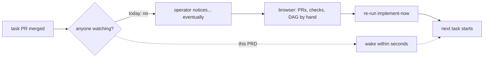

# Self-drive wake — proposal-state reads, the wake channel, and the status verb — PRD *(effective view)*

---

**GENERATED — DO NOT EDIT.** Sole writer: `docgate fold`. As of: **004**. Content fingerprint: `sha256:d400a2a201c6b6dc503b6be6a3549cfecf39fd0e66d65ce77ccab50968d4f9e6`. Tool version (recorded, never hashed): `docgate/v1`.

---

| Field | Value |
|---|---|
| **In one line** | The factory's eyes and alarm: batched, budget-guarded proposal-state reads (merged? commented? checks?) on every supported backend, a wake channel that re-runs a waiting drive within seconds of an awaited transition (timer-only in v1, push channels as reserved plug-in slots), and a status verb that shows each wait's age — so a running drive continues by itself and the operator stops being its clock. |
| **Relevant-when** | planning, building, or reviewing the wake channel, proposal-state reads, the status verb, poll cadence, or API budget guards; triaging a drive that did not continue after a merge, a silent/stale checker, a rate-limit trip, or a wrong proposal-state read; changing the executor ports (CodeHost/WorkTracker state surface), the GitHub or Carina adapters' read paths, or anything consuming wake signals |
| **Status** | Draft — problem review pending |
| **Tier** | T2 — reversible local tooling with no new credential, listener, or egress surface; upgraded scrutiny on two spots: the port shape is a platform contract (adapters must pass its conformance kit), and a misbehaving checker shares the repo's API budget. Not T3: the wake carries zero decision authority by construction — it observes and schedules; verified advancement stays with its consumers. |
| **Owner** | @mdarabi |
| **Approver(s)** | @mdarabi via the introducing PR's operator review |
| **Contributors** | — *(solo operator; gate tables record the introducing PR's review)* |
| **Informed** | Pyxis operators; implement-now / feature-drive / argus maintainers |
| **Date** | 2026-07-29 created · 2026-07-29 last updated |
| **Appetite** | Everything-or-nothing (no internal cut-line — brainstorm:self-drive-wake#D-8): machine work = the state-read port + both adapters (GitHub batched/budget-guarded, Carina file-based) + the timer wake channel with reserved push slots + the status verb with wait ages + the write-side budget guard + conformance kits + the failure drills + the 6-task proof run on both backends. Human attention = this review, one technical-design review, and the proof-run sign-off. Rollout burden = none staged (local tooling; ships through the normal release channel). Excludes: the always-on background driver, any push adapter, any hosted relay, multi-machine coordination, cadence knobs. |
| **Target release** | Unblocks prd:feature-implementation-drive's unattended continuation (its P2 segment) and the argus wake design (brainstorm:argus-unattended-drive#P-2); independently useful the day the status verb lands. |
| **Tracking** | — |
| **Artifacts** | `brainstorm:self-drive-wake` (the gated stage-1 record, rides this PR) · `docs/research/harbormaster-self-drive-failure-taxonomy.md` (the predecessor evidence base) |
| **Template version** | prd-template/v2 |

## 0. Read to rule — the human reviewer's section (~5 min)

*The body is the contract; this section only routes attention — on any conflict the body governs; machines ignore it.*

**Judge these**

| # | The call | Could have gone | If you disagree |
|---|---|---|---|
| 1 | **Never a hosted relay** — pyxis will never run a central notify/webhook service for users | an agenticlab-hosted relay making setup one line shorter | you accept custody of every user's repo activity and a required middleman in every install → NG-3 |
| 2 | **Timer-only v1; push = reserved slots** — no listener, tunnel, or runner ships now | shipping the GitHub Actions listener channel in v1 | v1 gains a per-machine install step and a silently-failable moving part for ~10 s of latency → §4.1, FR-11, WR-1 |
| 3 | **Both backends day one** — the port shape is settled with Carina and GitHub in view | GitHub-first, Carina later | the read surface freezes around the metered medium → §2.4, FR-1/FR-2 |
| 4 | **Reads are batched, per-check, and marked as the medium's claim** | per-proposal reads; trusting aggregate badges | N+1 API cost and false advancement → FR-2, FR-3, FR-13 |
| 5 | **A failed read means unknown, never no** | treating a failed probe as absence | a transient failure drives a false empty frontier → FR-9, UB-2 |
| 6 | **Implementation and configured-review readiness form one wake predicate** — pending review is work even when no task is ready | stopping after an implementation-empty sweep | an interrupted or failed review is laundered to exit 0 on the next drive round → FR-15, FR-16, UB-9 |
| 7 | **Review recovery is one selected-frontier review-only sweep per round and consumer-bounded** — it never redispatches the succeeded task | one sweep per obligation or counting only provider attempts | green implementation history is rewritten, N sweeps race, or setup failures loop without consuming the driver guard → FR-15, FR-16, DOD-11 |
| 8 | **Everything-or-nothing appetite** — no pre-agreed cut-line | dropping comment reads or recovery evidence first | the finish line moves instead of scope being explicit → header Appetite, §6.3 R5 |

**Sanity-check the numbers** — merge→wake p95 ≤ 15 s (GitHub) and ≤ 1 s (Carina) at the proof run (M2, NFR-2); one 50-proposal state read in ≤ 2 API round trips (FR-2); zero manual re-invocations (M1); zero rate-limit trips (M3); one review-only sweep per driver round regardless of pending-obligation count; and every obligation ends authenticated-verified or remains visibly pending/red after its consumer recovery bound (FR-15, FR-16, DOD-11).

**The author's open questions** — Q1: what “too long” means per wait kind (§7.2); Q2: how argus binds to this capability (§7.2). Neither changes the closed review-recovery behavior.

**Skip the rest** — structure/IDs/fold → docgate; substance and coherence → `/prd-review`; query shapes, throttle storage, review-state reader placement, retry bound, and event persistence → the superseding technical designs.

## 1. Summary — the one-pager

- **Problem** — Proposal transitions and configured-review obligations can both leave a drive waiting, yet the factory neither observes them as one durable frontier nor reliably distinguishes “nothing remains” from “review failed and is still pending.” The operator becomes the clock, and a restart can launder advisory review failure into a clean empty run.
- **For whom** — Anyone running a pyxis feature drive on any installed repo (GitHub-backed or local Carina), and the feature/argus drivers contracted to continue from implementation and review completions.
- **Why now** — The proposal-state consumers exist, and prd:implement-now FR-40..FR-47 now make configured review a durable exact-revision obligation whose bounded recovery belongs to the driver rather than the one-shot executor.
- **Direction** — Four named parts behind one contract: a batched **proposal-state reader**; an exact **review-state reader** joining canonical obligations to consumer recovery state; a timer-driven, instruction-free **wake consumer** that derives one combined frontier and invokes one consumer-bounded review-only sweep when needed; and a read-only **status verb** showing implementation and review waits, ages, failure classes, provider attempts, recovery bounds, and liveness.
- **Appetite** — Everything-or-nothing: both media, all four parts, the combined-frontier/recovery failure matrix, and the proof run. Excludes an always-on background daemon, push adapters, hosted relays, multi-machine coordination, cadence knobs, and implementation/reviewer decision authority.
- **Success** — Zero manual re-invocations across a real 6-task feature on both backends; merge→wake p95 ≤ 15 s GitHub / ≤ 1 s Carina; every pending review is recovered to authenticated verification or remains visibly red/exhausted without implementation redispatch.
- **Guardrail** — Zero rate-limit trips; steady-state reads ≤ 10% of budget; zero clean/idle decision while review state is pending, unknown, or exhausted; zero implementation action during review-only recovery.
- **Top risks** — silently dead checking; API/schema drift; burst limits; review-state unknown interpreted as empty; repeated full sweeps redispatching succeeded work; and unbounded or laundered review retries.

## 2. Problem space

### 2.1 Problem statement

The factory needs to observe two durable frontiers. First, it can write proposals but cannot natively answer which landed, settled checks, or received new comments, so the operator re-invokes after each transition. Second, configured implementation review now persists an exact-revision obligation after a task is green; a failed or interrupted attempt remains pending even when no implementation task is ready. A driver that reads only proposal/task state reports the latter as an empty clean run, and retrying whole sweeps risks redispatching succeeded work. The operator is therefore both the clock and the memory of failed review. This feature supplies exact proposal and review-state reads, a combined readiness predicate, bounded review-only recovery, and status that makes pending/unknown/exhausted work explicit.

### 2.2 Users and segments

| Segment | Role and context | Domain exp. | Tech exp. | Key goals | Pain today | Evidence |
|---|---|---|---|---|---|---|
| **P1 (primary)** | The operator running a feature drive on any pyxis-installed repo (GitHub or Carina), reviewing and merging each task PR | journeyman–master | journeyman–master | review + merge only; never re-invoke; see at a glance what's waiting and for how long | is the factory's clock; reconstructs state from the browser | argus drive ledgers (≥5 non-owned touches/drive, prd:argus-unattended-drive §3.2 baseline); brainstorm:self-drive-wake#D-3 |
| P2 (secondary) | Machine drivers: the feature integration drive (prd:feature-implementation-drive P2) and the argus unattended drive (prd:argus-unattended-drive FR-14) | — | — | receive a wake within a bound; read state through a port, not a medium API | no port exists; their contracts park the mechanism | brainstorm:self-drive-wake#F-1/#F-3 |
| **Anti-segment** | Fleets/orgs wanting a centrally-hosted watcher over many repos, or multi-machine shared drives | — | — | — | — | deliberate refusals NG-3, NG-5 (brainstorm:self-drive-wake#D-7) |

### 2.3 Jobs and desired outcomes

| # | When… (situation) | I want to… (motivation) | So I can… (outcome) | Today's workaround | Evidence |
|---|---|---|---|---|---|
| J1 | a task PR I just merged unblocks the next task, while my drive process is running | have the next task start by itself within seconds | keep the feature moving with review+merge as my only acts | re-run `implement-now` by hand after every merge | brainstorm:self-drive-wake#D-2/#D-6 |
| J2 | the drive has been quiet for a while | see in one command what it's waiting on, for how long, and whether that's abnormal | tell "waiting on me" from "waiting on CI" from "silently stuck" | open the browser: PRs tab, checks tab, mental dependency graph | brainstorm:self-drive-wake#D-4; prd:feature-implementation-drive J2 (manual correlating) |
| J3 | (machine) a drive awaits a named completion — a proposal merged, checks settled, a comment landed | receive a normalized wake within the configured bound and re-derive state through fresh reads | continue at the frontier without a human clock | the operator re-invokes; the argus ledgers record every such touch | brainstorm:self-drive-wake#F-1/#F-2 |

### 2.4 Evidence

| Claim | Source (research, data, tickets, interviews) | Confidence |
|---|---|---|
| No executor port can read proposal state: CodeHost = OpenProposal + per-proposal Checks only; WorkTracker.Comment is write-only | `internal/executor/port/{codehost,worktracker}.go` (read 2026-07-29); brainstorm:self-drive-wake#F-3 | High |
| One batched GraphQL read covering 50 proposals × (landing + comments + checks) costs 1 point of a 5,000-point/hr budget; cost is set by the query shape, not the PR count | live measured run, 2026-07-29 (`rateLimit { cost: 1, nodeCount: 350 }`); brainstorm:self-drive-wake#F-4 | High |
| The binding write-side limits are the platform's secondary content-generation caps; batching a review into one call roughly halves-to-thirds a task's write count | platform REST rate-limit + reviews docs (fetched 2026-07-29); brainstorm:self-drive-wake#F-5 | High |
| Zero of the predecessor's 18 recorded self-drive incidents were transport failures; the dominant classes are the silently-dead clock and swallowed evidence | `docs/research/harbormaster-self-drive-failure-taxonomy.md` §2–§3 | High |
| The predecessor built webhook-wake (tunnel + receiver) and never validated it end-to-end; its own trade study: faster polling captures ~80% of the latency win at ~zero cost | research record §4 (hm#1176 open; hm#921 verbatim) | High |
| Platform-scheduled crons are throttled by hours and unusable as a load-bearing cadence; event-dispatched triggers are immediate | research record §3.8/§5 (observed 4.5 h gaps) | Med |
| Operator touch baseline: ≥5 non-owned touches per delegated drive | prd:argus-unattended-drive §3.2 M1 baseline (the three prior drives' ledgers) | High |

### 2.5 The journey today

| Phase | User does | User feels / pain | Frontstage (what user sees) | Backstage (systems, people, processes) |
|---|---|---|---|---|
| merge | reviews and merges task PR in the browser | done my part | GitHub/Carina proposal closes | tracker state advances on the medium |
| silence | nothing — and nothing happens | why isn't it moving? | no signal anywhere | no process observes the transition |
| diagnose | opens PRs tab, checks tab, recalls the DAG | I am doing the machine's bookkeeping | browser tabs | no status surface exists |
| re-invoke | runs the executor again by hand | I am the clock | terminal | a fresh sweep re-derives the frontier and continues |

### 2.6 Opportunity and why now

- **Size** — Every multi-task feature on every pyxis repo, several transitions per task: ~5+ operator touches and unbounded notice-latency per feature, forever, without this.
- **Alternatives users have** — stay the clock (today); shell scripts polling `gh` ad hoc (unbudgeted, per-user, no Carina); the predecessor's webhook-wake (unvalidated, tunnel-bound, GitHub-only).
- **Why us / strategic fit** — the ports/adapters posture (AP-1/AP-3) is exactly what makes one contract serve GitHub and Carina; the consumers are already contracted and waiting.
- **Why now** — the feature drive and argus contracts both landed within the last fortnight and both park exactly this; the read cost was measured this week at 1 point per check; every further feature built without it re-pays the operator-as-clock tax.
- **Cost of doing nothing** — the unattended segments of two merged/drafted contracts stay unserved; adopter repos inherit the manual loop on day one.

**Decision:** Problem gate — do not proceed to §3–§4 until every contributor signs.

| Reviewer | Role | Date | Verdict |
|---|---|---|---|
| @mdarabi | operator (product + engineering) | — | pending — via the introducing PR's operator review |

## 3. Goals, metrics, and guardrails

### 3.1 Goals as falsifiable hypotheses

| # | We believe that… | Will result in… | Measured by… |
|---|---|---|---|
| G1 | giving a running drive eyes (state reads) and an alarm (wake channel) | the operator's only acts on a driven feature being reviews and merges — zero re-invocations | M1 |
| G2 | a status verb with wait ages and a too-long flag | "waiting on me" vs "waiting on CI" vs "stuck" diagnosed in one command, without the browser | M4 (qualitative drill) |
| G3 | budget guards designed in (batched reads, write throttle, unknown-on-failure) | the loop never trips the platform's limits nor mistakes a failed read for state | M3 |

### 3.2 Goals → signals → metrics

| Metric | Goal | Signal | Baseline | Target (at checkpoint) | Feeds from |
|---|---|---|---|---|---|
| M1 (primary) | G1 | operator-initiated executor invocations targeting the driven feature's scope | ~5+ per feature (argus ledgers) | 0, at the checkpoint "6-task proof feature driven end-to-end on both backends" | EVT-2, EVT-6 |
| M2 | G1 | awaited-transition → wake latency, measured from the medium-reported transition timestamp to local wake delivery (clock offset recorded in the proof-run report) | unbounded (operator memory) | p95 ≤ 15 s GitHub · ≤ 1 s Carina, at the proof run | EVT-2 |
| M3 | G3 | rate-limit responses received; read-budget share consumed | n/a (no reader exists) | 0 rate-limit trips; reads ≤ 10% of the medium's read budget, across the proof run | EVT-1, EVT-3, EVT-4 |
| M4 | G2 | quiet-state diagnosis without the browser | browser + memory | operator diagnoses N of N seeded quiet-states correctly from the status verb alone, at the proof run (rubric in DOD-4) | EVT-5 + drill record |

### 3.3 Guardrails and decision rule

| Guardrail metric | Threshold | Action if breached |
|---|---|---|
| Rate-limit trips attributable to this feature | any occurrence | halt the wake channel; fix throttle/cadence before re-enabling |
| Read-budget share while one drive runs | > 10% sustained | lengthen adapter-advised cadence; investigate query shape |
| Idle cost while the combined frontier is empty | > 0 medium/store calls attributable to an await-free channel | defect: FR-5 or the combined-empty predicate broke |
| Review-state laundering | any idle/clean decision while review state is pending, unknown, or exhausted | fail closed; block activation; retain the state/evidence and repair recovery |
| Review-only implementation activity | any task route, claim, worker, proposal write, or changed succeeded terminal | fail closed; block activation; preserve the task terminal and repair the boundary |
| Existing executor/adapter suites and NR-1..NR-3 | any regression | stop; the capability may not change one-sweep or implementation semantics |

**Ship rule (pre-registered):** M1 = 0, M2 within bounds, M3 clean, every guardrail above clean, and DOD-11..DOD-15 green on the same proof composition → ship. A fixture where M1–M3 pass but combined-frontier recovery, exhaustion visibility, event durability, or zero-implementation isolation fails must produce `do not ship`; no other section may weaken this predicate.

### 3.4 Non-goals and waiting room

| ID | Non-goal | Why refused |
|---|---|---|
| NG-1 | An always-on background program (daemon/service watching when no drive runs) | the deferred driver feature; the riskiest surface in the predecessor's record — built only on proven foundations (brainstorm:self-drive-wake#D-2/#O-1) |
| NG-2 | Shipping any push channel (webhook listener, tunnel, Actions runner) in v1 | ~10 s latency gain before a ~30-minute agent step, at the cost of a per-machine install and a silently-failable moving part (#D-5/#O-2) |
| NG-3 | Hosting a central notify/webhook relay for pyxis users — ever | a required middleman with plaintext custody of every user's repo activity; violates "no privileged substrate" (#D-7/#O-3; product-vision §2) |
| NG-4 | Merging, approving, or otherwise acting on proposals | observation only; merge authority lives with humans and, where contracted, the argus AUTO lane (#D-7/#O-4) |
| NG-5 | Multi-machine coordination (two machines sharing one feature's watching/driving) | one drive process per feature in v1; cross-machine is the deferred driver's ground (#D-7/#O-5) |
| NG-6 | Cadence/tuning knobs | adapter-advised defaults; a knob only on demonstrated need — knobs are easy to add, near-impossible to remove (#D-7/#O-6) |

| ID | Waiting room | Revisit when / intended version |
|---|---|---|
| WR-1 | Push channel adapters filling FR-11's reserved slots (e.g. an Actions-runner listener; a user-owned tunnel URL) | when the background driver ships (push earns its keep for machines with no live process), or when measured wake latency demonstrably hurts a real workflow |
| WR-2 | Learned too-long thresholds (per-repo history instead of fixed defaults) | when Q1's fixed defaults produce recorded false ⚠ noise at the proof run or in live use |

## 4. Solution space

### 4.1 Approach and alternatives considered

The chosen shape is four named parts behind one contract. The **proposal-state reader** returns batched landing/check/comment state on every medium. The **review-state reader** exact-reads canonical implement-now obligations and joins them to a consumer-owned durable recovery ledger. The **wake consumer** derives one combined implementation/review readiness predicate, coalesces duplicate hints into a durable driver round, and—when any obligation is eligible—starts one review-only executor sweep over the eligible in-scope frontier while the provider admits at most one attempt per obligation. The **status verb** renders proposal waits, review pending/unknown/exhausted states, ages, counters, failure classes, and checker liveness. Timer cadence remains the v1 wake mechanism; push slots stay hint-only.

| Option | Sketch | Why not chosen |
|---|---|---|
| A (chosen) | proposal reads + exact review-state/recovery reads + combined wake consumer + status | observes every durable frontier and keeps one-shot executor ownership intact |
| B | proposal-state wake only | launders failed/interrupted configured review when implementation is empty |
| C | invoke one executor sweep per obligation | N sweeps each rescan the same N-obligation frontier and race one another |
| D | retry on any non-zero process exit | conflates task and review failure and can redispatch succeeded work |
| E | push-first with slow polling backup | adds a silently-failable listener before measured need |
| F | hosted central relay | privileged middleman and custody surface; permanently refused |
| Do nothing | — | the operator remains the clock and review failure remains non-durable at the driver boundary |

### 4.2 Scope perimeter

- **In (plan of record)** — proposal-state port + GitHub/Carina adapters; canonical review-state consumer port; consumer-owned durable review-recovery ledger; combined readiness derivation; one deduplicated selected-frontier review-only sweep per driver round; provider-side at-most-one attempt per obligation; bounded recovery/exhaustion with immutable evidence; timer wake + reserved push slots; status for implementation and review waits; write budget guard; typed events; conformance/failure drills; 6-task proof on both backends.
- **Future (believed next, not committed)** — always-on background driver; push adapters; learned thresholds.
- **Out** — merging/approving; implementation or review decision authority; review artifact verification itself (owned by implement-now/impl-review); hardware isolation; hosted relay; multi-machine coordination; cadence knobs.

### 4.3 Experience: flows and states

**Flow F1 — a driven feature continues by itself (serves J1, J3)**

| Step | User does | System responds | States covered | Design |
|---|---|---|---|---|
| 1 | starts a drive on a frozen plan | the drive exact-reads proposal/task state and configured-review obligations, registers awaits for every non-empty frontier, and runs no checks only when both frontiers are empty | ideal · empty · review-only | superseding state-reader and wake designs |
| 2 | reviews + merges a task PR in the browser | within the cadence bound, the reader observes landing and the wake channel delivers `(await-id, transition)` | ideal · loading | superseding state-reader and wake designs |
| 3 | — | the drive re-derives the combined frontier through fresh reads and starts each newly ready implementation task at most once | ideal · partial | superseding wake design |
| 4 | — | when one or more review obligations are eligible, the drive invokes one bounded review-only sweep for that round over the eligible in-scope frontier; the provider exact-reads immutable obligations, admits at most one attempt per obligation, and performs zero implementation dispatch | review-only · partial · error | superseding wake design + prd:implement-now FR-40..FR-47 |
| 5 | closes the laptop / kills the process | on restart the combined frontier is re-derived from durable state; interrupted review remains pending and red until authenticated verification or explicit consumer recovery exhaustion | interruption · recovery · exhausted | superseding state-reader and wake designs |

**Flow F2 — “why is it quiet?” (serves J2)**

| Step | User does | System responds | States covered | Design |
|---|---|---|---|---|
| 1 | runs the status verb | one read-only pass renders per implementation await and review obligation: state, waiting-on, `age_s` since the consumer first observed the obligation, provider attempt count, consumer recovery epoch/count/bound, terminal failure class, a too-long flag, and checker last-check age | ideal · empty · review-only · partial · error | superseding state-reader design |

- **Empty** — no implementation awaits and no pending review obligations: say so explicitly; only this combined-empty state is idle.
- **Review-only** — no implementation task is ready but at least one review obligation is pending: show immutable identity, provider-attempt and consumer recovery counters/bound, age, and last failure; schedule at most one selected-frontier review-only sweep for the round.
- **Loading** — a check is in flight: render the last completed picture plus its age.
- **Partial** — unknown proposal or review state is typed and retained, never omitted or interpreted as empty.
- **Error** — medium/store unreachable: render the last observation as stale, keep the frontier non-empty, and exit non-clean; consumer recovery exhaustion is immutable escalation, never success.
- **Accessibility** — terminal status is never carried by color alone.
- **Localization** — none (single-locale CLI).

### 4.4 Scenarios

**Ordinary continuation.** The operator merges one task proposal. Within the medium bound, the drive exact-reads state and dispatches the newly ready task once.

**Review-only continuation.** Two configured-review obligations are pending and no implementation task is ready. One driver round initializes/reads their recovery entries, appends one admission for each eligible obligation, and invokes exactly one selected-frontier review-only sweep. The provider admits at most one attempt per selected obligation. Authenticated artifacts clear both; zero task route, claim, worker, or proposal operation occurs.

**Setup failure and exhaustion.** The review backend's auth preflight fails before a provider attempt. The consumer admission still counts for every selected obligation. At `recovery_count == recovery_bound`, no sweep launches; exhaustion is appended to immutable git evidence and status remains red until authenticated verification or an explicit evidenced rearm creates a new epoch.

**Unknown state.** The canonical obligation or recovery ledger is corrupt/unavailable. The combined frontier is unknown/non-empty, EVT-8 records bounded deferral, no implementation/review launches, and the round is non-clean until a successful exact read.

**Duplicate hints and restart.** Timer and push hints arrive together; one durable round coalesces them. A crash before admission consumes nothing; a crash after append-first admission consumes one recovery unit. Restart exact-replays both stores and never changes revision, bound, prior epoch, or succeeded implementation truth.

**Decision:** Solution gate — zero TBDs may pass.

| Reviewer | Role | Date | Verdict |
|---|---|---|---|
| @mdarabi | operator (via introducing PR review) | — | — |

## 5. System requirements

*Subjects: the **state reader** (the read port + its adapters), the **wake channel**, the **status verb**, the **GitHub adapter** / **Carina adapter** where medium-specific.*

### 5.1 Functional requirements

| ID | Requirement (EARS) | Rationale | Priority | Risk | Fit criterion | Verify | Traces to |
|---|---|---|---|---|---|---|---|
| FR-1 | When a consumer requests the state of a set of proposals, the state reader shall return, per proposal: landing state (open · landed · closed-unlanded), per-required-check state, and the comments newer than the caller's cursor across the medium's proposal-discussion surfaces (discussion comments and review comments, review summaries included). | the eyes; no port can answer this today (§2.4) | Must | high | on both adapters, a mixed 50-proposal fixture returns all three kinds matching the medium's ground truth per enumerated surface; unknown fields are typed, never empty-string | Test | G1, J1, J3, F1 |
| FR-2 | When a batch state request covers N proposals on a metered medium, the medium's adapter shall satisfy it in a number of API round trips bounded by a constant independent of N (within the medium's page size). | per-item reads are an unfixable N+1 on metered media (measured §2.4) | Must | high | the conformance kit asserts round-trip count: a 50-proposal batch on the GitHub adapter completes in ≤ 2 API calls | Test | G3, F1 |
| FR-3 | When answering check state, the state reader shall derive it from the per-context check set compared against the repo's required set, never from an aggregate rollup alone. | a rollup can read green with a required context absent (AP-13's badge-trust class) | Must | high | a fixture with aggregate=success but one required context missing reports not-green | Test | G1, F1 |
| FR-4 | While at least one await is registered, the wake channel shall check state on the adapter-advised cadence and, when an awaited transition is observed, deliver a wake naming only the await's identifier and the transition kind to the registered consumer. | the alarm; instruction-free by construction (AP-2) | Must | high | live drill on both media: a merge/accept is followed by a delivered wake within the M2 bound; the signal schema is closed (unknown fields = defect) | Test + Demo | G1, J1, J3, F1, M2 |
| FR-5 | While no await is registered, the wake channel shall run no checks and place no medium calls. | idle is free; parked problems keep zero steady-state cost | Must | med | one idle hour emits zero medium calls and zero events of kind check_ran (event log) | Test | G3, F1 |
| FR-6 | The wake channel shall take its cadence from the adapter's declared advice, and the v1 surface shall expose no user-facing cadence configuration. | defaults over knobs (NG-6); the medium knows its budget | Must | low | each adapter declares advice in the conformance kit; inspection finds no cadence knob on the config surface | Test + Inspection | G3, NG-6 |
| FR-17 *(004 ← FR-7)* | When the operator runs the status verb, the system shall render, per task/proposal await and configured-review obligation in the active scope: its state, what it waits on, wait age, a too-long flag, and the checker's last-check age; review rows shall additionally render the immutable revision, FR-15 `age_s`, provider review-attempt count, consumer recovery epoch/count/bound, last failure class, and an explicit exhausted/escalated state — read-only. | “quiet” must distinguish implementation wait, pending review, exhausted review, and a dead reader without the browser | Must | high | seeded waiting-on-review, CI-running, blocked, stale-wait, dead-checker, review-pending in each failure class, review-unknown, and review-exhausted fixtures render every required field and flag exactly the seeded stale/exhausted rows; the verb performs zero writes | Test + Demo | G2, J2, F2, FR-15, FR-16, UB-9 |
| FR-8 | The GitHub adapter shall keep the aggregate rate of content-writing requests within the platform's published secondary limits and shall surface saturation to callers as backpressure, never as a platform rate-limit error. | the write path is the binding budget (§2.4); N workers land together | Must | high | a burst fixture replaying nine tasks' write sets concurrently completes with zero platform rate-limit responses; writes are delayed, none dropped | Test | G3, M3 |
| FR-9 | If a state read fails or is rate-limited, then the state reader shall report the affected proposals as unknown-retry-later, and no consumer-visible state transition shall be derived from the failure. | a 429 read as "no" drives wrong recovery (predecessor-paid, §2.4) | Must | critical | injected 429/5xx/timeout fixtures yield typed unknown; a consumer test asserts zero transitions during the injection window | Test | G3, F1, F2 |
| FR-10 | The wake signal shall carry only the await identifier and the transition kind; the wake channel shall accept no inbound content that its consumers could receive as instruction. | the injection posture extends to this surface | Must | high | schema inspection + a poisoned-fixture test: extra fields are rejected at parse, never forwarded | Test + Inspection | F1 |
| FR-11 | Where a push channel adapter is present, the wake channel shall treat its deliveries solely as schedule-now hints — the same reads run, the same signals deliver — and an absent or dead push adapter shall change no behavior except latency. | the reserved slot (WR-1): push may never carry decisions or become load-bearing | Must | med | with a stub push adapter: a delivery only advances the next check; killing the stub mid-drill leaves behavior byte-identical at timer cadence | Test | F1, WR-1 |
| FR-12 | The wake channel shall record every check and every delivered wake as typed events, and the status verb shall render the last-check age, so that a dead checker is distinguishable from a quiet repo within one cadence interval. | silence must be loud (the predecessor's #1 class) | Must | high | kill-the-checker drill: within one cadence the status verb renders the stale last-check ⚠ and the event stream shows the gap | Test | G2, F2, M4 |
| FR-13 | When reporting a proposal landed, the state reader shall include the medium-reported landed revision identifier and shall present landing state as the medium's claim — a consumer performing verified advancement shall verify at the goal object per its own contract, and this reader's output shall carry what that verification needs. | a medium's "merged" certifies the medium's object, never the mainline (AP-26; incident I2); the reader must not launder a badge into goal-state | Must | high | the port's landed state carries the revision id on both adapters; a consumer-side fixture performs an ancestry check from the reader's output alone; the port docs mark landing state as medium-claimed | Test + Inspection | G1, J3, F1 |
| FR-14 *(002)* | When content writes originate concurrently from a process whose authenticated identity is resolved and a process on the same host whose identity is not, the write guard shall admit them against a single host bound, charging the resolved writer's identity ledger and the host umbrella and the unresolved writer's host umbrella alone. | a coarser fallback is only a bound if the finer ledgers charge it; keyed-but-uncharged, it is a second full window (review-thread:pyxis#968) | Must | high | a deterministic mixed-writer fixture across two processes on one host: the two writer classes together are admitted at most the platform's per-window cap (never twice it), every charged write appears in the umbrella, resolved writes appear in both ledgers, zero writes are dropped, and zero platform rate-limit responses occur | Test | FR-8, UB-7, M3 |
| FR-15 *(004)* | When a consumer derives drive readiness, the state reader shall exact-read both the canonical configured-review obligation store and the consumer-owned durable recovery ledger and return a closed `review-wake-state/v1` containing each pending obligation's stable identity, task/proposal/revision binding, effective review backend, last terminal failure class, provider `review_attempt_count`, and consumer `first_observed_at_utc`, `recovery_epoch`, `recovery_count`, and frozen positive `recovery_bound`; it shall derive `age_s = floor(max(0, now_utc - first_observed_at_utc)/1s)` from an injected wall clock, so attempts/restarts never reset age and backward clock movement clamps rather than underflows. Missing recovery state for a newly observed obligation shall be initialized append-first with source-owned UTC observation time, count 0, and the current closed policy bound; later config/restarts shall not change that epoch's time or bound. Unreadable, structurally invalid, or unavailable whole-store state on either side shall instead be typed `unknown` and keep readiness non-empty, never become zero pending. | provider attempts do not count factory/preflight failures, and the provider contract exposes no creation time; the retry and age guards belong in the consumer that spends and observes | Must | critical | empty, one-pending, mixed-backend, verified-cleared, corrupt/unavailable provider, corrupt/unavailable recovery ledger, stale-summary, initial-state, config-change, new/retried/long-pending, restart, and backward-clock fixtures match canonical ground truth; injected-clock assertions prove append-first time and exact `age_s`; every unknown fixture returns non-empty and never idle | Test + Failure injection | G1, J3, F1, prd:implement-now FR-40, FR-42, UB-21, incident:I8 |
| FR-16 *(004)* | For each durable driver round — one cycle identified by a fresh `drive_round_id` from exact combined-frontier read through persisted decisions and either one settled selected-frontier executor invocation or a persisted no-launch exhausted/unknown decision, with duplicate wakes coalesced into that cycle — the wake consumer shall select every in-scope pending obligation whose `recovery_count < recovery_bound`. If and only if that selected set is non-empty, it shall append-first increment each member's recovery count and issue exactly one review-only executor invocation carrying the round ID and selected IDs; a preflight/factory/auth failure still consumes admission even if the provider creates no attempt. `recovery_count == recovery_bound` is exhausted and excluded; when every pending obligation is exhausted, the round appends/replays EVT-7 evidence and launches nothing. The provider scans only the selected frontier and admits at most one attempt per member; the invocation performs zero implementation operations. Authenticated verification clears the await and closes recovery state; failure/interruption remains pending/red; exhaustion remains stale/escalated until explicit operator rearm creates a new epoch without erasing the old one. | one sweep per obligation races an N-item provider scan; provider attempts miss setup failures; an all-exhausted frontier must not manufacture an empty sweep | Must | critical | multi-obligation and empty-implementation fixtures produce at most one sweep per round, one decision/count increment per selected obligation, and at most one provider attempt each; truth tables at 0, bound−1, bound plus duplicate-wake, all-exhausted, mixed eligible/exhausted, preflight, crash edges, restart, rearm, forgery, and infrastructure prove exact arithmetic, immutable prior epochs, zero provider preflight/attempt/implementation on all-exhausted, and no clean pending/exhausted result | Test + Failure injection + Demo | G1, J1, J3, F1, FR-15, UB-3, UB-4, prd:implement-now FR-46, FR-47, UB-20, UB-21, incident:I8 |

**Non-regression (NR-n)**

| ID | Existing behavior protected | Why protected | Risk | Fit criterion | Verify | Traces to |
|---|---|---|---|---|---|---|
| NR-1 | The executor remains a one-sweep primitive: no timer, no loop, no wake consumption is added to `implement-now` itself; its idle-frontier run still spends zero model tokens | the drive owns the clock; the sweep's contract is frozen ground (prd:implement-now FR-12/FR-14) | med | the existing implement-now suites pass unchanged; inspection shows the executor gained no scheduling code path | Test + Inspection | F1 |
| NR-2 | Existing write paths (proposal opening, comments, lease/claim refs) keep working under the new throttle | the guard must shape traffic, not break it | high | existing executor e2e fixtures pass with the throttle active | Test | F1 |
| NR-3 *(004)* | `implement-now` remains one-shot and task implementation remains terminal once succeeded; the drive owns cadence and review-only recovery invokes only the executor's selected review frontier | keeps scheduling out of the executor and preserves green task truth | critical | inspection finds no timer/loop in the executor; the FR-16 matrix records zero task dispatches and byte-identical succeeded task terminals across every retry | Test + Inspection | FR-16, prd:implement-now FR-42, FR-46, FR-47, NR-10 |

### 5.2 Unwanted behavior and failure handling

| ID | If… (trigger) | Then the system shall… | User sees | Priority | Risk | Fit criterion | Verify | Traces to |
|---|---|---|---|---|---|---|---|---|
| UB-1 | the medium is unreachable (offline, outage) | keep cadence with bounded backoff, report affected proposals unknown, and render the degraded state; never crash, never fabricate state | status rows `unknown (offline, retrying)` + stale-marked ages | Must | high | pull-the-network drill: zero crashes, zero false states, recovery reconciles on first successful check | Test | FR-9, F1, F2 |
| UB-2 | a read returns data the schema cannot parse (platform API drift) | surface a named defect distinguishing "broken" from "empty" — an unparseable response is never presented as a healthy zero-state | a typed error row / non-clean exit, naming the parse failure | Must | critical | malformed-response fixtures produce the named defect; no fixture renders as an empty-but-healthy list | Test | FR-9, F2 |
| UB-3 | the drive process dies mid-await (crash, laptop closed) | lose nothing permanently: on next start, awaits re-derive from durable state and the first check reconciles reality | the restarted drive continues; no duplicate proposals | Must | high | kill/restart drill on both media: continuation with zero duplicates (rides prd:implement-now FR-14) | Test | F1 |
| UB-4 | overlapping checkers observe the same transition (restart races, future push + timer overlap) | deliver possibly-duplicate wakes that are harmless by construction — consumers re-derive through reads and existing claims arbitrate | nothing abnormal | Must | med | two concurrent checkers over one fixture feature: zero duplicate task dispatches; events show coalescing | Test | FR-4, FR-11 |
| UB-10 *(004 ← UB-5)* | an implementation await, configured-review obligation, or the checker exceeds its too-long threshold — including pending review reaching its consumer recovery bound | surface it as a named non-resting defect in status and events; append immutable evidence before reporting exhaustion; an exhausted review stays pending/escalated until authenticated verification or explicit evidenced rearm | a typed stale or exhausted row with age, provider attempts, recovery epoch/count/bound, last failure class, evidence ref, and remedy | Must | high | seeded stale implementation await, dead checker, pending review, exhausted review, and rearm fixtures flag at the exact threshold, retain/replay evidence, and never render idle/clean | Test + Demo + Inspection | FR-12, FR-15..FR-17, EVT-5, EVT-7 |
| UB-7 *(002 ← UB-6)* | the write throttle saturates (burst exceeds the budget) | queue and delay writes, surfacing backpressure and queue depth as events; never drop a write, never let a platform rate-limit response occur | slower landings; events show throttle_deferred | Must | high | replaces UB-6, whose criterion never checked the depth it required the system to surface: the FR-8 burst fixture — zero drops, zero platform 429s, queue drains — **and** a deterministic depth fixture: with N > 1 writers held concurrently in deferral on one ledger, an emitted throttle_deferred reports queue_depth = N; no run in which more than one writer is concurrently deferred reports a maximum depth of 1 | Test | FR-8, FR-14, EVT-4, M3 |
| UB-8 *(003)* | the machine is downgraded from a build that charges the host umbrella to one that does not — **every such downgrade, whatever state the umbrella is in** | gate the downgrade on a **documented operator precondition**, not on any in-software hold-off: for each affected medium host, no legacy write until that host's drain deadline has passed, computed from confirmed quiescence by state class — **readable and holding live entries** ⇒ the latest applicable expiry those entries imply; **readable and empty** ⇒ no wait, the deadline is confirmed quiescence itself; **missing, unreadable, or structurally invalid** ⇒ the full longest platform window, since the bytes may encode spend as recent as quiescence. Neither build can enforce this — they share no state, lock, or vocabulary — so the enforcement is the release gate: §6.6's Cutover record carries the per-host evidence, and §6.4/§6.5's launch decision refuses a release whose rollback rehearsal did not walk it | the documented downgrade procedure blocks until each host's deadline; the readiness record shows the deadline and the first legacy write after it | Must | high | **arithmetic (Test)**: with an injected clock, seed the umbrella to one below the per-minute cap at a recorded t0 and downgrade at t0+ε; a two-write legacy workload inside the live window exceeds the platform cap against a bound oracle computed from the seeded timestamps, while the identical workload after the clock passes every seeded expiry stays inside both windows. **Absent-ledger variant (Test)**: with the umbrella missing or corrupted, the computed deadline is the full longest window from confirmed quiescence, and a workload before it breaches while the same workload after it does not. **Compliance (Inspection)**: the rollback rehearsal walks the procedure end to end and the §6.6 record carries, per host, the confirmed-quiescence time, the state classification, the computed deadline, the completion time, and evidence the first legacy write followed it | Test + Inspection | FR-8, UB-7, M3 |
| UB-9 *(004)* | a review attempt is killed, fails, produces unauthentic evidence, or remains pending when the next drive round has no ready implementation task | exact-read and retain the same obligation, schedule only consumer-bounded review-only recovery, preserve its last closed failure class, and remain non-clean through recovery exhaustion; never redispatch implementation or derive the reviewed revision from the current proposal head | implementation stays succeeded; review stays visibly pending/red with provider-attempt and consumer recovery counters/remedy, or exhausted/escalated | Must | critical | kill/restart, absent/malformed/forged artifact, factory/auth/infrastructure, moving-head, empty-frontier, and exhausted-bound fixtures retain one exact obligation, count every admitted review-only sweep, launch zero implementation, and never report clean until authenticated verification | Test + Failure injection | FR-15, FR-16, EVT-7, prd:implement-now FR-40, FR-42, FR-46, FR-47, UB-20, UB-21 |
| UB-11 *(004)* | the canonical review-obligation store or consumer recovery ledger is unavailable, unreadable, or structurally invalid as a whole | treat combined readiness as unknown/non-empty, emit EVT-8 naming the failed source, wait the reader's bounded backoff before a fresh exact read of both stores, launch neither implementation nor review from that unknown snapshot, and end the current driver round non-cleanly if either remains unknown | explicit `review state unknown` with source, failure kind, retry delay, and remedy; never “nothing to do” | Must | critical | unavailable, permission-denied, corrupt-envelope, unknown-field, and recovery fixtures for both sources each emit EVT-8, perform zero launch, exit non-cleanly while unknown, and resume ordinary derivation only after both exact-read successfully | Test + Failure injection | FR-15, EVT-8, UB-2 |

### 5.3 Permissions and abuse cases

Skipped: v1 adds no new credential, role, listener, or inbound surface — the reader uses the existing per-medium auth read-only, the wake channel is process-internal (timer + local file-watch), and FR-10 closes the future slot's signal shape; the push adapters that would open a real inbound surface arrive with WR-1 and carry their own design-stage security section.

### 5.4 Data

| Entity / field | Meaning | Source of truth | Retention | Integrity rules | Privacy class |
|---|---|---|---|---|---|
| throttle ledger — identity | write-budget state for one authenticated identity on one medium host, shared by every pyxis process on the machine | machine pyxis state dir, never a checkout | ephemeral only when no unexpired spend exists | absent starts empty only after the host barrier; unreadable starts conservative; every resolved write charges identity and host umbrella | internal |
| throttle ledger — host umbrella | machine-wide bound for all identities/unresolved writers on one medium host | machine pyxis state dir beside identity ledgers | same safe-disposal rule as identity ledger | every resolved write charges it in addition to identity; unresolved charges it alone; absent/unreadable follow the barrier rule | internal |
| cutover marker | one record per `(machine, medium-host)` proving the first-initialization barrier completed and no non-umbrella writer has written since | machine pyxis state dir under the umbrella lock | durable; deletion deliberately re-arms the barrier | conservative ledger durable before marker; crash leaves conservative state or absent marker; unreadable marker means absent | internal |
| canonical review obligations / provider attempts | immutable exact-green obligations and append-only provider attempts owned by implement-now | implement-now's canonical configured-review store | per its governing contract | exact-read only; this feature cannot rewrite backend, proposal, revision, attempt, failure class, or verified state | internal |
| review-recovery ledger (`review-recovery/v1`) | consumer-owned append log keyed by `(scope, review_obligation_id, recovery_epoch)`: source-owned `first_observed_at_utc`, initial frozen positive bound, one admission increment per selected review-only sweep, exhaustion, explicit operator rearm, and closure on authenticated verification | configured drive evidence git ref, outside disposable checkout/workspace state | immutable git history; retained with the drive evidence | append-first before action; reconstruction is closed-schema exact replay; first observation creates time/epoch/count 0/bound; later config/restart cannot change time/bound; admission appends count+1 before executor launch; each `(scope, obligation, epoch, count, action)` is idempotent and conflicting replay invalid; exhausted/rearmed entries carry attributable principal, reason, prior evidence ref, and stable content-derived ref; rearm creates a new epoch and never edits/deletes the exhausted one | internal |
| `review-wake-state/v1` | derived exact join of canonical obligation/provider state and review-recovery ledger, including consumer `first_observed_at_utc`/`age_s`, provider attempt count, recovery epoch/count/bound, failure, and eligibility | derived at read time; never independently stored | none | any missing/corrupt/unavailable source makes the relevant side unknown/non-empty; verified provider obligation closes but does not erase recovery evidence | internal |
| wake/check/recovery telemetry | EVT-1..EVT-8 routine observations | repo event stream | standing rotated/local event retention | append-only within the stream; additive schema evolution only. EVT-7 invoke/defer telemetry may remain ephemeral, but `action=exhausted` or `rearmed` fires only after the corresponding immutable recovery-ledger append and must carry its evidence ref | internal |
| read cursors | caller-held comments-since positions | consumer durable state | consumer-owned | reader persists no medium content | internal |

The throttle partition remains no finer than the platform's documented limit: identity ledgers sit inside the host umbrella, never beside it. A throttle ledger is disposable only before first hold on an already-cut-over host or after the longest window with no writer active; mid-window deletion is outside contract.

Every transition between umbrella-aware and legacy writers remains a cutover with a drain. Upgrade: quiesce all legacy writers, then pay the conservative first-initialization barrier under the host lock. Downgrade: quiesce umbrella writers, durably invalidate the marker, then wait per host until the latest live expiry—or a full longest window from confirmed quiescence when state is missing/unreadable—before a legacy write. Parallel generations are forbidden. Same-generation rollback leaves ledgers/marker in place; legacy rollback follows the downgrade drain. Legacy files may be removed only after the longest window. A crash during initialization must leave either conservative ledger state or an absent marker.

- **Migration** — existing throttle cutover/drain applies unchanged. Review-recovery state is born append-first on first observation of an obligation; no summary/event migration is accepted as source of truth.
- **Parallel-run / cutover** — throttle generations follow the rule above. For review recovery, one drive owns a scope; duplicate wake processes may read but the git append/idempotence key admits at most one count transition for a given epoch/count.
- **Rollback** — disabling configured review stops new recovery invocations but never deletes obligations or recovery evidence. A build that cannot interpret a live pending/exhausted ledger must report unknown/non-clean, not empty.
- **Decommission** — no automatic deletion; closure remains in git history with the drive.
- **Privacy check** — internal IDs, revision hashes, failure classes, times, and principals only; no prompt, code payload, raw artifact, token, or attribution secret enters the ledger/events.
- **Egress** — none new: git evidence uses the configured repository/code-host path; medium reads use existing authenticated APIs; NG-3 still forbids a hosted relay.

### 5.5 Interfaces and integrations

| Interface | Direction | Purpose | Contract (format, ranges, timing) | Failure modes | Owner |
|---|---|---|---|---|---|
| state-read port (consumers: drive, argus, status verb) | in | batched proposal-state reads | typed batch request → typed per-proposal states incl. unknown; round-trip bound per FR-2; landed reports carry the medium's revision id and are marked medium-claimed (FR-13) | unknown-retry-later (FR-9); parse defect (UB-2) | this feature |
| review-state port (consumers: drive, status verb) | in | exact durable configured-review readiness | closed `review-wake-state/v1`; exact join of provider obligation/attempt state with consumer `first_observed_at_utc`/`age_s` and recovery epoch/count/frozen-bound; verified is absent; whole-store unknown is readiness, not empty | unavailable/corrupt/invalid on either side → UB-11 typed unknown, bounded backoff, non-clean round, zero launch | implement-now owns obligation state; this feature owns recovery state and the joined port |
| wake delivery (consumer-registered) | out | schedule-now signals | closed schema: await id + transition kind, nothing else (FR-10); review transitions identify only the obligation await and transition | duplicate delivery harmless (UB-4); loss covered by next exact read | this feature |
| review-only executor invocation | out | reconcile eligible pending review without task implementation | exactly one one-shot invocation per durable driver round carrying `drive_round_id` plus a closed selected-obligation ID set; provider scans only that set and admits at most one attempt per member; zero implementation operations | setup/attempt failure remains pending and consumes consumer recovery admission; exhausted obligations excluded; unknown state launches nothing | implement-now provider + this feature consumer |
| GitHub API (GraphQL/REST) | out | the metered medium's reads + throttled writes | within published budgets; batched per FR-2; per-context checks per FR-3 | 429/5xx → FR-9/UB-1; drift → UB-2 | GitHub adapter |
| Carina store (local files) | out | the offline medium's reads | file reads + watch; no network | fs errors → FR-9's unknown | Carina adapter |
| push-slot (reserved, empty in v1) | in | future schedule-now hints | FR-11's hint-only contract | dead adapter = timer behavior | WR-1's feature |

### 5.6 Non-functional requirements

| ID | Area | Requirement | Fit criterion | Verify |
|---|---|---|---|---|
| NFR-1 | Cost | While one feature is driven, the state reader's steady-state consumption shall stay within a tenth of the medium's read budget. | measured over the proof run: read-points consumed ≤ 10% of the budget window, from EVT-1 sums | Analysis |
| NFR-2 | Performance | The wake channel shall deliver wakes within the promised bound per medium. | proof run at the shipped cadence advice (GitHub ≈ 10 s): transition→wake p95 ≤ 15 s (GitHub), ≤ 1 s (Carina); no wake exceeds 2× the bound; latency basis per M2 (EVT-2) | Test |
| NFR-3 | Operability | Every degraded mode (offline, rate-limited, parse-defect, dead checker, stale await) shall present distinguishably on the status verb and in events. | the §5.2 drill matrix: each mode's presentation is distinct and named; support runbook maps each to its remedy | Demo |
| NFR-4 | Security | The v1 wake surface shall accept no network input. | inspection: no listener, no socket, no inbound handler exists in the shipped v1 | Inspection |
| NFR-5 | Maintainability | A new medium adapter shall be buildable against the port from its conformance kit alone. | the kit runs green on both shipped adapters and documents every asserted behavior (AP-3) | Inspection + Test |

### 5.7 Instrumentation — the tracking plan

| ID | Event name | Fires when | Properties (typed) | Source | Feeds |
|---|---|---|---|---|---|
| EVT-1 | wake_check_ran | each cadence check completes | medium: str, batch_size: int, cost_points: int, duration_ms: int, unknowns: int | wake channel | M3, NFR-1 |
| EVT-2 | wake_delivered | a wake is handed to a consumer | await_id: str, transition: enum, latency_ms: int (medium timestamp → delivery) | wake channel | M1, M2 |
| EVT-3 | read_unknown | a read resolves unknown | medium: str, kind: enum(rate-limited, offline, parse-defect, timeout), count: int | state reader | M3 |
| EVT-4 | throttle_deferred | the write guard decides to delay a write — emitted at the deferral decision, before the wait, and again at each re-evaluation | ledger: enum(identity, host-umbrella) — which of the two windows blocked; queue_depth: int — writers concurrently inside the guard for that ledger in the emitting process, counted from guard entry to guard exit and sampled at the emission instant; deferred_ms: int — the *projected* wait, never elapsed; reset_at: timestamp — when the blocking window refills | GitHub adapter | M3 |
| EVT-5 | stale_flagged | an await or the checker exceeds its threshold | subject: enum(await, checker), age_s: int, threshold_s: int | the staleness predicate — one shared implementation, rendered by the status verb and emitted with wake-channel events (AP-11) | M4 |
| EVT-6 | sweep_invoked | an executor sweep starts | initiator: enum(operator, drive-wake, other), scope: str (the plan/feature the sweep targets) | executor dispatch (existing surface, new properties) | M1 |
| EVT-7 *(004)* | `review_recovery_decision` | the driver evaluates one pending review obligation for a durable round | `drive_round_id:string`, `review_obligation_id:string`, `task_id:string`, `proposal_ref:string`, `revision:string`, `action:enum{invoke_review_only,defer,exhausted,rearmed}`, `provider_attempt_count:int`, `recovery_epoch:string`, `recovery_count:int`, `recovery_bound:int`, `last_failure_class:enum{artifact_unverified,artifact_untrusted,infrastructure}?`, `evidence_ref:string?`, `reason:string?`; `evidence_ref` is required for exhausted/rearmed | wake consumer / drive | M1, FR-15, FR-16, UB-9 |
| EVT-8 *(004)* | `review_state_unknown` | a combined-frontier derivation cannot exact-read a valid provider obligation store or consumer recovery ledger | `drive_round_id:string`, `scope:string`, `source:enum{obligation_store,recovery_ledger}`, `kind:enum{unavailable,permission_denied,invalid_envelope,unknown_field}`, `action:enum{defer}`, `retry_after_ms:int`, `reason:string` | review-state reader / drive | M1, FR-15, UB-11 |

`queue_depth` is **per emitting process**, not machine-wide: the file lock coordinates spend, not intent, and a durable cross-process registry of intent would be shared mutable state whose staleness after a crash costs more than the number is worth. The contracted burst (UB-7, FR-8) is one sweep's in-process fan-out, which is the population this counts.

### 5.8 Definition of Done

| ID | Done criterion | Source | Verify | Required evidence | Blocking? |
|---|---|---|---|---|---|
| DOD-12 *(004 ← DOD-1)* | Every live Must FR passes its fit criterion on every applicable adapter and consumer composition — the metered medium alone for FR-8/FR-14, both media for medium-neutral proposal reads, and the canonical review-state provider plus each supported review backend for FR-15..FR-17. | FR-1..FR-6, FR-8..FR-17 | Test + Failure injection + Demo | conformance and drill run indexed by every live Must row, including combined readiness, review-only recovery, and pending/unknown/exhausted status fixtures | yes |
| DOD-15 *(004 ← DOD-2)* | No live non-regression row is broken; review recovery remains one-shot and preserves succeeded implementation terminals. | NR-1..NR-3 | Test + Inspection | existing executor suites plus the zero-implementation review-only trace and byte-identical succeeded terminals | yes |
| DOD-13 *(004 ← DOD-3)* | The complete live unwanted-behavior matrix passes, including downgrade drain, durable review recovery/non-laundering, and whole-store unknown. | UB-1..UB-4, UB-7..UB-11 | Test + Failure injection + Inspection | one indexed result per live UB row; UB-8's drain oracle, UB-9's recovery traces, UB-10's stale/exhausted status, and UB-11's zero-launch unknown traces included | yes |
| DOD-4 | The proof run: one real 6-task feature driven end-to-end on each backend with M1 = 0, M2 within bounds, M3 clean | §3.2, §3.3 | Demo + Analysis | the run report + event-log extracts (EVT-1..6) | yes |
| DOD-5 | Quiet-state diagnosis drill: the operator, using only the status verb, correctly classifies every seeded quiet-state — rubric: 5 of 5 scenarios (waiting-on-review, CI-running, blocked, offline, dead-checker) | G2, M4 | Human judgment — @mdarabi, 5/5 rubric | drill record in the run report | yes |
| DOD-14 *(004 ← DOD-6)* | Every live §5.7 event is observed with its exact typed properties during conformance/proof, including EVT-4's ledger/depth/wait/deadline, EVT-7's round/obligation/provider-attempt/recovery/action/failure join and required immutable evidence refs for exhausted/rearmed, and EVT-8's whole-store unknown result. | EVT-1..EVT-8, §5.4 | Inspection + Test | event-log wire extracts, schema assertions for all eight events, git-retained exhaustion/rearm records, replay/idempotence/conflict fixtures, and evidence-ref joins | yes |
| DOD-7 | Conformance kit published and green on both adapters; adapter-authoring notes exist | NFR-5 | Inspection | kit run + doc link | yes |
| DOD-8 | Staged-rollout rows | §6.5 | — | — | n/a — local-only tooling, no staged exposure; ships via the normal release channel |
| DOD-10 *(003 ← DOD-9)* | The cutover is exercised in **both** directions. **Barrier fixtures** (upgrade): spend recorded in another or a since-deleted checkout before quiescence is contained; two new processes initializing concurrently serialize on the umbrella's lock and exactly one pays the barrier; a machine that never ran an earlier build pays the same one-time barrier; the marker is per (machine, medium host), so a second host arms its own barrier and a second identity on an already-cut-over host does not; an unreadable marker re-arms the barrier rather than skipping it. **Drain fixture** (downgrade): UB-8's criterion, run as stated — an injected clock, the umbrella seeded to one below the per-minute cap at a recorded t0, downgrade at t0+ε, and a two-write legacy workload. Without the drain the combined writes inside the live window exceed the cap and the fixture asserts that breach against a bound oracle computed from the seeded timestamps, not from prose; with the drain observed (clock advanced past every seeded entry's expiry) the identical workload stays inside both windows. The **unreadable-umbrella** variant runs the same shape with the umbrella corrupted, and the drain is the full longest window from confirmed quiescence. Each affected host drains on its own clock. **Round-trip fixture**: cut over → downgrade with drain → legacy spend → quiesce → re-upgrade, and the barrier is paid again. **Crash fixture**: a crash at any point during initialization leaves either the conservative ledger state or an absent marker — never a durable marker beside an unwritten conservative ledger. **Breach fixture**: a legacy writer left running writes near barrier expiry and the new pair then admits — the fixture asserts the platform bound IS exceeded, demonstrating why quiescence is mandatory | §5.4 (the version-change rule), FR-8, UB-8 | Test | cutover fixture suite output, including both breach fixtures' recorded failure modes and the bound oracle's computed values | yes |
| DOD-11 *(004)* | Pending configured-review obligations participate in the same readiness decision as implementation work and survive kill/restart, unavailable/corrupt reads, unauthentic artifacts, moving heads, duplicate wakes, setup failure, and an empty implementation frontier; one durable driver round issues at most one executor sweep over its non-empty selected frontier, consumer recovery accounting includes every admitted sweep, the provider admits at most one attempt per selected obligation, and zero implementation work occurs. All-exhausted and whole-store-unknown rounds persist evidence/events and launch nothing. Only authenticated verification clears an obligation; exhausted/rearmed epochs retain immutable evidence. | FR-15, FR-16, NR-3, UB-9, UB-11, EVT-7, EVT-8 | Test + Failure injection + Demo + Inspection | combined-frontier and 0/bound−1/bound truth tables; injected-clock first-observed age evidence; multi-obligation/duplicate-wake/mixed fixture proving one sweep; all-exhausted and unknown zero-preflight/zero-launch traces; setup-failure/crash accounting; kill/restart/forgery/moving-head/exhaustion/rearm; immutable replay; zero-implementation, EVT wire, status, and exit assertions | yes |

### 5.9 AI behavior and evals

Skipped: this feature ships no model-driven behavior — reads, timers, and rendering are deterministic; the agents it wakes are governed by their own contracts.

## 6. Delivery

### 6.1 Phasing and milestones

| Phase | Purpose | Scope | Exit criterion |
|---|---|---|---|
| Build | the whole v1 (everything-or-nothing, D-8) | §4.2 “In” | DOD-7, DOD-10..DOD-15 green |
| Proof | validate the promise on reality | the 6-task dogfood feature, both backends, including one killed review recovered with no implementation work | DOD-4..5 and DOD-11..DOD-15 green — the D-6 numbers and non-laundering invariant hold |
| Ship | release via the normal channel | — | §8 walked; §6.6 launch gate satisfied; introducing-PR review signed |

### 6.2 Dependencies

| Dependency | Type (team / system / vendor / approval) | Needed by | Status | Owner |
|---|---|---|---|---|
| executor ports surface (CodeHost/WorkTracker homes for proposal reads) | system (design decision) | Build | open — superseding state-reader design owns placement | @mdarabi |
| prd:implement-now FR-40..FR-47 and its canonical review-obligation store / selected-frontier review-only invocation | system contract + provider | Build | approved contract; implementation remains blocked on the sibling impl-review capability below, after which provider and consumer designs/implementations activate as one unit | @mdarabi |
| prd:impl-review host-side persistence-adapter authority plus exactly-one receipt-returning publication | sibling contract + design | before provider/consumer Build | blocked — the live sibling contract/design must explicitly authorize its host adapter to perform FR-6 for the reviewer program and expose exactly-one publication returning the native receipt; absence or ambiguity fails closed per prd:implement-now FR-41 | @mdarabi |
| superseding state-reader and wake-watch designs | system design | Build | required before configured review activates; stale predecessors may not ship against the new provider | @mdarabi |
| a frozen 6-task plan to drive | artifact | Proof | plentiful | @mdarabi |
| feature-drive and argus consumption | system consumers | after ship | consume the same combined readiness contract | @mdarabi |

### 6.3 Risks, assumptions, and rabbit holes

| # | Risk / assumption / rabbit hole | Likelihood | Impact | Mitigation or test | Owner |
|---|---|---|---|---|---|
| R1 | the checker dies silently and self-drive quietly reverts to operator-clocked | M | H | FR-12 + UB-10; kill drill blocks | @mdarabi |
| R2 | platform API drift turns a read silently wrong or empty | M | H | UB-2 parse-or-defect; conformance fixtures | @mdarabi |
| R3 | write bursts trip platform limits despite the throttle | L | M | FR-8 burst fixture; M3 halts on any trip | @mdarabi |
| R4 | the port shape fits the shipped media but not a third | L | M | NFR-5 conformance kit | @mdarabi |
| R5 | comment-read edge cases balloon the build | M | M | schedule absorbs it; scope is not silently dropped | @mdarabi |
| R6 | assumption: consumers re-derive state on every wake, so duplicate/lost wakes are harmless | — | H if false | UB-3/UB-4 plus combined exact-read fixtures | @mdarabi |
| R7 | a failed review disappears when a later round sees no implementation task, or full-sweep retry recreates work | M | H | FR-15/FR-16 closed combined predicate, NR-3, UB-9, and blocking DOD-11 | @mdarabi |

### 6.4 Release criteria

| Lens | Criterion | Evaluated by |
|---|---|---|
| Functionality | every Must FR green on every applicable adapter and the combined implementation/review readiness truth table is complete | CI (conformance + suites) |
| Usability | DOD-5's quiet-state diagnosis plus pending/exhausted review rows are correctly classified from status alone | operator drill |
| Reliability | §5.2 drills, DOD-10 cutover suite, FR-14 mixed-writer fixture, and DOD-11 recovery/non-laundering matrix all pass | failure injection + run report |
| Performance | M2 latency bounds hold at the proof run | event-log analysis |
| Supportability | NFR-3 degraded-mode map includes review unknown, pending, three failure classes, and exhausted remedies | support review |

Release is permitted only by §3.3's single pre-registered ship predicate; this table supplies its lens evidence and does not define an alternate weaker decision rule.

### 6.5 Rollout and reversibility

- **Flag** — none needed: the wake channel activates only when a consumer registers awaits; absent consumers, the code is inert (FR-5).
- **Kill switch** — stop the drive process (or its wake registration): the factory reverts byte-identically to operator-clocked sweeps. This stops *this* build, so the throttle ledgers **and the cutover marker** are left in place — deleting the marker here re-arms the barrier and costs another window for nothing. **Reverting to an earlier build is a different act**, and it is three steps, not one: stop every umbrella-charging writer, durably delete the marker, **then wait out that host's drain** before the older build writes (§5.4's version-change rule). Deleting the marker alone protects only the eventual re-upgrade; the drain is what protects the downgrade itself, and skipping it lets the older build meter from an empty legacy ledger while the platform is still counting the umbrella's writes. As for the ledgers: they cost nothing idle and expire on their own, and deleting them mid-window is the one act that can trip a platform limit (§5.4).
- **Experiment** — none: single-operator dogfood then release.
- **Cutover/migration steps** — **two, and the first is an operator step that cannot be automated.** (1) Stop every pyxis writer of the earlier build before starting the new one; no in-build mechanism can coordinate with a binary that writes to a ledger this one does not consult and takes no lock it holds (§5.4 Migration (a)). (2) The first initialization of a host's ledger pair is then conservative, recorded by the cutover marker under the host umbrella's lock so concurrent starts serialize. No data copy is required. The only optional manual act is deleting legacy files once their window has passed. **Downgrading is the mirror procedure and equally manual**: stop every umbrella-charging writer, durably invalidate the cutover marker, wait out the drain for each affected host — its umbrella's latest applicable expiry, or the full longest platform window if that umbrella is missing or unreadable — and only then permit the older build to write (§5.4; UB-8).

| Stage | Audience | Minimum evidence | Advance when | Roll back when |
|---|---|---|---|---|
| n/a — local-only tooling; no staged percentage exposure (DOD-8). The proof run (§6.1) is the evidence gate; the normal release channel is the ship vehicle. | | | | |

### 6.6 Launch readiness

| Area | Item | Owner | Status |
|---|---|---|---|
| Support | runbook: the degraded-mode map (NFR-3) + remedies, including the two states in which a throttle ledger may be deleted and the fact that the cutover marker is not one of them | @mdarabi | ☐ |
| Docs | status verb + wake behavior in the shipped docs; techspec rollup row when live | @mdarabi | ☐ |
| Platform | conformance kit + adapter-authoring notes (DOD-7) | @mdarabi | ☐ |
| **Cutover** | **both directions recorded per machine and per affected medium host, because neither is verifiable from inside either build (§5.4's version-change rule).** *Upgrade*: every earlier-build writer stopped before the new build started, with the **time of quiescence** — the first-initialization barrier assumes it and cannot check it. *Downgrade* (UB-8), per host: the **confirmed-quiescence time**; the umbrella's **state classification** at that moment — readable-with-live-entries · readable-and-empty · missing-or-unreadable; the **drain deadline computed** from those two; the **completion time**; and **evidence that the first legacy write followed it**. The quiescence timestamp is not bookkeeping — it is the origin the conservative full-window wait is measured from, so without it the deadline can be neither computed nor audited | **@mdarabi** | **☐** |
| Enablement · Legal & privacy · Pricing & billing · Marketing & comms · Localization | n/a — solo-operator open-source tooling; no such surfaces | — | n/a |

**Decision:** Launch gate — §6.4 criteria green, §6.6 owned and checked **including the Cutover row in both directions**, and the rollback rehearsed **end to end as the drained downgrade**: writers stopped, marker durably invalidated, drain waited out per affected host, and only then a legacy write. A rehearsal that stops at marker invalidation exercises the half of the procedure that protects the *re-upgrade* and none of the half that protects the downgrade itself. The rehearsal is signed off against the Cutover row's per-host fields, so a drain that was waited but not recorded does not satisfy the gate — the record is the evidence, and an unrecorded wait is indistinguishable from none.

| Reviewer | Role | Date | Verdict |
|---|---|---|---|
| @mdarabi | operator | — | pending — signed on the header's Tracking ref at ship |

### 6.7 Post-launch review

- **Review trigger** — three real features driven end-to-end through the shipped capability (any repo, any backend) · **Owner** — @mdarabi
- **Verdict recorded** — adopt / iterate / kill, with M1–M4 evidence — on the header's Tracking ref; contract consequences travel as amendments citing the verdict.

## 7. Alignment

### 7.1 FAQ

**Customer**

- **Q:** Does my machine need a server, tunnel, or new account? — **A:** No. v1 uses the same authenticated proposal/review stores and local timer; nothing listens on the network.
- **Q:** What happens when I close my laptop? — **A:** The drive pauses. On restart it exact-replays proposal, obligation, and recovery state; pending review remains pending and does not redispatch implementation.
- **Q:** Will this consume excessive API quota? — **A:** The measured proposal read remains one point per whole-feature check; review recovery is bounded in the consumer and uses the configured provider's existing interfaces.
- **Q:** Can it merge or approve things? — **A:** No. It observes and schedules one-shot work only.

**Internal**

- **Q:** Why is review recovery here rather than a loop in implement-now? — **A:** Implement-now remains one-shot (NR-1/NR-3); the drive owns cadence, durable recovery admission, and exhaustion, while the provider owns exact obligations and attempts.
- **Q:** Why not invoke once per obligation? — **A:** Each provider invocation scans its selected frontier; one invocation per obligation would create N competing scans. FR-16 makes one selected-frontier sweep per round and one provider admission per selected obligation.
- **Q:** Why are provider attempts and recovery counts separate? — **A:** Factory/auth/preflight failure can spend a driver invocation without creating a provider attempt. Incident I8's lesson puts the durable bound where the spend occurs.
- **Q:** What are the four primary failure classes? — **A:** dead/stale checking (FR-12/UB-10), parse or store unknown (UB-2/UB-11), platform budget breach (FR-8/FR-9), and pending review laundering/unbounded recovery (UB-9/FR-16).

### 7.2 Open questions

| # | Question | Owner | Needed by | Status |
|---|---|---|---|---|
| Q1 | The ⚠ thresholds: fixed defaults per wait kind (implementation review, CI, claim, configured-review obligation) vs learned from repo history — and their values | @mdarabi | technical design (blocks FR-17's threshold table, not the recovery state machine) | open (brainstorm:self-drive-wake#G-1; WR-2 holds the learned path) |
| Q2 | Sequencing and citation shape between this capability's design and the argus wake design | @mdarabi | design-stage integration | open (brainstorm:self-drive-wake#G-2) |

### 7.3 Decision log

| Date | Decision | Alternatives considered | Why | Who |
|---|---|---|---|---|
| 2026-07-29 | New capability feature, not covered ground | gate `covered` → design under existing contracts | the every-user, both-media capability layer is owned by no contract; the parked loops stay parked (brainstorm:self-drive-wake#D-1) | @mdarabi |
| 2026-07-29 | "Eyes + alarm" in one feature; background driver deferred | eyes-only; alarm-only; the full standing driver | both contracted consumers need exactly these two; the driver is the predecessor's most defect-dense ground (brainstorm:self-drive-wake#D-2) | @mdarabi |
| 2026-07-29 | Both backends day one | GitHub-first | the offline floor promise; the port shape stays honest (brainstorm:self-drive-wake#D-3) | @mdarabi |
| 2026-07-29 | Status verb with wait ages in v1 | machine-only; plain status | quiet-vs-stuck visible in one command (brainstorm:self-drive-wake#D-4) | @mdarabi |
| 2026-07-29 | Timer-only v1; push = reserved slots | push in v1; push-first | ~10 s buys nothing pre-30-minute steps; push adds silent-failure surface (brainstorm:self-drive-wake#D-5) | @mdarabi |
| 2026-07-29 | Success = 0 re-invocations · latency bounds · 0 rate-limit trips, on a real run | wall-clock speedup; demo-only | measures the feature, not the operator's calendar; numbers from logs (brainstorm:self-drive-wake#D-6) | @mdarabi |
| 2026-07-29 | The six refusals (NG-1..NG-6), incl. never-host-a-relay | keep the relay door open; ship a cadence knob | the middleman/custody line is permanent; knobs on demonstrated need only (brainstorm:self-drive-wake#D-7) | @mdarabi |
| 2026-07-29 | Everything-or-nothing appetite | cut-line dropping comment reads; GitHub-sequenced landing | complete-and-verified over partial-and-fast (brainstorm:self-drive-wake#D-8) | @mdarabi |
| 2026-08-03 | An absent throttle bucket starts empty; only a present-but-unreadable one starts spent | keep fail-closed for both (000-base's rule); drop the conservative start altogether | an unreadable bucket may hide spend the reader cannot see, so fail-closed is right; an absent one had no prior holder, so there is no spend to hide and the conservative start buys nothing but an idle hour — separating the cases is also what makes the row's own "safe to delete" promise true | @mdarabi |
| 2026-08-03 | One bucket per (medium host, authenticated identity) in the machine state dir — never per checkout, never per repository | per-checkout (as first built); per-repository; per (identity, repository) | the platform publishes the content-write caps but not the entity they are scoped to, and reserves the right to change them without notice, so the bucket is never partitioned finer than the platform documents: per-repository would let N repositories each spend a full window against what may be one identity's quota, while per-identity can only ever over-throttle — which UB-6 permits and a rate-limit trip (M3) does not | @mdarabi |
| 2026-08-04 | The host ledger is an **umbrella** every identity ledger also charges, not a sibling beside them; an unresolvable identity charges the umbrella alone | 001's reading (a host-keyed ledger used only by unresolved writers); refuse the write until the identity resolves; drop per-identity separation and key by host only | 001's own fallback could *under*-throttle, the one direction its rule forbids: identity resolution is retried rather than memoized on failure, so one process can hold a resolved ledger while another holds the host one, and as siblings the pair spends two full windows against what may be one quota. Refusing the write turns a transient lookup blip into a failed write, which FR-8 makes backpressure rather than an error; keying by host only would discard the per-identity separation 001 decided. The umbrella keeps that separation and makes the coarse fallback genuinely *contain* the fine buckets — the cost is that two identities on one host share a bound, which is over-throttling and permitted (UB-7) | @mdarabi |
| 2026-08-04 | Deferral queue depth is measured per bucket within the reporting process, not machine-wide | count only the calling instance's waiters; maintain a cross-process waiter registry | the flock coordinates spend, not intent: a durable registry of *intent* would be shared mutable state whose staleness after a crash is worse than the number is useful, and the contracted burst (UB-7's nine-task fixture) is one sweep's in-process fan-out. Naming the scope in the contract is what keeps the reported number honest against its own label | @mdarabi |
| 2026-08-04 | "Safe to delete" is scoped to two states — never-held, or past the longest window with no writer active — rather than asserted unconditionally | keep 001's unqualified claim; forbid deletion outright; define tombstones preserving unexpired spend | the unqualified claim is a bypass, not a convenience: a mid-window deletion discards spend the platform still counts, and deleting the umbrella restores exactly the private allowance this amendment removes. Forbidding deletion outright would break I7's repair, whose whole point is that a never-held ledger costs nothing; tombstones buy correctness this feature has no need for, since the only legitimate cleanup moment is a quiesced one. Naming the two safe states keeps both properties (review-thread:pyxis#969) | @mdarabi |
| 2026-08-04 | The umbrella gets its own fit criterion (FR-14) rather than riding FR-8's burst fixture | extend FR-8's fixture; leave verification to the design's acceptance rows | FR-8's fixture replays one writer class, so it passes whether or not the fallback is a sibling — the defect would have been invisible to the contract that is supposed to forbid it. A requirement whose violation no fit criterion can detect is not yet a requirement (review-thread:pyxis#969) | @mdarabi |
| 2026-08-04 | EVT-4 declares the blocking ledger, the counting boundary and the sampling instant; UB-7 asserts a known depth above one | keep `queue_depth: int` and define the semantics in the design only | a property typed but not defined is satisfied by any constant, which is what shipped — a reported depth of 1 for nine waiters passed every check. The event is a contract surface, so its meaning belongs beside its type (review-thread:pyxis#969) | @mdarabi |
| 2026-08-04 | Quiescing every legacy writer is a **mandatory** operator step, not an optimization operators may skip | rely on the barrier alone; attempt in-build coordination with old binaries; probe for evidence of an earlier build | the barrier alone cannot contain a writer that is still running: an old binary spending at t=59m leaves that spend counted to t=119m while the barrier expires at t=60m and the new pair begins granting. No in-build mechanism can close it — an old binary writes a ledger the new one never consults and takes no lock it holds — so the coordination has to happen outside the software, and the contract has to say so plainly rather than describing quiescence as an optimization (review-thread:pyxis#969) | @mdarabi |
| 2026-08-04 | The cutover barrier is recorded by a durable marker per **(machine, medium host)**, taken under the host umbrella's lock | one machine-global marker; one marker per ledger pair (per identity); no marker, re-deriving the barrier each start | a machine-global marker would exempt a host this machine has never written to, which is unsound in the unsafe direction; a per-identity marker charges the barrier again for every new login on an established machine, which is merely expensive. The host is the scope the umbrella already bounds, so the marker follows it, and taking it in the umbrella's own critical section is what makes concurrent initialization serialize rather than race (review-thread:pyxis#969) | @mdarabi |
| 2026-08-04 | The barrier is unconditional per (machine, host), so a machine that never ran pyxis also pays one window — and 001's "a never-held ledger is free" is narrowed to say so | keep the unconditional never-held promise and accept an unsound cutover; distinguish clean install from upgrade inside this contract | the two statements cannot both stand, and the contradiction is the same shape as 001's "safe to delete": a promise of free absence beside a rule that charges for it. I7's defect was every *ephemeral checkout* re-paying a full window indefinitely; this charges one window per (machine, host) once, which is a different quantity — but a fresh machine's first hour is a genuine regression against I7 and is recorded as an accepted cost, not waved away. Distinguishing a clean install from an upgrade soundly needs the installer to record it at install time, which is an installer-contract question this amendment does not decide (review-thread:pyxis#969) | @mdarabi |
| 2026-08-04 | The marker's crash semantics are stated as a required **outcome**, not a mechanism: after any initialization crash either the conservative ledger survives or the marker is absent and the barrier is repaid | leave the ordering to the implementation; require a single combined record holding both | a lock orders processes but does not make two durable writes atomic, so a marker that lands before the conservative ledger lets the next process read "barrier paid" and start empty — a free full window from a crash. Stating the outcome binds the safety property while leaving the design free to pick the protocol (making the ledger durable first is the obvious one); a combined record would work too and is not worth mandating from the requirements layer (review-thread:pyxis#969) | @mdarabi |
| 2026-08-04 | Quiescence gets an owned launch-readiness row, and DOD-9 joins Build's exit criterion | leave both to the design's acceptance rows; treat quiescence as runbook prose | a precondition the barrier assumes and cannot verify is exactly the kind of step that is skipped and then discovered afterwards; the only place it can be recorded is a human-owned readiness item. And a blocking DoD row absent from every phase gate is not blocking anything (review-thread:pyxis#969) | @mdarabi |
| 2026-08-04 | Rollback leaves the ledgers in place rather than deleting them | delete on rollback (the shipped instruction) | reversing a deployment does not reverse the platform's counter; deleting live ledgers on the way out is the same reset forbidden on the way in, and idle ledgers cost nothing and expire on their own (review-thread:pyxis#969) | @mdarabi |
| 2026-08-04 | Every transition between a build that charges the umbrella and one that does not is a cutover with a drain, and the drain runs on the side that is stopping — upgrading pays a barrier, downgrading waits out the umbrella's live window before the older build writes | 002's shape (guard the upgrade, invalidate the marker on the way down, and permit the older build to write immediately); forbid downgrades entirely | 002 protected the re-upgrade and the current build's ledgers but left the moment of downgrade itself unguarded: the older build meters from an empty legacy ledger while the platform is still counting the umbrella's writes, which is the upgrade hazard run backwards and equally capable of a rate-limit trip. Forbidding downgrades is not available — a rollback is what an operator reaches for when the new build is the problem — so the drain is stated as the price of one, and DOD-10's drain fixture asserts the breach rather than assuming the wait is observed (review-thread:pyxis#970) | @mdarabi |
| 2026-08-04 | The downgrade gets a requirement row (UB-8) with a deterministic bound oracle, and the drain is defined for unreadable state and per host | leave it in §5.4's procedure prose plus a DoD fixture; describe the breach qualitatively | a hazard whose only home is a procedure can be satisfied by describing it, and the fixture as first written could pass without observing any breach at all — one umbrella write plus one legacy write sits under both caps, so "let the older build write" proves nothing. UB-8 states the obligation with a tier and a criterion computed from seeded timestamps against a bound oracle. And a drain defined only over readable state is undefined exactly when an operator reaches for a rollback, so an unreadable umbrella waits the full longest window from confirmed quiescence — the ledgers' own fail-closed reading, applied to the clock (review-thread:pyxis#996) | @mdarabi |

### 7.4 Changelog

| Date | Change | Author |
|---|---|---|
| 2026-07-29 | 000-base instantiated from brainstorm:self-drive-wake (gated ready-for-prd same day) | @mdarabi + factory |
| 2026-07-29 | prd-review round-1 findings applied (review:self-drive-wake-000 FND-1..FND-6): FR-13 added (medium-claim landing + revision id, AP-26/I2); cadence advice sized to the latency promise; comment surfaces enumerated + FR-1 risk raised; EVT-5 single-sourced; M1/M2 measurement bases stated | factory (review flow) |

## 8. Contract readiness — the executability gate

| Check | Pass? | Notes |
|---|---|---|
| Problem basis accepted — §1 problem accepted; §2 problem gate signed | ☐ | pending — introducing PR operator review |
| Zero solution-blocking TBDs or open questions (§7.2) | ✅ | Q1/Q2 do not change the closed recovery behavior |
| Every Must FR has a fit criterion and verification method | ✅ | FR-1..FR-6, FR-8..FR-17; FR-15..FR-17 have exact-read, recovery, and status matrices |
| Every requirement row carries a risk tier; high/critical rows have a safety plan | ✅ | FR-15, FR-16, NR-3, UB-9 are critical and DOD-11-backed |
| Non-goals drawn; non-regression rows named | ✅ | NG-1..6, WR-1..2; NR-1..NR-3 |
| Every primary job is covered | ✅ | J1/J3 include FR-15/FR-16; J2 includes review status through §4.3/F2 |
| Every key flow has functional, failure, and non-regression coverage | ✅ | F1→FR-15/FR-16/UB-9/NR-3; F2→FR-15/FR-17/UB-9/UB-10 |
| Every primary metric has instrumentation or an explicit plan | ✅ | M1 additionally reads EVT-7; M2..M4 remain EVT-1..EVT-6 + drills |
| Every blocking DoD row traces to a requirement, guardrail, release criterion, or rubric | ✅ | DOD-4..DOD-5, DOD-7..DOD-15; DOD-11..DOD-15 trace the live recovery, Must, UB, event, and NR contracts |
| Risks and assumptions have owners | ✅ | R1..R7 owned |
| Human-judgment criteria name an owner and rubric | ✅ | DOD-5 remains @mdarabi's scenario rubric |
| DoD complete: every blocking row sourced/evidenced; every n/a explained | ✅ | DOD-11..DOD-14 close recovery, all-Must, all-UB, and all-event evidence; DOD-8 remains explained n/a |
| Sibling impl-review contract/design supplies explicit host-adapter performer authority and exactly-one receipt-returning publication | ☐ | pending — §6.2 and prd:implement-now FR-41 block implementation and activation while the capability is absent or ambiguous |
| Provider and consumer designs supersede stale implement-now/state-reader/wake-watch contracts together before activation | ☐ | pending after the sibling capability above — required by §6.2 and DOD-11; no partial activation |
| Single ship predicate satisfied | ☐ | pending — §3.3 requires M1–M3, every guardrail, and DOD-11..DOD-15 on one proof composition; M1–M3 alone cannot ship |
| Launch gate satisfied — §6.4 green and every owned §6.6 row checked | ☐ | pending at ship |

## Superseded & retired

- **UB-6** *(superseded by UB-7 (002))* — `UB-6 | the write throttle saturates (burst exceeds the budget) | queue and delay writes, surfacing backpressure and queue depth as events; never drop a write, never let a platform rate-limit response occur | slower landings; events show throttle_deferred | Must | high | the FR-8 burst fixture: zero drops, zero platform 429s, queue drains | Test | FR-8, M3`
- **DOD-9** *(superseded by DOD-10 (003))* — `DOD-9 *(002)* | The cutover is exercised, not assumed. **Barrier fixtures**: spend recorded in another or a since-deleted checkout before quiescence is contained; two new processes initializing concurrently serialize on the umbrella's lock and exactly one pays the barrier; a machine that never ran an earlier build pays the same one-time barrier; the marker is per (machine, medium host), so a second host arms its own barrier and a second identity on an already-cut-over host does not; an unreadable marker re-arms the barrier rather than skipping it. **Rollback fixture**: cut over → roll back to a build that does not charge the umbrella → let it spend → quiesce → re-upgrade, and the barrier is paid **again** because the marker was invalidated on the way down; the same sequence with the marker retained is asserted to exceed the platform bound. **Crash fixture**: a crash at any point during initialization leaves either the conservative ledger state or an absent marker — never a durable marker beside an unwritten conservative ledger — so the barrier is repaid rather than skipped. **Breach fixture**: a legacy writer left running writes near barrier expiry and the new pair then admits — the fixture asserts the platform bound IS exceeded, demonstrating why quiescence is mandatory rather than certifying that the barrier covers it | §5.4 (Migration) | Test | cutover fixture suite output, including the breach fixture's recorded failure mode | yes`
- **FR-7** *(superseded by FR-17 (004))* — `FR-7 | When the operator runs the status verb, the system shall render, per task/proposal in the active scope: its state, what it waits on, the wait's age, a too-long flag when the age exceeds the wait-kind's threshold, and the checker's own last-check age — read-only. | J2; quiet-vs-stuck in one command | Must | med | a seeded fixture set (waiting-on-review / CI-running / blocked / stale-wait / dead-checker) renders every column and flags exactly the seeded stale rows; the verb performs zero writes | Test + Demo | G2, J2, F2, M4`
- **UB-5** *(superseded by UB-10 (004))* — `UB-5 | an await's age exceeds its too-long threshold — including the checker itself being dead | surface it as a named defect state on the status verb and the event stream, never a resting state | ⚠ rows; a stale `last check` age | Must | med | seeded stale-await + dead-checker fixtures both flag within one cadence/threshold | Test | FR-7, FR-12`
- **DOD-1** *(superseded by DOD-12 (004))* — `DOD-1 | Every Must FR passes its fit criterion on both adapters | FR-1..FR-13 | Test | CI run link (conformance + drills) | yes`
- **DOD-3** *(superseded by DOD-13 (004))* — `DOD-3 | The failure-drill matrix passes | UB-1..UB-6 | Test | drill suite output | yes`
- **DOD-2** *(superseded by DOD-15 (004))* — `DOD-2 | No non-regression row broken | NR-1, NR-2 | Test | existing suites' result link | yes`
- **DOD-6** *(superseded by DOD-14 (004))* — `DOD-6 | Instrumentation live: every §5.7 event observed with typed properties during the proof run | EVT-1..EVT-6 | Inspection | event-log extract | yes`
