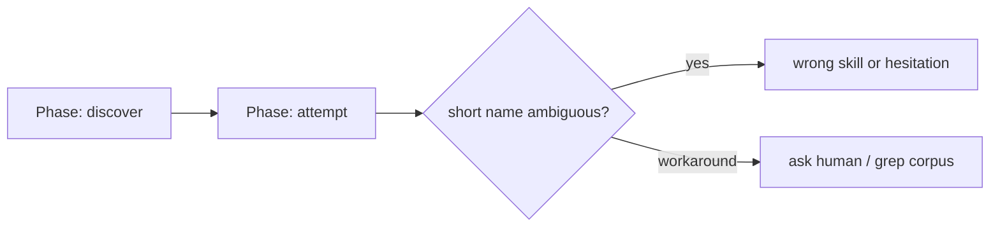

# skill-command-prefix — `pyxis-` harness skill namespace — PRD

| Field | Value |
|---|---|
| **In one line** | Rename every pyxis harness skill and slash-command to a canonical `pyxis-<basename>` identity (directory, frontmatter `name:`, invocation, and live routing refs) with a hard cut, a per-skill PR train, and a closing mechanical prefix gate plus Argus glossary split. |
| **Relevant-when** | planning, building, or reviewing harness skill naming / slash-command namespaces; triaging collisions between pyxis skills and native CLI skills; changing the distributable skills-tree layout, authoring-guide names, pipeline-map command citations, or the skill-name gate; amending Argus persona vs skill vocabulary |
| **Status** | Draft — problem review pending |
| **Tier** | T2 — touches the distributable agent surface every harness user invokes, but reversible by revert, no data/auth/money/migration surface |
| **Owner** | @mdarabi |
| **Approver(s)** | @mdarabi (operator) |
| **Contributors** | — *(solo operator; gate tables record the introducing PR's review, rule 15)* |
| **Informed** | engineers and agents on pyxis-onboarded repos |
| **Date** | 2026-07-29 created · 2026-07-29 last updated |
| **Appetite** | Small-batch: one PR per existing skill rename (directory + `name:` + skill-local live refs), then one closing PR for the mechanical `pyxis-*` skill-name gate, the Argus/`/pyxis-argus` glossary split, and remaining shared live refs. No engine-CLI rename, no frozen-doc rewrite, no alias layer, no per-harness name variants. (brainstorm:skill-command-prefix#D-8/#D-9) |
| **Target release** | trigger-bound: closing PR merge completes the namespace cut on the distributable surface |
| **Tracking** | agenticlab-ai/pyxis#808 — the introducing PR |
| **Artifacts** | `brainstorm:skill-command-prefix` — the gated stage-1 record (rides this PR) · `review:skill-command-prefix-000` — the unmanned reviewer's report (rides this PR) |
| **Template version** | prd-template/v2 |

## 0. Read to rule — the human reviewer's section (~4 min)

*The body is the contract; this section only routes attention — on any conflict the body governs; machines ignore it.*

**Judge these**

| # | The call | Could have gone | If you disagree |
|---|---|---|---|
| 1 | **Canonical unified rename** — one `pyxis-<basename>` identity for directory, `name:`, slash, and live refs | Invocation-only prefix, or partial collision-only prefix | Destination falls; help/adapters grow a permanent mapping layer → FR-1, NG-4, `brainstorm:skill-command-prefix#D-1` |
| 2 | **Hard cut** — unprefixed names die with each skill's PR; no aliases | Soft dual-name window | Dual catalog reintroduces the collision this feature exists to remove → FR-2, NG-3, `#D-3` |
| 3 | **One PR per skill + closing PR** for gate, glossary, shared refs | Single mega-PR for all renames | Appetite and reviewability change; mid-train gate timing (Q1) must be re-planned → §6.1, `#D-8`/`#D-9` |
| 4 | **Stem = current basename** — no shortening | Per-skill shorter names | Opens 14 naming debates and breaks mechanical J2 → FR-1, `#D-10` |
| 5 | **Engine CLIs and frozen docs stay out** | Rename `pyxis`/`docgate` verbs; rewrite merged history | Crosses into a different namespace and mutability class → NG-1, NG-2, `#D-2` |

**Sanity-check the numbers** — M1: after the closing PR, zero unprefixed pyxis skills remain invocable on the vendor surface and the prefix gate is green (§3.2); FR-4's gate refuses any new non-`pyxis-*` skill directory/`name:` pair (§5.1).

**The author's open questions** — Q1: concrete mechanism and activation of the skill-name gate under the closing-PR timing (product timing settled in D-9; mechanism is stage-3/4) (§7.2, `brainstorm:skill-command-prefix#P-1`).

**Skip the rest** — structure → docgate; substance/coherence → the unmanned reviewer's report riding this PR; implementation defects → downstream verification gates.

## 1. Summary — the one-pager

- **Problem** — Pyxis skills register in shared agentic harnesses under short unprefixed names that collide with or are confused for native CLI skills; operators and agents cannot tell which commands are factory surface.
- **For whom** — humans and agents invoking pyxis skills inside Claude Code, Codex, Cursor Agent, OpenCode (primary); newcomers reading `/pyxis-help` and the pipeline map (secondary). Not for engine-CLI rename.
- **Why now** — the distributable skill surface is already live across multiple harnesses; every new unprefixed skill widens the collision surface.
- **Direction** — canonical unified rename to `pyxis-<basename>` on the distributable agent surface and live routing docs; hard cut; one PR per skill; closing PR lands the mechanical prefix gate and Argus persona vs `/pyxis-argus` glossary split. (brainstorm:skill-command-prefix#D-1/#D-7/#D-9)
- **Appetite** — as header: per-skill PRs + one closing PR; no aliases, no engine CLI, no frozen rewrites.
- **Success** — at closing-PR merge: every skill on the live surface carries the prefixed identity end-to-end; live routing cites only prefixed forms; the prefix gate is on; glossary distinguishes Argus the persona from `/pyxis-argus` (M1).
- **Guardrail** — engine CLI verbs and frozen merged documents are unchanged by this feature (NR-1).
- **Top risks** — mid-train mixed surface confuses operators (R1); shared live refs drift across the train (R2); gate mechanism is underspecified until design (R3 / Q1).

## 2. Problem space

### 2.1 Problem statement

Operators and agents work inside third-party harnesses whose skill lists mix pyxis factory commands with native CLI skills under the same short-name grammar. Unprefixed pyxis names (`help`, `prd-new`, …) are ambiguous at the moment of invocation. Doing nothing leaves every future skill as another collision candidate and forces ad-hoc renames later at higher cost. (brainstorm:skill-command-prefix#D-1; operator seed idea verbatim in the record)

### 2.2 Users and segments

| Segment | Role and context | Domain exp. | Tech exp. | Key goals | Pain today | Evidence |
|---|---|---|---|---|---|---|
| **P1 (primary)** | humans and agents invoking pyxis skills inside shared harnesses (Claude Code, Codex, Cursor Agent, OpenCode) | journeyman | journeyman–master | invoke the right factory command without colliding with native skills | short names look like host skills; wrong or ambiguous selection | brainstorm:skill-command-prefix#D-4 |
| P2 (secondary) | newcomers discovering the surface via help / the pipeline map after install | novice | journeyman | learn which commands are pyxis | catalog and map teach unprefixed names that collide in the host | brainstorm:skill-command-prefix#D-4 |
| **Anti-segment** | engine CLI users wanting `pyxis` / `docgate` / `pyxis-release` verb renames | — | — | — | — | brainstorm:skill-command-prefix#D-4 |

### 2.3 Jobs and desired outcomes

| # | When… (situation) | I want to… (motivation) | So I can… (outcome) | Today's workaround | Evidence |
|---|---|---|---|---|---|
| J1 | I open a harness skill list that mixes pyxis and native commands | see every pyxis skill under a visible `pyxis-` namespace | pick factory commands without mistaking them for host skills | memorize which short names are ours, or guess | brainstorm:skill-command-prefix#D-5 |
| J2 | I rename or cite a skill across directory, frontmatter, slash, and live docs | use one string everywhere | avoid directory≠invocation drift and dual catalogs | hand-keep several spellings in sync | brainstorm:skill-command-prefix#D-5 |

### 2.4 Evidence

| Claim | Source (research, data, tickets, interviews) | Confidence |
|---|---|---|
| Skills today use unprefixed directory + matching frontmatter `name:` | live skills-tree `SKILL.md` scan (brainstorm:skill-command-prefix#F-1) | High |
| Vendor harness dirs are symlinks into the neutral skills tree — rename once, all harnesses see it | techspec agent-surface section; AP-25 (brainstorm:skill-command-prefix#F-2) | High |
| The pipeline map and help routing fixtures cite unprefixed slash commands | the shipped pipeline map; help routing eval fixtures (brainstorm:skill-command-prefix#F-3/#F-4) | High |
| Glossary currently treats Argus as persona/skill name together | `docs/wiki/glossary.md` Argus entry (brainstorm:skill-command-prefix#F-5) | High |
| Collision demand is real in multi-harness use | operator seed request; no outside-user telemetry yet | Med |

### 2.5 The journey today

| Phase | User does | User feels / pain | Frontstage (what user sees) | Backstage (systems, people, processes) |
|---|---|---|---|---|
| discover | opens harness skill picker / types `/` | many short names; unclear which are pyxis | mixed native + pyxis skill list | the neutral skills tree via vendor symlinks |
| attempt | invokes a short name (`/help`, `/prd-new`) | ambiguity or wrong skill | host may resolve native or pyxis | skill frontmatter `name:` + directory basename |
| recover | asks a human or greps the repo | friction; loses trust in the catalog | docs still teach unprefixed forms | pipeline map + help fixtures mirror the collision |

### 2.6 Opportunity and why now

- **Size** — every invocation of every pyxis skill on every supported harness, plus every new skill added to the surface.
- **Alternatives users have** — memorize the short list; avoid colliding names by accident; do nothing until a hard collision forces a one-off rename.
- **Why us / strategic fit** — AP-25 already consolidates skills on one neutral tree; a single rename propagates through vendor pointers.
- **Why now** — the multi-harness surface is live; prefixing once beats per-collision renames (brainstorm:skill-command-prefix#D-6).
- **Cost of doing nothing** — growing ambiguity; eventual forced rename with a larger live-ref surface.

**Decision:** Problem gate.

| Reviewer | Role | Date | Verdict |
|---|---|---|---|
| @mdarabi | operator | pending | pending — via the introducing PR's operator review |

## 3. Goals, metrics, and guardrails

### 3.1 Goals as falsifiable hypotheses

| # | We believe that… | Will result in… | Measured by… |
|---|---|---|---|
| G1 | namespacing every harness skill as `pyxis-<basename>` with one identity and a hard cut | unambiguous factory commands on shared harness skill lists | M1 |
| G2 *(qualitative)* | a mechanical prefix gate after the train | new skills cannot reintroduce unprefixed names | qual: gate green on closing PR; future skill PRs fail closed if unprefixed |

### 3.2 Goals → signals → metrics

| Metric | Goal | Signal | Baseline | Target (at checkpoint) | Feeds from |
|---|---|---|---|---|---|
| M1 (primary) | G1 | after the closing PR merges: (a) every skill directory under the skills tree and its frontmatter `name:` match `pyxis-<basename>`; (b) live routing surfaces named in FR-3 cite only prefixed forms; (c) no unprefixed pyxis skill remains invocable via the vendor surface; (d) the mechanical prefix gate is enabled; (e) glossary distinguishes Argus the persona from `/pyxis-argus` | fails today (all unprefixed) | all five clauses true at closing-PR merge | inspection checklist on the closing PR (§6.7) |

### 3.3 Guardrails and decision rule

| Guardrail metric | Threshold | Action if breached |
|---|---|---|
| Engine CLI surface unchanged | zero renames of `pyxis` / `docgate` / `pyxis-release` verbs in this feature's diffs | strip from scope; reopen only via a different PRD |
| Frozen-doc immutability | zero edits to merged immutable documents solely to rewrite historical command strings | revert those edits; leave provenance as-is |

**Ship rule (pre-registered):** M1 all five clauses true AND both guardrails clean on the closing PR → adopt the namespace; any unprefixed skill still invocable → do not enable the gate / do not call the train done; guardrail breach → revert offending commits.

### 3.4 Non-goals and waiting room

| ID | Non-goal | Why refused |
|---|---|---|
| NG-1 | Renaming engine CLI binaries or subcommands (`pyxis`, `pyxis-release`, `docgate`) | different command namespace from harness slash-commands (brainstorm:skill-command-prefix#O-1/#D-2) |
| NG-2 | Rewriting frozen merged records/designs/PRDs solely to replace historical unprefixed command mentions | immutability; provenance stays; only live surfaces update (brainstorm:skill-command-prefix#O-2/#D-2) |
| NG-3 | Compatibility aliases or a soft dual-name cutover for unprefixed skills | hard cut only — dual names reintroduce ambiguity (brainstorm:skill-command-prefix#O-3/#D-3) |
| NG-4 | Per-harness divergent skill names | one canonical `pyxis-<basename>` identity everywhere (brainstorm:skill-command-prefix#O-4/#D-1/#D-5) |

| ID | Waiting room | Revisit when / intended version |
|---|---|---|
| — | none — the mechanical prefix gate and Argus glossary split are **in this iteration**, not deferred (brainstorm:skill-command-prefix#D-7) | — |

## 4. Solution space

### 4.1 Approach and alternatives considered

The chosen shape: rename every harness skill to `pyxis-` + current basename (unchanged stem) so directory, frontmatter `name:`, slash invocation, and matching authoring-guide filename share one string; hard-cut each skill on its PR merge; deliver as one PR per skill; close with a PR that enables the mechanical `pyxis-*` skill-name gate, lands the Argus persona vs `/pyxis-argus` glossary amendment, and finishes remaining shared live refs. (brainstorm:skill-command-prefix#D-1/#D-9/#D-10)

| Option | Sketch | Why not chosen |
|---|---|---|
| A (chosen) | canonical unified rename + hard cut + per-skill PR train + closing gate/glossary PR | — |
| B | invocation-only prefix; directories stay short | permanent directory≠invocation drift; help must learn a mapping layer (brainstorm:skill-command-prefix#D-1) |
| C | prefix only colliding names | mixed catalog + collision matrix to maintain (brainstorm:skill-command-prefix#D-1) |
| Do nothing | keep unprefixed short names | collisions grow with every new skill (§2.6) |

### 4.2 Scope perimeter

- **In (plan of record)** — rename of every skill on the distributable skills tree and matching authoring guides; updates to live routing docs (pipeline map, help fixtures/tests/eval expectations, editable wiki invocation pointers, living rollup agent-surface inventory); hard cut per skill; mechanical `pyxis-*` skill-name gate; Argus/`/pyxis-argus` glossary split (candidate may land with this PRD; confirmed by M1); delivery as one PR per skill plus closing PR.
- **Future (believed next, not committed)** — none committed beyond Q1's mechanism detail (design-owned).
- **Out** — mirrors §3.4.

### 4.3 Experience: flows and states

**Flow F1 — invoke a namespaced skill (serves J1).** Operator or agent types `/pyxis-<basename>` (or selects it from the harness skill list) → the pyxis skill runs; the old unprefixed form is absent after that skill's PR merges. **Degraded:** typing the old name fails closed (no alias) — operator uses help/pipeline map for the new name (UB-1).

**Flow F2 — land one skill rename (serves J2).** Author opens a per-skill PR that renames directory + `name:` + skill-local live refs to the same `pyxis-<basename>` string → merge hard-cuts that skill. **Partial (mid-train):** other skills may still be unprefixed until their PRs land — expected under D-8/D-9; shared refs may lag until the closing PR (UB-2).

**Flow F3 — close the namespace (serves G2 / M1).** Closing PR enables the prefix gate, lands the glossary split, finishes shared live refs → M1 checklist passes. **Error:** gate enabled while an unprefixed skill remains → fail closed; do not merge (UB-3).

- **Accessibility / localization** — terminal/chat text; English-only; inherits host CLI. No separate UI.

### 4.4 Scenarios

1. **Collision avoided.** An engineer on Claude Code types `/` and sees `/pyxis-help` beside native skills — selects the factory front door without confusing it for a host help command.
2. **Per-skill land.** A reviewer merges `chore: rename feature-brainstorm → pyxis-feature-brainstorm`; `/feature-brainstorm` stops resolving; `/pyxis-feature-brainstorm` works; other skills unchanged until their PRs.
3. **Closing.** After the last skill PR, the closing PR turns on the prefix gate and updates the Argus glossary; a follow-up attempt to add an unprefixed skill directory (e.g. `foo/`) under the skills tree fails the gate.

**Decision:** Solution gate — zero TBDs pass this gate (Q1 is design-owned, non-blocking here).

| Reviewer | Role | Date | Verdict |
|---|---|---|---|
| @mdarabi | operator | pending | pending — via the introducing PR's operator review |

## 5. System requirements

### 5.1 Functional requirements

| ID | Requirement (EARS) | Rationale | Priority | Risk | Fit criterion | Verify | Traces to |
|---|---|---|---|---|---|---|---|
| FR-1 | When a pyxis harness skill is published on the distributable agent surface, the system shall identify it by the single string `pyxis-` concatenated with its pre-rename basename (no shortening), used identically as skill directory basename, frontmatter `name:`, slash-command identity, and matching authoring-guide filename. | J1 + J2 — one namespaced identity | Must | low | for every skill on the live skills tree after the train, directory basename = frontmatter `name:` = `pyxis-<pre-rename-basename>`; matching authoring guide filename uses the same stem | Inspection | G1, J1, J2, F1 |
| FR-2 | When a skill's rename PR merges, the system shall provide no compatibility alias for that skill's former unprefixed identity. | hard cut — no dual catalog | Must | med | after merge, the unprefixed form is absent from the skills tree and is not registered as an alternate `name:` | Inspection | G1, NG-3, F1 |
| FR-3 | When live routing surfaces for the namespace cut are updated, they shall cite only prefixed skill/command forms for pyxis harness skills — specifically the pipeline map, help fixtures/tests/eval expectations, editable wiki invocation pointers, and the living rollup's agent-surface inventory. | discovery and shipped inventory must teach the new identity | Must | med | after the closing PR, those surfaces contain zero unprefixed pyxis slash-command citations for harness skills | Inspection | G1, M1, F2 |
| FR-4 | When a new skill is added under the skills tree after the closing PR, the system shall refuse the change unless the skill directory basename and frontmatter `name:` both match the `pyxis-*` prefix rule. | prevent regression | Must | med | a sandbox attempt to add a non-`pyxis-*` skill fails the mechanical gate; a correctly prefixed skill is accepted | Test | G2, M1 |
| FR-5 | By the M1 checkpoint (closing-PR merge), the glossary shall distinguish **Argus** (the AI Engineer persona) from **`/pyxis-argus`** (the harness skill identity). The candidate entry may land earlier with the PRD introducing PR (prd-new T-n routing); the closing PR confirms the prefixed skill form. | vocabulary seam closed in-iteration | Must | low | at M1, glossary Argus entry states persona vs skill split; avoid-list rejects treating them as interchangeable | Inspection | M1, T-1 |

**Non-regression (NR-n)**

| ID | Existing behavior protected | Why protected | Risk | Fit criterion | Verify | Traces to |
|---|---|---|---|---|---|---|
| NR-1 | Engine CLI binaries/verbs (`pyxis`, `docgate`, `pyxis-release`) and frozen merged documents remain unchanged by this feature's rename work | NG-1 / NG-2 perimeter | low | implementation diffs for rename work do not rename engine CLI verbs and do not rewrite frozen docs solely to replace historical command strings | Inspection | NG-1, NG-2 |

### 5.2 Unwanted behavior and failure handling

| ID | If… (trigger) | Then the system shall… | User sees | Priority | Risk | Fit criterion | Verify | Traces to |
|---|---|---|---|---|---|---|---|---|
| UB-1 | If a user invokes a skill's former unprefixed name after that skill's rename PR has merged | not resolve it via alias — fail closed | host "unknown skill" (or equivalent); prefixed name remains the only path | Must | med | no alias file, symlink, or frontmatter alternate restores the old name | Inspection | FR-2, F1 |
| UB-2 | If the PR train is mid-flight (some skills renamed, some not) | allow the mixed surface until the closing PR; not enable the all-skills prefix gate early | some `/pyxis-*` and some legacy short names coexist temporarily | Must | low | gate is absent or inactive until the closing PR; per-skill hard cuts still hold | Inspection | D-9, F2, F3 |
| UB-3 | If the closing PR would enable the prefix gate while any skill on the tree still lacks the `pyxis-*` identity | refuse to treat the namespace cut as complete | closing PR cannot merge green / M1 fails | Must | med | checklist or gate precondition fails when any unprefixed skill remains | Test | FR-4, M1 |

### 5.3 Permissions and abuse cases

Skipped: rename of in-repo agent-surface files and a mechanical naming gate; no new privilege surface beyond existing CI/docgate authority.

### 5.4 Data

Skipped: no new durable data class — skills and docs are the existing repo surfaces; the gate is a check over tree shape, not a store.

### 5.5 Interfaces and integrations

Skipped: no new external system boundary — harnesses continue to discover skills via existing vendor pointers into the neutral tree (AP-25).

### 5.6 Non-functional requirements

| ID | Area | Requirement | Fit criterion | Verify |
|---|---|---|---|---|
| NFR-1 | Maintainability | The rename rule shall stay mechanical (`pyxis-` + basename) so future skills need no per-skill naming debate. | new skills follow FR-1/FR-4 without glossary exceptions beyond Argus persona split | Inspection |

*Other NFR areas reviewed and dropped: local agent-surface rename inherits host CLI performance/security/privacy; no separate UI for a11y/i18n.*

### 5.7 Instrumentation — the tracking plan

Skipped: no telemetry surface; M1 is measured by the closing-PR inspection checklist (§3.2, §6.7).

### 5.8 Definition of Done

| ID | Done criterion | Source | Verify | Required evidence | Blocking? |
|---|---|---|---|---|---|
| DOD-1 | All Must FRs pass their fit criteria | FR-1..5 | Inspection/Test per row | closing-PR checklist + gate test transcript | yes |
| DOD-2 | Failure behavior holds: no aliases; mid-train mixed surface expected; gate not enabled early; incomplete close refused | UB-1..3 | Inspection/Test | train notes + closing-PR gate run | yes |
| DOD-3 | M1 all five clauses true | M1 | Inspection | checklist riding the closing PR | yes |
| DOD-4 | Non-regression holds | NR-1 | Inspection | rename-train + closing PR diffs | yes |

### 5.9 AI behavior and evals

Skipped: this feature is a mechanical naming/cutover contract; no model-driven behavior to eval. Help routing evals update as live-surface fallout (FR-3), owned by the existing help purity/eval harness.

## 6. Delivery

### 6.1 Phasing and milestones

| Phase | Purpose | Scope | Exit criterion |
|---|---|---|---|
| Per-skill train | rename each skill under FR-1/FR-2 | one PR per skill: directory, `name:`, skill-local live refs, matching authoring guide | each PR merges with that skill hard-cut |
| Close | enable gate, glossary split, shared live refs | one closing PR | DOD-1..4 / M1 green |

### 6.2 Dependencies

| Dependency | Type (team / system / vendor / approval) | Needed by | Status | Owner |
|---|---|---|---|---|
| ecosystem-help live-surface derivation | system — sibling | Close (fixtures update with FR-3); help catalog follows surface automatically (DINV-1) | shipped | operator |
| vendor skill pointers (AP-25 symlinks) | system | Per-skill train | live | operator |

### 6.3 Risks, assumptions, and rabbit holes

| # | Risk / assumption / rabbit hole | Likelihood | Impact | Mitigation or test | Owner |
|---|---|---|---|---|---|
| R1 | Mid-train mixed names confuse operators | M | L | expected under UB-2; train short; help/pipeline updated as refs land | operator |
| R2 | Shared live refs (`pipeline.md`, cross-skill citations) drift across many PRs | M | M | closing PR owns remaining shared refs (D-9); FR-3 checklist | operator |
| R3 | Gate mechanism underspecified (Q1) | M | M | product timing fixed (closing PR); mechanism deferred to design — do not invent it in the PRD | operator |
| A1 | Assumption: harnesses discover skills by directory/`name:` on the vendor pointer tree (High — F-2) | — | H | if a harness ignores renamed dirs, file a portability defect — out of inventing aliases (NG-3) | operator |

### 6.4 Release criteria

| Lens | Criterion | Evaluated by |
|---|---|---|
| Functionality | FR-1..5 fit criteria | DOD-1 |
| Reliability | UB-1..3 hold | DOD-2 |
| Completeness | M1 five clauses | DOD-3 |
| Supportability | NR-1 perimeter intact | DOD-4 |

### 6.5 Rollout and reversibility

- **Flag / kill switch** — n/a at runtime: reversal is reverting the offending PR(s) in the train; no runtime flag surface.
- **Stages** — the honest stages are §6.1 (per-skill train → close); no percentage rollout.

### 6.6 Launch readiness

| Area | Item | Owner | Status |
|---|---|---|---|
| Docs | glossary Argus/`/pyxis-argus` candidate rides this introducing PR (prd-new T-n); closing PR confirms the prefixed skill form (FR-5) | operator | ☐ |
| Docs | pipeline map + help fixtures + living rollup agent-surface inventory finish on the closing PR if not completed skill-by-skill (FR-3) | operator | ☐ |

*Other areas (support, legal, pricing, marketing): n/a — solo-operator tooling rename.*

### 6.7 Post-launch review

- **Review trigger** — closing PR merges and M1 checklist is recorded. · **Owner** — @mdarabi
- **Verdict recorded** — adopt / iterate / kill — on the header's Tracking ref.

## 7. Alignment

### 7.1 FAQ

**Customer**

- **Q:** What do I type instead of `/help`? — **A:** `/pyxis-help`. Every factory skill becomes `/pyxis-<old-name>`.
- **Q:** Will the old names keep working for a while? — **A:** No. Each skill hard-cuts when its rename PR merges — no aliases.

**Internal**

- **Q:** Why not one mega-PR? — **A:** Appetite is small-batch and reviewable: one PR per skill, then a closing PR for gate + glossary + shared refs (brainstorm:skill-command-prefix#D-8/#D-9).
- **Q:** Why not rename `docgate` too? — **A:** Engine CLIs are a different namespace; refused as NG-1.
- **Q:** Does `/argus` become something else? — **A:** The skill becomes `/pyxis-argus`; **Argus** remains the persona name in prose (FR-5).

### 7.2 Open questions

| # | Question | Owner | Needed by | Status |
|---|---|---|---|---|
| Q1 | What concrete mechanism implements the `pyxis-*` skill-name gate, and how does it encode the closing-PR activation (absent/inactive mid-train)? Product timing is settled (gate in closing PR); mechanism is stage-3/4. (brainstorm:skill-command-prefix#P-1) | operator | stage-3 design | open |

### 7.3 Decision log

| Date | Decision | Alternatives considered | Why | Who |
|---|---|---|---|---|
| 2026-07-27 | Destination B: canonical unified rename | invocation-only (A); collision-only (C) | one identity; AP-25 + help derivation (brainstorm:skill-command-prefix#D-1) | operator |
| 2026-07-27 | Scope: agent surface + live routing; not engine CLIs or frozen docs | broader rename | harness collision is the pain (brainstorm:skill-command-prefix#D-2) | operator |
| 2026-07-28 | Hard cut; no aliases | soft dual-name window | dual catalog reintroduces ambiguity (brainstorm:skill-command-prefix#D-3) | operator |
| 2026-07-28 | Segments: harness users primary; newcomers secondary; engine CLI anti-segment | engine CLI in scope | different namespace (brainstorm:skill-command-prefix#D-4) | operator |
| 2026-07-28 | Jobs: disambiguate + one identity | teaching / discoverability as primary jobs | ecosystem-help owns teaching (brainstorm:skill-command-prefix#D-5) | operator |
| 2026-07-28 | Success: merge-bound M1 checklist | calendar / adoption telemetry | mechanical cutover (brainstorm:skill-command-prefix#D-6) | operator |
| 2026-07-28 | NG perimeter + gate & glossary **in iteration** | defer gate/glossary to WR | operator pulled both into this iteration (brainstorm:skill-command-prefix#D-7) | operator |
| 2026-07-29 | Appetite: one PR per skill | single mega-PR | reviewable small batches (brainstorm:skill-command-prefix#D-8) | operator |
| 2026-07-29 | Closing PR owns gate + glossary + remaining shared refs | enable gate mid-train | avoids false failures on unprefixed leftovers (brainstorm:skill-command-prefix#D-9) | operator |
| 2026-07-29 | Stem = `pyxis-` + current basename unchanged | per-skill shortening | mechanical J2 (brainstorm:skill-command-prefix#D-10) | operator |

### 7.4 Changelog

| Date | Change | Author |
|---|---|---|
| 2026-07-29 | 000-base created from the gated brainstorm record | factory agent (operator-directed session) |
| 2026-07-29 | Round-1 review findings applied — FR-5 timing aligned with prd-new T-n routing; FR-3/M1/§4.2/§6.6 enumerate live routing surfaces including the living rollup (review:skill-command-prefix-000#FND-1..3) | factory agent (review disposition) |
| 2026-07-30 | CI purity fix: drop system-footprint path literals from § Relevant-when / §2.4 / §2.5 / §4.4 (check-content-paths, FR-31); no semantics changed | factory agent (operator-directed session) |

## 8. Contract readiness — the executability gate

| Check | Pass? | Notes |
|---|---|---|
| Problem basis accepted — §2 problem gate signed (T2) | ☐ | pending — signs via the introducing PR's operator review (rule 15) |
| Zero solution-blocking TBDs or open questions (§7.2) | ☑ | Q1 is design-owned; blocks no gate here |
| Every Must FR has a fit criterion and a verification method (§5.1) | ☑ | |
| Every requirement row carries a risk tier; high/critical rows have a declared safety plan | ☑ | vacuously — no high/critical rows |
| Non-goals drawn (§3.4); non-regression rows named (§5.1) | ☑ | NG-1..4; WR none (in-iteration); NR-1 |
| Every primary job (§2.3) is covered by a requirement, a non-goal, or a waiting-room entry | ☑ | J1→FR-1/FR-2; J2→FR-1/FR-3 |
| Every key flow (§4.3) has functional, failure, and non-regression coverage (§5.1–5.2) | ☑ | F1→FR-1/UB-1; F2→FR-2/UB-2; F3→FR-4/UB-3; NR-1 spans |
| Every primary metric (§3.2) has instrumentation (§5.7) or an explicit measurement plan | ☑ | M1 → closing-PR checklist (§6.7); §5.7 skipped with reason |
| Every blocking DoD row traces to a requirement, guardrail, release criterion, or human-judgment rubric (§5.8) | ☑ | |
| Risks and assumptions have owners (§6.3) | ☑ | |
| Human-judgment criteria name an owner and a rubric (§5.8) | ☑ | vacuously — no Human-judgment Verify rows; M1 is Inspection |
| DoD complete: every blocking row sourced and evidenced; every n/a explained (§5.8) | ☑ | no n/a rows |
