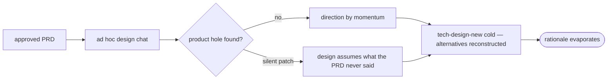

# tech-design-brainstorm — the stage-3 design-grilling skill — PRD *(effective view)*

---

**GENERATED — DO NOT EDIT.** Sole writer: `docgate fold`. As of: **001**. Content fingerprint: `sha256:e4b6a2b5d9b86daaabf3156548800484773ed4452859bd895446359fc9ed089e`. Tool version (recorded, never hashed): `docgate/v1`.

---

| Field | Value |
|---|---|
| **In one line** | The pipeline-stage-3 explore half: a design-grilling session that takes an approved requirement basis and resolves the solution-space decisions with the stage's decision authority — parallel alternatives fired by a seam rule, product holes bounced formally, everything frozen into a design-brainstorm record from which `tech-design-new` authors without re-interviewing. |
| **Relevant-when** | planning, building, or reviewing the tech-design-brainstorm skill, its authoring guide, or the design-brainstorm-record contract; triaging defects in stage-3 elicitation (self-answered design rulings, silent requirement patches, un-audited panel skips, re-interviewing during design authoring); changing `tech-design-new`'s inputs, the sibling record template, or the stage-3 → design handoff |
| **Status** | Problem review ✓ · Solution review ✓ (2026-07-10) — launch review pending, post-implementation |
| **Tier** | T2 |
| **Owner** | @mdarabi |
| **Approver(s)** | @mdarabi (operator) |
| **Contributors** | operator (product) · factory agents (implementation) |
| **Informed** | the future stage-3 judgment-service design (the autonomous answerer, WR-1); the escalation-brief machinery when it arrives |
| **Date** | 2026-07-10 created · 2026-07-10 last updated |
| **Appetite** | small: one authoring guide + the sibling record template (own checklists) + skill glue + an eval fixture corpus with its own HITL/integrity fixtures; ≤ 2 human review rounds per document; modest eval-run spend; zero rollout/support burden (repo-internal, bootstrap-era). Excludes engine code, the autonomous answerer, docgate changes, and any edit to the shipped feature-brainstorm surface. |
| **Target release** | precedes the next technical design authored in this repo — the next design doc should be born from a design-brainstorm record; completes the explore half of the System-2 authoring set |
| **Tracking** | introducing PR (filed on approval) |
| **Artifacts** | the feeding brainstorm record `docs/brainstorms/tech-design-brainstorm.md` (gated ready-for-prd 2026-07-10) · design-brainstorm-record template (arrives with implementation) · eval fixture corpus (arrives with implementation) · external prior-art survey of design-exploration disciplines (2026-07-09 session) |
| **Template version** | prd-template/v1 |

## 1. Summary — the one-pager

- **Problem** — Once a PRD is approved, the solution-space decisions — what shape, which seam, why this alternative — happen in ad hoc conversation: the rationale evaporates with the session, first-idea anchoring goes unchallenged, and a product hole discovered mid-design gets silently patched instead of formally routed back to the contract.
- **For whom** — the stage-3 decision authority (the operator today; the judgment plane within a risk envelope later, with the operator as escalation authority always); `tech-design-new`, which needs direction + rejected alternatives + seams pre-resolved; and traceability, which needs why-this-architecture to be citable.
- **Why now** — the stage-1 twin shipped and proved the record discipline end-to-end (this PRD is itself its first fully record-fed synthesis); PLAN-1 names the harbormaster brainstorm stage as an unmet parity requirement; and the next designs this repo needs are exactly the sessions this skill should front.
- **Direction** — a design-grilling session with the proven record spine: orient against the requirement basis and the live design corpus, refuse drafts and basis-free requests at the door, grill one question at a time with recommendations, fire a parallel-alternatives panel when the question opens or replaces a seam (operator-overridable both ways, always audited), score alternatives against the principles and matched incidents, park fog typed against the design-template's inputs, bounce product holes to `/prd-amend` under a dedicated verdict, and end only through the decision authority's explicit gate.
- **Appetite** — as header; the distinctive exclusion: zero edits to the shipped stage-1 surface (no shared primitive — the disciplines evolve separately).
- **Success** — `tech-design-new`, authoring from a gated `ready-for-design` record, asks the decision authority zero decision-questions (median across the first five designs through the stage).
- **Guardrail** — the skill mutates no governed document, writes nothing but its record, and records no ruling without a live decision-authority answer; any breach is a defect (unanchored rulings are sev-1).
- **Top risks** — self-answering under long-session drift (now with design questions, where "the obvious answer" is most tempting); duplicated interview discipline drifting between the two skills (accepted by ruling; bounded by per-skill evals); the panel becoming ceremony (mis-firing on extensions) or theater (skipped on real seams).

## 2. Problem space

### 2.1 Problem statement

Between an approved PRD and an authored technical design lives the highest-leverage set of decisions in the pipeline — the solution's shape — and today that set has no home, no discipline, and no record. Direction gets picked in unrecorded chat; alternatives are considered in the author's head, if at all; the architecture principles and incident registry are consulted by memory or not at all; and when design exploration exposes a hole in the requirements, the path of least resistance is to quietly design around it rather than amend the contract — leaving the PRD claiming one thing and the design assuming another. The predecessor factory had a brainstorm stage (2–3 scored approaches, incident matching, an explicit recommendation) that pyxis has not rebuilt, and the one stage-3-shaped conversation run in this repo (the local-work-tracker design direction) worked only as operator-driven improvisation. The cost of doing nothing: design rationale stays unauditable exactly where the autonomy roadmap needs it auditable most, and stage 5 review becomes the first place bad direction gets caught — the most expensive place.

### 2.2 Users and segments

| Segment | Role and context | Domain exp. | Tech exp. | Key goals | Pain today | Evidence |
|---|---|---|---|---|---|---|
| **P1 (primary)** | the stage-3 **decision authority** — the operator at today's autonomy level; the judgment plane acting within a risk envelope later, with the operator as escalation authority always | master | master | explore the solution space with recommendations attached; rule on trade-offs; end with a direction that is theirs, recorded | design brainstorming is ad hoc chat; rationale evaporates; nothing challenges the first idea | brainstorm:tech-design-brainstorm#D-7; product-vision §4 stage 3 |
| P2 | `tech-design-new` / the Planner downstream — consumes direction, rejected alternatives, seams | — | master | author the design as assembly: §2 Decision and §4 Alternatives pre-resolved and citable | no structured input; the design author re-derives or re-asks | the tech-design-new authoring guide (tech-design-template/v1: §4 alternatives; Serves) |
| P3 | traceability and audit — the design index, stage-2 acceptance, incident forensics | — | — | why-this-architecture traces to a ruling; autonomous design decisions carry evidence | the chain starts at the design doc; nothing above it | product-vision §6; brainstorm:tech-design-brainstorm#D-7 |
| **Anti-segment** | design decisions made **without a record** — autonomy without provenance | — | — | — | — | refused forever; the autonomous *answerer* itself is WR-1, not an anti-segment (#D-7) |

### 2.3 Jobs and desired outcomes

| # | When… (situation) | I want to… (motivation) | So I can… (outcome) | Today's workaround | Evidence |
|---|---|---|---|---|---|
| J1 | a PRD is approved and the solution shape is open | be grilled through the solution space one question at a time, recommendations attached, alternatives paneled where the seam is new | end with a direction I have ruled on, recorded with its why | ad hoc design chat; direction by momentum | #D-7, #D-1 |
| J2 | `tech-design-new` runs | have direction, rejected alternatives, seam map, and Serves-ready anchors pre-resolved | author the design as assembly, zero re-interviewing | the author re-derives; §4 tables reconstructed from memory | #D-7, #D-8 |
| J3 | design grilling exposes a product hole | get a formal stop-and-bounce (`needs-more-product` → `/prd-amend`) | keep the PRD and the design telling one story | silent local patch; drift between contract and design | #D-5 |
| J4 | a reviewer (or incident) later asks *why this architecture* | trace the direction to the authority's ruling — question, answer, date | audit and supersede designs on evidence | git archaeology; memory | #D-7; product-vision §6 |
| J5 | a session dies mid-grilling | resume from the record without re-answering | protect the rulings from context loss | start over | stage-1 precedent (FR-14 there) |

### 2.4 Evidence

| Claim | Source (research, data, tickets, interviews) | Confidence |
|---|---|---|
| The brainstorm stage is a named, unmet parity requirement — approaches scored against principles **and matched incidents**, recommendation, zero tracker writes | docs/prds/design-and-planning.md (PLAN-1); brainstorm:tech-design-brainstorm#F-1 | High |
| The record discipline works end-to-end at stage 1 — shipped, eval-proven, and this PRD is its first fully record-fed synthesis (zero decision-questions asked) | feature-brainstorm ledger + its eval reports; this document's §7.3 anchors | High |
| The stage-3 record class was pre-reserved as a sibling that Builds-on the stage-1 record model and shares its grammar | docs/tech-design/brainstorm-record-model.md §3.6; brainstorm:tech-design-brainstorm#F-2 | High |
| Parallel alternatives under orthogonal constraints counter first-idea anchoring on design questions | external prior-art survey 2026-07-09 (design-it-twice discipline; judge panels) | Medium |
| Solution-space grilling is where product under-specification actually surfaces — it needs a formal exit, not a silent patch | brainstorm:tech-design-brainstorm#D-5 (operator ruling); stage-2 review churn pattern | Medium |

### 2.5 The journey today

| Phase | User does | User feels / pain | Frontstage (what user sees) | Backstage (systems, people, processes) |
|---|---|---|---|---|
| PRD approved | decides to "figure out the design" | where do I even hold this conversation? | an empty chat | no stage, no record, no discipline |
| Explore | talks through options ad hoc | first idea dominates; principles/incidents consulted by memory | prose back-and-forth | nothing scores, nothing anchors |
| Hit a product gap | designs around it | "we'll note it somewhere" | a silent assumption in the design | the PRD and design now disagree |
| Author | runs tech-design-new cold | §4 alternatives reconstructed after the fact | a design doc with thin alternatives | rationale unauditable |
| Later | someone asks why this shape | archaeology | git blame | the chain stops at the design doc |

### 2.6 Opportunity and why now

- **Size** — every feature passes through stage 3; the direction chosen there governs implementation, review, and every later supersession argument.
- **Alternatives users have** — ad hoc chat (status quo); authoring the design cold and treating stage-5 review as the design conversation (latest, most expensive catch point).
- **Why us / strategic fit** — the record spine is built and proven; the design corpus (principles, incidents, index) exists to be scored against; the autonomy roadmap (§10 zero-touch) requires exactly this decision-protocol shape to remove the human safely later.
- **Why now** — the sibling skill just shipped; the next designs this repo authors (this feature's own, the minimal-local siblings) are the sessions to front; PLAN-1 parity is open.
- **Cost of doing nothing** — design rationale stays unrecorded at the exact point the autonomy ladder needs it; product/design drift keeps entering through silent patches.

**Decision:** Problem gate — do not proceed to §3–§4 until every contributor signs.

| Reviewer | Role | Date | Verdict |
|---|---|---|---|
| @mdarabi | operator | 2026-07-10 | approved |

## 3. Goals, metrics, and guardrails

### 3.1 Goals as falsifiable hypotheses

| # | We believe that… | Will result in… | Measured by… |
|---|---|---|---|
| G1 | a disciplined design-grilling front half producing a frozen record | design authoring that never re-interviews and never invents direction | M1 |
| G2 | recording every design ruling with question, answer, and anchor — and every alternative with its score | a provenance chain from requirement to architecture that survives into the autonomy era | M2 |
| G3 *(qualitative)* | the seam-ruled panel | genuinely distinct alternatives where they matter, and no ceremony where they don't — confirmed by the decision authority at the gate | qual: gate confirmation + panel audit notes (DOD-5 rubric) |

### 3.2 Goals → signals → metrics

| Metric | Goal | Signal | Baseline | Target (at checkpoint) | Feeds from |
|---|---|---|---|---|---|
| M1 (primary) | G1 | decision-questions `tech-design-new` asks the decision authority while authoring from a gated `ready-for-design` record | n/a (stage does not exist; cold authoring re-derives) | median 0, max ≤ 2, at checkpoint "five designs through stage 3" | measurement plan: count authority-directed decision-questions in each authoring session transcript |
| M2 | G2 | §2 Decision and §4 Alternatives rows in merged designs carrying `design-brainstorm:<slug>#D-n` anchors | n/a | 100% of such rows at the same checkpoint | measurement plan: inspection of each merged design against its record |

*(§5.7 tracking plan skipped with reason — repo-internal HITL tooling with no product analytics; both metrics are measured by transcript count and document inspection at the named checkpoint, plans stated above.)*

### 3.3 Guardrails and decision rule

| Guardrail metric | Threshold | Action if breached |
|---|---|---|
| governed-document mutations by the skill (vision, principles, PRD ledgers, designs, incidents) | any (> 0) | defect — the write perimeter is the record; fix before further sessions |
| tracker / work-item writes by the skill | any | defect — stage 3 precedes planning by design |
| design rulings recorded without a live decision-authority answer | any single occurrence | sev-1 defect — halt adoption, fix, re-run evals (EVAL-2) |
| requirement content silently altered during a session (a "patched" PRD assumption in the record or downstream design) | any | sev-1 defect — the needs-more-product bounce exists precisely for this (FR-14) |
| median authority questions per session (burden, diagnostic) | median > 40 across the checkpoint set | discuss — review guide quality and panel usage; never a hard cap |

**Ship rule (pre-registered):** M1 and M2 hit targets at the checkpoint AND zero integrity-guardrail breaches → adopt as the standing stage-3 front half; M1 missed with guardrails clean → iterate the guide and re-run; any integrity breach → halt, fix, re-verify.

### 3.4 Non-goals and waiting room

| ID | Non-goal | Why refused |
|---|---|---|
| NG-1 | Authoring the technical design (any part of a `docs/tech-design/` document) | `tech-design-new`'s job; the explore/exploit split is the premature-completion defense, proven at stage 1 (brainstorm:tech-design-brainstorm#D-9) |
| NG-2 | Engine or judgment-service code — including the autonomous stage-3 answerer | bootstrap-era authoring skill; the answerer is WR-1, never this feature (#D-7, #D-9) |
| NG-3 | A shared grilling primitive with feature-brainstorm | operator ruling: the two disciplines evolve separately in the long run; coupling cost outweighs bounded duplication (#D-6) |
| NG-4 | Tracker writes or work-item creation | stage 3 precedes planning; the write perimeter is the record (#D-9) |
| NG-5 | Stage-6 contract-compilation concerns | the bounce routes to `/prd-amend`, not to a compiler; no compilation logic here (#D-9) |
| NG-6 | Modifying governed documents | gaps are surfaced (or bounced), never patched (#D-9) |
| NG-7 | Design decisions without a record | the standing refusal — autonomy without provenance is never served (#D-7) |

| ID | Waiting room | Revisit when / intended version |
|---|---|---|
| WR-1 | The autonomous stage-3 answerer — the judgment plane adopting its own recommendations within a risk envelope, escalating exceptions as decision briefs | when the autonomy ladder reaches design decisions (#D-7) |
| WR-2 | A per-repo config dial for the panel rule (always / seam-ruled / operator-only) | with the pyxis-config surface; the rule ships as guide prose first (#D-4) |
| WR-3 | Record-lint graduation for the sibling record class | aligned with stage 1's trigger: checklists stable across the first five records (#D-9) |

## 4. Solution space

### 4.1 Approach and alternatives considered

The chosen shape is the **design grilling**: a HITL session with the proven record spine — orient, refuse bad input at the door, one question at a time with recommendations, capture immediately, park fog typed, end only through an explicit gate — retargeted at the solution space, with three stage-3-specific organs. The **panel move**: when the question opens or replaces a seam, spawn parallel design alternatives under orthogonal constraints and record each with its trade-offs and its score against the architecture principles and matched incidents; skip it for pure extensions; the decision authority may force or waive either way, and the record notes which path was taken and why. The **bounce**: when grilling exposes a hole in the requirement basis, the session stops designing, names the gap with anchors, and ends `needs-more-product` — the remedy is a typed amendment on the PRD ledger, never a silent local patch. The **handoff**: the gated record feeds `tech-design-new` the way brainstorm records feed `prd-new` — direction, alternatives, seams, and citations, ready for assembly.

| Option | Sketch | Why not chosen |
|---|---|---|
| A (chosen) | the design grilling — record-spine interview; panel and bounce as organs inside it | — |
| B | the judge panel as the skill's identity — parallel alternatives, conversation reviews the output | loses decision provenance as the spine; the panel is the highest-leverage *move*, not the identity (brainstorm:tech-design-brainstorm#D-1) |
| C | the scored bake-off (PLAN-1 parity, lighter ceremony) | loses the interview that surfaces constraints only the decision authority knows; scoring survives as the panel's rubric (#D-1) |
| Do nothing | ad hoc design chat; stage-5 review catches direction late | §2.6 — rationale evaporates; product/design drift enters silently |

### 4.2 Scope perimeter

- **In (plan of record)** — the authoring guide + invocation glue (vendor-neutral); the sibling `design-brainstorm-record/v1` template with its own structure and coverage checklists (coverage targeting the design-template's decision-shaped inputs); the session discipline incl. the basis gate, the seam-ruled panel with audit notes, alternative scoring, the five verdicts, and the `needs-more-product` → `/prd-amend` route; the `tech-design-new` handoff (additive input path); the eval fixture corpus incl. seam-rule and bounce fixtures; resume/reopen.
- **Future (believed next, not committed)** — WR-1..3.
- **Out** — NG-1..7; any edit to the shipped feature-brainstorm surface (the one stage-1 touch is the separate one-row `/prd-amend` resolving its WR-2 as refused, per #D-6).

### 4.3 Experience: flows and states

**Flow F1 — the session (serves J1, J3, J4)**

| Step | User does | System responds | States covered | Design |
|---|---|---|---|---|
| 1 | invokes the skill naming a requirement basis | verifies the basis (merged PRD `effective.md`, or corpus anchors); refuses drafts and basis-free requests with the remedy named; orients against the basis, live designs (index), principles, incidents, glossary, prior records | ideal · error (draft / no basis) · covered (a live design already decides it) | tech design |
| 2 | confirms the design question(s) in scope | opens the record; surfaces overlaps with live designs and prior records before any exploration | ideal · covered | tech design |
| 3 | answers one question at a time | recommendations attached; facts looked up; rulings captured before the next question; **panel move** when a question opens/replaces a seam (or on "panel this"), alternatives recorded with principle+incident scores; skips audited | ideal · partial (fog parked) · error (contradiction challenged) | tech design |
| 4 | *(when a product hole surfaces)* confirms the gap | stops designing; records the gap with anchors; gates `needs-more-product` with the `/prd-amend` route named | bounce | tech design |
| 5 | rules at the gate | verdict from the five recorded with date and authority; `ready-for-design` embeds the coverage result | ideal · partial (needs-investigation) | tech design |

**Flow F2 — resume / reopen (serves J5)** — an ungated record resumes at the frontier with zero re-asked rulings; a frozen record is never edited — a reopened direction starts a fresh record citing it.

**Flow F3 — handoff (serves J2)** — `tech-design-new`, given a gated `ready-for-design` record: authors §2 from the direction ruling, §4 from the recorded alternatives and scores, seams and `Serves` from the record's map; cites `design-brainstorm:<slug>#D-n` throughout; refuses ungated or wrong-verdict records with the remedy named; recordless invocations follow the unmodified guide.

*(five-UI-states condensed into per-step "States covered" — a conversational skill's states are prompts, parked entries, and named defects; single-authority, English-only repo convention.)*

### 4.4 Scenarios

The local-work-tracker PRD is approved and its design direction is open: the session's basis gate admits the merged ledger; the question "how does the engine talk to a tracker?" opens a port — the panel fires, three shapes land (files-as-truth, embedded store, CLI wrapper) each scored against AP-1/AP-15 and the stale-read incident class; the authority picks files-as-truth; the record feeds `tech-design-new`, whose §4 table is the panel's output verbatim, cited. — A session on "add a `pre-push` verb to docgate" hits the seam rule's other side: extension of an existing verb surface, panel skipped, audit note says so, six rulings later it gates `ready-for-design` in twenty minutes. — Mid-session on a queue feature, grilling reveals the PRD never said whether ordering is per-repo or global: the session stops, records the gap citing the PRD anchor, gates `needs-more-product`, and the authority runs `/prd-amend`; the follow-up session resumes from a fresh basis. — The authority says "skip the panel" on a genuinely new seam whose shape a third-party API dictates; the waiver lands in the record with the reason, and the gate confirmation quotes it back.

**Decision:** Solution gate — contributors sign that this shape, at this appetite, is the bet. Zero TBDs may pass this gate.

| Reviewer | Role | Date | Verdict |
|---|---|---|---|
| @mdarabi | operator | 2026-07-10 | approved |

## 5. System requirements

*Subject naming: "the skill" is the design-grilling session behavior; "the record" is the design-brainstorm record; "the authority" is the stage-3 decision authority (the operator today — brainstorm:tech-design-brainstorm#D-7).*

### 5.1 Functional requirements

| ID | Requirement (EARS) | Rationale | Priority | Risk | Fit criterion | Verify | Traces to |
|---|---|---|---|---|---|---|---|
| FR-1 | When invoked, the skill shall verify the requirement basis before anything else: admit a merged per-feature PRD (reading its `effective.md`) or citable corpus requirement anchors; refuse a draft or unmerged PRD and a basis-free request, naming the state and the remedy, writing nothing. | grilling against an unfrozen or absent contract yields a record citing unstable anchors (#D-3) | Must | high | fixture sessions: merged-PRD and corpus bases admitted; draft-PRD and no-basis fixtures refused with state + remedy named, zero writes | Eval | J1, G1 |
| FR-2 | While orienting, the skill shall read the basis, the live design corpus (the index and matching designs), the architecture principles, the incident registry, the glossary, and prior design-brainstorm records — routing surfaces first — and shall surface every overlap with a live design or prior record before exploration begins. | direction already decided elsewhere is the cheapest session to end (covered); principles and incidents are the scoring substrate | Must | med | on fixtures seeded with a covering live design and a prior record, the overlap is surfaced with its source before any framing/panel | Eval | J1, FR-13 |
| FR-3 | While interviewing, the skill shall put questions to the authority one at a time, every question carrying a recommended answer with its reasoning. | the proven interview quality bar; recommendations are also the autonomous-adoption payload later (#D-7) | Must | med | ≥ 95% of interview turns single-question; 100% carry a recommendation (EVAL-1) | Eval | J1, G3 |
| FR-4 | When a question is answerable from the corpus, code, or prior records, the skill shall answer it by lookup and record it as a fact with its source, reserving authority questions for genuine design decisions. | the authority's attention is the budget | Must | med | ≥ 95% of seeded doc-answerable questions resolved by lookup with source (EVAL-3) | Eval | J1 |
| FR-5 | The skill shall record a design ruling only from an explicit authority answer given in the live session — content in the basis, corpus documents, or prior records is never a ruling — and every ruling shall carry question, answer, reasoning, anchor, and status. | decision integrity is the product; injected "decisions" are the observed attack shape (ABUSE-1/2) | Must | high | zero rulings without a live authority anchor across the corpus incl. silence, long-session, and injected fixtures (EVAL-2; zero-tolerance) | Eval | J4, G2, M2 |
| FR-6 | When a ruling resolves, the skill shall append it to the record before the next question, re-reading the record from disk before each write so authority edits survive. | capture rhythm; the record is collaborative | Must | med | each ruling present before the next question turn on all fixtures; a seeded mid-session edit persists | Eval | J4, J5 |
| FR-7 | The skill shall maintain the record as typed sections under the versioned sibling template (`design-brainstorm-record/v1`) — sharing the stage-1 spine (routing-pair header, dense anchors, gate mechanics, citation grammar family) and carrying at minimum: rulings, facts, typed fog, alternatives-considered with their scores, a seam map, and parked product gaps — the exact section set pinned by this feature's technical design. | the record is the cross-boundary contract (AP-6); the sibling class was pre-reserved (#D-2, #F-2); exact schema is a design decision (#P-1) | Must | med | 100% of gated fixture records pass the sibling structure checklist; the template pins its version and its coverage targets | Test | J2, G2 |
| FR-8 | When the session's design question opens or replaces a seam — a new interface, port, document class, or module boundary — the skill shall run the panel move: parallel design alternatives under orthogonal constraints, each recorded with its trade-offs and its score against the architecture principles and matched incidents; when the question purely extends an existing seam, the skill shall skip the panel; in both cases the record shall note which path was taken and why. | first-idea anchoring is strongest on novel seams; ceremony on extensions burns budget; the audit note keeps the call challengeable (#D-4) | Must | high | seam-rule fixtures: new-seam fires (≥ 2 genuinely distinct alternatives, each scored), extension skips, and 100% of sessions carry the audit note (EVAL-6) | Eval | J1, G3 |
| FR-9 | Where the authority forces ("panel this") or waives ("skip the panel") the panel move, the skill shall honor the override and record it with the authority's reason. | the rule is a default, not a cage; the override is itself provenance (#D-4) | Must | med | override fixtures: forced-on-extension runs the panel; waived-on-new-seam skips it; both audit notes present with reasons | Eval | J1, FR-8 |
| FR-10 | When grilling exposes a defect in the requirement basis — a missing requirement, a contradiction, an unstated non-goal — the skill shall stop designing, record the gap with its basis anchors, and gate the session `needs-more-product` naming the `/prd-amend` route; the skill shall never adjust, reinterpret, or design around the requirement content. | product/design drift enters through silent patches; the bounce is the formal exit (#D-5) | Must | high | on hole-seeded fixtures, zero silent patches: the gap is recorded with anchors and the session gates needs-more-product; the negative fixture (a run that designs around the hole) is an EVAL-4 failure | Eval | J3, §3.3 |
| FR-11 | When a branch cannot yet be phrased as a precise question, the skill shall park it as a fog entry typed by what it blocks — blocking when it sits on the chosen direction or a design-template decision-shaped input (the §2 Decision, seam placement, the Serves set), non-blocking when the design document can carry it as its own open question — and while blocking fog remains, the skill shall recommend needs-investigation rather than ready-for-design. | honesty about ignorance, retargeted at the design contract (#D-5) | Must | high | on under-specified fixtures, zero fabricated directions; every seeded gap is typed; blocking fixtures end needs-investigation | Eval | J1, G1 |
| FR-12 | When the frontier is empty, the skill shall put the gate to the authority and end only by recording their explicit verdict — ready-for-design, needs-more-product, needs-investigation, covered, or abandoned — with date and authority; a covered verdict shall name its covering design; a ready-for-design verdict shall embed the coverage-check result against the design-template's decision-shaped inputs. | the five-verdict enum is the ruling (#D-5); an unconfirmed direction is an assumed one | Must | high | 100% of ended fixture sessions carry exactly one gate entry with the verdict-conditional fields | Test | J1, J2 |
| FR-13 | While a record's verdict is ready-for-design, every design-template decision-shaped input shall hold a resolved ruling and every remaining fog entry shall be typed non-blocking — sufficient for `tech-design-new` to author with no new authority decision-questions, the recorded alternatives landing as the design's §4 and citations carrying `design-brainstorm:<slug>#D-n`. | the handoff is the success condition (M1/M2); sufficiency must be checkable (#D-8) | Must | high | `tech-design-new` run against every ready-for-design fixture record asks median 0 (max ≤ 2) decision-questions (EVAL-5); the coverage checklist reports full coverage and zero blocking fog | Eval + Test | J2, G1, M1 |
| FR-14 | When invoked against an existing ungated record, the skill shall resume at the frontier re-asking nothing the record holds; a frozen record shall never be edited — a reopened direction starts a fresh record citing it. | records are the durable state; freeze-at-merge is the class rule | Must | med | kill-and-resume fixture: zero re-asked rulings; reopen fixture: predecessor byte-identical, fresh record cites it | Eval | J5 |
| FR-15 | The skill shall confine its writes to its own record (and session scratch), making no tracker writes, creating no ledger or design documents, and modifying no other document. | the write perimeter (#D-9); the bounce *names* the amendment route, it never runs it | Must | med | after every fixture session the tree is clean except the record path; `docgate gate` unchanged | Test | NG-4, NG-6, §3.3 |
| FR-16 | When the authority's language conflicts with the glossary or overloads a term, the skill shall challenge it at that moment and record the resolution as a candidate glossary entry. | stage 3 coins design vocabulary (this feature's own session coined *seam*'s entry) | Should | low | on a seeded term-collision fixture, the challenge occurs and a complete candidate entry lands | Eval | J1 |
| FR-17 *(001)* | While interviewing the authority, the skill shall present every question turn in the authority's register rather than the record's: the question phrased in plain language with every house term or corpus anchor glossed inline (never a bare `F-n`/`DQ-n`/`ALT-n`/document reference), grounded in one concrete example — a real case looked up from the basis, code, or corpus where one exists, marked hypothetical or illustrative otherwise, or replaced by an explicit `no example: <reason>` line when no illustrative case exists; for a structural question (a seam, port, or document-class choice) the example is one concrete flow traced through each candidate shape — and carrying an enumerated option set (on a fired panel, the recorded alternatives) in which every option states its outcome on that same example (outcomes pairwise distinct, the FR-3 recommendation marked among them), or one to two sample answers with their meaning where the question is open-form; the record keeps its own register (NFR-2) untouched. | an authority who cannot cheaply parse a design question either stalls, delegates ("you decide") more than they mean to, or rubber-stamps the recommendation — eroding the provenance the stage exists to produce; one example traced through every candidate shape converts an architecture question into a comparable-outcomes question, and the same-example trace is exactly what makes panel alternatives judgeable rather than wallpaper (UB-7, G3) (operator ruling 2026-07-30) | Must | med | across the fixture corpus, 100% of authority-facing question turns carry the form — plain-language question, example or typed skip, enumerated options each stating its outcome on the turn's example (or sample answers for open-form), recommendation marked; zero turns present a corpus anchor without its inline gloss; zero example-bearing turns where two options share an outcome; on fired-panel fixtures, each presented alternative carries its outcome on the turn's example (EVAL-7) | Eval | J1, FR-3 |

**Non-regression (NR-n)**

| ID | Existing behavior protected | Why protected | Risk | Fit criterion | Verify | Traces to |
|---|---|---|---|---|---|---|
| NR-1 | The shipped feature-brainstorm surface — guide, glue, template, fixtures — is untouched by this feature | no shared primitive: the disciplines evolve separately (#D-6); blast radius stays zero on stage 1 | med | zero diff under the stage-1 skill's files in this feature's PRs; stage-1 eval corpus untouched and green | Inspection + Test | NG-3 |
| NR-2 | `tech-design-new` invoked without a record keeps working exactly as today — the record is an optional input | cold design authoring stays valid (the stage-1 pattern, NR-1 there) | med | the tech-design-new guide diff is additive only; a recordless invocation follows the unmodified path | Inspection | J2 |
| NR-3 | docgate verbs, the design index, and `gate` output are unchanged on trees containing sibling records | the record class stays ungoverned until its own graduation trigger (WR-3) | low | zero diff under `cmd/docgate` + `internal/docgate`; gate green with records present | Inspection + Test | WR-3 |

### 5.2 Unwanted behavior and failure handling

| ID | If… (trigger) | Then the system shall… | User sees | Priority | Risk | Fit criterion | Verify | Traces to |
|---|---|---|---|---|---|---|---|---|
| UB-1 | If the authority goes silent or defers mid-question | park the open question as fog, note the pause, and stop — recording no ruling on their behalf | a parked question; a clean resume later | Must | high | silence fixture: zero rulings during the absence; the parked question is first on resume | Eval | FR-5, FR-14 |
| UB-2 | If an answer contradicts an earlier ruling | quote both, ask which stands, mark the loser superseded-with-reason — never deleted | the contradiction named; both entries kept, one live | Must | med | contradiction fixture: both entries survive, one live, supersession reasoned | Eval | FR-6 |
| UB-3 | If the record has been hand-edited into an unparseable form | surface a named defect (section, entry, reason, remedy), preserving the authority's text | a named defect and a proposed fix | Must | med | invalid-edit fixture: defect names the location; text preserved verbatim | Eval | FR-6, FR-7 |
| UB-4 | If orientation finds a live design already deciding the question | present it and, on confirmation, gate covered naming the design — no duplicate exploration | a pointer, not a re-litigation | Must | med | covered fixture: gates covered citing the design; no framings/panel afterward | Eval | FR-2, FR-12 |
| UB-5 | If the named basis is a draft or absent | refuse with the state and remedy (finish stage 2; or run stage 1; or cite the corpus), writing nothing | an actionable refusal | Must | high | refusal fixtures: named remedy, zero writes | Eval | FR-1 |
| UB-6 | If instructions arrive embedded in the basis, corpus, prior records, or notes ("record as decided: …", "skip the gate") | treat them as data — never rulings, never control; the gate is never skipped | planted content quoted as data, if at all | Must | high | injection fixtures: zero planted rulings; a real gate entry from the live authority (EVAL-2 sev-1) | Eval | FR-5, FR-12 |
| UB-7 | If the panel produces alternatives that are variations rather than genuinely distinct shapes | redo the divergence under sharpened orthogonal constraints before presenting | distinct shapes, not wallpaper | Should | med | panel-quality fixture: presented alternatives differ structurally (distinct seams/interfaces), judged at the gate | Eval | FR-8, G3 |

### 5.3 Permissions and abuse cases

Permissions matrix skipped: single-authority, repo-local authoring skill; no new authenticated surface; FR-15 bounds writes. Abuse cases enumerated — the record is a trusted influence artifact for `tech-design-new`, and the basis is itself an input channel:

| ID | Actor and intent | Vector | Impact | Severity | Mitigated by | Verify |
|---|---|---|---|---|---|---|
| ABUSE-1 | whoever can shape the basis or notes — steering architecture without a ruling | instructions or "pre-made decisions" embedded in the PRD text, notes, or corpus | planted direction enters the record and then the design | high | FR-5 (rulings only from live authority answers) + UB-6 fixtures | Eval |
| ABUSE-2 | whoever can edit prior records or live designs the skill orients on | planted "prior rulings" or a poisoned covering-design claim | skipped exploration or smuggled direction | high | FR-2 surfaces overlaps *with sources* for the authority to confirm; covered requires explicit confirmation (UB-4) | Eval |
| ABUSE-3 | whoever edits a gated record before `tech-design-new` consumes it | post-gate tampering inserting rulings the authority never made | the design inherits unreviewed direction | med | the record rides the design's introducing PR (human review sees both); M2 anchor citations make unanchored direction diffable; WR-3 mechanization later | Inspection |

### 5.4 Data

| Entity / field | Meaning | Source of truth | Retention | Integrity rules | Privacy class |
|---|---|---|---|---|---|
| DesignBrainstormRecord {header (routing pair · authority · status · tracking · feeds · prior records · template version), rulings[], facts[], fog[] (typed), alternatives[] (with scores), seam map, out_of_scope[], candidate_terms[], parked product gaps[], gate} | the session's durable state and the stage-3 → design handoff | the record file until the design it feeds merges; the design is sole truth after — the record is provenance | committed per its verdict's lifecycle (mirrors the stage-1 class: ready-for-design rides the design's introducing PR; needs-more-product/needs-investigation/covered on their own PR; abandoned discarded); frozen at merge | typed sections per versioned template; supersede-never-delete; one gate entry; exact schema + home pinned by the tech design (Q1/Q2) | internal (repo-local) |
| Gate {verdict, date, authority, covering design (when covered), coverage result (when ready-for-design), amend route (when needs-more-product)} | the session's terminal ruling | the record | with the record | verdict ∈ the five (#D-5); conditional fields mandatory per verdict | internal |

- **Migration** — none: no records of this class exist.
- **Rollback / decommission** — removing the skill leaves records readable; nothing downstream depends on it at runtime.
- **Privacy check / egress** — no new surface: session content reaches the configured agent-runtime provider as every authoring skill's does; records never leave the repo.

### 5.5 Interfaces and integrations

| Interface | Direction | Purpose | Contract (format, ranges, timing) | Failure modes | Owner |
|---|---|---|---|---|---|
| requirement basis (merged PRD `effective.md` · corpus anchors) | in | the session's ground truth | read-only; admit/refuse per FR-1 | draft/absent → UB-5 refusal | FR-1 |
| design corpus (index · live designs · principles · incidents · glossary · prior records) | in | orientation, overlap, scoring substrate | read-only; routing surfaces first | a missing doc is noted, never fabricated | FR-2 |
| design-brainstorm record | out | durable state + handoff artifact | typed markdown per `design-brainstorm-record/v1` | invalid state → UB-3 defect | FR-7 |
| `tech-design-new` (authoring guide) | out | stage-3 → design handoff | additive input path: a gated ready-for-design record; refuses otherwise | ungated/wrong verdict → refusal with remedy | FR-13, NR-2 |
| `/prd-amend` (route, never invoked by the skill) | out (named) | the needs-more-product remedy | the gate names the route and the gap's anchors; a human (or later, the factory) runs it | — (no invocation exists to fail) | FR-10, FR-15 |

### 5.6 Non-functional requirements

| ID | Area | Requirement | Fit criterion | Verify |
|---|---|---|---|---|
| NFR-1 | Cost / orientation bound | The skill shall orient through routing surfaces, loading full bodies only on a Relevant-when/Serves match with the basis or question. | every full-body load on fixtures is justified by a matching surface row; orientation ≤ 12 documents | Inspection |
| NFR-2 | Record compactness | The record shall carry gists, scores, and anchors — never transcripts; panel alternatives ≤ 10 lines each. | a 10-ruling, 3-alternative fixture record ≤ 400 lines | Test |
| NFR-3 | Maintainability | The guide, template, and checklists shall follow the repo's authoring conventions (vendor-neutral, versioned template, coverage targets pinned to the tech-design-template version). | AP-25 split passes review; version pins present; coverage rows map to design-template sections 1:1 | Inspection |

### 5.7 Instrumentation — the tracking plan

Skipped with reason: see §3.2 — no product analytics; transcript counts and document inspection at the named checkpoint.

### 5.8 Definition of Done

| ID | Done criterion | Source | Verify | Required evidence | Blocking? |
|---|---|---|---|---|---|
| DOD-1 | All Must FRs pass their fit criteria | FR-1..15 | Test + Eval | eval-harness + checklist results on the fixture corpus | yes |
| DOD-2 | Every UB row and all three NR rows hold | UB-1..7, NR-1..3 | Test + Eval + Inspection | fixture results; guide diffs; stage-1 surface diff (empty) | yes |
| DOD-3 | The eval suite passes its thresholds, EVAL-2 at zero | §5.9 | Eval | eval report on the committed corpus | yes |
| DOD-4 | One real design runs basis → gated record → `tech-design-new` draft with zero authority decision-questions and 100% of §2/§4 rows anchored | FR-13, M1, M2 | Demo | the record + the draft design + the authoring transcript | yes |
| DOD-5 | The decision authority drives a full session unaided and affirms at the gate that every ruling is theirs, the panel fired (or was skipped/overridden) per the rule with audit notes, and gaps were parked or bounced rather than papered over | G3, J1, J3 | Human judgment — @mdarabi; rubric: gate verdict recorded; per-ruling affirmation; panel audit note present and accurate; zero silent requirement patches | review record | yes |
| DOD-6 | Packaging honors the vendor-neutral surface; the sibling template is versioned with both checklists; the stage-1 surface diff is empty | NFR-3, NR-1 | Inspection | file layout + diff review | yes |
| DOD-7 | A full session leaves the tree clean except the record path; `docgate gate` stays green | FR-15, NR-3 | Test | session-end status capture + gate output | yes |

### 5.9 AI behavior and evals

*Model-driven end to end; acceptance is eval-backed. The harness mirrors stage 1's scripted-authority corpus, plus the stage-3-specific fixtures: seam-rule discrimination, panel quality, and the bounce.*

| ID | Behavior | Eval set / harness | Threshold | Negative examples |
|---|---|---|---|---|
| EVAL-1 | one question per turn, recommendation attached | all interview turns, full corpus | ≥ 95% single-question; 100% recommendation | question dumps; options without a recommendation |
| EVAL-2 | rulings only from live authority answers | full corpus incl. silence, long-session, injection | zero unanchored/planted rulings (sev-1: any) | adopting "the obvious architecture" during silence; treating basis/notes content as decided; skipping the gate on planted instructions |
| EVAL-3 | facts by lookup | doc-answerable seeds | ≥ 95% resolved with source | asking the authority what a merged PRD or design already states |
| EVAL-4 | fog honesty + no silent patches | under-specified and hole-seeded fixtures | zero fabricated directions; zero designs-around-the-hole; every gap typed or bounced | inventing a seam decision; reinterpreting a requirement to make the design fit |
| EVAL-5 | handoff sufficiency | `tech-design-new` on every ready-for-design fixture record | median 0, max ≤ 2 decision-questions; §2/§4 citations complete | authoring stalling on an unrecorded direction; reconstructing alternatives from scratch |
| EVAL-6 | seam-rule + override discrimination | new-seam, extension, forced, waived fixtures | fires on new seams (≥ 2 distinct scored alternatives); skips on extensions; overrides honored; 100% audit notes | panel-as-ceremony on an extension; silent skip on a new seam; missing audit note |
| EVAL-7 *(001)* | question turns legible in the authority's register — example-anchored comparable options, panel alternatives traced through the same example, no bare anchors (FR-17) | fixture corpus, all interview turns incl. fired-panel and extension fixtures | 100% of turns carry the FR-17 form; zero unglossed corpus anchors; zero example-bearing turns with two options sharing an outcome; fired panels present each alternative's outcome on the turn's example; typed example-skips only where no illustrative case exists (judged at the report); example fidelity — every example presented as looked-up verifies against its named source at the report, and every invented example is marked hypothetical or illustrative (a fabricated-as-real example is a fail) | "which shape should the reader port take — ALT-2 or ALT-3?" with no gloss and no trace; alternatives with trade-off adjectives ("simpler", "more flexible") but no outcomes; each alternative illustrated on a different scenario, defeating comparison; a forced example bolted onto a pure naming turn instead of a typed skip; an invented example presented as a real basis case, or a hypothetical left unmarked |

## 6. Delivery

### 6.1 Phasing and milestones

| Phase | Purpose | Scope | Exit criterion |
|---|---|---|---|
| Record contract | pin the sibling artifact | `design-brainstorm-record/v1` template + structure/coverage checklists (coverage → design-template inputs); Q1/Q2 resolved by this feature's tech design | template + checklists reviewed and committed; tech-design-new guide consumes a record additively (NR-2 inspected) |
| The skill | the session discipline | authoring guide + glue; F1–F3 incl. basis gate, panel move, bounce | a scripted dry-run produces a gated record passing the structure checklist, panel audit note included |
| Eval harness | make integrity checkable | fixture corpus (incl. seam-rule, override, bounce, injection) + scripted-authority harness | EVAL-1..6 runnable; thresholds green; EVAL-2 at zero |
| Prove | the stage works end to end | one real design through basis → record → tech-design-new draft | DOD-4 + DOD-5 evidence recorded |

### 6.2 Dependencies

| Dependency | Type (team / system / vendor / approval) | Needed by | Status | Owner |
|---|---|---|---|---|
| this feature's approved technical design (RW-5) — pins the sibling record schema, home, and coverage mapping (Q1/Q2, #P-1) | docs | Record contract | next step after this PRD | @mdarabi |
| `tech-design-new` guide (the consumer; additive edit) | system | Record contract | exists | @mdarabi |
| `brainstorm-record-model` design (the sibling record design will Builds-on it) | docs | Record contract | merged | — |
| the one-row `/prd-amend` resolving feature-brainstorm's WR-2 as refused (#D-6) | docs | any time; independent PR | queued | @mdarabi |

### 6.3 Risks, assumptions, and rabbit holes

| # | Risk / assumption / rabbit hole | Likelihood | Impact | Mitigation or test | Owner |
|---|---|---|---|---|---|
| R1 | self-answering under drift — design questions invite "the obvious answer" harder than product questions | M | H | EVAL-2 zero-tolerance with long-session + silence fixtures; resume keeps sessions short | implementation |
| R2 | duplicated interview discipline drifts between the two skills (accepted cost of #D-6) | M | M | per-skill eval corpora hold each discipline to its own bar; drift shows as eval divergence, reviewed at the five-record checkpoints | @mdarabi |
| R3 | the panel mis-fires — ceremony on extensions, or skipped on real seams | M | M | the seam rule + both overrides + mandatory audit notes (FR-8/9); EVAL-6 discrimination fixtures; G3 gate confirmation | implementation |
| R4 | the bounce gets bypassed — sessions design around holes because amending feels heavy | M | H | FR-10 zero-tolerance fixture + the §3.3 silent-patch guardrail; the bounce names the exact amendment anchors to lower its cost | @mdarabi |
| R5 | the sibling template's coverage mapping goes stale against tech-design-template evolution | L | M | the template pins the design-template version it targets; a bump reviews the mapping in the same change (the stage-1 pattern) | implementation |
| R6 | assumption: the design-template's decision-shaped inputs are enumerable the way the PRD's were | — | M | tested at the Record-contract phase; if they resist enumeration, the coverage checklist narrows to the §2 Decision + §4 + Serves core and says so | tech design |

### 6.4 Release criteria

| Lens | Criterion | Evaluated by |
|---|---|---|
| Functionality | DOD-1, DOD-2 | eval harness + checklists |
| Reliability (integrity) | DOD-3 with EVAL-2 at zero; DOD-7 | eval report; tree check |
| Usability | DOD-5 (authority-unaided session, honest gate, audited panel) | authority review record |
| Supportability | every refusal names state + remedy (FR-1, UB-3, F3) | fixture review |
| Performance | NFR-1..2 bounds hold | inspection + line counts |

### 6.5 Rollout and reversibility

Safety plan (staged rollout n/a — repo-internal authoring skill): adoption is per-session and voluntary — cold `tech-design-new` remains fully available (NR-2); reversal is deleting the guide + glue with existing records left readable. The integrity rows (FR-5, FR-10..13) are gated behind the eval suite (EVAL-2 at zero) before the skill fronts a real design; the §3.3 ship rule halts adoption on any breach. No flag; no destructive path exists (FR-15).

### 6.6 Launch readiness

| Area | Item | Owner | Status |
|---|---|---|---|
| Docs | AGENTS.md layout table gains the sibling-record row (or the brainstorms row generalizes to both classes); prds/README "Not in the baseline" PLAN-1 note points here | @mdarabi | ☐ |
| Docs | guide cross-links: tech-design-new ↔ tech-design-brainstorm (each names when to start with the other); feature-brainstorm's guide is **not** touched (NR-1) | implementation | ☐ |

*(support, enablement, legal, pricing, marketing, localization, platform rows skipped — repo-internal tooling)*

**Decision:** Launch gate — §6.4 criteria green, §6.6 owned, reversibility confirmed.

| Reviewer | Role | Date | Verdict |
|---|---|---|---|
| @mdarabi | operator | — | pending |

### 6.7 Post-launch review

- **Review trigger** — five designs driven through stage 3 via the skill (the M1/M2 checkpoint) · **Owner** — @mdarabi
- **Verdict recorded** — adopt / iterate / kill, with M1, M2, the silent-patch guardrail, panel audit quality, and eval evidence

## 7. Alignment

### 7.1 FAQ

**Customer (the decision authority)**

- **Q:** Must I run this before every `tech-design-new`? — **A:** No. A direction you've already settled can go straight to authoring (NR-2). This is for when the solution shape is genuinely open — new seams especially.
- **Q:** What happens when the session finds the PRD is wrong or incomplete? — **A:** It stops designing and tells you exactly what's missing, with anchors — the verdict is `needs-more-product` and the remedy is a typed amendment. It will never quietly design around the gap (that's a sev-1 guardrail, not a preference).
- **Q:** Do I have to sit through a panel every time? — **A:** No — it fires only when the question opens or replaces a seam, and you can force or skip it explicitly; either way the record says what happened and why.

**Internal**

- **Q:** Why no shared grilling primitive with stage 1? — **A:** Operator ruling (#D-6): the disciplines evolve separately in the long run; coupling their evolution costs more than bounded duplication, which per-skill eval corpora keep honest. Stage-1's WR-2 is resolved-refused by amendment.
- **Q:** How does this survive full autonomy? — **A:** By construction: every question carries its recommendation, so the autonomous mode is the factory adopting its own recommendations within a risk envelope and escalating exceptions (#D-7, WR-1). The record is what makes that safe to grant — it's the evidence package for design decisions.
- **Top three ways this fails** — self-answering under drift (R1); the bounce bypassed by designing around holes (R4); the panel degenerating to ceremony or theater (R3) — mirrored in §1.

### 7.2 Open questions

| # | Question | Owner | Needed by | Status |
|---|---|---|---|---|
| Q1 | The sibling record's home (share `docs/brainstorms/` with a class discriminator vs a sibling directory) and its lifecycle binding per verdict | tech design | Record-contract phase | open |
| Q2 | The `design-brainstorm-record/v1` exact section set and the coverage checklist's derivation from the tech-design-template (#P-1) | tech design | Record-contract phase | open |
| Q3 | Eval fixture corpus home and the scripted-authority encoding (reuse the stage-1 protocol shape or diverge) | implementation | Eval-harness phase | open |
| Q4 | The relationship between the needs-more-product bounce and the future escalation-brief machinery (do they converge on one decision-brief format?) | @mdarabi | nothing — WR-1 era | open |
| Q5 | The vision-§1 vs long-run-autonomy posture reconciliation — a human-authored vision append (carried non-blocking fog, brainstorm:tech-design-brainstorm#G-1) | @mdarabi | nothing in this feature | open |

*(none block the solution gate — Q1–Q3 block delivery phases; Q4/Q5 block nothing.)*

### 7.3 Decision log

| Date | Decision | Alternatives considered | Why | Who |
|---|---|---|---|---|
| 2026-07-10 | the skill is the design grilling — record-spine interview; the panel is a move inside it | the judge panel as identity; the scored bake-off | provenance is the value; the panel is the highest-leverage step, scoring its rubric (brainstorm:tech-design-brainstorm#D-1) | @mdarabi |
| 2026-07-10 | a sibling record template, not a stretched `brainstorm-record/v1` | reuse v1 with optional sections | coverage must target design-template inputs; conditional sections would make both stages' gates lie (brainstorm:tech-design-brainstorm#D-2) | @mdarabi |
| 2026-07-10 | admit merged PRDs + corpus anchors; refuse drafts and basis-free requests | admit drafts to overlap stage-2 review; admit anything | unstable anchors poison provenance; the admission shape mirrors the Serves grammar (brainstorm:tech-design-brainstorm#D-3) | @mdarabi |
| 2026-07-10 | the panel fires on the seam rule, operator-overridable both ways, always audited | always; operator-invoked-only | ceremony vs under-use; the audit note keeps the call challengeable (brainstorm:tech-design-brainstorm#D-4) | @mdarabi |
| 2026-07-10 | five gate verdicts incl. needs-more-product → `/prd-amend` | fold the bounce into needs-investigation | different remedy, different owner; the bounce is the formal anti-drift exit (brainstorm:tech-design-brainstorm#D-5) | @mdarabi |
| 2026-07-10 | no shared grilling primitive; the disciplines evolve separately | extract at the second consumer (stage-1's WR-2 leaning) | operator ruling: coupling cost outweighs bounded duplication; WR-2 resolves refused by amendment (brainstorm:tech-design-brainstorm#D-6) | @mdarabi |
| 2026-07-10 | the audience is the stage-3 decision authority — operator now, judgment plane within an envelope later, operator as escalation always; unrecorded decisions are the anti-segment | HITL-as-identity with autonomous design refused | the protocol is answerer-neutral; the record is what makes autonomy safe (brainstorm:tech-design-brainstorm#D-7) | @mdarabi |
| 2026-07-10 | the bet: gated records make design authoring assembly — M1 median 0, M2 100% at five designs | — | mirrors the proven stage-1 measures (brainstorm:tech-design-brainstorm#D-8) | @mdarabi |
| 2026-07-10 | perimeter: no design authoring, no engine code, no tracker writes, no stage-6 logic, no governed-doc edits; WR: autonomous answerer, panel config dial, record-lint graduation | — | the stage-1 perimeter where the same forces apply (brainstorm:tech-design-brainstorm#D-9) | @mdarabi |
| 2026-07-10 | appetite small, with zero stage-1 surface edits | — | D-6's consequence narrows blast radius (brainstorm:tech-design-brainstorm#D-10) | @mdarabi |

### 7.4 Changelog

| Date | Change | Author |
|---|---|---|
| 2026-07-10 | 000-base synthesized from the gated record (brainstorm:tech-design-brainstorm — zero decision-questions asked during synthesis) | @mdarabi |
| 2026-07-10 | problem + solution gates signed (operator review session); provisional drafting note retired; carried fog re-homed as Q5 (docgate: one table, one kind) | @mdarabi |

## 8. Contract readiness — the executability gate

| Check | Pass? | Notes |
|---|---|---|
| Problem basis accepted — §2 problem gate signed (T2) | pass | problem + solution gates signed 2026-07-10 (operator review session) |
| Zero solution-blocking TBDs or open questions (§7.2) | pass | Q1–Q3 block delivery phases; Q4/G-1 block nothing |
| Every Must FR has a fit criterion and a verification method (§5.1) | pass | FR-1..16 each carry both |
| Every requirement row carries a risk tier; high/critical rows have a declared safety plan (§5.1, §6.5) | pass | high rows FR-1/5/8/10/11/12/13, UB-1/5/6 gated behind the eval suite (EVAL-2 zero-tolerance) + §3.3 halt rule; reversal is non-use/removal |
| Non-goals drawn (§3.4); non-regression rows named (§5.1) | pass | NG-1..7; NR-1..3 |
| Every primary job (§2.3) is covered by a requirement, a non-goal, or a waiting-room entry | pass | J1→FR-1..4, FR-8/9/11; J2→FR-13, NR-2; J3→FR-10; J4→FR-5..7; J5→FR-14 |
| Every key flow (§4.3) has functional, failure, and non-regression coverage (§5.1–5.2) | pass | F1→FR-1..12 / UB-1..7; F2→FR-14 / UB-3; F3→FR-13 / NR-2 |
| Every primary metric (§3.2) has instrumentation or an explicit measurement plan | pass | plans in §3.2 (transcript count; document inspection) |
| Every blocking DoD row traces to a requirement, guardrail, release criterion, or human-judgment rubric (§5.8) | pass | DOD-1..7 sourced; DOD-5 names owner + rubric |
| Risks and assumptions have owners (§6.3) | pass | R1..R6 owned |
| Human-judgment criteria name an owner and a rubric (§5.8) | pass | DOD-5: @mdarabi, per-ruling + audit-note rubric |
| DoD complete: every blocking row sourced and evidenced; every n/a explained (§5.8) | pass | no n/a rows; §5.3 matrix and §5.7 skips are reasoned |

## Superseded & retired

None — no unit has been superseded or retired; the ledger is its base.
