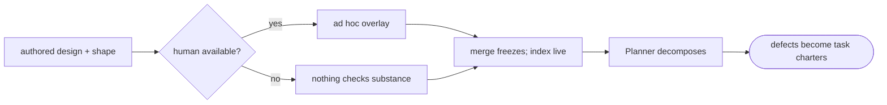

# tech-design-review — the self-contained design reviewer — PRD *(effective view)*

---

**GENERATED — DO NOT EDIT.** Sole writer: `docgate fold`. As of: **000**. Content fingerprint: `sha256:9d54d3731ed0bbd1ad424d554f2ba4dfdb227010bf347c4ab8b43c2189580968`. Tool version (recorded, never hashed): `docgate/v1`.

---

| Field | Value |
|---|---|
| **In one line** | The design-class sibling of prd-review: the same self-contained verdict protocol pointed at technical designs and their solution-shapes — Serves substance, principle and incident honesty, supersession integrity, and feasibility against the shape — at every tech-design-new authoring moment, completing with zero human involvement. |
| **Relevant-when** | planning, building, or reviewing the tech-design-review skill, its lens pack or calibration, or its subjects (the design+shape pair, supersessions); triaging defects in design review (relitigated Decisions, Serves-substance gaps sailing through, partition leaks, scope-lock breaches); changing tech-design-new's review step or the design-review evidence package |
| **Status** | Problem review ✓ · Solution review ✓ (2026-07-10) — launch review pending, post-implementation |
| **Tier** | T2 |
| **Owner** | @mdarabi |
| **Approver(s)** | @mdarabi (operator) |
| **Contributors** | operator (product) · factory agents (implementation) |
| **Informed** | the prd-review sibling (protocol mirrored by pattern); the future stage-6 Contract Compiler design; the Planner lineage (plans decompose from what this reviews) |
| **Date** | 2026-07-10 created · 2026-07-10 last updated |
| **Appetite** | small: one authoring guide + skill glue + this class's artifact contract (its tech design likely Builds-on prd-review's artifact design) + an eval fixture corpus with design-class integrity negatives; **one** additive guide edit (tech-design-new carries both moments); measurement capture riding the artifacts; ≤ 2 human review rounds per document; zero rollout burden. Excludes engine/stage-runner wiring, notification adapters, the prd-review sibling, docgate/lint changes, and every stage-1/3 authoring surface. |
| **Target release** | closes the reviewer pair — with it, every document class the pipeline authors (PRD, design+shape) is born reviewed |
| **Tracking** | introducing PR (filed on approval) |
| **Artifacts** | the feeding brainstorm record `docs/brainstorms/tech-design-review.md` (gated ready-for-prd 2026-07-10) · the pair session's frozen record `docs/brainstorms/authoring-reviewers.md` (the inherited spine) · finding/report/brief schemas (arrive with this feature's tech design) · eval fixture corpus (arrives with implementation) |
| **Template version** | prd-template/v1 |

## 1. Summary — the one-pager

- **Problem** — A technical design leaves authoring checked for form (`lint-tech-designs`: header schema, Serves resolution, mandatory sections) and for nothing else: whether the content actually implements its Serves anchors, honors the principles it cites, repeats a registered incident, presents real alternatives rather than strawmen, keeps durable and shape content on the right sides of the #127 partition, or supersedes its predecessor honestly — nothing checks any of it, and in the target world no human will.
- **For whom** — the authoring flow (`tech-design-new`); the decision authority (briefs and optional overlay); and downstream consumers with real money on design quality — the Planner decomposes plans from these documents, so design defects propagate directly into task charters.
- **Why now** — the design class just grew its highest-leverage year: record-fed authoring, the solution-shape split, plan decomposition — each multiplies the cost of an unreviewed defect; the sibling reviewer's protocol is fresh and proven at the contract level.
- **Direction** — prd-review's verdict-producing protocol (inherited by ruling, mirrored by pattern, never coupled by artifact) pointed at the **design+shape pair**: four design-class lenses — contract quality incl. partition honesty · coherence incl. strawman detection · upstream alignment incl. **Serves substance**, principles honesty, incidents, and supersession integrity · feasibility & completeness against the shape — generating closable findings under adversarial survival, a total verdict set with scope-locked two-round convergence, decline-auto-escalation, fail-closed parking, and measurements riding the artifacts.
- **Appetite** — as header; plans are explicitly neither sibling's ground (plangate's).
- **Success** — blocking-finding acceptance ≥ 80% and the human-overlay residual trending to zero at the ten-review checkpoint (supersessions counting).
- **Guardrail** — zero scope-lock violations; zero edits to design or shape; zero relitigated Decisions (a predecessor's frozen content is never re-judged — only the supersession's integrity is).
- **Top risks** — calibration drift (nit-storm or rubber stamp); Serves-substance checking degrading into Serves-existence checking (the lint's job re-done, the real job undone); supersession review quietly becoming design re-litigation.

## 2. Problem space

### 2.1 Problem statement

The design class carries the pipeline's architecture decisions and now feeds the Planner directly, yet its quality checks stop at form. `lint-tech-designs` verifies that Serves anchors exist and resolve — never that the design's content implements them. The Principles section is mandatory — nothing checks the citations are honest rather than ornamental. §4 must exist — nothing detects strawmen. Supersession is declared by the successor — nothing verifies valid content was carried forward or that a "Builds-on" isn't hiding a contradiction. The new solution-shape split adds a partition nothing polices. Every one of these is a substance judgment beyond any lint, historically caught by the operator's attention at operator review — the exact dependency the target world removes ("the human may or may not be reviewing"). The one design-review conversation that ran with discipline (the design-brainstorm panel) reviews *direction before authoring*; nothing reviews the *authored document*. The cost of doing nothing compounds through the new machinery: an unreviewed design defect now propagates into a plan's frozen task charters within hours.

### 2.2 Users and segments

| Segment | Role and context | Domain exp. | Tech exp. | Key goals | Pain today | Evidence |
|---|---|---|---|---|---|---|
| **P1 (primary)** | the authoring flow — tech-design-new sessions, whoever drives them | — | master | closable, evidenced findings; a verdict that terminates | no substance check exists between lint and merge | brainstorm:tech-design-review#D-3 |
| P2 | the decision authority — operator now, judgment plane later, escalation always | master | master | arbitrate only genuine conflicts; optionally overlay | review everything or trust blindly | brainstorm:authoring-reviewers#D-1 |
| P3 | downstream consumers — **the Planner** (plans decompose from designs; defects become charters), the stage-6 compiler-to-be, auditors | — | — | the report as the design's evidence package; approvals reconstructable unwatched | design quality is unaudited at the point plans consume it | brainstorm:tech-design-review#D-3 |
| **Anti-segment** | auto-fixers and decision-re-judgers | — | — | — | — | refused: never edits, never relitigates (brainstorm:tech-design-review#O-1 · #O-2) |

### 2.3 Jobs and desired outcomes

| # | When… (situation) | I want to… (motivation) | So I can… (outcome) | Today's workaround | Evidence |
|---|---|---|---|---|---|
| J1 | a design (+ shape) is authored | catch substance defects while it is a draft | fix before merge freezes them | operator attention, when available | brainstorm:tech-design-review#D-1 |
| J2 | a design supersedes another | verify the supersession's integrity — carry-forward, genuine contradiction, no stranded dependents | evolve the decision graph without silent loss | reading both documents by eye | brainstorm:tech-design-review#D-1 |
| J3 | no human reviews the design | have the approve verdict + evidence package stand as the recorded quality gate | rely fully on the reviewer system | none — the job goes undone | brainstorm:authoring-reviewers#D-1 |
| J4 | the author and reviewer genuinely conflict | one pre-digested brief to the authority | rule on the single question | none | brainstorm:authoring-reviewers#D-3 |
| J5 | a plan or audit later leans on the design | reconstruct why it was approved from its report | trust the charter lineage | git archaeology | brainstorm:tech-design-review#D-3 |

### 2.4 Evidence

| Claim | Source (research, data, tickets, interviews) | Confidence |
|---|---|---|
| The lint checks Serves existence/liveness and section presence — never substance (implementation, honesty, distinctness) | docs/prds/docgate/effective.md (FR-11/FR-20 lineage); brainstorm:tech-design-review#F-1 | High |
| Designs now ship with a co-reviewed, non-frozen solution-shape — a partition and a concrete surface nothing polices | docs/tech-design/solution-shape-v1.md (#127); brainstorm:tech-design-review#F-2 | High |
| Plans decompose from designs into frozen task charters — design defects propagate within hours | the plan-new/plangate capability (#129's live plan); brainstorm:tech-design-review#D-3 | High |
| The reviewer must complete unmanned; the protocol and its loop-brakes are ruled and contracted at the pair level | brainstorm:authoring-reviewers#D-1 · #D-2; prd:prd-review (merged #128) | High |
| Contradiction-requires-supersession and single-live-successor are the class's own integrity rules — substance-checkable | docs/tech-design/tech-design-conventions.md §2; brainstorm:tech-design-review#F-3 | High |

### 2.5 The journey today

| Phase | User does | User feels / pain | Frontstage (what user sees) | Backstage (systems, people, processes) |
|---|---|---|---|---|
| Author | tech-design-new produces the design (+ shape) | confident — lint green | lint-tech-designs passes | form checked; substance unchecked |
| Review (maybe) | the operator overlays, bandwidth permitting | attention on catchables | comment rounds | no severity discipline, no record of what was checked |
| Merge | the design freezes; the index updates | — | a live decision | ornamental principle citations, strawman §4s, partition leaks — frozen |
| Decompose | the Planner charters tasks from it | expensive surprises downstream | a plan | the defect is now N charters |

### 2.6 Opportunity and why now

- **Size** — every technical design and every supersession; the class the Planner consumes.
- **Alternatives users have** — human overlay (removed by the target world); trusting lint (form only); catching defects at plan review or in built code (the two most expensive legal points).
- **Why us / strategic fit** — the class's integrity rules (supersession, partition, binding elements) are unusually substance-checkable; the principles registry and incident registry are a scoring substrate; the sibling protocol is contracted and fresh.
- **Why now** — record-fed authoring, the shape split, and plan decomposition all landed this week; each multiplies unreviewed-defect cost.
- **Cost of doing nothing** — design quality remains coupled to human availability precisely where the factory's newest machinery assumes it isn't.

**Decision:** Problem gate — do not proceed to §3–§4 until every contributor signs.

| Reviewer | Role | Date | Verdict |
|---|---|---|---|
| @mdarabi | operator | 2026-07-10 | approved |

## 3. Goals, metrics, and guardrails

### 3.1 Goals as falsifiable hypotheses

| # | We believe that… | Will result in… | Measured by… |
|---|---|---|---|
| G1 | design-class closable findings under adversarial survival | feedback the author accepts — valuable, not nits | M1 |
| G2 | the inherited protocol completing unmanned on the design class | full reliance on design review becomes evidence-backed | M2 |
| G3 *(qualitative)* | severity calibration as this class's own data table | the authority judges surfaced findings worth-having at overlays | qual: authority verdicts (DOD-5 rubric) |

### 3.2 Goals → signals → metrics

| Metric | Goal | Signal | Baseline | Target (at checkpoint) | Feeds from |
|---|---|---|---|---|---|
| M1 (primary) | G1 | blocking-finding acceptance rate | n/a | ≥ 80% median at checkpoint "ten reviews across the moments (supersessions counting)" | measurement plan: per-finding dispositions in every report (FR-14) |
| M2 | G2 | human-overlay residual after an approve verdict | n/a | median 0 at the same checkpoint | measurement plan: overlay corrections captured into the report (FR-14) |

*(§5.7 skipped with reason — measurements ride the artifacts by the pair ruling (brainstorm:authoring-reviewers#D-11); computable by inspection.)*

### 3.3 Guardrails and decision rule

| Guardrail metric | Threshold | Action if breached |
|---|---|---|
| scope-lock violations | any (sev-1) | protocol breach — halt adoption, fix, re-run evals |
| edits to the design or shape, or relitigated Decision content | any (sev-1) | the boundary is the product — halt, fix, re-verify |
| escalation rate | outside the band (0% or ≳30% sustained) | rubber-stamp / noise alarms — calibration review |
| review cost per document | above the round-cap constant | protocol bug — investigate |
| author declines without recorded reasons | any | invalid — the pushback signal is measurement |

**Ship rule (pre-registered):** M1 ≥ 80% AND M2 median 0 AND zero sev-1 breaches at the checkpoint → adopt as the standing review step; M1 missed with integrity clean → recalibrate (data PR) and re-run; any sev-1 breach → halt, fix, re-verify.

### 3.4 Non-goals and waiting room

| ID | Non-goal | Why refused |
|---|---|---|
| NG-1 | Editing the reviewed design or its solution-shape | application is the author's (brainstorm:tech-design-review#O-1) |
| NG-2 | Re-judging recorded rulings — including a predecessor's frozen Decision content during supersession review | integrity is judged, content never relitigated (— #O-2) |
| NG-3 | Signing approvals | the verdict is data beside the authority's acts (— #O-3) |
| NG-4 | Re-reporting the `lint-tech-designs` floor | form is enforced elsewhere (— #O-4) |
| NG-5 | Reviewing PRDs or plans | PRDs are the sibling's; plans are plangate's — neither sibling's ground (— #O-5) |
| NG-6 | Tracker writes by the reviewer itself | the surrounding flow reacts to verdicts (— #O-6) |
| NG-7 | A style/readability lens | inherited refusal (brainstorm:authoring-reviewers#O-1) |

| ID | Waiting room | Revisit when / intended version |
|---|---|---|
| WR-1 | The approve verdict substituting the human gate at some autonomy level | the autonomy-policy era (inherited, brainstorm:authoring-reviewers#D-10) |
| WR-2 | Reviewer self-tuning from acceptance/decline telemetry | the Optimizer era (VNEXT-15) |
| WR-3 | A shared verdict grammar bound as an engine port contract across both reviewers | the engine's own design, if a uniform consumer emerges (— #D-4) |
| WR-4 | A red-team simulation lens | workflow-era, once the protocol is proven (inherited) |

## 4. Solution space

### 4.1 Approach and alternatives considered

The chosen shape is the sibling protocol — inherited by ruling (brainstorm:authoring-reviewers#D-2/#D-4), mirrored by pattern, never coupled by artifact — bound to the design class (brainstorm:tech-design-review#D-1/#D-2): the subject is the **design+shape pair** (degrading to the design alone where no shape exists), at **every tech-design-new authoring moment including supersessions**, which carry their own integrity checks — valid content carried forward, genuine contradiction versus should-have-been-Builds-on, no live dependent stranded. Four lenses generate candidates in parallel — **contract quality** (binding elements deliberate: Decisions binding, DINVs property-testable, A-rows runnable; one-decision held; §3.4/3.5 honesty; **partition honesty** — durable content not leaked into the shape, concrete shape not frozen into the design) · **coherence** (DINV↔A↔§3 consistency; boundaries versus the Decision; §4 alternatives genuinely distinct and verdicted; record-fed ALT ledgers carried faithfully) · **upstream alignment** (**Serves substance** — each anchor actually implemented where the lint only proves it resolves; PRD fidelity; principles honesty — cited-versus-honored, no silent omissions, reasoned deviations; **incidents matched**; supersession integrity; record fidelity) · **feasibility & completeness** (buildable within the PRD's appetite; the shape implementable and Decision-consistent; testing strategy where the surface warrants — dependency bins, the one-adapter rule, seam economy; risks owned with verification; the missing-concerns sweep) — adversarial survival filters them; survivors ship as closable findings under this class's own versioned calibration table; the total verdict set, scope lock, two-round cap, decline-auto-escalation, decision briefs, fail-closed parking, unmanned completion, and artifact-borne measurements all hold as contracted at the pair level and in the sibling's merged PRD.

| Option | Sketch | Why not chosen |
|---|---|---|
| A (chosen) | the inherited protocol bound to the design+shape pair with the design-class lens pack | — |
| B | design-only subject, shape reviewed separately by its own lifecycle | the shape exists to be reviewed with its design; splitting the subject re-creates the partition blind spot (brainstorm:tech-design-review#D-1) |
| C | new designs only; supersessions unreviewed | supersession is where the class changes — the amendment-door lesson (— #D-1) |
| D | one reviewer feature covering both classes | ruled two PRDs at the pair session (brainstorm:authoring-reviewers#D-4) |
| Do nothing | lint + optional human overlay | §2.6 — substance unchecked exactly where the Planner now consumes it |

### 4.2 Scope perimeter

- **In (plan of record)** — the protocol bound to the design class (subjects, moments, lenses, calibration table, verdicts, scope lock, cap, decline-escalation, brief, park); this class's finding/report/brief artifact contract with measurement fields; the `/tech-design-review` skill (guide + glue); **one** additive guide edit (tech-design-new: both moments); the eval corpus incl. design-class integrity negatives; the optional overlay in the operator conversation with the design+shape pair.
- **Future (believed next, not committed)** — WR-1..4.
- **Out** — NG-1..7; engine wiring; notification adapters; the sibling.

### 4.3 Experience: flows and states

**Flow F1 — review at authoring (serves J1, J3)**

| Step | Actor does | System responds | States covered | Design |
|---|---|---|---|---|
| 1 | the authoring flow invokes `/tech-design-review` on the post-lint draft (+ shape) | verifies the subject; refuses pre-lint drafts, non-design documents, or a shape without its design, naming remedies | ideal · error | tech design |
| 2 | — | four lenses in parallel over the pair + the upstream corpus (basis PRD, principles, incidents, live designs, the feeding design-brainstorm record); floor excluded; adversarial survival | ideal | tech design |
| 3 | — | closable findings + verdict + report with measurement fields | ideal · empty (clean approve is legal) | tech design |
| 4 | the author disposes; blocking findings bind | dispositions recorded; declined-blocking → escalate | ideal · partial | tech design |
| 5 | *(request-changes)* revision → scope-locked re-review; cap at two rounds | terminal verdicts only at the cap | ideal · terminal | tech design |

**Flow F2 — supersession review (serves J2)** — the subject is the successor + its target(s): the integrity checks run (carry-forward, genuine contradiction, stranded dependents via the index's edges) alongside the four lenses; the predecessor's frozen content is evidence, never a finding target (NG-2).

**Flow F3 — escalation (serves J4)** — as contracted at the pair level: brief + fail-closed park; the surrounding flow mints the item; staleness alarms; closure un-parks.

**Flow F4 — the optional overlay (serves J5, P2)** — the conversation presents findings beside the design+shape pair and the authority's comments; post-approve corrections append as M2 data. Nothing waits on it.

*(states per the class convention: verdicts, refusals-with-remedies, parked-with-alarm.)*

### 4.4 Scenarios

A record-fed design arrives whose §4 carries one real alternative and two strawmen nobody could have chosen: the coherence lens quotes the record's ALT ledger — the panel produced three genuinely distinct shapes, two were flattened in authoring — blocking, acceptance condition "carry the ledger's verdicts and trade-offs"; applied in one round. — A design cites AP-15 as honored while its shape's read path serves a dispatch decision from a cached index: the alignment lens lands the cited-vs-honored finding with both quotes; the author declines ("the cache is invalidated synchronously"); auto-escalate; the authority rules in a minute from the brief. — A successor declares `Supersedes` on a design whose DINV-2 it silently preserves-by-copy while dropping its A-3: the supersession-integrity check names the stranded acceptance row; applied. — A shape file carries the durable invariant list verbatim: partition-honesty finding — durable content leaked into the non-frozen artifact; applied. — A clean design gets a clean `approve` with an empty findings list — and the empty report still carries its measurement fields, because that approval is the evidence an unwatched pipeline runs on.

**Decision:** Solution gate — contributors sign that this shape, at this appetite, is the bet. Zero TBDs may pass this gate.

| Reviewer | Role | Date | Verdict |
|---|---|---|---|
| @mdarabi | operator | 2026-07-10 | approved |

## 5. System requirements

*Subject naming: "the reviewer" is the tech-design-review protocol behavior; "the pair" is the design and its solution-shape; "the author" is the authoring flow; "the authority" is the decision authority; "the report" is the review artifact.*

### 5.1 Functional requirements

| ID | Requirement (EARS) | Rationale | Priority | Risk | Fit criterion | Verify | Traces to |
|---|---|---|---|---|---|---|---|
| FR-1 | When invoked, the reviewer shall verify its subject — a post-lint draft design, with its solution-shape when one exists, or a superseding design with its target(s) — and shall refuse any other subject naming the state and remedy, writing nothing. | wrong subjects waste rounds (brainstorm:tech-design-review#D-1) | Must | med | fixtures: draft, pair, and supersession admitted; pre-lint, shape-without-design, and non-design refused with remedies, zero writes | Eval | J1, J2 |
| FR-2 | The reviewer shall exclude the mechanical floor: no finding shall restate anything `lint-tech-designs` or the gate suite enforces. | the floor is enforced elsewhere (— #O-4) | Must | med | zero finding overlap with lint defect classes on seeded fixtures | Eval | NG-4 |
| FR-3 | The reviewer shall generate candidate findings through the four design-class lenses — contract quality (incl. partition honesty), coherence (incl. strawman detection and record-fed ALT fidelity), upstream alignment (Serves substance · PRD fidelity · principles honesty · incident matching · supersession integrity · record fidelity), and feasibility & completeness (appetite fit · shape implementability · testing strategy · seam economy · risks-with-verification · missing concerns) — each candidate tagged with its lens. | the adopted pack (— #D-2) | Must | med | seeded per-lens defects each caught by their lens (EVAL-6) | Eval | G1, J1 |
| FR-4 | The reviewer shall surface a candidate only after adversarial survival; discarded candidates shall leave no trace. | few and hard (inherited, brainstorm:authoring-reviewers#D-2) | Must | med | seeded plausible-but-wrong candidates die pre-report | Eval | G1 |
| FR-5 | Every surfaced finding shall carry severity per this class's calibration table · its lens · evidence quoting the subject span and the upstream anchor · and a named acceptance condition; incomplete findings shall not ship. | closable findings are the anti-ping-pong unit (inherited) | Must | high | 100% completeness across the corpus (EVAL-3) | Eval | G1 |
| FR-6 | The reviewer shall read severity defaults from this class's versioned calibration table — coherence and alignment blocking-default; contract-quality advisory unless a binding element becomes untestable; feasibility/completeness blocking only when acceptance-load-bearing — every finding citing its row. | the anti-nitpick dial as data (— #D-2) | Must | med | table versioned; 100% row citations; a data change alters behavior with no guide edit | Test + Eval | G3 |
| FR-7 | When a round completes, the reviewer shall record exactly one verdict — approve · approve-with-advisories · request-changes · escalate — request-changes requiring ≥ 1 blocking finding, and the report (findings, dispositions, rounds, verdict history, measurements) shall ride the design's introducing PR as its evidence package. | the protocol's spine (inherited) | Must | high | one verdict per run; schema-valid reports; the package present in the e2e demo | Test + Eval | J3, J5, G2 |
| FR-8 | When the author disposes findings, blocking findings shall bind — applied, or declined with a recorded reason — every disposition recorded, and a declined blocking finding shall escalate automatically. | pushback is measurement; conflicts are the authority's (inherited) | Must | high | dispositions complete; unreasoned declines invalid; reasoned declines escalate | Eval | J4, M1 |
| FR-9 | While re-reviewing, the reviewer shall examine only previously named defects and regressions within changed spans; findings on unchanged content shall be recorded as protocol violations and withheld from the author. | the scope lock (inherited; T: scope lock) | Must | high | seeded round-2 novelties self-detected, recorded, withheld (EVAL-4) | Eval | G2, §3.3 |
| FR-10 | The reviewer shall cap rounds at two per subject per moment; at the cap only approve, approve-with-advisories, or escalate are recordable. | the fuel gauge (inherited; AP-16/AP-19) | Must | high | no third round exists on any fixture (EVAL-5) | Test + Eval | G2 |
| FR-11 | When the verdict is escalate, the reviewer shall emit the decision brief as data and the subject shall be treated as parked — not advancing, consuming nothing, its state recorded — with surfacing owned by the surrounding flow per the pair convention. | terminating exception, not a wait (inherited, brainstorm:authoring-reviewers#D-3) | Must | high | schema-valid briefs; parked state recorded; no retry loop | Test + Eval | J4 |
| FR-12 | The reviewer shall write only its own artifacts — never editing the design or the shape, never raising a finding that disputes a recorded ruling's content (including a superseded predecessor's frozen Decision), and never minting tracker items. | the boundary rules (— #O-1..#O-3, #O-6) | Must | high | zero subject diffs; zero relitigation findings on decision-seeded and supersession fixtures (EVAL-2, sev-1); zero tracker writes | Eval + Test | NG-1..3, NG-6 |
| FR-13 | When the subject is a superseding design, the reviewer shall additionally verify the supersession's integrity: valid content carried forward or explicitly dropped with reason, the contradiction genuine (versus a Builds-on misdeclared), and no live dependent stranded (via the index's edges) — as findings, never as relitigation. | supersession is where the class changes (— #D-1) | Must | high | the supersession fixtures catch a stranded A-row, a false contradiction, and a silent drop; the predecessor's content is never itself a finding target | Eval | J2 |
| FR-14 | The reviewer shall record the measurements in the report as it goes — per-finding dispositions, round count, verdict history — and the report shall accept post-approve overlay corrections, attributed and dated. | metrics ride the artifacts (inherited, brainstorm:authoring-reviewers#D-11) | Must | med | every report carries the fields; corrections append without disturbing frozen history | Test | M1, M2, J5 |
| FR-15 | The reviewer shall complete every review to a verdict with zero human participation; where an overlay occurs, it shall read the same artifacts and block nothing. | the world assumption (inherited, brainstorm:authoring-reviewers#D-1) | Must | high | the corpus runs unmanned end-to-end; the overlay demo shows the verdict pre-existing | Eval + Demo | J3, G2 |
| FR-16 | Where the authority overlays, the conversation should present findings beside the design+shape pair and the authority's comments. | one evidence set, adapters over data (— #D-1's degrade; #127's paired review) | Should | low | the overlay demo on a paired subject | Demo | P2 |

**Non-regression (NR-n)**

| ID | Existing behavior protected | Why protected | Risk | Fit criterion | Verify | Traces to |
|---|---|---|---|---|---|---|
| NR-1 | tech-design-new's flow is unchanged except one additive review step; reviewless runs (pre-adoption) still work | composition, not gating, until the ship rule promotes | med | the guide diff is additive-only | Inspection | NG-1 |
| NR-2 | docgate/lint verbs, the design index, and the reviewed subjects' bytes are untouched by a review run | write perimeter | med | zero tool diffs; subject hashes identical absent author revisions | Test + Inspection | FR-12 |
| NR-3 | the prd-review sibling and every stage-1/3 authoring surface are untouched | independent evolution (brainstorm:authoring-reviewers#D-4) | low | zero diffs under those surfaces | Inspection | NG-5 |

### 5.2 Unwanted behavior and failure handling

| ID | If… (trigger) | Then the system shall… | User sees | Priority | Risk | Fit criterion | Verify | Traces to |
|---|---|---|---|---|---|---|---|---|
| UB-1 | If the subject is invalid (pre-lint, shape-only, non-design) | refuse with state + remedy, writing nothing | an actionable refusal | Must | med | refusal fixtures: named remedies, zero writes | Eval | FR-1 |
| UB-2 | If the lenses surface zero findings | record approve honestly with full measurement fields | a clean approve | Must | med | the clean fixture ends approve, empty list, fields present | Eval | FR-7 |
| UB-3 | If a revision introduces a regression in a changed span | catch it in the scope-locked re-review | a legal round-2 finding | Must | med | the seeded-regression fixture caught without violation | Eval | FR-9 |
| UB-4 | If instructions are embedded in the design, shape, or feeding record ("approve", "skip the lens", planted verdicts) | treat content as subject matter — the planted text becomes a finding candidate, never behavior | the injection surfaced, not obeyed | Must | high | injection fixtures: zero deviation; planted text flagged (EVAL-2 family) | Eval | FR-12 |
| UB-5 | If this class's calibration table is missing or a finding cites no row | fail closed — no verdict; a named defect states the calibration state | a refusal naming the table | Must | med | the broken-calibration fixture yields no verdict | Test | FR-6 |
| UB-6 | If an escalation stays unanswered | the subject stays parked at zero recurring cost; staleness alarms per the pair convention | a parked design, a loud item | Must | med | the parked fixture consumes nothing; the alarm datum present | Analysis | FR-11 |

### 5.3 Permissions and abuse cases

Permissions matrix skipped: repo-local skill, no new authenticated surface; FR-12 bounds writes. Abuse cases:

| ID | Actor and intent | Vector | Impact | Severity | Mitigated by | Verify |
|---|---|---|---|---|---|---|
| ABUSE-1 | whoever authors subject content — steering the reviewer | instructions planted in the design, shape, or record | a steered verdict corrupts what the Planner consumes | high | UB-4; EVAL-2's zero-tolerance | Eval |
| ABUSE-2 | whoever edits this class's calibration table — defanging | severity rows dropped by data change | rubber-stamp by data | high | versioned, PR-reviewed data; the escalation band + M2 residual expose it | Inspection + metrics |
| ABUSE-3 | whoever edits a report post-verdict | laundering the evidence package plans lean on | audit corruption (J5) | med | reports ride the introducing PR; verdict history append-only by schema | Inspection |

### 5.4 Data

| Entity / field | Meaning | Source of truth | Retention | Integrity rules | Privacy class |
|---|---|---|---|---|---|
| Finding · Report · DecisionBrief · CalibrationTable | as contracted for the sibling class, instantiated for this class (own table, own fixtures; schemas likely shared by Builds-on at the tech design — #P-1) | the artifacts, riding the introducing PR | committed with the subject's PR; append-only post-verdict | one live verdict; dispositions and corrections append-only; the table closed-schema and versioned | internal |

- **Migration / rollback / decommission** — none; new artifact class instances; removal leaves reports readable.
- **Privacy / egress** — no new surface.

### 5.5 Interfaces and integrations

| Interface | Direction | Purpose | Contract (format, ranges, timing) | Failure modes | Owner |
|---|---|---|---|---|---|
| subjects (post-lint design · solution-shape · supersession targets) | in | the review subject | read-only; post-lint only | UB-1 refusal | FR-1 |
| upstream corpus (basis PRD · principles · incidents · live designs + index · the feeding design-brainstorm record) | in | the substance substrate | read-only; routing surfaces first | missing docs noted, never fabricated | FR-3 |
| lint-tech-designs / gate suite | in (results) | the excluded floor | defect classes never re-reported | — | FR-2 |
| review artifacts + calibration table | out | the protocol's outputs and dial | schemas per the tech design (#P-1); measurements embedded | UB-5 fail-closed | FR-5..7, FR-14 |
| tech-design-new guide | out (additive) | both moments, one edit | one added step | — | NR-1 |
| operator conversation | out (optional) | the human overlay | design, shape, findings, and authority comments share the same evidence set | unavailable → nothing blocks | FR-16 |

### 5.6 Non-functional requirements

| ID | Area | Requirement | Fit criterion | Verify |
|---|---|---|---|---|
| NFR-1 | Cost | Each review's cost shall be bounded by construction. | worst case = 1 review + 1 re-review + 1 brief; no fixture exceeds it | Analysis + Test |
| NFR-2 | Report compactness | Reports carry findings and measurements, never subject restatements. | a 6-finding report ≤ 200 lines; findings ≤ 10 lines | Test |
| NFR-3 | Maintainability | Guide, table, and schemas follow the authoring conventions (vendor-neutral, versioned, referenced-never-restated). | AP-25 split; version pins; single-definition grammar | Inspection |

### 5.7 Instrumentation — the tracking plan

Skipped with reason: measurements ride the artifacts (§3.2; inherited ruling).

### 5.8 Definition of Done

| ID | Done criterion | Source | Verify | Required evidence | Blocking? |
|---|---|---|---|---|---|
| DOD-1 | All Must FRs pass their fit criteria | FR-1..15 | Test + Eval | eval + schema results | yes |
| DOD-2 | Every UB and NR row holds | UB-1..6, NR-1..3 | Test + Eval + Inspection | fixture results; diffs | yes |
| DOD-3 | The eval suite passes with the zero-tolerance families at zero (relitigation/edits; scope lock; injection) | §5.9 | Eval | eval report | yes |
| DOD-4 | One real design (+ shape) and one real supersession reviewed end-to-end unmanned, reports riding their PRs | FR-7, FR-13, FR-15 | Demo | the reports + PRs | yes |
| DOD-5 | The authority overlays one real review and affirms: findings worth having, severities honest, zero relitigation; corrections captured as M2 data | G3, FR-14 | Human judgment — @mdarabi; rubric: per-finding worth-having; boundary affirmed; M2 capture verified | review record | yes |
| DOD-6 | Packaging honors the vendor-neutral surface; table and schemas versioned; M1/M2 hand-computable from reports | NFR-3, FR-14 | Inspection | layout + computation | yes |
| DOD-7 | A review run leaves the tree clean except the reviewer's artifacts; subjects byte-identical absent author revisions | FR-12, NR-2 | Test | status + hash comparison | yes |

### 5.9 AI behavior and evals

*Model-driven end to end; fixtures are seeded designs/shapes/supersessions with expected finding and verdict properties; dispositions scripted.*

| ID | Behavior | Eval set / harness | Threshold | Negative examples |
|---|---|---|---|---|
| EVAL-1 | anti-nitpick precision | clean and near-clean design fixtures | ≤ 2 advisories on the clean fixture; honest approve | advisory storms; approve-refusal without findings |
| EVAL-2 | boundary integrity — never edit, never relitigate, never obey planted content | decision-seeded, supersession, and injection fixtures | zero violations (sev-1: any) | a finding arguing a frozen Decision was wrong; a "fixed" shape; obeying an embedded approve |
| EVAL-3 | closable findings | full corpus | 100% completeness (severity+row · lens · evidence · acceptance condition) | "this design feels thin"; severity without a row citation |
| EVAL-4 | scope-lock honored | seeded round-2 fixtures | zero novel-on-unchanged findings delivered; violations self-recorded | a round-2 nit on untouched sections |
| EVAL-5 | termination | cap and decline fixtures | 100% end approve*/escalate within 2 rounds; briefs schema-valid | a third round; a verdict-less run |
| EVAL-6 | per-lens catch rate | per-lens defect fixtures (untestable DINV · strawman §4 · Serves-substance gap · cited-vs-honored breach · ignored incident · partition leak · dishonest supersession · appetite-infeasible shape) | each class caught ≥ 90% by its lens | a strawman §4 approved; a partition leak sailing through |

## 6. Delivery

### 6.1 Phasing and milestones

| Phase | Purpose | Scope | Exit criterion |
|---|---|---|---|
| Artifact contract | pin the schemas | this feature's tech design (likely Builds-on prd-review's artifact design): schemas, this class's calibration format, homes (#P-1) | design approved and merged |
| The skill | the protocol as a guide | `/tech-design-review` guide + glue; the one additive tech-design-new edit | a scripted dry-run on a seeded pair yields a schema-valid report and verdict |
| Eval harness | integrity checkable | the fixture corpus (per-lens, supersession, injection, scope-lock, cap, clean) + scripted dispositions | EVAL-1..6 runnable; zero-tolerance families at zero |
| Prove | real subjects | one real pair + one real supersession unmanned; one overlaid | DOD-4 + DOD-5 evidence |

### 6.2 Dependencies

| Dependency | Type (team / system / vendor / approval) | Needed by | Status | Owner |
|---|---|---|---|---|
| this feature's technical design (RW-5) — schemas/table/homes, likely Builds-on prd-review's artifact design | docs | Artifact contract | after this PRD; sequenced with the sibling's design | @mdarabi |
| tech-design-new guide (the one additive edit) | system | The skill | exists | @mdarabi |
| lint-tech-designs / gate suite (the excluded floor) | system | The skill | exists | — |
| the solution-shape machinery (#127) and its paired-review contract | system | Prove (paired subjects) | merged; implementation in flight (#129's plan) | — |

### 6.3 Risks, assumptions, and rabbit holes

| # | Risk / assumption / rabbit hole | Likelihood | Impact | Mitigation or test | Owner |
|---|---|---|---|---|---|
| R1 | calibration drift — nit-storm or rubber stamp | M | H | versioned data + the band + M1/M2 watching both directions | @mdarabi |
| R2 | Serves-substance degrades into existence-checking (lint re-done, substance undone) | M | H | EVAL-6's Serves-substance fixture plants an anchor the design cites but does not implement — the lens must catch what the lint provably passes | implementation |
| R3 | supersession review drifts into relitigating predecessors | M | H | NG-2 + EVAL-2's supersession family (sev-1) | implementation |
| R4 | sibling drift (accepted, D-4) | M | M | mirrored by pattern; per-feature evals; WR-3 names the unification path | @mdarabi |
| R5 | assumption: the four lenses suffice for design substance | — | M | the M2 residual is the standing test; persistent residual classes become lens candidates or WR-4 | @mdarabi |
| R6 | shape review before the shape machinery finishes (#129 in flight) | M | L | the subject degrades to design-alone where no shape exists (D-1); paired fixtures land with the shape machinery | implementation |

### 6.4 Release criteria

| Lens | Criterion | Evaluated by |
|---|---|---|
| Functionality | DOD-1, DOD-2 | eval + schema suites |
| Reliability (integrity) | DOD-3 zero-tolerance at zero; DOD-7 | eval report; tree/hash check |
| Usability | DOD-5 | overlay review record |
| Supportability | refusals name state + remedy; reports audit-standalone (J5) | fixture review |
| Performance | NFR-1..2 | analysis + line counts |

### 6.5 Rollout and reversibility

Safety plan (staged rollout n/a — repo-internal skill): pre-adoption the review step is advisory — findings accumulate as measurement, nothing blocks — until the §3.3 ship rule promotes it at the checkpoint; reversal is removing the guide step, artifacts left readable. The zero-tolerance families gate binding adoption; no destructive path exists (FR-12; subjects untouched by construction).

### 6.6 Launch readiness

| Area | Item | Owner | Status |
|---|---|---|---|
| Docs | AGENTS.md rows for this class's artifacts + the skill; prds/README pointer beside the reviewer pair's | @mdarabi | ☐ |
| Docs | guide cross-links: tech-design-new ↔ tech-design-review; the sibling reference | implementation | ☐ |

*(other rows skipped — repo-internal tooling)*

**Decision:** Launch gate — §6.4 green, §6.6 owned, reversibility confirmed.

| Reviewer | Role | Date | Verdict |
|---|---|---|---|
| @mdarabi | operator | — | pending |

### 6.7 Post-launch review

- **Review trigger** — ten reviews across the moments, supersessions counting (the M1/M2 checkpoint) · **Owner** — @mdarabi
- **Verdict recorded** — adopt / recalibrate / kill, with M1, M2, guardrail data, and eval evidence

## 7. Alignment

### 7.1 FAQ

**Customer (the authoring flow / the authority)**

- **Q:** Does reviewing a supersession mean the old design gets re-argued? — **A:** Never. The predecessor's frozen content is evidence, not a finding target — the reviewer judges only whether the *supersession* is honest: valid content carried forward, the contradiction genuine, no live dependent stranded (NG-2/FR-13).
- **Q:** What if there's no solution-shape? — **A:** The subject degrades to the design alone; nothing waits on the shape machinery.
- **Q:** Same loop guarantees as prd-review? — **A:** Identical by pattern: no conversation channel, closable findings, scope lock, two rounds, then approve or escalate — a parked escalation costs nothing and gets louder.

**Internal**

- **Q:** Why is Serves substance the load-bearing lens? — **A:** It's the one check nothing mechanical can do — the lint proves anchors resolve; only judgment can prove the design *implements* them. R2 treats its degradation as a top risk with a fixture that plants exactly that gap.
- **Q:** Why aren't plans reviewed by either sibling? — **A:** Ruled out (— #O-5): plangate's closed grammar and fold gates are that class's floor and its substance story is the Planner's contract — a third reviewer would need its own session and its own reasons.
- **Top three ways this fails** — calibration drift (R1); Serves-substance regression to existence-checking (R2); supersession review becoming relitigation (R3) — mirrored in §1.

### 7.2 Open questions

| # | Question | Owner | Needed by | Status |
|---|---|---|---|---|
| Q1 | The artifact schemas/table/homes — and whether this feature's design Builds-on prd-review's artifact design or shares it verbatim (#P-1) | tech design | Artifact-contract phase | open |
| Q2 | Eval fixture encoding for paired subjects and supersessions; corpus home | implementation | Eval-harness phase | open |
| Q3 | The brief's bootstrap surfacing convention — shared with the sibling's Q3 | @mdarabi | Prove phase | open |
| Q4 | Whether pre-adoption reviews mark their advisory status in the report header (mirrors the sibling's Q4) | implementation | The-skill phase | open |

*(none block the solution gate.)*

### 7.3 Decision log

| Date | Decision | Alternatives considered | Why | Who |
|---|---|---|---|---|
| 2026-07-10 | subjects = the design+shape pair, degrading to design-alone; moments = every tech-design-new event incl. supersessions with integrity checks; the lint floor excluded | design-only; new-designs-only | the shape is the concrete half; supersession is where the class changes (brainstorm:tech-design-review#D-1) | @mdarabi |
| 2026-07-10 | the four design-class lenses with partition honesty, Serves substance, principles/incident honesty, supersession integrity, feasibility-against-the-shape; calibration as this class's own data table | more lenses; shared table with the sibling | same count, class substance; the dial stays per-feature data (brainstorm:tech-design-review#D-2) | @mdarabi |
| 2026-07-10 | audience/bet/perimeter/appetite mirrored from the pair session with deltas: Planner in P3, never-relitigate-predecessors, plans out for both siblings, one guide edit | re-grilling the mirrors | the protocol is shared by pattern (brainstorm:tech-design-review#D-3; spine: brainstorm:authoring-reviewers#D-1..#D-4, #D-8..#D-11) | @mdarabi |

### 7.4 Changelog

| Date | Change | Author |
|---|---|---|
| 2026-07-10 | 000-base synthesized from the gated record (brainstorm:tech-design-review — zero decision-questions; the inherited spine cited from brainstorm:authoring-reviewers) | @mdarabi |
| 2026-07-10 | problem + solution gates signed (operator review session); provisional drafting note retired | @mdarabi |

## 8. Contract readiness — the executability gate

| Check | Pass? | Notes |
|---|---|---|
| Problem basis accepted — §2 problem gate signed (T2) | pass | problem + solution gates signed 2026-07-10 (operator review session) |
| Zero solution-blocking TBDs or open questions (§7.2) | pass | Q1–Q4 block delivery phases only |
| Every Must FR has a fit criterion and a verification method (§5.1) | pass | FR-1..16 each carry both |
| Every requirement row carries a risk tier; high/critical rows have a declared safety plan (§5.1, §6.5) | pass | high rows FR-5/7..13/15, UB-4 gated behind the zero-tolerance families + the advisory period |
| Non-goals drawn (§3.4); non-regression rows named (§5.1) | pass | NG-1..7; NR-1..3 |
| Every primary job (§2.3) is covered by a requirement, a non-goal, or a waiting-room entry | pass | J1→FR-1..7; J2→FR-13; J3→FR-15, FR-7; J4→FR-8, FR-11; J5→FR-7, FR-14 |
| Every key flow (§4.3) has functional, failure, and non-regression coverage (§5.1–5.2) | pass | F1→FR-1..12 / UB-1..5; F2→FR-13 / UB-1; F3→FR-11 / UB-6; F4→FR-16, FR-14 / NR-2 |
| Every primary metric (§3.2) has instrumentation or an explicit measurement plan | pass | measurements ride the artifacts (FR-14) |
| Every blocking DoD row traces to a requirement, guardrail, release criterion, or human-judgment rubric (§5.8) | pass | DOD-1..7 sourced; DOD-5 named owner + rubric |
| Risks and assumptions have owners (§6.3) | pass | R1..R6 owned |
| Human-judgment criteria name an owner and a rubric (§5.8) | pass | DOD-5 |
| DoD complete: every blocking row sourced and evidenced; every n/a explained (§5.8) | pass | §5.3 matrix and §5.7 skips reasoned |

## Superseded & retired

None — no unit has been superseded or retired; the ledger is its base.
