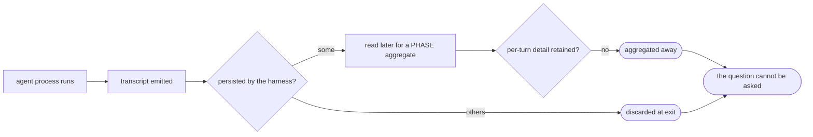

# Worker transcript metrics — PRD *(effective view)*

---

**GENERATED — DO NOT EDIT.** Sole writer: `docgate fold`. As of: **001**. Content fingerprint: `sha256:96825f5cf4a5c383a1bf65fa0249568c25f75ef531f6be6165cb74a2923c64e8`. Tool version (recorded, never hashed): `docgate/v1`.

---

| Field | Value |
|---|---|
| **In one line** | Capture, for every agent process the factory launches, a schema-valid record of how long it ran, what each tool use cost in time and tokens, and how its context grew — with any figure a harness cannot expose declared rather than omitted. |
| **Relevant-when** | planning, building, or reviewing worker-run measurement — per-process or per-tool-use capture, run and tool wall-clock duration, per-turn token usage, context-growth measurement, or the record schema those land in; triaging a defect where a run produced no record, a silently missing figure, or a rollup disagreeing with its parts; changing the executor's agent-launch path, a harness runtime adapter, or the pipeline-measurement phase record this sits beneath |
| **Status** | Draft — problem review pending |
| **Tier** | T2 |
| **Owner** | @mdarabi |
| **Approver(s)** | @mdarabi (operator) |
| **Contributors** | @mdarabi (product, engineering) |
| **Informed** | — |
| **Date** | 2026-08-05 created · 2026-08-05 last updated |
| **Appetite** | **Human attention**: this PRD's review, the design review, and the operator reading real records from a multi-harness batch. **Machine work**: one versioned record schema, a capture path per supported harness runtime, the in-flight derivation needed by any harness that persists nothing, the reconciliation against the executor's launch record, and the task-level rollup. **Rollout burden**: near-zero for the readers (additive, no migration); non-zero for the one harness whose capture must be arranged at launch, which touches the executor's launch path and adds an abuse surface (§5.3). **Excluded**: NG-1..NG-5, any read/query/presentation surface. |
| **Target release** | None pinned — this is producer-side substrate; it gates no other in-flight feature. |
| **Tracking** | — *(the introducing PR)* |
| **Artifacts** | brainstorm:worker-transcript-metrics *(the gated stage-1 record)* |
| **Template version** | prd-template/v2 |

## 0. Read to rule — the human reviewer's section (~6 min)

*The body is the contract; this section only routes attention — on any conflict the body governs; machines ignore it.*

**Judge these**

| # | The call | Could have gone | If you disagree |
|---|---|---|---|
| 1 | Capture is **use-agnostic and maximal** — no metric is filtered out because no analysis wants it yet | Capture only what a named consumer asks for | The perimeter collapses to whatever the first consumer needs, and every later question needs a schema change → NG-2, FR-2 |
| 2 | A **stored task rollup** exists beside the per-process records, restating their totals | Derive the task total at read time from the process records | You accept arithmetic at every read in exchange for one fewer figure that can disagree with itself → FR-6, NR-2, R1 |
| 3 | **All four harnesses in v1**, including the one that persists nothing and so needs capture arranged at launch | The three readable-after-the-fact harnesses first, the ephemeral one behind them | v1 ships without ever proving the schema against a streaming source, and the executor launch path stays untouched → FR-8, NG-4, R2 |
| 4 | A figure a harness cannot expose is **declared unavailable**, never omitted and never zero | Omit the field and let readers infer | Readers cannot distinguish "not measurable here" from "measured as zero" — the failure this contract is built to prevent → FR-4, UB-1, DOD-3 |
| 5 | **FR-8 derives in flight and persists no raw output**, rather than retaining the run's stream and governing it | Retain the raw stream as a governed artifact with an owner, lifetime and access boundary | You accept a file holding the prompts, commands, output and secrets that FR-5 exists to exclude — and the T3 privacy treatment that comes with it → FR-8, ABUSE-1, §5.4 |
| 6 | **Identifiers yes, free text no** — tool names and exit statuses are captured, command strings and outputs are not | Capture full transcript content | You take on prompt logging, secret redaction, and a T3 privacy surface; or, going the other way, you lose the ability to say *what* to improve → FR-3, NG-5 |
| 7 | **This feature produces usage figures; the routed plane consumes them by reference** — the two planes split by artifact, not by intent | Cede usage aggregation to the routed plane and capture only durations, tool events and context growth | You reopen FR-2, FR-6 and FR-14, and defer the figures to a plane with no code and no plan for them → §7.2 Q1, FR-2, FR-6, FR-14 |

**Sanity-check the numbers** — the completeness bar is **100% accounted-for** (M1): every launched process yields either a record or a capture-failure entry, and the two must partition the launched set. Not a sampling bar, which would make a missing record unfalsifiable; and not a bare record-share, which UB-2's no-record-on-failure rule makes unreachable. The failure side is bounded separately by **M4** at **1%**, a pre-registered guess awaiting first measurement. The capture-overhead ceiling is **NFR-1**'s p95, a fraction of the measured run rather than an absolute, because run lengths vary by orders of magnitude — and it is measured and trended, never gated on (AP-29: wall-clock is a measurement, not a correctness assertion; DOD-6).

**The author's open questions** — Q2 (whether the rollup is written at task end only, or amended as processes complete — bears on FR-6 and R1); Q3 (retention: this contract sets none, and the volume implied by FR-2 is unbounded over time); Q4 (what "token usage attributed to a tool use" means, given tokens are consumed per turn — FR-3 binds to whatever the design fixes). Q1 is resolved by amendment 001 and no longer routes attention here; the residual it left — that the routed plane's own contract still claims usage in its own words — is recorded in that amendment's Effects, not carried as an open question of this document.

**Skip the rest** — structure and ledger legality → docgate; substance and coherence → the unmanned PRD reviewer's report and the human overlay recorded beside it; requirement-to-code fidelity → the technical design and its review; §4.3 flow states, §5.9 evals, and most of §6 → skipped with stated reasons, since this feature ships no user-facing surface and no model-driven behavior. §5.3 is **not** skipped: FR-8 puts this feature in the path of a run's raw output, which is an abuse surface even though no new role is introduced.

## 1. Summary — the one-pager

- **Problem** — When a worker finishes a task, nothing records how long it actually ran, which of its tool calls were slow, what each one cost in tokens, or how its context grew. The factory can see what a *pipeline phase* cost in aggregate, but not what happened inside a run — so questions like "are planned tasks too big", "which harness wastes the most time re-reading", and "did that prompt change help" have no evidence behind them.
- **For whom** — machine consumers processing records at scale, across every task the executor runs on every supported harness.
- **Why now** — the executor already launches agent processes across four harnesses and already parses per-turn usage in one of them, then discards it at the schema boundary; the signal is being read and thrown away today. The optimization work that needs it has no substrate to stand on.
- **Direction** — one versioned, harness-neutral record per launched agent process, carrying the run's aggregate (duration, tokens) and its breakdown (per turn, per tool use: duration, tokens, identifiers), plus a stored task-level rollup across the processes of one task. Every figure a harness cannot expose is declared unavailable rather than omitted. No presentation surface, no analysis, no filtering by anticipated use.
- **Appetite** — as the header states; excludes any read, query, or presentation surface, and excludes the analyses this data exists to feed.
- **Success** — M1: across a batch spanning all supported harnesses, every launched agent process — counted from the executor's own launch record, not from capture's own output — ends in exactly one of two terminal outcomes, a schema-valid record or a capture-failure entry, with zero silently-missing figures inside the records.
- **Guardrail** — capture must not change any run's outcome (NR-1). Capture overhead (NFR-1) is measured and trended, never gated: wall-clock is a measurement, not a correctness assertion (AP-29).
- **Top risks** — R1 the stored rollup drifts from the records it summarizes; R2 the launch-side capture required by an ephemeral harness couples measurement to execution and destabilizes the launch path; R3 unbounded volume under maximal capture makes the store impractical before any consumer exists.

## 2. Problem space

### 2.1 Problem statement

The factory measures spend per *pipeline phase*, aggregated over that phase's turns. Inside a worker's run — the unit that actually does the work — nothing is measured: not how long the process ran on the wall clock, not which tool calls were slow, not what any individual tool use cost in tokens, not how the context grew across turns. The cost of doing nothing is that every optimization question about the pipeline is answered by intuition: whether planning slices tasks too large, whether a prompt change helped, whether one harness wastes effort another does not. Each of those is decided today without evidence, and each decision compounds across every task the factory runs.

### 2.2 Users and segments

| Segment | Role and context | Domain exp. | Tech exp. | Key goals | Pain today | Evidence |
|---|---|---|---|---|---|---|
| **P1 (primary)** | Machine consumers reading records at scale — the later analyses, rollups, and adaptation loops that this substrate feeds; they process many runs programmatically, never by eye | master | master | uniform parsing across harnesses; no silent gaps; records that keep meaning as the schema evolves | the data does not exist; where it partly exists it is aggregated away before it can be read | brainstorm:worker-transcript-metrics#D-4 · #F-5 |
| P2 (secondary) | The later presentation feature — a separate contract that will render these records for humans | — | master | a record shape it can project without re-deriving | no substrate to build on | brainstorm:worker-transcript-metrics#D-4 |
| **Anti-segment** | The human wanting a readable view *from this feature* — actively not served: where a choice trades machine-processability for human readability, this contract refuses it. Also the built application's runtime, a disjoint measurement plane. | — | — | — | — | brainstorm:worker-transcript-metrics#D-8 |

### 2.3 Jobs and desired outcomes

| # | When… (situation) | I want to… (motivation) | So I can… (outcome) | Today's workaround | Evidence |
|---|---|---|---|---|---|
| J1 | a task has finished running | know what that task's work cost in total tokens and wall-clock time | attribute cost to tasks rather than to phases | none — job goes undone | brainstorm:worker-transcript-metrics#D-7 |
| J2 | a run took longer or cost more than expected | see where inside the run the time, tokens and context went — per turn, per tool use | change the harness, its prompts, or its tooling on evidence rather than intuition | none — job goes undone | brainstorm:worker-transcript-metrics#D-7 · #D-9 |
| J3 | a task required more than one process to finish | see that rework happened and what it cost | judge whether planned tasks are sliced too large | none — job goes undone | brainstorm:worker-transcript-metrics#D-7 |

### 2.4 Evidence

| Claim | Source | Confidence |
|---|---|---|
| Per-turn usage is already parsed by an existing adapter and then aggregated away into a per-phase figure — the material exists and is discarded | brainstorm:worker-transcript-metrics#F-5 | High |
| The only duration measured today is derived from git timestamps, not harness wall-clock; no tool-use capture of any kind exists | brainstorm:worker-transcript-metrics#F-6 | High |
| A per-turn record with turn and tool-use counts is an established, still-unbuilt parity requirement, with a planned entity in the domain model | brainstorm:worker-transcript-metrics#F-1 · #F-2 | High |
| The adjacent per-phase contract excluded per-turn granularity by name, and placed the surrounding plane in a waiting room rather than refusing it permanently | brainstorm:worker-transcript-metrics#F-3 · #F-4 | High |
| Supported harnesses differ structurally in how their run data is exposed: some persist a transcript that can be read after the run; at least one persists nothing and exposes only a live stream the caller must consume as it is produced | brainstorm:worker-transcript-metrics#F-15 · #F-16 · #F-17 | High |
| A frozen adjacent design already claims per-process usage capture and names token, cost and turn metrics among its own | brainstorm:worker-transcript-metrics#F-8 · #F-9 | High |
| This capability sits inside the product vision's observability-and-spend scope | brainstorm:worker-transcript-metrics#F-11 | High |

### 2.5 The journey today

| Phase | User does | User feels / pain | Frontstage | Backstage |
|---|---|---|---|---|
| run | the executor launches an agent process for a task | — | the proposal that eventually appears | the process emits a transcript; some harnesses persist it, some discard it at exit |
| observe | a consumer asks what the run cost or where its time went | the question cannot be asked | nothing | no record exists; per-turn material that was parsed has already been aggregated away |
| decide | a change is made to planning, prompts, or harness choice | decides on intuition | — | no evidence trail; the decision cannot be revisited against data |

### 2.6 Opportunity and why now

- **Size** — every task the executor runs, on every supported harness, indefinitely; the substrate compounds because each recorded run adds to what later analysis can see.
- **Alternatives users have** — the per-phase aggregate (wrong unit, wrong granularity, and explicitly not this); reading raw transcripts by hand where they happen to persist; doing nothing.
- **Why us / strategic fit** — the factory already launches every worker process and already parses transcripts for one harness; the capture point and much of the parsing exist.
- **Why now** — the signal is being read and discarded today, and at least one harness discards its run data permanently at process exit: every run that completes before this exists is unrecoverable.
- **Cost of doing nothing** — every pipeline, harness, and prompt optimization decision continues to be made without evidence, and the data behind them is destroyed as it is produced.

**Decision:** Problem gate — do not proceed to §3–§4 until every contributor signs.

| Reviewer | Role | Date | Verdict |
|---|---|---|---|
| @mdarabi | operator — via the introducing PR's operator review | *(pending)* | *(pending)* |

## 3. Goals, metrics, and guardrails

### 3.1 Goals as falsifiable hypotheses

| # | We believe that… | Will result in… | Measured by… |
|---|---|---|---|
| G1 | recording every launched process's duration, token usage and per-tool-use breakdown under one schema | a complete, trustworthy substrate where a run's cost and internal shape can be read programmatically | M1 |
| G2 | declaring every figure a harness cannot expose, rather than omitting it | consumers that can distinguish "not measurable here" from "measured as zero", and so can trust a zero | M2 |
| G3 | keeping capture free of any content body | a record set that carries no secret-bearing text and stays small enough to process at scale | M3 |

### 3.2 Goals → signals → metrics

| Metric | Goal | Signal | Baseline | Target (at checkpoint) | Feeds from |
|---|---|---|---|---|---|
| M1 (primary) | G1 | every launched agent process is **accounted for** — by a schema-valid record, or by an explicit capture-failure entry naming it | 0% (nothing is recorded) | 100% of launched processes accounted for, the two sets partitioning the launched set with no process in neither, at the checkpoint of one batch spanning every supported harness. **The denominator is the authoritative launch record (FR-13), produced by the executor — never capture's own event stream**, which cannot emit anything for a process whose capture never ran | EVT-1, EVT-4, EVT-5 |
| M2 | G2 | a required figure is either measured or explicitly declared unavailable — never silently absent | n/a (nothing is recorded) | zero missing-figure discrepancies across the batch, counted by FR-15's reconciliation against each harness's enumerated required-figure set (FR-14). The count comes from the reconciliation, **not** from EVT-2 alone: EVT-2 fires only when an unavailability is successfully declared, so a silently dropped figure would emit nothing and pass unseen | EVT-2, EVT-6 |
| M4 | G1 | a launched process yields a record rather than a capture-failure entry | n/a (nothing is recorded) | capture-failure entries ≤ 1% of launched processes across the same batch; malformed or unparseable input counts here (UB-5), never as an unavailability | EVT-4 |
| M3 | G3 | records carry no free-text content field | n/a | zero content-bearing fields present, by schema inspection | EVT-1 |

*Checkpoints are exposure conditions, not dates: the batch above is "one executor sweep per supported harness, each producing at least one multi-process task".*

### 3.3 Guardrails and decision rule

*Capture overhead (NFR-1) is deliberately **absent** from this table. It is a wall-clock measurement, and AP-29 holds that a measurement only records while a gate asserts correctness; a guardrail entry would make a loaded machine breach the contract — the defect incident I5 records. It is tracked as a trend (DOD-6) and a breach prompts review, never a pause, rollback, or failed release.*

| Guardrail metric | Threshold | Action if breached |
|---|---|---|
| Task outcome parity — the terminal class a task reaches with capture enabled versus disabled | any divergence in outcome class across the checkpoint batch | rollback the capture path; capture must be inert to results |
| Capture failure rate (M4) | above 1% of launched processes | pause and fix the capture path before wider use — accounted-for is the floor, not the goal |

**Ship rule (pre-registered):** M1 at 100% accounted-for and M2 at zero silent gaps across the checkpoint batch, with no guardrail breached → the substrate is complete. Two distinct shortfalls have distinct rules, because they are different events: a figure a harness **provably cannot expose** yields a record carrying an FR-4 unavailability — that is honest degradation, it counts toward M1, and it is DOD-3's expected case, not a failure. A **capture failure** (UB-2) yields no record at all; it still counts toward M1 through its capture-failure entry, but it counts against M4, and M4 above its guardrail threshold → rollback rather than discuss. A launched process in *neither* set is the one unrecoverable outcome and fails M1 outright.

### 3.4 Non-goals and waiting room

| ID | Non-goal | Why refused |
|---|---|---|
| NG-1 | Any presentation, view, dashboard, or query surface over these records | a later, separate feature; this contract captures and stores, it does not display or serve *(brainstorm:worker-transcript-metrics#O-1)* |
| NG-2 | Selecting which metrics to capture from anticipated use | refused as a principle: discarding a signal whose value is not yet known is the failure this substrate exists to avoid *(#O-2)* |
| NG-3 | The optimizer or self-improvement loop itself | the analyses this data feeds — planning slice size, harness and prompt tuning — are a separate feature; this produces their input *(#O-3)* |
| NG-4 | Deciding how a run executes — routing, model or effort selection, retry policy | this observes runs; it never influences one *(derived from the guardrail above; NR-1)* |
| NG-5 | Capturing transcript content — prompt bodies, command strings, tool output, or code | keeps this contract free of a secret-bearing surface and of prompt-logging obligations; identifiers are captured, free text is not *(#D-9)* |

| ID | Waiting room | Revisit when / intended version |
|---|---|---|
| WR-1 | A retention, compaction, or pruning policy for the record store | when measured volume from real runs makes the growth rate concrete (Q3) |
| WR-2 | Reconciling these records against a harness's own totals, in the manner the adjacent phase contract does | when a harness is found to publish an authoritative per-run total to reconcile against |
| WR-3 | Capturing content behind redaction, should a diagnostic need for it appear | when a concrete question is shown to be unanswerable without content, and a redaction contract exists |

## 4. Solution space

### 4.1 Approach and alternatives considered

One versioned, harness-neutral record per launched agent process, written when that process ends, carrying the run's aggregate figures and its per-turn and per-tool-use breakdown; plus one stored task-level rollup aggregating the processes of a single task. A per-harness capture path supplies the record from whatever that harness exposes — a persisted transcript where one exists, in-flight derivation from the run's output stream where it does not — and declares, per figure, anything it cannot obtain.

| Option | Sketch | Why not chosen |
|---|---|---|
| A (chosen) | one record per process + a stored task rollup, one schema, per-harness capture paths | — |
| B | per-process records only; task totals summed at read time | fewer figures able to disagree, but every task-level read pays arithmetic; the operator ruled for the stored rollup *(#D-3)* |
| C | extend the existing per-phase record with finer fields | the phase bracket is the wrong unit — it spans a different span than a run, and the adjacent contract fixed its record as per-phase by name *(#F-3)* |
| Do nothing | — | the signal continues to be discarded as it is produced, permanently for at least one harness *(§2.6)* |

### 4.2 Scope perimeter

- **In (plan of record)** — the record schema; per-process capture on every supported harness; the task-level rollup; explicit unavailability for any figure a harness cannot expose; in-flight derivation for harnesses that persist no run data of their own; reconciliation against the executor's launch record and against the required-figure set.
- **Future (believed next, not committed)** — a presentation surface (NG-1); retention policy (WR-1); reconciliation against harness totals (WR-2).
- **Out** — everything in §3.4.

### 4.3 Experience: flows and states

*Skipped: this feature ships no user-facing surface — its only consumers are machine readers (§2.2), and any human-facing rendering is refused to a later feature by NG-1. Failure behavior that would otherwise live in flow states is specified as UB rows in §5.2.*

### 4.4 Scenarios

**S1 — the ordinary task.** A task is claimed and an agent process runs, writes code, and exits. A record appears for that process carrying its duration, its token usage, and a per-turn breakdown in which each tool use names its kind, its duration, and the tokens its result contributed. CI is red, so a second process runs and a second record appears. A review-remediation process follows, and a third. When the task ends, a rollup records the three processes' totals as one task figure. J1 and J3 are answerable from the rollup; J2 from any single record.

**S2 — the harness that persists nothing.** A task runs on a harness that discards its run data at process exit. Because the figures were derived from the run's output as it was produced, the record still appears, with the same schema and the same fields as any other harness's — and no file holding that run's prompts, commands or output is left behind, because none was ever written.

**S3 — the figure that cannot be obtained.** A harness exposes no per-tool timing. The record still exists, still validates, and carries an explicit unavailability naming the harness and the missing figure — so a consumer reading it can tell that the figure was never measurable, rather than reading a zero and believing it.

**S4 — the interrupted task.** A task is killed after its second process has finished. The two completed processes' records exist and are readable; the task never reaches its rollup. A consumer can tell a task without a rollup from a task whose rollup says zero.

**Decision:** Solution gate — contributors sign that this shape, at this appetite, is the bet. Zero TBDs may pass this gate.

| Reviewer | Role | Date | Verdict |
|---|---|---|---|
| @mdarabi | operator — via the introducing PR's operator review | *(pending)* | *(pending)* |

## 5. System requirements

### 5.1 Functional requirements

| ID | Requirement (EARS) | Rationale | Priority | Risk | Fit criterion | Verify | Traces to |
|---|---|---|---|---|---|---|---|
| FR-1 | When a launched agent process ends, the system shall record one schema-valid record describing that process, or, where capture failed, one capture-failure entry naming it. | the process is the unit that emits a transcript, so it is the unit that can be recorded *(#D-3)*; the entry is the alternative terminal outcome UB-2 produces, so the two together are exhaustive | Must | med | across the checkpoint batch, every launched process in the authoritative launch record (FR-13) has exactly one of the two — a schema-valid record or a capture-failure entry — never both and never neither | Test | G1, J1, M1 |
| FR-2 | The system shall record, for each recorded process, every measurement its harness exposes about that process. | capture is use-agnostic; a filtered capture discards signals whose value is not yet known *(#D-4)* | Must | med | for each supported harness, every measurement enumerable from that harness's **own published output surface** — its documented output contract, not any description this feature authors — appears in the record or carries an FR-4 unavailability; the enumeration is frozen and reviewed **before** the capture path for that harness is built, so a measurement omitted from capture fails this row rather than disappearing from the standard it is judged against | Inspection | G1, NG-2 |
| FR-3 | The system shall record, for each tool use within a recorded process, its kind identifier, its duration, and the token usage attributed to it. | J2 needs an attributable operation, not an unattributed spike *(#D-2, #D-9)* | Must | med | for a run on a harness exposing tool events, every tool use in the transcript appears in the record with those three figures present or declared unavailable | Test | G1, J2 |
| FR-4 | If a harness cannot expose a figure this contract requires, then the system shall record an explicit unavailability naming the harness and the missing figure. | a consumer must be able to distinguish "not measurable here" from "measured as zero" *(#D-6)* | Must | high | in the checkpoint batch, every figure absent from a record is accompanied by an unavailability entry; zero figures are absent without one | Test | G2, M2, DOD-3 |
| FR-5 | The system shall record no free-text content — no prompt body, command string, tool output body, or source text — in any record. | keeps the record set free of secret-bearing text and of prompt-logging obligations *(#D-9)* | Must | high | schema inspection finds no content-bearing field; a record produced from a transcript containing a known secret string does not contain that string | Test | G3, M3, NG-5 |
| FR-6 | When every process of a task has ended, the system shall record one task-level rollup aggregating those processes' figures, marking any figure whose parts are not all measured as incomplete rather than summing over what is present. | J1 and J3 are task-level questions; the operator ruled the rollup stored rather than derived *(#D-3, #D-7)*. A sum over an incomplete set is indistinguishable from a complete one, which would make the rollup the contract's one silently-wrong number | Must | med | for a multi-process task whose parts are all measured, exactly one rollup exists and each figure equals the sum of its parts; for a task where any part carries an FR-4 unavailability or lacks a record (UB-2), the corresponding rollup figure is marked incomplete and names the processes it could not include — never a sum presented as whole | Test | J1, J3 |
| FR-7 | The system shall record, for each recorded process, the identity of the task it served, the role it ran in, and the harness, model and effort it ran under. | without these a record cannot be attributed, grouped, or compared *(#D-2)* | Must | med | every record in the checkpoint batch carries all five, and **all five equal** the corresponding values in that launch's entry in the authoritative launch record (FR-13) — non-emptiness alone is insufficient, since two records with swapped task identities would both pass it | Test | J1, J3 |
| FR-8 | Where a harness does not persist its own run data, the system shall derive its figures from that data as the run produces it, persisting no content-bearing intermediate artifact. | at least one supported harness discards its run data permanently at process exit *(#F-16, #F-17, #D-5)*. Retaining that raw output verbatim would create an artifact holding exactly the prompts, command text, tool output and code that FR-5 exists to keep out of the record — an ungoverned secret-bearing file with no owner, lifetime, or access boundary; deriving in flight removes the surface rather than governing it. **This is a declared departure** from the adjacent merged contract `prd:pipeline-measurement` NG-3, whose reason holds that "measurement is execution-agnostic, reading whatever accounting the run produced": this row does not read whatever the run produced — it requires the run be arranged so the data survives. The departure is deliberate (#D-5) and bounded by NR-1 and NR-3, which forbid it from changing any run's behavior or outcome | Must | high | a task run on such a harness yields a record with the same required figures as one run on a persisting harness; and no artifact this feature creates or controls — capture's own files, buffers and stores, including transient ones — holds that run's content once derivation ends, proven against a run seeded with known content-bearing material and checked after normal completion **and** after cancellation. The proof is scoped to capture-owned artifacts: the task's worktree and the harness's own state legitimately contain the run's content and are outside this requirement's reach | Test | G1, M1, NG-5, R2 |
| FR-9 | The system shall record each figure under a versioned schema whose fields carry stable meaning across versions. | the schema is the deliverable; consumers at scale cannot re-learn field meaning per version *(#D-4)* | Must | high | the schema declares a version; a consumer written against version *n* reads a version *n+1* record without modification | Test | G1, NFR-3 |
| FR-10 | The system shall record the context size in effect at each turn of a recorded process. | context growth is a named target of J2, and is not derivable from token totals | Should | low | for a harness exposing it, every turn in the record carries a context size; otherwise an FR-4 unavailability | Test | J2 |
| FR-11 | When a process is launched for a task, the system shall record that process's ordinal position within the task and the occasion that launched it. | J3 asks which work was rework; role alone cannot answer it, since a first-pass process and a CI-fix process share the role recorded by FR-7 | Must | med | for a multi-process task in the checkpoint batch, each record carries a distinct ordinal and an occasion drawn from the closed set {first-pass, ci-fix, review-remediation, resume}, and a consumer can identify the first-pass process without reading any other record | Test | J3 |
| FR-12 | Where capture is disabled, the system shall complete tasks writing no record and no capture-failure entry. | the disable path is NR-1's entire safety plan; an untested fallback is a second incident | Must | high | across the checkpoint batch with capture disabled, zero records and zero capture-failure entries are written, and every task reaches the same outcome class as with capture enabled | Test | NR-1, §6.5 |
| FR-13 | The system shall reconcile its records against an authoritative launch record produced independently of capture, and shall record any launch found in that record with neither a process record nor a capture-failure entry. | every completeness figure needs a denominator capture cannot author: a process whose capture never ran emits no event of its own, so a metric fed only by capture's own events cannot see it — the silence this contract most needs to detect *(#D-6)* | Must | high | seeding the checkpoint batch with a launch whose capture is suppressed entirely yields a recorded discrepancy naming that launch; the launch record's producer is the executor, not this feature | Test | M1, M2, G2 |
| FR-14 | The system shall enumerate, per harness, the figures it requires, and shall resolve each required figure for a recorded process to a measured value or an explicit unavailability. | M2 counts absent figures against a universe; without an enumerated required set, "absent" has no denominator and the metric cannot fail | Must | med | for each supported harness the required-figure set is enumerable from the contract and its frozen capability enumeration (FR-2); every required figure in every record resolves to one of the two states | Test | M2, G2 |
| FR-15 | When a process record is written, the system shall reconcile it against that harness's required-figure set and record a discrepancy for every required figure that is neither measured nor declared unavailable. | a figure that is silently omitted emits nothing, so a metric fed only by successful unavailability declarations cannot observe the omission it exists to detect — the reconciliation is what makes M2 falsifiable, exactly as FR-13 makes M1 falsifiable | Must | high | seeding a record whose writer drops a required figure without declaring it yields a recorded discrepancy naming the process and the figure; a record with every required figure resolved yields none | Test | M2, G2 |

**Must ranking** — cuts arrive mid-build, and an unranked list cuts itself. In descending order of what the contract cannot ship without: **FR-1** (a record exists at all) · **FR-9** (it is versioned and stably readable) · **FR-4** (its gaps are declared, never silent) · **FR-5** (it carries no content) · **FR-7** (it can be attributed) · **FR-2** (it is complete against the harness's own surface) · **FR-3** (the per-tool-use breakdown, J2's substance) · **FR-8** (the ephemeral harness) · **FR-13** (an independent denominator for launches) · **FR-15** (the reconciliation that makes the figure-level metric falsifiable) · **FR-14** (the required-figure universe FR-15 reconciles against) · **FR-11** (rework is distinguishable) · **FR-12** (the disable path) · **FR-6** (the task rollup). FR-8 sits deliberately above the last three despite being the largest: dropping it would deliver the file-shaped schema this contract's basis exists to prevent *(#D-5)*.

**Non-regression (NR-n)**

| ID | Existing behavior protected | Why protected | Risk | Fit criterion | Verify | Traces to |
|---|---|---|---|---|---|---|
| NR-1 | A task's terminal outcome class is unchanged by the presence of capture | measurement must never alter the result it measures | critical | across the checkpoint batch, each task reaches the same outcome class with capture enabled as with it disabled | Test | §3.3 |
| NR-2 | The existing per-phase measurement records keep their current shape and meaning | this contract sits beneath that one; it does not redefine it *(#F-3)* | med | the existing measurement suite passes unchanged | Test | NG-4 |
| NR-3 | The executor's launch path continues to launch, bound, and reap processes as before | FR-8 touches that path, which is production execution | high | the existing executor suite passes unchanged, including its process-lifecycle and cancellation cases | Test | FR-8, R2 |

### 5.2 Unwanted behavior and failure handling

| ID | If… (trigger) | Then the system shall… | Consumer sees | Priority | Risk | Fit criterion | Verify | Traces to |
|---|---|---|---|---|---|---|---|---|
| UB-1 | If a harness exposes a figure as zero and that zero was never measured | record it as an unavailability rather than as a zero | an explicit unavailability | Must | high | two cases are distinguished and both tested: a transcript carrying an all-zero block **with no measurement having occurred** yields an unavailability; a transcript carrying a **legitimately measured zero** (an operation that genuinely consumed none of that quantity) yields the value zero. A rule that mapped every zero to unavailability would destroy real measurements, and one that mapped none would restore the silent zero | Test | FR-4, G2 |
| UB-2 | If capture fails for a process | complete the run unaffected and leave no partial or invalid record | no record for that process, and the run's outcome unchanged | Must | high | an injected capture failure changes no task outcome and produces no schema-invalid record | Test | NR-1 |
| UB-3 | If a process is killed before it ends | record whatever the run produced up to that point, marked as ended by termination | a record marked terminated, not a silently short one | Must | med | a killed process yields a record whose end reason is termination and whose figures cover the completed portion | Test | S4 |
| UB-4 | If a task ends without every process ending | record no rollup for that task | absence of a rollup, distinguishable from a zero rollup | Must | med | an interrupted task has readable process records and no rollup; a consumer can tell this from a rollup of zero | Test | FR-6, S4 |
| UB-5 | If a harness's run data is malformed or unparseable | record a capture failure naming the harness and the unparseable source — not an unavailability | a capture-failure entry, not a partial guess and not a capability gap | Must | high | a corrupted transcript yields a capture-failure entry counting against M4, never an FR-4 unavailability. The distinction is load-bearing: an unavailability means *this harness cannot expose the figure* and passes as honest degradation, so classifying a parser or capture defect as one would let this feature's own bugs accumulate invisibly inside its success metric | Test | FR-4, M4 |
| UB-7 | If a reconciliation's independent source is unavailable, incomplete, or unreadable | report that reconciliation as unavailable, never as clean | an explicit reconciliation-unavailable state, never a clean result | Must | high | with the authoritative launch record withheld, FR-13 reports unavailable and M1 is not satisfied; with the required-figure set unreadable, FR-15 does the same for M2 — in neither case does a missing source read as zero discrepancies | Test | FR-13, FR-15, M1, M2 |
| UB-6 | If two processes of one task end concurrently | record both without loss or interleaving | two complete, independent records | Must | med | concurrent completion under the race detector produces two schema-valid records and no lost write | Test | FR-1 |

### 5.3 Permissions and abuse cases

*No new role or access surface is introduced: records are written by the executor and read by machine consumers already inside the trust boundary, so the permissions matrix is unchanged and omitted. The abuse cases below are included because FR-8 places this feature in the path of a run's raw output — the one point at which content that FR-5 excludes from records could escape into an artifact.*

| ID | Actor and intent | Vector | Impact | Severity | Mitigated by | Verify |
|---|---|---|---|---|---|---|
| ABUSE-1 | Anyone who can read the environment's filesystem, seeking prompts, source, command output, or credentials that appeared in a run | An intermediate artifact holding a run's raw output — a spill file, buffer, or partial capture left behind, especially after an interrupted or cancelled run | Content the record deliberately excludes leaks through the artifact instead, defeating FR-5, NFR-5 and NG-5 at once | high | FR-8 (derive in flight, persist no content-bearing intermediate), FR-5, NFR-5 | Test — a run seeded with known content-bearing material, checked after normal completion *and* after cancellation, leaves that material in no artifact this feature creates or controls. Scoped as FR-8 is: the task's worktree and the harness's own state legitimately hold the run's content and are outside the claim |
| ABUSE-2 | A consumer or operator seeking to make capture look healthier than it is | Classifying this feature's own capture or parser defects as harness unavailability, so they pass as honest degradation and never count against M4 | The success metric certifies a capture path that is silently failing — the contract's central claim becomes unfalsifiable | med | UB-5 (malformed input is a capture failure, never an unavailability), FR-14 (the required-figure universe), FR-13 (an independent denominator) | Test — an injected parser defect produces a capture-failure entry and moves M4, never an unavailability |

### 5.4 Data

| Entity / field | Meaning | Source of truth | Retention | Integrity rules | Privacy class |
|---|---|---|---|---|---|
| process record | one launched agent process's aggregate and breakdown figures | the harness's own run data for that process | unbounded in this contract — a policy is deferred to WR-1 | schema-valid; immutable once written; every required figure present or declared unavailable | internal |
| task rollup | one task's processes aggregated into one figure set, each figure in one of two states — **measured** (every contributing part measured) or **incomplete** (a part carried an FR-4 unavailability, or its process record is absent per UB-2) | the process records it aggregates, **plus the authoritative launch record** for the identity of any process that produced no record | as above | written only when every process of the task has ended; a measured figure equals the sum of its parts; an incomplete figure is never a sum, and names the processes it could not include | internal |
| unavailability entry | a named figure a harness could not expose, with the harness named | the capture path that could not obtain it | as above | names both the harness and the figure; never substitutes a value | internal |
| capture-failure entry | a launched process for which capture did not produce a record — including on malformed or unparseable input (UB-5) | the capture path that failed | as above | names the process and a reason from a closed set; it is the second of FR-1's two terminal outcomes, never a third state alongside a record | internal |
| required-figure set | per harness, the figures this contract requires a record to resolve | this contract plus the frozen capability enumeration (FR-2) — never the capture implementation | versioned with the schema | enumerable without reading any record; changes are contract changes, not implementation changes | internal |
| reconciliation discrepancy | an unaccounted launch (EVT-5) or an unaccounted required figure (EVT-6) | the reconciliations of FR-13 and FR-15, read against the authoritative launch record and the required-figure set | as above | a discrepancy is never resolved by writing the missing record or figure after the fact; it stands as the recorded evidence of the gap | internal |

- **Intermediate artifacts** — none is permitted to hold content: FR-8 requires figures be derived from a run's output in flight, so no raw-output file, buffer, or spill outlives the derivation. That absence is the point: no row above describes a raw-output artifact, because none is permitted to exist. ABUSE-1 is its adversarial test.
- **Migration** — none: no prior record of this class exists.
- **Parallel-run / cutover** — none required; records are additive and no consumer exists yet.
- **Rollback** — records are write-only and read by nothing in this contract, so retreat means ceasing to write; existing records remain readable and are not depended upon.
- **Decommission** — not applicable at this stage.
- **Privacy check** — no DPIA triggered: FR-5 refuses all content capture, so no prompt text, source text, command output, or personal data enters a record. Records carry measurements, identifiers, and harness/model names only.
- **Egress** — none. Nothing in this contract transmits records anywhere; capture and storage are local to the environment that ran the work.

### 5.5 Interfaces and integrations

| Interface | Direction | Purpose | Contract | Failure modes | Owner |
|---|---|---|---|---|---|
| harness run data | in | the source every figure is derived from | per-harness: a persisted transcript where one exists, otherwise the run's own output stream consumed in flight per FR-8, with no content-bearing copy retained | absent or partial → FR-4; malformed or discarded before capture → UB-5 | this feature |
| executor launch path | in | the point at which FR-8's in-flight derivation must be arranged, and the source of FR-7's task, role, harness, model and effort | the values the executor resolved for the launch | a launch whose output cannot be consumed → UB-5 capture failure, never a fabricated figure | the executor |
| authoritative launch record | in | the denominator for M1 and the comparison source for FR-7's attribution fields — produced by the executor, never by capture | one entry per launched process carrying its identity, task, role, harness, model and effort | unavailable or incomplete → the reconciliation (FR-13) cannot run and reports itself unavailable rather than reporting all-clear | the executor |
| record store | out | where records are written | the versioned schema of FR-9 | write failure → UB-2 | this feature |

### 5.6 Non-functional requirements

| ID | Area | Requirement | Fit criterion | Verify |
|---|---|---|---|---|
| NFR-1 | Performance | The system shall capture a process's data without materially extending that process's run. | p95 added wall-clock ≤ 1% of the measured run's own duration; p99 ≤ 2% — measured and trended, never asserted as a blocking verdict (AP-29; DOD-6) | Analysis |
| NFR-2 | Capacity / scale | The system shall allow a consumer to process records incrementally rather than by loading a whole run's records at once. | a consumer reads a batch of records with memory bounded independently of the batch's size | Test |
| NFR-3 | Maintainability | The system shall evolve its schema additively, so that a record written under one version remains readable under later ones. | a version *n* record parses under a version *n+1* consumer with no field losing meaning | Test |
| NFR-4 | Operability | The system shall make a capture failure diagnosable from the record set alone. | for every process lacking a record, the store carries an entry naming the process and the reason | Inspection |
| NFR-5 | Security | The system shall write no credential, token, or secret into a record. | a run whose transcript contains known secret material yields records containing none of it | Test |

### 5.7 Instrumentation — the tracking plan

| ID | Event name | Fires when | Properties (typed) | Source | Feeds |
|---|---|---|---|---|---|
| EVT-1 | process_record_written | a process record is committed to the store | task_id: string, process_id: string, role: enum, harness: string, model: string, effort: string, duration_ms: int, schema_version: string | the capture path | M1, M3 |
| EVT-2 | figure_unavailable | a required figure cannot be obtained | harness: string, figure: string, process_id: string, reason: enum | the capture path | M2 |
| EVT-3 | task_rollup_written | a task rollup is committed; it serves the J1/J3 reads and feeds no completeness metric, since those count processes rather than rollups | task_id: string, process_count: int, duration_ms: int, incomplete_figures: int | the capture path | — |
| EVT-4 | capture_failed | capture fails for a process, including on malformed or unparseable input (UB-5) | task_id: string, process_id: string, reason: enum | the capture path | M1, M4, NFR-4 |
| EVT-5 | launch_unaccounted | reconciliation finds a launch in the authoritative launch record with neither a record nor a capture-failure entry | task_id: string, process_id: string | the reconciliation of FR-13 | M1 |
| EVT-6 | figure_unaccounted | reconciliation finds a required figure that is neither measured nor declared unavailable | process_id: string, harness: string, figure: string | the reconciliation of FR-15 | M2 |

### 5.8 Definition of Done

| ID | Done criterion | Source | Verify | Required evidence | Blocking? |
|---|---|---|---|---|---|
| DOD-1 | All Must FRs pass their fit criteria | FR-1..FR-9, FR-11..FR-15 | Test | CI run link | yes |
| DOD-2 | No non-regression row broken | NR-1..NR-3 | Test | suite result | yes |
| DOD-3 | Across a batch spanning every supported harness, both reconciliations run clean: every launched process in the authoritative launch record is accounted for by a schema-valid record or a capture-failure entry with none in neither (FR-13), and every required figure in every record is measured or declared unavailable with zero discrepancies (FR-15) | M1, M2, FR-4, FR-13, FR-15, UB-2 | Test | the batch's record set + capture-failure entries + both reconciliation outputs, each read against its independent source | yes |
| DOD-4 | Every unwanted-behavior row is exercised by failure injection, including both reconciliation sources withheld independently (UB-7: the authoritative launch record for FR-13, the required-figure set for FR-15) | UB-1..UB-7 | Test | failure-injection suite result naming each UB row and both withheld-source cases | yes |
| DOD-5 | No record contains free-text content, proven against a transcript carrying known secret material | FR-5, NFR-5 | Test | test result naming the seeded material | yes |
| DOD-6 | Capture overhead is **measured and recorded** as a trend against the run's own duration, and reviewed against NFR-1's ceiling | NFR-1 | Analysis | recorded p95/p99 measurements with their trend | no — AP-29: wall-clock is a measurement, not a correctness assertion. A blocking gate must be hermetic (same input → same verdict on any machine); gating release on p95/p99 timing would make a loaded machine fail the contract, the defect incident I5 records. NFR-1 remains the stated ceiling; a breach prompts review of the capture path — never a pause, rollback, or failed release. §3.3 states why overhead is deliberately absent from the guardrail table |
| DOD-7 | The schema's additive-evolution property is proven in **both** directions — a version *n* consumer reading a version *n+1* record (FR-9) and a version *n+1* consumer reading a version *n* record (NFR-3) — and in each direction the test asserts the value a field resolves to, not merely that the record parses | FR-9, NFR-3 | Test | compatibility test result covering both directions with value assertions | yes |
| DOD-8 | Rollout/staging evidence | §6.5 | — | — | n/a — this feature has no staged exposure: it is producer-side, local, additive, and read by no consumer at completion |
| DOD-9 | The disable path — NR-1's safety plan — is proven independently: capture off writes nothing and changes no outcome | FR-12, NR-1, §6.5 | Test | test result over a capture-disabled batch | yes |
| DOD-10 | Rework is distinguishable: for a multi-process task, the first-pass process is identifiable from its own record | FR-11, J3 | Test | the batch's multi-process task records | yes |

### 5.9 AI behavior and evals

*Skipped: this feature ships no model-driven behavior. It reads what harnesses emit and writes records; every requirement above is deterministically verifiable.*

## 6. Delivery

### 6.1 Phasing and milestones

| Phase | Purpose | Scope | Exit criterion |
|---|---|---|---|
| Schema + one persisting harness | prove the record shape against real run data | schema, capture for one harness that persists its transcript | records for a real multi-process task validate and reconcile against the transcript by hand |
| The ephemeral harness | prove the schema survives a source that persists nothing | FR-8 in-flight derivation on the launch path | a task on that harness yields the same required figures as a persisting one, leaving no content-bearing artifact |
| Remaining harnesses + rollup | complete the contract | remaining capture paths, FR-6 rollup | DOD-3 green across every supported harness |

### 6.2 Dependencies

| Dependency | Type | Needed by | Status | Owner |
|---|---|---|---|---|
| The executor's agent-launch path — FR-8's in-flight derivation and FR-7's identity fields attach here | system | phase 2 | confirmed (exists today) | the executor |
| The executor's authoritative launch record — FR-13's denominator and FR-7's comparison source; must be produced independently of capture | system | phase 1 | at-risk — no such record is contracted today; whether the executor already emits one is a design input | the executor |
| Per-harness capability matrix — which figures each harness actually exposes and by what channel, enumerated from each harness's own published output contract | system | phase 1 | at-risk — a design input, not yet resolved *(carried as brainstorm:worker-transcript-metrics#P-3)*. It must be frozen and reviewed before the capture path it governs is built: a matrix written alongside the capture it certifies would let FR-2 pass by omission, the failure incident I8 names — a fixture that cannot disagree with the thing it tests | this feature's technical design |

### 6.3 Risks, assumptions, and rabbit holes

| # | Risk / assumption / rabbit hole | Likelihood | Impact | Mitigation or test | Owner |
|---|---|---|---|---|---|
| R1 | The stored rollup disagrees with the process records it summarizes | M | H | FR-6's fit criterion tests both of its states — a measured figure equals the sum of its parts, and a figure with an unavailable or absent part is marked incomplete and names what it could not include, never presented as a sum; the design owns how divergence is prevented *(#P-1)*; Q2 decides when the rollup is written | @mdarabi |
| R2 | FR-8's launch-side in-flight derivation destabilizes the executor's launch path | M | H | NR-3 protects the existing lifecycle behavior; UB-2 requires capture failure to be inert to outcomes | @mdarabi |
| R3 | Maximal capture produces volume that outpaces any consumer, before one exists | H | M | WR-1 defers a retention policy to measured evidence; NFR-2 requires incremental processing so volume does not force whole-batch loads | @mdarabi |
| R4 | Attributing token usage to an individual tool use has no single honest definition — tokens are consumed per turn, not per call | H | M | the design must fix and state the meaning rather than emit an ambiguous number *(#P-2)*; FR-3's fit criterion binds to whatever that definition is | @mdarabi |
| R5 | Assumption: every supported harness exposes enough to make a record worth writing. If one exposes almost nothing, its records are near-empty unavailability sets | M | M | FR-4 keeps that outcome honest rather than hidden; the capability matrix (§6.2) tests the assumption before build | @mdarabi |

### 6.4 Release criteria

| Lens | Criterion | Evaluated by |
|---|---|---|
| Functionality | All Must FRs pass their fit criteria | CI / test suite |
| Reliability | Every UB row exercised by failure injection with no outcome change | failure-injection suite |
| Performance | Capture overhead is measured and its trend recorded against NFR-1's ceiling — reviewed, never gating (AP-29) | recorded measurement, reviewed |
| Supportability | A capture failure is diagnosable from the record set alone (NFR-4) | inspection |
| Correctness of measurement | DOD-3: zero silently-missing figures across a multi-harness batch | the batch's record set |

### 6.5 Rollout and reversibility

*Skipped as a staged rollout: this feature has no audience to stage across — it is producer-side, local to the environment running the work, additive, and read by no consumer at completion. Reversibility is nonetheless real and is stated here: capture can be disabled, at which point runs proceed exactly as before (NR-1, NR-3), and already-written records remain readable and are depended upon by nothing (§5.4 rollback).*

### 6.6 Launch readiness

*Skipped: no user-facing surface, no announcement, no support, docs, enablement, pricing, or localization impact — the feature writes records read only by future machine consumers (NG-1, §2.2).*

### 6.7 Post-launch review

- **Review trigger** — the first consumer built on these records reports whether the captured set was sufficient to answer its question. · **Owner** — @mdarabi
- **Verdict recorded** — adopt / iterate / kill, with evidence, on the header's Tracking ref.

## 7. Alignment

### 7.1 FAQ

**Customer**

- **Q:** Does this store my prompts or my code? — **A:** No. FR-5 refuses all free-text content; records carry measurements and identifiers such as tool names and exit statuses only, and NFR-5 requires that no secret material reaches a record.
- **Q:** Will this slow my runs down? — **A:** NFR-1 states a ceiling of a small fraction of the run's own duration, and it is measured and trended on every run. It is deliberately not a blocking gate — wall-clock varies with machine load, so asserting it would fail the contract on a busy machine rather than on a real regression (AP-29). What *is* binding is NR-1: capture never changes a run's outcome.

**Internal**

- **Q:** Why store a task rollup when it restates the process records? — **A:** Because both reads were required directly, and the operator ruled for it knowing the restatement risk *(#D-3)*. The risk is carried as R1 and constrained by FR-6, which admits only two states per figure: **measured**, where it must equal the sum of its parts, or **incomplete**, where a part was unavailable or its record absent — and an incomplete figure is never presented as a sum. A rollup cannot quietly summarize a partial set.
- **Q:** Why include the harness that persists nothing, when three others are readable after the fact? — **A:** Because the schema is the deliverable, and a schema never tested against a streaming source is only proven file-shaped; meeting that case after the schema freezes is expensive under additive-only evolution *(#D-5)*.
- **Q:** Doesn't this break the adjacent contract's rule that measurement stays execution-agnostic? — **A:** It departs from it, deliberately and on the record. `prd:pipeline-measurement` NG-3 holds that measurement reads whatever accounting the run produced; FR-8 instead requires the run be arranged so an ephemeral harness's data survives, because otherwise that harness can never be measured at all *(#D-5)*. The departure is bounded rather than open: NR-1 and NR-3 forbid it from changing any run's behavior, outcome, or the executor's existing lifecycle, and R2 carries the residual risk.
- **Q:** Doesn't another design already claim to capture per-process usage? — **A:** Yes — a frozen adjacent design does, and the boundary between them is genuinely unresolved. It is Q1, carried from the stage-1 record's own unruled fog rather than papered over.
- **Q:** What happens when a harness exposes almost nothing? — **A:** Its records are mostly unavailability entries. That is the honest outcome and the contract prefers it to a record that looks complete (FR-4, R5).

### 7.2 Open questions

| # | Question | Owner | Needed by | Status |
|---|---|---|---|---|
| Q1 | Where is the boundary against the frozen routed-execution plane, which already claims per-process usage capture and names token, cost and turn metrics of its own — does it reference these records, duplicate them, or supersede part of this capture? | @mdarabi | solution gate | resolved (001) — **This feature produces usage figures; the routed plane consumes them by reference.** The routed plane owns route selection and launch fidelity — which native profile was chosen, and whether the process launched with it. This feature owns per-process transcript metrics, usage figures included. Where `prd:planner-driven-model-routing` FR-20 connects "available usage measurements" to a routing decision, those measurements are this feature's records, referenced by identity rather than restated: FR-20 positions itself as a consumer of whatever usage is available, not as a second producer of it. No requirement of this contract changes, and none is ceded. |
| Q2 | Is the task rollup written once at task end, or amended as each process completes? | @mdarabi | technical design | open — bears on FR-6 and R1 |
| Q3 | What retention applies to records, given FR-2's capture is unbounded over time? | @mdarabi | after volume is measured | open — deferred by WR-1 |
| Q4 | What exactly does "token usage attributed to a tool use" mean, given tokens are consumed per turn? | @mdarabi | technical design | open *(brainstorm:worker-transcript-metrics#P-2)*; FR-3 binds to the definition the design fixes |

### 7.3 Decision log

| Date | Decision | Alternatives considered | Why | Who |
|---|---|---|---|---|
| 2026-08-05 | Timing and shape led, on one versioned harness-neutral record | realize the per-turn spend record as specified; a timing-only profiler; a metric-agnostic normalization layer | tokens at phase granularity already exist; the stated targets are time-and-shape questions; one-record discipline guards the open-ended appetite *(brainstorm:worker-transcript-metrics#D-1)* | @mdarabi |
| 2026-08-05 | The measured unit is one worker running one task in one role; both aggregate and per-tool-use breakdown required | aggregate only; breakdown only | the aggregate answers cost, the breakdown answers where it went; only the pair serves J1 and J2 *(#D-2)* | @mdarabi |
| 2026-08-05 | One record per process **plus** a stored task rollup | per-process records with the task total summed at read time | both reads direct without arithmetic; restatement risk accepted and carried as R1 *(#D-3)* | @mdarabi |
| 2026-08-05 | Capture maximally and use-agnostically for machine consumers; presentation is a later feature; the schema is the only constraint | capture what a named consumer asks for | discarding a signal whose value is not yet known is the failure to avoid; bounding moves onto structure *(#D-4)* | @mdarabi |
| 2026-08-05 | All supported harnesses in v1, including the one that persists nothing | the readable-after-the-fact harnesses first, the ephemeral one behind them | a schema never tested against a streaming source is only proven file-shaped *(#D-5)* | @mdarabi |
| 2026-08-05 | Success is complete, honest capture — every figure measured or declared, never a silent zero | success is that the data produced an optimization | that bar would make this contract answer for analyses it does not own *(#D-6)* | @mdarabi |
| 2026-08-05 | Jobs are cost attribution, in-run breakdown, and rework exposure | — | the operator's own stated purposes, put back as jobs *(#D-7)* | @mdarabi |
| 2026-08-05 | Anti-segments: the human wanting a readable view; the built application's runtime | serve human readability from this feature | prevents maximal capture degrading into what looks good in a table *(#D-8)* | @mdarabi |
| 2026-08-05 | "Everything" means measurements and identifiers, never free-text content | measurements only, without identifiers; full content including prompts and output | keeps J2 answerable while refusing a prompt-logging and secret-redaction surface *(#D-9)* | @mdarabi |
| 2026-08-05 | M1 counts a launched process as *accounted for* by either a record or a capture-failure entry, and the two must partition the launched set | keep M1 as a bare record-share, with UB-2 failures counting against it; or exempt UB-2 from M1 entirely | the bare form was unreachable — UB-2 requires a failed capture to leave no record, so M1 could never reach its own target; exempting failures would have hidden them. Partitioning keeps the honest-capture bet (#D-6) measurable while making failures visible through M4 rather than invisible *(review round 1, FND-1)* | prd-review |
| 2026-08-05 | Rework is made visible by recording each process's ordinal and launch occasion (FR-11) | leave J3 to process count alone; or narrow J3's stated outcome | role is fixed as implementation-or-review (#D-2), so a first-pass and a CI-fix process are indistinguishable by it; J3's outcome — judging whether tasks are sliced too large — needs the distinction, and §8 had claimed coverage the requirements did not deliver *(review round 1, FND-2)* | prd-review |
| 2026-08-05 | FR-2 is judged against each harness's own published output contract, frozen before its capture path is built | judge against a capability matrix authored alongside the capture | a matrix written by the same effort cannot disagree with it, so the Must row carrying the maximal-capture ruling could never fail — the failure incident I8 names *(review round 1, FND-3)* | prd-review |
| 2026-08-05 | The disable path becomes a requirement (FR-12) with its own blocking proof | leave it as §6.5 prose backed by NR-1's parity test | NR-1 is risk-critical and the disable path was its entire safety plan while being proven only incidentally; an untested fallback is a second incident *(review round 1, FND-5)* | prd-review |
| 2026-08-05 | M4's capture-failure guardrail is set at 1% of launched processes | no failure-rate guardrail; or a threshold set after first measurement | a guardrail must be pre-registered to be a guardrail, so a provisional number beats none; it is a candidate for the first amendment once real failure rates are observed *(review round 1, FND-1)* | prd-review |
| 2026-08-05 | FR-1's own fit criterion restated as the two-outcome invariant | leave FR-1 requiring records to equal launches, as round 1 left it | round 1 fixed M1, DOD-3 and the ship rule but not FR-1, so the contradiction with UB-2 survived in the requirement itself — and DOD-1 inherited it *(human overlay, OC-1)* | @mdarabi |
| 2026-08-05 | FR-8 derives figures in flight and persists no content-bearing intermediate | retain the raw stream and govern it — owner, lifetime, access boundary, privacy class — accepting T3 treatment | retaining it would create an ungoverned file holding exactly the prompts, commands, output and secrets FR-5 exists to exclude; removing the artifact beats governing it, and keeps the no-content property true end to end rather than only at the record *(human overlay, OC-2)* | @mdarabi |
| 2026-08-05 | M1 and M2 take author-independent denominators — FR-13's launch record and FR-14's required-figure set | continue feeding both metrics from capture's own event stream | a process whose capture never ran emits no event, so the metrics could not see the silence they exist to detect; a metric whose denominator is authored by the thing it measures cannot fail *(human overlay, OC-3)* | @mdarabi |
| 2026-08-05 | Capture overhead is measured and trended, not gated | keep DOD-6 blocking on p95/p99 wall-clock | AP-29 — a blocking gate must be hermetic; wall-clock is a measurement, not a correctness assertion, and gating on it makes a loaded machine fail the contract (incident I5) *(human overlay, OC-4)* | @mdarabi |
| 2026-08-05 | A rollup figure whose parts are not all measured is marked incomplete, never summed | sum over the present parts; or refuse the rollup entirely | FR-4 unavailability and UB-2 missing records both leave holes, and a sum over an incomplete set is indistinguishable from a whole one — which would make the rollup this contract's one silently-wrong number *(human overlay, OC-5)* | @mdarabi |
| 2026-08-05 | Malformed input is a capture failure, not an unavailability; a measured zero stays zero | keep UB-5 mapping malformed input to unavailability, and UB-1 mapping every zero to unavailability | unavailability passes as honest degradation, so classifying this feature's own defects as one would let them accumulate inside its success metric; and mapping every zero to unavailability would destroy legitimately measured zeros *(human overlay, OC-6)* | @mdarabi |
| 2026-08-05 | Schema compatibility is proven in both directions with value assertions | prove only old-consumer-reads-new-record, and only that it parses | FR-9 and NFR-3 state opposite directions and DOD-7 proved one; parsing also does not demonstrate that a field still means what it meant *(human overlay, OC-7)* | @mdarabi |
| 2026-08-05 | A silently dropped figure is made observable by reconciliation (FR-15/EVT-6), not by trusting the declaration path | leave M2 fed by EVT-2 alone | EVT-2 fires only when an unavailability is *successfully declared*, so the one failure M2 exists to catch — a figure omitted with no declaration — emitted nothing and passed unseen *(human overlay pass 2)* | @mdarabi |
| 2026-08-05 | FR-8's no-content proof is scoped to capture-owned artifacts | prove no seeded content survives in any file, buffer or store | the broader form fails against the task's own worktree, which legitimately holds the code the agent wrote — an unpassable criterion is as useless as an unfailable one *(human overlay pass 2)* | @mdarabi |
| 2026-08-05 | All five attribution fields are compared against the launch record | keep verifying task and role as non-empty | two records with swapped task identities both satisfy non-emptiness, so the check could not detect the misattribution it exists to prevent *(human overlay, OC-8)* | @mdarabi |

### 7.4 Changelog

| Date | Change | Author |
|---|---|---|
| 2026-08-05 | Ledger base created from the gated stage-1 record | @mdarabi |
| 2026-08-05 | Human-overlay fourth pass: UB-7 given blocking completion coverage (DOD-4 and §8's failure row extended to UB-1..UB-7, with both withheld-source cases named); EVT-3's reverse mapping to M1 removed. The derived-claim consistency check was mechanised (the §8 sets, UB coverage, and **bidirectional** metric/event agreement — the class of drift that recurred through four passes); it ran as an authoring aid and is not shipped here, since a checked-in checker belongs in `docgate` as a Go verb rather than as a script beside one ledger | @mdarabi |
| 2026-08-05 | Human-overlay third pass: §8 regenerated from the current sets rather than edited — it had been certifying stale evidence after the two passes above changed the Must set (now FR-1..FR-9, FR-11..FR-15), the high-risk set (+FR-13, FR-15), the blocking-DoD set (+DOD-9/DOD-10, −DOD-6) and the verification methods. UB-7 added so a reconciliation with a missing source reports unavailable rather than clean; M1's event mapping corrected (EVT-1/EVT-4/EVT-5, EVT-4 now naming M1); ABUSE-1 scoped to capture-owned artifacts; the §5.4 row-count note, DOD-6's dangling §3.3 reference, and R1/§7.1's exact-sum wording restated | @mdarabi |
| 2026-08-05 | Human-overlay second pass: blocking residuals of OC-2/OC-3/OC-4/OC-5 closed by sweeping every section restating each claim (not just the cited row) — retention language removed from §4.1/§4.2/§4.4/§5.5/§6.1/§6.2/§6.3/§2.4; FR-8's proof scoped to capture-owned artifacts; FR-15 + EVT-6 added so a silently dropped figure is observable; NFR-1 removed from the §1 guardrail, the §3.3 table and the §6.4 release criteria; §5.4's rollup row given measured/incomplete states. FND-7 closed by enumerating FR-11's occasion set | @mdarabi |
| 2026-08-05 | Human-overlay corrections OC-1..OC-8 applied post-approve: FR-1's two-outcome invariant; FR-8 derives in flight with no content-bearing intermediate (+ §5.3 abuse cases now filled, not skipped); FR-13/FR-14 added as independent denominators; DOD-6 unblocked per AP-29; FR-6 incomplete-rollup rule; UB-5/UB-1 separating defect from capability; DOD-7 both directions; FR-7 full attribution comparison | @mdarabi |
| 2026-08-05 | Round-1 review findings applied: M1 restated as an accounted-for partition with M4 bounding failures (FND-1); FR-11 added so rework is distinguishable (FND-2); FR-2 rebound to each harness's own published output contract (FND-3); the pipeline-measurement NG-3 departure stated in FR-8 and §7.1 (FND-4); FR-12 + DOD-9 added for the disable path (FND-5); Must rows ranked (FND-6) | @mdarabi |

## 8. Contract readiness — the executability gate

| Check | Pass? | Notes |
|---|---|---|
| Problem basis accepted — §2 problem gate signed (T2) | ☐ | The §2.6 and §4.4 gate tables merged with their Date and Verdict cells reading *(pending)*; the introducing PR (#1035) was reviewed and merged, but no verdict was recorded in the tables before merge froze them. Whether a draft-phase gate may be signed retroactively by amendment is undecided and deliberately out of amendment 001's scope, so this row stays unchecked rather than being quietly passed |
| Zero solution-blocking TBDs or open questions (§7.2) | ☑ | Q1 — the sole solution-blocking question — is resolved by amendment 001. Q2, Q3 and Q4 remain open and owned; none is solution-blocking (they bear on the technical design and on a retention policy already deferred to WR-1) |
| Every Must FR has a fit criterion and a verification method (§5.1) | ☑ | the Must set is FR-1..FR-9 and FR-11..FR-15 (FR-10 is the sole Should); every one carries a fit criterion and a Verify method |
| Every requirement row carries a risk tier; high/critical rows have a declared safety plan (§5.1, §6.5) | ☑ | high: FR-4, FR-5, FR-8, FR-9, FR-12, FR-13, FR-15 · critical: NR-1. Safety plans: the disable path is a requirement (FR-12) with its own blocking proof (DOD-9), not a prose assurance; content escape is bounded by FR-5/NFR-5 and adversarially tested by ABUSE-1; and the two reconciliations **fail closed** — UB-7 requires FR-13 and FR-15 to report themselves *unavailable* when their independent source is missing or unreadable, so an absent denominator can never read as a clean result. No staged rollout applies, with the reason stated in §6.5 |
| Non-goals drawn (§3.4); non-regression rows named (§5.1) | ☑ | NG-1..NG-5, WR-1..WR-3; NR-1..NR-3 |
| Every primary job (§2.3) is covered by a requirement, a non-goal, or a waiting-room entry | ☑ | J1 → FR-6/FR-7; J2 → FR-3/FR-10; J3 → FR-11 (which process was rework) + FR-6/FR-7 (what it cost). FR-11 exists because FR-7's role alone cannot separate a first-pass process from a CI-fix one — both carry the same role |
| Every key flow (§4.3) has functional, failure, and non-regression coverage | ☑ | vacuous for flows — §4.3 skipped with reason. The failure space is covered by UB-1..UB-7, every row blocking-proved by DOD-4; non-regression by NR-1..NR-3 via DOD-2 |
| Every primary metric (§3.2) has instrumentation (§5.7) | ☑ | M1 → EVT-1/EVT-4/EVT-5 (its two terminal outcomes plus the unaccounted case; EVT-3 is the rollup event and feeds nothing here) · M2 → EVT-2/EVT-6 · M3 → EVT-1 · M4 → EVT-4. Each denominator is author-independent *and* each metric has an event that fires on the silent case: EVT-5 for a launch in the launch record with no outcome, EVT-6 for a required figure neither measured nor declared. Neither can be satisfied by capture emitting nothing |
| Every blocking DoD row traces to a requirement, guardrail, release criterion, or rubric (§5.8) | ☑ | the blocking set is DOD-1, DOD-2, DOD-3, DOD-4, DOD-5, DOD-7, DOD-9, DOD-10 — each citing its sources; DOD-4 covers the whole UB-1..UB-7 failure set. DOD-6 is deliberately **non-blocking** (AP-29: wall-clock is a measurement, not a correctness assertion) and DOD-8 is n/a with its reason stated in the row |
| Risks and assumptions have owners (§6.3) | ☑ | R1..R5 owned |
| Human-judgment criteria name an owner and a rubric (§5.8) | ☑ | vacuous — no DoD row uses the Human-judgment method. The methods in use are Test (DOD-1..DOD-5, DOD-7, DOD-9, DOD-10) and Analysis (DOD-6, a recorded measurement reviewed against NFR-1's ceiling); DOD-8 carries none, being n/a |
| DoD complete: every blocking row sourced and evidenced; every n/a explained (§5.8) | ☑ | DOD-8's n/a states its reason |

## Superseded & retired

None — no unit has been superseded or retired; the ledger is its base.
