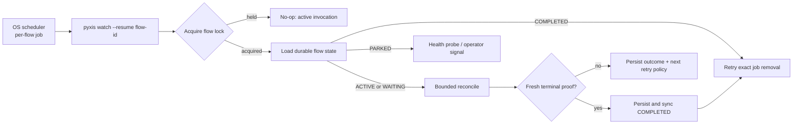

# Harbormaster lessons for per-flow scheduled watchers

| Field | Value |
|---|---|
| **Question** | What failed in Harbormaster when a local scheduler, watchdog, and long-lived worker loop were combined, and what must Pyxis preserve if each implementation flow installs its own scheduled wake, excludes duplicate execution with a lock, and unregisters itself at verified completion? |
| **In one line** | The proposed shape is viable, but cron plus a lock solves only duplicate process entry; Harbormaster's recurring failures were lost cadence, ambiguous identity, environment drift, leaked ownership, false completion, non-converging recovery, and healthy-looking no-ops. |
| **Status** | Study complete 2026-08-24; descriptive input to a future watcher/recovery contract and design, not an approved design. |
| **Class** | Descriptive research record — never authoritative. On conflict, Pyxis's governing documents and the cited Harbormaster primary sources govern. |
| **Related study** | [Harbormaster self-drive — failure taxonomy](harbormaster-self-drive-failure-taxonomy.md), which studies the predecessor's broader poll → gate → dispatch → merge → advance loop. This record narrows that evidence to scheduled process recovery and multiple concurrent implementation flows. |

---

## 1. Proposal being evaluated

The proposed local recovery shape is:

1. each active implementation-flow watcher installs its own scheduled job;
2. the scheduled job restarts or resumes that watcher when it is not already running;
3. an operating-system lock prevents a scheduled invocation from duplicating a live watcher; and
4. after the development flow is durably complete, the watcher removes its own scheduled job.

The attractive property is that no permanently-running supervisor is required. A watcher owns its own recovery registration, while the machine's scheduler is the independent process capable of waking it after a crash.

Harbormaster validates the need for that independent wake, but it also shows that the design needs more than a cron line and a process lock. The lock answers only:

> Is another process holding this lock right now?

It does not answer:

- whether the scheduler is alive and actually invoking the command;
- which repository and plan the command owns;
- whether the previous process durably handed off or abandoned its claims;
- whether an empty frontier means complete, temporarily idle, or unreadable;
- whether a retry is safe and when it should occur;
- whether a different flow may run concurrently on the same clone or machine; or
- whether unregistering the scheduled job succeeded.

Those are the challenge classes this record enumerates.

## 2. Method and evidence boundary

The study used four evidence layers:

1. enumeration of the full Harbormaster GitHub issue ledger at the study date — approximately 600 issue records — followed by a lifecycle/scheduler/recovery title and body sweep that identified approximately 210 direct candidates;
2. full reads of the relevant issue bodies, including the canonical watchdog, driver, scheduler, claim, recovery, cleanup, and silent-outage incidents cited below;
3. a full read of all 18 entries in Harbormaster's incident registry; and
4. inspection of the current watchdog and node-entrypoint code plus the landed history of the fixes.

This is not a claim that every sentence in every issue body was manually classified. It is an evidence-backed failure-class study: the entire ledger was enumerated, likely candidates were mechanically narrowed, and the primary records and code for every class reported below were inspected. Issue counts are therefore context, not a statistical estimate.

The inspected Harbormaster code revision was
`9e86e7e78683b3da1af5de1bb97c941d42cd8f30`.

## 3. Headline result

**Per-flow scheduled wake is sound only when the scheduler is treated as a replaceable wake source and durable flow state remains the source of truth.**

Harbormaster's incidents cluster around four boundaries:

| Boundary | Repeated failure shape |
|---|---|
| **Wake** | The scheduler was installed but did not run, ran with the wrong environment, or depended on the component it was supposed to repair. |
| **Identity and exclusion** | Jobs, repositories, issue numbers, clones, claims, or cleanup targets were not identified at the same scope. |
| **Reconciliation** | A probe failure became "absent," a stale read became a decision, or an error path skipped ownership settlement. |
| **Completion and recovery** | Temporary idleness became completion, cleanup raced live work, or a self-heal repeated without convergence or escalation. |

The rest of this record maps each challenge to concrete Harbormaster evidence and to the design obligation it creates for Pyxis.

## 4. Challenges found

### 4.1 A scheduler can be installed and still never execute

Harbormaster's canonical silent outage was hm#251. Its launchd agent existed, but it was registered in a GUI domain that did not execute for the headless account. The supervisor, maintenance, heartbeat, and dispatch all stopped. The process looked merely idle because nothing remained alive to report the failure.

The node later moved to Linux cron inside its container. Even there, the entrypoint must explicitly locate and start `cron` or `crond`; if neither is available, it logs a warning and relies on the co-located driver. See `node-entrypoint.sh` lines 102–134.

**Pyxis obligation:** successful job registration is not proof of cadence. Persist at least:

- `registered_at`;
- `last_invoked_at`;
- `last_reconcile_started_at`;
- `last_reconcile_completed_at`; and
- the last typed outcome.

If silent local-machine death must be observable, an off-machine observer must alarm on stale flow heartbeats. An on-machine watcher cannot report the death of its own machine or scheduler; Harbormaster paid for this separately in hm#419.

### 4.2 A repair loop cannot be its own only caller

hm#260 corrected a premature fix to hm#251. A doctor check could reinstall or heal the watchdog, but doctor ran inside the watchdog-driven cycle. Once the watchdog stopped, the repair never ran.

Harbormaster responded with two cadence sources:

- a co-located tmux driver as the steady-state loop; and
- cron as a redundant restart backstop that also revives the driver.

The rationale and mutual-recovery loop are explicit in
`supervisor-tmux.sh` lines 2503–2518 and 2661–2685.

**Pyxis obligation:** the scheduled invocation should be able to reconstruct execution from durable state without asking an existing watcher to repair itself. Conversely, watcher health must not be inferred merely from the scheduler configuration being present.

### 4.3 Shared crontab mutation does not have per-flow identity

Harbormaster's current installer removes every crontab line containing the shared supervisor script path, then appends one replacement. Its uninstaller removes every line containing the same path. See
`supervisor-tmux.sh` lines 2001–2034.

That is idempotent for one machine-wide Harbormaster watchdog. It is wrong for multiple Pyxis implementation flows using the same executable: installing, updating, or deleting one flow would match and remove its siblings.

The read-filter-write sequence is also a non-atomic shared-registry update. Two concurrent installers or removers can each read the same old crontab and have the last writer erase the other's change.

**Pyxis obligation:** give every scheduled flow a canonical job identity, for example:

```text
pyxis.watch/<code-host>/<repository-id>/<plan-id>
```

Registration and deletion must target that exact identity. Shared registry mutation must be serialized and reconciled by one job manager; substring filtering over executable paths is not sufficient.

On macOS, one launchd plist per canonical flow ID avoids shared crontab text mutation. On systems where cron is used, a single generated Pyxis-owned block or registry reconciler is safer than independent read-modify-write operations from every watcher.

### 4.4 `flock` is neither portable nor a complete concurrency policy

Linux `flock(1)` is not present on stock macOS, so it cannot be the portable Pyxis contract. More importantly, even a correct per-flow lock prevents only two processes for the **same flow** from running simultaneously.

Harbormaster encountered two additional concurrency scopes:

- synchronized supervisors stampeded shared GitHub and model capacity, including expensive losing passes (hm#467, hm#486); and
- different workers prepared worktrees concurrently through the same clone, causing preparation failure and a leaked claim (hm#1158).

**Pyxis obligation:** implement locks in Go and define three distinct scopes:

| Scope | Purpose |
|---|---|
| **Flow lock** | At most one reconcile invocation for one repository-plan flow. |
| **Clone mutation lock** | At most one operation that mutates shared clone administration, such as worktree preparation. |
| **Machine capacity lease** | A configured total number of concurrent workers/reviewers across all flows. |

Scheduled starts should include jitter so independent flows do not synchronize on the minute boundary.

### 4.5 Scheduled and interactive environments drift

Harbormaster repeatedly failed because cron, launchd, containers, and interactive shells did not share environment or location:

- cron lost the configured pool size and log directory, requiring values to be pinned into the installed line;
- token minting failed under launchd's minimal environment, with stderr discarded (hm#346);
- context injection ran from a directory that was not a Git repository (hm#353, hm#356);
- GNU/BSD `stat` behavior and obsolete flags crash-looped the containerized pool (hm#716); and
- authentication sources differed between the host and container environments.

The current Harbormaster cron installer documents this directly around its explicit `RIG_SESSION_KIND`, `SUPERVISOR_LOGDIR`, and `RIG_POOL_SIZE` environment. See
`supervisor-tmux.sh` lines 2003–2024.

**Pyxis obligation:** the installed job must invoke an absolute binary path with a closed, explicit configuration containing:

- canonical repository and state paths;
- flow ID;
- credential-source identifier;
- log/evidence location;
- capacity policy; and
- installation schema and binary version.

No correctness-sensitive behavior may depend on shell profiles, inherited current directory, or ambient defaults.

### 4.6 Wrong working directory can look like an empty frontier

In hm#1153, the steady-state driver ran from `/opt/harbormaster` rather than the managed clone. Repository discovery returned zero repositories for roughly fourteen hours while other maintenance made the process appear healthy. Earlier janitors similarly ran outside a repository and silently no-op'd every tick (hm#257).

**Pyxis obligation:** repository identity and location are required job inputs, not discoveries from `cwd`. Failure to open or verify the configured repository is an infrastructure failure. It must never be represented as "no ready work."

### 4.7 Failure classification determines whether retry helps or harms

Harbormaster learned that one retry policy cannot serve every failure:

- transient API errors needed a bounded fast retry window (hm#139);
- a 401 required operator action, while repeated nudges only inflated context and cost (hm#145);
- shared GraphQL quota needed reset-aware, fleet-coordinated backoff and jitter (hm#162); and
- transient GitHub errors were incorrectly interpreted as "no PR," producing false gate failure (hm#1192).

**Pyxis obligation:** use typed failure classes and policy-driven retry:

| Failure class | Expected treatment |
|---|---|
| Network timeout, reset, 502/503 | One quick retry, then exponential backoff with jitter and a cap. |
| Rate limit | Honor `Retry-After` or reset time, then add jitter. |
| Authentication or permission | Park for operator action; optionally run a slow credential-health probe. |
| Invalid configuration, unsupported schema, corrupt durable state | Fail closed and park; do not create a retry storm. |
| Repository or code-host read unavailable | Record `unknown`, never `absent` or `complete`. |
| No runnable task in an unfinished plan | Normal idle cadence, not an error and not completion. |
| Verified terminal plan state | Persist completion and unregister. |

The policy should optimize for both probability of recovery on the next attempt and the development delay created by waiting—the decision principle identified in the operator discussion that led to this record.

### 4.8 Process exclusion does not settle task ownership

Harbormaster's densest defect surface was the claim/lease lifecycle:

- a post-claim control-flow exit neither fired work nor released the claim (hm#347);
- claim release at successful completion was misread as unexpected lease loss (hm#454);
- post-claim failures orphaned claims (hm#535);
- worktree failure leaked its claim (hm#1158);
- terminal dispatch outcomes left leaves dead for the full TTL (hm#1164); and
- repository hooks blocked coordination-ref pushes and stalled Pyxis dispatch for roughly fifteen hours (hm#1198).

**Pyxis obligation:** after a durable claim is acquired, control flow must structurally end in exactly one of:

```text
claimed → handed_off
claimed → released
claimed → terminally_settled
```

The watcher process lock is not a substitute for those task-level transitions. Startup reconciliation must also recover ownership whose process died after claim acquisition.

### 4.9 An empty sweep is not proof that development is complete

Harbormaster repeatedly produced false empty or false done states:

- a just-created PR was hidden by a cached/list read and duplicate work was dispatched (hm#492);
- a missing `Closes` link caused a completed leaf to be re-listed and dispatched for hours (hm#1165);
- delayed or stale spec-marker reads created a no-spec loop; and
- API failure was sometimes reduced to absence.

**Pyxis obligation:** distinguish at least these states:

```text
READY       runnable work exists
IN_FLIGHT   owned work exists
WAITING     unfinished but currently blocked or awaiting external state
UNKNOWN     required evidence could not be read
PARKED      non-recoverable condition requires intervention
COMPLETED   the plan-level terminal invariant has been freshly verified
```

Only `COMPLETED` authorizes scheduled-job removal.

### 4.10 Completion and self-unregistration form a recovery transaction

Harbormaster exposed a completion-window race when a claim disappeared before the corresponding issue was durably closed. Another scheduler could re-claim the work during the gap (hm#461).

The same shape applies to self-unregistration:

- unregister first, then crash before persisting completion → unfinished work has no future wake;
- persist completion first, then fail to unregister → the job continues firing but can safely converge cleanup; and
- mutate the wrong shared registry entry → one completed flow disables another live flow.

**Pyxis obligation:** use this order:

1. freshly verify the plan-level completion invariant;
2. append and durably sync the `COMPLETED` state;
3. settle any remaining ownership records;
4. remove the exact scheduled-job identity; and
5. if removal fails, retain a cleanup-needed marker so the next invocation retries only unregistration.

Completion must be monotonic. Once durably complete, a later cron invocation cannot return the flow to active work.

### 4.11 Stale reads cannot carry action authority

Harbormaster incident I4 used an ETag/list read that hid a newly created PR for approximately thirteen minutes. Incident I12 repeated the same defect on comment/spec-marker reads because the original repair covered only one call site. Both are recorded in the
Harbormaster incident registry.

**Pyxis obligation:** cached or conditional reads may cheaply detect that something changed, but action and completion decisions require fresh, exact reads keyed by deterministic identity. `unknown` must remain distinct from `absent`.

### 4.12 Keeping the loop alive can swallow the evidence of failure

Harbormaster deliberately used `|| true` in long-running loops so one failed maintenance step would not kill the entire driver. That preserved cadence, but multiple incidents showed the dangerous companion behavior:

- janitors silently no-op'd;
- dispatch returned an empty set after an internal failure;
- claim failure reasons disappeared while every slot stayed idle (hm#1193); and
- clone synchronization reported success while the managed clone remained diverged and stale (hm#1200).

**Pyxis obligation:** continuing after a recoverable error must not convert that error to success. Each invocation needs a durable, typed terminal outcome. Health must include both process liveness and recent successful reconciliation.

### 4.13 Cleanup needs the same ownership model as execution

Harbormaster accumulated abandoned worktrees when cleanup covered only some creation paths (hm#890, hm#924, hm#1009). In the opposite direction, cleanup classified a worker's draft PR as finished and terminated live work (hm#456). Duplicate clones caused janitors to visit the same repository identity twice and false-reap a live lease (hm#1132).

**Pyxis obligation:** every resource a flow creates—scheduled job, process, task claim, worktree, temporary credential copy, and log/evidence location—needs:

- canonical owner identity;
- creation state;
- liveness/terminal evidence;
- idempotent cleanup; and
- a recovery path when cleanup is interrupted.

Age alone is insufficient proof that a resource is abandoned.

### 4.14 Job upgrades and uninstall need migration semantics

Harbormaster left stale runtime state outside the install tree (hm#372); launchd label migrations could leave multiple live jobs unless legacy labels were explicitly removed (hm#381); and nodes sometimes ran obsolete supervisor code because clone synchronization silently skipped or claimed success without healing divergence (hm#458, hm#1200).

**Pyxis obligation:** scheduled registration is versioned state. Reconciliation must compare desired and installed job schemas, replace an obsolete job without losing the flow, and remove only legacy entries whose ownership is proven.

### 4.15 Production scheduler behavior must be tested as a real boundary

Harbormaster's tests were green while production was dead when:

- tests ran inside a Git repository but the shipped program ran from a non-git directory;
- mocks implemented the same incorrect API route assumed by the caller;
- tests globally enabled fresh reads and therefore bypassed the cache behavior used in production;
- a claimed K-way scheduler was actually sequential (hm#950, hm#957); and
- the scheduler suite itself was red on main but absent from the required gate (hm#1195).

**Pyxis obligation:** acceptance must exercise the actual scheduled command and binary with:

- a cron/launchd-like minimal environment;
- a non-repository starting directory;
- two concurrent invocations of the same flow;
- two different flows sharing machine capacity;
- two flows sharing one clone;
- forced watcher death while owning and while not owning work;
- scheduler/job deletion failure after durable completion;
- stale and unavailable code-host reads; and
- upgrade from an older installed-job schema.

## 5. Recommended Pyxis operating model

The Harbormaster evidence supports the operator's per-flow scheduled-watcher idea with one refinement: **schedule bounded reconciliation, not an opaque process resurrection.**



The watcher may remain alive between bounded reconcile cycles for low latency, but correctness must not depend on its survival. After a crash, the next scheduled invocation reconstructs the same state from durable evidence.

### 5.1 Required identities

```text
FlowID       = code-host + canonical repository ID + plan ID
JobID        = namespace + FlowID + job-schema version
InvocationID = one scheduled or manually started reconcile execution
ClaimID      = one task ownership attempt within the flow
```

Filesystem paths, issue numbers, process IDs, hostnames, and script paths are locators or runtime details—not sufficient identities.

### 5.2 Required state machine

```text
ACTIVE       work may be runnable or in flight
BACKING_OFF  a recoverable failure has a recorded next-attempt time
WAITING      unfinished work is legitimately blocked
PARKED       progress needs operator intervention
COMPLETED    the plan terminal invariant is durably verified; no more work may start
```

The scheduler registration is a projection of `ACTIVE`, `BACKING_OFF`, `WAITING`, or cleanup-pending `COMPLETED`. It is not the authoritative state itself.

### 5.3 Required concurrency controls

- One flow lock prevents duplicate reconciliation of the same flow.
- One clone-administration lock protects shared worktree and ref operations.
- One machine capacity policy bounds aggregate concurrent workers and reviewers.
- Jitter distributes flow wake times.
- Task claims remain durable and independently settled; process-lock release does not imply task-claim release.

### 5.4 Required completion transaction

```text
fresh terminal proof
  → durable COMPLETED record
  → ownership settlement
  → exact job unregister
  → retry cleanup until absent
```

If any step after the durable completion record fails, the next scheduled invocation performs cleanup only. If proof acquisition fails, the state is `UNKNOWN` or `BACKING_OFF`, never `COMPLETED`.

## 6. What should not be copied from Harbormaster

The following implementation shapes were useful bootstrap mechanisms but are poor contracts for Pyxis:

- shared crontab mutation by filtering on a script pathname;
- a shell-level `flock` requirement;
- correctness derived from tmux session existence;
- current-directory repository discovery;
- `|| true` without a persisted typed failure;
- duplicated readiness or completion predicates;
- conditional/list-cache reads used to authorize action;
- one unbounded retry cadence for every failure;
- cleanup based only on age or artifact appearance; and
- a co-located loop whose internal state cannot be reconstructed after death.

Pyxis can preserve the valuable core—independent scheduled wake, idempotent reconciliation, and self-removal—while implementing those boundaries as explicit Go contracts and durable state.

## 7. Minimum design gate before implementation

A scheduled-watcher design should not proceed until it answers these questions explicitly:

1. What is the canonical flow and job identity across repositories, clones, and machines?
2. Which durable state authorizes a reconcile, a retry, a park, and unregister?
3. What exact artifact proves whole-flow completion?
4. How does a crash after claim acquisition converge?
5. How does a crash between completion persistence and unregister converge?
6. Which failures are transient, rate-limited, operator-action, corrupt, or normal idle?
7. Where are per-flow, per-clone, and per-machine concurrency enforced?
8. What explicit environment and credentials does the scheduled command receive?
9. How are installed jobs versioned, migrated, and deleted without touching siblings?
10. What observes a scheduler or machine that has stopped producing heartbeats?
11. Which real-boundary tests prove restart, exclusion, completion cleanup, and multiple-flow behavior?

Until those answers are contractual, "cron restarts the watcher and a lock prevents duplicates" is a useful mechanism sketch, not yet a reliable unattended-development design.
