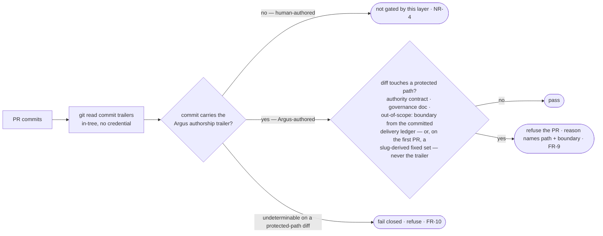

# Argus attribution gate — the authorship-scoped protected-path CI refusal — technical design

| Field | Value |
|---|---|
| **Status** | Draft → Approved *(merge requires Approved; merge is the freezing event; "superseded" is computed by the index, never written here)* |
| **Owner** | @mdarabi |
| **Approver(s)** | @mdarabi (operator) — factory-control / security merge-boundary surface; a named reviewer is mandatory (Security/privacy impact + governance surface) |
| **Date** | 2026-07-12 |
| **Relevant-when** | implementing or changing the Argus attribution gate — its Argus-authorship derivation, its protected-path classification, its fail-closed rule, or its CI composition; triaging a defect where an Argus-authored protected-path diff was not refused, a human-authored diff was wrongly refused, or an attribution signal was forged; superseding the authorship-derivation mechanism |
| **Scope** | How the attribution gate derives whether a PR's diff is Argus-authored and refuses it when it touches a protected path: a repo-internal commit-trailer authorship derivation read from in-tree commit metadata, the protected-path classification (the authority contract, a governance document, or an out-of-declared-scope file), and a fail-closed rule for the protected-path subset when authorship is underivable. **Not**: the write hook (part 1 — its own design) or the structure arm (part 2 — its own design); the authority contract's structural legality (the structure arm owns that, author-independently); the specific forgery-resistance *strength* of the trailer (a design-refinement open question, §7 Q1); any authority-contract mutation |
| **Tracking** | introducing PR (filed on approval) |
| **Builds-on** | docs/tech-design/argus-artifacts.md · docs/tech-design/argus-agent-v1.md · docs/tech-design/distributed-check-registration.md · docs/tech-design/docgate-v1.md |
| **Supersedes** | — |
| **Serves** | prd:argus-boundary-enforcement/FR-9 · prd:argus-boundary-enforcement/FR-10 · prd:argus-boundary-enforcement/FR-11 · prd:argus-boundary-enforcement/NR-4 · prd:argus-boundary-enforcement/UB-4 · prd:argus-boundary-enforcement/UB-5 · prd:argus-boundary-enforcement/ABUSE-2 · prd:argus-boundary-enforcement/ABUSE-3 · prd:argus-boundary-enforcement/ABUSE-4 · prd:argus-boundary-enforcement/NFR-1 · prd:argus-boundary-enforcement/NFR-2 · prd:argus-boundary-enforcement/NFR-3 |
| **Security/privacy impact** | yes — the gate is the sole merge-boundary fail-closed guarantee for the governance-document and out-of-declared-scope protected-path classes (no structure arm covers those), and it decides which diffs are the agent's own. It derives authorship from **in-tree commit metadata via `git`** and introduces **no** new egress, identity, secret, credential, or network surface (repo-internal, report-or-refuse-only). · reviewer: @mdarabi |
| **Template version** | tech-design-template/v1 |

## 1. Problem

The write hook (part 1) denies an Argus protected-path write at write time on the agent surface, and the structure arm (part 2) fails the gate on a structurally-illegal authority contract regardless of author. Neither closes the whole boundary at the merge boundary: a desk-side write hook cannot stop an out-of-band write (a raw shell redirect, a non-honoring CLI), and the structure arm covers **only** the authority contract's structural legality — it says nothing about a governance document or an out-of-declared-scope file an Argus diff touched, nor about an authority-contract change that is structurally legal but was authored by a drifted or injected Argus that should never have written that file. The **unbypassable, authorship-scoped** refusal — the one that fails a PR at CI because an *Argus-authored* diff touched a protected path, no matter how the bytes got there — does not exist. On the factory-control surface, that is the guarantee the human merge reviewer carries alone today, unaided by any authorship-scoped refusal.

**Why now:** Argus was promoted to tier-2 and now performs real gate-signing and materialization acts, so the moment its boundaries stop being merely prompt-and-review-reliable matters; and the attribution gate is the sole merge-boundary fail-closed backstop for two of the four protected-path classes (governance documents and out-of-scope files), so its forgery-resistance is required at the feature's definition of done. The failure mode this design prevents: an Argus-authored protected-path change reaching the mainline because the desk hook was bypassed and no author-scoped CI refusal caught it — while never once refusing a legitimate human-authored PR to the same paths.

## 2. Decision

**Decision:** The attribution gate derives Argus authorship from a **repo-internal commit-trailer convention** — an explicit authorship trailer the Argus drive appends to each commit it authors — read from the PR's **in-tree commit metadata via `git`**, and refuses a PR whose Argus-authored diff touches a protected path (the authority contract, a governance document, or an out-of-declared-scope file), returning a reason naming the path and the boundary *(design-brainstorm:argus-boundary-enforcement-tech-design#D-3, #ALT-3)*. The derivation reads **no** mutable platform/author badge and requires **no** ambient credential at evaluation time (AP-14, AP-26): a `git` read of the commit graph is exactly what the shipped ledger arms already run in CI. When the authorship of a diff touching a protected path **cannot be determined**, the gate **fails closed for that protected-path subset** — an underivable author touching a protected path is refused (FR-10, AP-17). A human-authored diff to the same paths is **not** refused by this layer — it keys on Argus authorship, so the human-author path stays fully open (NR-4).

A reader who stops here should see the shape: authorship is a **verified in-tree artifact** (a trailer in the commit, not a badge), the gate classifies each Argus-authored change's target against the protected-path set, refuses on a protected-path hit, and fails closed when authorship is underivable — so the merge boundary mechanically refuses an Argus protected-path diff no desk bypass escaped, while a legal human PR to those paths passes untouched.

## 3. The design

### 3.1 The authorship derivation — a repo-internal commit trailer

**Decision:** Argus authorship is derived from an **explicit commit trailer** the drive appends when it authors a commit, read from the PR's commit metadata via `git` — never from a code-host author-identity or a platform badge, and never requiring a credential or an external service *(design-brainstorm:argus-boundary-enforcement-tech-design#D-3)*.

The Argus drive, when it authors a commit, appends an authorship trailer to the commit message (a stable, documented trailer key identifying an Argus-authored commit and the driving problem). The gate reads the PR's commits — the in-tree commit metadata a `git log`/`git show` already exposes locally, exactly as the shipped ledger arms read the commit graph — and classifies each commit as Argus-authored or not by the trailer's presence. This is the derivation's load-bearing property: authorship is a **verifiable artifact carried in the commit content** (AP-13), read from the **deployment context with no ambient credential** (AP-14), and it is **not** a mutable badge (AP-26).

- **Per-diff granularity.** FR-9 keys on whether *this diff* is Argus-authored. The gate resolves authorship at commit granularity (a PR's protected-path change is attributed to the commit(s) that introduced it); a commit lacking the trailer is not Argus-authored for this layer's purposes.
- **Authorship signal vs scope boundary — two different trusts.** For **authorship** (is *this diff* Argus-authored?), the trailer is the primary and sufficient signal — per-diff, read from the commit (a ledger cross-reference is prose-granular, not per-diff, so it is not the authorship source — §4). For the **out-of-scope boundary's *width*** (which paths the driving problem permits), the trailer's problem field is **not** trusted alone and the boundary is **never** derived from any author-controlled same-PR input: for any PR with a prior committed ledger the scope width is **load-bearing on the named problem's gate-protected committed delivery ledger** (the ALT-5 cross-reference, elevated from optional corroboration to load-bearing for the scope-derivation — §3.2.1), and on the problem's **first (stage-1–2) PR** — the only PR with no committed ledger — the width is a **slug-derived fixed set ∪ a fixed named allowlist** (§3.2.1(b), operator ruling problem:argus-boundary-enforcement#A-1). Both sources are author-independent, so a self-named broader slug can never widen scope to an arbitrary path. The trailer still *identifies* the problem; the committed ledger (or, on the first PR, the slug-derived grammar) *bounds* what that problem's scope may be.
- **Forgery-resistance property (required at DoD) — where it comes from.** FR-11 requires the derivation to be forgery-resistant, badge-independent, and credential-free — a **property** the DoD asserts. The *bare trailer string itself carries no intrinsic forgery-resistance* (a plaintext, author-writable line); the forgery-resistance the feature needs is delivered not by the trailer but by two binding rules: for the **evade** direction (strip the trailer to pass as human), **DINV-2's fail-closed-on-absence** (an absent/unverifiable trailer on a protected-path diff refuses, never passes); and for the **widen** direction (name a broader problem), **DINV-6's scope integrity** — the committed-ledger derivation for any PR with a prior merged ledger, and the author-independent slug-derived fixed grammar on the first PR (§3.2.1). Badge-independence and credential-freeness are what the trailer/derivation (DINV-3) delivers. The trailer's forgery-*resistance strength* (a bare in-tree trailer vs one cryptographically bound to verifiable commit content) is a further design refinement carried as an open question (§7 Q1); the *direction* — repo-internal, credential-free, badge-independent, fail-closed-on-absence — holds either way, and the structure arm (part 2) independently closes the authority-contract evade path for any author (§3.5, ABUSE-3), so a stripped trailer never silently reclassifies an authority-contract change as legal-and-human.

### 3.2 Protected-path classification

**Decision:** The gate refuses an Argus-authored diff that touches any of the three protected-path classes: the **authority contract**, a **governance document**, or a file **outside the drive's declared scope**; each refusal names the path and which boundary it hit *(design-brainstorm:argus-boundary-enforcement-tech-design#S-3; basis FR-9)*.

- **The authority contract** — the fixed factory-control policy file (the same file the structure arm parses). An Argus-authored diff touching it is refused (the never-list: Argus never writes its own authority contract).
- **A governance document** — the governance-tier content set (the append-only governing layer the drive guide's never-list forbids Argus authoring). An Argus-authored diff touching it is refused.
- **Out of declared scope** — a file outside the paths the driving problem's scope permits (its own problem's ledgers and the documents it authors for that problem). The gate identifies the driving problem from the authorship trailer, but it does **not** trust the trailer's problem field to *set the scope boundary*, and it never derives that boundary from any author-controlled same-PR input. The boundary comes from one of two author-independent sources (§3.2.1): for any PR with a prior committed ledger, the scope boundary is **derived from the named problem's committed (merged) delivery ledger** — the gate-protected append-only `E-n` journal a current drive cannot retroactively widen; on the problem's **first (stage-1–2) PR** — the only PR with no committed ledger — the scope is a **slug-derived fixed set ∪ a fixed named allowlist** (the slug's own `docs/problems`/`docs/brainstorms`/`docs/prds`/`docs/reviews` subtrees + a static shared-target allowlist), never the trailer's problem field alone and never same-PR self-attribution (problem:argus-boundary-enforcement#A-1). Any Argus-authored change outside that derived declared scope is a protected-path hit.

#### 3.2.1 Scope integrity — the boundary comes from the committed ledger, not the trailer

**Decision:** The out-of-scope boundary's *width* is **load-bearing on the gate-protected committed delivery ledger**, never on the author-writable trailer field alone *(elevating the ALT-5 delivery-ledger cross-reference from optional corroboration to load-bearing for the scope-derivation)*.

The threat this closes: the trailer is Argus-appended and names the driving problem (§3.1), so a mis-behaving or injected Argus authoring the commit controls that field. If the scope boundary were read from the trailer's problem field alone, a drive could name a **different, broader problem slug** whose declared scope *includes* the target path — reclassifying an out-of-scope write as in-scope, which **passes**. The fail-closed-on-absence rule (#DINV-2) does not catch this — the trailer is *present and derivable*; it merely names a self-serving problem. The gate is the **sole** merge-boundary backstop for the out-of-scope class (the structure arm covers only the authority-contract class), so this widen-your-own-scope path would be an unbacked hole.

The mechanism that closes it: for the problem the trailer names, the gate reads that problem's **merged (committed) delivery ledger** — `docs/problems/<slug>/delivery.md`, whose `E-n` journal is **gate-protected append-only against the merge base** (the shipped ledger-history arm makes merged Argus `E-n`/`A-n` entries add-only — a current drive cannot retroactively edit or delete a committed entry) — and derives the permitted scope from the ledger's own recorded reality: the problem's own two ledgers, plus the documents its committed journal attributes to the drive (the `E-n` entries' external-effect identities and the artifacts they name). Because a current, in-flight drive **cannot retroactively widen the committed ledger of any problem** (its own or another's), naming a broader slug buys nothing: either the named problem's *merged* ledger genuinely declares the target in-scope (in which case a legitimate drive of that problem authored it, and this is not an evasion — it is the real owner) or it does not (and the write reds as out-of-scope). The self-serving-slug reclassification is thereby structurally unavailable.

**The first-PR / no-prior-committed-ledger case — a slug-derived fixed-path grammar, never same-PR self-attribution** *(operator ruling — problem:argus-boundary-enforcement#A-1, answering the review escalation review:argus-attribution-gate#FND-3)*. There is exactly one PR of a problem with **no committed delivery ledger to bound scope against**: the problem's **very first** PR — the **stage-1–2 documentation PR** that instantiates the problem and its PRD ledger. By the design and plan PRs the PRD is already merged, so a committed delivery ledger exists and the already-sound committed-ledger branch (above) governs those and every later PR. That first PR's *legitimate* footprint is therefore **narrow and entirely slug-derivable** — the authoring flow at stages 1–2 touches only the problem's own doc subtrees plus a few known shared targets — so the out-of-scope boundary on this one PR is a **fixed function of the drive's slug ∪ a small fixed named allowlist**, and it takes **no author-controlled input** (in particular, it does **not** read this PR's own delivery-ledger self-attribution — the vector FND-3 named). Concretely, on a first PR (a target not in this set is out-of-scope → refuse):

- the problem's own ledgers — `docs/problems/<slug>/**` (its `problem.md` + `delivery.md`);
- the stage-1 brainstorm record — `docs/brainstorms/<slug>*.md` (`<slug>.md` and the `-tech-design.md` sibling live under the same slug prefix);
- the PRD ledger — `docs/prds/<slug>/**` (the `000-base.md` + any amendments + the generated projection);
- its review report(s) — `docs/reviews/<slug>-*.md` (the PRD/design review evidence riding this PR);
- **plus** the small **fixed named shared-target allowlist** the stage-1–2 flow legitimately touches — the glossary `docs/wiki/glossary.md` (DOD-8's term landings) and the tech-design index (`docs/tech-design/index.md` · `docs/tech-design/index.json`) if regenerated.

Every element is either a **fixed function of the slug** (the first four — the slug is read from the trailer's problem field, but here it only *names the subtree the drive owns by construction*; it can never widen to a code path, because the grammar's slug-derived members are all `docs/**` documents keyed to that one slug) or a **fixed named allowlist entry** (the last — a static, author-independent list). **Nothing** in this set is derived from same-PR self-attribution or any other author-controlled input, so a mis-behaving first-PR Argus **cannot** self-widen to an arbitrary path: naming a broader slug buys only *more of that slug's own doc subtree*, never `internal/engine/core.go` or any code path (no code path is a member of the grammar), and writing a same-PR ledger entry that self-attributes an out-of-scope target buys **nothing** (the grammar never consults that entry). **This closes the FND-3 widen vector on the first-PR branch** — the branch is now genuinely refusal-only, not merely labeled so. It is scoped and bounded: (a) the *authority-contract* and *governance-document* protected-path classes are unaffected — those are fixed path sets, not trailer-derived, so a first-PR drive still cannot touch them (DINV-1); (b) the out-of-scope class on a first PR is the slug-derived fixed set ∪ the named allowlist, and it refuses (AP-17) everything else — a genuine refusal-only floor: it can at most force a legitimate first-PR out-of-scope-looking write to be split or human-landed, and it **can never widen** to an author-chosen path; (c) this grammar applies only to the *first* PR of a problem and only to the out-of-scope class. **The one residual that remains — owned honestly (§7 Q4) — is the allowlist's own trust**: the allowlist is a small fixed *named* set of shared targets whose members are author-independent (a static list, not derived from any PR input), so a broader-slug or self-attributing drive cannot add to it; its only trust is that the enumerated shared targets are ones a first-PR drive *may* legitimately touch — a property of the static list, reviewed when the list itself changes, **not** an author-controllable widen. This residual is carried as §7 Q4 and as a §3.8 threat-model line + a §5 risk row.

This layer **derives declared scope itself** for now — the shared declared-scope source with the write hook is the deliberately-un-promoted seam (basis WR-2; the program decomposition, design-brainstorm:argus-boundary-enforcement-tech-design#D-1). Whether the two layers ever share one scope source is this design's §7 Q2, decidable only once both exist.

### 3.3 The fail-closed rule

**Decision:** When authorship cannot be determined for a diff that touches a protected path, the gate **refuses that protected-path subset** — an underivable author touching a protected path is a refusal (never a pass) *(design-brainstorm:argus-boundary-enforcement-tech-design#D-3; basis FR-10, UB-4; AP-17)*.

Ambiguity must not fail open on the policy surface. A diff touching a protected path whose author the gate cannot derive (an absent/unverifiable trailer, an unresolvable commit) is treated as Argus-authored **for the protected-path subset only** and refused — so a stripped or forged-away trailer on a protected-path change cannot slip through as "not Argus." Crucially, this fail-closed rule is scoped to the **protected-path subset**: a diff that touches no protected path is never refused for an underivable author (the human-author path to non-protected paths is unaffected — a human PR needs no trailer, and it touches no protected path or, if it does, it is a *human*-authored protected-path change, which this layer does not refuse — the classification only refuses on the *Argus-authored ∧ protected-path* conjunction, and the fail-closed rule fires only when authorship is *underivable* on a protected-path diff, which a normal human PR's determinable non-Argus authorship never triggers).

### 3.4 Composition — a CI-run check

**Decision:** The attribution gate runs as a **required CI context** reading the PR's diff and the in-tree commit trailers; where it is realized as a gate check it self-registers as one descriptor (the settled composition seam), and where it needs PR-scoped commit context beyond a single gate run it is a discrete CI step — either way it composes without editing a shared line *(design-brainstorm:argus-boundary-enforcement-tech-design#S-4; basis §5.5)*.

The gate reads the PR's changed files (the diff) and the PR's commit trailers (via `git`), classifies, and fails the required context on a refusal — the same report-then-enforce posture the other merge-boundary layer takes. Its composition follows the self-registered-check contract where it fits (a descriptor adding no hand-edited umbrella/dispatch/help line; AP-27), and a discrete CI step where the PR-commit context is broader than a single gate invocation carries — the choice is an implementation detail bounded by the same no-shared-line constraint (§7 Q3). It adds **no** new egress or credential: the diff and the commit trailers are in-tree, read locally in CI exactly as the shipped ledger arms read the corpus and the commit graph.

### 3.5 Boundaries and non-goals

- **Not solved here** — the write hook (part 1) and the structure arm (part 2): independently-revisable decisions with their own designs (design-brainstorm:argus-boundary-enforcement-tech-design#D-1). The authority contract's **structural legality** — the structure arm owns that, author-independently; this gate refuses an *Argus-authored* authority-contract diff, which is a different, complementary catch. The engine-era graduation of this check (basis WR-1).
- **Owned by a future design** — the trailer's exact forgery-resistance strength (a cryptographic binding vs a bare trailer; §7 Q1); a shared declared-scope manifest with the write hook (basis WR-2; §7 Q2), decidable only once both layers exist; the engine-era runtime reader.
- **Implementation must not infer** — that the gate refuses human-authored diffs: it keys on **Argus authorship**; a human PR to a protected path is **not** refused by this layer (NR-4). That authorship comes from a badge: it comes from an **in-tree commit trailer** (never a mutable platform/author badge). That the fail-closed rule refuses non-protected-path diffs: it fires **only** on the protected-path subset when authorship is underivable. That the gate mutates anything: it reports/refuses, never writes.
- **Must remain unchanged** — the human-author path to protected paths (NR-4; the anti-segment stays served); the CI's ambient-credential posture (the gate adds none — NFR-1); every non-protected-path verdict; the authority contract's own content (basis NG-3; the never-list).

### 3.6 Invariants

- **DINV-1** — **Argus-authored ∧ protected-path ⇒ refuse.** A PR carrying an Argus-authored diff that touches the authority contract, a governance document, or an out-of-declared-scope file is refused with a reason naming the path and the boundary. (Serves FR-9.)
- **DINV-2** — **Underivable ∧ protected-path ⇒ fail closed.** When authorship cannot be determined for a diff touching a protected path, that protected-path subset is refused — never passed. (Serves FR-10, UB-4; AP-17.)
- **DINV-3** — **Badge-independent, credential-free derivation.** Authorship is derived from in-tree commit content (the trailer), never from a mutable platform/author badge, and the derivation runs in CI with no ambient credential. (Serves FR-11; AP-14, AP-26.)
- **DINV-4** — **Human-author path open.** A human-authored diff to a protected path is never refused by this layer; the fail-closed rule fires only on an *underivable* author on a protected-path diff, which a determinable human-authored change never triggers. (Serves NR-4.)
- **DINV-5** — **Report/refuse-only, no new surface.** The gate mutates nothing and adds no new egress, identity, secret, credential, or network surface; it reads the diff, the commit trailers, and the committed delivery ledgers in-tree. (Serves NFR-1.)
- **DINV-6** — **Scope integrity — boundary from the committed ledger (or, on the first PR, a slug-derived fixed set), never from author-controlled same-PR input.** For any PR with a prior committed ledger, the out-of-declared-scope boundary's *width* is derived from the named problem's **gate-protected committed (merged) delivery ledger** (append-only against the merge base), never from the author-writable trailer's problem field alone; a current drive cannot retroactively widen any committed ledger, so a self-named broader problem slug cannot reclassify an out-of-scope write as in-scope. On the problem's **first (stage-1–2 documentation) PR** — the only PR with no committed ledger — the out-of-scope scope is the **slug-derived fixed set ∪ a fixed named allowlist**: the slug's own `docs/problems/<slug>/**`, `docs/brainstorms/<slug>*.md`, `docs/prds/<slug>/**`, `docs/reviews/<slug>-*.md`, plus the static named shared-target allowlist (the glossary; the design index if regenerated) — **every element a fixed function of the slug or a fixed named allowlist entry, and nothing derived from same-PR self-attribution or any other author-controlled input** (problem:argus-boundary-enforcement#A-1). Any target the gate cannot place in that fixed set is out-of-scope (refuse). Because no member of the first-PR grammar is a code path or author-attributed, a self-named broader slug or a self-attributing same-PR ledger entry can never widen the first-PR boundary to an arbitrary path — the grammar admits only more of that slug's own doc subtree. (Serves FR-9, FR-11; AP-17; the ALT-5 elevation + the first-PR slug-derived grammar, §3.2.1.)

### 3.7 Observability

- **Events/logs** — the gate emits the standard defect/refusal record (verb, file, op, reason, remedy): the reason names the citing PR's protected-path file, the boundary class it hit (authority contract / governance doc / out-of-scope), and — for the fail-closed case — that authorship was underivable on a protected-path diff. A human-authored protected-path diff emits nothing (not gated). The corpus-harness records the two instrumentation events the basis names (a refusal of a seeded violation fixture; a pass of a legitimate fixture) as the metric surface.
- **Metrics** — the golden-fixture pass rate in CI is the metric surface (basis M1/M2 — the Argus-authored protected-path fixtures refused, the human-authored ones passed, the underivable-on-protected-path fixture refused); no runtime telemetry is added (NFR-1).
- **Alerts** — a red required CI context *is* the alert; no other channel.
- **Debugging surface** — any fixture (a seeded PR with a trailered/untrailered commit touching a protected path) replays the verdict exactly; the verb/file/op triple is the correlation key.
- **Trace/correlation** — none beyond the defect triple; single-process CI check.

### 3.8 Security & privacy

yes — matches the header row. This gate is the **sole merge-boundary fail-closed guarantee** for the governance-document and out-of-declared-scope protected-path classes (the structure arm covers only the authority-contract path), which is why forgery-resistance is required at the feature's DoD and a named reviewer is mandatory. What it does **not** introduce: any new identity, permission, secret, credential, network, or egress surface — authorship is derived from **in-tree commit metadata via `git`**, read locally in CI exactly as the shipped ledger arms read the commit graph; the diff and the trailers already live in the repo. It **never writes** the authority contract or any protected path (basis NG-3; the never-list).

**Threat model and mitigations, traced to binding elements:**
- **ABUSE-3 (attribution forgery / DoS).** An attacker spoofs a diff's authorship to appear human (evade the refusal), or frames a human as Argus (a false-refusal DoS). Mitigated for the *evade* direction by DINV-2's fail-closed-on-absence rule (a stripped/absent trailer on a protected-path diff refuses, never passes — see §3.8 R1 / DINV-2), by the badge-independent, credential-free in-tree derivation (DINV-3 — a mutable badge is never trusted), and by the structure arm (part 2), which fails a structurally-illegal authority contract regardless of author, closing the *authority-contract* evade path even if the trailer is spoofed. The false-refusal (framing) direction is bounded by scoping the refusal to the *Argus-authored ∧ protected-path* conjunction and by the trailer being an explicit, verifiable in-tree artifact (a human's ordinary PR carries no such trailer). The forgery-*strength* refinement is §7 Q1.
- **ABUSE-3′ (widen-your-own-scope via a self-named broader problem slug — and its first-PR variant).** A mis-behaving or injected Argus controls the trailer's problem field (§3.1), so it could name a **different, broader problem** whose declared scope includes an out-of-scope target — reclassifying the write as in-scope. DINV-2 does not catch this (the trailer is present and derivable; it merely names a self-serving problem), and the structure arm does **not** cover the out-of-scope class — this gate is its **sole** merge-boundary backstop (§1). Mitigated by **DINV-6 (scope integrity)**: for any PR with a prior committed ledger the out-of-scope boundary's *width* is derived from the named problem's **gate-protected committed delivery ledger**, whose `E-n` journal is append-only against the merge base (the shipped ledger-history arm) — a current drive cannot retroactively widen any committed ledger, so a self-named broader slug buys nothing (either the named problem's merged ledger genuinely owns the target, or the write reds — §3.2.1). **The first-PR variant (the class this gate solely backstops, with no committed ledger yet) is closed, not merely a residual** *(operator ruling, problem:argus-boundary-enforcement#A-1, answering review:argus-attribution-gate#FND-3)*: the first-PR out-of-scope scope is a **slug-derived fixed set ∪ a fixed named allowlist** (`docs/problems/<slug>/**`, `docs/brainstorms/<slug>*.md`, `docs/prds/<slug>/**`, `docs/reviews/<slug>-*.md`, + the static allowlist — glossary, design index), **never** same-PR self-attribution and containing **no code path**; so a broader slug buys only more of that slug's own doc subtree and a same-PR ledger entry self-attributing an arbitrary code path buys **nothing** — the first-PR boundary can never widen to an author-chosen path (§3.2.1(b), DINV-6, §5 R6, A-7). The **honestly-owned residual is now the allowlist's own trust** — a small static named set, author-independent (not derived from any PR input), hence not attacker-widenable; its only trust is that its enumerated shared targets are legitimately first-PR-touchable, reviewed when the list changes (§7 Q4). The authority-contract and governance classes are unaffected throughout (fixed path sets — DINV-1).
- **ABUSE-2 (injection-steered write).** Injected content steers Argus to write a protected path. The agent's injection posture (data, never obeyed) is the first line; this gate is the mechanical backstop if a lapse produces the write — an Argus-authored protected-path diff is refused at CI regardless of the injected motive (DINV-1). A planted directive in a commit body or a diff cannot steer the *gate's* verdict, which is structural (trailer presence + protected-path classification), never content-directed.
- **ABUSE-4 (out-of-band bypass).** A bypass writes a protected path out-of-band to evade the write hook. This gate is the unbypassable backstop — the write reaches the PR as an Argus-authored diff (or, if the trailer is stripped, an underivable-author diff on a protected path), and either path refuses (DINV-1 / DINV-2). No desk bypass escapes CI.

### 3.9 Failure modes

| Failure | System behavior | Detection | Recovery |
|---|---|---|---|
| an Argus-authored diff touches a protected path | refused with a reason naming the path + boundary (DINV-1) | the CI refusal | revert the protected-path change; a human lands any legitimate authority/governance change by their own PR |
| authorship is underivable on a protected-path diff (absent/unverifiable trailer) | refused for the protected-path subset — fail closed (DINV-2) | the CI refusal naming the underivable-author case | restore/verify the trailer, or land the protected-path change as a determinable human-authored PR |
| a human-authored PR touches a protected path | **not refused** by this layer (DINV-4) — the structure arm still requires an authority-contract change to be structurally legal | no refusal from this gate | none — the human-author path is open by design |
| a diff spoofs its authorship (strips or forges the trailer) | on a protected-path diff, an absent/forged trailer falls to the underivable-author fail-closed refusal (DINV-2); the structure arm independently catches a structurally-illegal authority contract regardless of author | the CI refusal | as above; the forgery-strength refinement (§7 Q1) hardens this further |
| a **first-PR** Argus writes an out-of-scope target (e.g. a code path) and a **same-PR** delivery-ledger entry self-attributing it | **refused** — the first-PR out-of-scope scope is the slug-derived fixed set ∪ the fixed named allowlist (DINV-6, §3.2.1(b)), which never consults same-PR self-attribution and contains no code path; naming a broader slug likewise buys only more doc-subtree (problem:argus-boundary-enforcement#A-1) | the CI refusal naming the out-of-scope path | split the out-of-scope write out / land it as a determinable human-authored PR; only the slug's own doc subtrees + the allowlist are in-scope on a first PR |
| the gate's own introducing PR (the check does not yet exist to gate itself) | operator review is the sole backstop for that one bootstrap PR (incident I1); the gate refuses every subsequent PR | the introducing PR's explicit bootstrap note (basis DOD-7) | none — the I1 exception is stated |

### 3.10 Testing strategy

The acceptance spine is a seeded-PR golden-fixture corpus (a fixture repo/commit per case: commits with/without the authorship trailer touching each protected-path class, plus human-authored and non-protected-path controls). The seams under test and their bins:

- **the authorship derivation (trailer read)** — *local-substitutable*: the tests construct a real git fixture (commits carrying / lacking the trailer) in a temp repo and read the trailers via a real `git` read — the same way the shipped history arm stages a real merge base, never a mock of the commit graph.
- **the protected-path classification** — *in-process*: table-driven fixtures over the three classes (authority contract, governance doc, out-of-scope) + the declared-scope derivation, tested directly — including the **committed-ledger** scope-width derivation (a broader-slug trailer against a merged ledger does not widen) and the **first-PR slug-derived grammar** (the slug's own doc subtrees + the fixed allowlist are in-scope; a code path and any same-PR self-attributed target are out).
- **the fail-closed rule** — *in-process / local-substitutable*: an untrailered (underivable-author) commit touching a protected path is refused; a determinable human-authored one to the same path is not; a non-protected-path underivable diff is not refused.
- **the abuse fixtures** — a spoofed/stripped-trailer fixture (does not flip a human diff to Argus or an Argus diff to human on a protected path — it falls to fail-closed), a **widen-slug** fixture (a broader-slug trailer does not flip an out-of-scope write to in-scope against a committed ledger — A-4), the **first-PR malicious self-attribution** fixture (a first-PR commit writing an out-of-scope code target + a same-PR delivery-ledger entry self-attributing it is **refused** — the slug-derived grammar never consults same-PR self-attribution, and a broader-slug first-PR variant likewise reds — A-7) alongside the **legitimate first-PR** fixture (writes confined to the slug's own doc subtrees + the fixed allowlist pass — A-7), a planted-directive-body fixture (does not steer the verdict), and an out-of-band-write fixture (still refused at CI).

No true-external dependency exists (the derivation is in-tree); a code-host API is deliberately **not** a dependency (that was the rejected badge alternative, ALT-4 — see §4).

## 4. Alternatives considered

| Alternative | Why rejected |
|---|---|
| **Derive authorship from the code-host author identity / a platform badge** *(design-brainstorm:argus-boundary-enforcement-tech-design#ALT-4)* | a platform badge/author identity is **mutable** (AP-26 forbids certifying goal-state on it) and server-side verification needs a **code-host API credential in CI** — a new ambient credential / outward surface, which is precisely the escalation condition (basis R4); it also couples the gate to one code host (breaks medium-independence, AP-1/AP-25). Rejected on both design grounds and the R4 boundary; the repo-internal trailer needs no such surface. **Had this been the only viable mechanism, the design stage would have emitted a decision brief and parked rather than assume it.** |
| **Derive authorship solely from the delivery-ledger cross-reference** *(design-brainstorm:argus-boundary-enforcement-tech-design#ALT-5)* | the journal records a drive's *acts* at gist granularity, not a per-commit/per-hunk authorship map — resolving "did *this diff* come from an Argus drive" back to a journal entry is a fragile many-to-one join, imprecise exactly where FR-9 needs per-diff precision, and it couples the CI gate to parsing ledger prose. **Hybridized** into the trailer derivation as a *corroborating* signal (§3.1), never the sole source. |
| **Fail open when authorship is underivable** | ambiguity failing open on the policy surface is exactly the hole a stripped trailer would exploit; AP-17 puts the fail-closed guarantee at the merge boundary — an underivable author on a protected-path diff is refused (DINV-2, FR-10). |
| **Gate all authorship to the protected paths** (refuse any diff, human or Argus, touching them) | broadens scope to impede legitimate human and other-agent authorship — the anti-segment breach the basis forbids (NG-4, NR-4); part 3 keys on *Argus-authored* diffs by the operator's framing (design-brainstorm:argus-boundary-enforcement-tech-design#D-5 of the stage-1 record). |
| **Bundle the attribution gate into one design with the write hook and structure arm** | three independently-revisable §2 decisions in one document (the conventions' anti-pattern; RW-5). The program decomposition (design-brainstorm:argus-boundary-enforcement-tech-design#D-1) is the resolution. |

## 5. Risks

| ID | Risk | Impact | Mitigation | Verification / evidence |
|---|---|---|---|---|
| R1 | the authorship derivation is forgeable → the gate is bypassable (a spoofed-human diff evades the refusal) | an Argus protected-path change merges under a stripped trailer | the bare trailer carries no intrinsic forgery-resistance — the resistance for the **evade** direction is delivered by **DINV-2's fail-closed-on-absence rule** (a stripped/absent trailer on a protected-path diff refuses, never passes) plus the committed-ledger corroboration (DINV-6, for the out-of-scope width); DINV-3 contributes only badge-independence + credential-freeness (not forgery-resistance); the structure arm independently catches a structurally-illegal authority contract regardless of author (ABUSE-3); the forgery-*strength* refinement is §7 Q1 | fail-closed + spoofed-trailer fixtures (A-2, A-4) |
| R2 | the derivation is unavailable in CI (needs a credential the deployment context lacks) → the gate is false or dead | the sole backstop for two protected-path classes does not run | DINV-3 requires a credential-free, in-tree derivation — a `git` read of the commit trailers, exactly what the shipped arms run in CI (AP-14 deployment-context); the code-host-badge alternative that *would* need a credential is rejected (ALT-4) | the derivation runs in the CI deployment context with no ambient credential (A-3) |
| R3 | a false-refusal fights legitimate authorship (a human PR to a protected path is refused, or a human is framed as Argus) | a DoS on the operator or a human author; the anti-segment breach | DINV-4 keeps the human-author path open (the refusal is the Argus-authored ∧ protected-path conjunction; the fail-closed rule fires only on an *underivable* author, which a determinable human change never triggers); the basis M2 guardrail blocks adoption on any false refusal | human-authored protected-path fixture passes (A-5); framing fixture does not refuse |
| R4 | assumption (delivery:argus-boundary-enforcement#E-15): the in-tree commit-trailer derivation requires **no new grant, no new outward surface, and moves no operator-owned boundary** — so it is R4-legal and no breaking escalation is owed at this design | mis-judged R4 (a mechanism smuggling a new credential/egress past the escalation condition) | tested by the absence of any credential/egress/identity/permission change (§3.8) — authorship is a `git` read of in-tree commit metadata; the badge/credential mechanism that *would* break R4 is rejected (ALT-4), not assumed; if the only viable derivation had needed a new surface the decision would have escalated (brief + park), it did not | §3.8 shows no new surface; A-3 credential-free |
| R5 | the bootstrap PR (the gate cannot refuse its own introducing PR) merges an Argus-authored protected-path change | the one PR that installs the gate is ungated by it | operator review is the stated sole backstop for that one PR (incident I1); the introducing PR carries an explicit bootstrap note (basis DOD-7); the gate refuses every subsequent PR | the introducing PR's bootstrap note (A-6) |
| R6 | a mis-behaving Argus widens its own out-of-scope boundary by naming a broader problem slug in the author-writable trailer (this gate is the *sole* backstop for the out-of-scope class) → an out-of-scope write reclassifies as in-scope and merges | the out-of-scope guarantee — one of two classes this gate solely backstops — is bypassable | DINV-6 scope integrity: for any PR with a prior committed ledger the boundary width is derived from the named problem's **gate-protected committed delivery ledger** (append-only against the merge base — the shipped ledger-history arm), which a current drive cannot retroactively widen; a self-named slug either genuinely owns the target in its merged ledger or the write reds (§3.2.1). **First PR (no committed ledger)**: the out-of-scope scope is the **slug-derived fixed set ∪ a fixed named allowlist** (problem:argus-boundary-enforcement#A-1) — `docs/problems/<slug>/**`, `docs/brainstorms/<slug>*.md`, `docs/prds/<slug>/**`, `docs/reviews/<slug>-*.md`, + the static allowlist (glossary, design index) — **no code path and nothing author-attributed is a member**, so a broader slug buys only more of that slug's own doc subtree and a same-PR self-attributing ledger entry buys nothing → **it can never widen to an arbitrary path** (a genuine refusal-only floor; it can at most force a split/human-land); the authority-contract + governance classes are unaffected (fixed path sets). **Residual — the allowlist's own trust**: the allowlist is a small static named set (author-independent — not derived from any PR input), so it is not attacker-widenable; its only trust is that its enumerated shared targets are legitimately first-PR-touchable, a property of the static list reviewed when the list changes (§7 Q4) | the widen-slug abuse fixture (A-4 — a broader-slug trailer does not flip an out-of-scope write to in-scope against a committed ledger); the first-PR fixtures (A-7 — the **malicious** same-PR-self-attribution case reds; the legitimate slug-subtree case passes) |

## 6. Acceptance

| ID | Acceptance criterion | Verify | Required evidence | Traces to |
|---|---|---|---|---|
| A-1 | on the seeded PR fixtures (an Argus-authored — trailered — diff touching each of the authority contract, a governance document, and an out-of-declared-scope file), CI refuses with a reason naming the path and the boundary; on a human-authored (untrailered) diff to the same paths, CI does not refuse on this layer | Test | seeded-PR fixture report | prd:argus-boundary-enforcement/FR-9 · §3.1 · §3.2 · #DINV-1 · #DINV-4 |
| A-2 | an attribution-underivable fixture (absent/unverifiable trailer) touching a protected path is **refused** (fail closed for the protected-path subset); a determinable human-authored one to the same path is not; a non-protected-path underivable diff is not refused | Test | fail-closed fixture report | prd:argus-boundary-enforcement/FR-10 · /UB-4 · §3.3 · #DINV-2 |
| A-3 | the derivation runs in the CI deployment context with **no ambient credential** and reads **no** mutable badge (it reads in-tree commit trailers via `git`); the design demonstrates the derivation source | Test + Inspection | CI-context run (no credential) + the derivation-source demonstration | prd:argus-boundary-enforcement/FR-11 · §3.1 · #DINV-3 |
| A-4 | a spoofed/stripped-attribution fixture does **not** flip the classification — a stripped trailer on a protected-path diff falls to the fail-closed refusal (never a silent pass), and a forged trailer framing a human is bounded by the Argus-authored ∧ protected-path scoping; a **widen-your-own-scope fixture** (an Argus-authored out-of-scope write whose trailer names a broader problem slug) does **not** flip the write to in-scope — the out-of-scope boundary is derived from the named problem's committed delivery ledger (which the fixture's current drive cannot retroactively widen), so the write reds as out-of-scope; the abuse fixtures (ABUSE-2 planted-directive body; ABUSE-4 out-of-band write) are each still refused/unsteered | Test | abuse-fixture results | prd:argus-boundary-enforcement/ABUSE-2 · /ABUSE-3 · /ABUSE-4 · §3.8 · #DINV-2 · #DINV-3 · #DINV-6 |
| A-5 | on the legitimate corpus, **0** human-authored PRs to protected paths are refused by this layer | Test | legitimate-corpus fixture report | prd:argus-boundary-enforcement/NR-4 · §3.3 · #DINV-4 |
| A-6 | the gate adds no new egress/identity/secret/credential surface (all inputs in-tree — the diff, the commit trailers, and the committed delivery ledgers); the introducing PR states the incident-I1 bootstrap exception (the gate cannot refuse its own introducing PR; operator review is the backstop for that one PR) | Inspection | design/security review + the introducing PR's bootstrap note | prd:argus-boundary-enforcement/NFR-1 · /UB-5 · incident I1 |
| A-7 | on **first-PR fixtures** (a brand-new problem whose delivery ledger is not yet committed): **(i) the malicious same-PR self-attribution case reds** — a first-PR commit that writes an out-of-scope code target (e.g. `internal/engine/core.go`) **and** a same-PR delivery-ledger entry self-attributing that path to the drive is **refused** (the slug-derived grammar never consults same-PR self-attribution; no code path is a grammar member — problem:argus-boundary-enforcement#A-1), never admitted in-scope; **(ii) a broader-slug first-PR commit** writing a code target does not flip it in-scope (the grammar admits only the named slug's own doc subtree, no code path); **(iii) the legitimate first-PR case passes** — writes confined to the slug's own doc subtrees (`docs/problems/<slug>/**`, `docs/brainstorms/<slug>*.md`, `docs/prds/<slug>/**`, `docs/reviews/<slug>-*.md`) + the fixed allowlist (glossary, design index) are admitted in-scope; the authority-contract and governance-document classes still refuse (fixed path sets, DINV-1) | Test | first-PR fixture report (malicious-self-attribution + broader-slug refused; legitimate slug-subtree passed) | prd:argus-boundary-enforcement/FR-9 · /FR-10 · /FR-11 · §3.2.1 · #DINV-6 · #DINV-1 |

## 7. Open questions

| ID | Question | Owner | Blocks | Status | Resolution |
|---|---|---|---|---|---|
| Q1 | The exact forgery-resistance **strength** of the authorship trailer — a bare in-tree trailer vs one cryptographically bound to verifiable commit content — carried from the design-brainstorm's G-1 | operator / implementation | nothing (the direction — a repo-internal, credential-free, badge-independent, fail-closed-on-absence derivation — holds either way) | open | decided at implementation/review against the trust model; the FR-11 *property* is required at DoD, the *strength* is this refinement *(design-brainstorm:argus-boundary-enforcement-tech-design#G-1)* |
| Q2 | Do the attribution gate and the write hook share **one declared-scope source** (basis WR-2) or keep two independent derivations — carried from the design-brainstorm's G-2 | operator | nothing | open | deferred until both layers exist; each derives its own scope for now (design-brainstorm:argus-boundary-enforcement-tech-design#D-1, #G-2) |
| Q3 | Does the gate compose as a self-registered gate check or a discrete CI step (where PR-commit context exceeds a single gate invocation)? | implementation | nothing | open | decided at implementation; either way it adds no hand-edited shared line (§3.4) |
| Q4 | On a brand-new problem's **first** (stage-1–2 documentation) PR, the out-of-scope scope is a **slug-derived fixed set ∪ a fixed named allowlist** (operator-ruled, problem:argus-boundary-enforcement#A-1). The residual is the **allowlist's own trust**: is the enumerated static shared-target list (glossary; design index) exactly the set a first-PR drive may legitimately touch, and what is its change-review discipline? | operator / implementation | nothing (the allowlist is author-independent — a static named set, not derived from any PR input — so it cannot be widened by a broader slug or a same-PR self-attribution; the slug-derived members admit only that slug's own doc subtree, no code path, so the first-PR branch cannot widen to an arbitrary path) | resolved (direction) — allowlist-content refinement open | The **author-controllable** widen the escalation named (review:argus-attribution-gate#FND-3) is **closed** by the operator's ruling: the first-PR positive scope is a fixed function of the slug ∪ a static allowlist, never same-PR self-attribution (§3.2.1, DINV-6). The remaining, honestly-owned residual is the *allowlist's own trust* — a static named set is not attacker-widenable, but its membership (which shared targets are legitimately first-PR-touchable) is reviewed when the list changes; that content-level refinement (and any convergence with the write hook's declared-scope source, WR-2/Q2) is decidable at implementation, and does not reopen the widen path |

## Principles

- **AP-10 — honored.** A prompt-and-review-deep boundary (the never-list's "Argus never writes a protected path", enforced today by a reviewer's attention) becomes a mechanical, author-scoped merge-boundary refusal plus golden fixtures — codify over prompt on the factory-control surface.
- **AP-17 — honored.** Fail closed on the policy surface: an underivable author on a protected-path diff is refused (never a pass); the fail-closed guarantee sits at the merge boundary, where "impossible to violate, not merely prompt-reliable" is actually delivered. Additive on the safe side — a non-protected-path diff and a human PR are unaffected.
- **AP-13 — honored.** Authorship is a **verified in-tree artifact** (the commit trailer), and the gate's verdict is verified against the golden corpus — never a claimed status.
- **AP-14 — honored.** Acceptance is the executed fixture corpus, and the derivation runs in the CI **deployment context with no ambient credential** — a `git` read of in-tree commit metadata, not a code-host API call.
- **AP-26 — honored.** Authorship is derived from the commit's own content (the trailer), **never** from a mutable platform/author badge — the badge alternative is rejected precisely because a status certifies only the medium's object, not authorship.
- **AP-25 — honored.** The derivation is repo-internal and code-host-neutral (an in-tree trailer, not a host-specific identity) — onboarding a new code host adds no attribution rewrite.
- **AP-23 / AP-27 — honored.** Where realized as a gate check, the gate is a single-file self-registered descriptor adding no shared line; parallel additions merge cleanly, the central registry is derived.
- **RW-5 — honored.** One decision — how Argus authorship is derived and refused at the merge boundary — in one document, design-first; the write hook and the structure arm are independently-revisable decisions in their own designs (design-brainstorm:argus-boundary-enforcement-tech-design#D-1).
- **AP-6 — noted.** The authorship trailer is a contractual, documented in-tree signal (a stable key), not free-form text the gate guesses at. **AP-24 — noted.** The gate enforces human-authored governing boundaries (the never-list, the protected-path set); it regenerates nothing.
- **Deviation:** none.
