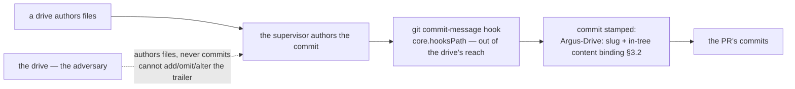

# Argus attribution hardening — the produced, forgery-resistant, positively-established authorship derivation — technical design

| Field | Value |
|---|---|
| **Status** | Draft → Approved *(merge requires Approved; merge is the freezing event; "superseded" is computed by the index, never written here)* |
| **Owner** | @mdarabi |
| **Approver(s)** | @mdarabi (operator) — factory-control / security merge-boundary surface; a named reviewer is mandatory (Security/privacy impact + governance surface) |
| **Date** | 2026-07-13 |
| **Relevant-when** | implementing or changing how the Argus attribution gate *produces*, *authenticates*, or *positively establishes* authorship — the commit-time producer, the forgery-resistance construction, the three-state (positively-Argus / positively-human / underivable) resolution, or the pre-/post-mechanism transition; triaging a defect where a real Argus commit was served as human (a latent/absent signal), a forged or replayed signal flipped the class, a planted human attestation on a positively-Argus diff laundered it (the both-signals collision), or a legitimate human PR to a protected path was refused; superseding the authorship-derivation mechanism |
| **Scope** | How Argus authorship is **produced by construction** on every drive-authored commit (a supervisor/harness commit-time trailer stamp on the repo's own git-hook surface, out of the drive's reach), given **forgery-resistant strength** (the producer is out of the adversary-drive's reach + an in-tree binding of the trailer to the commit's own content that closes replay, all re-derived credential-free at CI), with human authorship **positively established** on the protected subset (a positive attestation trailer via its own single-sourced reader — the three-state resolution under a **positively-Argus-wins precedence** so a drive-plantable human attestation cannot launder a positively-Argus diff; a non-adversarial in-tree committer identity is best-effort disambiguation only, carrying no security weight), and how the gate behaves **across the rollout** (a from-here-forward rule evaluating the PR's own commit range, with the incident-I1 operator-review bootstrap for the one introducing PR). **Not**: the write hook (part 1) or the structure arm (part 2), each its own design; the protected-path classification and the DINV-6 scope-width derivation (unchanged — reused verbatim from the superseded design's §3.2/§3.2.1 and `internal/argus/boundary`); a controlled signing key / signed commits (rejected on the R4 boundary — the operator's to grant); any authority-contract mutation |
| **Tracking** | introducing PR (filed on approval) |
| **Builds-on** | docs/tech-design/argus-artifacts.md · docs/tech-design/argus-agent-v1.md · docs/tech-design/distributed-check-registration.md · docs/tech-design/docgate-v1.md · docs/tech-design/argus-authority-contract-structure-arm.md |
| **Supersedes** | argus-attribution-gate |
| **Serves** | prd:argus-boundary-enforcement/FR-12 · prd:argus-boundary-enforcement/FR-13 · prd:argus-boundary-enforcement/FR-9 · prd:argus-boundary-enforcement/FR-10 · prd:argus-boundary-enforcement/NR-4 · prd:argus-boundary-enforcement/UB-4 · prd:argus-boundary-enforcement/UB-5 · prd:argus-boundary-enforcement/ABUSE-2 · prd:argus-boundary-enforcement/ABUSE-3 · prd:argus-boundary-enforcement/ABUSE-4 · prd:argus-boundary-enforcement/NFR-1 · prd:argus-boundary-enforcement/NFR-2 · prd:argus-boundary-enforcement/NFR-3 |
| **Security/privacy impact** | yes — this gate is the sole merge-boundary fail-closed guarantee for the governance-document and out-of-declared-scope protected-path classes (no structure arm covers those), and it now owns the *produced* and *forgery-resistant* authorship signal on which that guarantee rests. It **produces** the signal via a repo-internal git commit hook (the same `core.hooksPath` surface the shipped desk hooks use) and **verifies** it from in-tree commit metadata via `git`, introducing **no** new egress, identity, secret, credential, or network surface (repo-internal, report-or-refuse-only). A controlled signing key — the only construction reaching outside the repo — is **rejected** (§4), not introduced. · reviewer: @mdarabi |
| **Template version** | tech-design-template/v1 |

## 1. Problem

The frozen `argus-attribution-gate` design gave the attribution gate its verification — a credential-free, in-tree read of an `Argus-Drive` commit trailer, a fail-closed rule on absence, and an author-independent scope derivation — and that verification is sound and shipped (`internal/argus/attribution`). But the boundary-enforcement verification found the gate does not actually bite, for three reasons the amendment (FR-12, FR-13) now contracts closed:

1. **The signal is latent.** The frozen §3.1 *assumed* a producer — "the Argus drive, when it authors a commit, appends an authorship trailer" — but **no such step exists**: the drive authors *files* and prepares proposals; git/PR mechanics are the supervisor's, so nothing stamps the trailer. Real Argus commits carry none, classify as human, and are served — the gate guards a signal that is never emitted.
2. **The signal is only forgery-resistant in *direction*, not in *strength*.** The bare trailer is a plaintext, author-writable line (the frozen §7 Q1, R1, its own honest open question). The frozen design closed the *evade* direction (fail-closed-on-absence) but left the trailer's forgery *strength* — could a misbehaving/injected drive forge, replay, or omit it? — as a carried refinement, which FR-12 now requires *closed*.
3. **Human authorship is inferred from absence, not positively established.** The shipped derivation defines `Human` as *no Argus trailer present* — so stripping the Argus signal on a protected-path diff masquerades as a legitimate human edit. FR-13 now requires the gate to *positively* establish human authorship, so absence can fail closed without ever refusing the legitimate human-author path (NR-4).

This design **supersedes the derivation** to close all three, and it must do so **credential-free and badge-independent at CI evaluation time** (FR-12/AP-14/AP-26 — the shipped read runs with no ambient credential and `commit.gpgsign false`; that must be preserved). It carries the honest-layer split forward unchanged (the write hook is the fast layer; this gate + the structure arm are the unbypassable merge-boundary backstop) and the scope-width derivation unchanged (DINV-6).

**Why now:** Argus is at tier-2 and performs real gate-signing and materialization acts, and this gate is the sole merge-boundary fail-closed backstop for two of the four protected-path classes — so a *produced, forgery-resistant, positively-established* signal is required at the feature's definition of done, not a latent, absence-inferred one. The failure mode this design prevents: a real Argus-authored protected-path change reaching the mainline because no signal was produced (or a stripped one masqueraded as human), while never once refusing a legitimate human PR to the same paths.

## 2. Decision

**Decision:** Argus authorship is **produced by construction** — the commit-authoring actor (the supervisor/harness) stamps the contractual `Argus-Drive: <slug>` trailer on every commit a drive's work is landed as, via a **repo-internal git commit-message hook** on the same `core.hooksPath` surface the shipped desk hooks use; the drive authors files, not commits, so the producer sits **out of the drive's reach** and the model can neither add, omit, nor alter the trailer *(design-brainstorm:argus-attribution-hardening-tech-design#D-1, #ALT-1)*. The signal is given **forgery-resistant strength** from two repo-internal properties, **no new key**: the producer is out of the adversary-drive's reach (so the drive cannot forge/replay/omit), and the trailer carries an **in-tree binding to the commit's own content** (a binding the gate re-derives from the commit via `git`) so a trailer lifted onto a different commit is a detectable replay and derives *underivable* — the residual (a raw-commit-access forger) stays the frozen design's honestly-owned limit, backstopped by fail-closed-on-absence and the author-independent structure arm *(#D-2, #ALT-5)*. Human authorship is **positively established** on the protected subset by a **positive attestation trailer** — the shipped, credential-free `Governing-Change: operator` *pattern* (a single-sourced positive-human reader modeled on `hasOperatorTrailer`, read at the merge base via `git log`; §3.3), with a determinable in-tree committer identity as an explicitly **non-adversarial**, committer-settable best-effort disambiguation only (it carries no forgery-resistance; the primary and sole security-bearing positive-human signal is the attestation trailer). A protected-path diff resolves into the **three FR-13 states** under a **stated precedence — positively-Argus wins**: **a diff that is *both* positively-Argus and positively-human refuses** (the collision case; the positive-human attestation is a plaintext line the drive-influenced commit body can carry, so it can never launder a positively-Argus protected-path diff — §3.3), positively-Argus → refuse (FR-9); positively-human (and *not* positively-Argus) → pass, never refused (NR-4); underivable (neither positive signal) → fail closed (FR-10) *(#D-3, #ALT-7)*. The rollout is **from-here-forward**: the gate evaluates the PR's own commit range (`base..HEAD`, the shipped behavior), so pre-mechanism history is never in range and never retroactively refused, and the producer stamps every drive commit from the mechanism's landing forward, so no latent window remains; the mechanism's own introducing PR is the incident-I1 exception (operator review is its sole backstop) *(#D-4, #ALT-9)*. The **CI read stays exactly as shipped** — a `git` read of in-tree commit metadata, no ambient credential, no mutable badge — and the **scope-width derivation (DINV-6) and protected-path classification are unchanged**, reused verbatim from the superseded design and `internal/argus/boundary`.

A reader who stops here should see the shape: authorship is now a **produced** in-tree artifact (stamped by the supervisor, out of the drive's reach), **content-bound** in-tree so replay is detectable, and **positively three-stated** on the protected subset (positively-Argus / positively-human / underivable) under a **positively-Argus-wins precedence** — so absence fails closed without ever refusing a human, *and* a drive-plantable human attestation can never launder a positively-Argus protected-path diff — verified credential-free exactly as before, superseding only the *derivation* (production + strength + positive establishment), leaving the classification, the scope-width derivation, the fail-closed rule's shape, and the honest-layer split intact.

## 3. The design

### 3.1 The producer — the supervisor stamps the trailer at commit-authoring time, out of the drive's reach

**Decision:** The `Argus-Drive: <slug>` authorship trailer is **produced by the commit-authoring actor** (the supervisor/harness) at the moment it authors a drive's commit, realized as a **repo-internal git commit-message hook** (`prepare-commit-msg`/`commit-msg`-class) on the existing `core.hooksPath` surface; it is keyed on the active drive's slug (the context the supervisor already holds) — never chosen by the model, never hand-added *(design-brainstorm:argus-attribution-hardening-tech-design#D-1)*.

The drive authors files and prepares proposals; git/PR mechanics — commit, push, branch, PR — are the supervisor's (the drive contract and the domain model's `Change`/`WipCheckpoint`). The frozen §3.1 named a producer that did not exist; this design sites it where commits are actually authored:

- **Where.** A git commit-message hook on the same `core.hooksPath` surface the shipped desk hooks already run on (the repo activates it once per clone, exactly as the docs-gate desk hook is activated). When the supervisor authors a drive commit, the hook appends the `Argus-Drive: <slug>` trailer to the commit message's final trailer block — the block the shipped `parseTrailer` reads.
- **Out of the drive's reach.** The drive is the adversary FR-12 names (a misbehaving or injected Argus); it authors files, not commits, so **it never reaches the surface that emits the trailer** — it cannot add a trailer to frame, omit one to evade, or alter one. This is the load-bearing property: *produced by construction* means the model has no say in the signal (FR-12's "never chosen by the model, never hand-added").
- **Keyed on the drive context, not a model choice.** The slug is the active drive's slug — the resolvable drive context the supervisor holds when it authors a drive commit. A commit authored *outside* a drive carries no `Argus-Drive` trailer and derives as human (correct — it is not a drive's landed work). The trailer only *identifies* the driving problem; it never *bounds* the scope (that is the author-independent resolver, §3.3, unchanged).
- **Per-CLI wiring.** Where a commit is authored through an agent CLI's own commit path, the producer is wired via that CLI's `prepare-commit-msg`-class surface as a per-CLI adapter — the canonical stamp authored once on the vendor-neutral surface, each CLI a pointer (AP-25), a new supported path a new adapter file (AP-27). This mirrors the write hook's per-CLI shape and reuses the same "author once, wire per CLI" posture.

### 3.2 The forgery-resistance construction — producer-out-of-reach + an in-tree binding to commit content; credential-free at CI

**Decision:** Forgery-resistant strength comes from **two repo-internal properties, no new key**: the producer is architecturally out of the adversary-drive's reach (§3.1), and the trailer carries an **in-tree binding to the commit's own content** — a binding the gate re-derives from the commit via `git` — so a trailer replayed onto a different commit fails the binding and derives *underivable*. The CI read stays credential-free and badge-independent, exactly as shipped *(design-brainstorm:argus-attribution-hardening-tech-design#D-2)*.

- **The adversary and what the strength must resist.** FR-12 names the adversary precisely: a *misbehaving or injected drive* must not be able to *forge, replay, or omit* the signal to change the derived class. Because the producer is out of the drive's reach (§3.1), the drive **cannot forge or omit** at all. Two residual moves remain to consider — *replay* (lift a real Argus trailer onto a different commit) and *raw forgery* (an actor with commit-authoring access outside the honoring harness writes a bare-looking trailer) — addressed next.
- **The in-tree binding closes replay.** The trailer carries a binding to the commit's own identity (its tree/parent object identity — the exact composite is an implementation refinement, §7 Q2) that the gate **re-derives from the commit itself via `git`** and checks against the trailer. A trailer lifted verbatim from a real Argus commit onto a different commit no longer matches that commit's content, so the binding fails and the diff derives **underivable** — not Argus (never a frame), and on a protected-path diff, fail-closed (never a silent pass). The binding is re-derived *in-tree*, so it adds **no credential** to the read (F-5's constraint preserved).
- **The residual is the frozen design's honestly-owned limit, doubly backstopped.** An actor with *raw* commit-authoring access outside the drive and outside the honoring harness could still hand-write a bare-looking trailer with a correct binding for their own commit. This is the residual the frozen design already owns (§3.1, §7 Q1, R1). It is backstopped in both directions: the **evade/strip** direction by DINV-2 fail-closed-on-absence (a stripped signal on a protected-path diff refuses, never passes as human) **and** by the structure arm, which fails a structurally-illegal authority contract for *any* author (ABUSE-3, closing the authority-contract evade path regardless of the trailer); the **frame** direction by scoping refusal to the Argus∧protected conjunction and by the replay binding. The residual can neither serve a forbidden Argus change (fail-closed) nor durably frame a human (a legal human change passes the structure arm and, on the protected subset, is *positively* established human — §3.3).
- **Why not a signing key.** The only construction that makes the trailer cryptographically unforgeable by *any* commit author is a controlled signing key — and a signing key is placed and rotated by the operator (identity-and-security §28), a **new operator-owned surface**. Choosing it would be a breaking decision this design does not own; it is **rejected on the R4 boundary** (§4, the same line the frozen design held for the code-host badge), and the design records it as the escalation-candidate mechanism it declines to assume. The in-tree binding is the **maximum strength reachable credential-free**, and it is sufficient for FR-12's adversary (the drive) and DOD-11's corpus.

### 3.3 Positive human establishment — the three-state resolution

**Decision:** Human authorship on the protected subset is **positively established** by a **positive attestation trailer** — the credential-free `Governing-Change: operator` *pattern* (a merge-base `git log` read of the attestation trailer), served by **its own single-sourced positive-human reader** distinct from the shipped `hasOperatorTrailer` (which answers a different predicate — see the AP-11 note below and `## Principles`) — with a determinable in-tree committer identity as an explicitly **non-adversarial, committer-settable best-effort disambiguation** carrying **no** forgery-resistance. A protected-path diff resolves into three states under a **stated precedence — positively-Argus wins** — and the gate acts on each *(design-brainstorm:argus-attribution-hardening-tech-design#D-3)*. This **replaces** the frozen `Human = Argus-trailer-absent` inference.

**The precedence is load-bearing, because the positive-human attestation is a drive-plantable signal.** The `Governing-Change: operator` attestation is a **plaintext line the drive-influenced commit body can carry**: the shipped `hasOperatorTrailer` reads it as a whole-body substring over the concatenated commit-body range (`git log --format=%B base..HEAD`, `strings.Contains(…, "Governing-Change: operator")`), and a single-sourced positive-human reader modeled on it inherits the same reach — *attestation, review verifies the claim*, not an unforgeable signal. So unlike the harness-stamped `Argus-Drive` trailer, the positive-human signal is **not out of the drive's reach**: a misbehaving/injected drive can plant it in the very commit body whose files it authored. The **only** thing that keeps this from re-opening the masquerade is the precedence: **on a diff that is *both* positively-Argus and positively-human, positively-Argus wins → refuse** — mirroring the shipped `Argus > Underivable > Human` fold (`fileAuthorship`) and AP-17 (on any ambiguity the gate refuses, never passes). A planted human attestation can therefore **never launder a positively-Argus protected-path diff**: the produced, out-of-reach `Argus-Drive` stamp is present, so the diff is positively-Argus, so it refuses — the planted attestation is inert.

The three states on a diff touching a protected path, resolved **positively-Argus-first**:

| State | Positive signal | Gate action | Serves |
|---|---|---|---|
| **positively-Argus** (incl. the *both-signals collision*) | the `Argus-Drive` trailer, produced + content-bound (§3.1, §3.2) — **evaluated first**, so a diff that is positively-Argus refuses **even when a `Governing-Change: operator` attestation is also present** (a drive-plantable body line cannot launder it) | refuse (classified against the drive's scope) | FR-9, DINV-1, DINV-5 |
| **positively-human** (*and not positively-Argus*) | a positive human-authorship attestation on the protected-path change (the `Governing-Change: operator` pattern, its own single-sourced reader), with **no** produced `Argus-Drive` stamp; a determinable in-tree committer identity is non-adversarial corroboration only | pass — never refused by this gate | NR-4, DINV-5 |
| **underivable** | neither positive signal on a protected-path diff (a stripped/absent Argus trailer, an unverifiable/replayed one, or no positive human attestation) | fail closed — refuse the protected-path subset | FR-10, UB-4, DINV-2 |

- **Precedence, stated: positively-Argus wins on collision.** The states are evaluated positively-Argus-first, not as disjoint alternatives: a produced, content-bound `Argus-Drive` stamp makes the diff **positively-Argus and refuses regardless of any positive-human attestation in the same commit** (DINV-5). This is the tie-break the design's soundness rests on, and it is stated in a binding element rather than left for an implementer to infer — building the positively-human-first order (which would let a planted attestation pass a drive's protected-path write) is **not** permitted. The *frame* direction stays closed independently (a genuine human commit carries no harness-stamped `Argus-Drive`, §3.1), so this precedence closes the *evade* the attestation's drive-plantability would otherwise open.
- **Absence no longer means human.** The masquerade vector was `Human = no Argus trailer`. Under this design, *absence of the Argus signal* on a protected-path diff yields **underivable** (fail closed), not human — a positively-established human signal, *with no positively-Argus signal present*, is what yields *positively-human*. This is what makes the frozen DINV-2 (underivable∧protected ⇒ fail closed) and the open-human-path property (NR-4) **co-satisfiable**: they are consistent only if human is positively derivable on the protected subset, else a real human PR is "underivable" and DINV-2 wrongly refuses it (breaking NR-4).
- **No burden on the human author (FR-13).** For the authority-contract and governance-document protected-path classes, a legitimate human change *already* carries the positive attestation the shipped `check-governing` requires (`Governing-Change: operator`) — so on those classes it is **no new step**. The establishment must not require the human to do anything *beyond what their ordinary protected-path PR already carries* — the attestation trailer is that ordinary artifact.
- **The committer identity is non-adversarial best-effort only (no binding element rests on it).** An in-tree committer identity (`%ae`/`%an`) is itself **committer-settable** (`user.email`/`GIT_AUTHOR_EMAIL`), so against the adversary FR-12 names it carries **no** forgery-resistance and is **not** a second security factor — it is at most a best-effort disambiguation, derived with zero human action, and the *primary and sole security-bearing* positive-human signal is the attestation trailer. Every binding element (DINV-5, the state table, A-4) is therefore **testable on the attestation trailer alone**; the identity read is an implementation option deferred to §7 Q4, never a load-bearing corroboration. (This re-scopes the earlier "corroborating identity" framing per the design-review's FND-2; it net removes weight, breaking nothing.)
- **The positive-human predicate is single-sourced, distinct from `hasOperatorTrailer` (AP-11).** This positive-human establishment answers a **different predicate** than the shipped `hasOperatorTrailer` — *"this protected-path diff is positively human-authored for attribution"* versus *"a governing-doc / gate-policy change is operator-attested"* — and the two will evolve independently (the attribution use needs this section's positively-Argus precedence and the attribution gate's per-file scoping; the governing use is a whole-range substring by design). Per AP-11 (one predicate, one place; twin predicates always diverge), the positive-human read gets its **own single-sourced reader** rather than silently sharing `hasOperatorTrailer`'s implementation for a second meaning; whether it reuses the `Governing-Change: operator` *key* or a sibling human-authorship key is the implementation refinement in §7 Q4 (predicate identity, not key naming). See `## Principles` (AP-11).
- **Outside the protected subset, nothing changes.** The three-state resolution and its fail-closed rule are **scoped to protected-path diffs** — a diff that touches no protected path is never refused for an underivable/absent signal, and a human PR needs no attestation to write non-protected paths. The human-author path to non-protected paths is untouched.

### 3.4 The fail-closed rule and protected-path classification — unchanged in shape, sharpened by positive establishment

**Decision:** The fail-closed rule and the protected-path classification are carried forward from the superseded design unchanged in shape; the only change is that "underivable" is now the *absence of a positive signal* (Argus or human), not the absence of the Argus trailer alone *(design-brainstorm:argus-attribution-hardening-tech-design#D-3; basis FR-10, UB-4; AP-17)*.

- **Fail closed on the protected subset.** A diff touching a protected path whose authorship the gate cannot *positively* establish (no valid Argus signal, no positive human attestation) is **underivable** and refused for the protected-path subset — an unforgeable-away masquerade cannot slip through as human. As before, the rule fires **only** on the protected subset: a non-protected-path diff is never refused for an underivable author.
- **Protected-path classification (unchanged).** The three classes — the **authority contract**, a **governance document**, and a file **outside the drive's declared scope** — are classified exactly as the superseded design's §3.2 and the shipped `internal/argus/boundary` do. The authority-contract and governance classes are fixed path sets (author-independent); the out-of-scope class's *width* is the author-independent DINV-6 derivation (§3.5), unchanged.

### 3.5 Scope integrity (DINV-6) — carried forward verbatim

**Decision:** The out-of-scope boundary's *width* is derived author-independently — from the named problem's gate-protected committed delivery ledger, or, on the problem's first PR, a slug-derived fixed set ∪ a fixed named allowlist — exactly as the superseded design's §3.2.1 and the shipped `internal/argus/boundary` do; this design **does not re-open it** *(design-brainstorm:argus-attribution-hardening-tech-design#O-4)*.

This design hardens the *authorship* derivation (who authored the diff), not the *scope-width* derivation (how wide the named problem's scope is). The scope resolver (`ResolveCommittedLedger` / `ResolveFirstPR`) is reused verbatim: the trailer still only *identifies* the driving problem, and the width is bounded by the committed ledger (which a current drive cannot retroactively widen) or the first-PR slug grammar (which takes no author-controlled same-PR input and admits no code path). DINV-6 and its first-PR operator ruling (problem:argus-boundary-enforcement#A-1) stand. The produced+content-bound trailer *strengthens the identification* the width derivation keys off, but the width derivation itself is untouched.

### 3.6 Composition — a base-requiring CI-run check, unchanged

**Decision:** The gate composes exactly as shipped — a **base-requiring self-registered docgate check** (`NeedsMergeBase: true`) that the docgate umbrella runs in the already-required `docs-gate` CI context (invoked with `--merge-base origin/main`), adding no hand-edited shared enumeration/dispatch/help line *(design-brainstorm:argus-attribution-hardening-tech-design#S-5; the shipped `reg_check_attribution.go`; design:distributed-check-registration)*.

The gate reads the PR's changed files and the PR's commit trailers (via `git`), re-derives each trailer's in-tree content binding (§3.2), resolves each Argus drive's scope author-independently (§3.5), positively establishes human authorship on protected-path diffs (§3.3), classifies, and fails the required context on a refusal. It composes as one self-registered descriptor file (AP-27) and adds **no** new egress or credential — the diff, the commit trailers, the content binding, and the committed delivery ledgers are all in-tree, read locally in CI exactly as the shipped arms read them. The producer half (§3.1) is a git commit hook, a distinct repo-internal surface from the check; neither adds a network/identity/secret surface.

### 3.7 Transition and rollout — from-here-forward, with the incident-I1 bootstrap

**Decision:** The gate evaluates authorship over the PR's own commit range (`base..HEAD`), so pre-mechanism history is never in range and never retroactively refused; the producer stamps every drive commit from the mechanism's landing forward, so no latent window remains; the mechanism's own introducing PR is the incident-I1 exception *(design-brainstorm:argus-attribution-hardening-tech-design#D-4; basis DOD-7, UB-5; incident I1)*.

- **From-here-forward, safe by construction.** The produced signal begins existing at the mechanism's introducing commit. The gate evaluates only the commits *this PR* introduces (the shipped `Evaluate` range `base..HEAD`), so **pre-mechanism history is outside every later PR's range** and is never false-refused. Because the producer (§3.1) stamps every drive commit from the mechanism forward, **there is no latent window** — every post-mechanism drive-authored commit carries the produced, content-bound signal.
- **The one bootstrap exception (incident I1).** The mechanism's *own* introducing PR cannot be gated by the producer+gate it installs (the producer's hook and the gate's derivation do not yet exist at that commit to attribute it). Per incident I1, **operator review is the sole backstop for that one PR**; the introducing PR carries the explicit bootstrap note (basis DOD-7). The gate and producer bind every subsequent PR.
- **No history rewrite.** Retroactively stamping pre-mechanism commits is **not** done — it would rewrite merged history (forbidden, AP-7) and buys nothing, since those commits are outside every future PR's range.
- **Report-then-enforce.** The layer flips from report-only to a required context per the basis's ship rule (§6.5) once its golden corpus is green and its false-refusal rate is 0 — the same posture the other merge-boundary arm takes; the flip is a config/CI change, reversible.

### 3.8 Boundaries and non-goals

- **Not solved here** — the write hook (part 1) and the structure arm (part 2): independently-revisable decisions with their own designs (the honest-layer split; the program decomposition, design-brainstorm:argus-boundary-enforcement-tech-design#D-1). The authority contract's **structural legality** — the structure arm owns that, author-independently; this gate refuses an *Argus-authored* (or, on the protected subset, an underivable-author) authority-contract diff, a complementary catch. The engine-era graduation of this check (basis WR-1).
- **Owned by a future design / the operator** — **stronger-than-credential-free** forgery-resistance (signed commits under a controlled key): the operator's to grant, because it needs a new operator-owned key surface (§4; §7 Q3). A shared declared-scope manifest with the write hook (basis WR-2), decidable only once both layers converge. The engine-era runtime reader.
- **Implementation must not infer** — that authorship comes from a badge or a committing identity verified server-side: it comes from a **produced, content-bound in-tree trailer** (§3.1, §3.2), never a mutable platform/author badge, never a code-host API credential. That "human" means "no Argus trailer": human is **positively established** (§3.3); absence yields *underivable*, not human. That the fail-closed rule refuses non-protected-path diffs: it fires **only** on the protected subset. That the scope-width derivation changed: it is **unchanged** (§3.5, DINV-6). That the gate mutates anything: it reports/refuses, never writes; the producer stamps only the commit message it is authoring.
- **Must remain unchanged** — the credential-free, badge-independent CI **read** (a `git` read of in-tree commit metadata, no ambient credential — the shipped behavior; NFR-1, FR-12's preserved property); the protected-path classification and the DINV-6 scope-width derivation (§3.4, §3.5); the human-author path to protected paths (NR-4; the anti-segment stays served — a *positively-established* human diff passes); every non-protected-path verdict; the authority contract's own content (basis NG-3; the never-list).

### 3.9 Invariants

- **DINV-1** — **Positively-Argus ∧ protected-path ⇒ refuse.** A PR carrying a positively-Argus diff (a produced, content-bound `Argus-Drive` trailer) that touches the authority contract, a governance document, or an out-of-declared-scope file is refused with a reason naming the path and the boundary. (Serves FR-9.)
- **DINV-2** — **Underivable ∧ protected-path ⇒ fail closed.** When authorship cannot be *positively* established for a diff touching a protected path (no valid Argus signal and no positive human attestation — including a stripped, absent, unverifiable, or replayed Argus trailer), that protected-path subset is refused, never passed. (Serves FR-10, UB-4; AP-17.)
- **DINV-3** — **Produced by construction, out of the drive's reach.** The Argus authorship signal is produced by the commit-authoring actor (the supervisor/harness) via a repo-internal git commit hook, on every commit a drive's work is landed as; the drive authors files, not commits, so it can neither add, omit, nor alter the signal — the signal is never chosen by the model and never hand-added. (Serves FR-12, the produced-by-construction property.)
- **DINV-4** — **Forgery-resistant in strength, credential-free at CI.** Against the adversary FR-12 names (a misbehaving/injected drive), the signal cannot be forged or omitted (DINV-3) and a replayed trailer is detected by an in-tree binding of the trailer to the commit's own content re-derived via `git`; the derivation reads **no** mutable badge and needs **no** ambient credential at CI evaluation time. The residual (a raw-commit-access forger) is backstopped by DINV-2 (evade) and the structure arm (authority-contract evade), and the stronger cryptographic construction (a controlled signing key) is deliberately **not** introduced (§4). (Serves FR-12, the forgery-resistant-in-strength + badge-independent/credential-free properties; AP-14, AP-26.)
- **DINV-5** — **Three-state positive establishment under a positively-Argus-wins precedence; human authorship positively established, drive-plantable attestation cannot launder.** On a diff touching a protected path, the gate resolves authorship into exactly three states, evaluated **positively-Argus-first**: positively-Argus (refuse) — **including a diff that is *both* positively-Argus and positively-human, which refuses**, because the positive-human attestation is a drive-plantable commit-body line that must never launder a produced, out-of-reach `Argus-Drive` stamp (mirrors the shipped `Argus > Underivable > Human` fold; AP-17); positively-human *and not positively-Argus* (pass, NR-4); underivable (fail closed). Human authorship is **positively established** by a positive attestation trailer via its own single-sourced positive-human reader (AP-11), never inferred from the absence of an Argus signal, and requiring no extra human step to be recognized as human; a determinable in-tree committer identity is **non-adversarial best-effort disambiguation only** (committer-settable, no forgery-resistance) on which no part of this invariant rests — DINV-5 is testable on the attestation trailer and the precedence alone. (Serves FR-13; NR-4.)
- **DINV-6** — **Scope integrity — unchanged.** The out-of-declared-scope boundary's *width* is derived author-independently — from the named problem's gate-protected committed delivery ledger, or, on the problem's first PR, a slug-derived fixed set ∪ a fixed named allowlist — never from author-controlled same-PR input; carried forward verbatim from the superseded design (§3.5). A current drive cannot retroactively widen any committed ledger; the first-PR grammar admits only that slug's own doc subtree, no code path. (Serves FR-9, FR-12; AP-17; problem:argus-boundary-enforcement#A-1.)
- **DINV-7** — **Report/refuse-only, no new surface.** The gate mutates nothing and adds no new egress, identity, secret, credential, or network surface; the producer stamps only the commit message it authors, on the repo's own git-hook surface, adding no such surface either. Authorship is produced and verified entirely in-tree. (Serves NFR-1.)

### 3.10 Observability

- **Events/logs** — the gate emits the standard defect/refusal record (verb, file, op, reason, remedy): the reason names the citing PR's protected-path file, the boundary class it hit (authority contract / governance doc / out-of-scope), the resolved authorship state (positively-Argus / underivable), and — for the underivable case — that authorship could not be *positively* established on a protected-path diff (a stripped/absent/replayed Argus signal with no positive human attestation). A positively-human protected-path diff emits nothing (not gated). The producer's stamp is observable as the trailer present on the drive-authored commit. The corpus harness records the two instrumentation events the basis names (a refusal of a seeded violation fixture; a pass of a legitimate fixture) as the metric surface.
- **Metrics** — the golden-fixture pass rate in CI is the metric surface (basis M1/M2 — positively-Argus protected-path fixtures refused; positively-human ones passed; underivable/forged/replayed/stripped ones fail closed; **plus** the DOD-10 live-drive-produced-signal fixture refused and the DOD-11 forge/replay/strip corpus red in both directions); no runtime telemetry is added (NFR-1).
- **Alerts** — a red required CI context *is* the alert; no other channel.
- **Debugging surface** — any fixture (a seeded PR whose commit carries / lacks / replays / forges the produced trailer, plus a positively-human-attested control) replays the verdict exactly; a real drive's produced commit (the DOD-10 artifact) replays its own refusal. The verb/file/op triple is the correlation key.
- **Trace/correlation** — none beyond the defect triple; single-process CI check. The trailer's `<slug>` correlates a refusal to the driving problem.

### 3.11 Security & privacy

yes — matches the header row. This gate is the **sole merge-boundary fail-closed guarantee** for the governance-document and out-of-declared-scope protected-path classes (the structure arm covers only the authority-contract path), and it now owns the *produced* and *forgery-resistant* signal that guarantee rests on — which is why a named reviewer is mandatory. What it does **not** introduce: any new identity, permission, secret, credential, network, or egress surface. Authorship is **produced** by a repo-internal git commit hook (the same `core.hooksPath` surface the shipped desk hooks use — no new surface) and **verified** from in-tree commit metadata via `git`, read locally in CI with no ambient credential (the shipped read, preserved). A **controlled signing key** — the only construction reaching outside the repo — is **rejected** (§4), not introduced. The gate **never writes** the authority contract or any protected path (basis NG-3; the never-list); the producer writes only the commit message it is authoring.

**Threat model and mitigations, traced to binding elements:**
- **ABUSE-3 (attribution forgery / DoS), the sharpened form.** An attacker spoofs a diff's authorship to appear human (evade), or frames a human as Argus (false-refusal DoS). **The producer being out of the drive's reach (DINV-3) removes the drive — the adversary FR-12 names — as a forger/omitter entirely.** The *evade* direction: a stripped/absent/replayed Argus trailer on a protected-path diff is **underivable ⇒ fail closed** (DINV-2), never served as human; the in-tree content binding (DINV-4) makes a replayed trailer detectable; the structure arm independently fails a structurally-illegal authority contract regardless of author, closing the authority-contract evade path. **The planted-attestation evade — decisive here:** the positive-human signal (`Governing-Change: operator`) is a **drive-plantable commit-body line** (the shipped `hasOperatorTrailer` is a whole-body substring match, §3.3), so a drive could plant it on the very commit its files produced; the **positively-Argus-wins precedence (DINV-5)** closes this — a diff carrying a produced `Argus-Drive` stamp is positively-Argus and refuses *regardless of any planted attestation*, so a drive-plantable human signal can never launder a positively-Argus protected-path diff. The *frame* direction: refusal is scoped to positively-Argus ∧ protected, the replay binding rejects a lifted trailer, and a legitimate human is now **positively established** (DINV-5) on the attestation alone, so a forged Argus trailer cannot durably deny a human whose own change is positively-human/structurally-legal. The residual (a raw-commit-access forger with a correctly-bound trailer) is the honestly-owned limit; the stronger cryptographic construction (a signing key) is rejected on the R4 boundary (§4), not assumed.
- **ABUSE-3′ (widen-your-own-scope via a self-named broader problem slug — and its first-PR variant), unchanged.** Mitigated by DINV-6 scope integrity, carried forward verbatim (§3.5): the out-of-scope width is the committed ledger (un-widenable by a current drive) or the first-PR slug grammar (no author-controlled input, no code path). Unchanged by this hardening; the produced+bound trailer only strengthens the *identification* the width derivation keys off.
- **ABUSE-2 (injection-steered write).** Injected content steers Argus to write a protected path. The injection posture (data, never obeyed) is the first line; this gate is the mechanical backstop — a positively-Argus protected-path diff is refused (DINV-1), and because the producer is out of the drive's reach (DINV-3), the injected drive cannot even suppress its own attribution to slip through as human (it would be underivable ⇒ fail closed, DINV-2). A planted directive in a commit body or diff cannot steer the gate's structural verdict (trailer presence + content binding + protected-path classification). **Nor can a planted *attestation string* launder the write:** an injected drive that plants `Governing-Change: operator` in its own commit body does not thereby pass — the produced `Argus-Drive` stamp is present, so the diff is positively-Argus, and the positively-Argus-wins precedence (DINV-5) refuses it regardless of the planted attestation (the vector the design-review's FND-1 named is owned by the precedence, not left to the structural verdict).
- **ABUSE-4 (out-of-band bypass).** A bypass writes a protected path out-of-band to evade the write hook. This gate is the unbypassable backstop — the write reaches the PR either as a positively-Argus diff (refused, DINV-1) or, if the producer's trailer is absent (the write did not go through the honoring commit path), as an underivable-author diff on a protected path (refused fail-closed, DINV-2). No desk bypass escapes CI.

### 3.12 Failure modes

| Failure | System behavior | Detection | Recovery |
|---|---|---|---|
| a real drive-authored commit is landed | the producer (the supervisor's commit hook) stamps the `Argus-Drive` trailer by construction (DINV-3); a protected-path Argus diff is then refused (DINV-1) | the CI refusal on the produced signal (DOD-10) | revert the protected-path change; a human lands any legitimate authority/governance change by their own (positively-human) PR |
| a protected-path diff carries no positive signal (stripped/absent Argus trailer, no human attestation) | underivable ⇒ refused for the protected-path subset — fail closed (DINV-2) | the CI refusal naming the underivable-author case | restore the produced signal, or land the change as a positively-established human PR |
| a positively-established human PR touches a protected path (positively-human, *no* `Argus-Drive` stamp) | **not refused** by this gate (DINV-5) — the structure arm still requires an authority-contract change to be structurally legal | no refusal from this gate | none — the human-author path is open by design |
| a drive plants a `Governing-Change: operator` attestation on the same commit whose files it authored (a **both-signals collision** — positively-Argus ∧ positively-human) | the produced `Argus-Drive` stamp makes it **positively-Argus**, and the positively-Argus-wins precedence **refuses** it regardless of the planted attestation (DINV-5) — the planted human signal is inert and cannot launder the diff | the CI refusal on the produced signal (naming the positively-Argus protected-path case) | revert the protected-path change; a human lands any legitimate change by their own PR (which carries no harness-stamped `Argus-Drive`) |
| a trailer is **replayed** (lifted from a real Argus commit onto a different commit) | the in-tree content binding fails to re-derive (DINV-4) ⇒ the diff is underivable; on a protected-path diff, fail closed (DINV-2) | the CI refusal | author the change through the honoring commit path (the producer stamps a correctly-bound trailer) or land it as a positively-human PR |
| a trailer is **forged** by the drive | impossible by construction — the drive authors files, not commits, and never reaches the producer surface (DINV-3) | n/a (the vector is closed at the producer) | n/a |
| a trailer is **forged** by an actor with raw commit-authoring access outside the harness | the honestly-owned residual (§3.2) — backstopped by DINV-2 (evade) and the structure arm (authority-contract evade); the stronger signing-key construction is rejected on the R4 boundary (§4) | the structure arm / fail-closed refusal for the covered directions | the residual is stated, not worked around; §7 Q3 carries the operator-owned stronger construction |
| the gate's / producer's own introducing PR (neither exists yet to attribute or gate it) | operator review is the sole backstop for that one bootstrap PR (incident I1); the producer + gate bind every subsequent PR | the introducing PR's explicit bootstrap note (basis DOD-7) | none — the I1 exception is stated |

### 3.13 Testing strategy

The acceptance spine is the shipped seeded-PR golden-fixture corpus (a real git fixture per case, built commit-by-commit — the local-substitutable seam, a real `git` read of a real commit graph, never a mock), extended with the amendment's two new proof obligations. The seams under test and their bins:

- **the producer (the commit-time stamp)** — *local-substitutable*: a fixture that authors a commit **through the producer hook** and asserts the `Argus-Drive` trailer is present by construction (not hand-added) — the DOD-10 live-produced-signal proof: a genuine end-to-end drive of a protected-path write is refused *by the gate on its produced signal*, proving the signal is actually produced, not assumed.
- **the forgery-resistance construction** — *in-process / local-substitutable*: the DOD-11 corpus — a **forged** trailer (the drive cannot reach the producer, so the forge vector is a raw-commit fixture) does not flip a human diff to Argus (framing → the binding/scoping reject it); a **replayed** trailer (lifted onto a different commit) fails the in-tree binding and derives underivable; a **stripped** trailer on a protected-path diff is underivable ⇒ fail closed — the class does not flip in either direction (never Argus→human to evade, never human→Argus to frame).
- **the three-state positive establishment (incl. the both-signals collision)** — *in-process / local-substitutable*: a positively-Argus protected-path diff is refused; a **positively-human** (attested) protected-path diff passes (0 human-authored protected-path PRs refused — DOD-11's no-false-refuse half and NR-4); an absent-both-signals protected-path diff is underivable ⇒ fail closed; a non-protected-path underivable diff is not refused; **and — the collision fixture (FND-1) — a protected-path commit that carries *both* a produced `Argus-Drive` stamp *and* a planted `Governing-Change: operator` attestation in its body is *refused*, not passed** (positively-Argus wins the precedence; DINV-5), proving a drive-plantable human attestation cannot launder a positively-Argus protected-path diff.
- **the credential-free CI read** — *local-substitutable*: the derivation runs with a scrubbed environment carrying no credential and `commit.gpgsign false` (the shipped harness), and the in-tree binding re-derivation adds none.
- **the scope-width derivation (unchanged)** — *in-process*: the committed-ledger (a broader-slug trailer does not widen against a merged ledger) and first-PR slug-grammar fixtures (the slug's own doc subtrees + the fixed allowlist pass; a code path and any same-PR self-attributed target are out) — carried forward verbatim.
- **composition + non-regression** — *inspection / in-process*: the gate self-registers as one descriptor adding no shared line; every non-protected-path verdict is unchanged.

No true-external dependency exists (production is a repo-internal git hook; verification is an in-tree `git` read); a code-host API and a signing key are deliberately **not** dependencies (the rejected badge, ALT-4 of the superseded design, and the rejected signing key, §4).

## 4. Alternatives considered

| Alternative | Why rejected |
|---|---|
| **Keep the frozen derivation (a bare trailer, no producer, absence-inferred human)** | this is the state FR-12/FR-13 supersede: the signal is latent (no producer — the frozen §3.1 assumed one that does not exist), only forgery-resistant in *direction* not *strength* (the frozen §7 Q1), and human is inferred from absence (the masquerade). The amendment requires all three closed. |
| **Signed commits under a controlled signing key (cryptographic forgery-resistance)** *(design-brainstorm:argus-attribution-hardening-tech-design#ALT-6)* | the strongest construction (unforgeable by *any* commit author), but a controlled signing key is **placed and rotated by the operator** (identity-and-security §28) — a **new operator-owned identity/secret surface**, precisely the R4 escalation condition. **Rejected on the R4 boundary, not assumed** — the same line the frozen design held for the code-host badge; the design records it as the escalation-candidate mechanism the operator may grant if stronger-than-credential-free strength is later required (§7 Q3). The producer-out-of-reach + in-tree-binding construction is the maximum credential-free strength and suffices for FR-12's adversary (the drive) and DOD-11's corpus. |
| **Derive authorship from the committing identity / a code-host badge** *(design-brainstorm:argus-attribution-hardening-tech-design#ALT-3; the superseded design's ALT-4)* | a commit-author identity / platform badge is **mutable** (AP-26) and server-side verification needs a **code-host API credential in CI** — a new ambient credential / outward surface (the R4 breaking condition), and it couples the gate to one code host (AP-1/AP-25). Rejected on both design grounds and the R4 boundary; the repo-internal produced trailer needs no such surface. |
| **Retroactively stamp / rewrite pre-mechanism history** *(design-brainstorm:argus-attribution-hardening-tech-design#ALT-10)* | rewrites merged history (forbidden, AP-7) and is unnecessary — pre-mechanism commits are outside every future PR's evaluated range (`base..HEAD`), so they are never refused; the from-here-forward rule (§3.7) is safe by construction. |
| **Produce the trailer in the drive (the model appends it)** | the drive is the adversary FR-12 names — a signal the model chooses to add is one it can choose to omit or forge (the latent + forgeable gap itself); FR-12 requires "produced by construction, never chosen by the model." The producer must sit at the commit-authoring actor, out of the drive's reach (§3.1). |
| **Bundle this into the write hook / structure arm designs** | three independently-revisable §2 decisions in one document (RW-5; the conventions' anti-pattern) — the program decomposition (design-brainstorm:argus-boundary-enforcement-tech-design#D-1) keeps them separate; this design supersedes only the attribution *derivation*. |

## 5. Risks

| ID | Risk | Impact | Mitigation | Verification / evidence |
|---|---|---|---|---|
| R1 | the producer does not fire on some commit-authoring path → a real Argus commit lands un-attributed (the latent gap returns on a path) | a forbidden Argus protected-path change is served as human on that path | the producer is the commit-authoring actor's hook on the repo's own `core.hooksPath` surface (DINV-3), wired per commit-authoring path (per-CLI where a CLI authors the commit, AP-25/AP-27); DOD-10 proves a **live** drive-produced signal is refused (not a hand-seeded fixture); a commit that reaches the PR *without* the produced trailer on a protected path is underivable ⇒ fail closed (DINV-2), so an un-stamped path fails safe, not open | DOD-10 live-produced-signal fixture (A-1); fail-closed-on-absent fixture (A-2) |
| R2 | the forgery-resistance is over-claimed as cryptographic when it is not (the residual raw-commit-access forger) | a false sense the trailer is unforgeable by anyone | the design states the honest limit plainly (§3.2, DINV-4, §3.12): strength holds against the drive (out of reach) and closes replay (in-tree binding), credential-free; the residual is backstopped by DINV-2 + the structure arm; the stronger signing-key construction is **rejected on the R4 boundary** (§4), the operator's to grant (§7 Q3) — never claimed here | the DOD-11 forge/replay/strip corpus red (A-3); §3.2 honest-limit prose; §4 rejection |
| R3 | a false-refusal fights legitimate authorship (a human PR to a protected path is refused, or a human is framed as Argus) | a DoS on the operator or a human author; the anti-segment breach | human authorship is **positively established** (DINV-5) — a positively-human protected-path diff passes (NR-4), and absence yields underivable (not a wrong refusal of a *positively-established* human); the in-tree binding rejects a framing replay; the basis M2 guardrail blocks adoption on any false refusal; the positive attestation is no new burden (the shipped `Governing-Change: operator` artifact, §3.3) | positively-human protected-path fixture passes (A-4); framing fixture does not refuse (A-3) |
| R4 | assumption (delivery:argus-attribution-hardening#E-12..E-15): every chosen mechanism (the commit-hook producer, the producer-out-of-reach + in-tree binding, the positive attestation trailer, the from-here-forward transition) requires **no new grant, no new outward surface, and moves no operator-owned boundary** — so it is R4-legal and no breaking escalation is owed at this design | mis-judged R4 (a mechanism smuggling a new credential/egress/key past the escalation condition) | tested by the absence of any credential/egress/identity/permission/key change (§3.11) — production is a repo-internal git hook, verification is an in-tree `git` read + a re-derived in-tree binding, positive-human is the shipped in-tree attestation trailer; the two mechanisms that *would* break R4 — a controlled signing key (§4) and a code-host identity/badge (§4) — are **rejected, not assumed**; had a stronger mechanism needing a new surface been the only viable one, the design stage would have emitted a decision brief and parked (it did not — R4 did not fire) | §3.11 shows no new surface; A-5 credential-free + no-new-surface inspection; the design-brainstorm gate's R4-did-not-fire record |
| R5 | the bootstrap PR (neither producer nor gate exists yet to attribute/gate it) merges an Argus-authored protected-path change | the one PR that installs the mechanism is ungated by it | operator review is the stated sole backstop for that one PR (incident I1); the introducing PR carries an explicit bootstrap note (basis DOD-7); the producer + gate bind every subsequent PR (§3.7) | the introducing PR's bootstrap note (A-6) |
| R6 | the scope-width derivation (DINV-6) is mistakenly treated as re-opened by this hardening | a re-litigation of a settled decision / a regression in scope integrity | this design **reuses** the scope resolver verbatim (§3.5) and does not change DINV-6; the width remains the committed ledger / first-PR grammar (author-independent), unchanged; the hardening strengthens only the *authorship* identification the width keys off | the carried-forward scope fixtures pass unchanged (A-7); §3.5 states the reuse |

## 6. Acceptance

| ID | Acceptance criterion | Verify | Required evidence | Traces to |
|---|---|---|---|---|
| A-1 | a **live drive-produced** commit (authored through the producer hook, not a hand-seeded trailer) that touches a protected path is refused **by the gate on its produced signal** — proving the signal is produced by construction, out of the drive's reach, not assumed | Test | the live-drive artifact (the drive-authored commit) + the gate's refusal on it in CI | prd:argus-boundary-enforcement/FR-12 · /DOD-10 · §3.1 · #DINV-1 · #DINV-3 |
| A-2 | an authorship-underivable fixture (absent/stripped Argus trailer, no positive human attestation) touching a protected path is **refused** (fail closed for the protected-path subset); a determinable positively-human one to the same path is not; a non-protected-path underivable diff is not refused | Test | fail-closed fixture report | prd:argus-boundary-enforcement/FR-10 · /UB-4 · §3.3 · §3.4 · #DINV-2 |
| A-3 | a **forged / replayed / stripped** signal on a protected-path diff does **not flip the derived class** in either direction — no forged signal makes a human diff derive as Argus (framing → the in-tree binding + Argus∧protected scoping reject it), no stripped/replayed signal makes an Argus protected-path diff derive as human (masquerade → fail closed); **and the *both-signals collision* (FND-1): a protected-path commit carrying *both* a produced `Argus-Drive` stamp *and* a planted `Governing-Change: operator` attestation is *refused*, not passed** (positively-Argus wins the precedence — a drive-plantable human attestation cannot launder a positively-Argus protected-path diff); the class does not flip | Test | the forge/replay/strip + both-signals-collision fixture corpus red at the gate | prd:argus-boundary-enforcement/FR-12 · /FR-13 · /DOD-11 · /ABUSE-3 · §3.2 · §3.3 · #DINV-2 · #DINV-4 · #DINV-5 |
| A-4 | on the legitimate corpus, **0** positively-human PRs to protected paths are refused by this gate; a positively-human (attested, *and not* positively-Argus) protected-path diff passes, with no extra human step required — the pass rests on the **attestation trailer alone** (the in-tree committer identity is non-adversarial best-effort only, carries no forgery-resistance, and no acceptance rests on it) | Test | legitimate-corpus fixture report | prd:argus-boundary-enforcement/FR-13 · /NR-4 · §3.3 · #DINV-5 |
| A-5 | the derivation runs in the CI deployment context with **no ambient credential** and reads **no** mutable badge (it reads in-tree commit trailers + re-derives the in-tree content binding via `git`); the producer adds **no** new egress/identity/secret/credential/network surface (it is a repo-internal git commit hook); a controlled signing key is not introduced | Test + Inspection | CI-context run (no credential) + a security/no-new-surface inspection of the producer and the read | prd:argus-boundary-enforcement/FR-12 · /NFR-1 · §3.11 · #DINV-4 · #DINV-7 |
| A-6 | the gate composes as one self-registered check adding no hand-edited shared line; the introducing PR states the incident-I1 bootstrap exception (neither producer nor gate can gate its own introducing PR; operator review is the backstop for that one PR); the gate evaluates the PR's own commit range so pre-mechanism history is never refused | Inspection + Test | descriptor file + umbrella diff; the introducing PR's bootstrap note; a pre-mechanism-history fixture not refused | prd:argus-boundary-enforcement/UB-5 · /NFR-3 · §3.6 · §3.7 · incident I1 |
| A-7 | the scope-width derivation is **unchanged** — the committed-ledger fixture (a broader-slug trailer does not widen against a merged ledger) and the first-PR slug-grammar fixtures (the slug's own doc subtrees + the fixed allowlist pass; a code path and any same-PR self-attributed target are out) pass exactly as before; a positively-Argus out-of-scope diff is refused | Test | the carried-forward scope-integrity fixture report | prd:argus-boundary-enforcement/FR-9 · §3.5 · #DINV-6 |

## 7. Open questions

| ID | Question | Owner | Blocks | Status | Resolution |
|---|---|---|---|---|---|
| Q1 | The exact commit-hook class and per-CLI wiring surface of the producer (a `prepare-commit-msg` vs `commit-msg` hook; which supported commit-authoring paths get an adapter) | implementation | nothing (the direction — a repo-internal commit-time stamp on the existing hook surface, out of the drive's reach, authored once and wired per path — holds) | open | decided at implementation against each commit-authoring path (§3.1) *(design-brainstorm:argus-attribution-hardening-tech-design#G-1)* |
| Q2 | The precise in-tree binding form (what commit identity the trailer binds to — tree hash, parent SHA, or a composite — and its exact encoding) | implementation | nothing (the direction — a credential-free re-derivable binding that closes replay — holds) | open | decided at implementation against the replay fixtures; the *property* (a re-derivable-in-tree binding that fails on a lifted trailer) is fixed (§3.2, DINV-4) *(design-brainstorm:argus-attribution-hardening-tech-design#G-2)* |
| Q3 | Whether **stronger-than-credential-free** forgery-resistance (signed commits under a controlled key) is ever warranted — a construction that needs a new operator-owned key surface | operator | nothing (the credential-free construction is the answer for now; the signing key is rejected on the R4 boundary, §4) | open | the operator's to grant if stronger strength is later required; deliberately **not** assumed here (a new operator-owned surface — R4) *(design-brainstorm:argus-attribution-hardening-tech-design#G-4)* |
| Q4 | The positive-human predicate's exact key and per-class applicability — a *predicate-identity* question, not mere key naming (AP-11): its **own single-sourced reader** is fixed (§3.3), and this Q settles whether that reader reuses the `Governing-Change: operator` key or a sibling human-authorship key, and which protected-path classes rely on the attestation; whether to add the non-adversarial committer-identity disambiguation at all is an implementation option under this Q (nothing binding rests on it — FND-2) | implementation | nothing (the direction — a positive attestation trailer, its own single-sourced reader, with the positively-Argus-wins precedence and no new burden — holds) | open | decided at implementation; the *property* (positive human establishment, three states under positively-Argus-precedence, no extra human step, attestation-alone-testable) and the *own-single-sourced-reader* (AP-11) are fixed (§3.3, DINV-5) *(design-brainstorm:argus-attribution-hardening-tech-design#G-3)* |

## Principles

- **AP-10 — honored.** A prompt-and-review-deep boundary — and, worse, a *latent* signal nothing produced — becomes a signal **produced by construction** at the commit-authoring surface plus a mechanical, three-state author-scoped refusal and golden fixtures. Codify over prompt: the authorship signal is no longer something the model must remember to emit (which it could omit or forge); it is structure the harness produces out of the model's reach.
- **AP-13 — honored.** Authorship is a **produced, content-bound, verified in-tree artifact** (the stamped trailer + the in-tree binding re-derived from the commit), not a claimed status, and the verdict is verified against the golden corpus — including the DOD-10 *live-produced* proof (a real drive's signal, not a hand-seeded fixture) and the DOD-11 forge/replay/strip corpus.
- **AP-14 — honored.** Acceptance is the executed fixture corpus, and the derivation runs in the CI **deployment context with no ambient credential** — a `git` read of in-tree commit metadata plus an in-tree binding re-derivation, never a code-host API call and never a signing credential (the shipped read, preserved; `commit.gpgsign false`).
- **AP-17 — honored.** Fail closed on the policy surface: a protected-path diff whose authorship cannot be *positively* established (absent/stripped/replayed signal, no positive human attestation) is refused — the fail-closed guarantee sits at the merge boundary, and absence now yields *underivable*, not a masquerading "human". Additive on the safe side — a non-protected-path diff and a positively-human PR are unaffected.
- **AP-26 — honored.** Authorship (as a *security* signal) is derived from the commit's own **content** (the produced trailer + the in-tree binding + the attestation trailer), **never** from a mutable platform/author badge or a committing identity — the badge-and-server-verified-identity alternative is rejected precisely because a mutable status certifies only the medium's object, not authorship. A committer identity, being committer-settable, is admitted at most as **non-adversarial best-effort disambiguation** (no binding element rests on it — §3.3, FND-2), never as a forgery-resistant factor.
- **AP-25 — honored.** The producer's canonical stamp is authored once on the vendor-neutral surface and wired per commit-authoring path by pointers/adapters (never forked content); the derivation is repo-internal and code-host-neutral — onboarding a new code host adds no attribution rewrite, and a controlled signing key (which would couple to an operator-owned surface) is rejected.
- **AP-23 / AP-27 — honored.** The gate is a single-file self-registered descriptor adding no shared line; the producer is a new hook/adapter file per commit-authoring path — parallel additions merge cleanly, the central registry is derived.
- **AP-7 — honored.** The supersession evolves the frozen `argus-attribution-gate` design by a **new document citing the old** (never an edit); the transition rewrites **no** merged history (pre-mechanism commits are outside every PR's evaluated range, so no back-fill is attempted).
- **AP-6 — noted.** The authorship trailer and the positive attestation trailer are contractual, documented in-tree signals (stable keys), not free-form text the gate guesses at. **AP-24 — noted.** The gate enforces human-authored governing boundaries (the never-list, the protected-path set); it regenerates nothing.
- **AP-11 — honored.** *One predicate, one place.* The positive-human establishment (§3.3) answers a **distinct predicate** from the shipped `hasOperatorTrailer` — *"this protected-path diff is positively human-authored for attribution"* versus *"a governing-doc / gate-policy change is operator-attested"* — and the two evolve independently (the attribution use needs the §3.3 positively-Argus precedence and the attribution gate's per-file scoping; the governing use is a whole-range substring by design). Because twin predicates always diverge, this design gives the positive-human read its **own single-sourced reader**, not a silent second consumer of `hasOperatorTrailer`; §7 Q4 settles the predicate-identity refinement (own key vs the shared `Governing-Change: operator` key), never a shared implementation for two meanings. (Raised by the design-review's FND-3; the omission is now closed.)
- **RW-5 — honored.** One decision — how Argus authorship is *produced, made forgery-resistant, and positively established* at the merge boundary — in one document, superseding the derivation; the write hook and the structure arm remain independently-revisable decisions in their own designs (the program decomposition, design-brainstorm:argus-boundary-enforcement-tech-design#D-1).
- **Deviation:** none.
