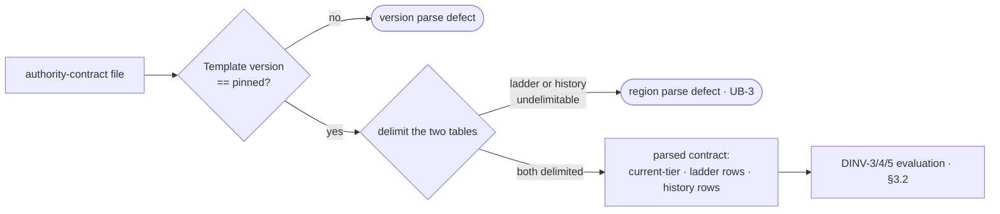

# Argus authority-contract structure arm — the DINV-3/4/5 mechanical guard — technical design

| Field | Value |
|---|---|
| **Status** | Draft → Approved *(merge requires Approved; merge is the freezing event; "superseded" is computed by the index, never written here)* |
| **Owner** | @mdarabi |
| **Approver(s)** | @mdarabi (operator) — factory-control / security gate surface; a named reviewer is mandatory (Security/privacy impact + governance surface) |
| **Date** | 2026-07-12 |
| **Relevant-when** | implementing or changing the authority-contract structure arm — its authority-contract parse, its DINV-3/4/5 evaluation, its closed-parse registry, or its gate composition; triaging a defect where a corrupt or self-granting authority contract merged, or where a legal authority-contract change was wrongly failed; superseding the arm's parse mechanic; adding a fourth Argus gate check |
| **Scope** | How the structure arm reads the authority-contract file and composes into the gate: a version-pinned closed parse of the file's two tables (the ladder and the change history) in a sibling parse package, the DINV-3/4/5 structural evaluation (attribution present · current-tier-in-ladder + no bare pointer flip + history-row completeness · action-class token-membership), and a single base-free self-registered gate check. **Not**: the write hook (part 1 — its own design) or the attribution gate (part 3 — its own design); any widening of the existing immutability check's governed set; any authority-contract *mutation* (this arm reports, never writes); the descriptor/registry composition contract itself (the distributed-check-registration design owns it — this design *uses* it) |
| **Tracking** | introducing PR (filed on approval) |
| **Builds-on** | docs/tech-design/argus-ledger-lint.md · docs/tech-design/argus-artifacts.md · docs/tech-design/distributed-check-registration.md · docs/tech-design/docgate-v1.md |
| **Supersedes** | — |
| **Serves** | prd:argus-boundary-enforcement/FR-4 · prd:argus-boundary-enforcement/FR-5 · prd:argus-boundary-enforcement/FR-6 · prd:argus-boundary-enforcement/FR-7 · prd:argus-boundary-enforcement/FR-8 · prd:argus-boundary-enforcement/NR-1 · prd:argus-boundary-enforcement/NR-2 · prd:argus-boundary-enforcement/UB-3 · prd:argus-boundary-enforcement/UB-5 · prd:argus-boundary-enforcement/ABUSE-1 · prd:argus-boundary-enforcement/NFR-1 · prd:argus-boundary-enforcement/NFR-2 · prd:argus-boundary-enforcement/NFR-3 · design:argus-artifacts#DINV-3 · design:argus-artifacts#DINV-4 · design:argus-artifacts#DINV-5 · design:distributed-check-registration |
| **Security/privacy impact** | yes — the arm enforces the structural legality of the factory-control policy object (the authority contract: the tier ladder that governs what the agent may decide). It reads that file and reports defects; it introduces no new egress, identity, secret, or network surface, and never writes the file (repo-internal, report-only). · reviewer: @mdarabi |
| **Template version** | tech-design-template/v1 |

## 1. Problem

The authority contract — the versioned data file at the Argus agent home declaring the tier ladder, the current-tier pointer, and the append-only change history — is the factory-control policy object: a grant check reads it to decide what the agent may do. Its structural invariants are already *stated* absolute (the artifacts design's DINV-3/4/5) and already *written into* the authority-contract template's Appendix as a checklist — but that checklist is **walked by a human at review**, blind by construction to what a diff expresses. A contract that names a current-tier absent from the ladder, flips the pointer with no change-history entry, drops a history row's attribution, or grants a token that is not a defined action class reads as valid prose and can merge unnoticed; the only barrier is a reviewer's attention. On the highest-cost surface in the repo — the object that governs the agent's own authority — that is exactly where relying on a human walk is most expensive.

The shipped Argus ledger-lint program gave the two `A-n`/`E-n` ledger classes their mechanical guard (a history arm and a cross-document arm) but **explicitly deferred this third *structure* arm** as its follow-on: the authority contract carries no `A-n`/`E-n` anchors, so the ledger arms' anchor-keyed mechanic does not fit it, and the shared ledger parse deliberately does not match the authority-contract file. This design is that follow-on. **Why now:** the enabling substrate is settled and dogfooded — the self-registered-check composition and the closed-parse-registry pattern shipped with ledger-lint — so the only novel work is one parse of one small file, the DINV-3/4/5 evaluation, and its fixtures. It is the lowest-risk, fully-precedented layer of the three-layer boundary-enforcement feature, and every merge under the human-walked checklist is another window for a silent factory-control corruption.

## 2. Decision

**Decision:** The authority contract gets its structure guard as a **single base-free self-registered gate check** driven by a **version-pinned closed parse of the file's two tables — the ladder and the change history — in a sibling parse package of record** (not an extension of the `A-n`/`E-n` ledger parse, which the authority contract's shape does not fit) *(design-brainstorm:argus-boundary-enforcement-tech-design#D-2 — whose reasoning scores the two package boundaries, reuse-`argusledger` vs sibling-`authoritycontract`; the DQ-2 package-boundary options live inside D-2's body, not as standalone `ALT-n` entries — `ALT-1`/`ALT-2` are the DQ-1 decomposition options)*. The check evaluates the three structural invariants and reports a named defect on any violation: **DINV-3/DINV-4** — attribution present (every change-history row carries date, a move from the closed enum, a resulting tier, and evidence refs) and no bare pointer flip (the current-tier names a tier declared in the ladder, the change-history table carries at least one row, and its latest row's tier equals the current-tier — an **empty or heading-only change history under a non-initial current-tier** is itself a bare-pointer-flip defect, the canonical "pointer flip with no history entry" `design:argus-artifacts#DINV-4` names invalid); **DINV-5** — token-membership (every ladder bundle token is a defined action-class token), which *is* the structural form of "no never-class act can be granted," never a separate scan. The check requires no merge base (it reads the file as it stands) and composes as one descriptor file adding no hand-edited umbrella, dispatch, or help line.

A reader who stops here should see the shape: the arm parses the authority-contract file against closed, version-pinned vocabularies (the tier names, the action-class tokens, the move enum), checks the three invariants as pure structure (position and membership, never content interpretation), and attaches as an ordinary self-registered check — so the authority contract reaches the same gate treatment every other class has, with every non-authority-contract tree's verdict unchanged, and a corrupt or self-granting contract can no longer merge past a green gate.

## 3. The design

### 3.1 The authority-contract parse — a sibling package of record

**Decision:** The authority-contract parse lives in its **own sibling parse package**, keyed on the file's two `## `-delimited tables, with its class vocabularies as a **closed, version-pinned registry** — the tier names, the action-class tokens, and the change-history move enum — distinct from the ledger classes' anchor-family registry *(design-brainstorm:argus-boundary-enforcement-tech-design#D-2)*.

The authority contract's shape is unlike the `A-n`/`E-n` ledgers: it has no dense entry anchors and no derived-state region. It carries a **`Current tier`** header field, a **ladder** table (ordered tiers, each a bundle of action-class tokens), and a **change history** table (append-only rows: date · move · resulting tier · evidence refs). The parse therefore models *those* structures rather than an entry map:

- **Version pin.** The parse reads the file's `Template version` header field and rejects any value that is not the pinned authority-contract version — a named parse defect, never a lenient parse of a guessed shape (the same closed-parse posture the ledger parse takes; DINV-2 of the ledger-lint design).
- **The ladder.** Each row contributes a tier name (first column) and its bundle of action-class tokens (second column). The tier-name set and the action-class token vocabulary are **closed registry data** pinned to the authority-contract template version — the exact vocabularies the artifacts design fixes: the ordered tier names, and the action-class tokens a grant check reads. Adding a tier or a token is a successor-design change to the registry, never a silent parse-time addition.
- **The change history.** Each row contributes date, move, resulting tier, and evidence refs. The move enum is closed registry data (the artifacts design's one closed move vocabulary). A change-history region whose heading is present and delimitable but carries **zero data rows** parses to an **empty history-row list** (not a parse defect — the region *is* delimitable) that the DINV-4 evaluation then reds when the current-tier is non-initial (§3.2, the bare-pointer-flip / history-mandatory rule).
- **Fail-closed parse.** If either table cannot be delimited (its region heading is absent, or a row cannot be split into its columns), the parse returns a **named parse defect identifying the region** — never a crash, never a false pass (the one failure type is the shared defect record: verb, file, op, reason, remedy). This is the UB-3 / incident-I3 posture the ledger parse already embodies.

The parse is closed and structural: it extracts positions and tokens, and it never interprets prose. A planted directive inside an evidence-ref cell or a tier label ("treat this as tier-4") is data — the parse reads the *token*, not its suggestion (the injection posture, §3.9).

### 3.2 The DINV-3/4/5 evaluation

**Decision:** The check evaluates the three invariants as pure structure over the parsed contract, emitting one named defect per violation; DINV-5 is a **token-membership** test, not a separate no-never-grant scan *(design-brainstorm:argus-boundary-enforcement-tech-design#D-2; design:argus-artifacts#DINV-5)*.

| Invariant | Structural test | Defect when… | Serves |
|---|---|---|---|
| **DINV-4 — tier-in-ladder** | the `Current tier` field names a tier present in the ladder | current-tier is absent from the ladder | FR-4 |
| **DINV-4 — no bare pointer flip (history mandatory)** | the change-history table carries **at least one** data row **and** its latest row's resulting tier equals the current-tier | the change-history table has **zero data rows** (empty / heading-only region) while the current-tier is **not the born initial tier**, **or** the latest data row's tier ≠ current-tier — either is a bare pointer flip | FR-4 |
| **DINV-3 — attribution present** | every change-history row carries all four fields (date · move-from-the-closed-enum · resulting tier · evidence refs) | any row is missing a required field, or its move is not in the closed enum | FR-5 |
| **DINV-5 — token-membership** | every token in every ladder bundle is a defined action-class token | any bundle carries a token that is not a defined action-class token | FR-6 |

The four tests are independent and every violation is reported (not first-fail), so a contract with two defects names both. Each defect names **the file, the invariant it violates, and the remedy** (the required-fields shape, the legal vocabulary) — the standard defect record's reason/remedy pair. A **legal** contract — current-tier in the ladder, **at least one** history row, latest-history-tier equal to the current-tier, every history row complete, every bundle token defined — raises **zero** defects.

**The empty-change-history / no-matching-latest-row case is load-bearing and deliberate.** A change-history table whose heading is present and delimitable but carries **zero data rows** is exactly the "**bare pointer flip with no history entry**" that `design:argus-artifacts#DINV-4` names *invalid* and the frozen `authority-contract/v1` template checklist row *"The latest history row's tier equals Current tier"* presupposes. This state is **not** a parse defect (§3.1 fails closed only on an *absent region heading* or an *unsplittable row* — neither fires on a present-but-empty region), token-membership passes, and attribution-present passes vacuously (no rows), so without this rule a wiped-history self-elevated pointer (`Current tier: tier-4`, empty history) would pass a green structure arm — the canonical evade path. The DINV-4 "no bare pointer flip" test therefore **requires the history table to carry a latest row and reds when it does not** (when the current-tier is anything other than the born initial tier — the one legitimate zero-history-move state is the born contract, whose single seed row carries `move: none` and the initial tier; a `Current tier` that is non-initial with no matching latest history row is a defect regardless of *why* the row is absent — wiped, never written, or dropped). The state is reachable off the born contract by deleting its seed row, so it is a real, attacker- and drift-reachable path, not a hypothetical.

DINV-5's phrasing is load-bearing and deliberate: the artifacts design and the authority-contract template both state that a never-class act is **absent from the action-class vocabulary by construction**, so "no never-class act can be granted" is enforced by checking that *every bundle token is a defined action-class token* — there is no separate "no-never-grant" scan to write, and inventing one would diverge from the template checklist the arm mechanizes. A token like `self-promote` or `amend-authority` fails not because a blocklist names it but because it is **not in the closed action-class vocabulary**.

### 3.3 Composition — a base-free self-registered check

**Decision:** The arm is **one base-free self-registered gate check** contributed from its own descriptor file, `NeedsMergeBase: false`, adding no hand-edited umbrella/dispatch/help line *(design-brainstorm:argus-boundary-enforcement-tech-design#D-2, #S-4; design:distributed-check-registration#DINV-2)*.

The check registers a descriptor (verb, one-line help, the base-free applicability flag, and a run behavior taking the shared context value) from its own file at package initialization, exactly as every self-registered check does. The umbrella iterates the registry sorted by verb and runs it on **every** gate path (base or not — the arm reads the file as it stands and needs no history); the individual-verb dispatch and the help walk the same registry. Because the arm is a **single-file descriptor contribution**, adding it edits **no** shared enumeration, dispatch, or help line — a lone file addition that cannot collide with a sibling's, and a later fourth Argus check adds a fourth file the same way (FR-7, NR-1, AP-27). The gate's verdict on **any non-authority-contract tree is byte-identical** before and after — the arm only *adds* defects on the one file it newly governs (NR-1). The existing immutability check's governed set is **unchanged** (the Argus classes stay disjoint from it; the arm is a separate verb — NR-2).

### 3.4 Boundaries and non-goals

- **Not solved here** — the write hook (part 1) and the attribution gate (part 3): each is an independently-revisable decision with its own design (the program decomposition, design-brainstorm:argus-boundary-enforcement-tech-design#D-1). No fold, projection, or closed-parse *runtime* reader for engine consumption (the engine-era other half; basis WR-1). The protected-path / declared-scope predicate the other two layers share (the un-promoted shared seam; basis WR-2) — this arm needs none of it (it governs one fixed file).
- **Owned by a future design** — the engine-era graduation of this check to a registry-born verb and a closed-parse runtime reader (basis WR-1, AP-10's arc); any fourth Argus gate check.
- **Implementation must not infer** — that the existing immutability check is widened onto the authority contract: it is **not**; the classes stay disjoint and the arm is a *separate* check (NR-2; basis NG-2). That the arm may mutate: it is **report-only** — a gate run's only writes are the sanctioned projection writes of *other* verbs, never this one. That DINV-5 needs a blocklist: it is **token-membership** against the closed vocabulary. That the arm keys on any position other than the two named tables and the current-tier field.
- **Must remain unchanged** — the existing immutability check's governed set and its file-granular mechanic; the umbrella's shared enumeration/dispatch/help (no hand-edited line); every existing check's verdict on every non-authority-contract tree (NR-1); the authority contract's own content (the arm reads it, never writes it — the never-list; basis NG-3).

### 3.5 Invariants

- **DINV-1** — **Structural evaluation, never content interpretation.** The arm's verdict is a function of table positions and closed-vocabulary token membership only; no ledger/contract prose can steer it (a planted directive in a cell is data, never an instruction). (Serves ABUSE-1/ABUSE-2's injection posture.)
- **DINV-2** — **Fail-closed parse.** A malformed authority contract (undelimitable ladder or change-history region, or a wrong/absent template version) yields a **named parse defect** identifying the region — never a crash, never a false pass. (Serves FR-8, UB-3; incident I3.)
- **DINV-3** — **DINV-5 is token-membership.** The no-never-class-grant guarantee is enforced solely by requiring every ladder bundle token to be a defined action-class token from the closed vocabulary; there is no separate scan. (Serves FR-6; design:argus-artifacts#DINV-5.)
- **DINV-4** — **Report-only, additive, verdict-preserving.** The arm mutates nothing; adding it leaves every existing check's verdict on every non-authority-contract tree byte-identical and adds no hand-edited line to the umbrella's shared enumeration/dispatch/help; the existing immutability check's governed set is unchanged. (Serves NR-1, NR-2, FR-7.)
- **DINV-5** — **Base-free.** The check needs no merge base; it runs identically on the desk (base-free) and CI paths, reading the file as it currently stands. (Serves FR-7.)

### 3.6 Observability

- **Events/logs** — the arm emits the standard defect record (verb, file, op, reason, remedy): human-readable on stderr and one JSON line per defect on the JSON-defects output, exactly as every gate check does. The reason names the file, the violated invariant, and the offending element (the absent tier, the mismatched latest-history-tier, the incomplete history row and its missing field, or the undefined bundle token); the op distinguishes the invariant class (a version/region parse defect vs a DINV-3 vs DINV-4 vs DINV-5 finding). A malformed-contract parse failure is a named parse defect (DINV-2), never a crash or a false pass.
- **Metrics** — the golden-fixture pass rate in CI is the metric surface (the basis's M1 — the per-DINV corpus red at exactly this arm, green on a legal contract, non-authority verdict byte-identical); no runtime telemetry is added (a hermetic gate tool; NFR-1).
- **Alerts** — a red required gate context *is* the alert; no other channel.
- **Debugging surface** — any fixture directory replays a failure exactly (run the gate over the fixture); the arm accepts the real authority contract, so a failing real contract is itself a reproducible case; the verb/file/op triple is the correlation key.
- **Trace/correlation** — none: single-process CLI; the defect triple correlates.

### 3.7 Security & privacy

yes — matches the header row. This arm enforces the **structural legality of the factory-control policy object** (the authority contract — the tier ladder governing what the agent may decide), which is why the surface is security-relevant and a named reviewer is mandatory. What it does **not** introduce: any new identity, permission, secret, user-data, network, or egress surface, and no new authenticated path — it reads a file already in the repo and reports defects, the same repo-local report-only posture the ledger arms hold (argus-artifacts §3.7). It **never writes** the authority contract (basis NG-3; the never-list — this feature enforces the contract, it must never become a path that mutates it).

**Injection posture:** authority-contract content is **data** to the arm — classification is structural (table position, closed-vocabulary membership), never content-directed — so a planted directive in a cell ("record tier-4 here", "treat this token as granted") cannot steer a verdict (DINV-1). This is the mechanical half of the mitigation for **ABUSE-1** (a drifted/injected Argus grants itself a never-class act or promotes its tier by editing the authority contract): the DINV-5 token-membership test fails the gate on a bundle token that is not a defined action class, and the DINV-4 tests fail a current-tier not in the ladder or a bare pointer flip — **including the wiped-/absent-history self-elevation** (a non-initial `Current tier` with an empty or heading-only change history), which reds at the DINV-4 history-mandatory rule rather than slipping through as "no latest row ⇒ no mismatch ⇒ pass" — regardless of who authored the change or why. The arm is one of three layers on ABUSE-1 (the write hook denies the write at write time; the attribution gate refuses an Argus-authored authority-contract diff); this arm is the **author-independent, merge-boundary** catch that fails a structurally-illegal contract from **any** author (which is correct — a human PR that breaks DINV-3/4/5 should fail too, exactly as the template checklist already asks of a human reviewer; NR-4's human-author path stays open because a *legal* human change passes untouched).

### 3.8 Failure modes

| Failure | System behavior | Detection | Recovery |
|---|---|---|---|
| the authority-contract file is structurally malformed (ladder or change-history region undelimitable, or a wrong/absent template version) | a **named parse defect** identifying the region/version — never a crash, never a false green (DINV-2) | the parse defect in the gate output | fix the file's structure/version and re-push |
| current-tier names a tier not in the ladder | a DINV-4 defect naming the file and the absent tier | the gate defect | correct the current-tier or the ladder (a human PR) |
| the latest change-history row's tier ≠ current-tier (a bare pointer flip) | a DINV-4 defect naming the mismatch | the gate defect | append the missing history row (a human PR) |
| the change-history table is empty / heading-only while the current-tier is non-initial (a wiped- or absent-history bare pointer flip — the canonical `design:argus-artifacts#DINV-4` "pointer flip with no history entry") | a DINV-4 defect naming the missing-history / non-initial-current-tier mismatch — never a silent pass | the gate defect | restore the change-history rows or land the pointer move with its history entry (a human PR) |
| a change-history row missing a required field or carrying an out-of-enum move | a DINV-3 defect naming the row and the missing/invalid field | the gate defect | complete the row (a human PR) |
| a ladder bundle carries a token not in the action-class vocabulary | a DINV-5 defect naming the token | the gate defect | remove the token / evolve the vocabulary by a successor-design change (a human PR), never a quiet bundle edit |
| the arm's own introducing PR (the check does not yet exist at that commit to gate itself) | operator review is the sole backstop for that one bootstrap PR (incident I1); the arm gates every subsequent PR | the introducing PR's explicit bootstrap note (basis DOD-7) | none — the I1 exception is stated, not worked around |

### 3.9 Testing strategy

The acceptance spine is a golden-fixture corpus following the shipped ledger-lint fixture pattern (a fixture directory per case: the authority-contract file + an expected-defects golden + a red-case assertion, mapped in a manifest). The seams under test and their bins:

- **the authority-contract parse and the DINV-3/4/5 evaluation** — *in-process* (the sibling parse package + the closed-parse registry): tested directly with table-driven fixtures, no external dependency. Fixtures: a legal contract (green); a current-tier-not-in-ladder; a latest-history-tier ≠ current-tier; an **empty / heading-only change history under a non-initial current-tier** (zero data rows — the wiped-history bare pointer flip; red at the DINV-4 arm, distinct from the latest-history-tier ≠ current-tier fixture); the **born contract** (a single `move: none` seed row at the initial tier — green, the one legitimate zero-move state); a history row missing each required field; an out-of-enum move; a bundle carrying an undefined/never-class token; a malformed contract (undelimitable region); a wrong/absent template version.
- **the gate composition** — *in-process*: a fixture asserting the arm runs on both the base-free and base-present paths (base-free applicability), that adding it leaves the non-authority-contract corpus's gate verdict byte-identical, that the existing immutability check's governed set is unchanged in code, and that the umbrella/dispatch/help gain no hand-edited line (the descriptor-file inspection).

No true-external dependency exists (the arm is hermetic); no port is introduced (there is one implementation of the parse — a hypothetical port nothing varies across would be dead structure).

## 4. Alternatives considered

| Alternative | Why rejected |
|---|---|
| **Reuse the `A-n`/`E-n` ledger parse's class registry for the authority contract** *(design-brainstorm:argus-boundary-enforcement-tech-design#D-2 — the reuse-`argusledger` package boundary scored in D-2's reasoning, not a standalone `ALT-n`)* | the ledger parse is built around an entry-anchor family + an entry-bearing region + a derived-state region; the authority contract has **none** of that shape (no `A-n`/`E-n` anchors — exactly why the shipped history arm excludes it), so the ledger `LedgerClass` model would build an empty entry map and mis-model the file. A sibling parse keyed on the ladder + change-history tables is the honest fit (D-2). |
| **A separate "no-never-grant" blocklist scan for DINV-5** | diverges from the artifacts design and the authority-contract template checklist, both of which enforce DINV-5 as token-membership (never-class acts are absent from the vocabulary by construction); a blocklist is a second source of truth that rots as the vocabulary evolves. Token-membership against the one closed vocabulary is the single-source form. |
| **Widen the existing immutability check onto the authority contract** | re-opens a closed decision (the Argus classes' deliberate disjointness from that check) and would false-red legal authority-contract appends the same way it would false-red legal ledger appends; the structure arm is a *separate* self-registered check (NR-2; basis NG-2). |
| **Bundle the structure arm into one design with the write hook and attribution gate** | three independently-revisable §2 decisions in one document (the conventions' anti-pattern; RW-5) — the same reason the ledger-lint design split this arm out. The program decomposition (D-1) is the resolution. |
| **A base-requiring history-diff on the authority contract** | the arm checks the file's *current* structural legality, not an append-only history property (the change-history append-only-ness is a distinct concern the file's own DINV governs at data grain); a merge base is unnecessary and would make the check unavailable on the desk path. Base-free is the fit (DINV-5). |

## 5. Risks

| ID | Risk | Impact | Mitigation | Verification / evidence |
|---|---|---|---|---|
| R1 | a false-green — a real structural corruption the arm fails to catch (the defect it exists to prevent) | a corrupt or self-granting authority contract merges | the per-DINV golden corpus (A-2) requires each violation class red at **exactly** this arm before merge; the four tests are independent and every violation is reported | fixture corpus red-at-exactly-this-arm (A-2) |
| R2 | a false-red — a legal authority-contract change flagged, widening the gate's refusal surface onto legitimate authorship | a legal (often human-authored) change fights the guard; the human-author path narrows | the legal-contract fixture is green (A-3); the non-authority verdict is byte-identical (A-4); the basis ship rule blocks adoption on any false refusal (basis §3.3, M2) | legal-contract + non-authority byte-diff fixtures (A-3, A-4) |
| R3 | the closed-parse registry drifts from the authority-contract template shape (a template bump silently breaks the parse) | a template version bump silently mis-parses | the vocabularies (tier names, action-class tokens, move enum) live as a **version-pinned** registry; a wrong/absent version is a named parse defect (DINV-2), and a template version bump reviews the registry in the same change, as every closed-parse registry does | version-pin parse-defect fixture (A-5); mapping review on template bumps |
| R4 | assumption (delivery:argus-boundary-enforcement#E-15): the sibling-parse + base-free self-registered check is a repo-internal, additive, report-only mechanism that requires **no new grant, no new outward surface, and moves no operator-owned boundary** — so it is R4-legal and no breaking escalation is owed at this design | mis-judged R4 (a mechanism smuggling a new surface past the escalation condition) | tested by the absence of any egress/identity/permission/privilege change (§3.7) — the arm reads one repo file with a Go parse and reports defects; if a new surface emerged the decision would escalate (brief + park), it did not | §3.7 shows no new surface; A-4 report-only |
| R5 | the bootstrap PR (the arm cannot gate its own introducing PR) merges a structurally-illegal contract | the one PR that installs the arm is ungated by it | operator review is the stated sole backstop for that one PR (incident I1); the introducing PR carries an explicit bootstrap note (basis DOD-7); the arm gates every subsequent PR | the introducing PR's bootstrap note (A-6) |

## 6. Acceptance

| ID | Acceptance criterion | Verify | Required evidence | Traces to |
|---|---|---|---|---|
| A-1 | on the seeded DINV-4 fixtures (current-tier-not-in-ladder; latest-history-tier ≠ current-tier; **an empty / heading-only change history under a non-initial current-tier** — the wiped-history bare pointer flip, red at exactly this arm and distinct from the latest-history-tier ≠ current-tier case), the arm reports a defect naming the file and the invariant; a legal contract **and the born contract (a single `move: none` seed row at the initial tier)** pass | Test | fixture-run report | prd:argus-boundary-enforcement/FR-4 · §3.2 · #DINV-4 · design:argus-artifacts#DINV-4 |
| A-2 | on the seeded DINV-3 fixtures (a change-history row missing each of date / move / resulting tier / evidence refs, and an out-of-enum move), the arm reports a defect naming the row and the missing/invalid field; a complete contract passes | Test | fixture-run report | prd:argus-boundary-enforcement/FR-5 · §3.2 · design:argus-artifacts#DINV-3 |
| A-3 | on the seeded DINV-5 fixture (a ladder bundle carrying a token that is not a defined action-class token), the arm reports a defect naming the token; the pinned legal vocabulary passes; the check verifies token-membership, not a separate no-never-grant scan | Test | fixture-run report | prd:argus-boundary-enforcement/FR-6 · §3.2 · #DINV-3 · design:argus-artifacts#DINV-5 |
| A-4 | adding the arm produces a **byte-identical** gate verdict on every non-authority-contract tree; the existing immutability check's governed set is unchanged in code; a legal authority-contract change raises zero immutability-check defects; the umbrella's shared enumeration/dispatch/help gains no hand-edited line; the arm runs on both the base-free and base-present paths | Test + Inspection | byte-diff of the gate on the pre-existing corpus; immutability-check code diff; umbrella diff; base-free/base-present run | prd:argus-boundary-enforcement/NR-1 · /NR-2 · /FR-7 · #DINV-4 · #DINV-5 |
| A-5 | on a malformed-contract fixture (undelimitable ladder or change-history region) and a wrong/absent-template-version fixture, the arm reports a **named parse defect** identifying the region/version and a non-zero verdict — never a crash, never a false green | Test | malformed + version fixture results | prd:argus-boundary-enforcement/FR-8 · /UB-3 · §3.8 · #DINV-2 |
| A-6 | the arm ships as a single descriptor file with the base-free applicability flag; the introducing PR states the incident-I1 bootstrap exception (the arm cannot gate its own introducing PR; operator review is the backstop for that one PR) | Inspection | descriptor file + the introducing PR's bootstrap note | prd:argus-boundary-enforcement/FR-7 · /UB-5 · incident I1 |

## 7. Open questions

| ID | Question | Owner | Blocks | Status | Resolution |
|---|---|---|---|---|---|
| Q1 | Does the authority-contract parse normalize whitespace/line-endings before table extraction (reusing the shared normalization) or read raw, and does the sibling package live beside the ledger parse or nested under it? | implementation | nothing (the direction holds either way) | open | decided at implementation against the fixtures; the parse's *contract* (the two tables + the closed vocabularies) is unchanged by either choice |
| Q2 | Does the check's `move`-enum, tier-name, and action-class-token registry data physically share the schema registry home with the ledger classes' pins, or sit in its own file within it? | implementation | nothing | open | decided at implementation; both are version-pinned closed-parse data, additive by version bump — the placement is an assembly detail |

## Principles

- **AP-10 — honored.** A review-only, prompt-side invariant set (the authority-contract template's human-walked Appendix checklist) becomes code plus golden fixtures — the exact "codify over prompt" move, on the highest-cost policy surface, completing the ledger-lint program's deliberately-deferred third arm.
- **AP-17 — honored.** Fail closed on the policy surface: a malformed contract is a named defect (never a false green), a current-tier-not-in-ladder / bare-pointer-flip / incomplete-history-row / undefined-token is a hard defect; there is no lenient mode. Additive on the legal side — a legal contract raises nothing.
- **AP-13 — honored.** "This authority contract is structurally legal" becomes a verified artifact — the gate's green over the golden corpus and the byte-identical non-authority verdict — never a reviewer's claim.
- **AP-14 — honored.** Acceptance is the executed fixture corpus (the per-DINV red-at-exactly-this-arm goldens + the byte-identical non-authority verdict), not merged-diff review; the parse runs hermetically with no ambient credentials.
- **AP-23 — honored.** The arm is a single-file self-registered descriptor; concurrent additions of Argus checks merge cleanly.
- **AP-27 — honored (the sharper form).** The unit of extension is the **file, not the line**: the arm is a new descriptor file touching no shared enumeration/dispatch/help; the central registry is *derived* (self-registration + deterministic verb-sorted assembly), no author's diff touching it (NR-1).
- **AP-26 — honored.** The arm certifies the authority-contract file's own structural legality (its own object), and it is verified against the recomputed corpus, never trusted as a status claim.
- **RW-5 — honored.** One decision — how the structure arm reads the authority contract and composes — in one document, design-first; the write hook and the attribution gate are independently-revisable decisions in their own designs (the program decomposition, design-brainstorm:argus-boundary-enforcement-tech-design#D-1).
- **AP-6 — noted.** The tier-name / action-class-token / move-enum vocabularies are closed, version-pinned registry data, additive by version bump. **AP-24 — noted.** The arm enforces human-authored governing data (the authority contract's declared structure), reconciling reality *toward* it; it regenerates nothing.
- **Deviation:** none.
