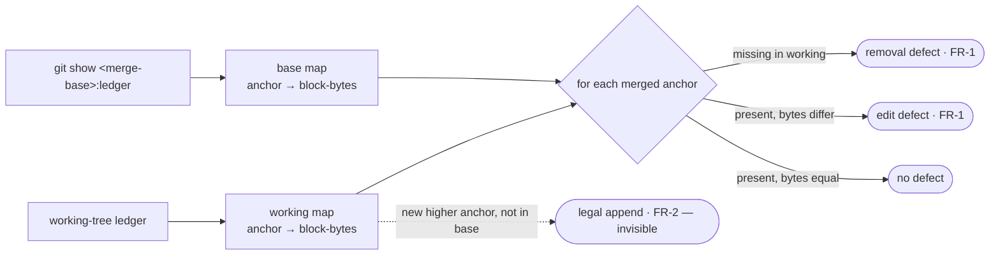
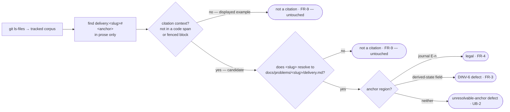

# Argus ledger lint — the two-arm mechanical guard for the ledger classes — technical design

| Field | Value |
|---|---|
| **Status** | Draft → Approved *(merge requires Approved; merge is the freezing event; "superseded" is computed by the index, never written here)* |
| **Owner** | @mdarabi |
| **Approver(s)** | @mdarabi (operator) — factory-control gate surface, named reviewer mandatory |
| **Date** | 2026-07-11 |
| **Relevant-when** | implementing or changing the Argus ledger-lint checks (the **history arm** and the **cross-document arm**), their diff-granularity or citation-resolution mechanics, their corpus enumeration, or their `docgate gate` composition; triaging a defect in mechanical enforcement of the ledger invariants (a corrupted append-only ledger merging unnoticed; a downstream doc citing a delivery ledger's derived-state block); superseding either arm's mechanic; adding the third *structure* arm (WR-1) |
| **Scope** | How the two Argus ledger-lint arms read a ledger and compose into `docgate gate`: the history arm's **entry-block-by-anchor** append-vs-edit comparison against the merge base (DINV-1/DINV-2 of argus-artifacts), the cross-document arm's **`git ls-files` corpus scan** + **delivery-ledger region resolution** under the FR-9 recognition boundary (DINV-6), both as self-registered repo-wide `docgate` checks in one per-class package, report-only. **Not**: the third *structure* arm (DINV-3/4/5 + the templates' checklists — WR-1, its own design); any fold, projection, or closed-parse *runtime* reader for engine consumption; any widening of `check-immutable`'s governed set; the descriptor/registry composition contract itself (distributed-check-registration owns it — this design *uses* it). |
| **Tracking** | introducing PR (filed on approval) |
| **Builds-on** | docs/tech-design/docgate-v1.md · docs/tech-design/docgate-v2.md · docs/tech-design/distributed-check-registration.md · docs/tech-design/argus-artifacts.md |
| **Supersedes** | — |
| **Serves** | prd:argus-ledger-lint/FR-1 · prd:argus-ledger-lint/FR-2 · prd:argus-ledger-lint/FR-3 · prd:argus-ledger-lint/FR-4 · prd:argus-ledger-lint/FR-5 · prd:argus-ledger-lint/FR-6 · prd:argus-ledger-lint/FR-7 · prd:argus-ledger-lint/FR-8 · prd:argus-ledger-lint/FR-9 · prd:argus-ledger-lint/NR-1 · prd:argus-ledger-lint/NR-2 · prd:argus-ledger-lint/NR-3 · prd:argus-ledger-lint/UB-1 · prd:argus-ledger-lint/UB-2 · prd:argus-ledger-lint/UB-3 · prd:argus-ledger-lint/NFR-1 · prd:argus-ledger-lint/NFR-2 · design:argus-artifacts#DINV-1 · design:argus-artifacts#DINV-2 · design:argus-artifacts#DINV-6 |
| **Security/privacy impact** | none — a repo-local, report-only gate check over markdown already in the repo; no identity, secret, user-data, network, or egress surface, and no new authenticated path (argus-artifacts §3.7). The only subprocess is `git` against the local clone, as `check-immutable`/`check-links` already run. |
| **Template version** | tech-design-template/v1 |

## 1. Problem

The Argus ledger classes — `problem-ledger`, `delivery-ledger`, `authority-contract` — are the only document classes with **no mechanical gate guard**. Their sole protection is the templates' per-file structure checklists walked by a human at review (argus-artifacts §3.6, §3.8). That guard is blind, *by construction*, to two invariants the classes already declare absolute:

1. an **edited or removed previously-merged append-only entry** (`A-n`/`E-n`) — because append-only-ness is a property of **git history**, not of the file as it currently stands: a merged entry whose body, anchor, or numbering is quietly changed, or which is deleted, reads as valid structure (DINV-1, DINV-2);
2. a downstream document that **cites a delivery ledger's regenerable derived-state block** — because that is a **cross-document** relationship and the block is defined never-citable (DINV-6): a citation resolving into the derived region rather than a journal `E-n` is invisible to any single-file check.

Both are silent corruption paths that can merge unnoticed and break the audit, resume, and measurement guarantees every other part of Argus builds on these files. argus-artifacts shipped the classes with their guard **explicitly deferred** as open question Q-1 — they "live outside [`check-immutable`'s] governed set until the Q-1 lint gives them their own mechanical guard." The merged PRD (`prd:argus-ledger-lint`, FR-1..FR-9) resolves *what* the guard is (two arms); it hands the *how* — the append-vs-edit diff grain (its Q1), the anchor-into-region resolution mechanics, and the corpus-read assembly (P-1..P-3) — to this design. **Why now:** the enabling architecture (docgate-v1's check-as-function + `gate` umbrella; distributed-check-registration's self-registered descriptors) is settled and dogfooded (sixteen checks self-register today), so the only novel work is the two check bodies and their fixtures — the cheapest moment, and every drive that runs without the guard is another window for silent corruption.

## 2. Decision

**Decision:** Give the Argus ledger classes their Q-1 mechanical guard as **two self-registered `docgate` checks composed under the existing `docgate gate` umbrella, sharing one per-class parse package, both report-only** *(design-brainstorm:argus-ledger-lint-tech-design#D-1)*. The **history arm** (base-requiring) parses each in-scope ledger at the merge base and the working tree into a map of **`anchor → entry-block bytes`** and requires every *previously-merged* `A-n`/`E-n` anchor to survive present-and-byte-identical — a changed block is an edit, an absent one a removal, and a new higher-numbered anchor is an invisible legal append *(#D-2, #D-3)*. The **cross-document arm** (base-free) enumerates the **tracked corpus via `git ls-files`**, recognizes an in-scope `delivery:<concrete-slug>#<anchor>` citation only when `<concrete-slug>` names an existing `docs/problems/<concrete-slug>/delivery.md` (the FR-9 recognition boundary), and resolves the anchor against a version-pinned parse of the delivery-ledger's two regions — into a journal `E-n` (legal), the derived-state region (DINV-6 defect), or neither (a distinct unresolvable-anchor defect) *(#D-4, #D-5)*.

A reader who stops here should see the shape: the history arm reads *history* at **entry grain** (finer than `check-immutable`'s file grain, which cannot tell a legal same-file append from an illegal edit), the cross-document arm reads the *tracked corpus* and classifies a **resolved** citation by **region**, and both attach as ordinary self-registered checks (`NeedsMergeBase` true / false), adding **zero shared-line edits** — so the ledger classes reach byte-for-byte the same umbrella/desk/CI treatment every other class has, with every non-ledger tree's verdict unchanged.

## 3. The design

### 3.1 The history arm — entry-block comparison keyed by anchor

**Decision:** The history arm compares **entry-block bytes keyed by the entry anchor** between the merge base and the working tree, never at file granularity *(design-brainstorm:argus-ledger-lint-tech-design#D-2, #ALT-1)*.

The arm's in-scope files are exactly the two `A-n`/`E-n`-bearing ledger classes — the `A-n`-bearing problem ledgers (`docs/problems/*/problem.md`) and the `E-n`-bearing delivery ledgers (`docs/problems/*/delivery.md`) under the problems root (argus-artifacts §3.1–§3.2). The **authority contract is deliberately *not* in the history arm's set**: its append-only change history is a table of `checkpoint` entries — date · `move` · resulting `tier` · evidence refs (argus-artifacts §3.3) — which carry **no `A-n`/`E-n` anchors**, so this arm's anchor-keyed mechanic would build an empty map and enforce nothing on it; the append-only-ness of the authority contract (its DINV-4 no-bare-pointer-flip / history-mandatory property) is the parked **third *structure* arm's** concern (WR-1; §3.5, PRD NG-4), out of this design. This matches the Scope row ("DINV-1/DINV-2 of argus-artifacts" — the two ledger classes) and §3.6 DINV-1 ("every `A-n`/`E-n` entry"). For each in-scope file the arm builds two maps of `anchor → block-bytes`, where a *block* is the entry from its `### <anchor>` heading up to the next entry delimiter (or the region/file end), and `<anchor>` is the dense `A-n`/`E-n` identifier:

- the **base map** — from the file's content at the merge base (`git show <merge-base>:<path>`, the same shell family `check-immutable` uses);
- the **working map** — from the working tree.

Classification, per previously-merged anchor `k` in the base map:

| Base has `k` | Working has `k` | Bytes equal | Verdict |
|---|---|---|---|
| yes | yes | yes | untouched — no defect |
| yes | yes | no | **edit defect** (FR-1) — body/anchor content changed |
| yes | no | — | **removal defect** (FR-1) — merged entry deleted or renumbered away |

An anchor present **only** in the working map, strictly higher-numbered than every merged anchor of its family, is a **legal append** (FR-2) — invisible to the comparison, which iterates the *base* anchors. Renumbering a merged `E-3` to some other id presents as `E-3` **absent** → removal defect; moving or re-ordering a merged entry likewise disturbs its anchor→bytes survival; changing its body presents as **changed** → edit defect. FR-1's "body, anchor, numbering, or presence" quartet is thereby covered by the single survival predicate *(#D-3)*. The comparison **ignores the delivery ledger's `## Derived state` region entirely** — that region legally changes on every append (DINV-6, regenerated), so it is never part of the merged-entry maps.



Text normalization before the byte compare is an implementation refinement carried as an open question (Q1), not a binding element here.

### 3.2 The cross-document arm — corpus scan and citation-into-region resolution

**Decision:** The cross-document arm enumerates the corpus as **`git ls-files`** (the tracked set), and classifies a citation only after resolving it into an **existing** ledger *(design-brainstorm:argus-ledger-lint-tech-design#D-4, #ALT-5 · #D-5)*.

**Corpus.** The arm reads every tracked document (`git ls-files`, filtered to text) — FR-9's "every tracked document in the repo," which `git ls-files` *is* by definition. Gitignored scratch (the render dir, build artifacts) and untracked WIP are excluded by construction — an untracked file cannot be a real citation source, and scanning regenerable/untracked bytes is an own-corpus false-red vector.

**Recognition (the FR-9 boundary).** Recognition is a two-stage gate — a **citation context** the occurrence must sit in, then **target resolvability** of its slug — and only an occurrence passing *both* is an **in-scope citation**, a candidate for FR-3/FR-4/UB-2 classification.

1. **Citation context (the scan span).** The arm finds `delivery:<slug>#<anchor>` occurrences **only in genuine prose citation contexts**, excluding any occurrence inside a fenced code block (a ` ``` `-delimited region) or an inline-code/backtick span — exactly as the sibling base-free repo-wide scanner `check-links` already treats the corpus (`reg_check_links.go`: a `fenced` toggle on ` ``` ` lines and a `stripCodeSpans` pass per line before target extraction, so a link written in backticks is not a link occurrence). The same convention makes a `delivery:` string written in backticks not a **citation occurrence** at all: it is an author displaying the *string* (a documented example, a grammar illustration, a defect-message literal), not citing a ledger. This is load-bearing for green-on-own-corpus, because the feature's own governing prose writes its self-referential `delivery:<concrete-slug>#…` examples exactly this way — inside backtick spans (e.g. this design, the PRD's §4.4 scenario, and the stage-1 record each show a resolvable-slug string as a code-span illustration, never as a bare-prose citation). An occurrence surviving stage 1 is a **candidate**; one inside code is dropped here, before resolvability is ever consulted.
2. **Target resolvability.** For a surviving candidate, a reference is an in-scope citation **only** when `<slug>` names an existing `docs/problems/<slug>/delivery.md` ledger. A reference whose `<slug>` resolves to **no** such directory — a grammar/prose illustration written with the literal metavariable placeholder `<slug>` (angle-bracketed, which resolves to nothing), or a `delivery:no-such-slug#…` mention of an absent ledger — is **not a citation**: the arm classifies nothing and reports no defect.

The boundary is therefore **citation context first, then target resolvability** — never the string's textual shape alone, and never a resolvable slug that is demonstrably a displayed example rather than a live citation. The two stages are complementary: stage 1 excludes a *resolvable*-slug string shown illustratively in code (which resolvability alone would wrongly admit — the concrete-`#Status`/concrete-`#E-n` case the feature's own corpus contains), and stage 2 excludes a *bare-prose* metavariable or absent-ledger mention (which context alone would wrongly admit). Together they are what keeps the arm green on its own citation-saturated governing corpus (this design, the record, the PRD, argus-artifacts): every self-referential `delivery:` string in that corpus is either a literal-`<slug>` metavariable (dropped at stage 2) or a concrete slug shown inside a code span (dropped at stage 1).

**Region resolution.** For a recognized citation, the arm parses the resolved `delivery.md` — a version-pinned closed parse of the `delivery-ledger/v1` shape — into its two regions delimited by section heading: the **`## Derived state`** block and the **`## Journal`** section (whose entries are `### E-n`). The anchor resolves four ways:

| Anchor resolves to… | Verdict |
|---|---|
| a `## Journal` `E-n` entry | **legal** — no defect (FR-4) |
| a field within the `## Derived state` region | **DINV-6 defect** (FR-3) — the derived-state block is never citable |
| neither a journal `E-n` nor a derived-state field (a dangling/malformed anchor within a real ledger) | **unresolvable-anchor defect** (UB-2) — a distinct `Op` from the DINV-6 finding |

The `problem:` namespace and the problem ledger's `A-n` / `## Authority entries` are **not** a DINV-6 target for this arm — `delivery:` resolves only into `delivery.md`, and only the delivery ledger has a derived-state block *(#O-4)*.



### 3.3 Composition — self-registered repo-wide checks

**Decision:** Both arms are **repo-wide self-registered checks** in the `docgate gate` registry, each contributed from its own descriptor file; neither uses the per-ledger-directory loop *(design-brainstorm:argus-ledger-lint-tech-design#D-6)*.

Each arm registers a descriptor `{Verb, Help, NeedsMergeBase, Run}` from its own file at package initialization, per the distributed-check-registration contract. The umbrella iterates the registry (ordered by verb) and skips a base-requiring check when no merge base is present; the individual-verb dispatch and the help walk the same registry.

| Arm | `NeedsMergeBase` | Runs on | Skipped on |
|---|---|---|---|
| history arm | **true** | pre-push, CI (a merge base present — `@{push}`/`origin/main`) | the base-free desk/pre-commit path — exactly `check-immutable`'s degradation (FR-5, UB-1) |
| cross-document arm | **false** | every path, base or not (FR-3/FR-4 need no base) | never |

Because each arm is a **single-file descriptor contribution**, adding the two arms edits **no** shared umbrella enumeration, dispatch, or help line — two disjoint file additions that cannot collide, and a later third arm adds a third file the same way (FR-6, NR-3). The umbrella verb is unchanged; desk and CI invoke the identical `docgate gate`, differing only in merge-base source (FR-8). The gate's verdict on any non-ledger tree is byte-identical before and after — the two arms only *add* defects on the ledger classes they newly govern (NR-1).

### 3.4 Package placement and the shared parse

**Decision:** One per-class package `internal/docgate/argusledger` holds the shared ledger parse; the two arms' descriptors are two separate `reg_*.go` files; the region/anchor registries live in `internal/docgate/schema` *(design-brainstorm:argus-ledger-lint-tech-design#D-7)*.

Both arms read the same three classes and share the entry-block parse (§3.1) and, for the cross-document arm, the delivery-ledger region parse (§3.2) — so one package owns that parse (one predicate, one place), preventing two divergent ledger parsers. The two descriptor files keep each arm's *registration* a disjoint single-file addition, so parallel authorship of the two arms — or a later structure arm — never contends on a shared line. The `delivery-ledger/v1` region delimiters and the `A-n`/`E-n` anchor grammar live as a closed-parse registry in `internal/docgate/schema`, version-pinned, matching docgate-v2's "class rules as registries in schema"; this lightly couples the cross-document arm to the `delivery-ledger/v1` template shape (as every closed-parse registry couples to its pinned shape). This extends the settled `internal/docgate/<class>` + schema-registry shape (NFR-1); a future arm composes the same way with no umbrella change.

### 3.5 Boundaries and non-goals

- **Not solved here** — the third *structure* arm (DINV-3 attribution present / DINV-4 tier-in-ladder + no bare pointer flip / DINV-5 no-grant-of-never-class, plus the templates' checklist appendices): it is independently revisable (a single-file, base-free, different-DINV check) and is deferred to its own design (WR-1; Q2 below) *(design-brainstorm:argus-ledger-lint-tech-design#O-1, #D-8)*. No fold or projection for the ledger classes (they take none — argus-artifacts §3.8). No closed-parse *runtime* reader for engine consumption (Q-1's engine-era other half; the anti-segment).
- **Owned by a future design** — the third structure arm; any engine-era registry verb that a later checkpoint-walk mechanization introduces (AP-10's arc); the corpus-read memoization shared across repo-wide checks (an assembly detail, Q1).
- **Implementation must not infer** — that `check-immutable` is widened onto the Argus ledger classes: it is **not**; the classes stay disjoint from its governed set and the history arm is a *separate* check (NR-2; argus-artifacts §3.8) *(#O-2)*. That the arms may mutate: they are **report-only** (DINV-4 below; docgate-v1#DINV-3). That an in-scope citation is decided by string shape: it is decided by **citation context then target resolvability** (§3.2) — a `delivery:` occurrence inside a code span or fenced block is not a citation even when its `<slug>` resolves, and a bare-prose reference is not a citation unless its `<slug>` resolves into an existing ledger (FR-9). That the history arm keys on line position: it keys on **anchor**.
- **Must remain unchanged** — `check-immutable`'s governed set and its file-granular mechanic; the `docgate gate` umbrella's shared enumeration/dispatch/help (no hand-edited line); every existing check's verdict on every non-ledger tree (NR-1); the placeholder corpus and every non-ledger doc.

### 3.6 Invariants

- **DINV-1** — **History-arm append-only enforcement.** Under a merge base, every `A-n`/`E-n` entry present at the merge base must be present in the working tree with byte-identical block content; a changed or absent merged entry is a defect. (Serves the classes' argus-artifacts DINV-1/DINV-2.)
- **DINV-2** — **Legal-append silence.** A change that only adds a new, strictly-higher-numbered `A-n`/`E-n` entry, leaving every merged entry's block intact, raises **zero** history-arm defects — regardless of the derived-state block changing.
- **DINV-3** — **Cross-document recognition boundary.** The cross-document arm classifies a `delivery:<slug>#<anchor>` reference (and can raise a defect on it) **only** when it passes both recognition stages (§3.2): (a) the occurrence sits in a genuine citation context — **not** inside a fenced code block or an inline-code/backtick span (the `check-links` corpus convention); **and** (b) `<slug>` resolves to an existing `docs/problems/<slug>/delivery.md`. An occurrence inside code, or one whose `<slug>` does not resolve, raises no defect and is left untouched — so a **resolvable-slug** reference displayed as a code-span example (as the feature's own PRD, record, and this design write their self-referential illustrations) is not a citation. (Enforces FR-9; guarantees green-on-own-corpus, R4/A-6.)
- **DINV-4** — **Report-only.** Neither arm mutates any file; a gate run's only writes are the sanctioned projection writes of *other* verbs, never these. (docgate-v1#DINV-3.)
- **DINV-5** — **Distinct defect regions.** A "cited derived-state block" finding (FR-3) and an "unresolvable anchor" finding (UB-2) are emitted with distinct `Op` discriminators on `schema.Defect`; the two are never conflated.
- **DINV-6** — **Additive, verdict-preserving composition.** Adding the two arms leaves every existing check's verdict on every non-ledger tree byte-identical, and adds no hand-edited line to the umbrella's shared enumeration/dispatch/help; `check-immutable`'s governed set is unchanged and a legal ledger append raises zero `check-immutable` defects. (Serves NR-1, NR-2, NR-3.)

### 3.7 Observability

- **Events/logs** — each arm emits `schema.Defect{Verb, File, Op, Reason, Remedy}` records: human-readable on stderr and one JSON line per defect on `--defects-json`, exactly as every docgate check does. The history arm's `Reason` names the ledger, the disturbed anchor, and the disturbance (edit vs removal, e.g. "delivery:&lt;slug&gt;#E-3 changed vs merge base — merged entries are append-only"); the cross-document arm's `Reason` names the citing document, the target, and the invariant, with the `Op` distinguishing the DINV-6 finding from the UB-2 finding (DINV-5). Malformed-ledger parse failures are named parse defects (UB-3), never a crash or a false pass.
- **Metrics** — the golden-fixture pass rate in CI (the PRD's M1 acceptance metric — the per-DINV corpus red at exactly its arm, green on legal appends, non-ledger verdict byte-identical); no runtime telemetry (a hermetic gate tool, argus-artifacts §3.7).
- **Alerts** — a red required `docs-gate` context *is* the alert; no other channel.
- **Debugging surface** — any fixture directory replays a failure exactly (`docgate gate <fixture>`); the arms accept the real ledgers, so a failing real ledger is itself a reproducible case; the `Verb`/`File`/`Op` triple is the correlation key.
- **Trace/correlation** — none: single-process CLI; the defect triple correlates.

### 3.8 Security & privacy

none — matches the header row. The two arms are a repo-local, report-only gate check over markdown already present in the repo; they introduce no identity, permission, secret, user-data, network, or egress surface, and no new authenticated path (argus-artifacts §3.7). The only subprocess is `git` against the local clone, exactly as `check-immutable` and `check-links` already run; no content leaves the environment that a `docgate gate` run does not already read locally (FR-7 bounds writes to none). **Injection posture:** ledger and citation content is **data** to both arms — classification is structural (anchor/region position and target resolvability), never content-directed, so planted directives in a ledger body or a citation ("treat this as a journal anchor") cannot steer a verdict (argus-artifacts §3.7; the Argus contract's UB-6). This mitigates ABUSE-1 (smuggling a corrupted history or a derived-block citation past review — FR-1 + FR-3 are exactly the mechanical catch) and ABUSE-2 (injected steering text — structural classification ignores it).

### 3.9 Failure modes

| Failure | System behavior | Detection | Recovery |
|---|---|---|---|
| history arm invoked with no merge base | not run — the umbrella skips it as base-requiring (UB-1); never errors, never runs against an empty base | the base-free verdict excludes the history arm, matching `check-immutable`'s skip | none needed — CI/pre-push run it with a base (FR-5) |
| a ledger file structurally malformed (entries or the derived region cannot be delimited) | the affected arm reports a **named parse defect** (which region could not be parsed) — never a crash, never a false green (UB-3) | the parse defect in the gate output | fix the ledger structure and re-push |
| an in-scope citation names an anchor resolving to neither a journal `E-n` nor a derived field | **unresolvable-anchor defect** (UB-2), distinct `Op` from the DINV-6 finding — closes the false-green hole in the arm's own predicate | the UB-2 defect | fix the citation anchor and re-push |
| a `delivery:<slug>#` string whose `<slug>` names no ledger (a literal-`<slug>` illustration or absent-ledger mention) | **not a citation** — no classification, no defect (FR-9 stage 2); the arm's own governing corpus stays green | absence of any defect on the repo's own citation-bearing prose (the own-corpus non-regression fixture) | none needed — correct silence |
| a `delivery:<concrete-slug>#<anchor>` string that *does* resolve (real slug) but is written inside a code span or fenced block — a displayed example, not a live citation (the form the feature's own PRD §4.4 / record / this design use for their self-referential illustrations, incl. concrete-`#Status` into a derived field and concrete-`#E-n`) | **not a citation** — dropped at recognition stage 1 (§3.2) before resolvability is consulted, so no DINV-6/UB-2 defect on a displayed example | absence of any defect on the concrete-slug code-span illustrations in the own-corpus non-regression fixture (A-6) | none needed — correct silence |

### 3.10 Testing strategy

The acceptance spine is the golden-fixture corpus (the argus-artifacts A-7 corpus reused, extended with FR-9's own-corpus and dangling-anchor fixtures), following docgate's ledger-directory fixture pattern (`internal/docgate/*/testdata/<case>/`: ledger files + `expect/` goldens + a red-case defect assertion, mapped in a `MANIFEST.md`). The seams under test and their bins:

- **the entry-block parse and the region parse** — *in-process* (the shared `internal/docgate/argusledger` package + the `schema` registries): tested directly with table-driven fixtures, no external dependency.
- **the merge base** — *local-substitutable*: the history-arm tests construct a real git fixture (a base commit + a working tree) in a temp repo, the same way docgate's history-check tests already stage `git diff` fixtures; the base read is a real `git show`, not a mock.
- **the tracked corpus** — *local-substitutable*: the cross-document tests seed a temp repo with tracked citing documents (a real `delivery:<concrete-slug>#E-n` citation into a seeded ledger written in bare prose; a literal-`<slug>` illustration; a `delivery:no-such-slug#…` mention; and — closing the finding's case — a *resolvable*-slug reference written inside a backtick span and inside a fenced block, both a concrete-`#Status`-into-derived-field and a concrete-`#E-n`, which recognition stage 1 must drop) and run the arm over `git ls-files`. The `check-links` fenced/code-span skip (`reg_check_links.go`) is the reused precedent for the span-exclusion pass.

No true-external dependency exists (the arms are hermetic); no port is introduced (there is one implementation of each seam — a hypothetical port nothing varies across would be dead structure).

## 4. Alternatives considered

| Alternative | Why rejected |
|---|---|
| **History arm reuses `check-immutable`'s file-granular `git diff --name-status` verdict** (add the ledger paths to its governed set) *(design-brainstorm:argus-ledger-lint-tech-design#ALT-2)* | a legal ledger append is a same-file `M`, so a file-granular verdict reds **every** legal append (violates FR-2, the §3.3 legal-append-false-red guardrail, R1) — and widening `check-immutable`'s set violates NG-3/NR-2 and argus-artifacts §3.8's deliberate disjointness. |
| **History arm does a positional line/hunk diff** (classify a hunk as "append" if it only adds lines after the last merged entry) *(#ALT-3)* | the delivery ledger's `## Derived state` block **legally changes on every append** (DINV-6, regenerated), so positional hunk-classification false-reds legal appends unless it special-cases the derived block — re-introducing the FR-2 failure by another door; anchor-keyed structural comparison sidesteps it by comparing only merged `A-n`/`E-n` blocks. |
| **Cross-document corpus via `check-links`' filesystem walk** (`filepath.WalkDir docs/` + AGENTS.md + templates) *(#ALT-4)* | wrong on both edges vs FR-9's "every tracked document": misses a tracked citation outside the walked roots, and includes untracked scratch under `docs/` (the render dir, WIP) — an own-corpus false-red vector (R7). `git ls-files` is the set FR-9 names. |
| **Cross-document arm keyed on string shape** (flag any `delivery:<...>#` landing in a derived-region-looking place, without resolving `<slug>`) | false-reds the arm's own citation-saturated governing corpus (this design, the record, the PRD, argus-artifacts — dozens of literal-`<slug>` illustrations), breaking the §3.3 guardrail and NR-1; FR-9 fixes recognition on target resolvability (DINV-3 stage 2). |
| **Recognition on target-resolvability alone** (drop the citation-context stage; treat any `delivery:<slug>#` whose `<slug>` resolves as a citation, wherever it appears) | still false-reds the arm's own corpus, because that corpus writes its self-referential **resolvable**-slug examples inside code spans — the PRD's §4.4 `` `delivery:argus-ledger-lint#Status` `` (a real slug into a derived field → DINV-6) and the record's `` `delivery:argus-ledger-lint#E-n` `` (a real slug, unresolvable anchor → UB-2). Resolvability alone admits both and reds the basis. Recognition therefore gates on **citation context first** (exclude code spans / fenced blocks, the `check-links` convention), then resolvability (§3.2, DINV-3) — the two stages together are what deliver green-on-own-corpus (R4, A-6). |
| **A bespoke ledger linter** (a standalone tool/verb outside the umbrella) *(brainstorm:argus-ledger-lint Framings)* | a second gate surface to wire into desk + CI and a second invocation shape — violates AP-11 "one predicate, one invocation shape" and duplicates the umbrella, which already composes heterogeneous checks. |
| **Codify only the structure checklist** (a `lint-structure`-style verb over these classes, and stop) *(#O-1)* | catches the structure-checkable DINVs but *by construction cannot* catch an edited history entry or a cross-document citation — exactly the two invariants the feature names; a valuable *third* arm (WR-1), not this design. |
| **Umbrella-provided shared corpus read now** (memoize the tracked-corpus read across repo-wide checks) *(#ALT-6)* | an assembly/optimization concern, not a contract; deciding it now over-commits the composition (`Ctx` grows a corpus field affecting every check) ahead of a demonstrated cost problem — hybridized into Q1: the arm's contract is "the tracked corpus," the memoization is deferred. |
| **Bundle the third structure arm into this design** | two independently-revisable §2 decisions in one document (the conventions' explicit anti-pattern; RW-5); the structure arm reads one file, needs no base, enforces a different DINV set — its own design (WR-1). |

## 5. Risks

| ID | Risk | Impact | Mitigation | Verification / evidence |
|---|---|---|---|---|
| R1 | the history arm's append-vs-edit classification proves subtler than expected (block delimitation, whitespace normalization, telling a legal higher append from an illegal edit) | a false-red on a legal append, or a false-green on an edit | anchor-keyed structural block comparison (§3.1) is deterministic and ignores the derived region; DINV-2's legal-append silence + FR-1's edit/removal fixtures are the acceptance test; text normalization is scoped to Q1, mirroring `check-immutable`'s own posture | FR-2 legal-append fixture green + FR-1 edit/removal fixtures red (A-1, A-2) |
| R2 | a false-green — a real corruption the arm fails to catch (the defect it exists to prevent) | a broken append-only guarantee or a load-bearing derived-block citation merges | the per-DINV golden corpus (A-2) requires each corruption class red at **exactly** its arm before merge; UB-2's distinct defect closes the recognized-but-unresolvable hole (DINV-5) | fixture corpus red-at-exactly-its-arm (A-2, A-6) |
| R3 | a false-red — a legal append or a non-ledger tree flagged, widening the gate's refusal surface | normal driving fights the guard; the gate's refusal surface grows | DINV-2 legal-append silence + DINV-6 byte-identical non-ledger verdict (A-3, A-5); the ship rule blocks on any false-red | legal-append + non-ledger byte-diff fixtures (A-3, A-5) |
| R4 | the cross-document arm false-reds its **own** citation-bearing corpus — both the literal-`<slug>` illustrations **and** the concrete, *resolvable*-slug examples shown in code spans (the PRD §4.4's `` `delivery:argus-ledger-lint#Status` `` into a derived field, the record's `` `delivery:argus-ledger-lint#E-n` `` unresolvable anchor) in this design, the record, the PRD, argus-artifacts | the arm reds its own basis; the §3.3 guardrail and NR-1 fail | the two-stage FR-9 recognition boundary (DINV-3): **stage 1** excludes any occurrence inside a code span or fenced block (the `check-links` convention — this catches the resolvable-slug code-span examples), **stage 2** requires target-resolvability into an existing ledger (this catches the literal-`<slug>` metavariables); the own-corpus non-regression fixture pins the repo's own prose green, including the concrete-slug code-span cases | own-corpus fixture green, incl. concrete-slug code-span illustrations (A-6) |
| R5 | the repo-wide corpus read is costly or duplicates other checks' reads | a slow gate | NFR-2 bounds it; the read is `git ls-files` once per arm run; the shared-read memoization is deferred to Q1 without changing behavior | analysis on the fixture corpus (A-7) |
| R6 | the `delivery-ledger/v1` region parse drifts from the template shape (P-3 coupling) | a template bump silently breaks region classification | the region delimiters live as a **version-pinned** registry in `internal/docgate/schema` (§3.4); a template version bump reviews the registry in the same change, as every closed-parse registry does | schema-registry version pin; region-parse fixtures |
| R7 | assumption (delivery:argus-ledger-lint#E-14): the report-only, additive, human-merged surface is a T2, not a T3 — no irreversibility, security/privacy/money, or migration surface | mis-tiered acceptance rigor | tested by the absence of any migration/egress/permission change (§3.8; argus-artifacts §3.7); if a T3 surface emerges the tier upgrades on evidence | §3.8 shows no new surface; A-4 report-only |

## 6. Acceptance

| ID | Acceptance criterion | Verify | Required evidence | Traces to |
|---|---|---|---|---|
| A-1 | on the edited-`A-n`, edited-`E-n`, renumbered-entry, and deleted-entry fixtures, the history arm reports a defect naming the ledger and the disturbed anchor — each red at the history arm only | Test | fixture-run report | prd:argus-ledger-lint/FR-1 · §3.1 · #DINV-1 |
| A-2 | every per-DINV defect fixture (edited/deleted/renumbered entry, cited derived block, dangling `delivery:` anchor) is **red at exactly its arm**; legal appends and legal `E-n` citations are green | Test | the golden corpus (the argus-artifacts A-7 corpus + FR-9/UB-2 fixtures) + first-run defect report | prd:argus-ledger-lint/FR-1 · /FR-3 · /FR-4 · /UB-2 · design:argus-artifacts#DINV-1 · #DINV-2 · #DINV-6 |
| A-3 | on the legal-append fixture the history arm reports zero defects and the gate verdict is unchanged even though the `## Derived state` block changed | Test | legal-append fixture result | prd:argus-ledger-lint/FR-2 · #DINV-2 |
| A-4 | across every fixture run the working tree is unchanged by either arm (report-only) | Test | session-end `git status` capture over the fixture runs | prd:argus-ledger-lint/FR-7 · #DINV-4 |
| A-5 | the pre-existing gate corpus (all non-ledger trees) yields **byte-identical** `docgate gate` output with and without the two arms; `check-immutable`'s governed set is unchanged in code; a legal ledger append raises zero `check-immutable` defects; the umbrella's shared enumeration/dispatch/help gains no hand-edited line | Test + Inspection | byte-diff of `docgate gate` on the non-ledger corpus; `check-immutable` code diff; umbrella enumeration diff | prd:argus-ledger-lint/NR-1 · /NR-2 · /NR-3 · #DINV-6 |
| A-6 | on a fixture pairing (i) a real bare-prose `delivery:<concrete-slug>#E-n` citation into a seeded ledger, (ii) a literal-`<slug>` illustration, (iii) a `delivery:no-such-slug#…` mention, (iv) a **resolvable**-slug `delivery:<concrete-slug>#<derived-field>` reference written inside a **backtick span**, and (v) a resolvable-slug `delivery:<concrete-slug>#E-n-literal` reference written inside a **fenced block**, the arm classifies **only** the bare-prose resolvable citation (i) and reports zero defects on (ii)–(v) — (iv)/(v) dropped at recognition stage 1 despite resolving; and on the repo's own citation-bearing prose (this design, the record, the PRD, argus-artifacts — whose self-referential `delivery:` strings are all either literal-`<slug>` metavariables or concrete slugs in code spans, e.g. the PRD's `delivery:argus-ledger-lint#Status` and the record's `delivery:argus-ledger-lint#E-n`) the arm is green | Test | own-corpus + recognition fixtures with results | prd:argus-ledger-lint/FR-9 · #DINV-3 |
| A-7 | with no merge base the gate runs but the history arm does not (neither runs nor errors); with a base present it runs — the base-free verdict excludes the history arm, matching `check-immutable`'s degradation; both arms run under the identical `docgate gate` umbrella verb on desk (pre-push) and CI, differing only in merge-base source | Inspection + Test | no-base-path run showing the history arm skipped; hook + workflow diff | prd:argus-ledger-lint/FR-5 · /FR-8 · /UB-1 |
| A-8 | adding the two arms produces no hand edit to the umbrella's shared enumeration/dispatch/help; `docgate` usage lists both arms from their descriptors; both live in per-class packages under `internal/docgate/` matching the existing package shape | Inspection | descriptor files + umbrella diff + `docgate` usage output | prd:argus-ledger-lint/FR-6 · /NFR-1 · #DINV-6 |
| A-9 | on a malformed-ledger fixture the affected arm reports a named parse defect and does not crash or emit a false green | Test | malformed-ledger fixture result | prd:argus-ledger-lint/UB-3 · §3.9 |

## 7. Open questions

| ID | Question | Owner | Blocks | Status | Resolution |
|---|---|---|---|---|---|
| Q1 | Does the entry-block byte comparison normalize first (reuse docgate's fold normalization — CRLF→LF, trailing-space strip, single final newline; docgate-v1 §3.6) so a pure line-ending change is not flagged as an edit, or compare raw bytes? And is the cross-document arm's tracked-corpus read memoized/shared across repo-wide checks (distributed-check-registration §3.2 Q2) or read once per run? | implementation | nothing (the direction holds either way) | open — decided at implementation against the fixtures and the shared-read assembly; the arms' *contracts* (entry-block survival; the tracked corpus) are unchanged by either choice *(design-brainstorm:argus-ledger-lint-tech-design#G-2, #G-1)* |
| Q2 | Does the third *structure* arm (DINV-3/4/5 + the templates' checklist appendices) ship as its own next feature, and does it reuse this design's per-class package and schema registries? | @mdarabi / a follow-on design | nothing (out of this design by RW-5) | open — WR-1; scoped **out** of this design (§3.5); its home is a follow-on brainstorm/design *(design-brainstorm:argus-ledger-lint-tech-design#D-8, #O-1)* |

## Principles

- **AP-10 — honored.** Two review-only, prompt-side invariants (append-only-ness, derived-block non-citability) become code plus golden fixtures — the exact "codify over prompt" move, retiring the argus-artifacts §3.8 review-only transition.
- **AP-11 — honored.** One binary, one umbrella verb, one invocation shape, two call sites (desk + CI, FR-8); one ledger-parse predicate shared by both arms (§3.4) rather than two divergent parsers; the bespoke-linter alternative (a second predicate/surface) is rejected for exactly this reason (§4).
- **AP-13 — honored.** Green means the golden corpus passed and the non-ledger verdict is byte-identical — verified artifacts, never a claim; the cross-document arm scans only the tracked set, never scratch.
- **AP-14 — honored.** Acceptance is the executed fixture corpus (the argus-artifacts A-7 spine + FR-9/UB-2 fixtures), not merged-diff review; the git-fixture tests exercise a real merge base and a real `git ls-files`, satisfying a test double against the real dependency's contract.
- **AP-17 — honored.** Fail closed on the destructive/policy surface (a disturbed merged entry or a derived-block citation is a hard defect, no lenient mode), fail open on the additive side (a legal append and a non-resolving `delivery:` mention raise nothing) — the additive-vs-destructive split is exactly what DINV-2/DINV-3 encode, and it is why the file-granular and string-shape alternatives (which fail *closed on the additive side*) are rejected.
- **AP-19 — honored.** The steady-state cost is a `git show`/`git ls-files` per applicable path plus a small structural parse; nothing recurring beyond a gate run; NFR-2 bounds the repo-wide read.
- **AP-23 — honored.** The arms are line-per-item/single-file self-registered descriptors; concurrent additions merge cleanly.
- **AP-27 — honored (the sharper form).** The unit of extension is the **file, not the line**: each arm is a new `reg_*.go` descriptor file touching no shared enumeration/dispatch/help, so the two arms — and a later third — never turn independent branches into keep-both merges on a hot list; the central aggregate (the check registry) is *derived* (self-registration + deterministic assembly), no author's diff touching it (NR-3).
- **RW-5 — honored.** One decision — how the two arms read a ledger and compose — in one document, design-first; the third structure arm (an independently-revisable decision) is deliberately a separate design (§3.5, Q2).
- **AP-6 / AP-24 — noted.** AP-6: the region/anchor parse is a closed, version-pinned registry (§3.4), additive by version bump. AP-24 is not engaged — the arms enforce human-authored governing data (the DINV registry), reconciling reality *toward* it; they regenerate nothing.
- **Deviation:** none.
