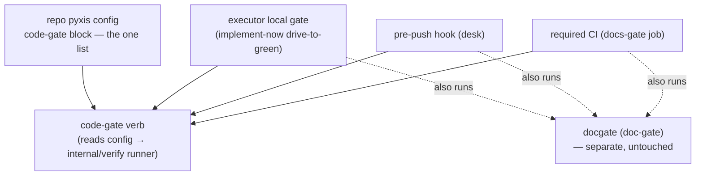

# code-gate mirror — the single-source, stack-scoped code gate — technical design

| Field | Value |
|---|---|
| **Status** | Draft — pending unmanned review + operator approval *(→ Approved at merge; "superseded" is computed by the index, never written here)* |
| **Owner** | @mdarabi |
| **Approver(s)** | @mdarabi (operator — infrastructure + security surface) |
| **Date** | 2026-07-21 |
| **Relevant-when** | designing or changing the local↔required-CI code-gate mirror, the per-repo code-gate check list, or how the executor gate / required CI / pre-push derive from one source; implementing the `code-gate` verb; superseding the mirror mechanism |
| **Scope** | The `code-gate` verb, the per-repo code-gate check-list config, and its invocation by three surfaces (the executor's local gate, required CI, the pre-push hook), reusing the `internal/verify` runner. **Not**: the doc-gate (`docgate`, untouched and independent); codegate's rung ladder (untouched); building any performance/measurement lane or fixing a specific non-hermetic check (a follow-up, `#O-2`); the drive-side executor behavior (implement-now's contract) |
| **Tracking** | filed with the introducing PR |
| **Builds-on** | `implement-now` (rewires its `executor.gate` surface) · `codegate-v1` (reuses its `internal/verify` runner as a library) · `repo-layout-and-system-footprint` (extends the pyxis-config schema it owns) |
| **Supersedes** | — |
| **Serves** | `prd:implement-now/FR-8` · `prd:implement-now/UB-5` |
| **Security/privacy impact** | yes — the `code-gate` verb executes repo-supplied check commands (arbitrary argv from config); it inherits `internal/verify`'s runner posture (env-strip, per-check timeout, platform write-scope). reviewer: @mdarabi |
| **Template version** | tech-design-template/v1 |

## 0. Read to rule — the human reviewer's section (~4 min)

*The body is the contract; this section only routes attention — on any conflict the body governs; machines ignore it.*

**Judge these** *(each row: the call · the alternative it displaced · what disagreeing concretely means, with its anchor)*

| # | The call | Could have gone | If you disagree |
|---|---|---|---|
| 1 | One `code-gate` verb over one per-repo config list, invoked by every surface (§2) | generate the CI file from config (`#ALT-2`); bake checks into a shipped binary (`#ALT-3`) | the mirror stops being *structural* and reverts to lists kept honest by discipline → §2 · §3.1 · #DINV-1 |
| 2 | The blocking gate holds correctness checks only; measurements never assert (§3.7) | convention-only, keep policing (`#ALT-4`) | a wall-clock/perf check can gate again — the #600 failure mode returns → §3.7 · #DINV-2 · #DINV-3 |
| 3 | Serve `prd:implement-now/FR-8`, not codegate's `WR-5` (§2) | promote codegate to the one gate (codegate-v1 `#ALT-6`) | the work refiles under codegate's remote-delivery phase and couples to its in-flight ladder → Serves · `#O-1` |
| 4 | Reuse `internal/verify` as a library; name it `code-gate` (§3.1) | a standalone runner; fold into `codegate` | a re-implemented runner (timeouts, sandbox) to maintain, or a blurred code/doc-gate boundary → §3.1 |
| 5 | Explicit per-repo config; no gate-time stack detection (§3.1) | detect the stack, apply built-in defaults | the check list moves into pyxis core, against per-repo ownership → §3.1 · #DINV-1 |
| 6 | The mirror is the *required* set; overhead cut by verdict reuse + advisory demotion, not a lighter local gate (§3.10) | run the full set on every surface every time; or a lighter local subset | a lighter *required* local set recreates the drift this design kills → §3.10 · #DINV-1 · #DINV-6 |

**Sanity-check the numbers** — none — this design's bounds are boolean invariants (the `#DINV-n` set), not thresholds; the one enumerated set (this repo's code checks) lives in config, not in frozen prose.

**The author's open questions** — Q1 (a conformance double-run guard — build it in v1, or defer?) and Q2 (the exact starter list `pyxis init` scaffolds); both non-blocking (§7).

**Skip the rest** — schema/structure → `docgate` (design lint, at its v2); substance/coherence/reuse → the unmanned `tech-design-review`; implementation defects → `code-gate` itself + downstream gates; rationale/alternatives → §4 (explanatory).

## 1. Problem

The executor's local gate and required CI are **two independently hand-authored lists of code checks**. The local gate (`executor.gate` in the repo's pyxis config) is whitespace-split into argv with no shell, so it can express `go build`/`vet`/`test` but not `gofmt` or the race detector; required CI lists its own richer set in the workflow. The config even documents the gap in a comment — declaring the checks it cannot express "CI-authoritative." Two lists drift, and a subset-local gate lets work drive green locally and strand red in CI.

This already happened: an implement-now task drove green through the local gate, then stranded required CI red at `go test -race` on a check the local `go test` never exercised the same way. The strand had **two distinct causes**: a *check-set* gap (local omits `-race`/`gofmt`), and a *hermeticity* gap — the failing check asserted a **wall-clock budget over a git-history-derived input**, so it passed on a fast machine and failed on a slow CI runner *for identical code*. The second class is the sharper one: a check whose verdict depends on the machine can never be a faithful mirror, so no amount of running "the same command" closes it.

The mirror is not a new requirement — `prd:implement-now/FR-8` and `UB-5` make it a Must, and AP-11 ("the local quality gate mirrors CI exactly, or it is not a mirror") is a graduated principle. The gap opened because the *mechanism* (argv-only config) could not carry the whole predicate. **Now** is the cheapest moment: the single-source pattern already exists for the document gate (one shim both the pre-push hook and CI invoke), and the config surface already exists — applying the same shape to code costs a verb and a schema, before more repos and stacks accrete their own divergent lists.

## 2. Decision

**Decision:** A repo's required code checks become **one canonical list in that repo's pyxis config** (the code-gate block), executed by a **single `code-gate` verb** that the executor's local gate, the pre-push hook, and required CI **all invoke** — same command, same list, both surfaces — so the local gate mirrors required CI *by construction* rather than by matching discipline (design-brainstorm:code-gate-mirror-tech-design#D-2, `#ALT-1`). The verb reuses codegate's `internal/verify` runner as a library; it is **not** codegate's rung ladder and does not supersede it (design-brainstorm:code-gate-mirror-tech-design#D-3). The doc-gate (`docgate`) is untouched and **composes alongside** as an independent predicate (design-brainstorm:code-gate-mirror-tech-design#D-1). The blocking gate admits **only correctness checks** — each a pure function of the declared input; performance and cost are *measurements*, recorded but never asserted (design-brainstorm:code-gate-mirror-tech-design#D-5).

A reader who stops here should see why it is safe: one command running one list on every surface cannot disagree with itself; the config home keeps the list per-repo and per-stack; and the correctness-only rule removes, at its root, the category of check that made "same command" insufficient. The mirror is scoped to the checks *required* to merge (FR-8's own wording); genuinely optional checks are advisory, and because required checks are hermetic their verdicts are reused by content fingerprint — so the gate runs once per change locally, not once per surface (§3.10).

## 3. The design

### 3.1 The `code-gate` verb and its config

**Decision:** The check list is **explicit per-repo config** (design-brainstorm:code-gate-mirror-tech-design#D-4). The `code-gate` verb reads the repo's code-gate config block, runs each listed check through the shared runner, and emits one aggregate verdict. There is no gate-time stack detection and no built-in default list — the gate runs exactly what the config declares. Repo setup (`pyxis init`) may *scaffold* a starter list into the config, but that is editable, visible content the author owns, never a fallback the verb reaches for on its own.

Each check in the config declares, at minimum: a **name**, the **argv** to run, and its **failure semantics** — the two kinds this repo needs are *non-zero exit* (`go vet`, `go build`, `go test -race`) and *non-empty output* (`gofmt -l`, whose findings are lines, not an exit code) — plus an optional per-check **timeout**, and a **class** — `required` (blocks; part of the mirror) or `advisory` (informational, never blocks), defaulting to `required` (§3.10). The config **parses closed**: an unknown key is an error, not a silent skip (AP-6). This replaces the argv-only `executor.gate` list (design-brainstorm:code-gate-mirror-tech-design#S-2); the concrete field schema is specified at implementation and pinned by golden fixtures, not frozen here.

The verb **reuses `internal/verify`** — codegate's tested runner (subprocess execution, environment stripping, per-check timeout, output capture, findings) — as a library (design-brainstorm:code-gate-mirror-tech-design#D-3). It re-implements no check execution; it is a thin front-end that maps config entries to runner calls and folds their results into a pass/fail. The existing `codegate` binary is untouched.

### 3.2 Boundaries and non-goals

- **Not solved here** — the doc-gate. `docgate` is a separate, universal predicate, already single-sourced through its own shim; `code-gate` never runs it, includes it in its list, or subsumes it (design-brainstorm:code-gate-mirror-tech-design#D-1, `#O-1`). The full local↔CI mirror is `code-gate` (this design) *plus* the untouched doc-gate.
- **Owned by a future design** — codegate's rung ladder becoming a repo's required gate (its `WR-5`/`WR-7`); and any performance/measurement lane, plus the actual repair of the known non-hermetic check (a follow-up owned by the check's team, `#O-2`). This design *rules* that non-hermetic checks may not block; it does not build their new home.
- **Implementation must not infer** — that `code-gate` may merge, approve, or write anything beyond running checks and emitting a verdict; that a missing config check is a pass (fail closed, #DINV-4); that `code-gate` replaces or wraps `codegate` (it reuses one library; the binary stands, honoring codegate-v1 `#F-2`).
- **Must remain unchanged** — the doc-gate's behavior and its `docgate-resolve.sh` single-source; codegate-v1's contract and its rung ladder; implement-now's drive-side behavior (this design only changes *what* the executor's gate step invokes, not *how* the worker drives to green).

### 3.3 Invariants

- **DINV-1** — **single source (the required set).** Every surface (executor gate, pre-push, required CI) runs the identical `code-gate` verb over the identical per-repo **required** check set; there is no second representation of it, and a required check exists on all surfaces or none. Advisory checks never block and may run on a subset of surfaces (e.g. remote-only) — being non-gating, they cannot cause local/remote drift (§3.10).
- **DINV-2** — **hermeticity.** Every check in the blocking gate is a pure function of the declared input: the same code yields the same verdict on any machine. A check whose verdict depends on wall-clock time, ambient git history, network, or machine speed is not admissible in the blocking gate. A *suite* check (e.g. `go test`) inherits its members' hermeticity — see §3.7.
- **DINV-3** — **measurements never block.** A run's cost, speed, or size (wall-clock, memory, tokens, dollars) is a measurement — recorded via benchmark or observability, never asserted as a blocking pass/fail. "Performance testing as a blocking unit test" is a category error and is excluded by construction.
- **DINV-4** — **fail closed.** A malformed config, an unknown key, or an unrunnable check is a usage refusal (non-zero, named), never a silent skip or a pass (I3).
- **DINV-5** — **doc-gate independence.** `code-gate` never executes, embeds, or subsumes `docgate`; the two gates are separate predicates that merely happen to share the same three invocation surfaces.
- **DINV-6** — **verdict reuse.** A required check's verdict is a pure function of the content fingerprint of its inputs (DINV-2); a fresh cached verdict for the exact tree is reused across the local surfaces (drive-to-green, pre-push), so the required gate runs once per distinct tree, not once per surface. Remote re-runs regardless — the authoritative backstop never trusts a locally-supplied verdict (AP-13).

### 3.4 Observability

- **Events/logs** — the verb emits, per run: each check's name, its verdict (pass/fail), and its duration; and the aggregate verdict. Failures name the failing check and surface its captured output.
- **Metrics** — per-check durations are emitted **as measurements** (recorded, trended — never asserted; DINV-3). No dashboard is mandated by this design; the measurement surface is the pipeline-measurement / observability plane's concern, not the gate's.
- **Alerts** — none from the gate itself; a red gate is surfaced by its consumer (the executor's drive loop, the CI check status, the pre-push refusal).
- **Debugging surface** — running `code-gate` by hand reproduces exactly what every surface runs (that is the point of DINV-1); `--list` (or equivalent) prints the resolved check set so an operator can see what the config expands to without running it.
- **Trace/correlation** — the verb runs synchronously under its caller; it carries the caller's context and needs no separate trace identity.

### 3.5 Security & privacy

yes — matches the header row. **Surface:** the verb executes **repo-supplied command lines** (the config's argv) — untrusted-by-shape, exactly as codegate's runner treats repo verbs. **Mitigations, inherited from `internal/verify` (not re-implemented here):** the environment is stripped to declared entries (ambient-credential exfiltration by a check requires an explicit, human-lane config entry that a proposal diff exposes); each check runs under a per-check timeout; filesystem write-scope is confined by platform — Landlock on Linux (CI, fleet), and a strip-plus-redirect posture on macOS with the residual named as codegate-v1 already records it. The config **parses closed** (DINV-4) so a malformed or unknown-key list fails the run rather than silently narrowing the gate. No network egress and no user data are introduced by this design beyond what the configured checks themselves perform. **Threat traced to binding elements:** a check added to widen exfiltration is human-lane config (review-visible); a malformed gate fails closed (#DINV-4, A-5); the runner's confinement is codegate-v1's analysis, unchanged.

### 3.6 The three surfaces, and composition with doc-gate

**Decision:** All three surfaces invoke the one verb (design-brainstorm:code-gate-mirror-tech-design#D-6):

- **Executor local gate** — the executor's gate step invokes `code-gate` (one entry) in place of today's hand-listed `build`/`vet`/`test`, alongside its separate doc-gate invocation (design-brainstorm:code-gate-mirror-tech-design#S-1).
- **Required CI** — the CI job runs the same verb over the same config, replacing the workflow's hand-listed code steps with a call to `code-gate` (a step, or a thin resolver shim mirroring `docgate-resolve.sh`); the doc-gate step is untouched beside it (design-brainstorm:code-gate-mirror-tech-design#S-3).
- **Pre-push (desk)** — the pre-push hook adds `code-gate` beside the existing `docgate` pre-push, so a human pushing by hand gets the same predicate before the change reaches CI (design-brainstorm:code-gate-mirror-tech-design#S-4). By verdict reuse (DINV-6, §3.10) a tree the executor already gated makes this pre-push a no-op — no surface re-runs an unchanged tree.

Because every surface runs the identical verb over the identical config, the three cannot diverge (DINV-1) — the property FR-8 and UB-5 require, now structural rather than maintained.

### 3.7 Correctness checks vs measurements — the category rule

**Decision:** The blocking gate is for **correctness** — properties that are pure functions of the code (DINV-2). A **measurement** (how fast, how big, how expensive) is a different kind of thing: it depends on the environment, so it is *recorded and trended*, never asserted as a build-failing pass/fail (DINV-3). The #600 strand was precisely a measurement — a wall-clock budget over a git-history-derived diff — welded onto the correctness runner and failing when the machine changed; the offending check's own comment conceded the valid latency claim "is a Phase-B measure across real dogfood runs" while asserting a single-run budget anyway.

Enforcement is **structural, not conventional**: a wall-clock/ambient-git assertion has no admissible home in the blocking gate (DINV-2/3), so the category of failure is removed rather than policed — a plain convention already existed (the repo mandates hermetic tests) and did not hold. **Disposition of the known offender:** its wall-clock **assertion is removed** (not relocated as an assertion); a deterministic smoke on a fixed fixture may remain, and any genuine latency NFR is verified by a separate statistical performance process. Making that specific change, and building any measurement lane, is a follow-up owned by the check's team — out of scope here (`#O-2`).

**A suite check inherits its members' hermeticity.** A single check like `go test -race ./...` is admissible in principle, but it is only as hermetic as the suite it runs: one non-hermetic test inside it makes the *check* non-hermetic. So for a repo whose suite check transitively runs a known non-hermetic test, DINV-2 is realized only once that test is neutralized — a **named precondition** of enabling the gate for that repo (the known offender is tracked as `#O-2`/#380), never a hermeticity this design asserts at ship. The gate does not claim a property it has not yet achieved; A-4 tests the admissibility rule and the directly-configured set, not the deferred fix.

### 3.8 Migration and compatibility

The change lands atomically: the config's code-gate block, the verb, and the three surfaces' invocations move together, so the executor is never left without a gate. The old `executor.gate` argv list is replaced by the code-gate block (or by a single `code-gate` entry) in the same change. Old and new do not need to coexist within a repo — there is one list before and one list after; the migration is a replacement, not a dual-run. The doc-gate is unaffected throughout.

### 3.9 Testing strategy

The seams under test: the **config parser** (in-process — table-driven: valid lists, unknown keys, each failure-semantics kind, malformed input → closed refusal); the **verb over the runner** (local-substitutable — fixtures with scripted checks exercising pass, fail-by-exit, fail-by-output, timeout, and the fail-closed paths); and the **surface parity** property (in-process — the same config resolves to the same check set for every surface, DINV-1). The runner itself is codegate's, already covered by codegate-v1's suite — this design tests the front-end and the parity property, not the borrowed engine. The parser, verb-over-runner, and parity acceptance rows map onto these seams.

### 3.10 Execution economy — required vs advisory, and verdict reuse

**Decision:** The mirror is the **required** set, and its overhead is cut two ways without weakening it (design-brainstorm:code-gate-mirror-tech-design#D-7).

- **Required vs advisory (§3.1 `class`).** A required check blocks and is faithfully mirrored (DINV-1); an advisory check never blocks and may run remote-only — the nice-to-have bucket, outside the mirror. Curating the required set to the musts is a per-repo config choice this design enables, never hardcodes; it is faithful to FR-8's own scope ("the checks **required by** CI").
- **Verdict reuse (DINV-6).** Because required checks are hermetic, a verdict is valid for a content fingerprint, so the local gate runs once per distinct tree, shared across drive-to-green and pre-push: an executor-gated tree makes the subsequent pre-push a no-op; a human who skipped the executor runs pre-push once. The implementation reuses codegate's verdict-as-state where available (its incremental re-verification; the fuller cache is codegate's `#O-1` successor's state design).
- **Remote stays authoritative.** Required CI re-runs the set on neutral ground — a local verdict is never trusted for the merge decision (AP-13) — and it is off the developer's critical path. So a change is gated **once locally (cached) + once remotely (authoritative)**, not three times.

## 4. Alternatives considered

| Alternative | Why rejected |
|---|---|
| Generate the CI workflow from the config (`#ALT-2`) | keeps a derived second copy honest only by a checker (fragile — the I1 stub-loophole pattern), and unifies only the *list*, not execution: local and remote still run it two ways |
| Bake the check list into a shipped Go program (`#ALT-3`) | cannot vary per repo/stack without rebuilding pyxis — conflicts with per-repo ownership of the check set (AP-25); if it instead reads per-repo config, it *is* the chosen shape |
| Convention-only hermeticity, keep policing (`#ALT-4`) | the #600 drift happened *under* the repo's already-written hermetic-tests convention; convention alone demonstrably did not hold |
| A conformance double-run test as the primary guard (`#ALT-6`) | imperfect (misses a check that is non-hermetic yet stable on one machine) and heavy to wrap around every check; retained as a possible *non-blocking* future guard (Q1), not the mechanism |
| Promote `codegate` to the single gate now (codegate-v1 `#ALT-6`) | couples the mirror to codegate's in-flight rung ladder and blurs the code/doc-gate independence you require; codegate-v1 `#F-2` explicitly forbids inferring codegate replaces the host's CI-mirror gate |
| Just add `-race` to the `executor.gate` config | argv-only config still cannot express `gofmt`; a one-line patch re-entrenches two independent lists — the exact drift AP-11 exists to forbid |

## 5. Risks

| ID | Risk | Impact | Mitigation | Verification / evidence |
|---|---|---|---|---|
| R1 | The config schema cannot express a check a repo needs (e.g. a fail-on-output check) | a required check is unrunnable, so it lives outside the gate — drift returns | the schema declares per-check failure semantics (exit-code and output-nonempty are first-class, §3.1); further kinds are additive | fixture per failure-semantics kind (A-3, §3.9) |
| R2 | Reusing `internal/verify` couples `code-gate` to a core evolving for codegate's ladder | a codegate-side change breaks the mirror | depend only on the runner's stable execution contract (an importable core per codegate-v1); the front-end's own suite pins the contract | code-gate runner-contract tests (§3.9) |
| R3 | A repo's config under-declares the intended gate (a check simply omitted) | the gate is narrower than intended — but *identically* on both surfaces, so not drift | since both surfaces read the one list, "required CI" *is* the config; `pyxis init` scaffolds a starter list; review reads the list as the gate's definition | A-2 (both surfaces reflect the list); init scaffold |
| R4 | A non-hermetic check is added to the config despite the rule | a flaky check can gate again | DINV-2/3 make it inadmissible by construction (§3.7); reviewer discipline; an optional conformance guard later (Q1) | the known offender's disposition (A-4); review |
| R5 | The atomic migration misfires, leaving the executor with no gate step | a window of ungated drive-to-green | config + verb + surfaces land in one change; a smoke asserts the executor invokes the verb | A-6 (three surfaces invoke the verb) |
| R6 | The full mirror binds every local surface (pre-push, the executor's drive loop) to the heavier check set — race-instrumented full tests — on every push and iteration | slower than today's `build/vet/test`; a developer runs `--no-verify` past pre-push, defeating the desk gate | mitigated (§3.10): verdict reuse (DINV-6) runs the required gate once per tree not per surface (an executor-gated push is a no-op); nice-to-haves are advisory (remote-only), keeping the required set lean; a faster *divergent* required subset stays forbidden (DINV-1) | A-8 (verdict reused across surfaces) · A-9 (advisory never gates) |

## 6. Acceptance

| ID | Acceptance criterion | Verify | Required evidence | Traces to |
|---|---|---|---|---|
| A-1 | a change that fails a required CI check also fails the local `code-gate` on the same input | Test | a fixture red in CI is red under local `code-gate` | `prd:implement-now/FR-8` · §2 · #DINV-1 |
| A-2 | editing the code-gate config's check list changes the local gate and required CI identically | Test | change the list; both surfaces reflect it in one step | `prd:implement-now/UB-5` · §3.1 · #DINV-1 |
| A-3 | `code-gate` runs the checks the argv-only `executor.gate` could not — including a formatter (fail-on-output) and the race detector | Test | verb run output over a fixture repo | §3.1 |
| A-4 | the code-gate config carries no *directly* non-hermetic check, and a suite check that transitively runs one (e.g. `go test` over a suite holding a wall-clock assertion) carries a named neutralization precondition — the known offender is tracked (`#O-2`/#380) and DINV-2 holds for the repo once it lands | Inspection | the config's check set; the §3.7 precondition note | §3.7 · #DINV-2 · #DINV-3 |
| A-5 | a malformed or unknown-key config fails `code-gate` closed (named refusal), never a silent skip or pass | Test | malformed-config fixture → non-zero refusal | §3.1 · #DINV-4 · I3 |
| A-6 | all three surfaces (executor gate, required CI, pre-push) invoke the same verb over the same config | Inspection | the three call sites | §3.6 · #DINV-1 · `prd:implement-now/UB-5` |
| A-7 | `code-gate` never runs or subsumes `docgate`; the doc-gate remains a separate invocation on each surface | Inspection | the config list + the surfaces' call sites | §3.2 · #DINV-5 |
| A-8 | a required check's verdict is reused across local surfaces — a second local run on the unchanged tree (pre-push after drive-to-green) re-runs nothing | Test | a drive-then-push fixture: the second surface reports reuse, not re-execution | §3.10 · #DINV-6 |
| A-9 | an advisory check never fails the gate — a red advisory check leaves the aggregate verdict green | Test | an advisory-fail fixture → green aggregate | §3.10 · #DINV-1 |

## 7. Open questions

| ID | Question | Owner | Blocks | Status | Resolution |
|---|---|---|---|---|---|
| Q1 | Do we add a conformance double-run guard (run each check twice, fail on divergent verdicts) as a non-blocking regression catch? | implementation | none | open | deferred — DINV-2/3 + review suffice for v1; revisit if a non-hermetic check recurs (`#ALT-6`) |
| Q2 | What exact starter check list does `pyxis init` scaffold for a Go repo? | implementation | none | open | decided at implementation against this repo's current required-CI code checks |

## Principles

- **AP-11 — honored.** One predicate, one place: a single `code-gate` verb over a single per-repo list, run by every surface — the local gate mirrors required CI by construction, not by matching two lists. This design *realizes* the principle FR-8 already cites.
- **AP-25 — honored.** The code-gate is a vendor-neutral CLI verb any harness or CI invokes, and the check set is per-repo/per-stack config — an adapter surface, never baked into pyxis-universal core.
- **AP-5 — honored.** Observability is designed in (§3.4): the verb emits per-check verdicts and durations, the latter explicitly as measurements (DINV-3), never bolted on.
- **AP-6 — honored.** The config is closed, contractual data: unknown keys are errors (DINV-4); the field schema is versioned and golden-pinned at implementation.
- **RW-5 — honored.** One decision per document: this decides the code-gate mirror mechanism. The doc-gate, codegate's ladder, and any measurement lane are separate, independently-revisable documents/concerns.
- **codegate-v1 `#F-2` — honored (not deviated).** codegate coexists with the host's CI-mirror gate; this design builds that coexisting gate and reuses one library, retiring nothing — so `Builds-on`, not `Supersedes`.
- **Candidate graduation (flagged, not authored here).** The correctness-check-vs-measurement category rule (DINV-2/DINV-3), paired with the drift incident (I5, to be recorded), is principle-grade; whether it graduates to an architecture principle is the operator's call.
- **Deviation:** none.
