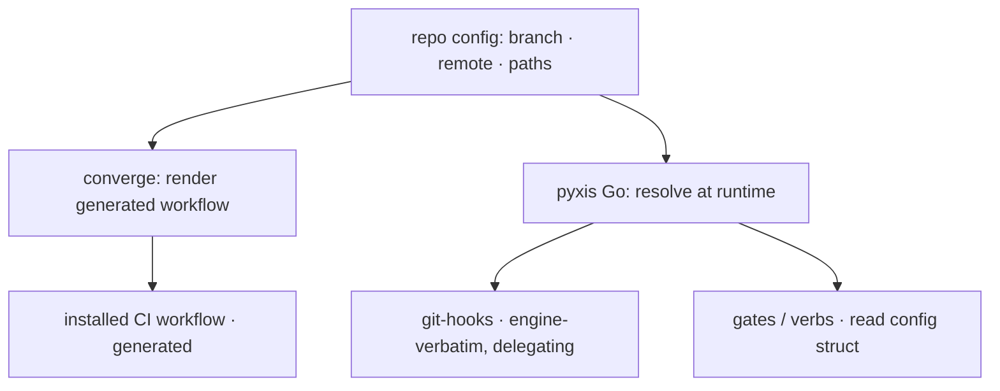

# Config-driven portability v1 — the non-Go config-delivery split and the engine's target-facing resolution — technical design

| Field | Value |
|---|---|
| **Status** | Draft *(→ Approved at the introducing PR's review; merge is the freezing event; "superseded" is computed by the index, never written here)* |
| **Owner** | @mdarabi |
| **Approver(s)** | @mdarabi (operator) — named reviewer: the change alters how the gates resolve the tree they check (a governance/production-control surface) |
| **Date** | 2026-07-23 |
| **Relevant-when** | designing or changing how config reaches the non-Go surfaces (the generated CI workflow, the git-hooks), the ownership class of the installed workflow/hooks, how the engine resolves doc paths / branch / remote / surface pointers, or config-load validation; implementing config-driven portability; superseding this shape |
| **Scope** | The concrete shape for phase-1 config-driven portability: the non-Go config-delivery split (the workflow generated, the git-hooks runtime-resolving), the closed-schema extension for the target-facing doc paths and the git remote, the Go-side resolution, config-load cross-field validation, and the self-host acceptance harness. **Not**: toolchain/stack selection, the irreducible collision-residue merge/chaining, onboarding / non-empty-tree converge / the install epoch, the module path / release host, and the system-tree-internal paths (the basis's WR/NG rows). |
| **Tracking** | — *(the introducing PR)* |
| **Builds-on** | docs/tech-design/installer-v1.md · docs/tech-design/repo-layout-and-system-footprint.md · docs/tech-design/code-gate-mirror.md |
| **Supersedes** | — |
| **Serves** | prd:config-driven-portability/FR-1 · prd:config-driven-portability/FR-2 · prd:config-driven-portability/FR-3 · prd:config-driven-portability/FR-4 · prd:config-driven-portability/FR-5 · prd:config-driven-portability/FR-6 · prd:config-driven-portability/UB-1 · prd:config-driven-portability/UB-2 · prd:config-driven-portability/UB-3 · prd:config-driven-portability/ABUSE-1 · prd:config-driven-portability/NR-1 · prd:config-driven-portability/NR-2 · prd:config-driven-portability/NFR-1 · prd:config-driven-portability/NFR-2 · prd:config-driven-portability/NFR-3 |
| **Security/privacy impact** | yes — a config value names the tree the governance gates resolve and check; a malformed value could aim a gate outside the repository. Same-principal threat model (the config author is the repo author); mitigation is load-time lexical containment (§3.3, DINV-3, A-4). · reviewer: @mdarabi |
| **Template version** | tech-design-template/v1 |

## 0. Read to rule — the human reviewer's section (~4 min)

*The body is the contract; this section only routes attention — on any conflict the body governs; machines ignore it.*

**Judge these**

| # | The call | Could have gone | If you disagree |
|---|---|---|---|
| 1 | The non-Go surfaces are handled **by split** — the workflow generated, the hooks runtime-resolving (§2, §3.1) | uniform-generated (`design-brainstorm:config-driven-portability-tech-design#ALT-1`) or uniform-runtime (`#ALT-3`) | the hooks become per-repo rendered files (ALT-1) or the workflow trigger can't resolve (ALT-3) → §3.1, DINV-4 |
| 2 | Go-side resolution **extends the config struct** — no resolver port (§3.2) | a dedicated target-facing resolver seam | an indirection layer with nothing cross-cutting to justify it → §3.2 |
| 3 | Config-path validation is **lexical, no symlink resolution** (§3.3) | resolve symlinks at load | non-hermetic validation + conflating config validity with repo filesystem policy → §3.3, DINV-3 |
| 4 | The self-host proof stays M1; **the existing-repo e2e is deferred to phase-2** (§3.8, §3.4) | build a foreign-repo install e2e now | pulls the phase-2 non-empty-tree converge forward → §3.4 |

**Sanity-check the numbers** — the acceptance rows are pass/fail, not thresholds: A-1 (self-host green), A-3 (default byte-identical). The one bound worth a gut-check is DINV-2's *byte-identical* on a default config — deliberately strict, so a coincidental default match can't hide a missed literal (§3.5 R-context, A-3).

**The author's open questions** — Q1 (§7): whether the generated workflow's runner becomes a config knob or stays a default — blocks nothing.

**Skip the rest** — schema/structure → docgate; substance, reuse, and basis fidelity → the unmanned `tech-design-review`; implementation defects → codegate + the self-host job; rationale and rejected shapes → §4 (explanatory).

## 1. Problem

The engine hardcodes the repository it was built in: its doc-path layout, its default branch and remote, and its CLI-surface pointers are baked into gate code, git-hooks, and CI. It therefore runs correctly only where it was developed — any repository with a different layout is dishonored or collided with the moment the engine runs there, which blocks existing-repo adoption at the root (`prd:config-driven-portability/§2.1`). The basis makes the Go-side lifts a matter of reading config, but leaves one genuinely open mechanism: the **non-Go surfaces** — the installed CI workflow and the shell git-hooks — cannot read the repo config the way a Go consumer can, so a delivery mechanism must be chosen. This design decides that mechanism and the surrounding resolution and validation shape. Now, because the config schema is already nearly complete and adoption is the next milestone: finishing the parameterization is cheap and unblocks everything downstream.

## 2. Decision

**Decision:** The engine's non-Go surfaces receive config-driven values by **two mechanisms chosen per constraint, not one uniform one** (`design-brainstorm:config-driven-portability-tech-design#D-1` · `#ALT-2`). The installed CI workflow becomes a **generated**-class file that converge renders from the repo config — its trigger is a static literal the CI host evaluates without computation, so it must be materialized at converge, re-rendered when config changes. The git-hooks stay **engine-verbatim** (byte-identical in every repository) and drop their branch/remote literals: they invoke `pyxis` for the checks they already delegate, and `pyxis` (Go, reads config) resolves branch and remote at runtime. Config is the single source for both surfaces — neither carries a hand-maintained second list (AP-11; this is the failure `docs/observability/incidents.md#I5` records). The Go-side resolution extends the existing config-struct read (new closed-schema keys read directly, no new port), and cross-field validation folds into config load. A reader who stops here knows the shape: **one config, resolved live by Go, rendered at converge for the one surface that cannot resolve live.**

## 3. The design

### 3.1 The non-Go config-delivery split

The two non-Go surfaces have different constraints, so they take different mechanisms.

**The installed CI workflow — generated.** A CI-host push trigger is a static literal evaluated from the workflow file with no computation and no config read. The workflow therefore cannot resolve the default branch at runtime; it must carry the branch as a literal that is *correct for the repository*. **Decision:** the installed workflow's ownership class is **generated** — the class policy declares it so (it was engine-verbatim under the class model `design:installer-v1#§3.2`), and a repository receives it generated from its first install. This design changes the *declared class*, not an operand's existing file: no phase-1 operand carries an old-class installed workflow to migrate — the pyxis repository is source-mode, and adoption is phase-2. Converge renders it from a shipped template, substituting branch, remote, and any referenced path from the repo config, reusing the seed-time substitution mechanism (`design:installer-v1#§3.5`); a config change re-renders it on the next converge, and doctor reports a hand-edited generated surface as drift (§3.6). The workflow's *run step* — which invokes `pyxis` — needs no literal: it delegates like the hooks.

**The git-hooks — runtime-resolving, engine-verbatim.** A git-hook already invokes `pyxis` for the check it runs. **Decision:** the hooks drop their branch/remote literals and let `pyxis` resolve them from config at invocation. The hook body is then identical in every repository — no per-repo rendering, no drift surface — and stays engine-verbatim (converge repairs it byte-exact). Runtime resolution is the natural extension of a surface that already delegates to the Go binary.

### 3.2 The closed-schema extension and Go-side resolution

**Decision:** the target-facing doc paths not yet represented in the schema are added as keys under the existing closed path schema, and the git remote is added as a top-level scalar beside the existing branch scalar — deliberate closed-schema keys, each with its current value as the default (`design-brainstorm:…#D-2`; INV-32). No new configuration surface is introduced (the single system config is settled — `design:installer-v1`, its D-7).

Consumers resolve these values by **reading the config struct they already receive** — there is no target-facing "resolver" port. A consumer that today holds a config reads the field; the few that hardcode a path without holding a config get one threaded in (plumbing, not a new seam). The config struct plus its defaults is the single resolution surface (AP-11).

The **derived surface maps** — the CLI-surface pointers and the governance-skeleton targets — are computed as a **pure function** of the CLI-surface knob and the relevant path config, recomputed at each use (converge / doctor / seed), with no cached or materialized derived state (`design-brainstorm:…#D-3`). A cache of derived pointers would be a second thing that can drift from config — the same failure shape as the two-list drift, in miniature.

### 3.3 Config-load validation and the same-principal threat model

**Decision:** cross-field validation folds into config load — the engine either loads a valid configuration or refuses by name, before any resolution, reusing the existing closed-schema fail-closed refusal path (INV-32; `design-brainstorm:…#D-4`). The in-repo check is **lexical**: a configured path is refused at load if it is absolute, contains a parent-directory escape, or is otherwise not a repository-relative path. The engine only ever joins a config path under the repository root and never follows a config value as an absolute location.

The check is deliberately **not symlink-resolved.** A symlink inside the repository that points outside is the repository owner's own content, and the config author and the repository author are the **same principal** — there is no privilege boundary to cross, so a symlink is not a config-*escape* vector beyond "the owner can point their own tree wherever." Resolving symlinks would be non-hermetic (filesystem-dependent) and would conflate config-value validity with repository filesystem policy. Lexical containment is deterministic and hermetic, and it closes the one abuse vector the surface admits (a config value aiming a gate outside the tree — `prd:config-driven-portability/ABUSE-1`).

### 3.4 Boundaries and non-goals

- **Not solved here** — the module path and release host (adopters consume released binaries, never source), and the system-tree-internal paths (they live in the engine's own namespace and never collide with a target). These are no-work per the basis (`prd:config-driven-portability/NG-2 · NG-1`).
- **Owned by a future design (phase-2)** — toolchain/stack selection (the local gate's build/test commands are already a config surface; generalizing off the default stack waits); the irreducible single-owner collision-residue merge/chaining (an existing root convention file, the single git hooks-path, a workflow-directory name collision); onboarding as a whole — the non-empty-tree converge, the install epoch/grandfathering, and the existing-(non-empty)-repository install e2e (`design-brainstorm:…#D-5 · #D-6`; basis WR-1/WR-2/WR-3); and migrating an already-installed operand's workflow across the engine-verbatim → generated class change (an upgrade/grandfathering concern — no such operand exists in phase-1).
- **Implementation must not infer** — that a relocated path implies any file *move*: this design makes the engine *read* the configured location; placing content there is the operand's (or, later, onboarding's) concern. Nor that runtime resolution implies the hooks parse config — they delegate to `pyxis`, which parses.
- **Must remain unchanged** — the engine's behavior under a default configuration (byte-identical; DINV-2, A-3) and the closed-schema refusal of unknown keys (A-5).

### 3.5 Invariants

- **DINV-1** — no target-facing surface (a doc path, a branch/remote reference, or a generated non-Go surface) carries a value the engine did not resolve from the repo config; the config is the single source for every such value.
- **DINV-2** — under a configuration that sets no non-default value, engine behavior is byte-identical to the pre-change engine (defaults preserved).
- **DINV-3** — a config path that is absolute, escapes the repository root, or is not repository-relative is refused at load, before any resolution; the engine never treats a config value as an absolute path.
- **DINV-4** — the generated workflow and the runtime-resolving hooks derive branch and remote from the same config value; no non-Go surface carries a second, independently-maintained copy of it.

### 3.6 Observability

- **Events/logs** — the self-host acceptance job (the basis's EVT-1) records the run under the non-default config and its green/red outcome; config-load refusals name the offending key and remedy (§3.3).
- **Metrics** — none beyond the acceptance job's pass/fail; this is deterministic engine tooling, not a runtime service (basis §3.2).
- **Alerts** — none (no runtime service to alert on).
- **Debugging surface** — `doctor` reports a generated non-Go surface that has drifted from the current config (a hand-edited workflow), and names it; converge regenerates it (`prd:config-driven-portability/UB-3`).
- **Trace/correlation** — none — resolution is synchronous and local.

### 3.7 Security & privacy

yes — echoing the header. The surface touched is **production/governance control**: a config value names the tree the governance gates resolve and check, so a malformed or hostile value could aim a gate at a path outside the repository, silently checking the wrong tree (`prd:config-driven-portability/ABUSE-1`). No secrets, user data, or network boundary is introduced. **Threat model:** the config author and the repository author are the same principal — there is no privilege escalation available that the principal does not already have over their own tree. **Mitigation** (traced to binding elements): load-time lexical containment refuses an absolute or escaping config path before any resolution (DINV-3, A-4), and the engine never follows a config value as an absolute location. Symlink resolution is out of scope for this same-principal model (§3.3).

### 3.8 Testing strategy and the self-host acceptance harness

The seams under test, binned:

- **Config load + validation** — *in-process*: table-driven fixtures for the new keys, defaults, and the containment refusals (absolute, escaping, non-relative, unknown-key) — the load path is a pure function of bytes → config-or-named-error.
- **Go-side resolution** — *in-process*: fixture operand trees with non-default configs assert each consumer reads the configured location.
- **The generated workflow render** — *in-process*: a golden test asserts the rendered workflow carries no branch/remote/path literal absent from config, for a non-default config.
- **The hooks' runtime resolution** — *in-process*: `pyxis`'s branch/remote resolution from config is asserted directly; the hook body is asserted literal-free.
- **The self-host proof** — the basis's M1/DOD-1, run as a CI job: in a throwaway checkout of the pyxis repository, a non-default config is applied and the corpus is relocated to the configured locations (the doc corpora moved, the default branch renamed, an explicit remote set, the surface pointers moved); the full gate + local gate + `doctor` run and must be green. A literal missed anywhere fails on the real corpus. The **existing-(non-empty)-repository install e2e is deferred to phase-2** (§3.4) — it needs the non-empty-tree converge, which this phase does not build.
- **Coherence inspection** — an inspection (the basis's DOD-4) asserts zero target-facing literals remain in engine code outside the schema's defaults.

## 4. Alternatives considered

| Alternative | Why rejected |
|---|---|
| Uniform generated — both the workflow and the hooks rendered at converge (`design-brainstorm:…#ALT-1`) | one mechanism, but it makes the hooks per-repo rendered files — a new hook-drift surface — where the split keeps them byte-identical; runtime delegation is cheaper than rendering a hook |
| Uniform runtime — both surfaces resolve at runtime (`design-brainstorm:…#ALT-3`) | infeasible: a CI push trigger cannot be computed, so the workflow would trigger on all pushes (wrong semantics, wasted CI) or bake a literal (the hardcoding this feature removes) |
| A dedicated target-facing "resolver" port the consumers call (`design-brainstorm:…#DQ-2`) | an indirection layer with nothing cross-cutting to justify it — each value is a direct config read; the config struct is already the single resolution surface |
| Symlink-resolved path validation (`design-brainstorm:…#DQ-4`) | non-hermetic (filesystem-dependent) and conflates config-value validity with repo filesystem policy; no privilege boundary exists in the same-principal model |
| A separate `pyxis-config/` directory for the new keys | the single system config directory is settled (`design:installer-v1`, its D-7); reopening it is out of scope |

## 5. Risks

| ID | Risk | Impact | Mitigation | Verification / evidence |
|---|---|---|---|---|
| R1 | A target-facing literal is missed — one surface still hardcoded while the rest honor config | a coherence gap: the gate silently checks the wrong (or an absent) path in an adopter's repo | the self-host proof runs on a *non-default* config over the real corpus, where a missed literal no longer coincidentally matches the default and therefore fails; the coherence inspection independently greps for literals | A-1 (self-host), A-2 (inspection) |
| R2 | The generated workflow, or a hook's resolution, drifts from the current config | CI or the local gate references a stale branch/tree | one config feeds both (DINV-4); converge re-renders the generated workflow and doctor names its drift; the hook reads live, so it cannot go stale | A-6, A-7 |
| R3 | Load-time validation over-refuses a legitimate configured path, or under-refuses an escaping one | a valid config is rejected, or a gate is aimed outside the tree | lexical containment fixtures cover absolute / escaping / non-relative / valid-relative cases at the load boundary | A-4 |

## 6. Acceptance

| ID | Acceptance criterion | Verify | Required evidence | Traces to |
|---|---|---|---|---|
| A-1 | The pyxis repository runs green (full gate + local gate + `doctor`) under a non-default config with its corpus relocated to the configured locations | Test (CI self-host job) | the self-host job link | `prd:config-driven-portability/FR-1 · FR-2 · FR-3 · FR-4` · §2 |
| A-2 | The coherence inspection finds zero target-facing literals in engine code outside the schema defaults — a first-pass scan; A-1's self-host on a non-default config is the full proof (a missed or constant-folded derivation fails there) | Inspection | the inspection result | `prd:config-driven-portability/FR-1` · #DINV-1 |
| A-3 | Under a default config, engine behavior is byte-identical to the pre-change engine and the existing suite passes unchanged | Test | suite result + a default-config byte-identity check | `prd:config-driven-portability/NR-1 · FR-6` · #DINV-2 |
| A-4 | Each of an absolute, an escaping, a non-relative, and an unknown-key config is refused by name at load, with no partial resolution | Test | the containment fixture suite | `prd:config-driven-portability/FR-5 · UB-1 · UB-2 · ABUSE-1 · NR-2` · #DINV-3 |
| A-5 | The rendered generated workflow carries no branch/remote/path literal absent from config | Test (golden) | the render golden result | `prd:config-driven-portability/FR-4` · #DINV-1 |
| A-6 | A hand-edited generated non-Go surface is named as drift by `doctor` and repaired by converge | Test | the drift fixture result | `prd:config-driven-portability/UB-3` · #DINV-4 |
| A-7 | A hook's runtime resolution tracks config — invoking the hook's `pyxis` branch/remote resolution under two configs with different values yields the two configured values (so the hook reads live and cannot go stale) | Test | the resolution fixture result | `prd:config-driven-portability/FR-2` · #DINV-4 |

## 7. Open questions

| ID | Question | Owner | Blocks | Status | Resolution |
|---|---|---|---|---|---|
| Q1 | Does the generated workflow's CI-runner become a config knob, or stay a sensible default? A runner is not a repo-layout assumption the way a path or branch is, so it is arguably not a target-facing surface. | @mdarabi | none | open | defaulted at implementation; a runner knob is a plausible later addition if an adopter needs it |

## Principles

- **AP-1 — honored.** The core is medium-independent; this extends that independence to the repository's own *layout* (paths, branch, remote, surface pointers), which the engine now adapts to via config rather than assuming.
- **AP-5 — honored.** Observability is designed in: `doctor` sees a drifted generated surface and names it; the self-host job observes the coherence property end-to-end (§3.6).
- **AP-11 — honored.** One predicate, one place: branch/remote/path values are evaluated in one place — the config — and both the generated workflow and the runtime-resolving hooks derive from that one source, never a second list (§3.1, DINV-4; the failure `docs/observability/incidents.md#I5` records).
- **AP-24 — honored.** The repo config is human-authored input the engine reads; it is never derived or rebuilt from the governed content it points at.
- **AP-25 — honored.** The vendor CLI-surface pointers stay pointers into the neutral system tree — derived from the surface knob, never carrying content (§3.2). (The hooks' delegation to `pyxis` is a single-source property — AP-11 above, not vendor-neutrality.)
- **AP-27 — honored.** Extension by addition: the config schema grows by adding keys, each defaulting to its current value, and never by changing an existing one (§3.2; DINV-2).
- **INV-32 — honored.** The schema stays closed — unknown keys remain hard errors, and cross-field validation folds into the same fail-closed load (§3.3).
- **Deviation:** none.
