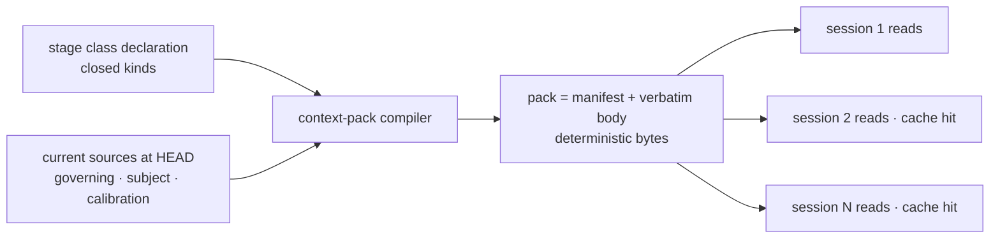

# Context pack — the shared pipeline-context compiler — technical design

| Field | Value |
|---|---|
| **Status** | Draft → Approved *(merge is the freezing event; "superseded" is computed by the index)* |
| **Owner** | @mdarabi |
| **Approver(s)** | @mdarabi (operator) — document-system tooling; the introducing PR's review is the gate |
| **Date** | 2026-07-14 |
| **Relevant-when** | designing or changing the context-pack compiler, its stable-class declaration, the manifest header, or the build-fresh freshness model; implementing the `docgate` context-pack verb; triaging a session that read a leaked or non-deterministic pack; superseding the pack format |
| **Scope** | The mechanism that assembles a stage's stable context into one deterministic artifact: the compiler's contract, the manifest header, the per-stage class declaration, the closed class-kind set that is the independence boundary, and the build-fresh freshness model. **Not**: which model runs a session, when a cold reviewer runs (orchestration policy — prd:context-pack/NG-1..NG-3); the docgate verb-registration mechanics (docgate's own design owns those); the selector grammar internals (§7 Q3). |
| **Tracking** | — *(the introducing PR)* |
| **Builds-on** | docs/tech-design/tech-design-conventions.md · docs/tech-design/docgate-v1.md |
| **Supersedes** | — |
| **Serves** | prd:context-pack/FR-1 · prd:context-pack/FR-2 · prd:context-pack/FR-3 · prd:context-pack/FR-4 · prd:context-pack/FR-5 · prd:context-pack/FR-6 · prd:context-pack/FR-7 · prd:context-pack/NR-1 · prd:context-pack/NR-3 · prd:context-pack/UB-1 · prd:context-pack/UB-2 · prd:context-pack/UB-3 · prd:context-pack/UB-4 · prd:context-pack/ABUSE-1 · prd:context-pack/ABUSE-2 · prd:context-pack/NFR-1 · prd:context-pack/NFR-2 · prd:context-pack/NFR-3 · prd:context-pack/NFR-4 · prd:context-pack/NFR-5 |
| **Security/privacy impact** | none — the compiler assembles repo content every session already sends to the provider (same content, same destination), changing only how often it is sent; no new secret, identity, network, or egress surface. The one integrity-critical property — the independence boundary — is a correctness invariant (§3.4, DINV-3), enforced structurally, not a security surface. |
| **Template version** | tech-design-template/v1 |

## 1. Problem

The `context-pack` PRD binds a compiler that assembles a stage's stable governing context — the vision and principles, the frozen subject, the stage's calibration — into one artifact every session reads once, so re-orientation is paid once per stage instead of once per session (prd:context-pack/FR-1). Nothing yet decides the artifact's shape or the mechanics that make it safe: how it stays fresh without the live crawl's automatic currency (FR-6), how a cold reviewer fed the pack cannot thereby see the author's reasoning (FR-4 — the pipeline's trust rests on this), and how concurrent sessions receive byte-identical bytes so a provider cache amortizes even the single read (FR-5). Decided wrong, the feature either leaks the answer key into review, serves stale governing content, or fails to cache and delivers a fraction of its saving. The moment is cheapest now: no pack format exists to migrate.

## 2. Decision

**Decision:** The context pack is a **deterministic projection** — a manifest header followed by the verbatim content of a **declared, closed set of stable-context classes**, concatenated in declared order — built **fresh on demand** by a `docgate` verb and never stored as authoritative. Freshness is structural: because the pack is always assembled from current sources at the point of use and never cached to disk as truth, a stale pack cannot exist; the manifest records the source revision and a content digest so any consumer can prove what it read. Determinism (a pure function of the declaration and the sources at a revision, with no wall-clock in the bytes) makes independent builds byte-identical, so one build shared to N sessions — or N independent builds — all present the same cacheable prefix. The independence boundary is **structural, not a filter**: the set of admissible class *kinds* is a closed enum containing no authoring-trail kind, so a declaration cannot name the delivery journal, dispositions, or orchestration — a cold reviewer's pack is free of the answer key by construction.

A reader who stops here should see the shape: one deterministic file per (stage, subject), built fresh so it is never stale, carrying only kinds an enum admits so it can never carry the trail, identical across sessions so the cache pays for it once.

## 3. The design

### 3.1 The artifact and its manifest

**Decision:** one pack is one file: a **manifest header** then the **body** — the declared classes' sources, each included verbatim, in declared order, separated by a fixed per-source delimiter naming the source.

The manifest header binds provenance as closed data (AP-6):

- `schema` — the pack format version (`context-pack/v1`), so a consumer parses against a known shape.
- `stage` · `subject` — what this pack is for.
- `built_from` — the repo revision the sources were read at (the tree identity, never wall-clock time — §4 rejects timestamps for determinism).
- `sources[]` — each included source: its role (the class it came from) and its path, in body order — so a reader (and a reviewer) sees exactly what the body holds and can confirm nothing unlisted appears (FR-2).
- `digest` — a content hash over the assembled body, so a consumer can verify the bytes it read match the manifest, and a resumed session can confirm two builds agree.

The body is verbatim: sources are concatenated, never reformatted or summarized (prd:context-pack/NR-3, NG-6). A class a stage declares but that resolves to no source is recorded in `sources[]` as absent rather than emitted as an empty section (FR-7) — honest partial state, no invented context.

### 3.2 The class declaration

**Decision:** which stable classes a stage's pack holds is **configuration data, parsed closed** (AP-6), not code (prd:context-pack/FR-3). A stage declares an ordered list of **class entries**; each entry names a **kind** (from the closed set, §3.4) and a **selector** resolving that kind to concrete sources for a given subject.

- The declaration is per-stage; adding a stage or changing a stage's classes is a data edit, no code change (prd:context-pack/NFR-4).
- Parse is closed: an unknown key or an unknown kind is an error, not a silent skip (AP-6). A declaration naming a kind outside the closed set fails validation and builds nothing (prd:context-pack/UB-3).
- The selector grammar (explicit paths vs a glob vs a named role that resolves per subject) is an implementation detail bounded by §7 Q3; the design binds only that a selector resolves deterministically to an ordered source list, and that a selector resolving to a missing file fails closed with a named error (prd:context-pack/UB-1), never a partial pack.

### 3.3 Build-fresh: freshness by construction

**Decision:** the compiler **always assembles from current sources at invocation** and writes only to caller-chosen ephemeral scratch (gitignored, never committed — the `.pyxis/scratch/` precedent). There is no stored, authoritative pack to fall out of date, so the PRD's "never serve a stale pack" (prd:context-pack/FR-6, ABUSE-2) holds without a staleness check: the crawl's automatic currency is preserved by rebuilding, not by cache invalidation.

Operationally the orchestrator builds one pack per (stage, subject) and hands its path to that stage's sessions (one build, N reads); a resumed or independent session that rebuilds gets byte-identical output by §3.5, so sharing and rebuilding are equally safe. If a source changes mid-stage, the next build reflects it; a build and its sources are read at one revision, so a single pack never mixes old and new (prd:context-pack/UB-4).

### 3.4 The independence boundary — a closed kind set

**Decision:** the admissible class **kinds** are a **closed enum** — the stable-context kinds (the governing documents, the frozen subject under work, the stage's calibration, and their peers) — and **no authoring-trail kind is a member**. The delivery journal, prior review dispositions, and orchestration notes have no kind a declaration can name, so the compiler has no path that reads them into a pack (prd:context-pack/FR-4, NFR-5). A cold reviewer's pack is free of the author's reasoning **by construction, not by a reminder to exclude**.

This is an allowlist of trusted kinds, deliberately not a blocklist of forbidden ones: enumerating the trusted set means a newly-added artifact class is excluded until explicitly admitted, whereas a blocklist would silently admit any kind no one thought to forbid (§4). The compiler reads only files reached through a declared, admitted kind — never an arbitrary path (prd:context-pack/NFR-5, ABUSE-1).

### 3.5 Determinism

**Decision:** the pack is a **pure function** of the declaration and the sources' content at a revision (prd:context-pack/FR-5). Concretely: declared order (never filesystem enumeration order), verbatim bytes (no reflow, no re-encoding), a fixed manifest serialization, and **no wall-clock value anywhere in the output** — `built_from` is the repo revision, the temporal anchor, and the only one. Two builds of the same (stage, subject) at the same revision are byte-identical; that identity is what makes the pack a cacheable shared prefix across a stage's sessions and what lets a consumer's `digest` check mean something.

### 3.6 Boundaries and non-goals

- **Not solved here** — model routing, review tiering, inline-vs-subagent (prd:context-pack/NG-1..NG-3 — orchestration policy, upstream of what a session reads); a token-telemetry plane (NG-5 — M1 rides ordinary session accounting).
- **Owned by a future design** — the selector grammar's full shape (§7 Q3); broadening the kind set as new stable classes appear (a data + enum change, separately revisable).
- **Implementation must not infer** — that "build fresh" permits reading anything on disk: it reads only declared, admitted kinds (§3.4). That determinism permits a timestamp "for debugging": it does not — the revision is the only temporal anchor (§3.5).
- **Must remain unchanged** — the docgate fold/gate verbs and their outputs (prd:context-pack/NR-1); the source documents themselves — the compiler reads, never writes them (prd:context-pack/NR-3); the existing per-session prompt path a disposition session uses to reach its own review findings (prd:context-pack/NR-2 — the pack is additive).

### 3.7 Observability

- **Events/logs** — the manifest header *is* the primary record: every build is self-describing (sources, revision, digest). Build failures emit named errors to stderr — missing source (UB-1), unknown subject (UB-2), invalid declaration / disallowed kind (UB-3).
- **Metrics** — the pack's token size is measurable from the artifact, feeding the PRD's M1 (governing-context tokens per session); the identical-prefix share across a stage's sessions feeds M3.
- **Alerts** — none: a build-time tool with no standing process (AP-19); a failed build is a non-zero exit at the call site, not a background alarm.
- **Debugging surface** — inspect the manifest, then re-run: determinism (§3.5) means a reported pack is exactly reproducible from its `built_from` revision.
- **Trace/correlation** — `built_from` + `digest` correlate a pack to exactly the sources a session read; a review report or ledger entry can cite the digest to pin what context a session saw.

### 3.8 Security & privacy

none — matches the header row. No identity, secret, network, or production surface; egress is unchanged (the same repo content every session already sends to the provider, assembled — no new destination or data class, per prd:context-pack/§5.4). The independence boundary (§3.4) is an integrity/correctness property, enforced by the closed kind set and carried as DINV-3, not a security-surface concern.

### 3.9 Invariants

- **DINV-1** — A pack is byte-identical for the same (stage, subject) at the same repo revision; the output contains no wall-clock value.
- **DINV-2** — A pack is assembled from sources at a single revision; no pack mixes content read at two revisions, and no pack is served from storage rather than built.
- **DINV-3** — The independence boundary: the compiler reads only files reached through a declared class of an **admitted kind**; no authoring-trail kind is admissible, so no pack contains authoring-trail content.
- **DINV-4** — The body is verbatim: every included source appears byte-for-byte as in its origin, in declared order; the compiler never reformats, summarizes, or reorders content.
- **DINV-5** — The compiler never writes any source file; after any build, all sources are byte-unchanged.
- **DINV-6** — A declared source that does not resolve fails the build with a named error; the compiler never emits a partial or fabricated pack.

## 4. Alternatives considered

| Alternative | Why rejected |
|---|---|
| Store the pack and check it against sources on each use (cache + invalidation) | build-fresh + determinism makes staleness structurally impossible; a stored pack reintroduces the cache-invalidation problem the build-fresh model removes (§3.3) |
| Exclude the authoring trail by a blocklist filter at assembly | a blocklist silently admits any trail kind no one thought to forbid — the recursive-trust failure class; a closed allowlist of trusted kinds excludes the unknown by default (§3.4) |
| Summarize or compress sources to shrink every read | loses the judgment-bearing detail the pipeline depends on (prd:context-pack/NG-6); the pack selects and concatenates, never rewrites (DINV-4) |
| Commit the pack to the repo | it is derived scratch; committing invites drift between pack and sources and bloats history — the `.pyxis/scratch/` precedent keeps regenerable output out of git |
| Put a build timestamp in the manifest | breaks determinism and the cache (DINV-1); the repo revision is the honest temporal anchor and is reproducible |
| A separate solution-shape document for the format | the format and the compile decision change together (one independently-revisable question, RW-5); the schema rides §3.1/§3.2 as binding sub-decisions rather than a separate artifact |

## 5. Risks

| ID | Risk | Impact | Mitigation | Verification / evidence |
|---|---|---|---|---|
| R1 | an authoring-trail kind is added to the admissible set by mistake, leaking the answer key to a cold reviewer | independence — the pipeline's trust basis — collapses | the admissible kinds are a closed enum changed only by a reviewed code+design change; the enum contains no trail kind; a declaration naming a non-admitted kind fails closed (§3.4) | leak-attempt fixture red-first (prd:context-pack/DOD-3): a declaration referencing a trail kind is rejected; a pack over a mid-review subject contains zero trail bytes |
| R2 | non-determinism creeps in via filesystem ordering, encoding, or a stray timestamp | packs differ across sessions; the cache misses; the digest check is meaningless | declared order + verbatim bytes + no wall-clock (§3.5, DINV-1) | byte-identical rebuild test (prd:context-pack/DOD-6) |
| R3 | sessions receive non-identical bytes and the cache saving does not materialize | M1 saving smaller than projected | determinism (R2) + the orchestrator's build-once-share (§3.3); even at zero cache hits the single-read saving stands | M3 measures the identical-prefix share; M1 measures the single-read saving independently |
| R4 | a governing source is renamed and a stage's selector dangles | a stage's pack cannot build | selectors fail closed with a named error, never a partial pack (§3.2, DINV-6); the manifest's `sources[]` makes the resolved set auditable | UB-1 fixture: a dangling selector reds with the source named |

## 6. Acceptance

| ID | Acceptance criterion | Verify | Required evidence | Traces to |
|---|---|---|---|---|
| A-1 | The compiler emits a manifest-headed pack whose `sources[]` exactly matches the declared classes' resolved sources for a subject, body verbatim in declared order | Test | build output + manifest inspection | prd:context-pack/FR-1 · FR-2 · §3.1 |
| A-2 | A stage's class set is data: editing the declaration changes pack contents with no code change | Test | declaration-edit fixture | prd:context-pack/FR-3 · §3.2 |
| A-3 | Independence: over a subject under review, no pack contains authoring-trail content, and a declaration naming a non-admitted kind is rejected | Test | leak-attempt corpus, red-first then green | prd:context-pack/FR-4 · UB-3 · ABUSE-1 · #DINV-3 |
| A-4 | Determinism: two builds of the same (stage, subject) at one revision are byte-identical; no wall-clock appears in the output | Test | byte-diff of two builds | prd:context-pack/FR-5 · #DINV-1 |
| A-5 | Freshness: a source changed between builds is reflected in the next build; no stored pack is served | Test | mid-stage change fixture | prd:context-pack/FR-6 · UB-4 · ABUSE-2 · #DINV-2 |
| A-6 | Fail-closed: a missing declared source or unknown subject yields no artifact and a named error | Test | UB-1 / UB-2 fixtures | prd:context-pack/UB-1 · UB-2 · #DINV-6 |
| A-7 | Sources are byte-unchanged after any build; docgate fold/gate outputs are unchanged by this feature | Test | pre/post source hashes; docgate gate parity | prd:context-pack/NR-1 · NR-3 · #DINV-5 |
| A-8 | The reference stage shows the manifest's pack-size and the per-session read replacing the corpus crawl, feeding M1 | Analysis | before/after token accounting on one stage | prd:context-pack/NFR-1 · §3.7 |

## 7. Open questions

| ID | Question | Owner | Blocks | Status | Resolution |
|---|---|---|---|---|---|
| Q1 | Refuse-on-stale vs regenerate — the PRD's freshness route | design | — | resolved | neither: build-fresh always, no stored pack, so staleness cannot occur (§3.3) |
| Q2 | One artifact vs a small set, while staying one cacheable prefix | design | — | resolved | one file — manifest + concatenated body — is the simplest single cacheable prefix (§3.1) |
| Q3 | The selector grammar (explicit paths vs glob vs subject-resolving role) | implementation | implementation | open | decided at implementation; the design binds only deterministic resolution + fail-closed on miss (§3.2) |
| Q4 | The manifest serialization and digest algorithm | implementation | implementation | open | decided at implementation against the determinism invariant (DINV-1) and docgate's existing conventions |

## Principles

- **AP-6 / INV-32 — honored.** The declaration and the manifest are closed, contractual data; unknown keys and unknown kinds are errors (§3.2).
- **AP-10 — honored.** The pack is generated tool output, never authored or committed; there is no hand-maintained interim (§3.3).
- **AP-19 — honored.** Zero steady-state cost: the compiler is a build-time tool with no standing process; a pack is ephemeral scratch built on demand (§3.7).
- **AP-26 — honored.** Freshness is by content at a revision, not by trusting a stored status: the pack is rebuilt from current sources, and the `digest` verifies content, never a badge (§3.3, §3.5).
- **AP-23 — honored.** Deterministic per-consumer builds and gitignored scratch keep parallel sessions collision-free; nothing shared is written (§3.5).
- **AP-5 — honored.** Observability is designed in: the manifest is the record of what every build assembled (§3.7).
- **AP-11 / INV-30 — honored.** The compiler is one more `docgate` verb — one binary, wider fence — not a new tool (§2).
- **RW-5 — honored.** One decision — the pack's shape and the mechanics that make it safe — in one document; the format rides §3 as a subordinate choice that changes with the decision, not a separate shape (§4).
- **Deviation:** none.
