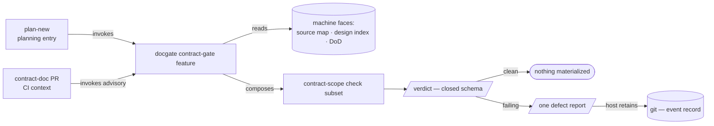

# Contract gate — the mechanical stage-6 gate as a docgate mode, planning entry scoped to document-pipeline features — technical design

| Field | Value |
|---|---|
| **Status** | Approved — operator review 2026-09-23 *(merge freezes the document; "superseded" is computed by the index, never written here)* |
| **Owner** | @mdarabi |
| **Approver(s)** | @mdarabi (operator) — the surface is a governance gate on the pipeline's critical path; a named reviewer is mandatory |
| **Date** | 2026-09-23 |
| **Relevant-when** | designing or changing the contract gate mechanism — the `docgate contract-gate` verb, the fold machine-face enrichment, the verdict + defect-report schemas, the check-registry membership, or the plan-new planning-entry precondition and which features it covers; implementing against it; superseding it |
| **Scope** | The mechanical contract gate's mechanism: a docgate-hosted verb composing the five deterministic checks into a feature-scoped verdict + a git-retained defect report, the fold enrichment its inputs need, the check-registry membership, and the plan-new precondition for document-pipeline features. **Not**: the planning precondition of a draft-born feature (`design:feature-draft-v1`); the LLM-judgment layer (issue #419); the exact defect-report home path + per-bounce naming (§7 Q2); whether the improvement-fuel-retention principle graduates to an AP (§7 Q3, operator-owned). |
| **Tracking** | agenticlab-ai/pyxis — the feature-draft introducing PR (filed with this design) |
| **Builds-on** | docs/tech-design/prd-amendment-model-v2.md · docs/tech-design/docgate-v2.md · docs/tech-design/distributed-check-registration.md · docs/tech-design/plan-new-routed-demand.md · docs/tech-design/feature-draft-v1.md |
| **Supersedes** | contract-gate-v1 |
| **Serves** | prd:contract-gate/FR-1 · prd:contract-gate/FR-3 · prd:contract-gate/FR-4 · prd:contract-gate/FR-5 · prd:contract-gate/FR-6 · prd:contract-gate/FR-7 · prd:contract-gate/FR-8 · prd:contract-gate/FR-11 · prd:contract-gate/FR-12 · prd:contract-gate/FR-13 · prd:contract-gate/NR-1 · prd:contract-gate/NR-2 · prd:contract-gate/NR-3 · prd:contract-gate/UB-1 · prd:contract-gate/UB-2 · prd:contract-gate/UB-3 · prd:contract-gate/UB-4 · prd:contract-gate/UB-5 · prd:contract-gate/UB-6 · prd:contract-gate/NFR-1 · prd:contract-gate/NFR-2 · prd:contract-gate/NFR-3 · prd:contract-gate/NFR-4 · prd:contract-gate/NFR-5 · prd:contract-gate/NFR-6 · prd:feature-draft/FR-31 |
| **Security/privacy impact** | none — read-only over committed repo files; no identity, secret, network, or egress surface (pairs with §3.5) |
| **Template version** | tech-design-template/v1 |

## 0. Read to rule — the human reviewer's section (~7 min)

*The body is the contract; this section only routes attention — on any conflict the body governs; machines ignore it.*

**Judge these**

| # | The call | Could have gone | If you disagree |
|---|---|---|---|
| 0 | **The planning-entry precondition covers document-pipeline features only** — a draft-born feature plans from its locked version's readiness (§3.10) | keep the precondition for every feature (`contract-gate-v1` §3.10), or forward draft-born features to memory readiness (`design-brainstorm:feature-draft-tech-design#D-18`) | a draft-born feature cannot plan, or this gate learns the memory model → §3.10, §1 |
| 1 | **Docgate-hosted verb, not a separate binary** — contract-gate reuses docgate's checks, fold, registry, and machine faces (§2) | a standalone pinned `cmd/contractgate` (`design-brainstorm:contract-gate-tech-design#ALT-2`) | the tool boundary moves: identity separates but docgate's check machinery is duplicated or coupled-to → §2, §3.1 |
| 2 | **The defect report is a git-committed immutable event record** (§3.8) | a gitignored ephemeral artifact (`#ALT-3`) | improvement fuel is discarded or retained; the commit-mechanism question (Q1) disappears → §3.8, §7 Q1 |
| 3 | **The gate is read-only; the host commits the report** (#DINV-1) | the gate writes the report itself | FR-11 is preserved or broken; where the planning-entry commit happens changes → §3.1, §3.8, #DINV-1 |
| 4 | **Enrich the fold's machine face; the gate never re-parses** (§3.6) | a second parser in the gate reading `effective.md` | the single-parser discipline holds or a drift surface opens → §3.6, #DINV-3 |
| 5 | **Reserve the semantic verdict slot, don't specify it** (§3.7) | fully specify the LLM verdict fields now | #419 lands additively or the schema guesses its shape early → §3.7, #DINV-4 |

**Sanity-check the numbers** — the gate completes in p95 ≤ 5 s on the largest live contract (A-7, `prd:contract-gate/NFR-1`); a pass materializes exactly zero artifacts (#DINV-6); the primary metric is a **zero** escape rate (`prd:contract-gate` M1).

**The author's open questions** — the planning-entry commit mechanism for the report (§7 Q1, from `#G-1`) and the report's home path + naming (§7 Q2) are design-implementation calls; the improvement-fuel question (§7 Q3) is resolved: it graduated as AP-28.

**Skip the rest** — schema/anchor/fold correctness → docgate; substance, reuse, and partition honesty → the unmanned `tech-design-review`; implementation defects → codegate + downstream gates; rationale and the rejected shapes → §4 (explanatory).

## 1. Problem

**Successor.** This design supersedes `contract-gate-v1` to scope one binding statement. Its planning-entry precondition (§3.10) required plan-new to call the gate before any plan. A draft-born feature (`prd:feature-draft`) has no PRD ledger, so the gate would refuse it with `configuration-error`, and `prd:feature-draft/FR-31` replaces the precondition for those features with the locked draft's readiness. Everything else in `contract-gate-v1` is carried forward, with two corrections of fact: `Serves` drops `prd:contract-gate/FR-2`, `FR-9`, and `FR-10`, which contract-gate amendment 001 superseded by `FR-14`, `FR-19`, and `FR-18`; this design carries the gate as built and does not design those successors, which stay undesigned. §7 Q3 records that its question graduated as AP-28 (`design-brainstorm:feature-draft-tech-design#D-18`).

The `contract-gate` PRD (merged #418) binds *what* the mechanical gate must do — five deterministic checks over a feature's assembled contract, hard at planning entry and advisory on contract-doc PRs, emitting nothing on a pass and one structured defect report on a bounce — but leaves the *mechanism* undecided: where the gate lives, where its checks get per-requirement inputs the source map does not expose, how the defect report persists, whether the verdict schema reserves the future LLM fields, and how the checks register and wire into planning. Deciding these now — before any gate code exists — is the cheapest moment: the substrate it reuses (docgate's fold, registry, and the check-citations / GenCoverage / stale-flag machinery) is already shipped, so the gate is composition, not construction, and the composition boundary is what this design fixes.

## 2. Decision

**Decision:** The mechanical contract gate is a **docgate-hosted mode** — a `docgate contract-gate <feature>` verb that resolves a feature's assembled contract from docgate's own committed machine faces, composes a **feature-scoped subset of docgate's checks** (the live `check-citations` for links, `GenCoverage` for inverse coverage, the design index's stale flags for currency, plus two new self-registered checks for structural completeness and compilability), and returns one closed-schema **verdict**; on any failing verdict it emits **one dual-face defect report** which the host retains to git as an immutable event record. The gate itself is **read-only** — it emits, it never commits or mutates; a passing contract materializes nothing. plan-new invokes the verb at planning entry (a hard gate, via an additive amendment to its ledger); a docgate CI check runs the same checks as the advisory continuous surface.

The reasoning: contract-gate's checks *are* doc-system checks over docgate's own machine faces, so hosting them in docgate reuses the fold, the source-map reader, the check registry, and three of the five checks outright — the PRD's "reuse the substrate, don't rebuild" bet — where a separate binary would duplicate that machinery or import docgate's internals anyway. The sibling `codegate` chose a separate binary explicitly because code-verification is a *different* domain; contract-gate is the same (docs) domain, so the precedent inverts. Everything else follows from keeping the gate a read-only composition over existing, single-parser data.

## 3. The design

### 3.1 The verb and its composition

**Decision:** `docgate contract-gate <feature>` is a feature-scoped, verdict-producing mode on the docgate binary, distinct from docgate's tree-wide defect-stream gate. It resolves the feature's **assembled contract** — the live PRD projection (`effective.source.json`), the live technical designs whose `Serves` targets that feature's requirements (from the design index), and the DoD — runs the contract-scope check subset (§3.9) against it, and returns the verdict (§3.7). It writes nothing: the verdict goes to stdout/return, the report (on failure) to a path the host reads (§3.8). The tree-wide docgate gate and its `docs-gate` CI context are unchanged (`prd:contract-gate/NR-2`).

### 3.2 Boundaries and non-goals

- **Not solved here** — the LLM-judgment layer: the `semantic` verdict slot's internals, the ambiguous/contradictory checks, and the analytical outputs (risk, cost, suggested evals) are issue #419's, filled additively into the reserved slot (§3.7; `design-brainstorm:contract-gate-tech-design#O-1`).
- **Owned by another design** — the planning precondition of a draft-born feature: its locked version's readiness, computed in memory (`design:feature-draft-v1`).
- **Owned by a future design** — an always-on ExecutableContract graph on a passing contract (the basis's NG-1/WR-2) — nothing materializes on a pass here; the exact defect-report home path and per-bounce naming (§7 Q2). The five rulings here (home, inputs, output schema, registration, trigger) **co-revise as one mechanism** — change the gate and they move together — which is why they are one document; should the fold enrichment (§3.6) grow consumers beyond this gate, *that* becomes an independently-revisable docgate-schema design superseding this one's §3.6.
- **Implementation must not infer** — that the gate may write anything (it is read-only, #DINV-1); that a pass emits a report (it emits nothing, #DINV-6); that "mechanically clean" means the full stage-6 "executable" verdict (it is a floor — the semantic classes are unevaluated in v1, #DINV-4).
- **Must remain unchanged** — docgate's tree-wide gate verdict and the `docs-gate` context (`NR-2`); the design index's `serves_inverse` and stale flags keep their current advisory shape for their other readers (`NR-2`); `check-citations`'s existing repo-wide behavior (`NR-3`); the fold enrichment is additive-only (§3.6).

### 3.3 Invariants

- **DINV-1** — **Read-only gate.** The `contract-gate` verb makes zero mutations on any path — no git commit, no tracker write, no file write outside the report sink it is told to emit to; the verdict and the report are its only outputs, and the *host* retains the report to git (`prd:contract-gate/FR-11`).
- **DINV-2** — **Immutable event record.** A committed defect report is never overwritten or edited; re-gating a fixed contract produces a *new* record, and the prior one persists as history (§3.8).
- **DINV-3** — **Single parser.** The gate reads contract data only from docgate's committed machine faces; it never re-parses `effective.md` or a design body for substance, and the fold remains the sole parser of the ledger (`FR-10`).
- **DINV-4** — **Reserved-not-evaluated semantic slot.** The v1 verdict schema declares the `semantic` slot and the extended verdict-class values as *known* keys that are never populated in v1; a v1 verdict marks them not-evaluated, so a mechanically-clean pass is never reported as the full "executable" verdict (`FR-7`).
- **DINV-5** — **Deterministic and network-free.** Given identical machine-face inputs the verdict is byte-identical (modulo declared timing fields); the gate makes no network call, no clock/randomness-dependent decision, and **no model invocation — zero tokens** (every check is deterministic code) (`FR-12`, `NFR-2`, `NFR-3`).
- **DINV-6** — **Nothing on a pass.** A `clean` verdict emits no defect report and materializes no artifact (`prd:contract-gate/NG-1`, `FR-8`).
- **DINV-7** — **Additive fold enrichment.** The per-requirement fields added to the machine face are additive; no existing `UnitState` field changes meaning or is removed, so existing machine-face consumers are unaffected (§3.6, AP-5/6).

### 3.4 Observability

- **Events/logs** — the gate emits the PRD's tracking events: `EVT-1` gate_run (every invocation, with verdict + per-check result + input fingerprints + trigger), `EVT-2` defect_emitted (per defect: check id, class, offender, severity), `EVT-3` planning_gated (a planning-entry non-clean bounce), `EVT-4` disposition_record (a disputed bounce opened + dispositioned) — `prd:contract-gate/§5.7`.
- **Metrics** — the escape rate (M1, zero target) and the pre-planning bounce count are derived from `EVT-1`/`EVT-2`; the false-bounce guardrail from `EVT-4`.
- **Alerts** — none in v1 (a read-only gate has no runtime service to page on); a gate-caused planning stall surfaces as an `EVT-4` disposition, not an alert.
- **Debugging surface** — the **git-committed defect reports are themselves the durable diagnostic + learning record** (§3.8): each names its checks, offenders, and unblocks; the verdict records the exact input fingerprints it evaluated, so a disputed verdict is reproducible by re-running the verb against the same fingerprints.
- **Trace/correlation** — each `EVT-1` carries the feature id + input fingerprints; the committed report cross-references the verdict's fingerprints, joining a bounce to the exact contract state that produced it.

### 3.5 Security & privacy

none — matches the header row. The gate is read-only over committed repo files (DINV-1), makes no network call (DINV-5), and reads no identity, secret, or user data; it produces a verdict and a defect report from public repo content. No egress, no new credential or production-control surface (`prd:contract-gate/NFR-6`).

### 3.6 The check inputs — additive fold machine-face enrichment

**Decision:** The structural-completeness and inverse-coverage checks read per-requirement inputs from an **enriched fold machine face**, not a second parser. The fold gains additive typed fields on each requirement unit — its **priority** (Must/Should/Could, where the table carries a Priority column), whether it carries a non-empty **fit criterion**, and its declared **verification method** — projected from the row cells the fold *already tokenizes* (`ledger.Unit.Cells`, keyed to the header by `Table.Cols` column name). The gate consumes these fields; it never re-parses `effective.md`.

This is a projection add, not new parsing (the cells are already parsed — the R1 budget risk is de-risked), and it keeps the fold the single parser (DINV-3): a gate-side parser would drift from the fold, the exact single-source failure the reuse decision refused. The field set is additive (DINV-7) and lands on docgate's fold as an additive schema evolution; column resolution is by header name, so it is robust to per-table column-order differences (FR and UB tables carry Priority; NR/NFR do not — coverage's Must scoping applies where the column exists).

Migration is a re-fold, not a rewrite: existing folded projections gain the new fields the next time their ledger is folded; a one-time re-fold across the ledger set populates them additively (DINV-7), changing no existing field's meaning — the projections are regenerable by construction, so this is regeneration, not a data migration.

### 3.7 The verdict — a closed schema with reserved semantic extension points

**Decision:** The verb returns one closed, versioned **verdict** recording, per check, its result; the overall class ∈ `clean` · `incomplete` · `malformed` · `stale` · `unresolved` · `error` · `configuration-error`; and the identity it evaluated (each input's content fingerprint + the gate/tool version). The verdict-class enum is declared **open** to the future semantic classes (`ambiguous`, `contradictory`), and a `semantic` object is a **known-but-not-evaluated** slot; v1 fully specifies the mechanical fields and marks the semantic slot not-evaluated (DINV-4). The LLM follow-up (#419) fills the semantic slot's internals additively — a pure additive evolution with no v1 schema break, because the reserved slot is a *known* key that never trips closed-schema unknown-key rejection (AP-5/6). A `clean` verdict is labeled "mechanically clean," never "executable" (`prd:contract-gate/FR-7`).

### 3.8 The defect report — a git-committed immutable event record

**Decision:** On a failing verdict the verb emits **one** structured, dual-face (machine JSON + human rendering) defect report bundling every failed check's named defects — each carrying the check id, the specific offender (a requirement ID, a citation + source location, a stale input + what superseded it, a malformed join), and what unblocks it. The report is **retained to git as an immutable, append-only event record** — the review-report/incident family — because a contract bounce is improvement fuel for the factory's learning loops, not a transient diagnostic.

The report is an **event record** ("at run T, contract C carried defects D"), *not* a live projection: it does not stale when the contract is fixed — a re-gate produces a *new* record and the prior one stays as history (DINV-2). This is why git-retention is safe here where it would be wrong for a live derivable (the #149 staleness family applies to projections, not event records). The gate stays read-only (DINV-1): the verb **emits** the report to a path; the **host retains it to git**. The continuous contract-doc-PR surface has a natural commit home (the report rides the PR, review-report-style); the planning-entry bounce has no PR to ride, so *who* commits it there is §7 Q1. On a `clean` verdict no report is emitted (DINV-6). The durable aggregate signal for the learning loops is the committed reports plus the `EVT-2` defect events (§3.4); the two are complementary, not redundant.

### 3.9 Check registration and the contract-scope subset

**Decision:** The two new checks — structural completeness and compilability — self-register per-file into **docgate's existing registry** via the distributed-check-registration pattern (each is one file calling the registrar at init; no shared enumeration, dispatch, or help line is edited — AP-27). A check descriptor gains an additive **`contract-scope` membership marker**. The three reused checks (`check-citations`, `GenCoverage`, the stale-flag computation) are already present or computed. The `contract-gate` verb assembles the marked subset and runs it **feature-scoped** — against one feature's assembled contract rather than the whole tree — aggregating per-check results into the verdict (§3.7). Registration order carries no meaning (assembly sorts by verb, per the DCR invariants); the marker is a read-only descriptor field, contributed at init and never mutated. Adding a future contract-scope check stays a single-file addition (`prd:contract-gate/NFR-5`).

**Feature-scoping the reused checks.** The three reused checks are tree-wide today. The verb scopes them to the feature by **selecting the feature's units from the machine faces** — the source map's `prd:<feature>` unit family and the design index's `serves_inverse` entries targeting that feature — and running each check over that subset; the checks' tree-wide behavior for their existing callers is byte-unchanged (`NR-2`, `NR-3`), the scoping living entirely in the verb's composition. `GenCoverage` already keys coverage by `prd:<feature>` family, so its feature slice is a direct read; the citation and stale-flag checks are filtered to the feature's own documents.

### 3.10 The two triggers — planning-entry precondition and continuous surface

**Decision:** The **planning-entry hard gate** lands as an additive typed amendment (`add` op) on plan-new's frozen ledger: a precondition FR requiring plan-new to call `docgate contract-gate <feature>` before it drafts, freezes, or projects any plan for a document-pipeline feature — a feature with a PRD ledger — and to refuse on any non-clean verdict (`prd:contract-gate/FR-1`, `NR-1`). A draft-born feature's planning precondition is its locked version's readiness, computed in memory (`prd:feature-draft/FR-31`, `design:feature-draft-v1`); this gate is not called for it. Contract-gate's feature-level checks run **before** plan-new's own plan-level coverage (its FR-26) and fog bounce (its FR-16) — complementary altitudes, no contradiction, so no requirement hole to bounce. The **continuous advisory surface** is a docgate CI context running the same contract-scope subset over a changed feature's contract on PRD/design PRs, with currency/link/structural defects blocking and inverse-coverage advisory (a PRD legitimately merges before its designs exist) — the severity split read from the closed-schema versioned severity-map policy (`prd:contract-gate/FR-13`, on the `pyxis-config/` surface, the plangate/codegate caps precedent).

### 3.11 Failure handling and testing strategy

Every check fails closed: a missing/unreadable input or an unmerged contract yields `configuration-error` with zero checks run; a malformed machine face or a check that raises yields `error`; none returns `clean` on bad input (`prd:contract-gate/UB-1..6`, DINV-5). A malformed severity-map yields `configuration-error`; a *missing* one falls back to the built-in default split (`UB-6`).

Testing seams: the check logic and the verdict/report assembly are **in-process** (table-driven tests over fixture contracts — clean and one-per-defect-class); the machine faces are **local-substitutable** (fixture `effective.source.json` + design-index inputs, no live fold run needed per test); the plan-new precondition is verified by an **integration fixture** (a bouncing contract produces zero plan output, a clean one proceeds). Golden files pin the verdict and both report faces. The gate has no true-external dependency (no network, DINV-5), so no injected mock is needed — a single production path, exercised directly.

## 4. Alternatives considered

| Alternative | Why rejected |
|---|---|
| A separate pinned `cmd/contractgate` binary (`design-brainstorm:contract-gate-tech-design#ALT-2`) | contract-gate's checks *are* docgate's machinery (check-citations, GenCoverage, the stale flags); a separate binary duplicates them (the drift the PRD's §4.1-C refused) or imports docgate's `internal/` (coupling without the co-location benefit), plus one more pinned-binary surface. The clean-identity win does not pay for duplicating the check machinery. |
| A gitignored ephemeral defect artifact, codegate-verdict style (`#ALT-3`) | discards the improvement fuel a bounce carries; only aggregate events would survive. Its motivating staleness concern misframes an event record as a live projection — an event record does not stale (§3.8, DINV-2). |
| A second parser in the gate reading `effective.md` | opens a drift surface against the fold (the single-source failure); and it is unnecessary — the fold already tokenizes the rows (§3.6). |
| Fully specify the semantic verdict fields now | guesses the LLM verdict's internal shape before #419 designs it; a closed schema then forces a change anyway. Reserving the slot (DINV-4) lands #419 additively. |
| A plangate-hosted verb (because the gate fires at planning entry) | the firing moment is who-invokes-when; the checks are doc-domain over the PRD/design machine faces, not plan-domain — they belong where doc checks live (docgate), which plangate is not. |

## 5. Risks

| ID | Risk | Impact | Mitigation | Verification / evidence |
|---|---|---|---|---|
| R1 | The fold enrichment (§3.6) turns out larger than the projection-add audit predicted | docgate schema churn; budget overrun | the audit found the cells already tokenized (`#F-3`); the change is header-named column reads + additive fields (DINV-7); if it grows, it is a flag-and-surface signal, not silent absorption | the enrichment diff reviewed against the audit; docgate fold tests stay green |
| R2 | docgate gains a second gate identity (tree-wide defect stream + feature-scoped verdict) that confuses the binary's contract | maintenance/onboarding cost | the two modes are distinct verbs over one registry; the tree-wide gate + `docs-gate` context are byte-unchanged (NR-2); the feature-scoped verb is additive | NR-2 inspection; the docgate gate verdict on the corpus unchanged |
| R3 | The planning-entry commit home for the report (§7 Q1) has no clean answer, stranding improvement fuel on planning-entry bounces | some bounces not retained | the continuous surface retains contract-doc-PR bounces already; the planning-entry mechanism is an open question with a viable host-commit path (plan-new or a reports PR), not a blocker | Q1 resolved at implementation; the continuous path covers the common drift case |
| R4 | Reviewers over-trust a `clean` verdict as the full stage-6 guarantee | false confidence | DINV-4 forbids labeling a pass "executable"; the semantic classes are declared unevaluated; the floor framing is in §2, §3.7, and the PRD | DINV-4 schema test: no v1 verdict reports the semantic classes as evaluated |

## 6. Acceptance

| ID | Acceptance criterion | Verify | Required evidence | Traces to |
|---|---|---|---|---|
| A-1 | `docgate contract-gate <feature>` runs the five contract-scope checks feature-scoped and returns a closed-schema verdict enumerating each check's result | Test | fixture-suite CI run | `prd:contract-gate/FR-1` · `FR-7` · §3.1 |
| A-2 | Each of the five checks catches its seeded defect class and passes a clean fixture; currency/coverage/link reuse the existing docgate machinery, structural/compilability are the new checks | Test | per-check fixture results | `prd:contract-gate/FR-3..FR-6` · §3.9 (the currency check as built for the superseded `FR-2`) |
| A-3 | The fold machine face exposes the additive per-requirement fields (priority, has-fit-criterion, verify-method); the gate reads them and no gate code parses `effective.md` | Test, Inspection | fold golden + a source read of the gate | `prd:contract-gate/FR-3` · `FR-5` · `FR-10` · #DINV-3 · #DINV-7 |
| A-4 | A bounce emits exactly one dual-face report (both faces schema-valid, every defect naming check-id + offender + unblock); a clean verdict emits none | Test | schema-validation fixtures | `prd:contract-gate/FR-8` · #DINV-2 · #DINV-6 |
| A-5 | The gate makes zero mutations on any path across all fixtures (clean and failing) | Test, Inspection | filesystem/git/tracker audit | `prd:contract-gate/FR-11` · #DINV-1 |
| A-6 | The two new checks each land as a single new file touching no shared enumeration/dispatch/help; the verb assembles the `contract-scope` subset | Inspection | the added-check diffs + registry-membership test | `prd:contract-gate/NFR-5` · §3.9 |
| A-7 | The gate is deterministic (byte-identical verdict across runs) and completes within p95 ≤ 5 s on the largest live contract; a network attempt fails the determinism suite | Test | determinism + timing run | `prd:contract-gate/NFR-1` · `NFR-2` · #DINV-5 |
| A-8 | For a document-pipeline feature, the plan-new precondition refuses drafting on a non-clean verdict and proceeds on a clean one; for a draft-born feature, plan-new does not call this gate and proceeds on its locked version's readiness | Test, Inspection | integration fixtures for both feature kinds | `prd:contract-gate/FR-1` · `NR-1` · `prd:feature-draft/FR-31` · §3.10 |
| A-9 | This design passes `docgate lint-tech-designs` and ships with the regenerated index | Test | gate output in the introducing PR | tech-design-conventions §3.2 |

## 7. Open questions

| ID | Question | Owner | Blocks | Status | Resolution |
|---|---|---|---|---|---|
| Q1 | The planning-entry commit mechanism: who commits the emitted report on a planning-entry bounce (no PR to ride) while preserving the gate's read-only invariant? | implementation | implementation | open | from `design-brainstorm:contract-gate-tech-design#G-1`; the continuous contract-doc-PR surface has a natural home; the planning-entry path (plan-new-side commit, or a reports PR) is decided at implementation |
| Q2 | The defect-report home path + per-bounce naming (dense-numbered vs timestamped) within the event-record family | implementation | nothing | open | decided at implementation against the review-report/incident conventions |
| Q3 | Does the operator's "any improvement-fuel output is retained in git" principle graduate to an architecture principle? | operator | nothing | resolved | graduated as AP-28 in the architecture principles |

## Principles

- **AP-5 / AP-6 — honored.** The verdict and defect report are closed, versioned, structured data; the fold enrichment (§3.6) and the reserved semantic slot (§3.7) are additive-only evolutions (DINV-7, DINV-4).
- **AP-10 — honored.** Reuse over rebuild: the gate composes docgate's existing fold, registry, and three shipped checks rather than re-implementing them (§2, §3.9) — the decision's spine.
- **AP-11 — honored.** One predicate, one parser: the same contract-scope check subset runs at both triggers (§3.10), and the fold stays the single parser (DINV-3) — no drifting second implementation.
- **AP-13 — honored.** The verdict records the exact content fingerprints it evaluated (§3.7), so a verdict is never true about the wrong contract state; the committed report cross-references them (§3.4).
- **AP-21 — honored.** The verdict and report are judged once and retained as data downstream reads verbatim (§3.7, §3.8); the committed report is the frozen record of that judgment.
- **AP-23 — honored.** The self-registration (§3.9) keeps check authorship conflict-magnet-free — two parallel check-adding tasks touch two disjoint files, no shared enumeration/dispatch/help line — the principle's charter surface, inherited by extending the DCR pattern.
- **AP-27 — honored.** The two new checks self-register per-file with a membership marker; no shared enumeration is edited (§3.9) — the DCR pattern extended, not a central list.
- **AP-28 — honored.** The defect report is an immutable event record retained in git (§3.8), the principle that graduated from this design's §7 Q3.
- **Deviation:** none.
