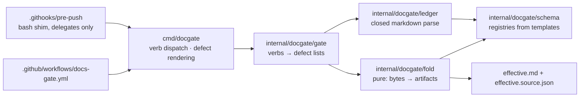

# docgate v1 — the fold, the gate verbs, and the wiring

| Field | Value |
|---|---|
| **Status** | Approved (2026-07-06 — operator, in operator review) *(merge is the freezing event; "superseded" is computed by the index, never written here)* |
| **Owner** | @mdarabi |
| **Approver(s)** | @mdarabi (operator) |
| **Date** | 2026-07-06 |
| **Relevant-when** | implementing or restructuring the docgate binary; adding or changing a gate verb; touching the fold, the normalization rules, the defect format, or the source-map schema; wiring the docs-gate CI context or the pre-push hook |
| **Scope** | The Go shape of docgate v1: package boundaries, fold semantics (incl. normalization and `verify-rebase` equality — PRD Q1), defects-as-data, the v1 `effective.source.json` schema, fixture/golden layout, and the desk+CI wiring (PRD Q2). **Not**: the amendment model's semantics (decided in `prd-amendment-model`), v2 design-doc verbs and indexes (NG-4/WR-1), the Contract Compiler. |
| **Tracking** | introducing PR (filed on approval) |
| **Builds-on** | docs/tech-design/prd-amendment-model.md · docs/tech-design/tech-design-conventions.md |
| **Supersedes** | — |
| **Serves** | prd:docgate/FR-1 · prd:docgate/FR-2 · prd:docgate/FR-3 · prd:docgate/FR-4 · prd:docgate/FR-5 · prd:docgate/FR-6 · prd:docgate/FR-7 · prd:docgate/FR-8 · prd:docgate/NFR-1 · prd:docgate/NFR-2 · prd:docgate/NFR-3 |
| **Security/privacy impact** | none — hermetic repo-local tool: no identity, secrets, user data, network, or egress surface (PRD NFR-2) |
| **Template version** | tech-design-template/v1 |

## 1. Problem

The PRD (`docs/prds/docgate/`, gates signed) specifies *what* docgate
guarantees; the amendment model specifies *what the fold and verbs mean*.
Neither decides the Go shape: package boundaries, how the verbs share the
parse and the fold, the exact normalization the fingerprint hashes, what
"semantically identical" means for `verify-rebase` (PRD Q1), the concrete
v1 schema of `effective.source.json`, how goldens are laid out, or how the
gate reaches the desk and CI in a repo that today has neither a Go module
nor a workflow (PRD Q2). Deciding this before the first line of code is
RW-5 verbatim — and this is the repo's first code, so it also bootstraps
the module, the lint config, and CI itself.

## 2. Decision

**Decision:** One binary, `cmd/docgate` (thin main: flag parsing, verb
dispatch, defect rendering), with all logic under **`internal/docgate/`**:
`ledger` (closed parse of envelopes, ops, payload tables — the only
package that reads markdown), `fold` (**pure**: ledger bytes in, artifact
bytes out — no filesystem, network, clock, or environment), `gate` (the
verbs as functions returning defect lists, composing `ledger`+`fold`), and
`schema` (anchor/table/envelope registries derived from the templates,
version-pinned). Standard library only. An umbrella verb — `docgate gate`
— runs every applicable check for the working tree or a merge base, and
is the single entry point the pre-push hook and CI both call (AP-11: one
predicate, one invocation shape, two places).

Purity of `fold` is the load-bearing choice: determinism (FR-1) becomes a
property of a pure function, testable without a filesystem; and
`verify-generated` (FR-3) is recompute-and-compare by construction.



## 3. The design

### 3.1 Package boundaries

Top-level `internal/` is reserved for the engine and genuinely shared
packages; a binary's private packages nest under its own
`internal/<binary>/` subtree — ownership by construction, and generic
names (`ledger`, `schema`) stay free for the engine to claim later.
docgate therefore owns `internal/docgate/`.

| Package | Provides | May import |
|---|---|---|
| `cmd/docgate` | verb dispatch, exit codes, human defects on stderr, `--defects-json` stream (FR-2) | `internal/docgate/*` |
| `internal/docgate/ledger` | parsed ledger: envelope structs, typed ops, payload rows; every parse failure is a defect, never a panic | `internal/docgate/schema` |
| `internal/docgate/fold` | `Fold(entries) → (effectiveMD, sourceJSON []byte, defects)` — pure | `internal/docgate/schema` |
| `internal/docgate/gate` | the verbs (`lint-structure`, `check-immutable`, `validate-amendments`, `verify-generated`, `diff`, `verify-rebase`) as functions; the `gate` umbrella | `internal/docgate/ledger`, `internal/docgate/fold` |
| `internal/docgate/schema` | closed-parse registries: ID namespaces, table column schemas, envelope fields, evidence classes — derived from the three templates and pinned to their versions | stdlib only |

Only `cmd/docgate` performs IO beyond reads: `fold`'s outputs are written
by the command layer, and only the two artifact paths are ever written.
`check-immutable` shells out to `git diff --name-status <merge-base>` —
the one subprocess, isolated in `internal/docgate/gate`.

### 3.2 Boundaries and non-goals

- **Not solved here** — semantic conflict detection (PRD NG-2), design-doc
  verbs and indexes (NG-4; v2 per tech-design-conventions §3.4), any
  engine integration (WR-3).
- **Owned by a future design** — docgate v2; the workbench installer that
  automates hook setup (Q2's manual step is transitional).
- **Implementation must not infer** — that the parser is a general
  markdown parser: it parses **exactly** the pinned template shapes;
  anything else is a defect, not a best-effort parse. And not that `gate`
  verbs may write: only `fold` produces bytes, only `cmd` writes them.
- **Must remain unchanged** — the placeholder corpus and every non-ledger
  doc (PRD NR-1); the existing doc-tooling suites (PRD NR-2).

### 3.3 Invariants

- **DINV-1** — `internal/docgate/fold` is pure: identical input bytes yield
  identical output bytes on every platform, with no ambient reads.
- **DINV-2** — no lenient mode exists anywhere: every ambiguity is a
  defect with file, op, reason, and remedy; there is no flag that weakens
  a check.
- **DINV-3** — gate verbs never mutate: the only writes in the system are
  the two artifact files, written by `cmd` from `fold` output.
- **DINV-4** — desk and CI run the same binary, same verbs, same
  configuration; no CI-only or hook-only logic exists.

### 3.4 Observability

- **Events/logs** — human-readable defects on stderr; one JSON line per
  defect on `--defects-json` (FR-2): `{file, op, reason, remedy}` plus the
  verb that raised it.
- **Metrics** — golden-suite pass rate in CI (PRD M1) and first-try gate
  passes on amendment PRs (M2), both measured from CI/PR records per the
  PRD's measurement plans; no runtime telemetry (hermetic tool).
- **Alerts** — a red required context *is* the alert; no other channel.
- **Debugging surface** — any fixture directory replays a failure exactly
  (`docgate gate <fixture>`); `fold` accepts any ledger directory, so a
  failing real ledger is itself a reproducible case.
- **Trace/correlation** — none: single-process CLI; the defect's
  file/op/verb triple is the correlation key.

### 3.5 Security & privacy

none — matches the header row: hermetic, repo-local, stdlib-only; the gate
path performs no network IO (enforced by A-6) and handles no secrets or
user data. The one subprocess is `git` against the local clone.

### 3.6 Fold semantics: normalization, fingerprint, and `verify-rebase` (answers PRD Q1)

Normalization (the bytes the fingerprint hashes, and the first step of
every parse): CRLF/CR → LF; strip trailing spaces and tabs per line; the
file's final newline is exactly one. The **content fingerprint** is
sha256 over the normalized bytes of the replayed ledger entries (latest
rebase onward), concatenated in filename order with a `\x00` separator
between entries (unambiguous under any content). The tool version is
recorded in both artifacts and never hashed.

**Decision (Q1):** `verify-rebase` compares **fold outputs, byte-wise,
after masking the generated header block** (the as-of / fingerprint /
tool-version lines — the "checkpoint metadata" allowance):
`fold(entries before the rebase)` must equal `fold(rebase entry alone)`.
Because the fold is canonicalizing and byte-deterministic, semantic
equality collapses into byte equality of refolds — no AST comparison, no
second equality definition to maintain. A rebase that reorders prose
without changing meaning *will* fail; that is correct — a rebase is a
semantic no-op snapshot of the projection, not a rewrite opportunity.

### 3.7 Defects as data

One defect type everywhere: `{verb, file, op, reason, remedy}`. Verbs
return `[]Defect`; `cmd` renders both faces. Exit codes: `0` clean, `1`
defects found, `2` usage/environment error. The defect catalog (every
`reason` string with its remedy) is a committed file beside the fixtures
and doubles as the runbook (PRD §6.4 supportability).

### 3.8 `effective.source.json` — the v1 schema

Pinned by goldens; additive evolution only:

```json
{
  "schema_version": "1",
  "generated_by": "docgate",
  "tool_version": "<recorded, never hashed>",
  "as_of": "000",
  "content_fingerprint": "sha256:...",
  "units": {
    "FR-1": {
      "status": "live",
      "introduced_by": "000-base.md",
      "supersedes": null,
      "superseded_by": null,
      "source_location": "000-base.md#5.1",
      "current_location": "effective.md#FR-1"
    }
  }
}
```

Every ID-bearing unit (all sixteen PRD prefixes) gets an entry; superseded
and retired units keep theirs with status + successor. The requirements
inverse map and binding blocks are v2 concerns (they serve the design
index and compiler); v1 carries per-unit lineage only — additive room is
reserved by the schema version.

### 3.9 Fixtures and goldens

`internal/docgate/fold/testdata/<case>/` — each case: ledger files +
`expect/effective.md` + `expect/effective.source.json` +
`expect/defects.json` (non-empty = a red case). Seeded from: the three
templates' own example blocks (PRD DOD-4), one red case per defect class
in the amendment model (dangling target, double-supersede, ID reuse,
schema-violating payload, gap/duplicate numbering, unapproved merge
target, understated blast radius, tampered rebase, hand-edited
projection), and **fixture zero**: the real `docs/prds/docgate/` ledger —
whose provisional fingerprint
(`sha256:50c0fad5ef7c0732235af5e93d45b0528d84cadb133e8241b3e896bb6938e913`)
the implemented fold must reproduce or the discrepancy be documented in
the introducing PR (PRD DOD-5; the manual projection was built to this
design's §3.6 normalization).

### 3.10 Wiring: umbrella verb, pre-push, CI (answers PRD Q2)

`docgate gate [--merge-base <ref>] [paths…]` runs every applicable verb.

**Decision (Q2):** the pre-push path is a committed `.githooks/pre-push` —
a **bash-3.2 shim** (admissible under the language policy: a git hook
entry is the named hard shell requirement) that only delegates:
`exec go run ./cmd/docgate gate --merge-base @{push}` with a two-line
"docgate unavailable — install Go / see AGENTS.md" failure message.
Activation is one documented command — `git config core.hooksPath
.githooks` — recorded in AGENTS.md; automating it is the future workbench
installer's job, and until CI is wired the hook is advisory (PRD §6.5).
CI is `.github/workflows/docs-gate.yml`: setup-go (version from
`go.mod`), `go test -race ./...`, then `docgate gate --merge-base
origin/main`; the workflow becomes the required `docs-gate` context
(branch protection — operator act). The repo's first workflow ships with
its first code.

## 4. Alternatives considered

| Alternative | Why rejected |
|---|---|
| a markdown library for parsing | closed-parse needs exact control of the pinned grammar; stdlib suffices; supply-chain surface stays zero (AP-6 posture / repo Go rules) |
| verbs as separate binaries | six pins, six drifts; AP-11 wants one predicate — one binary, one umbrella verb |
| `fold` with filesystem access | impurity spreads; determinism becomes an integration property instead of a unit property |
| AST/semantic equality for `verify-rebase` | a second equality definition to specify, implement, and drift; the canonicalizing fold makes byte-equality of refolds sufficient and stricter |
| full v2 source-map (inverse map, binding blocks) now | serves no v1 consumer; schema_version reserves the room; smallest honest artifact first |
| CI-only enforcement, no hook | desk verdicts minutes late; AP-11 desk/CI parity is the point of the umbrella verb |

## 5. Risks

| ID | Risk | Impact | Mitigation | Verification / evidence |
|---|---|---|---|---|
| R1 | pinned-grammar parser grows lenient branches under fixture pressure | silent acceptance of malformed ledgers | DINV-2: defects are the only escape; no weakening flags exist to grow | fixture per defect class stays red; review watches `internal/docgate/ledger` for options |
| R2 | fixture-zero fingerprint mismatch (manual projection vs implemented fold) | bootstrap confusion | §3.6 normalization was used to build the provisional file; any residual diff is documented in the introducing PR and the provisional file regenerated — the ledger (not the projection) is authoritative | DOD-5 evidence in the introducing PR |
| R3 | first-Go-code bootstrap friction (module, lint config, CI toolchain) | slow start, config churn | smallest viable configs committed with the code; golangci pinned; CI version from go.mod — single source | repo Go rules green in the introducing PR (NFR-3) |
| R4 | hook adoption friction — manual `core.hooksPath` step | authors skip desk verdicts, discover failures in CI | one documented command; CI remains authoritative; installer automates later (§3.2) | M2 at its checkpoint distinguishes desk vs CI discovery |

## 6. Acceptance

| ID | Acceptance criterion | Verify | Required evidence | Traces to |
|---|---|---|---|---|
| A-1 | `internal/docgate/fold` has no filesystem/network/clock/env imports (purity) | Test (import-graph walk) | test in suite | DINV-1 · prd:docgate/FR-1 |
| A-2 | every PRD FR fit criterion maps to ≥1 fixture case in a committed manifest | Inspection | fixture manifest | prd:docgate/FR-1..FR-8 |
| A-3 | fixture zero: the fold reproduces the docgate ledger's provisional fingerprint, or the discrepancy is documented and the provisional file regenerated in the same PR | Test | DOD-5 evidence | prd:docgate/FR-1 · §3.6 |
| A-4 | the pre-push shim is bash-3.2-clean, delegates only, and is covered by a test | Test | `scripts/tests/` addition | §3.10 |
| A-5 | pre-push and CI invoke the identical umbrella verb — invocation strings differ only in merge-base source | Inspection | hook + workflow diff | DINV-4 |
| A-6 | the gate path performs no network IO | Test (syscall/env guard in suite) | test result | prd:docgate/NFR-2 |
| A-7 | `gofmt`/`go vet`/`golangci-lint` clean; `go test -race` green; stdlib-only | Inspection | CI run | prd:docgate/NFR-3 |

## 7. Open questions

| ID | Question | Owner | Blocks | Status | Resolution |
|---|---|---|---|---|---|
| Q1 | Typed-ref range shorthand (`FR-1..FR-8`) in `Serves`: accepted by v2's parser or forbidden? This document enumerates explicitly to stay safe either way | operator | nothing (v1 parses PRD ledgers, not design headers) | open | decided at docgate v2's design |

## Principles

- **AP-10 — honored.** Every guarantee is code plus fixtures; nothing is prompt discipline — this design exists to retire the transitional prompt-side mode.
- **AP-11 / INV-30 — honored.** One binary, one umbrella verb, two call sites; DINV-4 forbids divergence by construction.
- **AP-6 / INV-32 — honored.** Closed parsing everywhere; the source-map schema is versioned and additive; defects are structured data.
- **AP-13 — honored.** Green means fixtures passed and fingerprints matched — verified artifacts, never claims.
- **AP-14 — honored.** Golden fixtures execute the contract; fixture zero verifies against the real ledger, not a synthetic one.
- **AP-17 / INV-6 — honored.** Fail closed: defects abort; no lenient mode (DINV-2); the remedy for a bad projection is regeneration, never deletion.
- **AP-19 — honored.** Steady-state cost is zero tokens and sub-second desk runs (NFR-1); no model is ever invoked (NG-3).
- **AP-20 — honored.** Writes are confined to the two artifact paths (DINV-3).
- **RW-5 — honored.** This document precedes the first line of Go; both PRD open questions are answered here (§3.6, §3.10), not in code.
- **Language policy — honored, with the sanctioned exception used.** The pre-push shim is bash because a git hook entry is the policy's own named hard requirement; it delegates only and is test-covered.
- **Deviation:** none.
