# Feature draft — hosted review and declared local Git receipts — technical design

| Field | Value |
|---|---|
| **Status** | Draft → Approved *(operator PR review and human merge required)* |
| **Owner** | @mdarabi |
| **Approver(s)** | @mdarabi (operator) — the surface governs the lock approval, the memory gate's authority, and the document gate; a named reviewer is mandatory |
| **Date** | 2026-09-30 |
| **Relevant-when** | designing or changing how a new feature's PRD and tech spec are drafted, compiled into memory, checked for readiness, approved, locked, reopened, or abandoned; the memory gate's authorization of native requirement links; the document gate's refusal of new contract documents; the plan's handoff from a locked draft; triaging refused locks, voided approvals, or compile defects; superseding this design |
| **Scope** | The existing feature-draft lifecycle, with authenticated hosted review and explicitly selected local-git declarations for compatible initialized installed repositories. This contract-only successor authorizes local approval before a later implementation enables it. Excludes migrating existing document-pipeline features, base-free draft locks, authenticated local actors, host-level local mainline protection, and implementation-task or final-feature landing authorization. |
| **Tracking** | https://github.com/agenticlab-ai/pyxis/issues/1336 — plan local-git-codehost/002 T13 |
| **Builds-on** | docs/tech-design/memory-durable-evidence-v1.md · docs/tech-design/memory-causal-admission-v1.md · docs/tech-design/memory-staged-contracts.md · docs/tech-design/plan-new-routed-demand.md · docs/tech-design/standalone-docs.md · docs/tech-design/solution-shape-v1.md |
| **Supersedes** | docs/tech-design/feature-draft-v1.md |
| **Serves** | prd:feature-draft/FR-1 · prd:feature-draft/FR-2 · prd:feature-draft/FR-3 · prd:feature-draft/FR-4 · prd:feature-draft/FR-5 · prd:feature-draft/FR-6 · prd:feature-draft/FR-7 · prd:feature-draft/FR-8 · prd:feature-draft/FR-9 · prd:feature-draft/FR-10 · prd:feature-draft/FR-11 · prd:feature-draft/FR-12 · prd:feature-draft/FR-13 · prd:feature-draft/FR-14 · prd:feature-draft/FR-15 · prd:feature-draft/FR-16 · prd:feature-draft/FR-48 · prd:feature-draft/FR-18 · prd:feature-draft/FR-19 · prd:feature-draft/FR-20 · prd:feature-draft/FR-21 · prd:feature-draft/FR-22 · prd:feature-draft/FR-23 · prd:feature-draft/FR-24 · prd:feature-draft/FR-25 · prd:feature-draft/FR-26 · prd:feature-draft/FR-55 · prd:feature-draft/FR-29 · prd:feature-draft/FR-54 · prd:feature-draft/FR-31 · prd:feature-draft/FR-32 · prd:feature-draft/FR-33 · prd:feature-draft/FR-34 · prd:feature-draft/FR-49 · prd:feature-draft/FR-36 · prd:feature-draft/FR-37 · prd:feature-draft/FR-38 · prd:feature-draft/FR-39 · prd:feature-draft/FR-40 · prd:feature-draft/FR-41 · prd:feature-draft/FR-42 · prd:feature-draft/FR-43 · prd:feature-draft/FR-44 · prd:feature-draft/FR-45 · prd:feature-draft/FR-50 · prd:feature-draft/FR-51 · prd:feature-draft/NR-1 · prd:feature-draft/NR-7 · prd:feature-draft/NR-4 · prd:feature-draft/NR-5 · prd:feature-draft/UB-1 · prd:feature-draft/UB-2 · prd:feature-draft/UB-12 · prd:feature-draft/UB-4 · prd:feature-draft/UB-14 · prd:feature-draft/UB-6 · prd:feature-draft/UB-7 · prd:feature-draft/UB-8 · prd:feature-draft/UB-9 · prd:feature-draft/UB-10 · prd:feature-draft/UB-13 · prd:feature-draft/NFR-5 · prd:feature-draft/NFR-2 · prd:feature-draft/NFR-3 · prd:feature-draft/NFR-4 · prd:feature-draft/ABUSE-1 · prd:feature-draft/ABUSE-2 · prd:feature-draft/ABUSE-3 · prd:feature-draft/ABUSE-4 · prd:feature-draft/ABUSE-5 · prd:feature-draft/ABUSE-6 · prd:feature-draft/ABUSE-7 · prd:feature-draft/ABUSE-8 · prd:feature-draft/EVT-1 · prd:feature-draft/EVT-2 · prd:feature-draft/EVT-3 · prd:feature-draft/EVT-4 · prd:feature-draft/EVT-5 · prd:feature-draft/EVT-6 · prd:feature-draft/EVT-7 · prd:feature-draft/FR-52 · prd:feature-draft/FR-53 · prd:feature-draft/NR-6 |
| **Security/privacy impact** | yes — a declared local receipt has no authenticated review actor, independent origin identity, or host-level mainline protection; hosted authentication remains required · reviewer: @mdarabi |
| **Template version** | tech-design-template/v1 |

## 0. Read to rule — the human reviewer's section (~8 min)

*The body is the contract; this section only routes attention — on any conflict the body governs; machines ignore it.*

**Judge these**

| # | The call | Could have gone | If you disagree |
|---|---|---|---|
| 1 | **A draft is a branch with a code-host proposal; its approved squash landing is the lock** (§2, §3.1) | draft records on the mainline (`design-brainstorm:feature-draft-tech-design#ALT-3`) | the draft isolation or lock event changes → §3.1 |
| 2 | **Authors edit markdown working files; one compiler writes the records once, at lock preparation** (§3.6, §3.7) | records written directly, or compiled every round (`#ALT-4`, `#ALT-24`) | the authoring surface or the evidence rule changes → §3.6, §3.7, #DINV-2 |
| 3 | **Readiness is computed in memory, once, for local runs, the draft PR's check, and the lock** (§3.8) | the contract gate reads memory, or a throwaway document projection (`#ALT-12`, `#ALT-13`) | readiness gains a second implementation → §3.8, #DINV-3 |
| 4 | **Hosted review stays authenticated; explicit local-git accepts a declared receipt with disclosed shared-account limits** (§3.9, §3.16) | a separate signing key or protected local host (§4) | the accepted local trust boundary changes → §3.5, #DINV-4, #DINV-15 |
| 5 | **A native decision may serve only a natively written requirement** (§3.10) | a draft-born marker record, or a configured list (`#ALT-21`, `#ALT-22`) | document features lose, or drafts never gain, native authority → §3.10, #DINV-5 |
| 6 | **The plan follows the lock, outside memory, as today's plan document** (§3.11) | plan records in memory, with or without a generated document (`#ALT-7`, `#ALT-8`) | plans enter memory and the lock → §3.11, #DINV-8 |
| 7 | **New features use drafts; automated legacy refusals apply only where enabled, and Pyxis source retains its approved bypass** (§3.12) | a draft-mode setting per repository (`#D-14`) | the document pipeline stays open beside drafts → §3.12, #DINV-7 |

**Sanity-check the numbers** — zero draft records reach mainline before lock (A-1); identical draft and base produce identical readiness (A-2); each local receipt nonce is published once (A-25); H1→H2→H1 needs new review (A-24); the contract lands independently before enabling code (A-28). Local consistency does not measure human authorship (A-26).

**The author's open questions** — the predecessor's moving-mainline question remains deferred for hosted mode (§7 Q1); other-draft notices and pre-lock event retention remain implementation questions (§7 Q2, Q4). Local actor and origin authentication are deliberately unavailable (§7 Q3).

**Skip the rest** — header, anchors, and structure → docgate; substance, reuse, and partition honesty → the unmanned `tech-design-review`; implementation defects → codegate and the memory gate; rejected shapes → §4 (explanatory); concrete layouts and signatures → the paired solution shape.

## 1. Problem

The merged feature-draft lifecycle already defines working files, compilation,
readiness, one reviewed lock, and planning from that lock. Its original approval
contract assumes an authenticated hosted human identity and enforced mainline
protection. A local bare origin shared by the operator and agent cannot provide
those guarantees: the same OS account can edit hooks and refs or forge a
self-declared approval.

The operator accepted this boundary and waived an independent signing key in
the local-git-codehost lock (`design:local-git-codehost#D-3`). T13 of the approved
plan requires this independently reviewed contract before T1 selects local mode
and T3 implements receipts. This successor preserves the existing lifecycle and
hosted review while stating the local consistency guarantee that can actually
be verified.

## 2. Decision

**Decision:** A feature draft is a pushed branch with a code-host proposal,
holding its parts as markdown working files. The existing compiler and readiness
gate prepare one exact head. Hosted mode keeps authenticated operator review
and enforced protection; explicit local-git mode accepts the operator command's
declared receipt bound to that prepared proposal generation, head, landing
target, readiness digest, and nonce. Its normal landing route checks those
bindings and atomically publishes the reviewed squash landing and retained
evidence, with no claim of actor authentication or host-level protection
(`prd:feature-draft/FR-48` through `FR-53`; `design:local-git-codehost#D-3`, `#D-4`).

Preparing the lock still rebases onto the current mainline, compiles the working
files once into memory with their exact text, and removes the working files.
The plan follows the lock outside memory. Reusing the compiler, readiness,
memory integrity, and reopen rules keeps the contract judged at the same
boundary; the local adapter varies how proposals, approvals, and landing
evidence are carried. No extra signing ceremony or identity service is required.

**Why one document.** These choices co-revise as one lifecycle. What a lock means depends on how the draft is compiled, what readiness checks, how the approval binds, and which links the memory gate authorizes, so changing any one of them changes the lock. The new-feature authoring and document-gate boundary (§3.12) and the plan handoff (§3.11) are this lifecycle's two edges. The contract gate's planning-entry scope, which a draft-born feature would otherwise fail, moves to `contract-gate-v2` (`#D-18`).

## 3. The design

### 3.1 The draft lifecycle

**Decision:** A draft lives on one pushed branch with a proposal from its first
round: a draft pull request on a hosted code host, or a typed origin proposal
ref in local-git mode. Each round publishes a revision; its approved squash
landing is the lock, whose commit is locked version N. The configured local
origin must already hold mainline before open or preparation (FR-53). A change
to a locked feature opens a new branch while version N binds; replaced versions
stay readable as memory at their lock commit (`FR-20`, `FR-21`, `FR-22`).

```mermaid
stateDiagram-v2
  [*] --> Drafting: open (branch + proposal)
  Drafting --> Drafting: round (push working files)
  Drafting --> Prepared: lock preparation (rebase, compile once, remove working files)
  Prepared --> Drafting: readiness refused / further round
  Prepared --> Locked: operator approves this head + squash merge
  Drafting --> Abandoned: reduce to one reason record, merge, delete branch
  Locked --> Drafting: reopen (new branch; locked version binds)
```

Contract state (`prd:feature-draft/FR-7`) is derived from the selected code host's
open proposals and lock history: drafting the first version, drafting N+1 while
N binds, or locked at N. A feature with a PRD ledger remains in the document
pipeline. A reopen is refused while current-plan tasks are unfinished, and
finished tasks keep tracing their delivered version (`FR-43`, `FR-44`). Draft
content never reaches mainline, planning, or execution before lock (`FR-5`,
`FR-6`; #DINV-1, #DINV-8).

### 3.2 Boundaries and non-goals

- **Not solved here** — migrating document-pipeline features; a general installed-memory rollout; base-free draft locks; local actor authentication, signing-key management, independent copied-origin identity, or host-level local mainline protection.
- **Owned by another design** — the contract gate for document-pipeline features, and its planning-entry precondition (`design:contract-gate-v2`); the plan document class and its projection (`design:plan-new-routed-demand`).
- **Owned elsewhere** — the separate first-mainline push (`prd:local-git-codehost/FR-9`); local implementation-task and final-feature landing authorization (plan local-git-codehost/002 T14); hosted movement after preparation (§7 Q1); the whole-pack execution handoff (`prd:feature-draft/WR-1`).
- **Implementation must not infer** — that a draft's records exist before lock preparation (they are compiled in process for readers until then, #DINV-1); that the plan is part of a locked version (#DINV-8); that a native decision may serve a requirement captured from a PRD document (#DINV-5); that any requirement beyond FR-13's Must rule needs a serving decision (`#O-5`).
- **Must remain unchanged** — the merge policy of proposals that add no contract records, the merge lane included (`design:merge-lane-v1`); today's plan projection and the executor (`NR-1`); existing documents' bytes and immutability (`NR-7`); memory integrity for every feature (`NR-4`); existing features' bindings and plans (`NR-5`).

**Decision:** The existing reopen design and solution shape continue to govern
their unchanged seed, compile-delta, numbering, and layout rules
(`design:feature-draft-reopen`; `doc:docs/solution-shapes/feature-draft-v1.md`).
Their references to the predecessor's retained compiler and lifecycle remain
compatible; this successor changes the approval medium and its declared trust
boundary. It does not restore the source repository's disabled legacy document
checks. Existing frozen-document authoring rules still apply.

### 3.3 Invariants

- **DINV-1** — No record of an open draft reaches the mainline before its lock; the lock-preparation commit is the only change that adds a draft's records, except the single reason record of an abandoned draft (§3.14) (`prd:feature-draft/FR-5`).
- **DINV-2** — A draft's compiled content — every record field except identity and issuance time — is a pure function of its working files and the mainline it is compiled against.
- **DINV-3** — Readiness has one implementation used locally, by hosted checks where applicable, and at lock; the same version and mainline give the same verdict (`NFR-3`).
- **DINV-4** — The normal Pyxis lock route requires authenticated hosted operator review or the explicit local mode's declared receipt for the exact prepared generation and head. A revision voids approval, even when it restores an old head (`FR-48`, `FR-50`, `FR-51`, `UB-12`, `UB-13`).
- **DINV-5** — A native decision's link to a requirement is authorized only when the requirement claim is native: its subject has no PRD ledger. A claim at a ledger-mapped address is never native (`NR-4`, `UB-6`, `ABUSE-4`).
- **DINV-6** — The native-link rule takes effect only from the trusted base; no proposal authorizes its own native links (`UB-6`).
- **DINV-7** — New feature contract work uses drafts. Automated new-document and existing-document refusals apply only in repositories whose legacy pipeline remains enabled for that scope; Pyxis source keeps its approved bypass and frozen-document authoring rules. Plans remain accepted (`FR-54`, `FR-55`, `NR-7`, `UB-14`).
- **DINV-8** — The plan is never stored in memory, and no plan is generated or projected from an unlocked draft (`FR-3`, `FR-6`, `ABUSE-7`).
- **DINV-9** — A locked version's records are immutable; a change reopens the feature as a new draft, and a replaced version stays readable (`FR-19`, `FR-22`, `UB-4`, `ABUSE-5`).
- **DINV-10** — A step failure other than readiness leaves the draft's working files unchanged and names the step (`UB-9`).
- **DINV-11** — Every requirement change made during a draft appears in the lock's approval request, with its ruling (author, reason, triggering problem) or marked unruled when no ruling names it; nothing locks without the operator seeing it (`FR-9`, `FR-18`, `UB-1`, `ABUSE-1`).
- **DINV-12** — A local receipt binds one proposal-record OID and monotonic sequence. The prepared generation durably stores its expected request nonce and readiness digest before review; receipt values must equal those stored values. A revised proposal never reuses that generation's approval (`FR-51`, `FR-52`).
- **DINV-13** — Local landing uses the workflow-derived configured mainline ref and its existing SHA. Head, target, readiness digest, or generation movement requires new preparation and review, with no partial landing (`FR-51`, `FR-53`).
- **DINV-14** — Each local receipt nonce is published once. Landing retains the canonical receipt and reviewed predecessor generation so a clone can verify the original result and a retry cannot create a second lock (`FR-52`).
- **DINV-15** — Local doctor, receipt output, lock evidence, and clone verification report unauthenticated review actor and independent origin identity plus the absence of host-level mainline protection (`FR-50`).
- **DINV-16** — This reviewed contract-only successor and amendment merge independently before local selection or receipt acceptance is enabled; hosted approval never falls back to local receipts (`NR-6`, `DOD-15`).

### 3.4 Observability

- **Events/logs** — the draft emits `draft_opened` (EVT-1), `draft_step_failed` (EVT-2), `requirement_changed` (EVT-3), `lock_refused` with every unmet condition (EVT-4), and `draft_reopened` (EVT-6); where they are retained before the lock is §7 Q4, proposed as a working-file event log compiled at lock preparation or carried by the abandonment record. `lock_approved` (EVT-5) is carried by the lock record (§3.9). Execution diagnostics stay under the ignored log directory.
- **Metrics** — proposals from opening to lock (M1) derive from the draft pull request's history and EVT-1/EVT-5; reopen causes (M2) from EVT-6; new corpus files (M3) from the checkpoint inventory (EVT-7); rulings with author and reason (M4) from EVT-3.
- **Alerts** — none; a refused lock or a failed step is reported where it happens, naming the condition, item, and next action (`NFR-2`).
- **Debugging surface** — the readiness verdict names every unmet condition and its item; rendering memory as of a lock commit shows the locked version; the draft pull request shows each round's working-file diff.
- **Trace/correlation** — every event carries the feature and the draft version digest; the lock record carries the approved head, the readiness digest, and the pull request, joining the approval to the exact content it approved.

In local mode proposal identity is a typed Git ref, never a fabricated hosted
URL or review ID. Requests, receipts, refusals, and verification output carry
the proposal OID/sequence, exact head, target, and receipt digest so the request
can be joined to its retained landing evidence. Declared reviewer names never
serve as actor-authentication evidence (#DINV-15).

### 3.5 Security & privacy

Yes — the header row. Surfaces touched: the identity that approves a lock, branch protection on the mainline, and the memory gate's authorization of requirement links. No personal data beyond operator identities already recorded with commits and reviews; no network egress beyond the existing code host.

- **Forged hosted approval** (`ABUSE-2`, `ABUSE-8`) — the authenticated operator's code-owner review of the exact head remains required, with admins bound and agent credentials separated. A self-declared author never satisfies hosted approval (#DINV-4; NR-6).
- **Declared local approval** — the operator shares the origin's OS account with the agent. It can edit hooks/refs and forge a consistent receipt; a copied origin can preserve the records. Pyxis verifies normal-route consistency and explicitly reports these accepted limits. A hook, Git author, reviewer-name field, or local file permission never counts as actor authentication or host-level protection (#DINV-12 through #DINV-15).
- **Stale certification** (`ABUSE-3`) — each review records the digest of the version it read, and readiness refuses a lock whose last reviews do not match the version being locked (§3.8); approvals are dismissed by any new push (#DINV-4).
- **Candidate-selected authority** (`ABUSE-4`, `UB-6`) — native authority is observed from each requirement's provenance and takes effect only from the trusted base (#DINV-5, #DINV-6).
- **Premature execution and silent edits** (`ABUSE-1`, `ABUSE-5`, `ABUSE-7`) — draft content stays off the mainline, locked records are immutable, and every requirement change is listed in the approval request with its ruling or marked unruled, so a silent rewrite cannot lock unseen (#DINV-1, #DINV-8, #DINV-9, #DINV-11; `FR-18`, `UB-1`; `design-brainstorm:feature-draft-tech-design#D-19`).
- **Override misuse** (`ABUSE-6`) — the draft-born overrides of sibling rows (`FR-31` to `FR-33`) apply only to features with no PRD ledger.

### 3.6 Working files and the compiler

**Decision:** Authors and stage skills edit markdown working files on the draft branch, close to today's templates, and one deterministic compiler turns them into memory records (`design-brainstorm:feature-draft-tech-design#D-3`, `#D-11`). Every reader of an open draft — readiness, the pull request's packet, the in-flight notice — calls the same compiler in process and writes nothing.

The compiler reuses the reconciler's existing mapping of PRD rows to typed claims (AP-11: one mapping), keeps each file's exact text as a native literal Document (`#D-13`), maps each tech-spec decision to a Decision that serves the requirements it names, keeps brainstorm records and review reports as their own Documents (`prd:feature-draft/FR-4`), and maps requirement problems and their rulings to Questions and Answers that carry the ruling's author, reason, and triggering problem (`FR-8`, `FR-9`). A product ruling comes from the operator, or from Argus where its authority contract grants that act (`FR-10`). Engineering-stage skills record requirement problems and never edit requirement rows (`FR-8`, `FR-34`); nothing refuses such an edit mechanically. Instead the compiler lists, from the draft branch's history, every requirement row changed after it first appeared, paired with the ruling that names it or marked unruled (`UB-1`; `design-brainstorm:feature-draft-tech-design#D-19`). A draft-born PRD is held to the PRD template in force, §0 included (`FR-41`). Compiled records are native memory: they carry none of the reconciler's source-capture or PRD-ledger provenance, so the reconciler never treats a removed working file as a missing source. The working-file layout and the mapping table live in the paired solution shape (`docs/solution-shapes/feature-draft-v1.md`).

### 3.7 Lock preparation and evidence

**Decision:** One lock-preparation step rebases the draft onto the current mainline, compiles its working files once, writes the records with evidence taken at that tree, stores each file's exact text, and removes the working files, so only freshly compiled records land (`design-brainstorm:feature-draft-tech-design#D-11`, `#D-13`).

Compiled records carry no working-file evidence: the files are scaffolding removed in the same change, and memory is the source (`prd:feature-draft/FR-29`). A decision that names code carries that code unit's fingerprint, taken after the rebase, so it matches the landing tree; the rebase also satisfies the memory gate's ancestry rule (`design:memory-durable-evidence-v1`). Because compilation is deterministic (#DINV-2), recompiling unchanged working files after another rebase changes only refreshed fingerprints. Every part is stored in memory from the lock onward (`FR-3`).

**Decision:** A round after lock preparation reverts the preparation commit, which restores the working files byte for byte; the next preparation compiles again. The draft digest that reviews and approvals bind to is computed from the working files before preparation and recomputed from the stored exact texts after it, so both give the same value for the same content (`FR-2`, `FR-16`).

### 3.8 Readiness

**Decision:** Readiness is one verdict over compiled draft and mainline records,
with no reverse check that every decision serves a requirement. It runs locally,
in hosted checks where applicable, and at preparation against the current
mainline (`FR-24`, `UB-8`). Hosted movement after preparation remains §7 Q1;
local movement refuses the leased landing and requires preparation and review
against the new base (§3.17).

It refuses the lock and names every unmet condition (`FR-11`, `NFR-2`) until:
- every open question and requirement problem has an answer (`FR-12`);
- every Must requirement is served by at least one tech-spec decision (`FR-13`), memory's existing completion check;
- every requirement carries a pass/fail fit criterion and a verification method (`FR-14`, `FR-40`);
- the last PRD review and tech-spec review read the exact version being locked, and every blocking finding carries a disposition (`FR-16`, `UB-2`);
- nothing depends on another feature's superseded or retired content (`FR-38`);
- every citation resolves (`FR-39`);
- the PRD holds every section its template requires (`FR-41`);
- the requirement-to-decision links form a consistent graph (`FR-42`).

An unreadable or invalid part refuses the lock and names the part (`UB-7`).

### 3.9 The lock approval

**Decision:** The lock reads approval through the consumer-side approval port.
Hosted mode requires the operator's authenticated approving review of the draft
pull request as code owner: stale approvals are dismissed, the latest push must
be approved, and admins remain bound. Explicit local-git uses the declared
receipt in §3.16 and operator-invoked landing in §3.17. It supplies no
authenticated actor or host-level mainline protection (`FR-48`, `FR-50`,
`FR-51`). A hosted proposal adding no contract records keeps its existing merge
policy, including the merge lane (`design:merge-lane-v1`).

The request presents the PRD with §0, readiness, and each requirement change
with its ruling or an unruled mark (`FR-18`, `UB-1`). Capture lines remain
optional; an absent line is recorded as lineless (`FR-45`). Hosted approval
and its annotated lock record retain their review/PR identity and both operator
roles. A local lock records the declared reviewer in both roles, typed proposal,
reviewed predecessor generation and head, landing commit, receipt digest,
readiness digest, and capture line. It retains the canonical receipt bytes as
§3.17 defines. Clone verification distinguishes hosted authentication from
local consistency (`FR-19`, `FR-50`, `FR-52`, EVT-5, `NFR-4`).

### 3.10 Native coverage authorization in the memory gate

**Decision:** The memory reconciler authorizes a native decision serving a requirement claim that was itself written natively; a claim that mirrors a PRD document row stays covered only by what a design document declares (`design-brainstorm:feature-draft-tech-design#D-10`). A claim is native when its subject has no PRD ledger, so a document-pipeline feature's addresses can never become native (#DINV-5). Memory's integrity checks stay unchanged for every feature (`prd:feature-draft/NR-4`).

Because the memory gate refuses candidate-selected enforcement (`#F-7`), this rule lands at the trusted base before the first draft-born lock relies on it (#DINV-6); the plan orders it first. The memory gate then accepts a draft-born contract with no document source (`FR-29`).

### 3.11 The plan after the lock

**Decision:** The plan is not part of the draft and is never stored in memory; after the lock, a plan may be generated from the locked version as today's plan document (`design-brainstorm:feature-draft-tech-design#D-12`). For a draft-born feature, plan-new's planning-entry precondition is the locked version's readiness, not the contract gate (`prd:feature-draft/FR-31`; `design:contract-gate-v2`, `#D-18`).

Plangate refuses a plan that leaves a requirement neither covered by a task nor deferred with a reason (`FR-15`), or that breaks a rule the projection enforces (`FR-37`). Plan traces cite requirement IDs as today and resolve against the locked version's records, and a plan names the lock it was generated from, so every task it delivers traces that locked version (`FR-44`). The reconciler's source discovery skips the plan documents of a feature with no PRD ledger, so no draft-born plan is captured into memory (#DINV-8). Projection and the executor are unchanged (`FR-25`, `NR-1`); the handoff carries nothing only a feature can supply (`FR-26`). A projection refusal of a plan leaves the lock intact and is reported as a defect naming the disagreeing rule (`UB-10`).

### 3.12 New-feature authoring and document-gate applicability

**Decision:** New feature contracts use drafts. In repositories whose legacy document gate remains enabled for cutover, that gate refuses new-feature work proposed as PRD ledger entries, technical designs, brainstorm records, or review reports with the feature-draft remedy, including already-open proposals; plans and permitted amendments or successors for existing document-pipeline features remain accepted (`prd:feature-draft/FR-55`, `UB-14`). Applicability is read through the existing trusted-repository policy, not a candidate-selected exemption or a new draft-mode setting.

Pyxis source retains the operator-approved memory-migration bypass at push and CI. This successor neither reinstates existing-document checks nor activates automated new-document refusals there. Existing frozen-document authoring rules, typed amendments, design supersession, and sanctioned retirement paths remain binding; retained non-document checks continue. Installed document-pipeline repositories retain their applicable existing-document checks, while draft-born parts receive none (`FR-54`, `NR-7`). Local code-host selection does not change this policy.

Existing features keep their frozen contracts and projected plans and are not migrated (`NR-5`). Instructions, the pipeline map, and the domain model describe drafts as the new-feature path (`FR-36`); the architecture rollup keeps its name and disambiguating header.

### 3.13 Stage skills, reviewers, and Argus

Stage skills that author or review a draft-born feature read and write that draft's working files only (`prd:feature-draft/FR-34`). The PRD reviewer and the tech-spec reviewer take the draft's PRD and tech spec as subjects in any round, and each report records the version it read (`FR-32`; §3.8). A requirement defect found during tech-spec work becomes a requirement problem in the same draft, never an amendment proposal (`FR-33`). Argus runs rounds and presents the lock request; its workflow invokes neither local approval nor landing, which the operator performs. That procedural boundary is unauthenticated under the shared account (`FR-49`, `FR-50`). Concurrent sessions share the draft branch through ordinary git, one working file per part, so a conflicting edit surfaces as a git conflict, never a silent overwrite (`design-brainstorm:feature-draft-tech-design#D-14`). While a draft is open, the in-flight notice shows other open drafts touching the same requirements or decisions, as advisory information only (`FR-23`; §7 Q2). Draft revisions are accepted in any round while the draft is open (`FR-2`), and a new feature always starts as a draft (`FR-1`).

### 3.14 Abandonment

**Decision:** Abandoning an open draft retains its reason and closes the
proposal. Hosted mode keeps the existing reason-only Learning proposal,
operator approval, merge, and branch deletion. Local mode records a terminal
abandonment event with the reason in the origin proposal history and retains
the reviewed-head archive (`design:local-git-codehost#D-2`); it creates no lock
or locked contract version. An abandonment revision cannot reuse an earlier
draft-lock receipt. Nothing else from the abandoned draft lands.

### 3.15 Failure modes and testing strategy

| Failure | System behavior | Detection | Recovery |
|---|---|---|---|
| A step fails for a reason other than readiness | working files unchanged; the step and error named (#DINV-10) | EVT-2 | fix forward and re-run the step |
| Readiness refuses | lock refused naming every unmet condition | EVT-4; the pull request's required check | another round |
| A push after approval | hosted approval dismissed; local receipt no longer matches the proposal generation | hosted protection or local receipt predicate | prepare and review the current head |
| A hosted agent approves | review does not satisfy protection | authenticated hosted approval | the operator approves |
| A local actor forges a consistent declaration or writes refs directly | accepted lack of actor authentication and host protection is reported; normal-route consistency is the checkable guarantee | trust disclosure and shared-account inspection | a stronger trust boundary requires a separately authorized design |
| A native link to a captured requirement | memory gate refuses | memory gate | serve it through a design document, or leave it undesigned |
| The mainline moves after readiness ran | hosted behavior remains §7 Q1; local leased landing refuses with no partial update | hosted policy or local target lease | local: prepare and review against the current base |

Test seams: the compiler, the readiness verdict, and the native-link rule are in-process (table-driven fixtures, one per condition, with golden verdicts); git and the draft branch are local-substitutable (real repositories in temporary directories); the approval port has a code-host adapter and a local test adapter, so the lock is tested without the network; branch protection is verified by inspection of the repository settings. An end-to-end fixture runs from an opened draft through rounds, a refused lock, a ruled requirement change, a ready lock with approval, a plan generated from it, and projection, from a fresh clone.

### 3.16 The declared local review receipt

**Decision:** Explicit local-git selection resolves one configured bare origin,
checks that the working repository uses it, and requires the configured mainline
to exist before draft open or preparation. It never falls back from a failed
hosted approval. The separate first-mainline push is bootstrap, not a draft
review or lock (§3.2; `FR-53`; `design:local-git-codehost#D-1`, `#D-2`).
Every prepared draft-lock generation durably stores the review request's nonce
and readiness digest before that request is presented; neither value is inferred
from a later receipt.

Each draft revision atomically publishes its branch and closed proposal record
with expected old OIDs. That record names a monotonic sequence, current head,
branch, kind, feature identity, state, and workflow-derived target ref and SHA.
Preparation keeps the existing rebase, deterministic compiler, reviews,
readiness, memory gate, and change report against the pinned origin mainline.
For the prepared state, the closed proposal record also requires a versioned
`review_request` containing the unique request nonce and readiness digest. Its
remaining bindings come from the same record's identity, kind, branch, head,
and target fields; this prepared request's operation is always draft-lock.
Preparation creates the nonce before computing the
prepared record's OID and atomically publishes that record with its branch;
there is no later nonce update to the same generation. A new preparation that
issues a new request advances the sequence and uses a fresh nonce, even when
the head is unchanged. Resuming in another process or worktree reads the
published prepared record and renders its stored request; rendering alone
neither regenerates the nonce nor advances the generation. The request presents
that precise retained binding and the accepted trust limits before review.

**Decision:** The operator command records a closed, versioned draft-lock
receipt with these required bindings (`FR-52`):

| Binding | Required value |
|---|---|
| Proposal | exact typed identity and draft kind on the configured origin |
| Generation | full current proposal-record OID and monotonic event sequence |
| Operation | draft-lock; a task-merge or final-feature receipt is invalid here |
| Branch and head | canonical proposal branch ref and exact full prepared-head SHA |
| Target | canonical refs/heads target derived from the configured mainline, plus its existing full old SHA |
| Readiness | digest of the exact readiness result presented against that base |
| Request | unique nonce of that prepared review request |

Declared reviewer names in both roles and an optional capture line accompany
the binding; they are labels, never identity credentials. The receipt uses a
once-only origin ref under refs/pyxis/receipts with a zero-old-OID lease. Its
publication does not advance the prepared proposal generation. A nonce ref
cannot be overwritten. Unknown or malformed fields, wrong proposal/kind,
operation, branch, head, target, digest, generation, or request nonce refuse
normal-route approval or landing. A revision H1→H2→H1 still advances sequence and record OID,
so the first H1 receipt stays invalid (#DINV-12 through #DINV-14).

### 3.17 Local lock landing and retained verification

**Decision:** The operator invokes local lock landing after review. The command
re-reads the prepared proposal, branch, and mainline from the configured origin;
verifies every receipt field against that pre-landing record, including an
exact comparison with its stored `review_request` nonce and readiness digest;
and rechecks all current readiness and memory-integrity conditions. A moved
generation, branch, target, readiness digest, or mismatched nonce refuses and
names fresh preparation and review as the remedy. Argus can present the request
and observe the outcome; its workflow
does not invoke approval or landing (`FR-49`).

Before publishing any landing ref, the adapter prepares the squash commit with
the approved contract tree and the receipt-bound mainline parent, the annotated
lock record/tag, the final proposal record, and an immutable reviewed-head
archive. The final record pins the reviewed predecessor OID and sequence and
retains that generation's canonical review request and embeds the canonical
receipt bytes and digest. The lock record names proposal,
prepared head, mainline landing, receipt/readiness digests, version, and declared
product/engineering reviewer, with the unauthenticated local trust semantics.
It claims no hosted PR number or authenticated code-host review ID.

**Decision:** One atomic Git push leases every changed ref: mainline from its
reviewed base to the landing, the new lock tag, the prepared-to-final proposal
record, the reviewed-head archive, and deletion of the proposal branch from the
exact reviewed head. Branch deletion is a real leased update; a no-op branch
push cannot detect a branch move between the last read and landing. Unsupported
atomic push or any stale lease refuses the entire transaction
(`design:local-git-codehost#D-4`; #DINV-13).

After publication the command fetches the landing evidence and verifies the
mainline landing's parent and exact reviewed contract bytes, lock tag, final
proposal, retained receipt, archive, and proposal-branch absence. An interruption
before the push leaves the prepared proposal; one after a successful push is
recovered by checking the same retained result. A retry returns that original
lock, never a second version. An abandoned or already landed proposal cannot
authorize a different landing with its old receipt.

A fresh clone can fetch the origin's retained proposal, receipt, archive, and
lock refs after the review worktree is deleted. It compares embedded canonical
receipt bytes/digest with the once-only receipt ref, verifies the pinned reviewed
generation/head, its stored request nonce and readiness digest, workflow-derived
target, and landing/tag objects, and refuses
missing or altered evidence. It reports record consistency, unauthenticated
review actor and independent origin identity, shared-account access, and no
host-level mainline protection. Copying the entire origin can preserve a
consistent record set; no independent repository-ID claim is made
(`FR-50`, `FR-52`, `NFR-4`).

### 3.18 Contract publication before activation

**Decision:** The feature-draft amendment and this successor land as the
independently reviewed contract-only T13 proposal. That proposal adds no local
configuration selection, receipt acceptance, or landing code. T1 and T3 start
only after its mainline merge and cite the merged source. Implementation-task
and final-feature authorization require their own T14 contract before T6.
This preserves the approved plan's contract-first order (#DINV-16).

## 4. Alternatives considered

| Alternative | Why rejected |
|---|---|
| Draft refs outside branches, landed by a lock record (`design-brainstorm:feature-draft-tech-design#ALT-2`) | two landing mechanisms for one event, and rounds invisible on the code host |
| Draft records on the mainline under a draft status (`#ALT-3`) | contradicts `prd:feature-draft/FR-5`; every reader would need a draft filter |
| Stage skills write records directly (`#ALT-4`) | review would run through rendered output instead of readable markdown diffs; the operator preferred working files |
| Today's documents on the branch, captured by reconciliation (`#ALT-6`) | contradicts `FR-55` and `FR-29`, and keeps the document gates in force |
| Compile records every round, refreshed at the lock (`#ALT-24`) | the operator preferred markdown-only rounds and a single compile |
| Compiled records cite their working files as evidence (`#ALT-25`) | the working files would have to land, contradicting the compile's removal of them |
| Records written only at the lock, with nothing for readers (`#ALT-26`) | hybridized into the chosen compile: readers compile in process (`#ALT-27`) |
| Plan records in memory, with or without a generated plan document (`#ALT-7`, `#ALT-8`) | the plan carries no learning; it only connects a locked contract to execution |
| Today's plan document captured in memory (`#ALT-9`) | the same: the plan stays out of memory |
| The contract gate reads memory (`#ALT-12`) | coverage would be computed twice over the same memory data |
| A throwaway document projection feeding the unchanged contract gate (`#ALT-13`) | a generated projection and two stitched checkers |
| A lock record signed with a hardware key (`#ALT-15`) | key setup and a second approve step; the enforced review binds the exact head through a port |
| Both the review and a signed record (`#ALT-16`) | two ceremonies per lock and two approval sources |
| A separate local operator signing key or a host account inaccessible to the agent | the operator waived these for the personal shared-account workflow; they would establish a different trust boundary |
| Treat a reviewer-name field, commit author, or same-account hook as authenticated local approval | the same account can manufacture those values or edit the hook; the accepted receipt proves consistency only |
| Reuse a receipt whenever its head SHA returns to the same value | proposal revisions and target changes can make that earlier review stale; OID/sequence and target bindings retain the actual reviewed generation |
| Recognize a draft-born feature from its observed lineage, per feature (`#ALT-20`) | hybridized into the chosen per-requirement rule (`#ALT-23`) |
| A draft-origin marker record (`#ALT-21`) | the proposal adding the marker would grant its own authority |
| A configured list of draft-born features (`#ALT-22`) | an extra proposal per feature and a shared list |
| A merge queue, up-to-date branches, or a lock command re-checking on a trial merge (`#ALT-17`, `#ALT-18`, `#ALT-19`) | deferred by the operator with the moving-mainline case (§7 Q1) |
| Narrow the contract gate's planning-entry rule with a recorded deviation (`#D-18`) | two live designs would disagree; the operator chose to supersede it |
| A draft-mode setting, or moving existing features on their next change (`#D-14`) | the operator scoped the release to day one: no setting, no migration |

## 5. Risks

| ID | Risk | Impact | Mitigation | Verification / evidence |
|---|---|---|---|---|
| R1 | A hosted agent session holds the operator's code-host credentials | an agent could approve a hosted lock (`FR-50` broken) | separate hosted credentials, operator code-owner review, admins bound; local mode makes no comparable authentication claim | settings inspection and A-5; local limit inspection A-26 |
| R2 | Mainline moves after preparation | readiness and approval become stale (`FR-24`, `UB-8`) | hosted deferral remains §7 Q1; local target lease rejects the whole landing and requires fresh preparation/review | A-23, A-27 |
| R3 | The compiled records diverge from the working files | readiness judges different content from what the operator read | one compiler for every reader and for lock preparation (#DINV-2, #DINV-3) | A-2 determinism and parity fixtures |
| R4 | An existing feature needs a change after the release | the change must follow its existing document-pipeline evolution rules rather than an automatic draft migration | frozen documents keep binding (`NR-5`); permitted typed amendments and design supersession continue (`NR-7`, `FR-55`); migration waits in `prd:feature-draft/WR-5` | release notes and authoring-rule inspection |
| R5 | A clone treats local record consistency as proof of human authorship or independent origin identity | a forged receipt or copied origin appears authenticated | local trust semantics are retained and reported; hosted authenticity still uses its code host | A-14, A-26; §7 Q3 |
| R6 | Superseding `contract-gate-v1` flags the designs that build on it | planning of a feature they serve is blocked by a currency flag | the designs building on it serve no planned feature or already carry the flag; the supersession changes no check | the regenerated design index in the introducing change |
| R7 | A proposal restores an earlier SHA and reuses its receipt | a different generation lands on stale review | receipt binds record OID/sequence, target, digest, and nonce | A-24, A-25 |
| R8 | Landing completes but the review worktree disappears before observation | retry could lose evidence or create another lock | final record embeds canonical receipt and pins the predecessor; origin retains receipt/archive/tag refs | A-27 |
| R9 | Local mode is enabled in the same proposal that weakens its approval contract | implementation relies on an unmerged authority change | contract-only T13 independently lands before T1/T3; T14 independently precedes T6 | A-28 |

## 6. Acceptance

| ID | Acceptance criterion | Verify | Required evidence | Traces to |
|---|---|---|---|---|
| A-1 | Opening a fixture creates one pushed branch and selected-medium proposal holding the working files; mainline holds zero draft records before lock; local open/prepare requires an existing mainline and names the separate first-push remedy when absent | Test | hosted and initialized bare-origin fixtures plus missing-mainline refusals | `prd:feature-draft/FR-1` · `FR-5` · `FR-53` · #DINV-1 |
| A-2 | Compiling the same working files against the same mainline twice gives identical content, and readiness gives the same verdict locally, in CI, and at the lock | Test | determinism and parity matrix | `NFR-3` · #DINV-2 · #DINV-3 |
| A-3 | One fixture per readiness condition is refused naming exactly that condition; a fixture failing all of them names all of them | Test | per-condition fixtures | `FR-11` · `FR-12` · `FR-13` · `FR-14` · `FR-16` · `FR-38` to `FR-42` · `UB-2` · `UB-7` |
| A-4 | Lock preparation on a draft whose mainline changed a code unit named by a decision refreshes its fingerprint, removes the working files, stores each file's exact text, and passes the memory gate at the landing tree | Test | real-repository fixture | `FR-3` · `FR-29` · §3.7 |
| A-5 | Hosted agent review never satisfies lock protection; a later push dismisses approval; the authenticated operator approves the latest head with admins bound; a proposal adding no contract records keeps its merge policy; hosted approval never falls back to a local receipt | Test + Inspection | unchanged hosted conformance verdicts and settings inspection | `FR-48` · `FR-50` · `FR-51` · `NR-6` · `UB-12` · `UB-13` · #DINV-4 |
| A-6 | A native decision serving a native claim passes the memory gate; one serving a ledger-mapped claim is refused; a proposal introducing the rule and relying on it is refused | Test | adversarial memory-gate fixtures | `FR-29` · `NR-4` · `UB-6` · `ABUSE-4` · #DINV-5 · #DINV-6 |
| A-7 | Enabled-cutover document repositories refuse new-feature work in each corpus-document kind with the draft remedy, accept plans and permitted existing-feature amendments or successors, and retain applicable existing-document checks; Pyxis source keeps its legacy-gate bypass and frozen-document authoring rules in hosted and local mode; draft-born parts trigger no legacy findings | Test + Inspection | enabled-pipeline and trusted-source gate fixtures plus source instruction inspection | `FR-55` · `FR-54` · `UB-14` · `NR-7` · #DINV-7 |
| A-8 | Plangate refuses a plan leaving a requirement uncovered and undeferred, or breaking a projection rule; a valid plan from a locked version projects with zero executor changes; a projection refusal leaves the lock intact | Test | plan fixtures and an end-to-end projection | `FR-6` · `FR-15` · `FR-25` · `FR-26` · `FR-37` · `NR-1` · `UB-10` · #DINV-8 |
| A-9 | A reopen starts from the locked version while it binds, is refused with unfinished tasks, and locks as the next version; the replaced version renders as of its lock | Test | reopen fixtures | `FR-19` · `FR-20` · `FR-21` · `FR-22` · `FR-43` · `FR-44` · `UB-4` · `ABUSE-5` · #DINV-9 |
| A-10 | A requirement row changed during a draft without a ruling appears in the approval request marked unruled; a ruled change appears with its author, reason, and problem; engineering-stage skills record requirement problems instead of editing rows | Test | ruling and listing fixtures | `FR-8` · `FR-9` · `FR-10` · `FR-18` · `UB-1` · `ABUSE-1` · #DINV-11 |
| A-11 | A change after the last review refuses the lock until both reviews re-run on the current version | Test | review-binding fixtures | `FR-16` · `UB-2` · `ABUSE-3` |
| A-12 | Hosted abandonment retains the reason-only Learning and branch deletion; local abandonment records its terminal reason and retained reviewed-head archive, produces no lock, and cannot use an earlier draft-lock receipt | Test | selected-medium abandonment fixtures | §3.14 · `FR-52` |
| A-13 | Stage skills write only working files; both reviewers run in any round; a tech-spec requirement defect becomes a requirement problem; Argus reaches the review request without invoking approval or local landing, and local actor separation is explicitly unauthenticated | Test + Inspection | skill and Argus workflow fixtures with trust disclosure | `FR-32` · `FR-33` · `FR-34` · `FR-49` · `FR-50` |
| A-14 | State reports its four forms; a fresh clone verifies the locked version after working state is deleted, distinguishing hosted approval authentication from local retained-record consistency | Test | state and selected-medium clone fixtures | `FR-7` · `FR-19` · `FR-45` · `FR-50` · `FR-52` · `NFR-4` |
| A-15 | A step failure other than readiness leaves the working files byte-identical and names the step | Test, Failure injection | failure-injection matrix | `UB-9` · `NFR-2` · #DINV-10 |
| A-16 | The agent instructions, the pipeline map, and the domain model describe the feature draft for new features; the architecture rollup's header disambiguates it | Inspection | the documentation diff | `FR-36` · §3.12 |
| A-17 | Every part of a draft is revisable in any round; brainstorm records and review reports stay their own documents; after the lock every part except the plan is retrievable from memory as records and exact text | Test | round and retrieval fixtures | `FR-2` · `FR-3` · `FR-4` |
| A-18 | For a draft-born feature, plan-new plans from the locked version's readiness and never calls the contract gate | Test | planning-entry fixture | `FR-31` · `design:contract-gate-v2` |
| A-19 | The in-flight notice lists other open drafts touching the same requirements or decisions, and never blocks | Test | two-draft fixture | `FR-23` |
| A-20 | The events EVT-1 to EVT-7 are emitted with their fields and retained | Test | event fixtures | `EVT-1` to `EVT-7` |
| A-21 | A draft-born PRD missing a section its template requires is refused at the lock | Test | template fixture | `FR-41` |
| A-22 | Hosted abuse-refusal verdicts remain; local normal-route readiness, status, immutable-version, receipt, and stale/replay refusals pass; local actor-forgery/direct-write inspection records the accepted lack of protection; unruled requirement edits remain listed | Test + Inspection | mode-scoped abuse matrix and accepted-limit inspection | `NFR-5` · `ABUSE-1` to `ABUSE-8` |
| A-23 | Preparation rebases and runs readiness against current mainline; local target movement after preparation rejects landing without partial updates and requires new preparation/review; hosted post-preparation behavior remains §7 Q1 | Test | selected-medium mainline-currency fixtures | `FR-24` · `FR-51` · `UB-8` · #DINV-13 |
| A-24 | Each local missing, malformed, wrong-proposal/kind/operation/branch/head/target/digest/generation/nonce receipt refuses without landing writes; after resuming in another process or worktree, a unique but unpresented nonce is refused against the stored request and its matching nonce succeeds; H1→H2→H1 cannot use its original H1 receipt | Test | real bare-origin field-mismatch, resumed-request, and restored-head fixtures | `FR-51` · `FR-52` · `UB-12` · `UB-13` · #DINV-12 |
| A-25 | A nonce ref publishes once and cannot be overwritten; rendering a retained request preserves its nonce and generation; issuing a new request advances the generation and nonce even at the same head; terminal or abandoned proposal receipts cannot authorize a different lock | Test | receipt publication/replay and repeated-preparation fixtures | `FR-52` · #DINV-12 · #DINV-14 |
| A-26 | Doctor, receipt output, lock evidence, and clone verification disclose shared-account access, unauthenticated review actor and independent origin identity, and no host-level protection; no separate key is required; inspection shows a consistent receipt can be forged and origin records copied | Test + Inspection | disclosure fixtures and accepted-limit inspection | `FR-50` · #DINV-15 |
| A-27 | A branch move between the final read and atomic landing rejects every update; unsupported atomic push refuses; successful landing retains exact reviewed contract bytes, receipt, predecessor generation, archive, and tag; pre/post-push interruptions recover once; a clone with the review worktree removed detects missing or altered receipt evidence | Test + Failure injection | real Git race, atomic-push, interruption, and clone fixtures | `FR-51` · `FR-52` · #DINV-13 · #DINV-14 |
| A-28 | Exact-source operator review and an independent contract-only merge precede T1 local selection and T3 receipts; this change enables no local runtime path; T1/T3 cite the merged amendment and successor | Inspection | operator approval and mainline/implementation history | `NR-6` · `DOD-15` · #DINV-16 |

## 7. Open questions

| ID | Question | Owner | Blocks | Status | Resolution |
|---|---|---|---|---|---|
| Q1 | How is hosted landing refused when mainline moves after preparation? | @mdarabi | nothing (deferred for hosted mode) | open | predecessor hosted deferral remains; local mode is decided by the target lease and fresh-preparation rule (§3.17) |
| Q2 | How does the in-flight notice compile other open drafts' working files on their branches without slowing every reader? | implementation | the in-flight notice | open | from `#G-2`; the direction is the one in-process compiler (§3.6) |
| Q3 | Does local approval require actor authentication, a signing key, or independent copied-origin identity? | @mdarabi | nothing | resolved | operator waived the independent key and accepted the shared-account origin; local verification reports consistency and these unavailable guarantees (`design:local-git-codehost#D-3`) |
| Q4 | Where are a draft's events retained before its lock: a working-file event log compiled at lock preparation, or elsewhere? | implementation | the events EVT-1 to EVT-4 and EVT-6 | open | proposed in the solution shape; no ruling in the design-brainstorm record decides it |

## Principles

- **AP-1 — honored.** The core reads the lock approval through a port; the code host is its first adapter (§3.9).
- **AP-5 — honored.** The draft's events and the lock record are designed in, not bolted on (§3.4).
- **AP-6 — honored.** Records, the readiness verdict, and the lock record are closed, typed data (§3.6, §3.8, §3.9).
- **AP-7 — honored.** The PRD and tech spec become immutable when the change that adds them is approved: the lock (§3.1, #DINV-9).
- **AP-10 — honored for readiness, native-link authority, and applicable enabled-repository document checks; scoped deviation for Pyxis source.** The operator disabled its legacy document gate during memory migration; frozen-document authoring rules there remain prompt-level and this successor preserves that bypass (§3.8, §3.10, §3.12).
- **AP-11 — honored.** One compiler serves every reader and lock preparation, one readiness implementation serves local, CI, and the lock, and the compiler reuses the reconciler's row mapping (#DINV-2, #DINV-3).
- **AP-13 — honored.** The lock is a merged mainline commit whose record names the approved head and readiness digest (§3.9).
- **AP-14 — honored.** Acceptance runs real repositories and a fresh-clone end-to-end fixture, not inspection alone (§3.15, §6).
- **AP-15 — honored locally, with the hosted deviation below.** Readiness is checked against the receipt-bound target and every moved local ref lease refuses the whole landing (§3.17).
- **AP-17 — honored for native authority; scoped deviation for local review enforcement.** A captured requirement never gains native authority and an invalid part refuses the lock (#DINV-5; `UB-7`). The accepted shared local account can bypass the lock route; normal-route receipt checks cannot prevent direct writes (§3.5; `FR-50`; `design:local-git-codehost#D-3`).
- **AP-18 — honored.** Native authority is observed from each requirement's provenance, not declared (§3.10).
- **AP-20 — honored.** Draft content stays on its branch until the lock, so a failed or abandoned draft touches nothing on the mainline (#DINV-1).
- **AP-21 — honored.** The contract is judged once, at the lock, and frozen as the locked version downstream reads verbatim (§3.1).
- **AP-22 — honored.** Recompiling converges, and re-running lock preparation on an unchanged draft writes the same content (#DINV-2).
- **AP-23 — honored.** One working file per part keeps concurrent sessions on a draft merging cleanly (§3.13).
- **AP-24 — honored.** No marker or list re-derives authority from the governed proposal (§3.10).
- **AP-25 — honored.** The reworked stage skills stay in the vendor-neutral agent surface (§3.13).
- **AP-26 — honored.** The lock checks that the approved commit is the head being merged, not merely that a badge reads approved (#DINV-4).
- **AP-27 — honored.** Applicable document checks self-register and the approval adapter registers under its port, with no shared list edited; registration does not restore the source bypass (§3.9, §3.12).
- **AP-28 — honored.** Refused locks and abandonment reasons are retained in git (§3.4, §3.14).
- **AP-30 — honored.** The drafts root and the draft branch prefix are configured paths, not hardcoded (solution shape S-1).
- **RW-5 — honored.** One decision, the draft lifecycle, whose subordinate choices co-revise (§2); the contract gate's independently revisable scope moves to its own successor document.
- **Deviation:** The predecessor's AP-15 moving-mainline deferral remains for hosted mode (§7 Q1). Local mode enforces consistency inside the Pyxis route only: the accepted shared account does not authenticate the reviewer or protect mainline against direct Git writes (`FR-50`; §3.5).
