# Feature draft — the PRD and tech spec drafted on a branch and compiled into memory at one approved lock — technical design

| Field | Value |
|---|---|
| **Status** | Approved — operator review 2026-09-23 *(merge is the freezing event; "superseded" is computed by the index, never written here)* |
| **Owner** | @mdarabi |
| **Approver(s)** | @mdarabi (operator) — the surface governs the lock approval, the memory gate's authority, and the document gate; a named reviewer is mandatory |
| **Date** | 2026-09-23 |
| **Relevant-when** | designing or changing how a new feature's PRD and tech spec are drafted, compiled into memory, checked for readiness, approved, locked, reopened, or abandoned; the memory gate's authorization of native requirement links; the document gate's refusal of new contract documents; the plan's handoff from a locked draft; triaging refused locks, voided approvals, or compile defects; superseding this design |
| **Scope** | The feature-draft lifecycle for new features in Pyxis's own repository: where an open draft lives, how its working files compile into memory records, readiness, the lock and its approval, reopen, abandonment, the memory gate's native-link rule, the document gate's closure to new contract documents, and the plan's handoff after the lock. **Not**: moving existing features into drafts (`prd:feature-draft/WR-5`); repositories other than Pyxis's own; refusing a lock whose mainline moved after readiness ran (§7 Q1); the whole-pack execution handoff (`prd:feature-draft/WR-1`). |
| **Tracking** | agenticlab-ai/pyxis — the feature-draft introducing PR (filed with this design) |
| **Builds-on** | docs/tech-design/memory-durable-evidence-v1.md · docs/tech-design/memory-causal-admission-v1.md · docs/tech-design/memory-staged-contracts.md · docs/tech-design/plan-new-routed-demand.md · docs/tech-design/standalone-docs.md · docs/tech-design/solution-shape-v1.md |
| **Supersedes** | — |
| **Serves** | prd:feature-draft/FR-1 · prd:feature-draft/FR-2 · prd:feature-draft/FR-3 · prd:feature-draft/FR-4 · prd:feature-draft/FR-5 · prd:feature-draft/FR-6 · prd:feature-draft/FR-7 · prd:feature-draft/FR-8 · prd:feature-draft/FR-9 · prd:feature-draft/FR-10 · prd:feature-draft/FR-11 · prd:feature-draft/FR-12 · prd:feature-draft/FR-13 · prd:feature-draft/FR-14 · prd:feature-draft/FR-15 · prd:feature-draft/FR-16 · prd:feature-draft/FR-17 · prd:feature-draft/FR-18 · prd:feature-draft/FR-19 · prd:feature-draft/FR-20 · prd:feature-draft/FR-21 · prd:feature-draft/FR-22 · prd:feature-draft/FR-23 · prd:feature-draft/FR-24 · prd:feature-draft/FR-25 · prd:feature-draft/FR-26 · prd:feature-draft/FR-27 · prd:feature-draft/FR-29 · prd:feature-draft/FR-30 · prd:feature-draft/FR-31 · prd:feature-draft/FR-32 · prd:feature-draft/FR-33 · prd:feature-draft/FR-34 · prd:feature-draft/FR-35 · prd:feature-draft/FR-36 · prd:feature-draft/FR-37 · prd:feature-draft/FR-38 · prd:feature-draft/FR-39 · prd:feature-draft/FR-40 · prd:feature-draft/FR-41 · prd:feature-draft/FR-42 · prd:feature-draft/FR-43 · prd:feature-draft/FR-44 · prd:feature-draft/FR-45 · prd:feature-draft/FR-46 · prd:feature-draft/FR-47 · prd:feature-draft/NR-1 · prd:feature-draft/NR-3 · prd:feature-draft/NR-4 · prd:feature-draft/NR-5 · prd:feature-draft/UB-1 · prd:feature-draft/UB-2 · prd:feature-draft/UB-3 · prd:feature-draft/UB-4 · prd:feature-draft/UB-5 · prd:feature-draft/UB-6 · prd:feature-draft/UB-7 · prd:feature-draft/UB-8 · prd:feature-draft/UB-9 · prd:feature-draft/UB-10 · prd:feature-draft/UB-11 · prd:feature-draft/NFR-1 · prd:feature-draft/NFR-2 · prd:feature-draft/NFR-3 · prd:feature-draft/NFR-4 · prd:feature-draft/ABUSE-1 · prd:feature-draft/ABUSE-2 · prd:feature-draft/ABUSE-3 · prd:feature-draft/ABUSE-4 · prd:feature-draft/ABUSE-5 · prd:feature-draft/ABUSE-6 · prd:feature-draft/ABUSE-7 · prd:feature-draft/ABUSE-8 · prd:feature-draft/EVT-1 · prd:feature-draft/EVT-2 · prd:feature-draft/EVT-3 · prd:feature-draft/EVT-4 · prd:feature-draft/EVT-5 · prd:feature-draft/EVT-6 · prd:feature-draft/EVT-7 |
| **Security/privacy impact** | yes — the lock approval's identity and binding, branch protection on the mainline, and the memory gate's authorization rule · reviewer: @mdarabi |
| **Template version** | tech-design-template/v1 |

## 0. Read to rule — the human reviewer's section (~8 min)

*The body is the contract; this section only routes attention — on any conflict the body governs; machines ignore it.*

**Judge these**

| # | The call | Could have gone | If you disagree |
|---|---|---|---|
| 1 | **A draft is a branch with a draft pull request; the operator-approved squash merge is the lock** (§2, §3.1) | draft refs with a lock record, or draft records on the mainline (`design-brainstorm:feature-draft-tech-design#ALT-2`, `#ALT-3`) | the lock event and the review surface move → §3.1 |
| 2 | **Authors edit markdown working files; one compiler writes the records once, at lock preparation** (§3.6, §3.7) | records written directly, or compiled every round (`#ALT-4`, `#ALT-24`) | the authoring surface or the evidence rule changes → §3.6, §3.7, #DINV-2 |
| 3 | **Readiness is computed in memory, once, for local runs, the draft PR's check, and the lock** (§3.8) | the contract gate reads memory, or a throwaway document projection (`#ALT-12`, `#ALT-13`) | readiness gains a second implementation → §3.8, #DINV-3 |
| 4 | **The lock approval is the operator's code-host review, enforced by branch protection on the contract records, read through a port** (§3.9) | a lock record signed with a hardware key (`#ALT-15`) | authenticity rests on a signature instead of the code host → §3.9, #DINV-4 |
| 5 | **A native decision may serve only a natively written requirement** (§3.10) | a draft-born marker record, or a configured list (`#ALT-21`, `#ALT-22`) | document features lose, or drafts never gain, native authority → §3.10, #DINV-5 |
| 6 | **The plan follows the lock, outside memory, as today's plan document** (§3.11) | plan records in memory, with or without a generated document (`#ALT-7`, `#ALT-8`) | plans enter memory and the lock → §3.11, #DINV-8 |
| 7 | **After the release, new contract documents are refused with no setting to switch it** (§3.12) | a draft-mode setting per repository (`#D-14`) | the document pipeline stays open beside drafts → §3.12, #DINV-7 |

**Sanity-check the numbers** — zero draft records reach the mainline before the lock (A-1, #DINV-1); readiness is byte-identical across local, CI, and lock runs (A-2, #DINV-3); a push after approval voids it every time (A-5, #DINV-4); the abuse matrix is refused in all cases (A-22).

**The author's open questions** — refusing a lock whose mainline moved after readiness ran (§7 Q1, deferred by the operator); how readers compile other open drafts for the in-flight notice (§7 Q2); offline authenticity of a locked version's approval (§7 Q3); where a draft's events are retained before its lock (§7 Q4).

**Skip the rest** — header, anchors, and structure → docgate; substance, reuse, and partition honesty → the unmanned `tech-design-review`; implementation defects → codegate and the memory gate; rejected shapes → §4 (explanatory); concrete layouts and signatures → the paired solution shape.

## 1. Problem

A feature's contract today is a relay of separately landed stages: brainstorm, PRD, design brainstorm, design, reviews, and plan, each its own proposal and frozen at its merge. When design or planning shows that a requirement was wrong or missing, the correction is another proposal against a frozen document. The failure recurs in the incident registry: a design merged before its requirements (I1), inverse coverage found only after a design froze (I4), a lineage remedy blocked by immutability (I6), and a frozen plan stranded by a later amendment (I9).

The repository memory already holds typed, immutable records and renders documents from them, but nothing lets a PRD and its tech spec evolve together and land once. The memory gate refuses a requirement-to-decision link that no document declares (`design-brainstorm:feature-draft-tech-design#F-4`); the document gate allows one governed class per proposal (`#F-8`); and no draft state exists. `prd:feature-draft` requires a draft of the PRD and tech spec that locks once, into memory, after readiness and an authenticated human approval, with the plan following the lock. No draft code exists yet, so the mechanism is cheapest to fix now.

## 2. Decision

**Decision:** A feature draft is a pushed branch with a code-host draft pull request, holding the feature's PRD, tech spec, brainstorm records, and review reports as markdown working files. Readiness is computed in memory, and the lock is the operator's enforced code-host approval of the exact version plus its squash merge. Preparing the lock rebases the draft onto the mainline, compiles the working files once into memory records carrying each file's exact text, and removes the working files; the plan is generated from the locked draft afterwards, outside memory (`design-brainstorm:feature-draft-tech-design#D-2`, `#D-3`, `#D-7`, `#D-8`, `#D-11`, `#D-12`, `#D-13`).

The reasoning, stated once. Every mechanism the draft needs already exists in some form: merge-base immutability lets a branch's unlanded content change freely (`#F-3`), the memory packet renders a proposal's contract deltas (`#F-2`), CI gates a pull request, and a merge is already the freezing event (AP-7). The lock therefore needs no new storage and no new landing path. Markdown working files keep rounds readable for the operator, and one deterministic compile at lock preparation lands records whose evidence matches the landing tree, avoiding stale evidence on long-lived drafts. Computing readiness in memory, where both ends of every link live, keeps one implementation (AP-11). The enforced review binds the approval to the exact head. Judging native links per requirement protects every document-pipeline feature without a declaration anyone could forge (`#D-10`).

**Why one document.** These choices co-revise as one lifecycle. What a lock means depends on how the draft is compiled, what readiness checks, how the approval binds, and which links the memory gate authorizes, so changing any one of them changes the lock. The document gate's closure (§3.12) and the plan handoff (§3.11) are this lifecycle's two edges. The contract gate's planning-entry scope, which a draft-born feature would otherwise fail, moves to `contract-gate-v2` (`#D-18`).

## 3. The design

### 3.1 The draft lifecycle

**Decision:** A draft lives on one pushed branch with a draft pull request from its first round; each round is a push, and the approved squash merge is the lock, whose merge commit is locked version N. A change to a locked feature opens a new draft branch from the mainline while version N stays binding; the next lock replaces it, and the replaced version stays readable by rendering memory as of its lock commit (`design-brainstorm:feature-draft-tech-design#D-2`; `prd:feature-draft/FR-20`, `FR-21`, `FR-22`).

```mermaid
stateDiagram-v2
  [*] --> Drafting: open (branch + draft PR)
  Drafting --> Drafting: round (push working files)
  Drafting --> Prepared: lock preparation (rebase, compile once, remove working files)
  Prepared --> Drafting: readiness refused / further round
  Prepared --> Locked: operator approves this head + squash merge
  Drafting --> Abandoned: reduce to one reason record, merge, delete branch
  Locked --> Drafting: reopen (new branch; locked version binds)
```

Contract state (`prd:feature-draft/FR-7`) is derived, never stored: an open draft pull request means drafting its first version, or drafting version N+1 while N binds; the lock history gives locked at version N; a feature with a PRD ledger is still in the document pipeline. A reopen is refused while any task of the current plan is unfinished, naming each task and the remedy, and a finished task keeps tracing the version it delivered (`FR-43`, `FR-44`). Draft content never reaches the mainline, planning, or execution before the lock (`FR-5`, `FR-6`; #DINV-1, #DINV-8).

### 3.2 Boundaries and non-goals

- **Not solved here** — moving existing document-pipeline features into drafts (`prd:feature-draft/WR-5`); repositories other than Pyxis's own; a setting that switches the draft process (`design-brainstorm:feature-draft-tech-design#O-1`, `#O-2`, `#O-3`).
- **Owned by another design** — the contract gate for document-pipeline features, and its planning-entry precondition (`design:contract-gate-v2`); the plan document class and its projection (`design:plan-new-routed-demand`).
- **Owned by a future design** — refusing a lock whose mainline moved after readiness ran (§7 Q1); a whole-pack execution handoff (`prd:feature-draft/WR-1`).
- **Implementation must not infer** — that a draft's records exist before lock preparation (they are compiled in process for readers until then, #DINV-1); that the plan is part of a locked version (#DINV-8); that a native decision may serve a requirement captured from a PRD document (#DINV-5); that any requirement beyond FR-13's Must rule needs a serving decision (`#O-5`).
- **Must remain unchanged** — the merge policy of proposals that add no contract records, the merge lane included (`design:merge-lane-v1`); today's plan projection and the executor (`NR-1`); existing documents' bytes and immutability (`NR-3`); memory integrity for every feature (`NR-4`); existing features' bindings and plans (`NR-5`).

### 3.3 Invariants

- **DINV-1** — No record of an open draft reaches the mainline before its lock; the lock-preparation commit is the only change that adds a draft's records, except the single reason record of an abandoned draft (§3.14) (`prd:feature-draft/FR-5`).
- **DINV-2** — A draft's compiled content — every record field except identity and issuance time — is a pure function of its working files and the mainline it is compiled against.
- **DINV-3** — Readiness has one implementation, used locally, by the draft pull request's required check, and at the lock; the same draft version and mainline give the same verdict (`NFR-3`).
- **DINV-4** — A lock lands only with the operator's approving review of the exact head being merged; any later push voids it (`FR-17`, `FR-46`, `FR-47`, `UB-3`, `UB-11`).
- **DINV-5** — A native decision's link to a requirement is authorized only when the requirement claim is native: its subject has no PRD ledger. A claim at a ledger-mapped address is never native (`NR-4`, `UB-6`, `ABUSE-4`).
- **DINV-6** — The native-link rule takes effect only from the trusted base; no proposal authorizes its own native links (`UB-6`).
- **DINV-7** — After the release, no new PRD ledger entry, technical design, brainstorm record, or review report lands, and plan documents still do (`FR-27`, `UB-5`).
- **DINV-8** — The plan is never stored in memory, and no plan is generated or projected from an unlocked draft (`FR-3`, `FR-6`, `ABUSE-7`).
- **DINV-9** — A locked version's records are immutable; a change reopens the feature as a new draft, and a replaced version stays readable (`FR-19`, `FR-22`, `UB-4`, `ABUSE-5`).
- **DINV-10** — A step failure other than readiness leaves the draft's working files unchanged and names the step (`UB-9`).
- **DINV-11** — Every requirement change made during a draft appears in the lock's approval request, with its ruling (author, reason, triggering problem) or marked unruled when no ruling names it; nothing locks without the operator seeing it (`FR-9`, `FR-18`, `UB-1`, `ABUSE-1`).

### 3.4 Observability

- **Events/logs** — the draft emits `draft_opened` (EVT-1), `draft_step_failed` (EVT-2), `requirement_changed` (EVT-3), `lock_refused` with every unmet condition (EVT-4), and `draft_reopened` (EVT-6); where they are retained before the lock is §7 Q4, proposed as a working-file event log compiled at lock preparation or carried by the abandonment record. `lock_approved` (EVT-5) is carried by the lock record (§3.9). Execution diagnostics stay under the ignored log directory.
- **Metrics** — proposals from opening to lock (M1) derive from the draft pull request's history and EVT-1/EVT-5; reopen causes (M2) from EVT-6; new corpus files (M3) from the checkpoint inventory (EVT-7); rulings with author and reason (M4) from EVT-3.
- **Alerts** — none; a refused lock or a failed step is reported where it happens, naming the condition, item, and next action (`NFR-2`).
- **Debugging surface** — the readiness verdict names every unmet condition and its item; rendering memory as of a lock commit shows the locked version; the draft pull request shows each round's working-file diff.
- **Trace/correlation** — every event carries the feature and the draft version digest; the lock record carries the approved head, the readiness digest, and the pull request, joining the approval to the exact content it approved.

### 3.5 Security & privacy

Yes — the header row. Surfaces touched: the identity that approves a lock, branch protection on the mainline, and the memory gate's authorization of requirement links. No personal data beyond operator identities already recorded with commits and reviews; no network egress beyond the existing code host.

- **Forged approval** (`ABUSE-2`, `ABUSE-8`) — a lock needs the operator's approving review as code owner on the exact head, with admins bound; agent sessions run under their own account and never hold the operator's credentials (#DINV-4; §5 R1). A record's self-declared author never counts as approval (`design-brainstorm:feature-draft-tech-design#F-14`).
- **Stale certification** (`ABUSE-3`) — each review records the digest of the version it read, and readiness refuses a lock whose last reviews do not match the version being locked (§3.8); approvals are dismissed by any new push (#DINV-4).
- **Candidate-selected authority** (`ABUSE-4`, `UB-6`) — native authority is observed from each requirement's provenance and takes effect only from the trusted base (#DINV-5, #DINV-6).
- **Premature execution and silent edits** (`ABUSE-1`, `ABUSE-5`, `ABUSE-7`) — draft content stays off the mainline, locked records are immutable, and every requirement change is listed in the approval request with its ruling or marked unruled, so a silent rewrite cannot lock unseen (#DINV-1, #DINV-8, #DINV-9, #DINV-11; `FR-18`, `UB-1`; `design-brainstorm:feature-draft-tech-design#D-19`).
- **Override misuse** (`ABUSE-6`) — the draft-born overrides of sibling rows (`FR-31` to `FR-33`) apply only to features with no PRD ledger.

### 3.6 Working files and the compiler

**Decision:** Authors and stage skills edit markdown working files on the draft branch, close to today's templates, and one deterministic compiler turns them into memory records (`design-brainstorm:feature-draft-tech-design#D-3`, `#D-11`). Every reader of an open draft — readiness, the pull request's packet, the in-flight notice — calls the same compiler in process and writes nothing.

The compiler reuses the reconciler's existing mapping of PRD rows to typed claims (AP-11: one mapping), keeps each file's exact text as a native literal Document (`#D-13`), maps each tech-spec decision to a Decision that serves the requirements it names, keeps brainstorm records and review reports as their own Documents (`prd:feature-draft/FR-4`), and maps requirement problems and their rulings to Questions and Answers that carry the ruling's author, reason, and triggering problem (`FR-8`, `FR-9`). A product ruling comes from the operator, or from Argus where its authority contract grants that act (`FR-10`). Engineering-stage skills record requirement problems and never edit requirement rows (`FR-8`, `FR-34`); nothing refuses such an edit mechanically. Instead the compiler lists, from the draft branch's history, every requirement row changed after it first appeared, paired with the ruling that names it or marked unruled (`UB-1`; `design-brainstorm:feature-draft-tech-design#D-19`). A draft-born PRD is held to the PRD template in force, §0 included (`FR-41`). Compiled records are native memory: they carry none of the reconciler's source-capture or PRD-ledger provenance, so the reconciler never treats a removed working file as a missing source. The working-file layout and the mapping table live in the paired solution shape (`docs/solution-shapes/feature-draft-v1.md`).

### 3.7 Lock preparation and evidence

**Decision:** One lock-preparation step rebases the draft onto the current mainline, compiles its working files once, writes the records with evidence taken at that tree, stores each file's exact text, and removes the working files, so only freshly compiled records land (`design-brainstorm:feature-draft-tech-design#D-11`, `#D-13`).

Compiled records carry no working-file evidence: the files are scaffolding removed in the same change, and memory is the source (`prd:feature-draft/FR-29`). A decision that names code carries that code unit's fingerprint, taken after the rebase, so it matches the landing tree; the rebase also satisfies the memory gate's ancestry rule (`design:memory-durable-evidence-v1`). Because compilation is deterministic (#DINV-2), recompiling unchanged working files after another rebase changes only refreshed fingerprints. Every part is stored in memory from the lock onward (`FR-3`).

**Decision:** A round after lock preparation reverts the preparation commit, which restores the working files byte for byte; the next preparation compiles again. The draft digest that reviews and approvals bind to is computed from the working files before preparation and recomputed from the stored exact texts after it, so both give the same value for the same content (`FR-2`, `FR-16`).

### 3.8 Readiness

**Decision:** Readiness is one verdict computed in memory over the draft's compiled records together with the mainline's records, with no reverse check that every decision serves a requirement (`design-brainstorm:feature-draft-tech-design#D-7`). It runs locally, as the draft pull request's required check, and at lock preparation, whose rebase makes it run against the mainline current at that moment (`prd:feature-draft/FR-24`, `UB-8`). A mainline that moves after preparation and before the merge is not refused yet: that case is §7 Q1.

It refuses the lock and names every unmet condition (`FR-11`, `NFR-2`) until:
- every open question and requirement problem has an answer (`FR-12`);
- every Must requirement is served by at least one tech-spec decision (`FR-13`), memory's existing completion check;
- every requirement carries a pass/fail fit criterion and a verification method (`FR-14`, `FR-40`);
- the last PRD review and tech-spec review read the exact version being locked, and every blocking finding carries a disposition (`FR-16`, `UB-2`);
- nothing depends on another feature's superseded or retired content (`FR-38`);
- every citation resolves (`FR-39`);
- the PRD holds every section its template requires (`FR-41`);
- the requirement-to-decision links form a consistent graph (`FR-42`).

An unreadable or invalid part refuses the lock and names the part (`UB-7`).

### 3.9 The lock approval

**Decision:** The lock approval is the operator's approving review of the draft pull request. Branch protection requires it: the operator owns the contract records a lock adds, so a lock needs the operator's code-owner review, with approvals dismissed when new commits arrive, approval of the latest push, and admins bound. A proposal that adds no contract records keeps today's merge policy, the merge lane included (`design:merge-lane-v1`; `design-brainstorm:feature-draft-tech-design#D-20`). The lock reads the review through an approval port whose first adapter is the code host (`design-brainstorm:feature-draft-tech-design#D-8`; `prd:feature-draft/FR-17`, `FR-46`, `FR-47`).

The approval request presents the PRD with its §0, the readiness result, and every requirement change made during the draft with its ruling, unruled changes marked (`FR-18`, `UB-1`). The review body carries the capture line, or the approval is recorded as lineless (`FR-45`). A push after approval dismisses it, and the lock waits for a new approval of the new head (`UB-11`); an agent account's review never satisfies protection (`UB-3`). After the merge, an annotated lock record on the merge commit carries the version number, the approver in both the product and engineering roles, the capture line, the readiness digest, and the pull request (`FR-19`, EVT-5), so a locked version stays verifiable from a fresh clone after its working state is gone (`NFR-4`; §7 Q3).

### 3.10 Native coverage authorization in the memory gate

**Decision:** The memory reconciler authorizes a native decision serving a requirement claim that was itself written natively; a claim that mirrors a PRD document row stays covered only by what a design document declares (`design-brainstorm:feature-draft-tech-design#D-10`). A claim is native when its subject has no PRD ledger, so a document-pipeline feature's addresses can never become native (#DINV-5). Memory's integrity checks stay unchanged for every feature (`prd:feature-draft/NR-4`).

Because the memory gate refuses candidate-selected enforcement (`#F-7`), this rule lands at the trusted base before the first draft-born lock relies on it (#DINV-6); the plan orders it first. The memory gate then accepts a draft-born contract with no document source (`FR-29`).

### 3.11 The plan after the lock

**Decision:** The plan is not part of the draft and is never stored in memory; after the lock, a plan may be generated from the locked version as today's plan document (`design-brainstorm:feature-draft-tech-design#D-12`). For a draft-born feature, plan-new's planning-entry precondition is the locked version's readiness, not the contract gate (`prd:feature-draft/FR-31`; `design:contract-gate-v2`, `#D-18`).

Plangate refuses a plan that leaves a requirement neither covered by a task nor deferred with a reason (`FR-15`), or that breaks a rule the projection enforces (`FR-37`). Plan traces cite requirement IDs as today and resolve against the locked version's records, and a plan names the lock it was generated from, so every task it delivers traces that locked version (`FR-44`). The reconciler's source discovery skips the plan documents of a feature with no PRD ledger, so no draft-born plan is captured into memory (#DINV-8). Projection and the executor are unchanged (`FR-25`, `NR-1`); the handoff carries nothing only a feature can supply (`FR-26`). A projection refusal of a plan leaves the lock intact and is reported as a defect naming the disagreeing rule (`UB-10`).

### 3.12 The document gate after the release

**Decision:** After the release, the document gate refuses every new PRD ledger entry, technical design, brainstorm record, and review report in Pyxis's own repository, naming the feature draft as the path; plan documents are accepted, and no setting switches this (`design-brainstorm:feature-draft-tech-design#D-14`, `#D-15`; `prd:feature-draft/FR-27`, `UB-5`).

The document pipeline's other checks keep applying to existing documents and never to a draft-born feature (`FR-30`, `NR-3`). Existing features are not moved into drafts in this release, and they keep their frozen documents as their binding contract (`NR-5`; `#O-1`). The agent instructions, the pipeline map, and the domain model describe the feature draft as how new features are contracted (`FR-36`). The architecture rollup keeps its name, and its header states that it is not a feature's tech spec (`#D-17`).

### 3.13 Stage skills, reviewers, and Argus

Stage skills that author or review a draft-born feature read and write that draft's working files only (`prd:feature-draft/FR-34`). The PRD reviewer and the tech-spec reviewer take the draft's PRD and tech spec as subjects in any round, and each report records the version it read (`FR-32`; §3.8). A requirement defect found during tech-spec work becomes a requirement problem in the same draft, never an amendment proposal (`FR-33`). Argus runs rounds and requests the lock, while the operator's review stays the approval (`FR-35`). Concurrent sessions share the draft branch through ordinary git, one working file per part, so a conflicting edit surfaces as a git conflict, never a silent overwrite (`design-brainstorm:feature-draft-tech-design#D-14`). While a draft is open, the in-flight notice shows other open drafts touching the same requirements or decisions, as advisory information only (`FR-23`; §7 Q2). Draft revisions are accepted in any round while the draft is open (`FR-2`), and a new feature always starts as a draft (`FR-1`).

### 3.14 Abandonment

**Decision:** Abandoning an open draft reduces its pull request to one memory Learning stating why, which the operator approves and merges; the branch is then deleted (`design-brainstorm:feature-draft-tech-design#D-16`). The reason is judgment signal kept in git (AP-28), and nothing else from the draft lands.

### 3.15 Failure modes and testing strategy

| Failure | System behavior | Detection | Recovery |
|---|---|---|---|
| A step fails for a reason other than readiness | working files unchanged; the step and error named (#DINV-10) | EVT-2 | fix forward and re-run the step |
| Readiness refuses | lock refused naming every unmet condition | EVT-4; the pull request's required check | another round |
| A push after approval | approval dismissed; lock waits | branch protection | re-approve the new head |
| An agent approves | review does not satisfy protection | branch protection | the operator approves |
| A native link to a captured requirement | memory gate refuses | memory gate | serve it through a design document, or leave it undesigned |
| The mainline moves after readiness ran | not refused (§7 Q1) | the mainline's own gates after merge | fix forward |

Test seams: the compiler, the readiness verdict, and the native-link rule are in-process (table-driven fixtures, one per condition, with golden verdicts); git and the draft branch are local-substitutable (real repositories in temporary directories); the approval port has a code-host adapter and a local test adapter, so the lock is tested without the network; branch protection is verified by inspection of the repository settings. An end-to-end fixture runs from an opened draft through rounds, a refused lock, a ruled requirement change, a ready lock with approval, a plan generated from it, and projection, from a fresh clone.

## 4. Alternatives considered

| Alternative | Why rejected |
|---|---|
| Draft refs outside branches, landed by a lock record (`design-brainstorm:feature-draft-tech-design#ALT-2`) | two landing mechanisms for one event, and rounds invisible on the code host |
| Draft records on the mainline under a draft status (`#ALT-3`) | contradicts `prd:feature-draft/FR-5`; every reader would need a draft filter |
| Stage skills write records directly (`#ALT-4`) | review would run through rendered output instead of readable markdown diffs; the operator preferred working files |
| Today's documents on the branch, captured by reconciliation (`#ALT-6`) | contradicts `FR-27` and `FR-29`, and keeps the document gates in force |
| Compile records every round, refreshed at the lock (`#ALT-24`) | the operator preferred markdown-only rounds and a single compile |
| Compiled records cite their working files as evidence (`#ALT-25`) | the working files would have to land, contradicting the compile's removal of them |
| Records written only at the lock, with nothing for readers (`#ALT-26`) | hybridized into the chosen compile: readers compile in process (`#ALT-27`) |
| Plan records in memory, with or without a generated plan document (`#ALT-7`, `#ALT-8`) | the plan carries no learning; it only connects a locked contract to execution |
| Today's plan document captured in memory (`#ALT-9`) | the same: the plan stays out of memory |
| The contract gate reads memory (`#ALT-12`) | coverage would be computed twice over the same memory data |
| A throwaway document projection feeding the unchanged contract gate (`#ALT-13`) | a generated projection and two stitched checkers |
| A lock record signed with a hardware key (`#ALT-15`) | key setup and a second approve step; the enforced review binds the exact head through a port |
| Both the review and a signed record (`#ALT-16`) | two ceremonies per lock and two approval sources |
| Recognize a draft-born feature from its observed lineage, per feature (`#ALT-20`) | hybridized into the chosen per-requirement rule (`#ALT-23`) |
| A draft-origin marker record (`#ALT-21`) | the proposal adding the marker would grant its own authority |
| A configured list of draft-born features (`#ALT-22`) | an extra proposal per feature and a shared list |
| A merge queue, up-to-date branches, or a lock command re-checking on a trial merge (`#ALT-17`, `#ALT-18`, `#ALT-19`) | deferred by the operator with the moving-mainline case (§7 Q1) |
| Narrow the contract gate's planning-entry rule with a recorded deviation (`#D-18`) | two live designs would disagree; the operator chose to supersede it |
| A draft-mode setting, or moving existing features on their next change (`#D-14`) | the operator scoped the release to day one: no setting, no migration |

## 5. Risks

| ID | Risk | Impact | Mitigation | Verification / evidence |
|---|---|---|---|---|
| R1 | An agent session holds the operator's code-host credentials | an agent could approve a lock (`FR-46` broken) | agent sessions run under their own account; branch protection requires the operator as code owner; admins bound | inspection of the session environment and repository settings; A-5 |
| R2 | The mainline moves after lock preparation and before the merge | a lock lands on a readiness result for an older mainline (`FR-24`, `UB-8`) | deferred by the operator (`design-brainstorm:feature-draft-tech-design#P-3`); the mainline's own gates run after merge | §7 Q1 |
| R3 | The compiled records diverge from the working files | readiness judges different content from what the operator read | one compiler for every reader and for lock preparation (#DINV-2, #DINV-3) | A-2 determinism and parity fixtures |
| R4 | An existing feature needs a change after the release | the change cannot land until migration exists | frozen documents keep binding (`NR-5`); migration waits in `prd:feature-draft/WR-5` | release notes; the checkpoint |
| R5 | A locked version's approval cannot be verified offline | authenticity needs the code host | the lock record names the pull request and approved head; the approval port verifies against the code host | A-14; §7 Q3 |
| R6 | Superseding `contract-gate-v1` flags the designs that build on it | planning of a feature they serve is blocked by a currency flag | the designs building on it serve no planned feature or already carry the flag; the supersession changes no check | the regenerated design index in the introducing change |

## 6. Acceptance

| ID | Acceptance criterion | Verify | Required evidence | Traces to |
|---|---|---|---|---|
| A-1 | Opening a fixture draft creates a branch and a draft pull request holding the feature's working files, and the mainline holds zero records of it until its lock | Test | real-repository fixture | `prd:feature-draft/FR-1` · `FR-5` · #DINV-1 |
| A-2 | Compiling the same working files against the same mainline twice gives identical content, and readiness gives the same verdict locally, in CI, and at the lock | Test | determinism and parity matrix | `NFR-3` · #DINV-2 · #DINV-3 |
| A-3 | One fixture per readiness condition is refused naming exactly that condition; a fixture failing all of them names all of them | Test | per-condition fixtures | `FR-11` · `FR-12` · `FR-13` · `FR-14` · `FR-16` · `FR-38` to `FR-42` · `UB-2` · `UB-7` |
| A-4 | Lock preparation on a draft whose mainline changed a code unit named by a decision refreshes its fingerprint, removes the working files, stores each file's exact text, and passes the memory gate at the landing tree | Test | real-repository fixture | `FR-3` · `FR-29` · §3.7 |
| A-5 | An agent account's review never satisfies protection on a lock; a push after approval dismisses it; the merge lands only with the operator's approval of the head; a proposal adding no contract records keeps its existing merge policy | Test, Inspection | protection fixture and settings inspection | `FR-17` · `FR-46` · `FR-47` · `UB-3` · `UB-11` · `ABUSE-2` · `ABUSE-8` · #DINV-4 |
| A-6 | A native decision serving a native claim passes the memory gate; one serving a ledger-mapped claim is refused; a proposal introducing the rule and relying on it is refused | Test | adversarial memory-gate fixtures | `FR-29` · `NR-4` · `UB-6` · `ABUSE-4` · #DINV-5 · #DINV-6 |
| A-7 | After the release, a new PRD base, amendment, technical design, brainstorm record, and review report are each refused with the feature-draft remedy, a new plan document is accepted, and existing documents keep their checks | Test | released-tree fixtures | `FR-27` · `FR-30` · `UB-5` · `NR-3` · #DINV-7 |
| A-8 | Plangate refuses a plan leaving a requirement uncovered and undeferred, or breaking a projection rule; a valid plan from a locked version projects with zero executor changes; a projection refusal leaves the lock intact | Test | plan fixtures and an end-to-end projection | `FR-6` · `FR-15` · `FR-25` · `FR-26` · `FR-37` · `NR-1` · `UB-10` · #DINV-8 |
| A-9 | A reopen starts from the locked version while it binds, is refused with unfinished tasks, and locks as the next version; the replaced version renders as of its lock | Test | reopen fixtures | `FR-19` · `FR-20` · `FR-21` · `FR-22` · `FR-43` · `FR-44` · `UB-4` · `ABUSE-5` · #DINV-9 |
| A-10 | A requirement row changed during a draft without a ruling appears in the approval request marked unruled; a ruled change appears with its author, reason, and problem; engineering-stage skills record requirement problems instead of editing rows | Test | ruling and listing fixtures | `FR-8` · `FR-9` · `FR-10` · `FR-18` · `UB-1` · `ABUSE-1` · #DINV-11 |
| A-11 | A change after the last review refuses the lock until both reviews re-run on the current version | Test | review-binding fixtures | `FR-16` · `UB-2` · `ABUSE-3` |
| A-12 | Abandoning a draft lands exactly one Learning with the reason and deletes the branch | Test | abandonment fixture | §3.14 |
| A-13 | The stage skills write only the draft's working files; both reviewers review the draft in any round; a tech-spec requirement defect becomes a requirement problem; Argus requests the lock and cannot approve it | Test | skill and Argus fixtures | `FR-32` · `FR-33` · `FR-34` · `FR-35` |
| A-14 | Contract state is reported in each of its four forms; a locked version and its approval are verifiable from a fresh clone after the draft's working state is deleted | Test | state and fresh-clone fixtures | `FR-7` · `FR-19` · `FR-45` · `NFR-4` |
| A-15 | A step failure other than readiness leaves the working files byte-identical and names the step | Test, Failure injection | failure-injection matrix | `UB-9` · `NFR-2` · #DINV-10 |
| A-16 | The agent instructions, the pipeline map, and the domain model describe the feature draft for new features; the architecture rollup's header disambiguates it | Inspection | the documentation diff | `FR-36` · §3.12 |
| A-17 | Every part of a draft is revisable in any round; brainstorm records and review reports stay their own documents; after the lock every part except the plan is retrievable from memory as records and exact text | Test | round and retrieval fixtures | `FR-2` · `FR-3` · `FR-4` |
| A-18 | For a draft-born feature, plan-new plans from the locked version's readiness and never calls the contract gate | Test | planning-entry fixture | `FR-31` · `design:contract-gate-v2` |
| A-19 | The in-flight notice lists other open drafts touching the same requirements or decisions, and never blocks | Test | two-draft fixture | `FR-23` |
| A-20 | The events EVT-1 to EVT-7 are emitted with their fields and retained | Test | event fixtures | `EVT-1` to `EVT-7` |
| A-21 | A draft-born PRD missing a section its template requires is refused at the lock | Test | template fixture | `FR-41` |
| A-22 | The abuse matrix is refused in every case | Test | abuse fixtures | `NFR-1` · `ABUSE-1` to `ABUSE-8` |
| A-23 | Lock preparation rebases onto the current mainline and re-runs readiness there; a draft whose mainline moved since its last readiness pass cannot pass preparation without that re-run | Test | mainline-currency fixture | `FR-24` · `UB-8` (a mainline moving after preparation: §7 Q1) |

## 7. Open questions

| ID | Question | Owner | Blocks | Status | Resolution |
|---|---|---|---|---|---|
| Q1 | How is a lock refused when the mainline moves between the readiness run and the merge: a merge queue, up-to-date branches, or a lock command re-checking on a trial merge? | @mdarabi | nothing (deferred) | open | deferred by the operator (`design-brainstorm:feature-draft-tech-design#D-9`, `#G-1`); the candidates are `#ALT-17` to `#ALT-19` |
| Q2 | How does the in-flight notice compile other open drafts' working files on their branches without slowing every reader? | implementation | the in-flight notice | open | from `#G-2`; the direction is the one in-process compiler (§3.6) |
| Q3 | Does a locked version's approval need offline authenticity, such as a signed lock record? | @mdarabi | nothing | open | the lock record names the pull request and head; offline signatures were rejected for now (`#ALT-15`) |
| Q4 | Where are a draft's events retained before its lock: a working-file event log compiled at lock preparation, or elsewhere? | implementation | the events EVT-1 to EVT-4 and EVT-6 | open | proposed in the solution shape; no ruling in the design-brainstorm record decides it |

## Principles

- **AP-1 — honored.** The core reads the lock approval through a port; the code host is its first adapter (§3.9).
- **AP-5 — honored.** The draft's events and the lock record are designed in, not bolted on (§3.4).
- **AP-6 — honored.** Records, the readiness verdict, and the lock record are closed, typed data (§3.6, §3.8, §3.9).
- **AP-7 — honored.** The PRD and tech spec become immutable when the change that adds them is approved: the lock (§3.1, #DINV-9).
- **AP-10 — honored.** Readiness, the native-link rule, and the document gate's closure are code, not prompt discipline (§3.8, §3.10, §3.12).
- **AP-11 — honored.** One compiler serves every reader and lock preparation, one readiness implementation serves local, CI, and the lock, and the compiler reuses the reconciler's row mapping (#DINV-2, #DINV-3).
- **AP-13 — honored.** The lock is a merged mainline commit whose record names the approved head and readiness digest (§3.9).
- **AP-14 — honored.** Acceptance runs real repositories and a fresh-clone end-to-end fixture, not inspection alone (§3.15, §6).
- **AP-15 — honored, with the deviation below.** Readiness is computed at the lock request against the current mainline (§3.8).
- **AP-17 — honored.** A captured requirement never gains native authority; an invalid part refuses the lock (#DINV-5; `UB-7`).
- **AP-18 — honored.** Native authority is observed from each requirement's provenance, not declared (§3.10).
- **AP-20 — honored.** Draft content stays on its branch until the lock, so a failed or abandoned draft touches nothing on the mainline (#DINV-1).
- **AP-21 — honored.** The contract is judged once, at the lock, and frozen as the locked version downstream reads verbatim (§3.1).
- **AP-22 — honored.** Recompiling converges, and re-running lock preparation on an unchanged draft writes the same content (#DINV-2).
- **AP-23 — honored.** One working file per part keeps concurrent sessions on a draft merging cleanly (§3.13).
- **AP-24 — honored.** No marker or list re-derives authority from the governed proposal (§3.10).
- **AP-25 — honored.** The reworked stage skills stay in the vendor-neutral agent surface (§3.13).
- **AP-26 — honored.** The lock checks that the approved commit is the head being merged, not merely that a badge reads approved (#DINV-4).
- **AP-27 — honored.** The new document-gate check self-registers and the approval adapter registers under its port, with no shared list edited (§3.9, §3.12).
- **AP-28 — honored.** Refused locks and abandonment reasons are retained in git (§3.4, §3.14).
- **AP-30 — honored.** The drafts root and the draft branch prefix are configured paths, not hardcoded (solution shape S-1).
- **RW-5 — honored.** One decision, the draft lifecycle, whose subordinate choices co-revise (§2); the contract gate's independently revisable scope moves to its own successor document.
- **Deviation:** AP-15 is honored only up to the lock request: the moving-mainline case is deferred by the operator (`design-brainstorm:feature-draft-tech-design#D-9`; §7 Q1).
