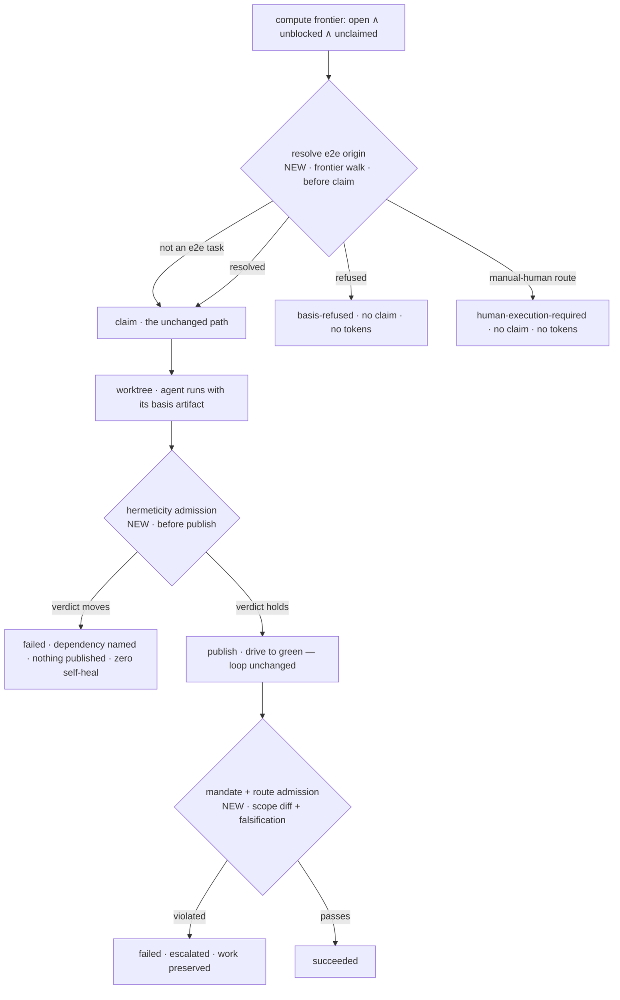

# implement-now — consuming e2e-planned tasks — technical design

| Field | Value |
|---|---|
| **Status** | Draft → Approved *(merge requires Approved; merge is the freezing event; "superseded" is computed by the index, never written here)* |
| **Owner** | @mdarabi |
| **Approver(s)** | @mdarabi (operator) — the executor gains its first inbound repo-document read surface and two new admission gates on autonomous code execution; Security/privacy is yes, so a named reviewer is mandatory |
| **Date** | 2026-07-28 |
| **Relevant-when** | designing or changing how the executor recognizes and executes e2e-planned tasks — the task→plan→design-doc join and its refusals, the basis artifact handed to a worker, the mandate and route admission, the hermeticity admission that decides whether an authored check is proposed at all, the manual-human no-spawn class; triaging an e2e task misread as feature work, a green e2e proposal that proves nothing, or a flaky authored check; superseding the e2e consumption path |
| **Scope** | The executor's second task-consumption class: pre-claim e2e origin and basis resolution, the worker's basis artifact, the hermeticity admission before a proposal is opened, the mandate and route admission between genuinely-green and succeeded, and the pre-claim terminal classes and evidence these produce. **Not**: the executor's shape — Worker, ports, Dispatcher, frontier-sweep, drive-to-green (`implement-now`); native model routing (undesigned, `prd:implement-now/FR-21`..`FR-27`); authoring or revising e2e coverage — scenarios, routes, mock strategies, harness choice, the coverage map (`e2e-verification-skills`, `e2e-verification-artifacts`); the plan class, its freeze, and its projection (`plan-new-v1`); the repo's canonical check list itself (`code-gate-mirror`); landing (`merge-lane-v1`). |
| **Tracking** | — *(the introducing PR)* |
| **Builds-on** | docs/tech-design/implement-now.md · docs/tech-design/e2e-verification-artifacts.md · docs/tech-design/e2e-verification-skills.md · docs/tech-design/plan-new-v1.md · docs/tech-design/code-gate-mirror.md |
| **Supersedes** | — |
| **Serves** | prd:implement-now/FR-28 · prd:implement-now/FR-29 · prd:implement-now/FR-30 · prd:implement-now/FR-31 · prd:implement-now/FR-32 · prd:implement-now/NR-8 · prd:implement-now/UB-14 · prd:implement-now/UB-15 · prd:implement-now/UB-16 · prd:implement-now/UB-17 · prd:implement-now/EVT-12 |
| **Security/privacy impact** | yes — the executor gains its first inbound repo-document read surface, and hands that content to a bypass-permission worker; untrusted markdown becomes worker-visible context, and the falsification admission deliberately damages code in a disposable copy of a workspace. The posture rests on the structural data/instruction split (§3.4), worktree confinement, and the unchanged never-merge boundary; no new credential, provider, or egress destination appears. reviewer: @mdarabi. Pairs with §3.11. |
| **Template version** | tech-design-template/v1 |

## 0. Read to rule — the human reviewer's section (~5 min)

*The body is the contract; this section only routes attention — on any conflict the body governs; machines ignore it.*

**Judge these**

| # | The call | Could have gone | If you disagree |
|---|---|---|---|
| 1 | An e2e task is recognized by **traversing a marker the projection already stamps** to the plan's existing governing-document field — nothing upstream changes | stamp the basis into the item at projection time (`#ALT-2`), or compile a frozen basis sidecar (`#ALT-3`) | you would accept editing the plan gate and the projection, which the non-regression row forbids, and a derived copy that can drift from the approved source → §3.2, #DINV-1 |
| 2 | The hermeticity battery runs **before the proposal is opened**, so a non-hermetic check is never published and never reaches required CI | run it after genuinely-green, alongside the mandate admission | on a suite-scoped check list a published test is already required, so nothing later can withhold it — and the self-heal loop burns first → §3.6, #DINV-6, #DINV-7 |
| 3 | The succeeded class is withheld until a **scope diff and a broken-subject falsification** both pass | a reviewer-lens judgment (`#ALT-9`), or an after-the-fact audit (`#ALT-10`) | you would spend inference per proposal on a check that must name its violation deterministically, or discover violations after the class was already granted → §3.5, #DINV-5 |
| 4 | Route fidelity is proved **by falsification, not by inspecting for mocks** — a real-subject scenario that survives a broken subject was mocked away | scan the authored test for doubling constructs | you would tie the check to one language's mocking idioms and still miss the substitutions that matter → §3.5 |
| 5 | Executor-written context lives **outside the publishing worktree**, and falsification damage lives in a disposable copy | write both into the task's worktree | the workspace commits its whole tree, so the executor's own file would land in the proposal and then fail the executor's own scope diff → §3.4, §3.5, #DINV-4 |
| 6 | The document read is **injected into the frontier walk**, not a sixth Worker port | a consumer-side port on the Worker | resolution happens before any Worker exists, and the executor's own precedent injects rather than growing the port surface → §3.3, #DINV-2 |
| 7 | A task whose plan declares **no path-bearing surface refuses**, rather than executing with the mandate gate silently off | treat an absent surface as unbounded | the critical mandate row would be unenforced on exactly the tasks that declared least → §3.5, #DINV-5 |

**Sanity-check the numbers** — one scenario or the harness slot per task and never more (#DINV-1); zero claims and zero model calls on every refusal and every manual-human task (#DINV-2); zero self-heal iterations consumed by a non-hermetic verdict, because no proposal exists yet (#DINV-7); one `EVT-12` per ready task per run (#DINV-8).

**The author's open questions** — how a single scenario's test is named and run (§7 Q1); what "perturb the subject" resolves to per scenario (§7 Q2); the fail-closed path when a plan's freeze revision is unavailable (§7 Q3); **and the one that may not be answerable in design at all** — whether a mocked double can be checked against the real dependency's observed contract from what the e2e document actually records (§7 Q4, R8).

**Skip the rest** — header schema, `Serves` grammar, mandatory sections → `docgate lint-tech-designs`; substance, reuse honesty, principles honesty → the unmanned `tech-design-review`; implementation defects → codegate and the repo's canonical check list; what a scenario, route, mock strategy, or harness should be → `e2e-design` and `e2e-review`, settled at approval; the plan's shape, freeze, and projection → `plan-new-v1`; native model routing → the undesigned supersession; rationale and displaced shapes → §4, explanatory only.

## 1. Problem

The e2e authoring line ships. A feature's coverage is designed, reviewed, approved, and turned into an ordinary plan whose tasks are projected onto the very frontier `/implement-now` already sweeps. By upstream contract those tasks are *ordinary tracker tasks* — deliberately so, precisely so the executor could consume them unchanged (`prd:e2e-verification/FR-14`, `NR-2`; `e2e-verification-skills` §3.3).

It cannot. Three gaps sit between the projection and a correct execution:

- **Nothing on the task says what it is.** An e2e charter restates a scenario's flow, so it *reads* like feature behavior. An unbriefed worker reaches for the nearest wrong reading — implement the feature again, or bend it until the scenario passes — and every required check stays green while it does. Inferring the kind from charter prose is exactly the free-form cross-boundary signal AP-6 forbids, and it cannot deliver the exclusivity the contract states (`prd:implement-now/FR-28`).
- **The document that justifies the task is unreachable.** A task's trace grammar admits only references that resolve against the PRD ledgers and the tech-designs path, so the approved e2e design doc — the home of every reviewed coverage decision — cannot reach a worker through the existing cited-context path at all (`prd:implement-now/FR-29`).
- **The executor's own "done" test cannot see the failures that matter here.** Success is a verified artifact with green checks (`implement-now#DINV-3`). That test is blind to a proposal that reached green by changing the subject under test or by swapping a reviewed route for a cheaper one — and blind to whether the *new blocking check the task just authored* holds its verdict on another machine. `incident:I5` already paid for the second one: a check asserting a wall-clock budget passed on a fast development machine and stranded required CI red, and the record states plainly that a command-level mirror would not have caught it. That lesson graduated to AP-29 — a gate asserts correctness; a measurement only records.

The cheapest moment is now: no e2e plan has been projected, so there is nothing to migrate, no green-but-hollow e2e proposal to unwind, and no flaky authored check already published into a required gate. The stage-3 session grilled and gated this direction (`design-brainstorm:implement-now-tech-design-2`, ready-for-design), which this design assembles.

## 2. Decision

**Decision:** The executor gains **one pre-claim resolution stage and two admission stages**, all inside the existing Worker and Dispatcher shape and behind the unchanged frontier and claim path. Before claim, the frontier walk follows the plan-task marker every projected item already carries back to the frozen plan, reads the governing-document field the plan class already requires of every plan, and — where that names an `approved`, well-formed `e2e-design/v1` document — recovers the task's slot by re-running the same closed rule that authored the plan, resolving a task to exactly one scenario, to the harness slot, or to nothing (`design-brainstorm:implement-now-tech-design-2#D-3`, `#ALT-1`). The resolved basis reaches the worker as a **read-only artifact outside the publishing worktree**, named by the charter's protocol but never folded into it — data, structurally, not instruction (`#D-4`, `#ALT-5`). The authored test then faces two admissions in different positions, each placed where its consequence can actually bind: a **labelled perturbation battery before the proposal is ever opened**, so a check that cannot hold its verdict is never published and therefore never enters required CI or the self-heal loop (`#D-6`, `#ALT-11`, as refined at review by `#D-9`); and, once a proposal is genuinely green, a **scope diff and broken-subject falsification** that together establish the test tests and the feature was not bent to satisfy it (`#D-5`, `#ALT-8`).

The reasoning, stated once. Every part of the recognition path already exists as data and is simply unread: the projection stamps its idempotency marker on every item, the plan header carries a governing-document field, the document class has a tested parser and well-formedness checker, and the plan's task graph was decided by a closed rule that can be re-run rather than reverse-engineered. Reading them is therefore additive to the executor and invisible upstream, which is what the non-regression row demands (`prd:implement-now/NR-8`). The two admissions sit apart because their objects differ. The mandate and route admission judges a *proposal* — the requirement's own object — so it must run after one exists, and withholding the succeeded class is the only consequence that binds. The hermeticity admission judges a *check about to become required*, and on a repository whose canonical list is suite-scoped a published test is already required the moment it lands; there is no later act to withhold. So the only position from which "never wired into required checks" is enforceable is before publication — which also makes "zero self-heal iterations" true by construction, since the loop only exists after a proposal. Falsification does double duty: it is simultaneously the route-fidelity proof and the release evidence the definition of done already demands, so one predicate serves both (AP-11, AP-14).

## 3. The design

### 3.1 Where the three stages sit in a sweep

The sweep's shape is unchanged (`implement-now` §3.6). Three stages are inserted — one in the frontier walk, two inside the Worker's terminal path:

Three properties of the placement carry the contract. Resolution sits **before claim**, so every refusal and every manual-human task costs one document read and nothing else — no lease, no worktree, no model call. The hermeticity admission sits **before publish**, which is the only position from which a check can be kept out of a suite-scoped required list, and the only one at which "zero self-heal iterations" is structurally true rather than merely counted. The mandate and route admission sits **after genuinely-green and before succeeded**, the only position from which the succeeded class can be withheld on a proposal while its work is preserved for escalation.

### 3.2 Origin and basis resolution

**Decision:** e2e origin is established by traversal of recorded data, never by inference over charter prose. For each ready task, the frontier walk reads the plan-task marker the projection stamps in the item body, resolves the frozen plan it names, and reads that plan's governing-document header field. Where that field names a document at the feature's e2e home which parses as the `e2e-design/v1` class, carries `approved` status, and passes the class well-formedness check, the task's slot is recovered by re-running the closed task-graph rule the e2e plan class owns, yielding exactly one scenario or the harness slot. Any other outcome resolves `not_e2e` and the task continues down the unchanged path (`prd:implement-now/FR-28`).

Three things make this cheap and exact rather than clever. The marker is the projection's own idempotency key, already written and already unique per plan task — the executor reads it, nothing writes it differently. The governing-document field is required of every plan and imposes no format the plan gate does not already accept, so an e2e plan naming its design doc there folds and projects with no upstream edit. And the join is not re-derived: the same rule that decided which slot is the harness and which scenario each task carries is asked again, so the plan's authored graph and the executor's reading of it cannot drift apart (AP-11).

**Decision:** that rule takes a second input — whether the feature's harness already existed when the plan was authored — which is a repo-inspection judgment the authoring skill made and **no artifact records**. The executor recovers it from recorded data alone, by comparing the frozen plan's task count against the document's scenario count at the freeze revision: equal means no harness slot was emitted; exactly one more means the harness slot is the plan's first task. Any other relationship is unresolvable and refuses under `UB-14`. Recovering it any other way — re-probing the repository for a harness, or assuming a default — reintroduces exactly the reconstruction this subsection rejects, and its failure is silent: every task still resolves to exactly one scenario, just the wrong one, so the worker is briefed with another scenario's flow and route while the exclusivity invariant still holds.

**Decision:** the document is read at the **plan's freeze revision**, and the resolved content's fingerprint is recorded in the origin-decision event. The plan freezes at merge, so its recorded reference resolves to exactly one revision of the referenced document; reading there satisfies the data contract's integrity rule without the executor ever depending on the working tree's current state, and the recorded fingerprint makes *which bytes a worker was briefed from* an auditable fact rather than an assumption.

**Refusals.** A task whose plan names an e2e design doc that is missing, not `approved`, malformed against the class checklist, or that resolves to no scenario or to more than one, is refused before claim, naming the feature, the expected document, and the defect (`prd:implement-now/UB-14`). The refusal reasons are the class checker's own findings plus the class and status pins, so the executor invents no defect vocabulary of its own; a refused task leaves the other independent ready tasks untouched.

### 3.3 The document-read seam

**Decision:** the read is **injected into the frontier walk as a function value**, not added as a port on the Worker. It resolves a path at a named revision and returns bytes; the frontier walk holds it, and the resolved basis is handed onward as part of a task's input.

Two facts decide this. Resolution happens **before claim**, and a Worker exists only after one — so a Worker port could not perform a read that must precede it, and the frontier walk is the Dispatcher's, not the Worker's. And the executor's own precedent is injection rather than port growth: the self-heal loop's log fetcher and pusher are injected specifically so the loop stays hermetically testable *without* growing the frozen port surface, and the plan gate reads merged bytes at a revision through an injected function for the same reason. A sixth port would buy nothing here — there is one production reader, and a fixture reader is a test double, not a second production adapter.

The content this seam returns is **data**. Nothing read through it is ever treated as instruction, at any point in the pipeline (`prd:implement-now/NFR-2`).

### 3.4 The basis artifact handed to the worker

**Decision:** before launch, the executor writes the resolved basis as a closed, versioned, read-only artifact **outside the task's publishing worktree**, in an executor-owned per-task location, and passes its path into the launch spec. The artifact holds that task's own scenario flow, its recorded route, its mock strategy, the setup and teardown lifecycle, the harness-libraries selection, the coverage-map rows that scenario proves, the governing-design revisions the document's own `Basis` names, and the feature's traced requirement rows. The charter's protocol preamble names the artifact's location and states that its contents are data; the charter itself is not extended, and neither the task nor the launch contract gains an e2e-specific required field (`prd:implement-now/FR-29`, `NR-8`).

The requirement is that the basis be carried "as data and never as instruction", and the assembled brief is definitionally the instruction the runtime is handed — so the separation has to be physical rather than typographic. A worktree artifact would have achieved that too, but the workspace commits its whole tree when it captures an agent's uncommitted work, so an executor-written file inside the worktree lands in the published proposal and is then, by construction, a changed path outside the task's declared surface — failing this design's own mandate admission on a file the executor wrote. Placing it outside the worktree removes that failure mode structurally rather than by an ignore rule the same capture would itself sweep in.

The artifact carries **one** task's basis and no other scenario's, which is what makes per-scenario exclusivity inspectable rather than asserted.

### 3.5 The mandate and route admission

**Decision:** a recognized e2e task's proposal is admitted to the succeeded class only after two mechanical checks pass, both run after the proposal is genuinely green:

- **Scope diff** — the proposal's changed paths must lie within the surface the frozen plan task declares in its path-bearing field. A change to the behavior under test outside that surface withholds the succeeded class, names the offending path, and marks the task failed with its work preserved (`prd:implement-now/FR-30`, `UB-16`).
- **Falsification** — the subject the scenario names is deliberately perturbed **in a disposable copy of the worktree**, and the authored test must go red there. A test that stays green against a broken subject is not exercising that subject, which is the same observation whether the cause was a stub standing in for the real thing or a scenario mocked away against its recorded route (`prd:implement-now/FR-31`). The publishing worktree is never damaged, so no perturbation can reach a proposal.

**Decision:** the declared surface is read from the frozen plan task's path-bearing field — the only field in the plan class that may carry paths, since the charter regions are lint-forbidden from containing them. A recognized e2e task whose plan task declares **no** surface **refuses under `UB-14`** rather than executing with the mandate gate silently unbounded. An absent surface is the one case where a permissive reading would disable a critical consequence row on exactly the tasks that declared least, so it fails closed.

A `run-for-real` scenario is exercised against the real subject; a `mocked` scenario must confine its doubles to the surfaces its recorded mock strategy names, and each double must satisfy the real dependency's observed contract. **That mocked-route obligation is carried to the worker in its basis and is not, in this design, mechanically admitted** — the e2e document records a mock *strategy* in prose with no per-surface grammar, and nothing captures the real dependency's contract to compare a double against. §7 Q4 owns the mechanism and R8 carries the risk; A-6 claims only what the two admissions deliver. Naming that gap is deliberate: asserting a check the document cannot support would be the hollow guarantee this design exists to prevent.

Proving route fidelity by falsification rather than by inspecting the test for doubling constructs is the load-bearing choice here. Inspection binds the check to one language's mocking idioms and still misses the substitutions that matter; falsification observes the only property the route actually claims — that the named subject is what the scenario exercises (AP-14). It is also not extra machinery: the definition of done already requires a broken-subject falsification result per automatable scenario, so the admission gate and the release evidence are one artifact (AP-11).

### 3.6 The hermeticity admission

**Decision:** once an authored test first passes in the worktree and **before any proposal is opened**, the executor re-runs that test under a **labelled perturbation battery** — varied ordering, the race detector where the stack has one, concurrent load, a perturbed clock and timezone, denied network, and a dirty ambient repository state. A verdict that moves under any perturbation, or across repeated identical runs, stops the task: it is marked failed naming the perturbation whose label identifies the non-hermetic dependency, its work is preserved on its branch, it is escalated, and **no proposal is opened**, so the check never becomes required and the self-heal loop — which exists only after a proposal — never runs (`prd:implement-now/FR-32`, `UB-17`).

**Decision:** each perturbation is scoped to the task's own process tree — its own environment, its own clock and network view, its own generated load — never to the host. Workers run concurrently by default, so a host-wide perturbation would push sibling workers past their wall-clock budgets into spurious respawns, making one task's admission check another task's failure.

Two placements matter, and the first was corrected at review. Publication, not a later wiring step, is the moment a check becomes required: this repository's canonical list is suite-scoped, so a test is inside the required predicate as soon as its file lands. There is consequently no "admit to the list" act to withhold, and any admission running *after* a proposal would be reasoning about a check that is already required and already flapping through the self-heal loop — the exact burn `incident:I5` describes. Running before publication makes "never wired into required checks" and "zero self-heal iterations consumed" true by construction rather than by accounting. Second, the check the battery admits arrives as a **new file per scenario**, which is pure addition: no sibling scenario task edits a line another could also be editing (AP-27).

The local battery and the required-CI run that follows a published test remain the "differently-loaded machines" pair the requirement asks for — the pair `incident:I5` failed across, a fast development machine and a slow runner. A cheap static pass for known non-hermetic constructs runs first inside the battery, used only to *name* the dependency when it can; it is never the verdict, because the incident's own failing check was syntactically ordinary and a denylist would have passed it.

### 3.7 Terminal classes and evidence

**Decision:** two terminal classes join the run's classed report, both reached before claim, both spawning no worker and consuming no model tokens:

- **basis-refused** — the task is left unclaimed with its named e2e-basis defect (`prd:implement-now/UB-14`).
- **human-execution-required** — a recognized e2e task whose scenario carries the `manual-human` route is classed as awaiting the owner the approved document records, never as succeeded and never as failed (`prd:implement-now/UB-15`).

Both join the pre-claim refusal stage the routing amendment already establishes rather than creating a second gate, so the executor's zero-work-when-nothing-is-ready posture extends to them unchanged. Resolving before claim is also what makes repeated runs over a manual-human scenario report identically without claim churn: a task that is never claimed has no lease to acquire and release.

Every ready task's origin decision — resolved, refused, or not-e2e — is recorded once per run before any claim, carrying the task, feature, and plan references, the resolved basis reference and its fingerprint, the slot, the route, and, on a refusal, its reason (`prd:implement-now/EVT-12`). The event rides the existing normalized stream to both existing sinks. Its **durable home is a named gap**: the data contract retains this decision "forever in git evidence", and the committed evidence store for executor events belongs to the undesigned routing supersession (§7 Q5, Principles/AP-28). Until that exists the decision is observable but not durably committed, which is a deviation this design records rather than papers over.

### 3.8 Boundaries and non-goals

- **Not solved here** — native model routing and the frozen-demand consumption path (`prd:implement-now/FR-21`..`FR-27` remain undesigned, and this design touches neither); what a scenario, route, mock strategy, harness, or coverage row *should be* — those are settled by e2e design, e2e review, and the operator's approval, and this design consumes the result without editing or reinterpreting it (`prd:implement-now/NG-5`); the composition of the repo's canonical check list, which this design keeps unfit checks out of but does not define; the committed evidence store for executor events (§7 Q5).
- **Owned by a future design** — the systematic run-time anti-gaming follow-on: falsification sweeps and e2e test-delta beyond the per-scenario check the definition of done requires, driving harder application shapes to green in CI, and the dedicated no-regression gate (`prd:implement-now/WR-3`); the mocked-double contract mechanism if it proves designable at all (§7 Q4).
- **Implementation must not infer** — that a second executor, package tree, dispatch route, or projection path exists for e2e work: there is one executor, one frontier, one claim path, and a frontier mixing e2e and feature tasks dispatches through one path (`prd:implement-now/NR-8`); that plan-new, the plan gate, the projection, or the e2e authoring skills may be edited to make recognition easier — the origin reference rides a field that already exists and already folds; that an e2e-specific task type or required charter field may be introduced; that a green proposal is sufficient for the succeeded class on an e2e task; that a check whose verdict moved may be published anyway; that the harness-existence flag may be re-probed from the repository rather than recovered from recorded data (§3.2); that the executor may author or revise coverage when a basis is thin — a thin basis is a refusal, not an invitation.
- **Must remain unchanged** — the frontier, claim, task, and charter path; the Worker's existing port set and the Dispatcher's ownership; drive-to-green's loop and its bounds, which this design does not modify for any task — it only decides whether a proposal is opened for the loop to act on; the two-sink reporting surface; the never-merge boundary; every upstream artifact and pipeline this design reads.

*A second Dispatcher adapter — the remote runtime — inherits this consumption path by invoking the same shared resolution stage from its own frontier walk; the join predicate stays in one place (AP-11), and no Worker change is required (`implement-now#DINV-10`).*

### 3.9 Invariants

- **DINV-1** — a ready task resolves to **exactly one** scenario, to the harness slot, or to nothing; no task ever resolves to two, and a task whose plan names no e2e design doc resolves to nothing whatever its charter says (`prd:implement-now/FR-28`).
- **DINV-2** — every refusal and every manual-human outcome is reached **before claim**: zero leases acquired, zero worktrees created, zero model invocations (`prd:implement-now/UB-14`, `UB-15`).
- **DINV-3** — the executor never writes to, edits, or reinterprets an e2e design doc, a plan, or any upstream artifact; its access to all of them is read-only (`prd:implement-now/NG-5`).
- **DINV-4** — the resolved basis reaches a worker only as data, in an artifact outside the publishing worktree, holding that task's basis and no other scenario's; the charter remains the sole instruction, and no executor-written file appears in a proposal (`prd:implement-now/FR-29`, `NFR-2`).
- **DINV-5** — a recognized e2e task counts succeeded only after the mandate and route admission passes over a declared surface; a proposal that changed behavior under test outside that surface, or whose scenario survived a broken subject, is never counted succeeded even with every required check green, and a task with no declared surface refuses rather than passing unchecked (`prd:implement-now/UB-16`).
- **DINV-6** — an authored test whose verdict is not stable under the perturbation battery is **never published**: no proposal is opened, so it never enters required checks (`prd:implement-now/FR-32`, `UB-17`).
- **DINV-7** — a non-hermetic verdict consumes **zero** self-heal iterations, structurally: the battery completes before a proposal exists, and the loop acts only on proposals (`prd:implement-now/UB-17`).
- **DINV-8** — exactly one origin decision is recorded per ready task per run, before any claim; a refusal names its reason, and the record is append-only (`prd:implement-now/EVT-12`).
- **DINV-9** — a perturbation is confined to the task's own process tree and its disposable copy; no admission check alters the publishing worktree or affects a concurrent worker.

### 3.10 Observability

- **Events/logs** — one origin decision per ready task per run, before claim, carrying the task, feature, and plan references, the resolved basis reference and content fingerprint, the slot, the route, the resolution, and any refusal reason (`prd:implement-now/EVT-12`). The admission stages emit their outcomes on the same normalized stream: for a withheld succeeded class, which check withheld it and the scenario, recorded route, and offending path it names; for a non-hermetic verdict, the perturbation label that identifies the dependency and the fact that no proposal was opened. Every event rides the existing two sinks, the attended live view and the unattended delivery journal, with no new surface; their durable committed home is the gap §3.7 names.
- **Metrics** — resolved, refused, and not-e2e counts per run with their refusal reasons; manual-human tasks awaiting their named owners; mandate and route withholdings by cause; hermeticity rejections by perturbation label. The last is the one to watch: a rising count means the authoring side is producing checks that gate on the machine.
- **Alerts** — a mandate or route violation is an escalation, not a statistic: it means a worker changed the thing it was sent to prove. A hermeticity rejection escalates with its dependency named. Both follow the existing escalation path — surfaced in session when attended, on the delivery journal with fail-closed escalation when not.
- **Debugging surface** — the basis artifact is the primary one: it is exactly what the worker was briefed with, diffable against the approved document at the recorded fingerprint. The origin decision explains why a task was or was not recognized; the perturbation label explains why a check was refused publication; the disposable falsification copy is retained on a withheld task so the perturbation and the test's response can be inspected.
- **Trace/correlation** — the origin decision joins task, plan, and basis reference; the admission outcomes join to the same task and proposal identities the existing outcome events carry, so a refused, admitted, or withheld task is one connected chain from frontier to terminal class.

### 3.11 Security & privacy

Matches the header row: **yes**.

**Surfaces touched.** (1) A **new inbound read surface** — the executor reads repository documents for the first time (§3.3), so markdown authored elsewhere becomes input to the execution path. (2) **Worker-visible untrusted content** — that document's content is handed to a bypass-permission worker (§3.4). (3) **Deliberate code damage** — the falsification admission perturbs a subject on purpose (§3.5). No new credential, identity, provider, network destination, or egress path appears: the already-selected harness remains the only model boundary, and the basis is repository-local content on the same boundary the charter already crosses.

**Threat sketch and mitigations.** The material threat is injection: a poisoned e2e design doc steering a worker into attacker-directed work. It is mitigated structurally rather than by filtering — the basis is carried in an artifact distinct from the charter and is never instruction (#DINV-4), the charter remains the sole instruction, and the executor's existing posture bounds the blast radius whatever a worker is persuaded to attempt: mutations are confined to the worktree, and the executor holds no merge credential. The document is additionally read only when it is `approved` and well-formed at the plan's freeze revision (§3.2), so the reachable content is what a human approved, not whatever currently sits at head. The second exposure — deliberate perturbation — happens in a disposable copy, never the publishing worktree, and is scoped to the task's own process tree so it cannot reach a sibling worker (#DINV-9). The third — a malformed or hostile document crashing the reader — fails closed into a refusal that spawns nothing (#DINV-2). Mitigations trace to #DINV-2, #DINV-3, #DINV-4, #DINV-9, and `prd:implement-now/ABUSE-1`.

### 3.12 Testing strategy

The seams this design introduces bin by what they actually touch, and the bin decides the strategy:

| Seam | Bin | Strategy |
|---|---|---|
| the document read (§3.3) | local-substitutable | the production reader runs real git against a real local tree; the injected function is substituted with a fixture reader so the whole refusal matrix runs with no files on disk |
| origin and slot resolution, incl. harness-flag recovery (§3.2) | in-process | table-driven over parsed documents and plans, including a mixed frontier carrying both an implementation plan and an e2e plan for one feature, and count-mismatch cases asserted to refuse |
| the basis artifact (§3.4) | in-process | golden artifact per scenario; the exclusivity property is a diff, the injection drill runs over its content, and a published-proposal diff is asserted to contain no executor-written file |
| the hermeticity battery (§3.6) | local-substitutable | real subprocess execution over a real tree under real perturbation — the seam is the command runner the executor already injects; one seeded fixture per non-hermetic class, each asserted to stop before publication with its dependency named |
| the mandate and route admission (§3.5) | local-substitutable | real test execution over a real disposable copy; seeded feature-edit and route-substitution fixtures, each asserted never-succeeded with every required check green |

The two execution stages run real subprocesses, so their tests must too — binning them in-process would produce a suite that never exercises the seam the gates actually stand on. Both are also the stages whose fixtures must not become the thing they police: each fixture's expected verdict is asserted stable before it is used to assert instability elsewhere, and the production battery's own stability is measured separately (R3).

## 4. Alternatives considered

| Alternative | Why rejected |
|---|---|
| **Stamp the basis into the projected item** at projection time, so the executor keeps reading only the tracker (`design-brainstorm:implement-now-tech-design-2#ALT-2`) | requires editing the plan gate and the projection, which the non-regression row forbids in terms; and it copies the approved document's content into a mutable tracker beside the immutable source the data contract names as authoritative, with nothing deciding which governs when they drift |
| **Compile a frozen basis sidecar** beside the plan, so the executor reads one closed schema and never markdown (`#ALT-3`) | buys freeze-at-plan-time at the price of a new artifact class and an upstream writer, straining the same non-regression row and the authoring line's own "the executor is unchanged" invariant; the same freeze is available by resolving at the plan's own freeze revision, which costs no new artifact |
| **Pass the originating plan on the command line** (`#ALT-4`) | the frontier is label-scoped and legitimately mixes plans and features, so a run-level flag cannot classify per task at all; recognition would depend on how the run was invoked rather than on recorded data, and a forgotten flag silently downgrades every e2e task to feature work — precisely the misread the requirement exists to make impossible |
| **A typed launch-contract field** each backend adapter renders into its own context mechanism (`#ALT-6`) | four adapters would each grow a rendering path and they differ in what they support, so the data/instruction split — the one property the requirement cares about — would vary by which backend ran; and the rendering is invisible at inspection time, making per-scenario exclusivity unprovable |
| **Fold the basis into the charter brief** (`#ALT-7`) | contradicts the requirement in terms: the basis must be carried as data and never as instruction, and the brief is definitionally the instruction, so the injection drill would run over text the runtime is told to obey |
| **A sixth Worker port for the document read** (`#ALT-1`'s original framing, corrected at review — `#D-8`) | the read happens before claim, when no Worker exists; and there is one production reader, so a port would be ceremony against the executor's own precedent, which injects the self-heal loop's fetcher and pusher rather than growing the frozen port surface |
| **Write the basis artifact into the task's worktree** | the workspace commits its whole tree when capturing an agent's uncommitted work, so the executor's own file lands in the proposal and then fails this design's own scope diff — a gate rejecting its own author's file. An ignore rule inside the worktree is swept in by the same capture |
| **A reviewer lens judging** whether behavior under test changed or the route was substituted (`#ALT-9`) | the consequence row is critical and its fit criterion requires the violation be named deterministically on seeded fixtures; a model verdict is neither deterministic nor free, and it would spend inference on every e2e proposal. Retained as the complement the existing review seam already supplies, never as the gate |
| **Trust the green checks and audit afterwards** (`#ALT-10`) | the consequence row requires the succeeded class be *withheld*, which an after-the-fact audit structurally cannot do; and the reason the row exists at all is that the green-checks test cannot see the violation |
| **A static scan for non-hermetic constructs** as the hermeticity mechanism (`#ALT-12`) | a denylist over an open set passes everything it has not been taught, and `incident:I5`'s own failing check was syntactically ordinary — a wall-clock budget asserted over a history-derived diff; it also cannot establish verdict stability, which the requirement states in terms of repeated runs. Retained inside the battery as a naming aid only |
| **Run the hermeticity battery after genuinely-green**, beside the mandate admission | on a suite-scoped canonical list a published test is already required, so there is no later act to withhold; and the self-heal loop would already have spent iterations flapping on it — the burn `incident:I5` describes |
| **Treat an absent declared surface as unbounded** rather than refusing | disables a critical consequence row on exactly the tasks that declared least, and does so silently |
| **Infer the task's kind from charter prose** | forbidden by the requirement, and rightly: an e2e charter restates a scenario's flow and therefore reads like feature behavior, so prose inference cannot deliver "no feature task is ever misread as e2e" in either direction |

## 5. Risks

| ID | Risk | Impact | Mitigation | Verification / evidence |
|---|---|---|---|---|
| R1 | the plan's governing-document field is used inconsistently by the authoring side, so some e2e plans name their design doc and others name a technical design | e2e tasks silently execute as feature work — the exact failure this design exists to prevent | the field is a named dependency of the requirement, owed by the e2e planning skill; recognition is all-or-nothing per plan and a plan naming no e2e doc yields zero e2e classifications rather than a partial one | the mixed-frontier fixture (§3.12) plus the real-plan run the definition of done requires |
| R2 | "perturb the subject" is under-defined for a scenario whose subject is diffuse, so falsification perturbs something incidental and passes vacuously | a green e2e proposal that proves less than the approved design says it proves — the failure the admission was built to catch, passing its own gate | the perturbation is chosen from the scenario's recorded flow and route rather than guessed, and a scenario whose subject cannot be identified is a refusal, not a pass; §7 Q2 owns the resolution before implementation | per-route fixtures asserting a broken subject turns each scenario's test red |
| R3 | the perturbation battery is itself non-deterministic, so it rejects hermetic tests | authoring work is thrown away and the class becomes distrusted | perturbations are process-scoped rather than host-wide (#DINV-9); each perturbation is labelled so a rejection is diagnosable; a rejected task's work is preserved on its branch and re-runnable | the **production** battery's own verdict stability, measured by running it repeatedly against a known-hermetic real authored test under varying host load — not only against seeded fixtures |
| R4 | the basis artifact is ignored by a worker, which rediscovers the scenario from the charter and reaches the wrong reading anyway | the briefing exists on paper only | the artifact is not the only guard: the mandate and route admissions bind the *outcome* regardless of what the worker read, so an ignored basis surfaces as a withheld class rather than a silent success | seeded feature-edit fixtures never counted succeeded |
| R5 | the document read at a plan's freeze revision is unavailable — a shallow clone, an export, a rewritten history | recognition fails on a legitimately e2e task and it executes as feature work | resolution fails closed into a refusal, never into a permissive fallback; §7 Q3 owns the exact path | the unavailable-revision fixture asserted to refuse, not to degrade |
| R6 | the admission stages lengthen every e2e task enough that the class is disabled in practice | the gates exist and are switched off — the worst outcome available | both stages run only for recognized e2e tasks, and both reuse work already required elsewhere (falsification is the definition of done's own evidence); the cost is bounded per scenario, not per run | admission cost recorded per task in the run report |
| R7 | a task's perturbation escapes its process tree and destabilizes a concurrent worker | one task's admission check becomes another task's spurious failure and wasted model spend | #DINV-9 scopes every perturbation to the task's own process tree and disposable copy; load is generated within the task's own budget, never host-wide | a concurrency fixture running the battery beside sibling workers, asserting no sibling outcome changes |
| R8 | the mocked-route double-contract obligation is never mechanized, so a `mocked` scenario can go green on a double encoding a wrong guess | the never-working-feature failure the requirement's fit criterion names explicitly — a green scenario proving nothing about the real dependency | the obligation is carried to the worker in its basis and the falsification run still applies to the scenario's own subject; but the executor-side check is **absent by declaration**, not assumed. §7 Q4 owns it, and if it proves unmechanizable from what the document records, the resolution is an amendment to the requirement, not a design workaround | Q4's resolution; until then, this risk is open and stated rather than mitigated |

## 6. Acceptance

| ID | Acceptance criterion | Verify | Required evidence | Traces to |
|---|---|---|---|---|
| A-1 | In a fixture repo carrying both an implementation plan and an e2e plan for one feature, every e2e task resolves to exactly one scenario or the harness slot and every non-e2e task resolves to none; a plan whose header names no e2e design doc yields zero e2e classifications regardless of charter wording | Test | the mixed-frontier fixture run | `prd:implement-now/FR-28` · #DINV-1 · §3.2 |
| A-2 | The task and charter schemas and the planning pipeline are byte-unchanged; the origin reference occupies an existing required plan header field and adds no new one; a frontier mixing e2e and feature tasks dispatches through one path | Inspection + Test | schema byte-identity manifest and the mixed-frontier dispatch record | `prd:implement-now/NR-8` · §3.2 |
| A-3 | One fixture per missing, not-approved, malformed, unresolvable, and ambiguous class performs zero claims and zero model invocations and names its defect; independent valid tasks in the same run still complete | Test | the refusal matrix run | `prd:implement-now/UB-14` · #DINV-2 · §3.2 |
| A-4 | Every spawned e2e attempt's input carries each named basis element for its own scenario and no other scenario's; a spawn missing any element does not proceed and refuses; the injection drill run over basis content changes no behavior; and no published proposal contains an executor-written file | Test + Inspection | golden basis artifacts per scenario, the injection drill report, and a published-proposal diff | `prd:implement-now/FR-29` · #DINV-4 · §3.4 |
| A-5 | A fixture whose scenario fails against genuinely-broken feature behavior yields a failing test and an escalated task, never a feature edit that makes it pass; a proposal altering behavior under test outside its declared surface is reported and never counted succeeded; and a task whose plan declares no surface refuses rather than passing unchecked | Test | seeded feature-edit fixture results plus the absent-surface refusal fixture | `prd:implement-now/FR-30` · `prd:implement-now/UB-16` · #DINV-5 |
| A-6 | Per-route fixtures show a real-subject scenario failing when its subject is broken in the disposable copy, and a manual-human scenario spawning zero workers; a route substitution detected by falsification is never counted succeeded, each naming scenario and recorded route. *(The mocked-double contract check is out of this row's scope by §3.5 — see Q4.)* | Test | per-route fixture results naming scenario, recorded route, and offending change | `prd:implement-now/FR-31` · `prd:implement-now/UB-15` · #DINV-5 |
| A-7 | Seeded clock, network, ordering, and ambient-repository fixtures are each detected before publication with the dependency named; **no proposal is opened** for any of them and zero self-heal iterations are consumed; a hermetic control in the same run publishes normally | Test + Failure injection | the seeded non-hermetic fixture matrix with proposal-count and self-heal-iteration counts | `prd:implement-now/FR-32` · `prd:implement-now/UB-17` · #DINV-6 · #DINV-7 |
| A-8 | Exactly one origin decision is recorded per ready task per run, before any claim, with its refusal reason where refused; records are append-only and every resolved decision joins its task, plan, and basis fingerprint | Test + Analysis | the joined event report over a mixed run | `prd:implement-now/EVT-12` · #DINV-8 · §3.7 |
| A-9 | A manual-human fixture spawns zero workers, consumes zero tokens, names its recorded owner, and is never counted succeeded; repeated runs report it identically without claim churn | Test | repeat-run record over the manual-human fixture | `prd:implement-now/UB-15` · #DINV-2 · §3.7 |
| A-10 | The harness-existence flag is recovered from recorded data alone: equal task and scenario counts yield no harness slot, exactly one more yields a harness slot at the first task, and any other relationship refuses; a seeded mismatch never mis-briefs a worker | Test | the count-recovery fixture matrix including the refusing mismatch case | `prd:implement-now/FR-28` · #DINV-1 · §3.2 |
| A-11 | Running the battery beside concurrent sibling workers changes no sibling's outcome, and the publishing worktree is byte-unchanged by any falsification perturbation | Test | the concurrency fixture and a worktree integrity check | #DINV-9 · §3.6 · R7 |
| A-12 | One real feature's approved e2e plan runs end to end: every task resolves from the recorded reference, every automatable scenario reaches a green proposal that fails when its subject is deliberately broken and holds its verdict on repeat runs across differently-loaded machines, every manual-human scenario is handed to its named owner with zero spawns, and no proposal changes the behavior under test | Demo + Test + Inspection | the run record, per-task origin decisions, proposal links, one falsification result and one verdict-stability record per automatable scenario, and a diff inspection | `prd:implement-now/FR-28` · `prd:implement-now/FR-32` · §2 |
| A-13 | This document passes the design lint and ships with the regenerated index | Test | gate output in the introducing PR | `tech-design-conventions` §3.2 |

## 7. Open questions

| ID | Question | Owner | Blocks | Status | Resolution |
|---|---|---|---|---|---|
| Q1 | How a single scenario's test is named and run. Both the falsification and the hermeticity stages must execute one scenario's test alone, and the executor's gate configuration carries commands, not per-test selectors. Whether this lands as a per-repo e2e configuration block, a naming convention the harness task establishes, or a selector the runner accepts is open — but it must land as pure addition per AP-27, never as N sibling tasks editing one authored list | implementation | implementation start | open | the direction holds under any shape that is additive; decided against fixtures |
| Q2 | What "perturb the subject" resolves to per scenario — which artifact is broken, how it is chosen from the scenario's recorded flow and route so it exercises that scenario's own subject rather than something incidental | implementation | implementation start | open | R2 is the risk this answer retires |
| Q3 | How a plan's freeze revision is determined in practice, and the fail-closed path when that history is unavailable — a shallow clone, an export, a rewritten history | implementation | implementation start | open | leaning: refuse under the basis-refused class rather than degrade to a working-tree read (R5) |
| Q4 | Whether a mocked double can be checked against the real dependency's observed contract from what the e2e document actually records. The document carries a mock *strategy* in prose with no per-surface grammar, and nothing captures the real dependency's contract. If it cannot, the requirement's fit criterion needs an amendment rather than a design workaround | @mdarabi | the mocked-route half of `FR-31` | open | R8 carries the risk; the honest outcomes are a recorded mechanism, a document-class change upstream, or a requirement amendment |
| Q5 | Where executor events come to rest as committed artifacts, so the data contract's "forever in git evidence" retention is real. The store belongs to the undesigned routing supersession; this design records the dependency rather than inventing a second surface | @mdarabi | the retention half of `EVT-12` | open | resolved by the routing supersession, or by a dedicated evidence design |

## Principles

- **AP-1 — honored.** The engine declares what it needs and adapters implement it; the document read is injected into the frontier walk rather than folded into the frozen port surface, matching the executor's own precedent (§3.3).
- **AP-5 — honored.** The origin decision, the admission outcomes, and the perturbation labels are designed in, not bolted on: every new stage emits on the existing normalized stream, and the basis artifact is itself the debugging surface (§3.10).
- **AP-6 — honored.** Recognition rides a closed machine marker and a closed document class, never prose; the basis artifact is a closed versioned schema; refusal reasons come from the class checker rather than free text (§3.2, §3.4).
- **AP-10 — honored.** Both admissions are codified predicates rather than instructions to a model: the rule is checkable, so it is checked (§3.5, §3.6).
- **AP-11 — honored, twice.** The task-to-scenario join is the same closed rule that authored the plan, asked again rather than reimplemented — including its harness-existence input, recovered from recorded data rather than re-probed; and falsification serves both the admission gate and the release evidence, one predicate in one place (§3.2, §3.5).
- **AP-13 — honored.** Every new verdict is a property of an artifact — a parsed document, a diff, a test's observed verdict — never a self-report; the succeeded class is withheld on evidence, not on judgment (§3.5, §3.6).
- **AP-14 — honored.** Route fidelity and hermeticity are both established by execution and observation: a scenario proves it exercises its subject by going red when that subject breaks, and a check proves it is a gate by holding its verdict under perturbation (§3.5, §3.6). The one place this design cannot yet deliver AP-14's test-double corollary is named rather than assumed (§3.5, Q4, R8).
- **AP-16 — honored.** The bounded loops are unchanged; a non-hermetic verdict never reaches them because no proposal is opened (#DINV-7).
- **AP-19 — honored.** Resolution is deterministic and spends zero inference; a refused or manual-human task costs one document read and nothing else, so recognition never turns idle work into model spend (#DINV-2).
- **AP-21 — honored.** The coverage judgment was made once, at the richest-context site, and frozen at the operator's approval; this design consumes that judgment at the plan's freeze revision and never re-judges it (§3.2, #DINV-3).
- **AP-23 — honored.** Concurrent extension is per-file: each scenario's authored test is its own file, and each task's basis artifact and disposable copy are its own, so parallel workers never contend on a shared surface (§3.4, §3.6, #DINV-9).
- **AP-24 — honored.** The approved document governs and the executor derives from it; nothing here regenerates, edits, or reinterprets a governing artifact, and a defective one routes to refusal rather than to repair (#DINV-3).
- **AP-27 — honored.** An e2e plan fans one "add a check" out to N sibling scenario tasks, which is exactly the shape this principle governs. Each authored check lands as a new file — pure addition, zero edits to any line a sibling could also touch — and Q1's resolution is bound to keep it that way; no sibling task appends to a shared enumeration (§3.6, Q1).
- **AP-28 — deviated, with reason.** Improvement fuel is meant to be retained in git. The origin decisions and admission outcomes this design produces ride the existing two sinks — a live in-session view and the delivery journal — and no live design yet provides a committed evidence store for executor events; that surface belongs to the undesigned routing supersession. The deviation is recorded as Q5 and named in §3.7 rather than concealed, and nothing here forecloses the store: the events are already typed and joinable when it arrives.
- **AP-29 — honored, and load-bearing.** A gate asserts correctness; a measurement only records. The hermeticity admission enforces exactly that at the point new checks are born — a check whose verdict depends on the machine is never published into the gate rather than run twice and hoped over (§3.6, `incident:I5`).
- **RW-5 — honored.** One independently-revisable decision: how the executor consumes e2e-planned tasks. Native model routing, the executor's shape, and the authoring line's coverage judgment each live in their own documents and can change without this one (§3.8).
- **Deviation:** AP-28, above — the only one; recorded with its reason, its owner, and its resolution path.
