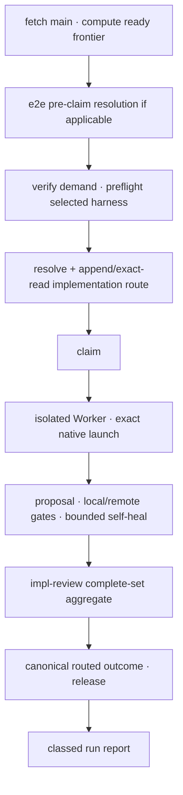

# implement-now routed execution — technical design

| Field | Value |
|---|---|
| **Status** | Draft → Approved *(merge requires Approved; merge is the freezing event)* |
| **Owner** | @mdarabi |
| **Approver(s)** | @mdarabi (operator and security reviewer) |
| **Date** | 2026-07-28 |
| **Relevant-when** | designing or changing the implement-now frontier sweep, Worker/Dispatcher, pre-claim demand and route admission, native implementation launch, drive-to-green, impl-review invocation, routed outcome, direct production activation, or post-cutover fallback/invalidation; superseding the executor |
| **Scope** | The implement-now successor and top-level composition: carried Worker/ports/frontier behavior, unchanged e2e task admissions, verified demand consumption, upstream harness retention, implementation-role resolution/evidence before claim, actual launch, green proposal and required review aggregate, complete run reporting, one union activation predicate, and same-harness strongest fallback. **Not:** planning judgment, catalog contents, evidence-store mechanics, review-pass internals, task authoring, landing, or merge authority. |
| **Tracking** | — *(the introducing PR)* |
| **Builds-on** | docs/tech-design/plan-new-routed-demand.md · docs/tech-design/execution-demand-contract-v1.md · docs/tech-design/native-routing-policy-v1.md · docs/tech-design/routing-evidence-v1.md · docs/tech-design/impl-review-routed-assurance.md · docs/tech-design/implement-now-e2e-tasks.md · docs/tech-design/codegate-v1.md · docs/tech-design/feature-implementation-drive.md · docs/tech-design/fleet-bridge-v1.md · docs/tech-design/argus-agent-v1.md · docs/tech-design/merge-lane-v1.md |
| **Supersedes** | docs/tech-design/implement-now.md |
| **Serves** | prd:implement-now/FR-1 · prd:implement-now/FR-2 · prd:implement-now/FR-3 · prd:implement-now/FR-4 · prd:implement-now/FR-5 · prd:implement-now/FR-7 · prd:implement-now/FR-8 · prd:implement-now/FR-9 · prd:implement-now/FR-10 · prd:implement-now/FR-11 · prd:implement-now/FR-12 · prd:implement-now/FR-13 · prd:implement-now/FR-14 · prd:implement-now/FR-15 · prd:implement-now/FR-16 · prd:implement-now/FR-17 · prd:implement-now/FR-18 · prd:implement-now/FR-19 · prd:implement-now/FR-20 · prd:implement-now/FR-21 · prd:implement-now/FR-22 · prd:implement-now/FR-23 · prd:implement-now/FR-24 · prd:implement-now/FR-25 · prd:implement-now/FR-26 · prd:implement-now/FR-27 · prd:implement-now/NR-1 · prd:implement-now/NR-2 · prd:implement-now/NR-3 · prd:implement-now/NR-4 · prd:implement-now/NR-5 · prd:implement-now/NR-6 · prd:implement-now/NR-7 · prd:implement-now/UB-1 · prd:implement-now/UB-2 · prd:implement-now/UB-3 · prd:implement-now/UB-4 · prd:implement-now/UB-5 · prd:implement-now/UB-6 · prd:implement-now/UB-7 · prd:implement-now/UB-8 · prd:implement-now/UB-9 · prd:implement-now/UB-11 · prd:implement-now/UB-12 · prd:implement-now/UB-13 · prd:implement-now/UB-18 · prd:implement-now/ABUSE-1 · prd:implement-now/ABUSE-2 · prd:implement-now/ABUSE-3 · prd:implement-now/ABUSE-4 · prd:implement-now/ABUSE-5 · prd:implement-now/NFR-1 · prd:implement-now/NFR-2 · prd:implement-now/NFR-3 · prd:implement-now/NFR-4 · prd:implement-now/NFR-5 · prd:implement-now/NFR-6 · prd:implement-now/NFR-7 · prd:implement-now/NFR-9 · prd:implement-now/EVAL-2 · prd:implement-now/EVAL-3 · prd:implement-now/EVT-1 · prd:implement-now/EVT-3 · prd:implement-now/EVT-4 · prd:implement-now/EVT-6 · prd:implement-now/EVT-7 · prd:implement-now/EVT-8 · prd:implement-now/EVT-9 · prd:implement-now/EVT-10 · prd:implement-now/EVT-11 · prd:impl-review/FR-23 · prd:planner-driven-model-routing/FR-17 · prd:planner-driven-model-routing/NR-8 |
| **Security/privacy impact** | yes — autonomous bypass-permission workers receive repository/tracker/CI content and selected provider credentials inside isolated workspaces; routing controls model/effort, cost, and egress, review gates acceptance, and activation changes every supported production path. reviewer: @mdarabi. |
| **Template version** | tech-design-template/v1 |

## 0. Read to rule — the human reviewer's section (~7 min)

*The body is the contract; this section only routes attention — on any conflict the body governs; machines ignore it.*

**Judge these**

| # | The call | Could have gone | If you disagree |
|---|---|---|---|
| 1 | Demand is exact-verified and the implementation route durably admitted before claim | claim then resolve or keep `tiermap(rung)` | you accept claimed work with absent/underpowered routing proof → §3.3, #DINV-12 |
| 2 | Success requires green artifact plus a current satisfying impl-review aggregate | green-only terminal | you accept a zero/stale/partial review path → §3.5, #DINV-14 |
| 3 | The six runtime implementations land inactive, pass one union predicate, then one fresh-main change activates all supported paths | cohort/canary (`#ALT-3`) | you want mixed production semantics despite the direct-cutover contract → §3.8, #DINV-16 |
| 4 | Post-cutover fallback is strongest qualified same-harness/role or stop | retired hardcoded rollback (`#ALT-4`) | you accept semantic downgrade or a second production truth → §3.9, #DINV-18 |
| 5 | The e2e child design runs before shared demand/routing and remains unchanged | fold e2e semantics into this successor | you want to reopen a separately frozen task-consumption contract → §3.2, #DINV-11 |

**Sanity-check the numbers** — empty frontier produces zero routes/claims/model calls (#DINV-8); each task gets a fresh process (#DINV-10); every resolved route gets one outcome (#DINV-13); activation requires all six runtime implementation generations and the full matrix (#DINV-16); dogfood includes at least three verified native implementation profiles (§3.8).

**The author's open questions** — none — cap values and live catalog cells remain closed configuration/policy data validated by their own tests.

**Skip the rest** — demand/native/evidence/review internals → sibling designs; e2e basis/admissions → `implement-now-e2e-tasks`; current mappings and costs → live policy/measurements; landing → merge lane; rationale → §4.

## 1. Problem

The current executor's durable Worker/Dispatcher shape is sound, but its AgentRuntime contract still exposes `tiermap(rung)` and permits one configured model/effort to stand in for semantic demand. It can claim before a reconstructable native route exists, and its green proposal terminal does not require the newly universal impl-review aggregate. Keeping that design live would make frozen binding statements disagree with the merged PRDs.

The system must preserve the upstream-selected harness, Worker isolation, shared claims, drive-to-green, e2e task admissions, and never-merge boundary while replacing only the route and review seams. Because this is the top-level composition, it also owns the one proof predicate and switch that make the complete semantic path production-authoritative (`design-brainstorm:planner-driven-model-routing-tech-design-4#D-1`; `design-brainstorm:planner-driven-model-routing-tech-design-3#D-5`).

## 2. Decision

**Decision:** implement-now remains a bounded frontier-sweep Dispatcher over a portable single-task Worker and its five consumer-side ports, but `AgentRuntime.tiermap(rung)` is removed. For each ready task the composition exact-verifies a plan/v2 or translated plan/v1 demand, retains the caller-selected harness, resolves `role=implementation`, durably admits that route before claim, launches exactly the selected native profile in a fresh process, drives a proposal green, and requires one current satisfying impl-review aggregate before classing the task succeeded.

All five routed components land production-inactive and are exercised through real conformance, failure, and dogfood entry points. One hermetic union predicate exact-reads proof from main; after it passes, one fresh-main human-merged activation enables every supported production implementation and review path at once. There is no shadow, canary, cohort, dual result, or hardcoded rollback.

## 3. The design

### 3.1 Worker, Dispatcher, and ports carried forward

The Worker remains `context.Context`-first, single-task, fresh-session, runtime-neutral, and composed from the five substrate ports **WorkTracker**, **Lease**, **Workspace**, **AgentRuntime**, and **CodeHost**. Two consumer-owned admission ports added by live dependent designs remain explicit: **VerificationGate**, whose pinned codegate adapter returns an exact-revision deterministic verdict before publication/green classification, and **ReviewGate**, whose impl-review adapter returns the exact-revision aggregate after genuinely green. The Dispatcher alone owns frontier walking and bounded concurrency; attended and argus modes consume the same normalized event stream. Landing and re-invocation remain outside the sweep.

AgentRuntime now accepts a typed launch specification containing the selected `native_profile_id` and adapter-typed model/effort/controls from `native-routing-policy-v1`; it returns actual launch capture, usage, turns, and terminal state. It cannot accept a semantic profile, rung, raw arguments, or choose a model. VerificationGate carries forward `codegate-v1` §3.6's subprocess adapter and exact revision/verdict identity; the Worker exact-checks that verdict before opening or updating the proposal. ReviewGate reads the typed aggregate contract from `impl-review-routed-assurance`; its production adapter invokes that reviewer without creating a reverse design dependency.

The predecessor's invariants remain binding:

- **DINV-1** — a Worker mutates only its Workspace; a mechanical guard blocks parent-checkout mutation.
- **DINV-2** — every task starts from freshly fetched mainline, never an unmerged blocker branch; no stacked proposal is created.
- **DINV-3** — clean process exit is not success; only a verified artifact can proceed.
- **DINV-4** — frontier, claim-held, task-done, and gate predicates each have one implementation; local gate mirrors required CI.
- **DINV-5** — claim acquire/release/reap is structurally paired; absence is never mistaken for safety.
- **DINV-6** — executor holds no approval/merge credential and never merges.
- **DINV-7** — executor is argus's hands, never the decision principal.
- **DINV-8** — empty ready frontier produces zero demand resolution, claim, review, or model invocation.
- **DINV-9** — worker turns, self-heal attempts, respawns, and parallel width are mechanically bounded; exhaustion escalates with recoverable work.
- **DINV-10** — every task and every review pass uses a fresh process/context; Worker core contains no adapter-specific code.

### 3.2 Pre-claim e2e stage remains live

**Decision:** `implement-now-e2e-tasks` remains the complete owner of e2e origin traversal, basis artifact, manual-human handling, hermeticity pre-publication check, and mandate/route admission. The frontier runs that design's pre-claim classification first. A refused/manual-human e2e task stops before demand routing; an admitted e2e or ordinary task enters the same demand/route/claim path below. No e2e-specific demand, harness selection, or Worker class is introduced.

- **DINV-11** — Routed execution changes no e2e recognition, basis, route-fidelity, hermeticity, or no-spawn semantics and no ordinary task bypasses the shared path.

### 3.3 Pre-claim demand and route admission

**Decision:** For each admitted ready task the Dispatcher performs, in order:

1. reconstruct and exact-verify the canonical demand against the frozen plan and sealed capsule;
2. read the explicit upstream implementation harness and preflight adapter installation/authentication without choosing another harness;
3. mint an attempt ID, resolve `role=implementation` through the exact effective catalog, append its canonical resolution terminal, and exact-read the evidence proof;
4. if failed, class the task blocked/failed before claim; if resolved, acquire the ordinary shared lease;
5. if claim loses, append the resolved attempt's blocked outcome; if claim succeeds, create the workspace and launch only the selected native profile.

No demand, invalid policy, unsupported route, unavailable evidence, missing credentials, or launch-spec mismatch may default to another model/effort or harness. Independent valid tasks continue.

- **DINV-12** — No implementation claim occurs without exact demand identity and a durable exact-read resolved implementation-route proof.
- **DINV-13** — Every resolved implementation attempt reaches exactly one verified, failed, or blocked outcome; a resolution failure reaches none.

### 3.4 Launch, drive-to-green, and recovery

The Worker passes its complete charter and relevant cited context inline, with repository/tracker/CI data structurally treated as data. One admitted implementation attempt owns the claim and the whole bounded Worker lifecycle through final review: initial implementation, CI self-heal, and review-finding remediation. Every fresh AgentRuntime sublaunch under that owner gets a distinct `sublaunch_id`, uses the same admitted native profile and launch controls, captures actual launch/usage, and cannot outlive the attempt. A policy invalidation or requested profile change terminates the attempt; only a new routed attempt may then launch. The attempt appends its single terminal routed outcome after final review/release, aggregating its sublaunch usage.

Before publication or green classification, VerificationGate runs the pinned codegate binary against the exact candidate revision. The worker opens/updates a proposal only from that verdict, runs the local mirror of required CI, feeds only redacted/clamped failed-check evidence into bounded self-heal, and preserves/escalates work at the bound.

Recovery exact-reads canonical route/outcome evidence, lease, workspace, branch, and proposal state. It resumes/reattaches only on positive ownership/launch evidence and never duplicates a proposal or ambiguous model invocation. A hollow exit is failed; a green proposal is `genuinely_green` but not yet succeeded.

### 3.5 Required review gate

**Decision:** After genuinely green, the Worker invokes `ReviewGate` with exact task/proposal/revision, verified demand, selected review harness supplied by the caller, the exact VerificationGate/codegate verdict, canonical implementation resolution proof, and the genuinely-green proof. No terminal implementation outcome exists yet. The gate returns only the typed aggregate from `impl-review-routed-assurance`.

A non-accepting aggregate exposes the full finding union only after the reviewer barrier. The same admitted Worker attempt may perform bounded fresh remediation sublaunches under §3.4; each must match the original route and is recorded under that attempt. Applied code changes create a new proposal head and therefore require a completely fresh review process; internal remediation never supplies an independent pass. The Worker may iterate within its mechanical bound, but it appends the attempt's one terminal outcome and counts succeeded only after the current exact revision has a canonical `satisfied` aggregate and every required check remains green.

- **DINV-14** — Succeeded means one exact proposal revision is green and has a current complete satisfying review aggregate; zero, partial, favorable-subset, stale, or invalidated review never succeeds.
- **DINV-15** — Implementation and review routes retain their separately selected harnesses/roles and evidence; neither implicitly supplies the other's native result.

### 3.6 Run lifecycle and report

The frontier sweep remains:

Claims are acquired serially and Workers run up to configured bounded width. One task failure never stops independent tasks. Attended mode renders live events; unattended mode appends them to argus's delivery journal. Both are sinks over the same canonical state, not alternate executors. The final report classes succeeded, failed, blocked, hollow, and human-execution-required tasks and references canonical routing/review evidence.

### 3.7 Boundaries and non-goals

- **Not solved here** — plan assessment, native catalog values, git event storage algorithm, reviewer lens/process internals, e2e admission internals, or merge/landing.
- **Owned elsewhere** — the upstream demand, plan producer, native policy, evidence, review, and e2e designs own those contracts; merge lane alone lands; driver re-invokes after merges.
- **Implementation must not infer** — demand from charter, model from complexity prose, harness from installed CLIs, success from exit/green alone, review count from risk labels, or activation from a PR badge.
- **Must remain unchanged** — one plan→tracker projection, shared external-fleet claims, e2e task/charter schemas, argus principal/hands split, merge credentials, and general authoring routing.

### 3.8 Pre-release proof and atomic activation

**Decision:** Implement in dependency order—demand, plan producer and native policy, evidence, impl-review, executor integration—with production activation false. Explicit test/dogfood entry points exercise the exact real implementations and adapters while incapable of authorizing production success.

One closed `routing-activation-proof/v1` manifest is committed on main before activation. It pins the exact candidate mainline object; all six runtime design/implementation/schema/policy generations; effective catalog and qualification digests; configured evidence-ref head and every relied-on event ID/digest; conformance/eval/dogfood/DoD artifact digests; operator qualification and release signatures; parent full-seam and ten-review checkpoint results; strongest-fallback and invalidation drill results; and retired-path reachability report. Unknown, missing, stale, incompatible, unsigned, or non-mainline inputs invalidate the whole manifest.

One hermetic activation predicate exact-reads that manifest and every pinned object:

- exact compatible implementation generations/schema/policy identities for all six runtime designs;
- exhaustive supported harness × implementation/review role × derivable profile conformance and current operator qualification;
- plan/v1 translation goldens and byte-identity manifest;
- evidence append, CAS, exact-read admission, round-trip, crash, recovery, and projection proofs;
- one-pass and critical concurrent two-pass independence, common-prefix pack/cache, staleness, union, and aggregate proofs;
- at least three distinct native implementation profiles connected to verified succeeded dogfood outcomes;
- every live blocking definition-of-done row from the parent and consuming contracts, including impl-review's ten-review pre-release checkpoint and the parent full implementation+review seam gate;
- actual-launch fidelity, exact/promoted/unsupported, strongest fallback, unsatisfied refusal, invalidation, and proposal/git evidence joins;
- static/control-flow inspection proving the hardcoded model pin, scalar rung selector, implicit review setting, and zero-review success terminal are unreachable under the candidate active configuration.

Cost, latency, token, and cache-hit data are recorded but non-blocking. Identical manifest/mainline/evidence objects produce one byte-identical verdict. Only a green predicate permits an `activation_checkpoint` event bound to the manifest and mainline object. One subsequent fresh-main, human-reviewed/merged activation change enables the validated semantic route for the complete supported production matrix at once. Recovery exact-reads the goal object on main; it never trusts a PR badge or journal claim.

- **DINV-16** — Production is either wholly pre-activation or wholly on the validated implementation+review semantic route; no supported harness/role cohort, shadow decision, dual result, or mixed semantics exists.
- **DINV-17** — Activation proof and state bind exact mainline objects and are never inferred from branch/PR status.

### 3.9 Post-cutover fallback and defect response

**Decision:** The only kill-switch behavior is `strongest_satisfying` on the already-selected harness and role. It preserves the complete semantic demand and review process; if the strongest qualified profile cannot satisfy every minimum, the affected task/process stops before claim/invocation. The retired hardcoded/rung path is absent, not dormant.

A qualification defect stops new affected claims/reviews, append-invalidates every affected open attempt/process, preserves unaffected work, and reruns the exact task/proposal revision through the full required evidence/process. Already accepted artifacts remain shipped and receive one exact operator remediation brief. No destructive rollback or silent validity claim occurs.

- **DINV-18** — Fallback can only overprovide within the selected harness-role or fail closed; it never downgrades, switches harness, reduces review, or restores retired selection.

### 3.10 Observability

- **Events/logs** — one normalized run stream references canonical demand, resolution, outcome, pass/process, invalidation, and activation events; structured logs include run/task/attempt/process/trace IDs and never credentials/prompts/code.
- **Metrics** — frontier/claim/green/success/failure/block/hollow; exact/promoted/unsupported/invalid; native profile, launch mismatch, tokens/cost/turns; review depth/count/verdict; cache hits; recovery and activation health.
- **Alerts** — parent mutation, double claim, launch mismatch, missing outcome, stale/partial review acceptance, evidence outage, exhausted cap, or activation/qualification defect alerts operator/argus.
- **Debugging surface** — attended view and final machine report link exact plan/capsule/policy/evidence/proposal objects and typed remedies.
- **Trace/correlation** — run→task→demand→implementation attempt→proposal revision→review process/pass attempts→outcomes and activation proof.

### 3.11 Security & privacy

Workers run with bypass-permission autonomy only inside mechanically guarded workspaces; executor has no merge/approve credential. Tracker/repository/CI/e2e basis content is data, while the charter and closed launch spec are the only instructions. Credentials are preflighted/injected into child sessions, never stored in routing policy/evidence or logs. Native policy authorization and launch equality prevent contributor-controlled model/argument substitution. Review uses fresh sibling contexts and downgrade-only aggregate authority. Direct activation is a production-control act guarded by exact mainline evidence and human merge.

### 3.12 Test strategy

Worker/Dispatcher/activation predicates are in-process behind fake AgentRuntime, local WorkTracker/Lease/Workspace/CodeHost, fake ReviewGate, and local bare-git evidence adapters. Every real CLI adapter runs demand→route→typed launch→actual capture conformance; every tracker/code-host adapter round-trips the capsule/evidence/report faces. Fault injection covers every boundary before/after resolution, append, claim, launch, push, gate, review, outcome, release, invalidation, and activation. E2e child conformance remains separately green.

## 4. Alternatives considered

| Alternative | Why rejected |
|---|---|
| Keep Worker/Dispatcher and replace only routing/review seams | selected: preserves proven executor boundaries while superseding the false rung and green-only bindings (`design-brainstorm:planner-driven-model-routing-tech-design-3#ALT-1`) |
| Add a separate terminal activation composition (`design-brainstorm:planner-driven-model-routing-tech-design-4#ALT-3`) | implement-now is already the top-level composition; a one-consumer activation record adds a landing object without a second lifecycle |
| Combine policy/evidence/executor into one design (#ALT-2) | couples independently changing catalog, retention, and worker lifecycle and obscures the launch-admission boundary |
| Inactive dependency wave, full proof, then atomic switch (#ALT-13) | selected cutover: exact operator ruling without production cohort behavior (`design-brainstorm:planner-driven-model-routing-tech-design-3#ALT-13`) |
| Activate harness/role cohorts as they land (#ALT-14) | creates mixed production semantics and is a canary rollout explicitly excluded |
| Retain hardcoded route as rollback (#ALT-15) | can silently underprovide and leaves two production truths |
| Claim then resolve | holds work and may create workspace side effects before a valid route/evidence permit exists |
| Count green proposal as success and review later | permits the forbidden zero-review terminal and stale acceptance |

## 5. Risks

| ID | Risk | Impact | Mitigation | Verification / evidence |
|---|---|---|---|---|
| R1 | Evidence outage halts dispatch | availability loss | fail closed before claim and continue independent recoverable work | outage matrix and run report |
| R2 | Pre-claim route resolves but lease loses | terminal-less attempt accumulation | append blocked outcome for claim loser | claim-race evidence fixture |
| R3 | Worker/fixer changes head after review | stale approval accepted | review aggregate exact-revision gate and full rerun | head-change end-to-end fixture |
| R4 | Atomic activation exposes a missed matrix defect broadly | production interruption | exhaustive pre-release proof and same-harness strongest fallback drill | union predicate and defect rehearsal |
| R5 | New successor accidentally regresses e2e admissions | hollow/unsafe e2e proposals | build on child design and run its full conformance unchanged | e2e DOD-19 non-regression report |
| R6 | Review costs pressure bypass | zero/partial review | success invariant has no bypass; cost is descriptive | zero-review/favorable-subset negative tests |
| R7 | Actual CLI flags drift from catalog | launched capacity differs | typed adapter launch and actual capture equality | per-harness real-runtime conformance |

## 6. Acceptance

| ID | Acceptance criterion | Verify | Required evidence | Traces to |
|---|---|---|---|---|
| A-1 | Worker/Dispatcher and five-port conformance preserves workspace isolation, fresh-main bases, shared claims, fresh process per task, bounded recovery, no stacking, and no merge credential. | Test + Inspection | predecessor regression and fake/remote-shaped adapter report | `prd:implement-now/FR-1` · `prd:implement-now/FR-2` · `prd:implement-now/FR-4` · `prd:implement-now/NFR-5` · #DINV-1..#DINV-10 |
| A-2 | Empty frontier and e2e manual/refused tasks produce zero routes, claims, or model calls; e2e origin/basis/hermeticity/mandate fixtures remain byte-behavior identical. | Test + Inspection | idle and `implement-now-e2e-tasks` conformance | `prd:planner-driven-model-routing/NR-8` · #DINV-8 · #DINV-11 |
| A-3 | Every valid plan/v2 tracker carrier is field-identical to frozen demand; every legacy rung translates exactly without rewrite; invalid carriers/legacy values stop before claim. | Test + Inspection | capsule and compatibility matrix | `prd:implement-now/FR-21` · `prd:implement-now/FR-22` · `prd:implement-now/UB-9` · `prd:implement-now/UB-11` |
| A-4 | Every supported implementation harness/profile produces the least-cost exact/promoted route or unsupported terminal, and actual launch exactly matches the selected typed native profile. | Test + Eval | EVAL-2 matrix and launch-fidelity report | `prd:implement-now/FR-23` · `prd:implement-now/FR-24` · `prd:implement-now/EVAL-2` · #DINV-12 |
| A-5 | No implementation claim occurs before exact-read resolved evidence; one admitted attempt owns every initial/self-heal/review-fix sublaunch at the same exact native profile, captures each launch, and appends one aggregate terminal outcome; claim loss/preflight/launch/crash/failure paths preserve the required chain. | Test + Failure injection | boundary, sublaunch, applied/declined-finding, repeated-iteration, and crash matrix | `prd:implement-now/FR-25` · `prd:implement-now/UB-12` · #DINV-12 · #DINV-13 |
| A-6 | A task reaches succeeded only when one exact revision has an exact VerificationGate verdict, is genuinely green, and has the required current one/two-pass aggregate; fixes stay in the owning routed attempt, rerun codegate and the complete review set, and no pre-review terminal outcome exists. | Test + Demo | codegate conformance plus one-pass, critical two-pass, remediation, stale-head, partial/favorable-subset corpus | `design:codegate-v1#DINV-1` · #DINV-14 · #DINV-15 |
| A-7 | One real pyxis feature produces verified succeeded outcomes through at least three distinct native implementation profiles; failures/blocks remain joined but do not count. | Demo + Analysis | dogfood proposals and joined evidence report | `prd:implement-now/EVAL-3` · §3.8 |
| A-8 | The union predicate exact-reads `routing-activation-proof/v1`, mainline, and its pinned evidence ref and fails on each unknown/missing/stale/mismatched/unsigned generation, qualification, event, matrix cell, ten-review/parent-seam/DOD result, route/review case, or reachable retired path; identical objects yield an identical verdict. | Test + Inspection | manifest schema/authorization corpus, one negative fixture per predicate input, and green activation record | `prd:planner-driven-model-routing/FR-17` · `prd:implement-now/FR-27` · `prd:impl-review/FR-23` · #DINV-16 · #DINV-17 |
| A-9 | One fresh-main human-merged activation enables all supported production implementation/review routes simultaneously; inspection finds no shadow, canary, cohort, dual result, hardcoded pin, scalar rung selector, implicit review setting, or zero-review success path. | Inspection + Demo | exact mainline activation and reachability audit | `prd:planner-driven-model-routing/FR-17` · `prd:implement-now/FR-27` · #DINV-16 |
| A-10 | Strongest fallback never switches harness/role or weakens demand/process; insufficient strongest capacity stops before claim/invocation. | Test + Demo | all-harness fallback/unsatisfied matrix | `prd:implement-now/FR-26` · #DINV-18 |
| A-11 | A seeded post-cutover qualification defect stops affected work, invalidates open evidence, reruns exact revisions, preserves unaffected work, and briefs accepted artifacts without destructive rollback. | Failure injection + Inspection | defect-disposition drill | `prd:implement-now/UB-13` · #DINV-18 |
| A-12 | Both attended and argus runs emit the same machine classes/evidence and continue independent tasks after one failure; no run-control predicate has multiple implementations. | Test + Demo + Inspection | two-sink and failure-continuation report | `prd:implement-now/FR-15` · `prd:implement-now/FR-17` · `prd:implement-now/FR-18` |

## 7. Open questions

None. Turn/self-heal/parallel cap values, live harness support, native mappings, and qualification evidence remain closed configuration/policy data. Any change to the Worker shape, admission order, success predicate, or cutover semantics requires a successor design.

## Principles

- **AP-1 — honored.** Worker ports and ReviewGate are consumer-owned; adapters remain outside core.
- **AP-2 — honored.** Attended and argus modes are two sinks over one executor and canonical state.
- **AP-3 — honored.** Every runtime/tracker/code-host/evidence/review adapter has one conformance contract.
- **AP-5 — honored.** Demand, route, launch, outcome, review, recovery, and activation trace end to end.
- **AP-6 — honored.** All policy, carrier, launch, evidence, aggregate, and report inputs parse closed.
- **AP-10 — honored.** Routing and activation are mechanical predicates over reviewed data, never model judgment.
- **AP-11 — honored.** Each run/control/activation predicate has one implementation.
- **AP-12 — honored.** Claims, workspaces, processes, and attempts have owners and reapers.
- **AP-13 — honored.** Success trusts exact green/review/evidence/mainline objects, not exits or badges.
- **AP-15 — honored.** Exact reads and idempotent retry make interrupted runs converge without duplicate proposals/invocations.
- **AP-16 — honored.** Worker, self-heal, review iteration, and respawn are mechanically bounded then escalated.
- **AP-17 — honored.** Invalid demand/policy/evidence/review/activation fails before the relevant side effect.
- **AP-19 — honored.** Idle remains zero model cost; model calls occur only for admitted work.
- **AP-20 — honored.** Worktree, route, review, evidence, and merge authorities remain separate.
- **AP-21 — honored.** Planner semantics are verified and consumed; executor never re-judges complexity.
- **AP-22 — honored.** Claim races and crashes converge to typed terminals under bounded ownership.
- **AP-25 — honored.** The executor surface stays vendor-neutral; native behavior ends at adapters.
- **AP-26 — honored.** Fresh mainline and exact goal objects prevent stacked/orphaned success claims.
- **AP-28 — honored.** Canonical events and frozen plans govern; reports/journals are projections.
- **AP-29 — honored.** Correctness gates bind activation; cost/latency/cache are measurements only.
- **RW-4 — deviated, with reason.** As in the predecessor, real GitHub and CLI adapters ship with local/fake hermetic substitutes because the approved executor scope requires real tracker-mediated multi-CLI operation; the ports and local conformance still land before network dependence.
- **RW-5 — honored.** This successor owns the executor composition and its one activation boundary; demand, policy, evidence, and review remain separate designs.
- **RW-6 — deviated, with operator authorization.** Production uses one direct all-path activation after exhaustive pre-release proof, with no shadow/canary/cohort; the evidence-before-replacement intent is preserved by §3.8's union predicate and same-harness fallback rehearsal.
- **Deviation:** RW-4 and RW-6 as stated; none other.
