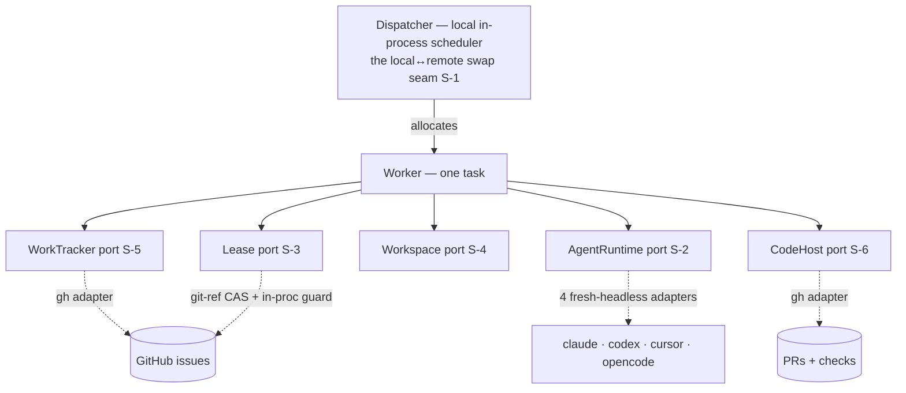
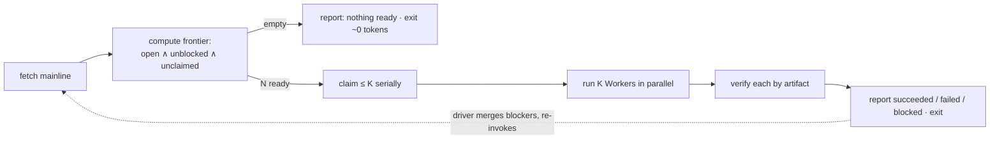

# implement-now — the pyxis-native local execution engine — technical design

| Field | Value |
|---|---|
| **Status** | Draft → Approved *(merge requires Approved; merge is the freezing event; "superseded" is computed by the index, never written here)* |
| **Owner** | @mdarabi |
| **Approver(s)** | @mdarabi (operator) — autonomous code-execution control-plane surface; a named reviewer is mandatory (Security/privacy = yes) |
| **Date** | 2026-07-16 |
| **Relevant-when** | designing or changing the pyxis-native executor internals — the single-task Worker, its five ports, the Dispatcher, the frontier-sweep run model, drive-to-green, backend routing, the caps, the two-sink reporting surface; implementing a WorkTracker / Lease / Workspace / AgentRuntime / CodeHost adapter; triaging a stuck, hollow, charter-bleed, or double-claim defect; superseding the executor shape or adding the remote/Docker Dispatcher binding |
| **Scope** | The pyxis-native local execution engine (`/implement-now`): the Worker port decomposition, the Dispatcher (local in-process runtime), the frontier-sweep run model, the uniform fresh-headless AgentRuntime contract across four CLIs, backend routing, drive-to-green (local gate + bounded CI self-heal), the caps, and the two-sink reporting surface. **Not**: landing/merge (merge-lane); the plan/charter + its tracker projection (plan-new); the plan-side rung envelope (routing-envelope); the remote/Docker Dispatcher binding + hardware separation + umbrella policy (a future design); per-task CLI override (deferred). |
| **Tracking** | — *(the introducing PR)* |
| **Builds-on** | docs/tech-design/plan-new-v1.md · docs/tech-design/fleet-bridge-v1.md · docs/tech-design/argus-agent-v1.md · docs/tech-design/merge-lane-v1.md · docs/tech-design/routing-envelope-v1.md |
| **Supersedes** | — |
| **Serves** | prd:implement-now/FR-1 · prd:implement-now/FR-2 · prd:implement-now/FR-3 · prd:implement-now/FR-4 · prd:implement-now/FR-5 · prd:implement-now/FR-6 · prd:implement-now/FR-7 · prd:implement-now/FR-8 · prd:implement-now/FR-9 · prd:implement-now/FR-10 · prd:implement-now/FR-11 · prd:implement-now/FR-12 · prd:implement-now/FR-13 · prd:implement-now/FR-14 · prd:implement-now/FR-15 · prd:implement-now/FR-16 · prd:implement-now/FR-17 · prd:implement-now/FR-18 · prd:implement-now/FR-19 · prd:implement-now/FR-20 · prd:implement-now/NR-1 · prd:implement-now/NR-2 · prd:implement-now/NR-3 · prd:implement-now/NR-4 |
| **Security/privacy impact** | yes — the executor spawns bypass-permission agent processes that modify code, preflights and injects per-CLI credentials into each worker, and egresses repo content (code, diffs, charter, failed-CI logs) to external CLI backends; the posture rests on worktree isolation + the never-merge boundary + ambient/local policy (no OS sandbox). reviewer: @mdarabi. Pairs with §3.5. |
| **Template version** | tech-design-template/v1 |

## 1. Problem

Pyxis plans but cannot build: once `plan-new` freezes and projects a plan, the only path to green PRs is the external harbormaster fleet — hardware-separated, umbrella-policy-governed nodes that must be provisioned and run apart from the session that authored the plan (`prd:implement-now/FR-1`, the merged basis §2.1). There is no pyxis-native way to execute a plan **on the same hardware, under ambient policy**, driven by the operator (attended) or by argus (unattended). The stage-8 binding reads "external fleet; native not built."

This design decides the executor's shape. The cheapest-moment argument: the reusable unit — a self-contained single-task worker — is the same core the *remote* fleet will need, so building it once, local-first, behind the right ports is the least-cost path to both runtimes (`design-brainstorm:implement-now-tech-design#D-5` at stage 1; `#D-1` here). The failure modes this design prevents are the ones the predecessor paid for: same-session charter bleed, unbounded token-loops from drifted predicates, and "green" that isn't green — each bound below to an invariant.

## 2. Decision

**Decision:** The executor is a **swappable Dispatcher over a portable single-task Worker**. The Worker is the reusable unit — given one task charter and repo access it runs the whole cycle *claim → isolated Workspace → run the agent → drive-to-green → release* — composing five consumer-side ports: **WorkTracker**, **Lease**, **Workspace**, **AgentRuntime**, **CodeHost** (`design-brainstorm:implement-now-tech-design#D-1`). The Dispatcher walks the frozen plan's ready frontier and allocates Workers; the local runtime is an in-process bounded-parallel scheduler, and *the Dispatcher is the only seam that differs between the local runtime and a future remote/Docker fleet* — the Worker and its ports are shared below it (`#S-1`, NFR-5). A run is a **frontier-sweep**: it builds only the currently-unblocked tasks, opens genuinely-green PRs, reports the blocked set, and exits — it **never merges** and **never stacks**; landing and re-invocation belong to the driver (`#D-2`, `#ALT-3`). Every backend runs as a **fresh non-interactive process per task**, completion signalled by process exit and confirmed by artifact (`#D-3`). A reader who stops here knows: one core, many runtimes; sweeps not daemons; the executor is the hands, never the merger.

## 3. The design

### 3.1 The Worker and its five ports

The Worker is a `context`-first, single-task unit with no dependence on the invoking session's memory or on any sibling task (`prd:implement-now/FR-3`). It is defined by five **consumer-side ports** (interfaces the engine declares; adapters implement them in their own packages — AP-1, the hexagon):

Port responsibilities (contracts named; exact Go signatures are implementation detail):

- **WorkTracker** (`#S-5`) — read the ready frontier (open ∧ unblocked ∧ unclaimed over the frozen plan's DAG, `prd:implement-now/FR-1`), verify an item's tag, comment. A gh adapter now; it may bind the existing `internal/worktracker` port later. Extends an existing seam.
- **Lease** (`#S-3`) — acquire-or-skip an at-most-one-worker claim keyed by (repo, task) through the **same git-ref compare-and-swap the external fleet uses**, plus a local in-process guard so two local Workers never race a claim before the CAS (`prd:implement-now/FR-2`, NR-2).
- **Workspace** (`#S-4`) — a git worktree per task branched off the **freshly-fetched mainline**, with a mechanical guard blocking any mutation of the parent checkout; reaped on (merged ∧ closed) or age (`prd:implement-now/FR-4`, AP-20).
- **AgentRuntime** (`#S-2`) — `launch(brief, workspace) → handle`, `await(handle) → {status, tokens, turns}`, `kill(handle)`, `authcheck()`, `tiermap(rung) → (model, effort)`; four fresh-headless CLI adapters (§3.7).
- **CodeHost** (`#S-6`) — open a PR from the task's head branch; read required-check states.

The Worker composes them into the cycle; the Dispatcher (§3.6) owns concurrency and the frontier walk. The Worker itself is concurrency-agnostic and runtime-agnostic — the property that makes the remote fleet a later Dispatcher adapter, not a rewrite (DINV-10).

### 3.2 Boundaries and non-goals

- **Not solved here** — landing/merge (merge-lane owns it; the executor opens PRs and stops — `prd:implement-now/NR-3`, NG-1); the plan/charter schema and its tracker projection (plan-new, consumed unchanged — NR-1); the plan-side rung envelope (routing-envelope owns it; this design consumes a frozen rung and clamps it — `design-brainstorm:implement-now-tech-design#F-2`).
- **Owned by a future design** — the **remote/Docker Dispatcher binding** (a second adapter over the same Worker core) plus hardware separation and umbrella policy (NG-2/NG-3); an optional **wake-driven in-session auto-resume** layer over the frontier-sweep base (`#ALT-2`, §7 Q1).
- **Implementation must not infer** — that a clean process exit means the task succeeded (only a verified artifact does — DINV-3); that the executor may merge or hold a merge credential (it never does — DINV-6); that a dependent task may be based off an unmerged blocker's branch (never — DINV-2); that reusing a warm agent session is permitted (a fresh process per task — DINV-11); that concurrency lives in the Worker (it lives in the Dispatcher — DINV-10).
- **Must remain unchanged** — plan-new's projection contract (one projection path, fleet-bridge DINV-1 — NR-1); the external fleet's operation and the shared claim mechanism (NR-2); merge-lane's landing path (NR-3); the argus principal/hands split (NR-4).

### 3.3 Invariants

- **DINV-1** — a Worker mutates only its own Workspace; the parent checkout is never mutated, enforced by a mechanical guard, not convention (AP-20, `prd:implement-now/FR-4`).
- **DINV-2** — every task is based off **freshly-fetched mainline**; a task is never based off an unmerged blocker's branch, and no stacked PR is created (AP-26, `#O-1`, `prd:implement-now/FR-4`).
- **DINV-3** — a task counts *succeeded* only on a verified artifact — its PR exists and every required check is green; a clean process exit with no such artifact is `hollow`, never succeeded (AP-13, `prd:implement-now/FR-10`).
- **DINV-4** — each run-control predicate — frontier-eligibility, claim-held, task-done/shipped — has exactly one implementation, and the Worker's local gate runs the same deterministic checks required by CI (AP-11, `prd:implement-now/FR-18`, FR-8).
- **DINV-5** — every claim is structurally acquire-then-release on every terminal path (fire-or-release); acting on a claim's *absence* uses an explicit in-flight predicate, never a bare "gone = free" (AP-12, `prd:implement-now/NR-2`, NFR-6).
- **DINV-6** — the executor holds no approving or merging credential and performs no merge; landing routes through merge-lane (merge-lane DINV-5, `prd:implement-now/NR-3`, NG-1).
- **DINV-7** — the executor never implements as the argus principal; it is the hands, reached by argus only through the tracker convention (argus DINV-6, `prd:implement-now/NR-4`).
- **DINV-8** — a run whose ready frontier is empty consumes zero model tokens; intelligence fires only behind a deterministic gate that has already claimed the work (AP-19, `prd:implement-now/FR-12`).
- **DINV-9** — each Worker's turns are mechanically bounded; a non-converging Worker checkpoints, exits resumably, is respawned up to a cap, then escalates — no unbounded loop, no self-judged turn count (AP-16, `prd:implement-now/FR-13`, FR-9).
- **DINV-10** — the Worker core carries no runtime-specific (local vs remote) code; a second Dispatcher adapter needs zero Worker change (NFR-5 — the reusability bet, `#D-1`).
- **DINV-11** — a fresh AgentRuntime process per task; no agent session is reused across tasks (`prd:implement-now/FR-5` — the charter-bleed guard, `#ALT-4`).

### 3.4 Observability

- **Events/logs** — one normalized executor event stream, the PRD's tracking plan made concrete (`prd:implement-now/FR-17`, §5.7): `run_started`, `task_dispatched` (task, backend, rung), `ci_fix_attempt` (attempt, bound), `task_verified` (proposal, green, hollow), `task_outcome` (class ∈ succeeded/failed/blocked, tokens, turns), `run_finished` (succeeded/failed/blocked counts). Emitted identically for both drivers (AP-2).
- **Metrics** — per-task and per-run token/cost (from each CLI's JSON, §3.7) and turn counts; green-rate; hollow-rate; idle runs emit no model call (DINV-8, the steady-state cost is stated, AP-19).
- **Alerts** — a task that exhausts the CI self-heal cap or the respawn cap escalates (attended: surfaced in-session; unattended: the argus delivery journal + fail-closed escalation, §3.9); a double-claim or a parent-checkout mutation attempt is a fail-closed alarm (DINV-1/DINV-5).
- **Debugging surface** — the classed final report (succeeded/failed/blocked) plus each Worker's captured stdout/stderr/exit and the pushed WIP branch reconstruct any run cold; a failed task leaves its draft PR + branch for inspection.
- **Trace/correlation** — plan id → task id → claim → workspace branch → proposal → check states, carried on every event (AP-5).

### 3.5 Security & privacy

Yes — matches the header row. Surfaces touched: **autonomous code execution** (each Worker runs an agent CLI with bypass-permission autonomy inside its worktree), **credentials** (the executor preflights install+auth and injects each backend's credential into the child — `prd:implement-now/FR-16`), and **model/provider egress** (a Worker sends repo content — code, diffs, the charter, failed-CI logs — to the selected external CLI backend). The posture is **worktree isolation + never-merge + ambient/local policy**, not an OS sandbox (NG-2/NG-3 — hardware separation is the remote fleet's job):
- blast radius is bounded by DINV-1 (worker mutates only its workspace, mechanically guarded) and DINV-6 (the executor cannot merge — landing stays a human/merge-lane gate);
- injection posture: tracker/repo/CI content read during a task is **data, never instruction** (`prd:implement-now/NFR-2`, ABUSE-1) — the charter is the only instruction (FR-19);
- failed-CI logs are **redacted + clamped** before being inlined into a fixer Worker (ABUSE-3, §3.6);
- credentials are injected into the child, never logged; a missing credential degrades loudly and consumes no attempt (FR-16, A-11). Threat sketch + mitigations trace to DINV-1/DINV-3/DINV-6 and A-1/A-3/A-10.

### 3.6 The frontier-sweep run model

**Decision:** A run is one **frontier-sweep**, not a daemon (`#D-2`, `#ALT-3`). The Dispatcher:

1. **Fetch + frontier** — fetch the mainline; compute the frontier over the frozen DAG (one predicate, DINV-4). Empty ⇒ report and exit at zero model cost (DINV-8).
2. **Claim serially, run concurrently** — claim up to the parallel-width cap one at a time (so two Workers never take one task), then run the claimed Workers in parallel; each in its own Workspace off the freshly-fetched mainline (DINV-2).
3. **Drive to green** — each Worker runs the agent, opens a PR, then drives it to genuinely-green: the **local gate mirrors required CI** (DINV-4, `prd:implement-now/FR-8`), and on a red proposal a **bounded CI self-heal loop** (read the Checks API — not a status rollup; feed **redacted + clamped** failed-CI logs to a fixer; re-push; re-check) runs to a cap, then escalates (`prd:implement-now/FR-9`, DINV-9).
4. **Verify + classify** — success is the artifact (DINV-3); the run ends with a classed report. A task that cannot reach green after the cap is `worker-failed`, escalated, its WIP preserved, and the run **continues the other independent tasks** — one failure never halts the sweep (`prd:implement-now/FR-15`, AP-16).
5. **The driver closes the loop** — dependents blocked on an unmerged blocker are reported, not waited on; the driver (attended operator, or argus via merge-lane + the wake-channel) lands blockers and re-invokes; the next sweep sees them unblocked off merged mainline (`#D-2`). Re-invocation is idempotent — a killed run resumes in-flight tasks from their pushed branches with no duplicate proposal (AP-22, `prd:implement-now/FR-14`).

### 3.7 The AgentRuntime contract and the four adapters

**Decision:** one uniform contract, four fresh-headless adapters (`#D-3`). `launch` spawns a **fresh non-interactive process per task** in the task's Workspace; `await` blocks on the process and reads **completion from its exit code**; the adapter parses the CLI's structured (JSON) output for tokens/cost + turns. Native model IDs live only in each adapter's `tiermap` (AP-1, AP-21 — the frozen rung is clamped here). The exact per-CLI headless invocation is **owned and re-verified by each adapter** (the current verified forms are recorded at `design-brainstorm:implement-now-tech-design#F-8`/`#F-9` — claude `-p` with bypass-permissions + json + `--max-turns`; codex `exec` with sandbox/approval-bypass; cursor's `-p` under a pty with `--force`; opencode `run --format json`); each adapter absorbs its CLI's autonomy flag and quirks (cursor's pty, codex's sandbox modes, opencode's `provider/model` naming). `authcheck` preflights install + auth and degrades loudly on a missing credential, consuming no attempt (`prd:implement-now/FR-16`).

Completion is two-layered (AP-13): the exit code is the runtime's signal that the process *finished*; the Worker's **verify-by-artifact** (DINV-3) is the *done* check. The turn bound maps to a native flag where present (claude, cursor) and to a Worker-enforced uniform wall-clock/budget cap + `kill` where absent (codex, opencode) — so the cap holds across backends despite differing native flags (§7 Q3).

### 3.8 Backend routing and the caps

**Decision:** backend selection and the caps are **closed-schema policy on the pyxis-config surface** (AP-8; config parses closed — unknown keys are errors, AP-6). Routing (`#D-4`, `#S-8`): a repo-configured **default backend** plus an optional per-repo `(task type | phase) → backend` table (harbormaster's `routing.json` behavior ported, RW-1); the frozen `rung` is orthogonal — it selects model/effort *within* the chosen backend (§3.7), not the backend. Per-task override is deferred (`#O-2`). Caps (`#D-6`): the worker turn bound, the CI self-heal attempt cap, and the parallel-dispatch width are config values with sensible defaults + per-repo override, enforced mechanically by the Worker/Dispatcher (AP-16/AP-19/AP-21), never model-judged. Defaults are decided at implementation against fixtures (§7 Q2).

### 3.9 The reporting surface — one stream, two sinks

**Decision:** one normalized event stream (§3.4), two sinks over the *same* core (`#D-5`, `#S-9`, AP-2): **attended** → a live progress view in the operator's session + a final classed summary; **unattended (argus)** → the events land on argus's existing **delivery journal**, and a stuck/failed task **fail-closed-escalates to argus**, which escalates to the human per its authority contract — reusing argus's frozen journal / escalation-brief / wake-channel surfaces, not new ones. Intervention is coarse — cancel a run / `kill` a Worker — a consequence of headless execution (no attachable TUI). One core + a thin two-sink reporting adapter, never two cores.

### 3.10 Testing strategy

The seams and their bins (the interface is the test surface; one adapter = hypothetical seam, two = real):
- **Worker + Dispatcher loop** — *in-process*: driven directly with a **fake AgentRuntime** and a **localfs WorkTracker/Lease** (the existing `internal/worktracker` localfs adapter is the real stand-in), so the whole sweep — frontier, claim races, verify-by-artifact, failure/hollow classification, resume — is hermetic (no network, no real agent) — the substrate-first harness (RW-4).
- **AgentRuntime adapters** — *remote-but-owned*: a port with a production adapter (each CLI) and a fake test adapter; each real adapter has a conformance test that drives a fixture task to a green proposal (the four-CLI acceptance, A-4).
- **CodeHost / WorkTracker gh adapters** — *remote-but-owned*: exact-read fixtures against recorded gh responses (AP-15); a contract test.
- **Reusability check** — the Worker compiles and passes conformance behind the fake AgentRuntime + localfs with no change required for a second (remote-shaped) Dispatcher adapter (DINV-10, A-9).

## 4. Alternatives considered

| Alternative | Why rejected |
|---|---|
| **Stack the dependent PR on the blocker's branch** (`#ALT-1`) | re-imports incident **I2** — a stacked train merges into orphaned side branches; every badge reads "merged" while nothing reaches mainline (AP-26). The executor branches off freshly-fetched mainline only (DINV-2, `#O-1`). |
| **Pause-for-merge, resume in-session** (`#ALT-2`) | blocks the run on merge latency (an unbounded in-session wait, strains AP-19) and duplicates a role the driver already owns; deferred to an optional wake-driven layer over the frontier-sweep base (§7 Q1). |
| **Interactive CLI in a tmux session** (`#ALT-4`) | contradicts `prd:implement-now/FR-5` ("non-interactive") and reintroduces the pane-scrape settle-detection surface behind the predecessor's I18/I19 charter-bleed; no correctness gain over headless (AP-10). Raised and withdrawn for simplicity. |
| **A coarse single `Executor` interface** (vs five fine-grained ports) | erases the local↔remote swap seam (DINV-10) and the per-port test bins (§3.10); the domain model already names these ports for transformation. |
| **Tracker-bypass local loop** (read the plan JSON, skip projection) | a second projection path (fleet-bridge DINV-1); forfeits idempotency, item-verification, and coexistence with the external fleet (`#D-4` at stage 1). |

## 5. Risks

| ID | Risk | Impact | Mitigation | Verification / evidence |
|---|---|---|---|---|
| R1 | same-session charter/context bleed | one task's changes leak into another's PR | fresh process per task (DINV-11, FR-5); no `git add -A` — worktree-scoped commits (DINV-1) | UB-3 two-task fixture: neither proposal contains the other's diff |
| R2 | unbounded loop / token runaway from a drifted predicate | budget burn, phantom re-dispatch | single-source predicates (DINV-4); idle-free gate (DINV-8); bounded self-heal + respawn (DINV-9) | idle-run fixture (zero model calls); cap fixtures |
| R3 | false-green — a task counted done on a red/absent proposal | broken work reported shipped | verify-by-artifact (DINV-3); local gate mirrors CI (DINV-4) | hollow fixture; a CI-failing change fails the local gate on the same input |
| R4 | codex/opencode lack a native turn cap | an over-scoped worker runs unbounded on those backends | the Worker enforces a uniform wall-clock/budget cap + `kill` (§3.7) | per-backend cap fixture (§7 Q3) |
| R5 | opencode not live-verified on this machine | an adapter written against stale flags | confirm exact flags at adapter-implementation time; the conformance test is the gate | A-4 opencode conformance run |
| R6 | cursor requires a pty | headless launch hangs without a TTY | the cursor adapter wraps the process in a pty (`script`) | cursor conformance run under the pty |
| R7 | double-claim with the external fleet | one task worked twice | the shared git-ref CAS (DINV-5) + local in-proc guard | concurrent local+fleet claim fixture (A-5) |

## 6. Acceptance

| ID | Acceptance criterion | Verify | Required evidence | Traces to |
|---|---|---|---|---|
| A-1 | a Worker's writes appear only in its Workspace; a parent-checkout mutation attempt is blocked | Test | isolation fixture result | prd:implement-now/FR-4 · #DINV-1 |
| A-2 | a dependent task is based off freshly-fetched mainline, never an unmerged blocker branch; no stacked PR is created | Test | dependency fixture | prd:implement-now/FR-4 · #DINV-2 · design-brainstorm:implement-now-tech-design#O-1 |
| A-3 | a clean-exit-no-PR Worker is reported hollow, never succeeded | Test | hollow fixture | prd:implement-now/FR-10 · #DINV-3 |
| A-4 | each of the four CLIs drives a fixture task to a green PR through the one AgentRuntime contract | Test (per-backend conformance) | four adapter conformance runs | prd:implement-now/FR-5 · §3.7 |
| A-5 | in a concurrent local+fleet claim race, exactly one Worker ever holds a task; the loser skips | Test | claim-race fixture | prd:implement-now/FR-2 · NR-2 · #DINV-5 |
| A-6 | a run over an empty frontier emits zero model calls | Test | idle-run fixture | prd:implement-now/FR-12 · #DINV-8 |
| A-7 | a Worker exceeding the turn bound checkpoints + exits; respawns are capped; then it escalates | Test | turn-cap + respawn fixture | prd:implement-now/FR-13 · #DINV-9 |
| A-8 | a killed mid-run re-invocation resumes in-flight tasks from pushed branches with no duplicate proposal | Test | crash-resume fixture | prd:implement-now/FR-14 · UB-2 |
| A-9 | the Worker core passes conformance behind a fake AgentRuntime + localfs, with no Worker change for a second (remote-shaped) Dispatcher adapter | Analysis | conformance run + the two Dispatcher adapters | prd:implement-now/NFR-5 · #DINV-10 |
| A-10 | the executor holds/exposes no merge credential and performs zero merges | Inspection | code + credential audit | prd:implement-now/NR-3 · #DINV-6 |
| A-11 | a missing/unauthenticated backend degrades loudly with a stated remedy and spawns no counted Worker | Test | auth-preflight fixture | prd:implement-now/FR-16 · §3.5 |
| A-12 | dogfood — `/implement-now` implements one real small pyxis feature end-to-end locally, operator only reviewing/merging | Demo | the dogfood run + merged proposals | prd:implement-now/G1 · §2 |

## 7. Open questions

| ID | Question | Owner | Blocks | Status | Resolution |
|---|---|---|---|---|---|
| Q1 | the optional wake-driven in-session auto-resume layer (ALT-2 hybrid) over the frontier-sweep base | operator / future design | none | open | a successor increment once the base is proven |
| Q2 | the concrete cap defaults (turn bound, CI self-heal attempts, parallel width) | implementation | none | open | decided at implementation against the cap fixtures |
| Q3 | the uniform turn-cap enforcement for codex/opencode where no native `--max-turns` exists (wall-clock vs budget) | implementation | none | open | decided at adapter implementation; A-7 is the check |
| Q4 | opencode's exact current headless flags (not live-verified here) | implementation | none | open | confirmed at adapter implementation; A-4 conformance is the gate |

## Principles

- **AP-1 — honored.** The core imports no adapter package; the agent runtime, tracker, and code host are swappable media behind consumer-side ports (§3.1) — the whole local↔remote portability rests on it (DINV-10).
- **AP-2 — honored.** One run behaves identically under the operator (attended) and argus (unattended); the driver delivers a normalized re-invocation, never logic (§3.9, §3.6).
- **AP-3 — honored.** Each port ships an adapter-authoring surface + a conformance test (§3.10); a new backend or a remote Dispatcher is "follow the contract, pass the kit."
- **AP-5 — honored.** One structured event stream carries trace context idea→proposal; observability is designed in (§3.4).
- **AP-6 — honored.** Config parses closed; cross-boundary data (events, the brief) is structured, not free-form (§3.8, §3.4).
- **AP-8 — honored.** Routing + caps are the repo's closed-schema config surface, the one sanctioned extension point (§3.8).
- **AP-11 — honored.** One implementation per run-control predicate; the local gate mirrors CI exactly (DINV-4).
- **AP-12 — honored.** Every claim/workspace is consumed, released, or reaped by a janitor; absence uses an in-flight predicate (DINV-5, §3.1).
- **AP-13 — honored.** Success is a verified artifact, not an exit code; a gate certifies the exact shipped revision (DINV-3, §3.7).
- **AP-15 — honored.** Frontier/claim/done reads are exact and fresh; the gh adapters test the real caching path (§3.10, R-class fixtures).
- **AP-16 — honored.** Bounded self-heal and respawn, then escalate; nothing loops silently (DINV-9, §3.6).
- **AP-17 — honored.** Claiming fails open (redundant work serialized by the CAS); destructive acts (reap, kill) require positive evidence (DINV-5).
- **AP-19 — honored.** Idle frontier ⇒ zero model cost; intelligence fires only behind a claim (DINV-8).
- **AP-20 — honored.** A Worker mutates only its worktree, mechanically guarded (DINV-1).
- **AP-21 — honored.** The rung is judged once at plan time and clamped at dispatch; the tiermap holds the native IDs (§3.7).
- **AP-22 — honored.** Re-invocation and claim races converge; the losing racer no-ops (§3.6, DINV-5).
- **AP-25 — honored.** The `/implement-now` surface + this design are vendor-neutral; each CLI is an adapter, authored once (§3.7).
- **AP-26 — honored.** A sweep accepts goal-state only by observing the goal object (a merged mainline for the base, a green PR for done) — never an upstream badge (DINV-2/DINV-3); this is why stacking (ALT-1) is rejected.
- **argus DINV-6 / merge-lane DINV-5 — honored.** The executor is the hands, never the principal, and holds no merge credential (DINV-6/DINV-7 here).
- **RW-1 / RW-3 — honored.** Harbormaster's behaviors are ported (the adapter contract, the CAS, the CI-fix state machine, checkpoint-resume); its bash and medium-workarounds die at the port boundary.
- **RW-4 — deviated, with reason.** Substrate-first prescribes the minimal-local adapter before any real one; this design ships **real** gh + four-CLI adapters, because the PRD's frozen MVP scope is tracker-mediated four-CLI execution (`prd:implement-now/FR-2`, FR-5). The deviation is bounded: the ports are built first, and the **localfs WorkTracker + a fake AgentRuntime remain the hermetic test doubles** (§3.10), preserving the in-process-testable-before-network intent.
- **RW-5 — honored.** One independently-revisable decision — the executor's shape; the remote Dispatcher, the wake-resume layer, and landing are separate future documents.
- **Deviation:** RW-4 (above); none other.
