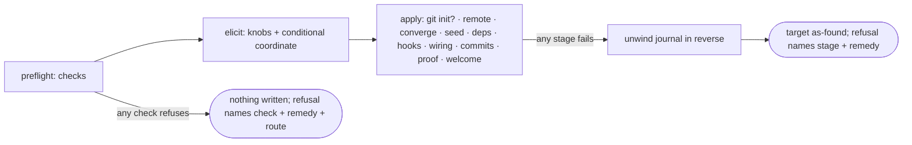

# Init hardening — the checked front door — technical design

| Field | Value |
|---|---|
| **Status** | Approved — operator review via the introducing PR (the feeding record gated ready-for-design 2026-07-28); merge is the freezing event |
| **Owner** | @mdarabi |
| **Approver(s)** | @mdarabi (operator) — named security reviewer per the impact row |
| **Date** | 2026-07-28 |
| **Relevant-when** | implementing or changing `pyxis init`'s preflight checks, content admission and adopt routing, the rollback journal, coordinate/remote setup, `ci_mode` materialization, preview's report surface, or the install truth surface; triaging a stranded, destructive, or mid-run-failed install; superseding the init front half |
| **Scope** | The init front half: the preflight check suite (one predicate home; doctor delegation), content-based admission + routing, the write-journal rollback, coordinate elicitation and remote materialization, the knob-conditional workflow entry and its migration posture, gh probe depth, and the truth surface (welcome boundary statement, doctor's manifest advisory). **Not**: adopt/apply/undo mechanics, converge's steady-state semantics, the codegate `seed` verb's internals (the sibling amendment D-6 assigns), python/node verb content, or prompt gloss wording (implementation under FR-12's fit). |
| **Tracking** | — *(the introducing PR)* |
| **Builds-on** | installer-v1 · config-driven-portability-v1 · existing-repo-onboarding-v2 |
| **Supersedes** | — |
| **Serves** | prd:init-hardening/FR-1 · prd:init-hardening/FR-2 · prd:init-hardening/FR-3 · prd:init-hardening/FR-4 · prd:init-hardening/FR-5 · prd:init-hardening/FR-6 · prd:init-hardening/FR-7 · prd:init-hardening/FR-8 · prd:init-hardening/FR-9 · prd:init-hardening/FR-10 · prd:init-hardening/FR-11 · prd:init-hardening/FR-12 · prd:init-hardening/FR-13 · prd:init-hardening/FR-14 · prd:init-hardening/FR-15 · prd:init-hardening/FR-16 · prd:init-hardening/UB-1 · prd:init-hardening/UB-2 · prd:init-hardening/UB-3 · prd:init-hardening/NR-1 · prd:init-hardening/NR-2 · prd:init-hardening/NR-3 · prd:init-hardening/ABUSE-1 · prd:init-hardening/NFR-1 · prd:init-hardening/NFR-2 · prd:init-hardening/NFR-3 · prd:init-hardening/EVT-1 · prd:init-hardening/EVT-2 · prd:init-hardening/EVT-3 · prd:installer/FR-23 · prd:installer/FR-24 · prd:installer/UB-11 |
| **Security/privacy impact** | yes — new pre-write network probes carry existing credentials to their owning services (gh identity/scope probes to GitHub; the artifact-door credential on the reachability probe); one new user input (the repository coordinate) enters gh/git argv; no new secret is stored · reviewer: @mdarabi |
| **Template version** | tech-design-template/v1 |

## 0. Read to rule — the human reviewer's section (~6 min)

*The body is the contract; this section only routes attention — on any conflict the body governs; machines ignore it.*

**Judge these**

| # | The call | Could have gone | If you disagree |
|---|---|---|---|
| 1 | **One dedicated check package**; init refuses pre-write, preview reports, doctor's prerequisite rows delegate | converge-homed checks (#ALT-1) or init-local copies (#ALT-3) | the predicate home re-scatters and I5's drift returns → §2, §3.1, DINV-2 |
| 2 | **Write-journal rollback** — as-found or fully-installed; foreign entries preserved and named | snapshot-diff (#ALT-5) or adopt's durable receipt (#ALT-6) | FR-10's foreign clause or the transient shape is re-litigated → §3.6, DINV-3 |
| 3 | **Strict emptiness + the two-step remedy** — adopt and its design untouched | onboarding amended to admit non-git targets | a live design's settled dispatch reopens for one printed command → §3.1, DINV-5 |
| 4 | **A created remote repository is never auto-deleted** on rollback — reported with its cleanup command | silent remote cleanup | destructive remote acts enter the failure path → DINV-4 |
| 5 | **Best-effort scope prediction, advisory-only** (operator override of the leaner auth+existence recommendation) | auth + existence probes only | earlier warnings disappear; or, inverted, scope verdicts start blocking on unknowable token classes → §3.1, DINV-7 |
| 6 | **`ci_mode` excludes by unlisting; migration is advise-only** — converge gains no deletion behavior | converge removes the now-excluded workflow | the engine's first delete-an-operand-file path opens, enacting knob choices made while the knob was inert → §3.8 |
| 7 | **codegate seeds its own manifest** — every surface routes to one command | the executor, doctor, or planner seeds it (#ALT-7..9) | a standing contract breaks (proposals-only · zero-mutations · observe-don't-declare) → §3.9 |

**Sanity-check the numbers** — interactive re-ask bound: 3 attempts then a reported abort (§3.1, A-6); zero writes and zero remote mutations before every applicable check passes — including the principle-forced ordering: coordinate validated at check time, remote materialized only at apply (DINV-1, §3.7, A-2); rollback restores byte-identical (A-3); no other numeric bounds — floors and hosts resolve from release/config data, never literals (DINV-6).

**The author's open questions** — Q1 journal persistence across uncatchable kills · Q2 the authoritative home of the toolchain floor set · Q3 scope-probe sources per token class — §7, none blocks approval.

**Skip the rest** — schema/structure → docgate (gen-index consumes the header); substance, coherence, reuse, shape honesty → the unmanned `/tech-design-review` (report rides this PR); implementation defects → codegate + the verify ladder; rationale and displaced shapes → §4 (explanatory).

## 1. Problem

The shipped init is trusting where it must be skeptical and destructive where it must be reversible. Its prerequisite checks fire mid-pipeline — after `git init`, the config writes, converge's fetch, dependency install, and hooks — so a missing remote or a logged-out `gh` kills a half-built tree the retry refusal then trips over; its admission tests git state rather than content, so a non-git directory full of files is admitted and silently overwritten with no history to recover from; one knob (`ci_mode`) changes nothing; and its refusal text routes nowhere, claiming adoption is deferred while `adopt` ships in the same binary. The merged contract (`prd:init-hardening`, with the installer ledger aligned by its amendment 001) now binds the opposite behaviors — checks before any write (FR-9), content-based admission with routing (FR-1/FR-2), full rollback (FR-10), a real `ci_mode` (FR-11), a truthful surface (FR-12..16). This design decides the mechanisms. The cheapest moment is now: the installer's stage machinery is still one package, doctor's probes are still three lines, and nothing yet depends on a second predicate home.

## 2. Decision

**Decision:** Init gains a **checked front door built from two new seams**: a **dedicated preflight check suite** — one package owning every environment and admission predicate, consumed by init (refuse before any write), by preview (report every outcome), and by doctor (its prerequisite rows delegate) — and a **write-journal rollback** — one journaling write primitive through which every init mutation lands, unwound in reverse on any stage failure, restoring the target to as-found while preserving and naming anything foreign (`design-brainstorm:init-hardening-tech-design#D-1` · `#D-3`). The flow becomes: **preflight → elicit (with the conditional GitHub coordinate) → apply, journaled → on failure, unwind**. Admission is content-based and routes by name — empty proceeds; anything else is told to run `adopt` (with the `git init` two-step for non-git targets) (`#D-2`); the workflow materializes knob-conditionally with an advise-only migration (`#D-4`); gh probes go auth + existence + best-effort advisory scope (`#D-5`); and the code-gate gap is closed by routing every surface to codegate's own `seed` verb (`#D-6`). This is safe by construction where it matters most: no mutation exists before the checks pass, and no mutation survives a failure except what init never owned.

## 3. The design

### 3.1 The preflight suite — one home, three consumers

**Decision:** All front-loaded predicates live in one new package (working name `internal/preflight`; the name is the implementer's), structured as a **check registry** — each check a row: id · applicability (a predicate over the resolved-or-prospective knobs) · probe (read-only) · outcome (`pass` | `refuse` with remedy and, where one exists, route | `advise` with warning). The registry is data the three consumers render identically (AP-10): init runs applicable checks and refuses on the first `refuse` class encountered (all outcomes reported, not just the first — a user fixes everything in one pass); preview runs the same registry and reports every outcome plus the would-do set (installer FR-24); doctor's prerequisite rows delegate to the same suite post-install (its report shape unchanged).

The checks, in evaluation order:

1. **Admission** — the target is an empty directory, or a repository whose tree holds nothing beyond the repository metadata directory (no tracked files, no untracked content, clean status). Anything else refuses with the conflict list and the route: a content-holding repository → `pyxis adopt`; a non-git target with content → the runnable two-step (`git init -b <branch>`, then `pyxis adopt`) (`#D-2`; `prd:installer/UB-11`). OS droppings are content and appear in the conflict list.
2. **Toolchain** — the git executable and each runtime executable the resolved knobs imply, present and at-or-above the release-documented floor set (home: Q2); the probe pattern follows the existing floor-check precedent (`brainstorm:init-hardening#P-2`).
3. **GitHub mode** (applicable when any gh-transport operation is implied — derived from the declared operation table, never a second knob predicate) — gh present; an authenticated identity; the **coordinate** resolvable (§3.7); for `wiring repo=use`, the coordinate's repository exists and is readable; for `create`, absence is the expected state (an existing repository is the ensured end state at apply, AP-22).
4. **Scope prediction, best-effort** (`#D-5`) — token scopes probed against the declared operation set where the token class exposes them; a detectable gap emits `advise` naming the operation and the credential remedy; an unknowable answer emits nothing. **A scope outcome is never `refuse`** (DINV-7).
5. **Artifact source** — applicable on a cold cache only: the manifest URL answers under the resolved credential; a warm, hash-verified cache skips the probe.
6. **Cross-knob coherence** — the resolved knob set is internally consistent: the closed enums gate values; this check gates combinations. Its first refusing pair is live from birth: `ci_mode` excluding hosted CI while `wiring.protection` requires the hosted check context — a repository born wedged, every PR blocked on a required check that never reports (the audit's original trap, unmasked the moment FR-11 makes the knob real). The refusal names both remedies (include hosted CI, or set protection to `none`); interactive runs re-ask, promptless runs refuse pre-write.

Interactive ordering: admission and environment checks run before the first question; knob-dependent checks run after resolution but before any write — both orderings satisfy DINV-1 because elicitation mutates nothing. The re-ask loop (FR-13) bounds at 3 attempts per question, then aborts reporting every collected answer; a closed input stream takes the default without entering the loop (today's EOF semantics).

### 3.2 Boundaries and non-goals

- **Not solved here** — adopt/apply/undo mechanics (a live design owns them); the `seed` verb's internals (the sibling amendment); gloss wording; python/node default verb content; any lock against concurrent mutation of the target during apply (see Q1's adjacency — the journal preserves foreign entries; it does not serialize writers).
- **Owned by a future design** — deepening scope prediction into a blocking pre-check (`prd:init-hardening` WR-1); a persistent journal surviving uncatchable kills (Q1); the `ci_mode` key rename (WR-2, riding a schema bump).
- **Implementation must not infer** — that checks passing guarantees wiring success (late permission failures remain legal and land as rollback + hand-off, UB-1); that a coordinate's validity implies permissions; that `advise` outcomes gate anything (DINV-7); that the admission check may relax for "harmless" files.
- **Must remain unchanged** — converge's steady-state `Run` and its ownership-class semantics; adopt's dispatch and the onboarding-v2 contract (O-1); promptless runs' zero-prompt guarantee (`prd:installer/FR-23`; NR-1); doctor's zero-mutations contract; the exec grammar and acquisition path (installer-v1 DINV-1/DINV-5).

### 3.3 Invariants

- **DINV-1** — no filesystem write and no remote mutation exists before every applicable check has passed; a refusing check reports with the target byte-identical and the transport transcript empty.
- **DINV-2** — one evaluator per predicate: every environment/admission predicate is implemented exactly once, in the check suite; init, preview, and doctor consume it; neither reimplements any probe it covers.
- **DINV-3** — the journal is complete and exact: every mutation lands through the journaling primitive or is ingested from converge's returned Report before the pipeline proceeds; unwind removes exactly the journaled writes (and the metadata directory only when init created the repository), preserves every unjournaled entry, and names each preserved foreign entry in the report.
- **DINV-4** — no automatic destructive remote act: a remotely created repository is never deleted by init; failure reports it with its manual cleanup command.
- **DINV-5** — admission is content-based: only the empty directory and the metadata-only repository proceed; every admission refusal names the adoption route.
- **DINV-6** — no operand-owned or release-owned value is a literal: the remote name, the floor set, and the artifact host resolve from config or release data (AP-30).
- **DINV-7** — a scope-prediction outcome is at most advisory; no scope probe result blocks or mutates.

### 3.4 Observability

- **Events/logs** — the basis's three, as structured slog events with the existing run-id: `init_checks_passed` (checks, duration), `init_refused` (check, remedy-present, route-present — EVT-2), `init_rolled_back` (failed stage, restored — EVT-3); each check additionally logs its outcome at debug.
- **Metrics** — none beyond the events (local CLI, zero egress — installer-v1 DINV-7 posture); M2's refusal-quality measurement consumes the events from run logs.
- **Alerts** — none; there is no hosted plane.
- **Debugging surface** — preview renders the full registry outcome table; a failed unwind dumps the remaining journal (path · kind · error) so manual recovery is enumerated, never guessed.
- **Trace/correlation** — the run id threads every event, check outcome, and journal entry (existing installer pattern).

### 3.5 Security & privacy

Yes — matching the header row.

- **Surfaces touched**: network boundaries (three read-only probe classes) and one new user input (the coordinate) entering gh/git argv. No identity, permission, or secret storage changes; no model egress; no billing.
- **Credential containment** — each probe carries a credential only to its owning service: the gh identity/scope probes speak to GitHub through the ambient gh credential; the artifact reachability probe sends the door credential only over TLS to the configured host (the existing containment discipline extends to the probes — A-11); the scope probe reads response headers only.
- **Coordinate input** (ABUSE-1) — the elicited `owner/name` is validated against a strict grammar (owner and name character classes, one slash, no leading dash) before it may enter any argv or URL; everything else re-asks. Mitigation binds via A-4.
- **Threat sketch** — (1) argv/URL smuggling via the coordinate → the grammar plus argv-array invocation (never shell interpolation); (2) credential misroute via a hostile artifact-source override → unchanged from installer-v1: the override changes bytes' origin, never credential targets or acceptance; (3) destructive-remote misuse of rollback → DINV-4 forecloses deletion outright.

### 3.6 The apply pipeline and the rollback journal

The stage order downstream of the front door is installer-v1 §3.5's, unchanged; what changes is everything before it and the failure path around it:

**Decision:** Every init-owned mutation flows through **one journaling write primitive** (file write, directory create, config write, git-init, remote-op — each a typed journal entry); converge's contribution is **ingested from its returned Report** (repaired + regenerated paths) immediately on return, before the pipeline proceeds. Unwind walks the journal in reverse: files, then emptied directories, then the repository metadata directory when and only when init created it. Foreign entries — anything on disk not in the journal — are preserved and named (DINV-3). A repository created remotely during wiring is a `remote-op` entry that unwinds to a **report line**, never a deletion (DINV-4). The journal is in-process and transient (O-3 of the record): an uncatchable kill loses it, and the residue then surfaces as admission conflicts on the next run — the honest floor, with Q1 holding the persistence question.

Converge's own mid-run death is the one partial-visibility seam: its writes are individually atomic (tmp + rename), but a death between write and Report loses the enumeration. The unwind tolerates journal-absent residue by refusing into the admission conflict list on re-run; R2 tracks the residual risk.

### 3.7 The coordinate and the remote

Resolution order (principle-forced — the record's F-10): parse the **configured remote** when present (the remote *name* from config, never a literal — DINV-6); otherwise, interactively, elicit `owner/name` (grammar-validated, re-asking per FR-13); promptless runs supply it by flag/answers key or receive the named pre-write refusal (`prd:installer/FR-23`'s conditional-exchange boundary). The existence/access probe runs at check time **against the coordinate via the API** — no remote needs to exist. The remote is **materialized at apply** (a journaled config write), and under `wiring repo=create` the repository is created at the coordinate (an idempotent ensure — an already-existing repository is the ensured end state, AP-22) before dependent wiring operations run. The pre-run check summary echoes the resolved coordinate before any creation (the basis's FR-8 fit).

### 3.8 `ci_mode` materialization and migration

**Decision:** The hosted workflow's class-policy entry becomes **knob-conditional**: the desired set converge computes includes the workflow exactly when `ci_mode` includes hosted CI. Excluded means **unlisted** — and converge never acts on unlisted paths (the never-touch complement property), so no deletion machinery exists anywhere (`#D-4`; O-2 of the record). Fresh installs are born right; an already-installed repo carrying the workflow under `ci_mode=local` gets a **doctor advisory** naming the mismatch and both remedies (flip the knob · delete the file). Desk hooks install in every mode (the hard-dependency ruling, `brainstorm:installer#D-6`).

### 3.9 The truth surface and the first-use route

The welcome/completion output states the gating boundary: which gates are active on the operand (the docs gate, desk + hosted per knob) and that the code gate is **pending with its enabling step named** — the codegate `seed` command (`#D-6`). Doctor gains the code-without-manifest advisory (the basis's FR-15): recognized code marker files present with no verification manifest → an advisory naming the same command; manifest-present or code-free trees stay silent. Both surfaces **route**; neither seeds — the verb itself, its marker-file detection, and its template manifest belong to `prd:implementation-verification` by its own amendment (the record's D-6; this design's one cross-feature dependency). The executor's manifest-absent refusal naming the same route is that sibling's concern, not bound here.

### 3.10 Testing strategy

Seams binned per the template menu: the **check registry, admission predicate, journal, and unwind** — in-process (table-driven per check with injected probes; property tests: unwind∘apply = identity on an empty target; foreign-file preservation). **git** — local-substitutable (real git against scratch directories, the existing installer-test pattern). The **gh transport** — remote-but-owned (the existing transcript-fake Runner; probe calls assert read-only pre-write — DINV-1's empty-transcript check). The **artifact fetch** — local-substitutable (the file:// fixture source; cold/warm cache legs). The **failure matrix** — per-check seeded defects (A-2) and per-stage injected deaths (A-3), inheriting the installer e2e harness; the NR suites run unchanged (A-10).

**Performance** — the check pass is read-only and bounded: local probes cost microseconds; the network-facing probes (gh identity/existence, artifact reachability) bound their retries under the transient classification and run only where the knobs imply them; independent probes may parallelize. The install-budget bound the installer contract binds (`prd:init-hardening` NFR-1) is re-measured with the full check pass included — A-13.

## 4. Alternatives considered

| Alternative | Why rejected |
|---|---|
| Converge-homed checks — doctor's section grows the suite (`design-brainstorm:init-hardening-tech-design#ALT-1`) | a workable single home, but converge's scope creeps permanently into environment probing; the tree engine should stay a tree engine (AP-20) |
| Init-local checks, doctor keeps copies (`#ALT-3`) | two evaluators of one predicate from day one — the I5 drift shape verbatim; the record's strawman boundary |
| Snapshot-diff rollback (`#ALT-5`) | deletes foreign entries planted mid-run — the exact FR-10 violation; distinguishing foreign requires the write enumeration anyway, collapsing into the journal with worse properties |
| Adopt's durable undo receipt for init (`#ALT-6`) | a durable artifact and cross-feature schema coupling for a seconds-scale transient need; adopt's undo answers a different question |
| The executor seeds the manifest (`#ALT-7`) | an unattended operand-config write outside implement-now's proposals-only perimeter |
| Doctor seeds the manifest (`#ALT-8`) | breaks doctor's zero-mutations contract — its cleanest promise |
| plan-new seeds the manifest (`#ALT-9`) | declares the stack from plan prose instead of observing the tree (AP-18 inverted) |
| Auth + existence probes only, no scope prediction (the record's D-5 recommendation) | displaced by the authority's ruling: a knowable scope gap warned before five stages run is worth the imprecise cases, which degrade to advisory under DINV-7 |
| Converge removes a knob-excluded workflow | the engine's first delete-an-operand-file path, enacting knob choices made while the knob was decorative; unlisting + advisory needs zero new machinery |

## 5. Risks

| ID | Risk | Impact | Mitigation | Verification / evidence |
|---|---|---|---|---|
| R1 | a later write path skips the journaling primitive | debris after failure — the defect this design exists to kill | all installer writes route through the one primitive (the package exposes no bare write); converge lands only via Report ingestion | the A-3 injection matrix + a review-time grep that `internal/installer` performs no direct writes outside the primitive |
| R2 | converge dies between a write and its Report — residue the journal never saw | unwind leaves it; the re-run's admission refusal lists it as conflicts | converge's per-file atomicity bounds it to at most the in-flight file; the admission conflict list makes it visible, never silent | a converge-death fixture asserting the re-run refusal names the residue |
| R3 | scope-probe false signals (token classes lie by omission) | a warning that teaches distrust, or silence before a late 403 | DINV-7 (advisory-only) + UB-1's rollback + hand-off classification | the token-matrix fixture (classic/fine-grained) asserting advisories never block |
| R4 | GitHub API unavailability at check time (existence probes) | a transient refusal on a healthy setup | probe failures classify through wire's existing transient patterns and retry bounded; a transient-classified failure refuses with the retry named, not a false verdict | fault-injected probe fixtures |
| R5 | the conditional coordinate exchange erodes promptless parity | CI runs start prompting — the NR-1 breach | the exchange fires only in the interactive mode the prompter already gates; promptless resolution is flag/answers-or-refuse | the existing promptless e2e matrix, unchanged (A-10) |

## 6. Acceptance

| ID | Acceptance criterion | Verify | Required evidence | Traces to |
|---|---|---|---|---|
| A-1 | the admission fixture set (empty dir · empty repo · repo+content · non-git+content · dirty repo) admits exactly the two empty shapes; every refusal lists the conflicts and names the route (adopt; the two-step for non-git) with zero writes | Test | admission suite result | prd:init-hardening/FR-1 · FR-2 · prd:installer/UB-11 · #DINV-5 |
| A-2 | every seeded check defect (per-check: absence, below-floor, logged-out gh, missing repo under `use`, unreachable artifact source, absent coordinate promptless, the wedged knob pair `ci_mode=local` × `wiring.protection=required-checks`) refuses pre-write naming that check's remedy, with the target byte-identical and the gh transcript empty | Test | check-injection suite result | FR-3 · FR-4 · FR-5 · FR-7 · FR-9 · FR-11 · #DINV-1 |
| A-3 | per-stage failure injection (converge fetch death, wiring permission failure, signal mid-apply) restores the target byte-identical to pre-run (created-repo case: the directory returns to empty); a planted foreign file survives and is named; the subsequent run proceeds past admission; a created remote repository is reported, never deleted | Test | failure-matrix result | FR-10 · UB-1 · UB-2 · UB-3 · #DINV-3 · #DINV-4 |
| A-4 | coordinate handling: origin-present runs ask nothing; origin-absent interactive runs elicit with grammar validation (hostile inputs re-ask, never reach argv), set the remote at apply, and `create` lands the repository from a bare folder (hermetic transport) with the coordinate echoed in the check summary | Test | coordinate suite + transcript | FR-6 · FR-8 · ABUSE-1 · §3.7 |
| A-5 | the `ci_mode` matrix: `local` ships no workflow file, `actions`/`both` ship it, hooks active in all; an old-repo mismatch yields the doctor advisory naming both remedies and doctor performs zero mutations | Test | matrix + doctor fixture | FR-11 · §3.8 |
| A-6 | interactive surface: every asked question renders value set + gloss + default (derived default names its basis); out-of-enum input re-asks and aborts at 3 with collected answers reported; EOF takes defaults | Demo + Test | recorded session + prompter suite | FR-12 · FR-13 |
| A-7 | the completion output states the gating boundary with the seed command named; the code-without-manifest doctor fixture yields the advisory; manifest-present and code-free fixtures stay silent | Test + Inspection | truth-surface fixtures + PR review record | FR-14 · FR-15 · §3.9 |
| A-8 | preview runs the same registry: reports every check outcome, the exact write set, and the declared wiring operations, performing none of them, cold cache included | Test | preview fixture result | prd:installer/FR-24 · #DINV-1 · #DINV-2 |
| A-9 | doctor's prerequisite rows are produced by the suite — no probe implemented twice anywhere in the tree | Test + Inspection | doctor fixture + the DINV-2 duplication sweep | #DINV-2 · §3.1 |
| A-10 | the three NR suites pass unchanged: promptless zero-prompt matrix, empty-target install parity, onboarding suites | Test | suite results | NR-1 · NR-2 · NR-3 |
| A-11 | credential containment holds on every probe: gh credentials only to GitHub, the door credential only to the configured host over TLS, nothing to a mirror; the scope probe reads headers only | Test | containment suite extension | NFR-2 · §3.5 |
| A-12 | the three events fire with their typed properties at their triggers and nowhere else | Test | event fixture assertions | EVT-1 · EVT-2 · EVT-3 · NFR-3 |
| A-13 | the install-budget measurement, re-run with the full check pass included, stays within the installer contract's existing bound | Analysis | measurement record on the reference runner | prd:init-hardening/NFR-1 · §3.10 |

## 7. Open questions

| ID | Question | Owner | Blocks | Status | Resolution |
|---|---|---|---|---|---|
| Q1 | Is a scratch-persisted journal (outside the target) worth its complexity to survive uncatchable kills, or is admission-conflict surfacing the durable answer? (record G-1) | @mdarabi | none | open | — |
| Q2 | Where does the toolchain floor set authoritatively live — release documentation, the release manifest's metadata, or compiled constants shipped with the release? | @mdarabi | implementation | open | — |
| Q3 | Which scope-signal sources exist per token class (classic header, fine-grained/App probes), and which operations map to which knowable scopes? | @mdarabi | none — advisory-only under DINV-7 | open | — |

## Principles

- **AP-5 — honored.** The three events and per-check outcomes are designed in with the run-id thread, not bolted on (§3.4).
- **AP-10 — honored.** The check registry is data all three consumers render; behavior captured as structure, not per-verb prose.
- **AP-11 — honored.** One evaluator per predicate (DINV-2); doctor delegates; the gh-required derivation stays the operation table's.
- **AP-12 — honored.** Every acquisition and mutation is accounted in the journal; unwind is the account settled (DINV-3).
- **AP-13 — honored.** "As-found" is verified against the journal before the refusal reports it; green is only reported over a verified end state.
- **AP-15 — honored.** Every refusal decision reads fresh probe results; nothing is cached across runs but the hash-verified artifact cache.
- **AP-16 — honored.** No check skips silently: every outcome — pass, refuse, advise — is reported (§3.1); the inapplicable are recorded as such in preview.
- **AP-17 — honored.** Fail closed on the destructive path (refuse pre-write; unwind on failure; DINV-4's never-delete-remote), fail open on the additive (advisory scope signals, DINV-7).
- **AP-18 — honored.** Behavior keys on observed state — probes, marker files, tree content — never declared intent (§3.1, §3.9).
- **AP-20 — honored.** The suite and the journal are their own narrow packages; converge, adopt, and doctor contracts untouched (§3.2).
- **AP-22 — honored.** `create` is an idempotent ensure; a re-run after rollback converges; the journal unwind is itself re-runnable over partial unwinds.
- **AP-24 — honored.** The knob-conditional workflow entry is authored class policy driving the derived desired set — governance from the authored input, never rebuilt from the governed tree (§3.8).
- **AP-30 — honored.** The remote name, floor set, and artifact host resolve from config/release data (DINV-6).
- **RW-5 — honored.** One independently-revisable decision — the checked front door; its subordinate choices (probe depth, migration posture, routing text) ride §3 and would only ever change together.
- **Deviation:** none.
