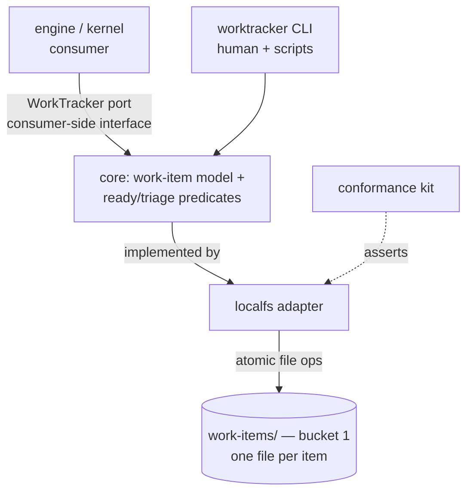

# Local work tracker — the file-based WorkTracker adapter — technical design

| Field | Value |
|---|---|
| **Status** | Approved (2026-07-07 — operator, in operator review) *(merge is the freezing event; "superseded" is computed by the index, never written here)* |
| **Owner** | @mdarabi |
| **Approver(s)** | @mdarabi (operator) — mandatory named reviewer: this is a data/infra surface (the factory's work-item store) |
| **Date** | 2026-07-07 |
| **Relevant-when** | designing or changing the file-based work-item store, the localfs WorkTracker adapter, the work-item on-disk schema, or the **Carina** work-item CLI; implementing against the WorkTracker port for the file medium; triaging Carina / local work-item store defects; superseding the file-tracker design |
| **Scope** | The file-based work tracker as one coupled unit: the work-item on-disk model, the localfs adapter's consistency/concurrency/query mechanics, the CLI over it, and the WorkTracker port surface this reference adapter implements + its conformance kit (the RW-4 substrate bundle). **Not**: the other 13 ports' contract conventions (system-design D3), the engine-state/consistency model (D1), the sibling minimal-local adapters (lease/code-host/proposal), or GitHub/Linear import-export. |
| **Tracking** | introducing PR (filed on approval) — **serves and merges after PR #28** (the `local-work-tracker` PRD) |
| **Builds-on** | docs/tech-design/repo-layout-and-system-footprint.md (bucket placement + the `.pyxis/config.yaml` path surface) · docs/tech-design/docgate-v1.md (the Go binary, typed-`Defect` boundary contract, and gate-wiring patterns this CLI reuses) |
| **Supersedes** | — |
| **Serves** | corpus:IMPL-1 · corpus:IMPL-8 · corpus:IMPL-10 · corpus:PLAN-4 · corpus:PLAN-8 · corpus:GATE-5 · corpus:GOV-5 |
| **Security/privacy impact** | none — the store is local files the operand already owns; no network, identity, secrets, model/provider egress, or new authenticated surface (see §3.11) |
| **Template version** | tech-design-template/v1 |

## 1. Problem

The `local-work-tracker` PRD (PR #28) requires a file-based WorkTracker medium — replicating GitHub Issues as plain files so the factory runs with no tracker service — but, correctly, decides no mechanics: it states *what* must be observably true (18 Must FRs) and leaves four questions open (Q1 on-disk schema, Q2 identifier scheme, Q3 search-index-vs-strong-read, Q4 CLI surface). Nothing yet decides how a work item is represented on disk, how writes stay atomic and reads stay strong without a database, how identifiers avoid collision under concurrent local processes, or how the port, the adapter, and the CLI are structured. Until those are decided, the RW-4 substrate — *port + minimal-local adapter + conformance kit* — cannot be built, and with it neither the factory-in-a-box nor the hermetic test harness every later engine test depends on.

Why now: the footprint just landed (`.pyxis/`, the three-bucket ownership model, the closed `.pyxis/config.yaml` path surface) and docgate established this repo's Go conventions (thin `cmd/` main, `internal/` packages, a typed `Defect` boundary contract, golden tests, the resolve-shim gate wiring). The file tracker can now be designed against a settled layout and a proven code shape rather than inventing both.

## 2. Decision

**Decision:** Each work item is one atomically-written, human-readable file under a git-versioned, configurable **bucket-1** path; **the file is the sole source of truth** — no database, no daemon, and no index on any decision path, so strong reads are direct file reads. A single Go core implements the work-item model and the shared readiness/triage predicates, exposed identically to the engine through the **WorkTracker port** (a consumer-side interface) and to humans through a thin CLI over the same core. This design defines that port surface **together with** its first (file) adapter and conformance kit — the RW-4 substrate bundle — because today exactly one WorkTracker medium exists and the three change together.

The reasoning, once: files-as-truth is precisely what makes strong reads free — the local filesystem gives read-your-writes, so the stale-read workarounds GitHub forced (INV-7/AP-15) simply have nowhere to live here (RW-3 — the new interface is not weak where the old medium was). It keeps the swap test honest and satisfies the PRD's hard "no db, no dependency" constraint (NG-2). One core behind two front doors is AP-11 (one predicate, one place) made structural: the human and the engine cannot drift because there is one implementation. And co-designing the port with its sole adapter is RW-4 read literally — *ports, the minimal-local adapters, and the conformance kit are built before any real-world adapter* — while §3.2 names the one future decision this defers.

## 3. The design



### 3.1 The on-disk model — one file per work item

**Decision:** one work item is one file, `<work_items_root>/items/<id>.md`, with three regions: a **closed-schema front-matter header** of typed fields, a free-markdown **body** (the description), and an append-only **log** of timestamped entries (comments, decision-records, transition audit). One file per item is what makes an item independently readable, hand-editable, git-diffable, and mergeable (G3/J4), and atomically replaceable (§3.4).

Header fields (closed — unknown keys are a named defect, AP-6/INV-32): `id`, `type`, `state` (`open`|`closed`), `title`, `signals[]` (names, §3.5), `assignees[]`, `parent` (id or `—`), `blocked_by[]` (ids, incl. the cross-repo form `owner/repo#id`), `created`, `updated`, `close_reason?`, `priority?`. The enum-valued fields (`type`, `state`, `close_reason`, `priority`, and the classification `kind:`/`area:` signals) draw their closed value sets from §3.14. The header is parsed by a hand-written closed grammar in the manner of docgate's config parser (stdlib-only, no YAML/TOML dependency); the body is markdown; each log entry is a delimited record `kind · author · timestamp · namespace? · payload` where `kind ∈ {comment, decision-record, transition}`. Comments are FR-5; decision-records are FR-9 (namespaced, latest-wins); transitions are the FR-4 audit trail. **Decision-records replace GitHub's HTML-comment marker grammar with typed, namespaced structured data** (RW-3/INV-39) — the routing tag becomes a Signal (§3.5), the disposition becomes a decision-record, and neither is a parsed comment.

### 3.2 Boundaries and non-goals

- **Not solved here** — the other 13 ports' contract conventions (D3); the engine-state/consistency model beyond this medium (D1); the sibling minimal-local adapters — LeaseStore, CodeHost, ProposalService (each its own design); GitHub/Linear import-export (PRD WR-1); a search index (added only on measured need, Q3); a multi-repo/global (`~/pyxis/`) store variant (Q2); any network, remote, or webhook surface.
- **Owned by a future design** — the medium-independent refinement of the WorkTracker port that a *second* adapter (GitHub) will force: extracting the port into a cross-adapter contract (D3) is a `Builds-on`/supersession decision *then*, named in Q4, not smuggled in now.
- **Implementation must not infer** — that the port surface is medium-independent-final (it co-emerged with one adapter; keep it free of file-isms so extraction is clean — R4); that any index may back a decision-path read (never — DINV-4); that work-item files may live under `.pyxis/` (they are bucket-1 operand data — DINV-8).
- **Must remain unchanged** — the footprint's three-bucket model and config surface (this design *adds* one `paths.work_items` key, nothing else); docgate's ledger paths and verb semantics.

### 3.3 Identifiers (resolves PRD Q2)

**Decision:** identifiers are sequential positive integers allocated by **atomic exclusive-create**. To create, the store attempts `open(items/<n>.md, O_CREAT|O_EXCL)` starting at the highest-known id + 1 and incrementing on `EEXIST` until the create wins; the winning exclusive create *is* the allocation. No counter file, no lock, first-writer-wins — collision-free and never-reused under concurrent local processes (PRD UB-5), and human-referenceable (`#1`, `#2`, …) as FR-1 requires. Ids need not be dense; a gap (from a failed create) is legal and never reused. This assumes local POSIX `O_EXCL` semantics; networked filesystems are out of scope (R2).

### 3.4 Consistency & concurrency (resolves PRD FR-14; partial Q3)

**Decision:** every mutation is a whole-file atomic replace — write a sibling temp file, `fsync`, then `rename()` over the target (atomic on POSIX) — and concurrent writes to *one* item are serialized by a per-item advisory lock (`flock`) held only across that read-modify-write. Reads take no lock: `rename()` guarantees a reader observes either the whole old file or the whole new one, never a torn one. **Reads that feed a destructive or dispatch decision** (readiness, closing, reaping) read the authoritative file directly and therefore reflect every prior write with no index or cache in the path (DINV-4 — AP-15/INV-7). Writes fail closed: a full disk or a failed `fsync` fails before the `rename`, leaving the prior file intact (AP-17). A crash mid-write leaves an orphaned temp file, swept on next run; the item is unharmed.

Concurrent writers to *different* items never contend (distinct locks). The append-only log is safe under the per-item lock (no lost append, PRD UB-4/DINV-5); a per-item append-only sidecar file with `O_APPEND` is the lock-free alternative if append contention is ever measured hot (§4).

### 3.5 Signals, hierarchy, dependencies

- **Signals** — a store-level vocabulary (`<work_items_root>/signals`, bucket-1, versioned with the backlog) defines each signal's `name`, `role` ∈ {routing, authorization, status, classification}, and presentation (color/description); items carry signal *names* in their header. Adding an undefined signal is a named defect (PRD UB-2). Roles are load-bearing, not decoration: the **routing/authorization** role is the direct analog of harbormaster's `local-agent` tag — the searchable "who implements this" field (PRD FR-6) — and it gates the ready-set (§3.6, DINV-6). Signals are typed control state, replacing GitHub's label-encoded state (RW-3, GOV-5).
- **Hierarchy** — a child stores its `parent`; children are enumerated by scanning for `parent == E`; an epic's rollup (open-child count) is a scan-derived read. No parent→children index is authoritative (DINV-1); the scan is strong.
- **Dependencies** — `blocked_by[]` holds ids (and the cross-repo `owner/repo#id` form, stored and displayed opaquely — Q5); the reverse `blocking` view is computed by scan. Adding an edge runs a cycle check over the transitive `blocked_by` closure and refuses a cycle, naming the path (PRD UB-3/DINV-10), so readiness never deadlocks.

### 3.6 Queries and the shared predicates (resolves PRD FR-10–FR-14, FR-16)

**Decision:** list/filter (by state and by signal name *or role*) and full-text search (over title, body, and log) are **direct scans** of the item files — no index in v1 (Q3). At the PRD's NFR-2 capacity (10⁴ items) a scan of small files on local SSD meets NFR-1 (< 200 ms p95), pinned by a 10k-item fixture (A-10). If scale ever breaches it, an index is added under one rule: decision-path reads bypass it (DINV-4); until measured, an index is a temptation, not a requirement.

**Decision:** the **ready-set** and **triage-set** predicates are one Go function each, in the core, consumed identically by the engine (through the port) and the CLI (DINV-6 — AP-11/INV-30). The tracker-side ready predicate is `open ∧ carries an authorization-role signal ∧ has no open blocker ∧ is not a structural rollup (epic/plan) ∧ has no closing decision-record`; the triage predicate is `open ∧ has no triage-disposition record ∧ is not a structural rollup ∧ has no open blocker ∧ is not assignee-held`. Results are stably sorted by creation order for fair rotation (INV-12). **Boundary:** full pipeline readiness also depends on *no active lease* and *no open proposal* — those live behind the LeaseStore and ProposalService ports; the tracker exposes its half and the engine composes the rest (§3.2).

**Scan cost at scale.** List, filter, and the ready/triage predicates read only each item's closed **header** (a few hundred bytes), never its body or log — so the common queries and every decision-path read scan header-sized data. ~5,000 items is trivially within NFR-1 (headers fit in the OS page cache; warm scans are sub-100 ms, and even a cold scan of small files on local SSD is well under the bound); 10,000 is the v1 capacity target, pinned by A-10. Only full-text `search` reads bodies and logs, and it is never on a decision path, so it absorbs the higher cost. The items directory is **sharded** (by id prefix) so no single directory holds the whole corpus. Beyond the tested capacity, the deferred index (Q3) is a rebuildable cache that decision-path reads bypass (DINV-4) and full-text search may consult — it never becomes authoritative.

### 3.7 The WorkTracker port and the localfs adapter

**Decision:** the WorkTracker port is a **consumer-side Go interface** — the engine declares what it needs; the localfs adapter implements it in its own package; the engine core imports the port, never the adapter (the hexagon boundary, AGENTS.md Go rules, lint-enforced). The interface is kept free of file-isms (no paths, no formats in its signatures) so the future extraction (§3.2/Q4) is clean. Every method takes `context.Context` first and returns typed domain structs plus a typed `Defect` (the docgate boundary-error pattern reused): create · get · edit · transition · comment · addSignal/removeSignal · setParent/clearParent · addDep/removeDep · appendDecisionRecord · list · search · readySet · triageSet · defineSignal.

Package layout (concrete, following docgate's shape):

```
cmd/carina/main.go                 # Carina — the standalone CLI binary (thin main: dispatch, Defect render, exit 0/1/2)
internal/worktracker/
  ├─ model/         # WorkItem, Signal, DecisionRecord, Query — typed domain structs (no IO)
  ├─ port.go        # the WorkTracker interface + the shared ready/triage predicate funcs
  ├─ localfs/       # the file adapter: on-disk grammar, atomic write, O_EXCL alloc, flock, scan
  └─ conformance/   # the port's conformance kit — a behavior table every adapter must pass
```

**The standalone app is named Carina** (the operator's choice — the *Argo* constellation's keel, paired with Pyxis the compass; the backlog is the factory's backbone): `cmd/carina` is the binary. The medium-neutral domain — the `WorkTracker` port, the shared model, and the conformance kit — keeps its functional name under `internal/worktracker` so a future GitHub adapter imports the *port*, not Carina. The port interface and the conformance kit graduate to `pkg/ports` / `pkg/conformance` when the public-API surface is intentionally cut (system-design §8); until an engine consumer exists they stay `internal` (AGENTS.md: `pkg/` only for a deliberate public API). The **conformance kit is the contract** (AP-3): a table of behaviors (create/get round-trip, atomic-write survival, id non-collision, strong-read-after-write, ready/triage correctness, idempotent transition, cycle refusal, JSON-schema validity) that the localfs adapter is the first to pass (RW-4) and that imports no adapter symbol (A-1, mirroring PRD NR-1).

### 3.8 On-disk placement and config (resolves part of Q2; builds on the footprint)

**Decision:** the work-item store is **bucket-1 operand content** (footprint #DINV-1) — it is the user's backlog, git-versioned, and it *survives* `pyxis remove`; it is never placed under `.pyxis/` (bucket 2, which uninstall deletes — losing the store). Its root is a new closed-schema key `paths.work_items` in `.pyxis/config.yaml`, defaulting to `work-items/` at the operand root; the signal vocabulary and any store metadata live under that same root, versioned with the backlog. This adds exactly one config key to the phase-1 surface and touches nothing else in it.

### 3.9 The CLI (resolves part of Q4)

**Decision:** a thin `carina` binary — the standalone app named in §3.7, foldable into a future `pyxis` umbrella as `pyxis work` — is the human and scripting front-end over the same core (PRD FR-16 — one store, two doors). Verbs: `create · show · edit · close · reopen · comment · signal {add,rm,def} · parent {set,clear} · dep {add,rm} · record · list · search · ready · triage`. Every verb prints human text and, with `--json`, schema-versioned structured output (PRD FR-15); errors are `Defect`s naming file/op/reason/remedy on stderr (PRD UB-1); exit codes are docgate's `0` clean / `1` defects / `2` usage. The CLI holds no logic the port does not — it is argument parsing over the core.

### 3.10 Invariants

- **DINV-1** — one file is the sole authoritative record of a work item; no index or cache is ever authoritative (files are truth).
- **DINV-2** — every mutation is atomic (temp + fsync + rename); a crash leaves an item wholly old or wholly new, never torn.
- **DINV-3** — ids are allocated by atomic exclusive-create; an id never collides and is never reused under concurrent local processes.
- **DINV-4** — any read feeding a destructive or dispatch decision reads the authoritative file directly and reflects all prior writes; no decision path consults an index (AP-15/INV-7).
- **DINV-5** — comments and decision-records are append-only; per-item writes are serialized so no append is lost; a decision-record namespace resolves latest-wins.
- **DINV-6** — the ready-set and triage-set predicates each have exactly one implementation, shared by the engine (port) and the CLI (AP-11/INV-30).
- **DINV-7** — every operation completes as a bounded sequence of local filesystem syscalls: no daemon, network, or external service (AP-19; PRD FR-17).
- **DINV-8** — work-item files are bucket-1 operand content: they live outside `.pyxis/` and survive pyxis removal (footprint #DINV-1).
- **DINV-9** — the localfs adapter implements the WorkTracker port and passes its conformance kit; the engine core imports the port, never the adapter (AP-1/AP-3/INV-37).
- **DINV-10** — a dependency edge that would close a `blocked_by` cycle is refused, naming the cycle; the edge set stays acyclic.
- **DINV-11** — every engine-recognized field (`type`, `state`, `close_reason`, `priority`, `signal.role`, decision-record `namespace`, `triage-disposition`, log `kind`) accepts only its closed value set; an out-of-set value is a named defect; only classification signals (`kind:`/`area:`) are operand-extensible (§3.14; AP-6/GOV-5).

### 3.11 Observability

- **Events/logs** — each mutation emits a structured domain event (`item.created`, `item.transitioned`, `item.signal-added`, `item.linked`, `item.record-appended`, `item.commented`) through the EventSink port when one is bound; the CLI logs via `log/slog`. The EventSink is a separate port — the tracker emits, it does not own the sink.
- **Metrics** — none intrinsic (no daemon); store size and per-op latency are derivable from event timings where a sink is bound.
- **Alerts** — none intrinsic; during development a red conformance suite or gate is the alert.
- **Debugging surface** — the files *are* the debugging surface: human-readable, greppable, `git diff`-able (a design goal, G3); every `Defect` names file, op, reason, and remedy.
- **Trace/correlation** — every port method takes a `context.Context` carrying trace context (AP-5); emitted events carry it end-to-end.

### 3.12 Security & privacy

none — the store is local files the operand already owns; there is no network, identity, secret, model/provider-egress, or new authenticated surface, and the OS filesystem is the access boundary (PRD NG-4). **Zero egress is a positive property** relative to hosted trackers, not merely an absence. Blast radius of malformed input is bounded to the single hand-edited file by the closed-schema fail-closed parse (DINV, NR-2 in the PRD); no personal or sensitive data is handled beyond whatever the user writes into their own repository — no DPIA surface. This subsection agrees with the header row (`none`).

### 3.13 Failure modes

| Failure | System behavior | Detection | Recovery |
|---|---|---|---|
| item file absent | `get` returns a not-found Defect (file/op/reason); no partial write | direct `stat` | caller handles |
| malformed / hand-corrupted item | closed-parse fails with a named Defect (file, line, reason); that one item is quarantined, others unaffected | parse on read | user fixes the file (NR-2); never silently dropped |
| crash mid-write | orphan temp file discarded; target is the last atomically-renamed version | temp-file sweep | automatic (DINV-2) |
| concurrent writers, one item | serialized by per-item `flock`; no lost append | lock contention | automatic (DINV-5) |
| dependency cycle on add | refused, cycle named | pre-write cycle check | user redirects the edge (DINV-10) |
| disk full / fsync failure | write fails before `rename`; store intact | write error | user frees space; no partial state (AP-17) |

### 3.14 Closed value vocabularies and their projection

Several fields are **closed enumerations the engine acts on** — pyxis ships them as a **canonical seed vocabulary**, a human-authored governed input (GOV-5; AP-24 — governance is never rebuilt from the governed). An out-of-set value for any engine-recognized field is a named defect (closed schema, AP-6/INV-32, DINV-11); operands may **add** values only along the open axis (classification `kind:`/`area:` signals), never redefine the engine-recognized set. The vocabularies are chosen to **project onto every real WorkTracker medium** (AP-1); the mapping below is that validation — not the adapters, which are future designs (§3.2).

| Field | Closed values | Engine meaning |
|---|---|---|
| `type` (hierarchy role) | feature · milestone · epic · task | place in the Feature→Milestone→Epic→Task DAG; drives auto-close and dispatch. Defaults to `task` on create; planning assigns higher roles |
| `state` | open · closed | core state; the rich lifecycle (triaged/ready/in-progress/…) is projected via signals + records + predicates, never this field |
| `close_reason` | completed · rejected | why a closed item closed (done vs won't-do) |
| `kind` (classification signal) | feat · bug · docs · chore *(operand-extensible)* | change classification — distinct from the `feature` hierarchy role |
| `priority` *(optional, advisory)* | none · urgent · high · medium · low | user priority; **not** an engine scheduling input in v1 (readiness + fairness + dependency order schedule); carried for round-trip fidelity |
| `signal.role` | routing · authorization · status · classification | how a signal is interpreted (§3.5) |
| decision-record `namespace` | triage-disposition · charter · foundation | which frozen judgment the record carries (engine-recognized set) |
| `triage-disposition` value | plan · operator · reject · skip | the triage decision (reject ⇒ close with `rejected`) |
| log-entry `kind` | comment · decision-record · transition | the append-log entry type |

Canonical engine-recognized **signals** (the seed set the engine keys on; all project as native labels): *authorization* — `agent` (the "factory may implement and merge" token, the local-agent analog that gates the ready-set); *routing* — `needs-plan`, `operator`, `retriage`; *status* — `hold`, `worker-failed`, `merge-conflict`, `verify-pending`, `feedback-stalled`, `empty-proposal`. Classification signals (`kind:*`, `area:*`) are the operand-extensible axis.

**Projection onto real media** (validates AP-1 — a canonical value with no native home is carried as a label or custom field, the harbormaster-on-GitHub pattern generalized):

| Canonical | GitHub Issues | Jira | Linear |
|---|---|---|---|
| `type` roles | issue **type** + **sub-issues**; milestone → GitHub milestone | native hierarchy: Initiative→Epic→Story/Task→Sub-task | Initiative→Project(+milestone)→Issue + sub-issue |
| `state` open/closed | open / closed | status **category** (To Do, In Progress → open; Done → closed) | state **type** (triage, backlog, unstarted, started → open; completed, canceled → closed) |
| `close_reason` completed/rejected | `state_reason` completed / not_planned | resolution Done / Won't Do | state type completed / canceled |
| `kind` feat/bug/… | issue **type** (Bug) or **label** | issue **type** (Bug) or **label** | **label** |
| `priority` | label | native **priority** | native **priority** (0–4) |
| signals (`agent`, `hold`, `needs-plan`, …) | **labels** | **labels** | **labels** |
| decision-records (disposition, charter, foundation) | label / **custom field** / comment | **custom field** / label | **custom field** / label |
| the triage-set (undecided) | open ∧ no disposition | initial status | native **Triage** inbox |

Two mapping notes, because they invert intuition: (1) GitHub's and Jira's "issue **type**" is pyxis's `kind` (Bug/Feature classification), **not** pyxis's `type` (hierarchy role) — the hierarchy projects onto sub-issues/parent links and native levels. (2) pyxis persists only `open`/`closed`; Jira's three status categories and Linear's six state types are **richer than pyxis's core state**, so an *ingesting* adapter collapses them to open/closed + signals, and an *emitting* adapter expands pyxis's derived lifecycle (state + signals + predicates) back onto the native statuses.

### 3.15 Capability parity across media — the common feature set

The port's **operation surface** is deliberately the **common intersection** of GitHub Issues, Jira, and Linear, so every adapter implements it natively (AP-1 at the capability level; §3.14 is the same test applied to values). As of 2025–26 all three support the full set — GitHub reached parity in 2025 by adding native sub-issues, issue dependencies, and multiple assignees; before that it needed the body-text/label workarounds harbormaster carried (RW-3).

| Capability (port op / PRD FR) | GitHub Issues | Jira | Linear |
|---|---|---|---|
| create · read · edit · open/close | ✓ (state + `state_reason`) | ✓ (workflow statuses) | ✓ (workflow states) |
| comments (FR-5) | ✓ | ✓ | ✓ |
| labels / signals (FR-6) | ✓ | ✓ | ✓ |
| assignees | ✓ up to 10 | ✓ single native | ✓ single |
| hierarchy — parent/child (FR-7) | ✓ sub-issues (2025) | ✓ Epic→Story→Sub-task | ✓ parent/sub-issue |
| dependencies — blocked-by (FR-8) | ✓ issue dependencies (2025) | ✓ "Blocks" issue links | ✓ blocking/blocked relations |
| custom metadata — decision-records (FR-9) | Projects custom fields / labels | ✓ native custom fields | ✓ custom fields |
| milestone (as a hierarchy `type`) | GitHub milestone / parent issue | fix version / Epic level | project milestone / parent |
| priority | Projects field / label | ✓ native | ✓ native (0–4) |
| search / filter (FR-10/FR-11) | ✓ | ✓ (JQL) | ✓ |

**Deliberately not modeled** — per-system extras that are *not* common to all three, or not pyxis concepts: **sprints / cycles** (Jira sprints, Linear cycles — GitHub has none, and pyxis schedules by readiness + dependencies + fairness, never time-boxes); **story points / estimates** (pyxis sizes work through capability rungs + the charter, judged once at plan time — IMPL-7); **board / view layouts** (pyxis owns its Feature→…→Task hierarchy, not a presentation surface). Excluding them keeps the port a true common denominator (R7).

Three parity nuances the adapters absorb: **assignees** — GitHub allows many, Jira and Linear one; pyxis stores `assignees[]` but requires only one, so single-assignee media project cleanly. **milestone** — pyxis's `milestone` is a *hierarchy role* (a node), not GitHub's date-milestone field; it projects onto whichever native construct each medium uses for that level (§3.14). **duplicate** — all three express it (Linear status, Jira link, GitHub close-as-not-planned); pyxis represents it as `close_reason: rejected` plus a `duplicate` dependency relation, adding no core state.

## 4. Alternatives considered

| Alternative | Why rejected |
|---|---|
| Embedded DB (SQLite) as source of truth | violates the PRD's no-db constraint (NG-2); forfeits "just files" browse/edit/diff and complicates the swap test; a daemon-free file store already meets the consistency needs |
| One append-only event log for *all* items (event-sourced) | excellent for concurrent append, but one item is no longer one readable/editable/diffable file (G3/J4); per-item hand-edit and git-merge regress; every read pays a project-the-log cost |
| Directory-per-item (header file + comments dir) | cleaner append isolation, but more inodes and multi-file atomic writes; one file + per-item lock is simpler and atomically renamable — revisit only if append contention is measured hot (§3.4) |
| JSON-per-item | stdlib-parseable but poor for prose bodies and noisy in git diffs; a closed front-matter + markdown body is more human- and diff-friendly (G3) |
| Full YAML/TOML front-matter via a dependency | adds a parser dependency for what a closed key-value grammar covers (docgate-config precedent, stdlib-only); either way unknown keys are rejected |
| Monotonic counter file for ids | read-then-write races under concurrency; `O_EXCL`-probe is lock-free and collision-free with the same human-friendly sequential ids (§3.3) |
| An index as source of truth, files as export | inverts truth; index staleness breaks strong reads (AP-15); an index may only ever be a rebuildable cache off the decision path (DINV-1/4) |
| A standalone WorkTracker port-contract design first (D3), adapter after | the port has no second implementation to make it independently revisable yet; RW-4 co-builds port + first adapter + kit; extraction is a future `Builds-on` when GitHub arrives (§3.2, Q4) |

## 5. Risks

| ID | Risk | Impact | Mitigation | Verification / evidence |
|---|---|---|---|---|
| R1 | scan-based queries breach NFR at scale; an index is tempting but would risk stale reads | slow ticks, or a correctness regression | v1 direct-scan measured on a 10k fixture (A-10); an index is deferred and, if ever added, decision-path reads bypass it (DINV-4) | 10k-item perf fixture |
| R2 | `O_EXCL` id allocation is weak on networked filesystems (NFS) → possible collision | duplicate ids off local disk | local-POSIX assumption stated (§3.3); conformance parallel-create test on local FS; NFS is out of scope (§3.2) | parallel-create stress on tmpfs/local |
| R3 | read-modify-write append loses an entry if the per-item lock is not held | lost comment/decision-record | per-item `flock` serializes writes; conformance concurrent-append fixture asserts zero loss (DINV-5) | concurrent-append fixture |
| R4 | bundling port + adapter + CLI lets a file-ism leak into the port, so a second adapter forces churn | messy supersession when GitHub arrives | the interface carries no paths/formats (§3.7); the conformance kit imports no adapter symbol (A-1); the future extraction is named, not surprising (§3.2/Q4) | kit import audit; interface review |
| R5 | a hand-edited malformed file blocks reads and looks like store failure | one item unusable | closed fail-closed parse names file+line+reason and quarantines that item only; others unaffected (NR-2) | malformed-fixture test |
| R6 | work-item files are mistaken for docs or placed under `.pyxis/` and lost on uninstall | backlog loss | DINV-8 + the §3.8 config default in bucket 1; the footprint removal test is extended to assert the store survives (A-9) | removal test |
| R7 | the canonical model — value vocabulary *or* operation surface — drifts toward one medium's shape (file- or GitHub-specific), breaking projection to Jira/Linear | a medium-locked "medium-neutral" model — AP-1 violated | the §3.14 and §3.15 projection tables are a standing constraint: a new enum value or port operation is admitted only if it maps onto / is natively supported by GitHub, Jira, and Linear | §3.14/§3.15 review on any model change; per-adapter conformance when those adapters are built |

## 6. Acceptance

| ID | Acceptance criterion | Verify | Required evidence | Traces to |
|---|---|---|---|---|
| A-1 | the conformance kit passes 100% for the localfs adapter, and the kit imports no localfs symbol | Test + Inspection | kit run + import audit | prd:local-work-tracker/FR-18 · #DINV-9 |
| A-2 | crash-injection (kill mid-write across N interleavings) yields zero torn or lost writes | Test (failure injection) | fixture report | #DINV-2 · #DINV-5 · prd:local-work-tracker/UB-4 |
| A-3 | parallel-create stress (P concurrent processes) yields zero id collision or reuse | Test | fixture | #DINV-3 · prd:local-work-tracker/UB-5 |
| A-4 | a strong-read interleave suite shows a post-write read reflecting the write in 100% of cases | Test | fixture | #DINV-4 · prd:local-work-tracker/FR-14 |
| A-5 | ready/triage over a fixture corpus match hand-computed expectation, and the CLI and port return byte-identical sets | Test | fixture | #DINV-6 · prd:local-work-tracker/FR-12 · prd:local-work-tracker/FR-16 |
| A-6 | a full lifecycle completes with zero network syscalls | Test (syscall trace) | trace | #DINV-7 · prd:local-work-tracker/FR-17 |
| A-7 | every read/query verb emits schema-valid JSON | Test (golden) | golden suite | prd:local-work-tracker/FR-15 |
| A-8 | an operator drives the full lifecycle from the CLI unaided and the files are legible/greppable | Human judgment — @mdarabi, rubric: every verb succeeds and files read without tooling | review record | prd:local-work-tracker/DOD-5 |
| A-9 | removal test: deleting `.pyxis/` leaves the work-item store intact and readable | Test | scripted check | #DINV-8 · repo-layout-and-system-footprint#DINV-1 |
| A-10 | list/search/ready/triage over a 10,000-item fixture meet the PRD's NFR-1 latency | Test (perf) | timed suite | prd:local-work-tracker/NFR-1 · prd:local-work-tracker/NFR-2 |
| A-11 | a signal-role filter selects exactly the factory-implementable (authorization-role) set | Test | fixture | prd:local-work-tracker/FR-6 · prd:local-work-tracker/FR-10 |
| A-12 | a dependency edge closing a cycle is refused with the cycle named | Test | fixture | #DINV-10 · prd:local-work-tracker/UB-3 |
| A-13 | every engine-recognized enum field rejects an out-of-set value with a named defect | Test | fixture | #DINV-11 · §3.14 |
| A-14 | the canonical value vocabulary projects onto GitHub Issues, Jira, and Linear per the §3.14 mapping — no value lacks a native or label/custom-field home | Inspection / Analysis | mapping review (per-adapter conformance deferred to those adapters' designs) | AP-1 · §3.14 |
| A-15 | the port's operation surface is a subset of the native capabilities of GitHub Issues, Jira, and Linear — no operation requires a feature absent from any of the three | Inspection / Analysis | §3.15 capability review | AP-1 · §3.15 |

## 7. Open questions

| ID | Question | Owner | Blocks | Status | Resolution |
|---|---|---|---|---|---|
| Q1 | exact front-matter flavor and one-file vs directory-per-item | implementation | implementation | open | leaning one file, closed key-value front-matter + markdown body + append log (§3.1); decided against goldens |
| Q2 | default `paths.work_items` value, and repo-relative vs a global `~/pyxis/` store | operator | implementation | open | leaning repo-relative bucket-1 `work-items/`, configurable (§3.8); global variant deferred |
| Q3 | whether a search index is needed at the capacity target, and its consistency discipline | implementation | nothing (v1 = scan) | open | revisit on a measured NFR breach; decision-path reads always bypass any index (§3.6/DINV-4) |
| Q4 | extraction of the WorkTracker port into a cross-adapter contract (D3); `pkg/ports` vs `internal` placement | operator | the GitHub WorkTracker adapter design | deferred | co-designed here as the RW-4 substrate; extracted when a second adapter exists (§3.2/§3.7). **Standalone app name resolved: Carina** (2026-07-07); umbrella form `pyxis work` |
| Q5 | cross-repo dependency resolution (the `owner/repo#id` `blocked_by` form) beyond opaque storage | implementation | nothing | open | v1 stores and displays the reference; resolution is PRD WR-4 |
| Q6 | does `priority` become an engine scheduling input, or stay advisory-only? | operator | nothing | open | advisory in v1 — readiness + fairness + dependency order schedule; revisit if a priority lane is wanted |

## Principles

- **AP-1 / AP-3 / INV-37 — honored.** WorkTracker is a consumer-side port with a conformance kit and an adapter guide; the engine imports the port, never the adapter; the file adapter passes the same kit any medium will (§3.7).
- **AP-6 / INV-32 / INV-39 — honored.** Work-item files, the signal vocabulary, and config parse closed (unknown keys are defects); cross-boundary data is typed structs; no free-form marker grammar (§3.1, RW-3).
- **AP-10 — honored.** Readiness, triage, and cycle checks are code, not prompt; the store is deterministic (§3.6).
- **GOV-5 / AP-24 — honored.** The type/state/kind/signal/disposition value sets are a governed seed vocabulary — a human-authored input the engine works off, closed against out-of-set values, and chosen to project onto every real medium; operands extend only the classification axis (§3.14).
- **AP-11 / INV-30 — honored.** One ready predicate, one triage predicate, one store — shared by engine and CLI (DINV-6).
- **AP-13 — honored.** Success is the conformance kit and fixtures passing, never prose (§6).
- **AP-15 / INV-7 — honored.** Decision-path reads are direct file reads; no index on those paths (DINV-4).
- **AP-17 / INV-6 — honored.** Writes fail closed (temp+rename; disk-full/parse-fail leave the store intact); destructive reads require positive evidence (§3.4/§3.13).
- **AP-19 — honored.** No daemon; idle costs nothing; every op is a bounded local syscall sequence (DINV-7).
- **AP-22 / INV-8 — honored.** Transitions and decision-records are idempotent and raceable; a repeat is a recorded no-op (prd:local-work-tracker/FR-4, FR-9).
- **AP-23 — honored.** Per-item files, an append-only log, and per-item locks keep parallel authors (engine, CLI, workers) collision-free; git merges stay local to touched items.
- **RW-3 — honored.** The medium's weaknesses — marker grammars, label-encoded state, stale-read workarounds — are absorbed into the port contract, typed data, and strong reads, not rebuilt (§3.1, DINV-4).
- **RW-4 — honored.** This *is* the substrate — port + minimal-local adapter + conformance kit — before any real-world adapter; the file tracker is the factory-in-a-box's first shippable piece.
- **RW-5 — honored.** One decision — the file-based work tracker — per document; the cross-port contract (D3), engine state (D1), and sibling adapters are separate decisions (§3.2).
- **Deviation:** the WorkTracker *port interface* is defined here alongside its first adapter rather than in a standalone port-contract design — a conscious RW-4 substrate bundling: one medium exists, so the port, its sole adapter, and the kit change together and have no independent revision axis yet (§3.2/§3.7). This is not a break from RW-5's one-decision rule; the future extraction, once a second adapter creates that axis, is named in Q4.
