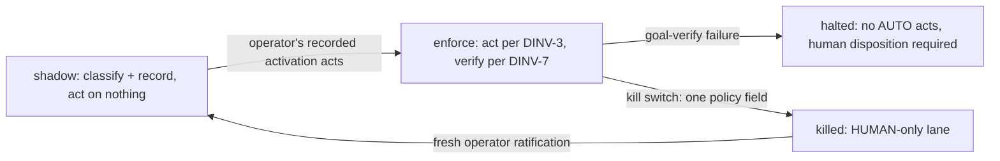

# Merge lane v1 — the risk-tiered AUTO/HUMAN lane over the existing checks — technical design

| Field | Value |
|---|---|
| **Status** | Draft → Approved *(merge is the freezing event; "superseded" is computed by the index, never written here)* |
| **Owner** | @mdarabi |
| **Approver(s)** | @mdarabi (operator) — factory-control surface (merge gate + risk policy); named reviewer mandatory per the security row |
| **Date** | 2026-07-13 |
| **Relevant-when** | designing or changing the AUTO/HUMAN lane — the classifier, the risk policy or its ratification, the machine identity, shadow/activation/kill mechanics; implementing the lane; triaging a wrong-lane routing, a floor violation, a lying-badge halt, or a policy-load defect; superseding the lane's shape |
| **Scope** | The lane end-to-end: the deterministic classifier (floor → classes → verdict), the risk-policy and lane-verdict data classes, shadow mode, the machine identity's acts and their binding to the evaluated revision, post-act goal verification and the halt rule, the fail-closed activation gate, and the kill switch. **Not**: the operator's activation acts themselves (org backstop change, class-set ratification — read as preconditions, never performed); the wake channel (wake-channel-v1); the drive's closure loop (fleet-bridge-v1); any change to an existing mechanical check — with one sanctioned additive delta carved out explicitly: the ratification-trailer check widens to the new policy home (§3.2, §3.6). |
| **Tracking** | — *(the introducing PR)* |
| **Builds-on** | docs/tech-design/docgate-v1.md (the deterministic verb + typed-defect + fixture pattern the classifier reuses) · docs/tech-design/repo-layout-and-system-footprint.md (the config surface that carries the policy file's path key) |
| **Supersedes** | — |
| **Serves** | prd:argus-unattended-drive/FR-1 · prd:argus-unattended-drive/FR-2 · prd:argus-unattended-drive/FR-3 · prd:argus-unattended-drive/FR-4 · prd:argus-unattended-drive/FR-5 · prd:argus-unattended-drive/FR-6 · prd:argus-unattended-drive/FR-7 · prd:argus-unattended-drive/FR-8 · prd:argus-unattended-drive/FR-9 · prd:argus-unattended-drive/UB-1 · prd:argus-unattended-drive/UB-2 · prd:argus-unattended-drive/UB-3 · prd:argus-unattended-drive/UB-4 · prd:argus-unattended-drive/UB-8 · prd:argus-unattended-drive/ABUSE-1 · prd:argus-unattended-drive/ABUSE-2 · prd:argus-unattended-drive/ABUSE-4 · prd:argus-unattended-drive/NR-1 · prd:argus-unattended-drive/NR-2 · prd:argus-unattended-drive/NR-3 · prd:argus-unattended-drive/NFR-1 · prd:argus-unattended-drive/NFR-3 · prd:argus-unattended-drive/NFR-4 · prd:argus-unattended-drive/NFR-5 |
| **Security/privacy impact** | yes — a dedicated machine identity gains approve/merge capability behind a deterministic policy floor, its credential held in the executing medium's secret store, structurally out of any drive session's reach · reviewer: @mdarabi (operator) |
| **Template version** | tech-design-template/v1 |

## 1. Problem

The merged unattended-drive contract requires floor-clearing proposals to stop waiting on a human whose verdict is already computed mechanically (prd:argus-unattended-drive FR-1..FR-9), while every proposal outside a narrow, operator-ratified perimeter keeps a human non-negotiably. Nothing implements it: there is no lane classifier, no risk-policy artifact, no machine identity, no shadow recording, and no activation gate. The cheapest moment is now — the mechanical check surface the lane composes over is live and green, the enforcement arms beneath it are shipped, and Phase B's shadow window cannot open without this machinery. The failure modes this design must prevent are named by the basis: a floor violation merged unattended (M2, zero-tolerance), a lying merged badge trusted (incident I2's class), and a self-unlock — the lane's own policy widened through the lane.

## 2. Decision

**Decision:** The lane is **repo-native and deterministic**: one hermetic classifier verb — the single lane predicate — computes `(diff, policy, check states) → one typed lane verdict`, fail-closed; a thin platform-workflow adapter invokes it per proposal event, records the verdict, and — in enforce mode only, with the operator's activation acts present — submits the approval and the merge **as the dedicated machine identity, bound to the exact evaluated head revision**, with the credential held in the executing medium's secret store, never reachable from any drive session. The risk policy is **one dedicated, versioned, closed-schema file at the repo's config surface**, changed only with the operator's recorded ratification (the existing gate-policy trailer mechanism, widened to it); the kill switch is one field in it. Shadow mode is the same classifier with the acting layer disabled: verdicts recorded, nothing performed. Everything the lane runs and reads — the classifier, the workflow logic, the review-verdict check arm it trusts, the policy — is taken from the trusted mainline context, never from the proposal under evaluation, and the lane's own code and build inputs are floor-gated so no code class can ratify them into AUTO (DINV-9, DINV-6). (design-brainstorm:argus-unattended-drive-tech-design#D-2, #D-3)

A reader who stops here should see the safety spine: HUMAN is the default lane and the floor evaluates first; intelligence, where ever configured, can only downgrade; no act happens without activation, green required checks, and revision binding; every act is verified afterward at the goal object, and a verification failure halts the lane. Concrete schemas live in the paired solution-shape (`shape:merge-lane-v1`), never in this frozen document.

## 3. The design

### 3.1 The classifier — one predicate, evaluated in a fixed order

**Decision:** Classification is a fixed pipeline: **floor first** — the policy's hard-gated classes, derived from the diff's paths and change classes, never from author-declared metadata; any hit routes HUMAN and records which class hit. The floor's **self-unlock minimum is design content, never merely policy content** (UB-3's "no policy state" bar): the control-plane paths (workflow and hook surfaces), the governing documents, the risk policy and activation state themselves, **the lane's own code** — the classifier verb, the shared validator, the acting workflow glue, **and the review-verdict check arm** whose published state DINV-3 consumes as its trust source, all as named packages, never the whole codebase — **the lane's own build inputs** (the module manifests `go.mod`/`go.sum` — a dependency substitution there poisons the next mainline build of the lane's own binaries, so they are part of the lane's trust base under the same "no policy state" bar), the Argus authority contract and the agent's home, **the operating manual** (the standing merge convention's home, in both its faces), and the rest of the **agent-control surface** (the drive and reviewer guides, the skills, the templates, the pipeline map — the distributable agent tree, with the vendor-dir pointers into it). The shared validator refuses to load any policy whose floor fails to cover this minimum (§3.6); a ratified policy may widen the floor beyond it, never shrink below it. Engine and feature code outside the lane's own packages — and any *other* code class's build-input reach — is deliberately **not** in the minimum: floor-clear code proposals must exist for the recommended fleet-task class to have members, and whether any code class rides AUTO stays the operator's ratification call (the basis's Q2 recommendation); the minimum covers only the lane's *own* trust base — its code, its check arm, and its build inputs — so no recommended AUTO code class may claim `go.mod`/`go.sum` in its perimeter (§3.6), closing the two-step ratify-then-plant path where a build-input or arm edit rides AUTO under a code class and then greens a planted verdict. **Classes second** — a floor-clear proposal is an AUTO candidate only when its *entire* diff falls inside **one** ratified AUTO-eligible class's perimeter: each class in the closed set is a data-defined deterministic predicate — a name, a whole-diff path perimeter, and its precondition flags (e.g. whether the artifact class carries a reviewer verdict) — carried in the policy schema itself and validated closed (§3.6), computed from the diff's paths and change classes only; any out-of-perimeter hunk routes HUMAN. **Intelligence last and optional** — where a model-driven review stage is configured it may only downgrade AUTO → HUMAN, and its ambiguity, timeout, or error routes HUMAN (deferred by default; the basis's WR-3).

**Trusted provenance and pinned inputs.** The classifier binary, the workflow logic, the review-verdict check arm whose state DINV-3 consumes, and the risk policy are always taken from the **trusted mainline context** — never from the evaluated proposal's tree, which contributes exactly one input, its diff, consumed as data; no step of the acting job — nor the trusted check arm — builds or executes proposal-derived code or a proposal-substituted dependency (DINV-9). The lane's build inputs (`go.mod`/`go.sum`) are in the self-unlock minimum above for the same reason: a substitution there would poison the next mainline build of the lane's own binaries. Every input the verdict depends on is pinned in the verdict record: the head revision, **the base (merge-base) revision the diff derives from**, the policy version, the check-state snapshot. The verb is deterministic (same pinned inputs → byte-identical verdict — the basis's NFR-1; the diff reconstructs from the pinned base+head pair, so replay survives the proposal's merge and any base move) and fail-closed on any misparse or unclassifiable input (UB-1; incident I3's lesson: a flag-like positional or malformed input is a refusal before any action).

### 3.2 Boundaries and non-goals

- **Not solved here** — the operator's activation acts (the org backstop change; ratifying the class set): read as preconditions (§3.7), owed as the activation brief, never performed or scheduled by anything this design ships (design-brainstorm:argus-unattended-drive-tech-design#O-1).
- **Owned by a future design** — the model-driven downgrade stage's eval harness when WR-3 revisits (FR-4 binds its contract now: downgrade-only, fail-closed); the engine-era multi-repo lane (#O-4).
- **Implementation must not infer** — that a green lane verdict authorizes anything by itself (acts additionally require activation + green required checks + revision binding — DINV-3); that the lane may read a private copy of the required-check set (it reads the medium's — AP-11); that shadow mode may perform *any* act, however safe-looking.
- **Must remain unchanged** — every existing mechanical check's verdict, byte-identical on every tree (NR-1), with this design's **one sanctioned check delta** carved out explicitly: the ratification-trailer check's coverage widens additively to the new policy home (§3.6) — a path class that exists only with this feature, so every pre-existing tree's verdict stays byte-identical, which is NR-1's real bar (A-9); the human-driven path, zero new steps (NR-2); the Argus authority contract, ladder, and never-list (NR-3 — the lane is the installation's mechanical dial, never a delegate grant).

### 3.3 Invariants

- **DINV-1** — Every evaluated proposal receives exactly one recorded lane, and every proposal not positively classified AUTO-eligible is HUMAN: unclassifiable, erroring, ambiguous, or unratified inputs all land HUMAN, never a third state.
- **DINV-2** — The floor evaluates before any other signal and a floor hit is terminal: no class membership, model opinion, author claim, or policy flag can route a floor-hit proposal AUTO. The floor derives from the diff's paths and classes only.
- **DINV-3** — No lane act occurs unless, at act time: the operator's activation acts are present (FR-9), every required mechanical check is green as read from the medium, an approving reviewer verdict exists where the artifact class carries one — read as §3.6's review-verdict check context through the pinned check-state snapshot, never parsed from the proposal's own content — and the act binds to the exact evaluated head revision — a post-evaluation push voids the verdict and requires re-evaluation.
- **DINV-4** — Replaying a verdict record's pinned inputs — the base+head pair the diff derives from, the policy version, the check-state snapshot — reproduces its verdict byte-identically, including after the proposal merges or its base moves; the lane holds no hidden state.
- **DINV-5** — The machine identity's credential is never readable or usable by any drive session, at any tier; Argus holds no approving or merging credential (the basis's NFR-3).
- **DINV-6** — The lane's own surface is self-unlock-guarded **under every policy state**: a diff touching the risk policy, the lane's own code (the classifier, the validator, the acting glue, **and the review-verdict check arm** DINV-3 trusts), **the lane's own build inputs** (`go.mod`/`go.sum`), the activation state, the authority contract, the operating manual, the agent-control surface, or a governing document routes HUMAN — the self-unlock minimum is design content enforced in floor-gated code (§3.1), and a policy whose floor fails to cover it, or whose AUTO code class claims a build input, refuses to load (§3.6; UB-3).
- **DINV-7** — A failed post-act goal-object verification (platform reports merged; the content is not an ancestor of the mainline) halts the lane: the acting step synchronously writes the halt as the repo-resident lane-state record (§3.6) before anything else, every subsequent act gate reads it first, and no further AUTO act occurs until a recorded human disposition clears it (UB-4; incident I2). The write/clear authority is **enforced, not merely asserted** (§3.6): the lane-state namespace is restricted to the machine identity by a **platform ref-protection** the operator sets at activation (read as a precondition, never performed by this design — FR-9's pattern), **and** the act gate honors a cleared state only after validating that the record's writer was the machine identity and that each clear entry cites a human disposition recorded on the affected drive's delivery ledger (the argus alarm surface) — so a forged clear or a ref deletion by any non-machine repo-write actor does not un-halt the lane (a planted halt is fail-safe; the forged clear is refused).
- **DINV-8** — The risk policy loads closed: malformed content, unknown keys, an unratified version — detected at load by §3.6's mainline-lineage read — or a floor that fails to cover the self-unlock minimum refuses to load; an absent or unreadable policy file is the same defect class (the bootstrap and decommission states); in every such state the lane treats every proposal HUMAN while recording the named defect (UB-2).
- **DINV-9** — Trusted provenance: the classifier binary, the workflow logic, the review-verdict check arm whose state DINV-3 consumes, and the risk policy load from the trusted mainline context, never from the evaluated proposal's tree; the proposal contributes only its diff, consumed as data; no step of the acting job — nor the trusted check arm the lane consumes — builds or executes proposal-derived code or proposal-substituted dependencies.

### 3.4 Observability

- **Events/logs** — the two artifact-riding event rows the basis contracts: `lane_verdict` per evaluation (lane, floor hits, class, policy version, head revision) and `auto_act` per machine act (identity, head revision, goal-verify outcome, policy version) — recorded per §3.6's homes; no second telemetry plane.
- **Metrics** — reads over the records: the shadow agreement rate and would-have-been-AUTO floor-violation count (M1's proxy, M2), computable from records alone (FR-8).
- **Alerts** — the halt (DINV-7) and the kill switch alarm on the affected drive's delivery ledger (the argus posture: the ledger is the alarm surface) — the halt's own datum is the synchronous lane-state record (§3.6) the alarm and every act gate read; a policy-load defect surfaces on the next state read.
- **Debugging surface** — the lane state (shadow · enforcing · halted · killed) readable from the repo alone — the policy file plus the lane-state record (NFR-5); every verdict names its floor hits or class; every refusal names the missing precondition — FR-9's refusal names the absent activation act, and a half-present activation (enforce set, but the backstop ref or the lane-state ref-protection absent) resolves shadow *plus* a named activation-incomplete defect at every state read, never silently.
- **Trace/correlation** — proposal id + head revision + policy version tie a verdict to its act to its goal verification, cold-readable years later (NFR-4).

### 3.5 Security & privacy

yes — matches the header row; the analysis:

- **Surfaces touched** — identity (a dedicated machine identity, distinguishable in history from any human), permissions (approve + merge on this repo, AUTO lane only, post-activation), secrets (one credential, held in the executing medium's secret store, scoped to the lane's acting workflow), production controls (the merge gate itself).
- **Data handled** — repo-public content only; no user data, no new egress destination (the lane talks to the surfaces the repo already binds).
- **Threat sketch and mitigations** — floor evasion by crafted diffs (ABUSE-1) → DINV-2's path-derived whole-diff floor + UB-1 fail-closed + the abuse corpus red rows (A-7); self-unlock (ABUSE-2) → DINV-6 + the policy's operator-trailer ratification + the validator's floor-minimum refusal (§3.6), the minimum covering the lane's whole trust base — its code, its review-verdict check arm, and its build inputs (`go.mod`/`go.sum`) — so the two-step ratify-then-plant path (edit the arm or a dependency under a ratified code class, then plant a verdict the corrupted arm greens) floor-hits at step one and the validator refuses any AUTO code class that claims a build input; provenance substitution — a proposal carrying an edited policy, classifier, workflow, or review-verdict check arm (ABUSE-2's tree-borne form) → DINV-9: the lane loads them all from the mainline context, the attacker's copies are never evaluated or executed, no proposal-substituted dependency is built, and the diff touching those surfaces floor-hits under the *mainline* policy (A-7); a planted reviewer verdict riding the very diff under evaluation → DINV-3's precondition reads only §3.6's review-verdict check context, never the proposal's content (A-7); governance laundering (ABUSE-4) → governing classes and the operating manual hard-gated at the floor, the governing-doc gate untouched (NR-1); credential theft via the drive (the never-list's outward-surface class) → DINV-5's structural boundary, probed by fixture (A-8); a lying merged badge → DINV-7's halt (I2). The classifier consumes no natural-language instructions — it is deterministic code over diffs, policy, and check states, so the injection surface is the policy file itself, which is ratification-gated and loaded only from its trailer-ratified mainline lineage (DINV-8, DINV-9).

### 3.6 The data classes — policy, verdicts, acts

**Decision:** The **risk policy** is one dedicated file at the repo's config surface (the system config carries only its path key): closed schema, own schema version, floor classes, the AUTO-eligible class set — each class a data-defined predicate (name, whole-diff path perimeter, precondition flags) per §3.1 — thresholds, the activation block, and the kill switch field. A **shared validator verb** enforces the closed parse everywhere the policy is read, refuses any policy — however well-formed — whose floor fails to cover §3.1's self-unlock minimum **or whose AUTO code class claims the lane's build inputs (`go.mod`/`go.sum`) in its perimeter** (§3.1's trust-base rule; a class perimeter and the self-unlock minimum may not overlap on those paths), and detects "unratified" at load: the policy is read from its mainline lineage, where every change landed only through the ratification check, and content whose fingerprint does not match that trailer-ratified lineage refuses to load (DINV-8, DINV-9). Every change lands only with the operator's recorded ratification — the existing gate-policy trailer mechanism widened to the policy home (AP-24 made mechanical); **that widening is this design's one sanctioned check delta**: additive coverage over a path class that exists only with this feature, so every pre-existing tree's verdict stays byte-identical — NR-1's real bar, verified at A-9 — carved out explicitly from §3.2's no-check-change line. The **lane verdict record** rides the proposal as a structured, versioned block per evaluation (append-only across evaluations); the **act** self-describes in the medium's durable history — the approval and merge carry the machine identity, the head revision, the policy version, and the consumed reviewer-verdict ref where the class carries one. **The reviewer-verdict read (DINV-3's precondition), defined**: where an AUTO class carries it, the verdict enters as a **required check context** — a registered mechanical arm validates the artifact class's review report (structural validity against its template, an approving verdict, the report's recorded subject fingerprint matching the evaluated content, and authoring commits carrying the reviewer-flow attribution the shipped attribution arms enforce) and publishes a check state the lane consumes through the already-pinned check-state snapshot — never by parsing the proposal's own content, which is exactly where a planted verdict is told apart from a produced one (A-7's red fixture). **This arm is part of the lane's trust base**: its code home is in the lane's own packages inside the self-unlock minimum (§3.1), so an edit to it floor-hits HUMAN under the mainline policy, and — like the classifier — it runs from the trusted mainline context (DINV-9), never built or executed from the evaluated proposal's tree, so neither an arm-code edit nor a build-input substitution riding a code class can corrupt the source DINV-3 trusts. The **lane-state record** is the fourth data class — the halted state's home: a repo-resident datum on a dedicated lane-state ref outside the protected branch namespace, written **synchronously by the acting workflow step at goal-verify failure, before any further act**, read together with the policy's kill and activation fields at every act gate and state read — so lane state (NFR-5) resolves from the repo alone. The record's **write/clear authority is enforced by a named mechanism, not merely asserted** — the property matters precisely because branch protection does not guard a ref outside the protected namespace, so any repo-write actor could otherwise forge a clear or delete the ref to un-halt the I2-class circuit breaker: **(1)** a **platform ref-protection** restricts the lane-state namespace to the machine identity — an activation-time operator precondition listed beside the org-backstop act (§3.7), read as data, never performed or scheduled by this design (FR-9's pattern); **(2)** the **act gate validates before honoring a cleared state** — it accepts a "cleared" reading only when the record's writer is the machine identity and each clear entry cites a **human disposition recorded on the affected drive's delivery ledger** (the named recording surface — the argus alarm surface), refusing a non-machine write or an uncited clear (a forged clear or ref deletion is refused; a planted halt is fail-safe — it only over-stops). A recorded human disposition — a delivery-ledger entry the clear cites — is the only clearer. The **shadow agreement report** is a committed artifact computed from the records alone. Field-level schemas, the verdict-record block format, the act self-description template, and the state-resolution rule are the paired solution-shape's content (`shape:merge-lane-v1`), authoritative until the implementing code lands. (design-brainstorm:argus-unattended-drive-tech-design#D-3)

### 3.7 Lifecycle: shadow → activation → enforce → halt/kill

**Decision:** The lane is born in **shadow**: the classifier runs on every proposal event and records verdicts; the acting layer is disabled by construction, not by flag-discipline — the activation gate (FR-9) refuses any act while the operator's recorded activation acts are absent, and the refusal names the missing act. **Activation** is entirely the operator's: their org backstop change, the ratified class set landing in the policy, and the **lane-state ref-protection** restricting that namespace to the machine identity (DINV-7's write-authority enforcement) — all readable as preconditions (the ref-protection observed as present or absent at every state read), none performed or scheduled by this feature. **Enforce** adds exactly one behavior: DINV-3's act, followed by goal-object verification. **Halt** (DINV-7 — its datum the synchronously-written lane-state record, §3.6) and **kill** (one policy field → HUMAN-only lane, the drill-tested single data change) both stop acts without touching classification, so evidence keeps accumulating; re-activation after a floor-violation kill requires fresh operator ratification (UB-8, the basis's §3.3 ship rule — drilled at A-10).

### 3.8 Testing strategy

The seams are in-process or local-substitutable; no injected mocks: the **classifier** is hermetic (table-driven fixture corpus: floor-hit set red at DINV-2; out-of-class hunks red at DINV-1; a membership fixture pair per shipped AUTO class — whole-diff-inside green, out-of-perimeter red — pinning DINV-1's positive branch; the floor-boundary fixture pinning §3.1's line — a code proposal outside the lane's own packages is floor-clear, one touching them floor-hits; the ABUSE evasion corpus each red at its row, including the widened-policy-in-proposal and proposal-modified-classifier/workflow provenance fixtures (DINV-9), the planted-reviewer-verdict fixture (DINV-3), the merge-convention-diff fixture (the basis's own governance scenario), and the **transitive-trust-anchor fixtures** (DINV-6/DINV-9): a diff touching the review-verdict check arm's code, and a diff touching `go.mod`/`go.sum`, each floor-hits HUMAN even when otherwise inside a ratified code class's paths, and a policy whose recommended AUTO code class claims `go.mod`/`go.sum` in its perimeter refuses to load — closing the two-step ratify-then-plant path; determinism replay for DINV-4 from the pinned base+head pair, including the replay-after-merge case; the malformed/absent-policy set red at DINV-8, with the hollow-floor case — a ratified-looking policy missing a self-unlock glob refuses to load); the **medium reads** (check states, protection) bin local-substitutable behind the adapter's thin read layer; the **acting path** is drill-verified (the FR-9 refusal fixture with activation absent, and the half-present case surfacing the named activation-incomplete defect; the revision-binding fixture — a post-evaluation push voids the act; the seeded badge-true/mainline-false fixture halting at DINV-7, the halt record written synchronously to the lane-state home and read by the next act gate; the **forged-clear fixture** — a non-machine write to the lane-state ref, and a clear entry citing no delivery-ledger human disposition, each refused by the act gate so the lane stays halted (DINV-7's write/clear enforcement); the kill-switch drill; the UB-8 injected-defect drill — an AUTO-merged proposal later found floor-violating trips the kill switch, appends the incident entry, and re-activation is refused until fresh operator ratification). Shadow mode's zero-side-effect property is asserted over the whole corpus.

## 4. Alternatives considered

| Alternative | Why rejected |
|---|---|
| An external lane service (resident platform-App server, the gen-1 topology) | new hosting + egress against the feature's appetite; idle cost against AP-19; a service twin of the desk-side predicate invites AP-11 drift; re-openable at the engine era's multi-repo surface (design-brainstorm:argus-unattended-drive-tech-design#ALT-2) |
| The drive-embedded lane (Argus classifies and acts at touchpoints) | enforce mode puts a merging credential in the drive's hands — violates the credential boundary (DINV-5) and the ratified decide/do split; proposals arriving between touches go unclassified, holing the shadow evidence (#ALT-3) |
| A policy block inside the system config file | one file, two owners — install-managed config vs operator-ratified governance data; ratification diffs entangle with install churn; hybridized: the config carries only the policy's path key (#ALT-5) |
| Platform-native policy (branch protection rules as the floor) | the policy stops being versioned repo data (AP-24); whole-diff class logic exceeds path-rule expressiveness; no shadow mode is expressible; the org backstop itself stays exactly this class of *operator-owned* platform act (#ALT-6) |
| Chosen: repo-native verb + workflow + secret-held identity | — (#ALT-1, design-brainstorm:argus-unattended-drive-tech-design#D-2) |

## 5. Risks

| ID | Risk | Impact | Mitigation | Verification / evidence |
|---|---|---|---|---|
| R1 | badge-trust: an AUTO merge accepted from platform status while the mainline lacks the content | false closure; I2's class | DINV-7's halt + mandatory goal-object verification after every act | the seeded badge-true/mainline-false fixture (A-6) |
| R2 | floor evasion via crafted diffs or author-declared metadata | a protected change rides AUTO | DINV-2 (path-derived, whole-diff, evaluated first) + UB-1 fail-closed + the shipped attribution/write-hook arms beneath | the ABUSE corpus red at each row (A-7) |
| R3 | policy misparse or drift fails open | the floor silently widens | DINV-8's closed load (all-HUMAN on any defect) + the shared validator at every read site | malformed-policy fixtures (A-4) |
| R4 | sparse human dispositions make shadow agreement unmeasurable | activation evidence stalls | the window binds to classified-proposal count, never time; the report states coverage honestly; extend rather than lower the bar (the basis's R5) | the agreement report's coverage fields (A-5) |
| R5 | adapter drift: the workflow invokes the predicate differently than desks/fixtures do | verdicts differ by call site | one verb is the only classification entry point (AP-11); the adapter passes pinned inputs, computes nothing | the determinism replay across call sites (A-2) |

## 6. Acceptance

| ID | Acceptance criterion | Verify | Required evidence | Traces to |
|---|---|---|---|---|
| A-1 | On the classification corpus every proposal receives exactly one recorded lane; every unclassifiable/fault-injected case lands HUMAN with the reason recorded; each shipped AUTO class carries a membership fixture pair (whole-diff-inside green · out-of-perimeter red) | Test | corpus run report | prd:argus-unattended-drive/FR-1 · prd:argus-unattended-drive/FR-3 · prd:argus-unattended-drive/UB-1 · #DINV-1 |
| A-2 | Floor-hit fixtures route HUMAN at 100% regardless of any other signal; replaying pinned inputs — the base+head pair, the policy version, the check states — reproduces every verdict byte-identically, including after the proposal merges | Test | fixture report + replay diff (incl. the replay-after-merge case) | prd:argus-unattended-drive/FR-2 · prd:argus-unattended-drive/NFR-1 · #DINV-2 · #DINV-4 |
| A-3 | With activation absent, no fixture — however floor-clear — produces an act, and the refusal names the missing act (a half-present activation surfaces the named activation-incomplete defect at every state read); with activation present, an act binds to the evaluated head revision and a post-evaluation push voids it | Test | the FR-9 refusal fixture + the revision-binding fixture | prd:argus-unattended-drive/FR-9 · prd:argus-unattended-drive/FR-5 · #DINV-3 |
| A-4 | A malformed, unknown-key, unratified, absent/unreadable, or self-unlock-uncovering policy refuses to load; the lane goes all-HUMAN and names the defect; the kill switch flips the lane to HUMAN-only in one data change | Test | malformed/absent-policy fixtures (incl. the hollow-floor case) + the kill drill transcript | prd:argus-unattended-drive/FR-7 · prd:argus-unattended-drive/UB-2 · #DINV-6 · #DINV-8 |
| A-5 | Over a shadow corpus run: every evaluated proposal carries a recorded verdict, zero acting side effects, and the agreement report is computed from the records alone | Test + Analysis | the shadow run + the report | prd:argus-unattended-drive/FR-8 · #DINV-1 |
| A-6 | The seeded badge-true/mainline-false case halts the lane before any further AUTO act — the halt written synchronously to the repo-resident lane-state home and read at every subsequent act gate — and alarms on the delivery ledger; a **forged clear** — a non-machine write to the lane-state ref, or a clear entry citing no human disposition — does not un-halt the lane (the act gate refuses to honor it), and the lane-state ref-protection is read as an activation precondition | Test | the halt fixture transcript + the forged-clear red fixture | prd:argus-unattended-drive/FR-6 · prd:argus-unattended-drive/UB-4 · #DINV-7 |
| A-7 | The abuse corpus is red at exactly its row: every evasion, self-unlock (including the widened-policy-riding and classifier/workflow-substituting proposals, the review-verdict-arm-touching and `go.mod`/`go.sum`-touching transitive-trust-anchor diffs, and a policy whose AUTO code class claims a build input), planted-reviewer-verdict, merge-convention-diff, and governance-laundering fixture routes HUMAN or is refused downstream | Test + Eval | the corpus report | prd:argus-unattended-drive/ABUSE-1 · prd:argus-unattended-drive/ABUSE-2 · prd:argus-unattended-drive/ABUSE-4 · #DINV-3 · #DINV-6 · #DINV-9 |
| A-8 | A drive-side probe fixture cannot reach the machine identity's credential; the identity is distinguishable from any human in history | Inspection + Test | the credential-home inspection + the probe fixture | prd:argus-unattended-drive/NFR-3 · #DINV-5 |
| A-9 | Every existing mechanical check's verdict is byte-identical on the acceptance corpus before and after the lane lands (the one sanctioned delta — the trailer check's additive widening to the policy home — verified verdict-neutral on every pre-existing tree); the human path gains zero steps | Test + Inspection | the before/after comparison | prd:argus-unattended-drive/NR-1 · prd:argus-unattended-drive/NR-2 |
| A-10 | The injected-defect drill: an AUTO-merged proposal later found floor-violating trips the kill switch, appends the incident entry, and re-activation is refused until fresh operator ratification | Test | the drill transcript + the refused re-activation fixture | prd:argus-unattended-drive/UB-8 |

## 7. Open questions

| ID | Question | Owner | Blocks | Status | Resolution |
|---|---|---|---|---|---|
| Q1 | The shadow agreement report's exact format and computation cadence | implementation | nothing (the records it reads are decided) | open | decided at implementation against the record fixtures (design-brainstorm:argus-unattended-drive-tech-design#G-2) |
| Q2 | Per-medium adapter details: which proposal events trigger evaluation, and the verdict block's exact carrier on each medium | implementation | nothing | open | decided at the first adapter; the classifier contract is medium-neutral (AP-1) |
| Q3 | The model-driven downgrade stage (FR-4) — harness and eval set | operator + a future design | nothing (deferred by default, WR-3) | open | revisited when shadow evidence shows a class the deterministic floor cannot separate |

## Principles

- **AP-10 — honored.** The lane is deterministic code end-to-end; no mechanical rule lives in a prompt; the only intelligence slot (FR-4) is optional, downgrade-only, and deferred.
- **AP-11 — honored.** One predicate, one place: the classifier verb is the sole computer of lane verdicts at every call site; the required-check set is read from the medium, never a private copy.
- **AP-17 / I3 — honored.** Fail closed everywhere: unclassifiable → HUMAN; malformed policy → all-HUMAN; misparse → refusal before action.
- **AP-19 — honored.** The lane fires per proposal event and spends nothing idle; shadow mode adds no acting machinery.
- **AP-21 — honored.** The operator judges the class set once at ratification; the lane reads it verbatim; no downstream re-judging.
- **AP-24 — honored.** The policy is a human-ratified governing input (trailer-enforced); nothing regenerates it from behavior.
- **AP-26 / I2 — honored.** Every act is accepted only at the goal object (mainline ancestry); a lying badge halts the lane.
- **AP-6 — honored.** Policy, verdicts, and acts are closed, versioned, schema'd data; additive evolution.
- **AP-15 — honored.** Act-time reads (activation, check states, head revision) are exact and fresh, never cached.
- **AP-22 — honored.** Evaluation and acts converge under re-runs and races: re-evaluation is idempotent; an already-merged proposal records a no-op.
- **AP-1 — honored.** The classifier is medium-neutral; the workflow and record carriers are the adapter layer.
- **RW-6 — honored.** Cutover is earned: shadow evidence to the pre-registered bar, then the operator's own activation — never declaration.
- **RW-5 — honored.** One decision — the lane — in one document; the wake and the bridge are the sibling designs per the record's partition (design-brainstorm:argus-unattended-drive-tech-design#D-1).
- **Deviation:** none.
