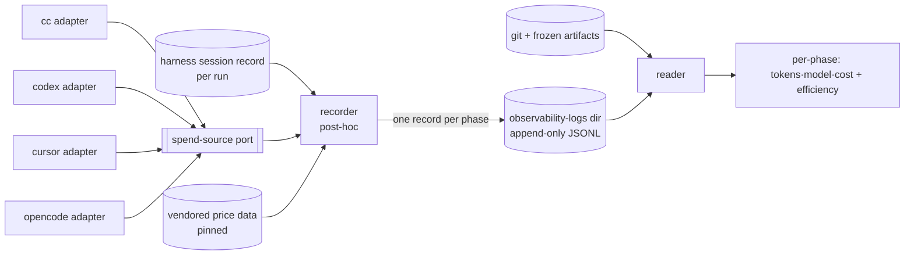

# Pipeline measurement — a standalone post-hoc per-phase spend & efficiency tool — technical design

| Field | Value |
|---|---|
| **Status** | Approved — via the operator's review on the introducing PR (2026-07-21) |
| **Owner** | @mdarabi |
| **Approver(s)** | @mdarabi — via the introducing PR's operator review (named reviewer mandatory: Security/privacy impact is yes) |
| **Date** | 2026-07-21 |
| **Relevant-when** | designing or changing the pipeline-measurement tool — the run-record store/schema, the spend-source port and per-harness adapters, phase-boundary/attribution, reconciliation, efficiency extraction, or price sourcing; implementing against it; superseding it. |
| **Scope** | The technical shape of the pipeline-measurement tool: the append-only run-record store, the spend-source port + four harness adapters, phase-stack attribution, tiered reconciliation, deterministic artifact+git efficiency extraction, standalone recorder+reader packaging, and vendored price sourcing. **Not**: the routing/optimizer consumers, the execution mechanism, the Ledger itself, or coupling to argus (see §3.2). |
| **Tracking** | — *(the introducing PR, once filed)* |
| **Builds-on** | — |
| **Supersedes** | — |
| **Serves** | prd:pipeline-measurement/FR-1 · prd:pipeline-measurement/FR-2 · prd:pipeline-measurement/FR-3 · prd:pipeline-measurement/FR-4 · prd:pipeline-measurement/FR-5 · prd:pipeline-measurement/FR-6 · prd:pipeline-measurement/FR-7 · prd:pipeline-measurement/FR-8 · prd:pipeline-measurement/FR-9 · prd:pipeline-measurement/FR-10 · prd:pipeline-measurement/NR-1 |
| **Security/privacy impact** | yes — the spend adapters read harness session records that may contain secrets/user data; mitigated: only token counts and model ids are extracted, no secret is ever written to a record (DINV-8), and there is no new egress · reviewer: @mdarabi |
| **Template version** | tech-design-template/v1 |

## 0. Read to rule — the human reviewer's section (~5 min)

*The body is the contract; this section only routes attention — on any conflict the body governs; machines ignore it.*

**Judge these**

| # | The call | Could have gone | If you disagree |
|---|---|---|---|
| 1 | A **standalone** run-record store, not the system-design Ledger (§3.6) | `#ALT-2` — a first slice of the Ledger (D7) | you'd build v1 on the unmerged, undesigned Ledger — reopen §3.6 (incident I1) |
| 2 | **Honest degradation** — a figure a harness can't expose is a declared `unavailable`, never a zero/estimate (§3.3 DINV-3) | best-effort estimation | you'd let estimated spend read as measured — reopen DINV-3 → §3.7 |
| 3 | A **spend-source port + four adapters**, each using its harness's best channel (§3.7) | `#ALT-5` universal transcript · `#ALT-6` proxy | you'd force one uniform mechanism across non-uniform CLIs — reopen §3.7 |
| 4 | **Post-hoc parse, zero model tokens** (§3.10, DINV-1) | runtime skill instrumentation / LLM quality-judgment | you'd instrument the model loop or spend tokens to measure — reopen §3.9/§3.10 |
| 5 | Prices from a **vendored external source**, not self-maintained (§3.12) | a hand-maintained price table | you'd own a table that rots — reopen §3.12 |

**Sanity-check the numbers** — zero model tokens consumed by measurement (A-4, DINV-1); 4/4 harnesses capture-or-declare (A-3, serves M2); reconciliation exact where the harness reports an authoritative per-model total (A-1, DINV-4).

**The author's open questions** — Q1 (the per-harness capability matrix — which channel each of the four exposes per-model spend on the user's own key; the one real empirical unknown); Q2 (the recorder's trigger — hook / orchestrator / on-demand).

**Skip the rest** — schema/structure → docgate (once it lints this class); substance/coherence/reuse → the unmanned `tech-design-review`; implementation defects → codegate + downstream gates; rationale/alternatives → §4 (explanatory).

## 1. Problem

The factory runs an expanding pipeline of skill-driven phases, each burning tokens against the operator's budget, yet nothing attributes that spend to the phase, the model, or a dollar figure, and nothing computes the efficiency signals that make cost interpretable. The PRD (`prd:pipeline-measurement`) fixes *what* must be true — per-phase per-model spend reconciled to the harness's own accounting, across all four supported CLIs with honest degradation, plus artifact/git efficiency signals, at zero model-token overhead — but leaves the *shape* open (its Q1–Q4). This design decides that shape. The failure mode it prevents: a measurement plane that either fabricates numbers where a harness is opaque (a silent zero misleading the very budget decisions it serves) or bolts a runtime hook into the model loop (spending tokens to measure, and coupling to one harness). The cheapest moment is now — before any recorder exists, and before the Ledger (which does not yet exist) forces a premature dependency.

## 2. Decision

**Decision:** Build a **standalone, post-hoc measurement tool** — a recorder and a reader (`design-brainstorm:pipeline-measurement-tech-design#D-6`). After a phase runs, the recorder parses the harness's *own* session record, brackets the phase stack (`#D-3`), pulls per-model spend through a **spend-source port** with one adapter per harness (`#D-2`), reconciles it to the harness's accounting (`#D-4`), and appends one schema-versioned JSON record per phase to a gitignored **append-only JSONL store** in the observability-logs directory of the system footprint (its concrete location fixed by `#D-1`). The reader computes the efficiency signals **deterministically** from the frozen artifacts + git by counting the corpus's existing typed anchors (`#D-5`), and derives dollar cost from **vendored external price data** (`#D-7`). Because it reads accounting the harness already produced and never invokes a model, it is execution-agnostic (FR-7) and consumes zero model tokens (FR-10); because a figure a harness cannot expose is declared `unavailable` rather than guessed, the number is trustworthy where present and honest where absent (FR-6). This is the "append-only files first, queryable later" shape the eventual Ledger endorses, owned by this feature so it depends on nothing unmerged.

## 3. The design

### 3.1 Architecture

The **recorder** owns phase-bracketing, spend capture (via the port), reconciliation, and record-writing. The **reader** owns the efficiency-signal extraction and the operator-facing presentation. The four **adapters** are the only harness-specific code; the recorder core imports no adapter package (the port is defined on the consumer side).

### 3.2 Boundaries and non-goals

- **Not solved here** — the routing/optimizer *consumers* of these records (`prd:pipeline-measurement` NG-1/NG-2); the *execution* mechanism, incl. headless/resume (NG-3); a query/analytics surface (WR-3).
- **Owned by a future design** — the system-design **Ledger** (`design-brainstorm:pipeline-measurement-tech-design#O-1`): this design writes a standalone store the Ledger later absorbs verbatim; it does **not** build on the unmerged Ledger/D7 (incident I1).
- **Implementation must not infer** — that measurement requires argus or the delivery ledger (`#O-2`): the tool is orchestrator-agnostic and runs for standalone skill runs; nor that any LLM proxy/gateway is in the capture path (`#O-3`, adapters only); nor that the tool self-maintains prices (`#O-4`).
- **Must remain unchanged** — the runs being measured (their artifacts and the harness's own operation), and docgate's verbs and outputs (`prd:pipeline-measurement/NR-1`, NR-2).

### 3.3 Invariants

- **DINV-1** — the recorder and reader consume **zero model tokens**: they invoke no model, reading only harness accounting and git. *(FR-10)*
- **DINV-2** — measurement never mutates the run it measures: the run's artifacts and the harness state are byte-unchanged after a measurement pass. *(NR-1)*
- **DINV-3** — **no silent zero**: a per-model figure a harness cannot expose is written as a declared `unavailable` marker naming the harness and the missing figure — never a zero, never an estimate presented as measured. *(FR-6)*
- **DINV-4** — every recorded per-model figure **reconciles** to the harness's own accounting for the same span: exact where the harness reports an authoritative per-model total; within the harness's own reported precision otherwise; `unavailable` where non-reconcilable. *(FR-1, FR-3, serves M1)*
- **DINV-5** — spend and turns attribute to the **innermost active phase** on the stack; a nested phase's spend is recorded under its own phase identity, never blended into its parent. *(FR-3, UB-5)*
- **DINV-6** — every run record is **schema-versioned** and stamps the **pricing-snapshot version** it used, so a historical cost reproduces exactly. *(FR-2, AP-6)*
- **DINV-7** — every run record carries a resolvable **run/feature id**, so a feature's phases aggregate to one cost. *(FR-8)*
- **DINV-8** — the recorder writes **no secret or credential value** to any record: it extracts only token counts, model ids, phase/run ids, and artifact-derived counts. *(NFR-5)*
- **DINV-9** — the recorder/reader CLI **fails closed on misparse**: a flag-like positional is a usage refusal before any write, and a consequential run's output is never truncated. *(incident I3)*

### 3.4 Observability

*This tool **is** the factory's spend/efficiency observability; the concern here is how the tool itself is seen working and seen broken.*

- **Events/logs** — the records it writes are its event stream: one `phase_measured` record per phase (run/phase/harness/per-model quartet/cost/efficiency), a `spend_unavailable` marker per degraded figure, a `reconciliation_check` outcome per figure (serves EVT-1/2/3).
- **Metrics** — M1 (reconciliation/attribution accuracy), M2 (4/4 capture-or-declare + floor coverage), M3 (cost-per-feature reachable) are *read back from the records* by the reader — the plane measures itself.
- **Alerts** — none in v1 (health alarms are the deferred OBS plane, WR-1); a `spend_unavailable` marker is surfaced by the reader, not alerted.
- **Debugging surface** — the reader is the diagnostic surface: it lists each phase's figures, their reconciliation tier, and any `unavailable` markers, so a wrong or missing number is self-describing.
- **Trace/correlation** — the run/feature id (DINV-7) correlates a phase to its run and feature; no model-trace (there is no model in the loop, DINV-1).

### 3.5 Security & privacy

yes (agrees with the header). Surfaces touched: the spend adapters **read** each harness's session record, which may contain user data or secrets in prompt/response content. Data handled: the adapters extract only token counts, model ids, and phase markers; the reader reads git + repo-public artifacts. Threat sketch: a secret in a transcript leaking into a run record, or measurement content egressing. Mitigations, traced to binding elements: **DINV-8** (no secret/credential value is ever written to a record — only counts/ids/model), and no new egress — records are local JSONL in the observability-logs directory and nothing is sent anywhere (the tool adds no network call). Verified by A-9 (a seeded-secret fixture: no secret appears in any record) and A-5 (the run is byte-unchanged).

### 3.6 The run-record store and schema

**Decision:** an append-only JSONL store in the **observability-logs directory** of the system footprint (its concrete path fixed by `#D-1`, `#ALT-1`), **gitignored** — per-run operational data, never committed — written **one file per run** (named by `run_id`), so parallel runs (PRD §12) never contend on a shared file and each append is collision-free (AP-23). Each line is one schema-versioned JSON run record: `schema_version`, `run_id`, `feature_id`, `phase_id`, `harness`, `spend` (per-model `{input,output,cache_creation,cache_read}` + `cost` + `reconciliation_tier` ∈ {exact, harness-precision, unavailable}), `efficiency` (the D-5 signals), `price_snapshot_version`, and `unavailable[]` markers. Additive-schema evolution only (AP-6): readers default missing fields. The store is orchestrator-agnostic and depends on nothing unmerged; when the Ledger lands it absorbs these schema-versioned records verbatim (O-1).

### 3.7 The spend-source port and per-harness adapters

**Decision:** one **spend-source port** (defined on the recorder's side) with a per-harness adapter for each of the four supported CLIs (`#D-2`, `#ALT-4`). Each adapter reads *its* harness's native accounting through the best channel that harness exposes — a headless result envelope, a session transcript, or OTEL — normalizes to the record's `spend` shape for the phase bracket, or returns a declared `unavailable` (DINV-3). The recorder core imports no adapter package (AP-1/AP-3); the port is *real*, not hypothetical — four justified adapters (the "two-adapters-make-a-seam" bar is met). *Which* channel each harness uses is the empirical spike Q1 — an adapter's private concern, not a change to the port.

Rejected here: a single universal transcript parser (`#ALT-5` — transcripts are not uniform across CLIs and cannot use a cleaner envelope where one exists) and an LLM proxy/gateway (`#ALT-6` — a running service needing base-URL redirect Cursor likely can't offer; over-engineered for a zero-overhead v1).

### 3.8 Phase boundary and nested attribution

**Decision:** a **phase stack** (`#D-3`). A skill-invocation marker in the harness's own record (a Skill tool-call or slash-command) **pushes** a phase; the artifact-write (the frozen doc / PR) **pops** it. Spend and turns attribute to the top of the stack — **innermost-active-phase** — so a nested sub-skill (e.g. `prd-new` invoking `prd-review`) gets its own record and the parent's record excludes the nested bracket (DINV-5, UB-5). The detector reads the *same* harness record the spend adapter does (it rides S-2, not a new seam). Rejected: *parent-absorbs* (over-charges the parent, hides the sub-skill's cost) and *split* (no principled ratio).

### 3.9 Reconciliation

**Decision:** the per-phase per-model total is the **sum of the harness's own per-turn usage within the phase bracket**, cross-checked against the harness's authoritative total for the same span where one is reported (`#D-4`). The tolerance is **tiered** (DINV-4): `exact` where the harness reports an authoritative per-model figure (recorded must equal it, count-exact); `harness-precision` where only a coarser/rounded figure exists (the tolerance is the harness's own precision — no invented digits); `unavailable` where non-reconcilable. The tier is recorded per figure, so a consumer sees exactly how trustworthy each number is.

### 3.10 Efficiency-signal extraction

**Decision:** a **deterministic** git + frozen-artifact reader (`#D-5`), no model and no runtime hook (DINV-1). Per phase it counts the corpus's existing typed anchors — questions = `D-n`, fog = `G-n`, rework = superseded `D-n` + amendment count, defects = review `FND-n`, coverage from the plan matrix, latency from git timestamps — joined to the run record by run/phase id. Because the anchors are identical whichever harness produced the artifact, the efficiency floor is **universal** — it holds on every harness even where spend capture degrades (FR-4). Rejected: runtime skill instrumentation (unreliable on external, prompt-guide harnesses) and LLM quality-judgment (spends model tokens, non-deterministic).

### 3.11 Tool packaging

**Decision:** a new **standalone tool** — a thin `cmd/<name>` main over an `internal/<name>` package (`#D-6`), **not** a docgate verb (docgate owns doc governance; measurement is a distinct concern, and folding it in would bloat docgate). Two faces: a **recorder** (post-hoc parse → bracket → capture → reconcile → write) and a **reader** (query → efficiency → present, FR-9). The recorder runs **post-hoc** over the harness's own session record, which is what makes it execution-agnostic (FR-7) and zero-overhead (FR-10) — no live hook into the model loop. The engine absorbs this tool later, as it absorbs the store. The two mains parse flags before positionals and refuse a flag-like positional as a usage error before any write (DINV-9, incident I3).

### 3.12 Prices

**Decision:** do not self-maintain prices (`#D-7`, O-4). Consume an existing, actively-maintained cross-provider pricing source (LiteLLM's `model_prices_and_context_window.json` is the de-facto, MIT-licensed, covering Anthropic/OpenAI/…), **vendored + pinned** (parsed with stdlib `encoding/json` — vendored *data*, not a code dependency), refreshed by a pinned re-vendor script (the Mermaid vendoring idiom). This preserves the no-new-egress/offline posture (no runtime fetch) and controls supply-chain surface. Each record stamps the pinned snapshot version (DINV-6); an un-priced model is flagged (UB-2), never silently $0. Cost is a thin derived layer over the ground-truth token counts.

### 3.13 Testing strategy

The seams under test: the **spend-source port** (S-2) is *remote-but-owned* — each of the four adapters is tested against a captured fixture of its harness's real accounting output, plus a no-usage fixture proving DINV-3; the port itself is exercised through an in-memory stand-in. The **run-record store** (S-1) is *local-substitutable* (a temp-dir JSONL). The reconciler, phase-stack, and efficiency reader are *in-process*, table-driven over golden fixtures (incl. a nested-invocation fixture for DINV-5 and a seeded-secret fixture for DINV-8). Hermetic: no network, no clock without injection; the vendored price snapshot is a fixture input.

## 4. Alternatives considered

| Alternative | Why rejected |
|---|---|
| A first slice of the system-design Ledger (`#ALT-2`) | the Ledger is unmerged and D7's schema is open — building v1 on it repeats incident **I1** (don't build on an unmerged design) |
| The argus delivery-ledger cost line (`#ALT-3`) | per-problem and argus-scoped — fails standalone skill runs; strains medium-independence and FR-7 |
| One universal transcript parser (`#ALT-5`) | transcripts are not uniform across CLIs; some carry no per-model usage; can't use a cleaner envelope where one exists |
| An LLM proxy/gateway metering centrally (`#ALT-6`) | a running service needing per-CLI base-URL redirect (Cursor likely can't); breaks the zero-overhead posture and FR-5 |
| Nested attribution by parent-absorbs / split | over-charges the parent and hides the sub-skill's cost / no principled split ratio (§3.8) |
| A docgate verb rather than a standalone tool | measurement is a distinct concern from doc governance; folding it in bloats docgate (§3.11) |
| A self-maintained price table | prices drift constantly; the table would rot (§3.12) |
| Runtime skill instrumentation / LLM quality-judgment for efficiency | unreliable on prompt-guide harnesses / spends model tokens + non-deterministic (§3.10) |

## 5. Risks

| ID | Risk | Impact | Mitigation | Verification / evidence |
|---|---|---|---|---|
| R1 | a harness exposes no per-model spend on the user's key (Cursor's proxy billing the prime suspect) | some of the four only degrade | DINV-3 honest degradation; the structural floor (§3.10) holds regardless; Q1 resolves the matrix per adapter | per-harness fixtures (A-3); the no-usage fixture (A-2) |
| R2 | phase-boundary detection is wrong on some harness → mis-attributed spend | confidently wrong numbers | DINV-4 reconciliation catches drift against the harness's own total; the stack is deterministic | reconciliation fixture (A-1); nested fixture (A-6) |
| R3 | the reader's anchor-counting drifts as the corpus's anchor schema evolves | wrong efficiency signals | reuse the corpus's typed-anchor families; golden fixtures pin the counts; additive-only | golden efficiency fixtures (A-7) |
| R4 | the vendored price snapshot goes stale | costs lag real prices | pinned + re-vendor script; each record stamps its snapshot version so lag is visible and reproducible | inspection of the re-vendor script + DINV-6 (A-8) |

## 6. Acceptance

| ID | Acceptance criterion | Verify | Required evidence | Traces to |
|---|---|---|---|---|
| A-1 | for a reference run, every completed phase yields exactly one record whose per-model quartet reconciles to the harness's own accounting (exact where authoritative), attributed to the correct phase | Test | reconciliation report on the reference run | `prd:pipeline-measurement/FR-1` · `prd:pipeline-measurement/FR-3` · #DINV-4 |
| A-2 | a no-usage fixture yields a declared `unavailable`, never a silent zero or estimate | Test | the degradation fixture, red-first then green | `prd:pipeline-measurement/FR-6` · #DINV-3 |
| A-3 | each of the four harnesses captures-or-declares on the reference run; the efficiency floor is present on 100% of phases | Test (per-harness fixtures) | per-harness run evidence | `prd:pipeline-measurement/FR-5` · `prd:pipeline-measurement/FR-4` |
| A-4 | zero model tokens are consumed by the recorder/reader over a full reference run's measurement | Test | token accounting of the measurement pass | `prd:pipeline-measurement/FR-10` · #DINV-1 |
| A-5 | measurement leaves the run's artifacts and the harness state byte-unchanged | Test | before/after byte comparison | `prd:pipeline-measurement/NR-1` · #DINV-2 |
| A-6 | a nested-invocation fixture yields distinct records per phase, with no blending into the parent | Test | nested fixture result | `prd:pipeline-measurement/FR-3` · #DINV-5 |
| A-7 | the efficiency signals for one run are byte-identical when computed from two different harnesses' artifacts | Test | cross-harness determinism fixture | `prd:pipeline-measurement/FR-4` |
| A-8 | a record reproduces its dollar cost from the stamped price-snapshot version; an un-priced model is flagged, not $0 | Test | reproduction + un-priced fixture | `prd:pipeline-measurement/FR-2` · #DINV-6 |
| A-9 | a seeded-secret transcript produces no record containing the secret | Test | seeded-secret fixture | §3.5 · #DINV-8 |
| A-10 | every record carries a resolvable run/feature id, and a feature's phase records aggregate to one cost | Test | aggregation fixture | `prd:pipeline-measurement/FR-8` · #DINV-7 |
| A-11 | a flag-like positional (e.g. `--dry-run` placed after a directory) is refused as a usage error before any record is written | Test | misparse fixture | §3.11 · #DINV-9 |

## 7. Open questions

| ID | Question | Owner | Blocks | Status | Resolution |
|---|---|---|---|---|---|
| Q1 | the per-harness capability matrix — which channel (headless envelope / transcript / OTEL) each of the four exposes per-model spend on the user's own key, and where DINV-3 degradation applies | implementation | implementation (the four adapters) | open | an empirical spike per adapter; carried from `design-brainstorm:pipeline-measurement-tech-design#G-1` / `prd:pipeline-measurement` Q1 |
| Q2 | the recorder's trigger — a git hook on artifact-write, the orchestrator, or on-demand | implementation | none (any works post-hoc) | open | decided at implementation; post-hoc parsing makes all three viable |

## Principles

- **AP-1 / AP-3 — honored.** The spend-source port is a consumer-side interface; the four adapters implement it in their own packages; the recorder core imports no adapter (§3.7) — the boundary is lint-enforceable.
- **AP-5 — honored.** Observability is designed in: this *is* the factory's first-class per-phase spend/efficiency plane; its own health is self-describing (§3.4).
- **AP-6 — honored.** Run records are schema-versioned contractual JSONL (additive evolution); prices parse closed; each record stamps its schema and price-snapshot versions (§3.6, DINV-6).
- **AP-10 — honored.** Measurement is deterministic code, never prompt discipline — no model in the loop (DINV-1, §3.10).
- **AP-23 — honored.** The store is append-only, one record per line, collision-free across parallel runs (§3.6).
- **AP-25 — honored.** The spend-source port keeps the four harnesses behind adapters; the structural floor is medium-independent, holding on every harness (§3.7, §3.10).
- **RW-5 — honored.** One design — the pipeline-measurement tool's shape; the subordinate §3.x mechanisms are revised together, not independently, so they ride one document.
- **Incident I1 — honored.** The store depends on nothing unmerged: it is a standalone file store, not a slice of the uncommitted Ledger (§3.6, `#ALT-2` rejected).
- **Incident I3 — honored.** The recorder/reader mains fail closed on misparse and never truncate a consequential run's output (DINV-9, §3.11).
- **Deviation:** none.
