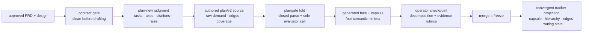

# plan-new routed demand — technical design

| Field | Value |
|---|---|
| **Status** | Draft → Approved *(merge requires Approved; merge is the freezing event)* |
| **Owner** | @mdarabi |
| **Approver(s)** | @mdarabi (operator and security reviewer) |
| **Date** | 2026-07-29 |
| **Relevant-when** | designing or changing plan-new's frozen plan class, plan/v2 execution-demand authoring and checkpoint, plangate validation/projection, tracker hierarchy and idempotency, executor-dialect rendering, or plan/v1 compatibility; superseding plan-new |
| **Scope** | The plan-new successor: carry forward the frozen plan lifecycle and convergent projection while making plan/v2 the only newly authored plan, with every executable task carrying evidence-backed vendor-neutral execution demand produced through the shared evaluator. **Not:** native model/effort selection, harness selection, routed-attempt retention, AI-review orchestration, execution, landing, or contract-gate internals. |
| **Tracking** | — *(the introducing PR)* |
| **Builds-on** | docs/tech-design/repo-layout-and-system-footprint.md · docs/tech-design/docgate-v1.md · docs/tech-design/contract-gate-v1.md · docs/tech-design/local-work-tracker-v2.md · docs/tech-design/execution-demand-contract-v1.md |
| **Supersedes** | docs/tech-design/plan-new-v1.md |
| **Serves** | prd:plan-new/FR-1 · prd:plan-new/FR-2 · prd:plan-new/FR-3 · prd:plan-new/FR-4 · prd:plan-new/FR-5 · prd:plan-new/FR-6 · prd:plan-new/FR-7 · prd:plan-new/FR-8 · prd:plan-new/FR-9 · prd:plan-new/FR-10 · prd:plan-new/FR-11 · prd:plan-new/FR-12 · prd:plan-new/FR-13 · prd:plan-new/FR-16 · prd:plan-new/FR-17 · prd:plan-new/FR-18 · prd:plan-new/FR-19 · prd:plan-new/FR-20 · prd:plan-new/FR-21 · prd:plan-new/FR-22 · prd:plan-new/FR-23 · prd:plan-new/FR-24 · prd:plan-new/FR-25 · prd:plan-new/FR-26 · prd:plan-new/FR-27 · prd:plan-new/FR-28 · prd:plan-new/FR-29 · prd:plan-new/FR-30 · prd:plan-new/NR-1 · prd:plan-new/NR-2 · prd:plan-new/NR-3 · prd:plan-new/NR-4 · prd:plan-new/UB-1 · prd:plan-new/UB-2 · prd:plan-new/UB-3 · prd:plan-new/UB-4 · prd:plan-new/UB-5 · prd:plan-new/UB-6 · prd:plan-new/UB-7 · prd:plan-new/ABUSE-2 · prd:plan-new/ABUSE-3 · prd:plan-new/NFR-1 · prd:plan-new/NFR-3 · prd:plan-new/NFR-4 · prd:plan-new/NFR-5 · prd:plan-new/NFR-6 · prd:plan-new/NFR-7 · prd:plan-new/NFR-8 · prd:plan-new/EVAL-2 |
| **Security/privacy impact** | yes — model-derived assessments control autonomous capacity and review assurance; plans cross repository/tracker boundaries and projected charters reach external agent runtimes. Closed demand contains citations and semantic values but no prompt, code, secret, harness, provider, native model, or native effort. reviewer: @mdarabi. |
| **Template version** | tech-design-template/v1 |

## 0. Read to rule — the human reviewer's section (~7 min)

*The body is the contract; this section only routes attention — on any conflict the body governs; machines ignore it.*

**Judge these**

| # | The call | Could have gone | If you disagree |
|---|---|---|---|
| 1 | plan-new and execution demand remain separate records: the planner produces the shared contract but does not own its consumer semantics | fold demand into plan-new (`design-brainstorm:planner-driven-model-routing-tech-design-4#ALT-2`) | you want implementation/review to depend on planner internals rather than a portable contract → §2, §3.2 |
| 2 | every new executable task, including mechanical work, freezes all six cited axes and four evaluator-derived minima | a scalar/optional routing signal | you accept missing or reconstructed task meaning downstream → §3.2, #DINV-10 |
| 3 | plangate alone derives and freezes the profile; semantic evidence receives a task-by-task operator rubric | trust planner arithmetic or citation existence | you accept two arithmetic authors or unsupported classifications → §3.3, #DINV-11 |
| 4 | plan/v1 remains byte-immutable while new authoring cuts directly to plan/v2 | backfill or dual authoring | you accept post-freeze inference or two new-plan truths → §3.4, #DINV-13 |
| 5 | the carried projection remains stateless and wires every edge before routing | repo mapping ledger or route-as-created | you accept duplicate/stale state or premature claims → §3.6, #DINV-3, #DINV-5 |

**Sanity-check the numbers** — exactly six assessment axes and four semantic minima per executable plan/v2 task (#DINV-10); zero executable task exemptions; one complete persisted support rubric per checkpointed plan (#DINV-12); one task per plan-task-id across convergent reruns (#DINV-3).

**The author's open questions** — Q-1..Q-3 are non-blocking implementation/trigger/retention choices; none may change the frozen demand, checkpoint, or projection invariants.

**Skip the rest** — schema/link grammar → plangate/docgate; substance and carried-forward coherence → `tech-design-review`; implementation defects → codegate and the downstream plan/route conformance suites; rationale → §4.

## 1. Problem

`plan-new-v1` freezes a plan/v1 artifact and projects an optional scalar routing signal. The merged contracts now require every newly planned `/implement-now` task to preserve the planner's evidence-backed workload and consequence judgment, the four independent semantic minima derived from it, and the policy that produced them. A downstream executor may not reconstruct those values from charter prose or translate them directly into a universal model name.

The predecessor's document lifecycle, coverage/fog gates, stateless tracker projection, hierarchy mapping, dialect rendering, and sizing policy remain valid. Replacing those mechanisms would create unrelated risk. The needed successor carries them forward and changes one product boundary: plan-new becomes the producer of `execution-demand/v2` in plan/v2, while the shared demand contract remains independently consumed and validated by planning, execution, and review (`design-brainstorm:planner-driven-model-routing-tech-design-4#D-1`).

## 2. Decision

**Decision:** Every newly authored plan is a frozen `plan/v2` source plus generated machine face. For every executable task, the plan-new judgment layer records the closed six-axis assessment, resolvable supporting citations, and an optional cited assurance raise; plangate alone applies the shared execution-demand evaluator and freezes the resulting four minima into the generated face and capsule. The operator checkpoint reviews the complete raw-plus-derived plan and judges substantive evidence support before merge freezes anything.

All still-valid plan-new behavior is carried forward: a versioned bucket-1 plan freezes at human merge; plangate remains the deterministic parser/gate/projector; projection remains stateless, exact-read, idempotent, additive, and wiring-before-routing; tracker hierarchy, executor dialect, sizing policy, and failure reports keep their existing contracts. Frozen plan/v1 files are neither rewritten nor enriched, and new authoring never emits plan/v1.

## 3. The design

### 3.1 Carried-forward plan lifecycle

**Decision:** Plans remain dense-numbered bucket-1 documents at `<paths.plans>/<feature-slug>/NNN-plan.md` (default `docs/plans/`). The authored Markdown source and generated JSON machine face commit together; merge is approval and freeze. The successor changes the generated schema to `plan/v2` for new plans but preserves the source→fold→verify lifecycle, plan-task identity, coverage matrix, charter contract, sizing policy, overlap handling, and all-or-nothing fog refusal.

Plan-new's first action is `docgate contract-gate <feature>` under `contract-gate-v1`; only its exact `clean` verdict admits drafting. A non-clean verdict produces zero plan output and plan-new surfaces the gate's retained defect-report reference. The same precondition runs again before fold/freeze and projection so later contract drift cannot ride an earlier clean result.

Before authoring, plan-new exact-reads the configured plan corpus and bounded tracker plan-epic set for plausible feature overlap. It surfaces every match and requires an operator `extend` or `supersede` disposition before drafting further; ambiguous multiple matches refuse. The chosen disposition and matched identities enter the plan source and checkpoint. No match records `new`; no server-search result is accepted as proof.

The plan-new skill owns contextual judgment and authors the source: vertically sliced tasks, durable charters, explicit DAG edges, declared touched surfaces, sizing/overlap decisions, complete slice/feature coverage, and the raw demand fields in §3.2. Mechanical work remains quarantined; a wide mechanical refactor uses expand → bounded migrate batches → contract; an independently useful preparatory refactor remains separate. Fog anywhere refuses the whole plan. Plangate owns every enumerable rule and generated byte, while the operator checkpoint owns the vertical-slice and no-compound-refactor judgment that cannot be mechanical.

The carried sizing policy remains the closed `plan:` block on the versioned pyxis-config surface: acceptance-criteria cap, scope-bullet cap, estimated-size-band cap, and per-plan-share cap; unknown keys fail, reviewed data changes recalibrate it, and the skill learns thresholds only through plangate verdicts. Projection refuses an unmerged plan, a generated-face mismatch, a moved/superseded trace, an unclean governing contract, or an incomplete checkpoint record. No tracker write precedes the explicit operator checkpoint and merged plan.

### 3.2 Plan/v2 demand production

Each executable task contains one canonical `execution-demand/v2` plan origin as defined by `execution-demand-contract-v1`:

- `reasoning`, `coupling`, `novelty`, `verification`, `impact_scope`, and `architectural_role`, each from the closed vocabulary;
- a normalized non-empty set of resolvable evidence citations that, collectively, support every axis;
- in the generated face and capsule, `capability`, `deliberation`, `context`, and `assurance` minima from the shared policy evaluator;
- derivation-policy version/digest and every applied floor/promotion;
- when the planner raises assurance, the monotone raised value and non-empty supporting citation set.

The skill writes no profile arithmetic. Plangate folds the assessment, citations, and raise into the generated profile and capsule; an authoring preview may display that projection but cannot author it. The complete source-plus-generated plan is the checkpoint subject. Neither face chooses or records a harness, provider, vendor product, native model, native effort, provider-specific context identifier, or aggregate complexity score. Mechanical/provenance work has the same complete demand contract as behavioral work.

- **DINV-10** — Every executable plan/v2 task carries exactly one complete evidence-backed assessment and all four evaluator-derived minima; no task-level exemption or `no_inference` state exists.

### 3.3 Mechanical verification and human evidence judgment

**Decision:** Plangate fold parses plan/v2 closed, resolves every citation, invokes the sole evaluator under the pinned policy, materializes the generated profile/capsule, and rejects any missing/unknown value, native identifier, absent evidence, downward assurance change, or hand-edited generated mismatch before checkpoint presentation. The operator then applies the FR-30 rubric task by task: every axis and raise must be substantively supported by one or more cited anchors; irrelevant, contradictory, or partial support returns the whole plan to the edit loop.

The completed rubric is one operator-completed, closed checkpoint source committed beside the plan source and generated face. It binds plan identity/content digest, task IDs, the FR-4/FR-9 decomposition result for each task, each axis/raise support result, reviewer, verdict, and timestamp; it contains no new task, assessment value, or derived profile and cannot override the plan source. Plangate validates its closed shape, completeness, reviewer field, and exact plan/content-digest binding, but never recomputes or declares the human judgment.

Authority remains the repository's existing plan-PR checkpoint: the named operator reviews the exact head carrying the plan, generated face, and rubric, and the operator's approval plus human merge is the approval/freeze evidence. A self-declared passing rubric, adapter status, or generated byte grants no authority, and this design introduces no adapter-signed approval protocol. Edits to the plan, generated face, or rubric invalidate the checkpoint and require re-presentation of the exact new head.

- **DINV-11** — Plangate and its one evaluator are the sole profile author; the planner and adapters implement no second arithmetic and cannot supply a trusted derived value.
- **DINV-12** — A plan cannot freeze or project unless every task's complete evidence-support rubric passes against the exact current plan bytes.

### 3.4 plan/v1 compatibility and schema cutover

**Decision:** Existing plan/v1 source and generated bytes remain valid and immutable. Plangate retains its v1 parser/projector only for frozen inputs; it does not add assessment fields, citations, profiles, or checkpoint rubrics to them. Their `/implement-now` demand is created later by the fixed no-rewrite compatibility path in `execution-demand-contract-v1`.

From activation of the plan/v2 authoring schema, plan-new creates only plan/v2. There is no dual-write cohort, backfill, or runtime re-assessment of legacy charters. A higher schema version remains an explicit successor decision.

- **DINV-13** — New authoring emits only plan/v2; every plan/v1 artifact remains byte-identical across validation, projection, execution, and review.

### 3.5 Boundaries and non-goals

- **Not solved here** — harness selection; native catalog/model/effort resolution; route/outcome retention; AI-review band/pass policy; task execution, proposal landing, or merge; contract-gate implementation details.
- **Owned by sibling designs** — execution-demand owns schema/evaluator/identity; native-routing-policy owns harness-role mappings; routing-evidence owns append admission; impl-review owns assurance passes; implement-now owns consumption and activation.
- **Implementation must not infer** — demand from charter prose, labels, estimates, installed CLIs, plan/v1 absence, or current catalogs; evidence support from citation existence; projection success from a write response without exact readback.
- **Must remain unchanged** — the document system; carried plan hierarchy/sizing/coverage/fog semantics; non-planner tracker work; upstream harness selection; general authoring-stage routing.

### 3.6 Convergent projection, hierarchy, and dialect

The predecessor's projection decisions remain binding:

1. exact-read the frozen plan and current tracker state;
2. ensure canonical signals and the plan epic;
3. create each missing task with its plan-task-id marker and complete charter/demand capsule;
4. link tasks to the epic and wire every dependency;
5. only then apply routing-ready state;
6. exact-read and emit the schema-versioned projection report.

Projection is stateless over the tracker and additive. Duplicate-marker ambiguity halts loudly and is never destructively repaired. The hierarchy remains one plan epic plus task sub-issues; milestone remains artifact metadata. The versioned executor dialect renders the charter, complete demand capsule, routing state, and agent-ready markers from plan/v2. GitHub and local WorkTracker adapters implement one consumer-owned projection contract and run the same conformance suite.

The idempotency marker remains `<feature>/<NNN>/<task-id>`, discovered through bounded exact adapter reads. The plan header pins a versioned executor-dialect renderer and its closed data manifest (grammar version, canonical signals, marker shapes, trigger strings); routing mode requires that version's contract test green. Foundation level is generated from the DAG, size band is preserved from the source, canonical signals are ensured idempotently, and the projection report maps every plan task to exact medium identity/status.

- **DINV-1** — Projection reads only an approved merged plan and exact checkpoint record; no tracker write derives from draft state.
- **DINV-2** — Every projected byte is a pure rendering of the frozen plan/checkpoint; tracker state adds no planning judgment.
- **DINV-3** — Per plan-task-id, repeated/interrupted projection converges to at most one task; duplicate ambiguity halts and is never auto-deleted.
- **DINV-4** — Projection decisions use exact bounded reads, never server search or cache inference.
- **DINV-5** — No task is routable before every parent/dependency edge and its complete demand capsule exist and exact-read successfully.
- **DINV-6** — A green plan has zero fog and complete slice/feature/task coverage under FR-26.
- **DINV-7** — Projection non-additively mutates nothing it did not create.
- **DINV-8** — Plans remain bucket-1 content with version-pinned template/dialect references and no system-footprint path dependency.
- **DINV-9** — Dialect rendering is version-pinned and contract-green before routing state may be applied.

### 3.7 Plangate verbs and artifacts

Plangate remains one Go tool and later one engine capability:

| Verb | Contract |
|---|---|
| `fold <plan-dir>` | closed-parse the applicable plan version; run contract precondition, charter/sizing/coverage/fog/edge checks, demand citation resolution and shared-evaluator recomputation; emit deterministic generated JSON only on a complete pass |
| `verify <plan-dir>` | byte-compare the committed generated face against source+policy recomputation; validate checkpoint schema, completeness, reviewer field, and exact plan/content-digest binding without re-judging human rubric answers |
| `project <plan-dir> [--dry-run] [--no-routing]` | enforce merged/current/checkpoint predicates, converge hierarchy/tasks/edges/capsules, and apply routing last; dry-run writes nothing |
| `report <plan-dir>` | exact-probe the medium and emit the current projection report |

The source grammar, generated schema, checkpoint record, charter, demand capsule, and projection report are closed and versioned. Exact syntax lives in golden fixtures, not frozen prose. Unknown versions or keys fail before any write.

The CLI parser is fail-closed before any consequential read or write: every flag is legal only in its declared slot, and an unknown/misplaced flag or any flag-like positional refuses. Machine and human defect/report output is complete rather than silently truncated, including when several tasks fail one invocation.

- **DINV-14** — Every malformed, unknown, misplaced, or flag-like positional CLI token refuses before side effects; consequential output never truncates the defect set.

### 3.8 Observability

- **Events/logs** — structured fold/checkpoint/projection events name plan/task, phase, schema/policy version, rule, result, and remedy; demand validation emits `execution_demand_checked` without prompt/code.
- **Metrics** — plan validation and projection duration split local computation from tracker wait; counts cover task/demand/checkpoint outcomes and projection create/link/wire/route/no-op/failure. Measurements never change verdicts.
- **Alerts** — contract-precondition, generated drift, invalid demand, missing rubric, duplicate task, premature routing, or dialect-contract failures are non-zero/fail-closed signals to the operator.
- **Debugging surface** — dry-run, fold defects, evaluator trace, persisted rubric, and projection report expose exact expected/current bytes and repair without native route data.
- **Trace/correlation** — plan identity → plan-task-id → demand-id/capsule → tracker item; later runtime attempts join through demand-id without rewriting the plan.

Fuel-bearing non-clean results are retained in git as immutable append-only `planning-event/v1` records under `<paths.plans>/<feature-slug>/events/`: fog/structural/demand refusals, failed checkpoint dispositions, and failed/partial projection reports each emit one dual-face dense-numbered event for the host to commit; a later successful run appends rather than overwrites it. Contract-gate failures retain their own event under `contract-gate-v1` and plan-new records only its reference. Clean folds and successful regenerable projection reports add no event (the latter may remain a tracker comment).

- **DINV-15** — Every planning failure or judgment refusal that can teach emits one immutable append-only git event; clean or routinely regenerable output creates none.

### 3.9 Security & privacy

Plans and charters are model-derived instructions published through repository and tracker boundaries. Only approved merged governing inputs may be planned; every scope claim and assessment value is traceable; the checkpoint gives an accountable human the complete task/demand view. Closed parsing and the shared evaluator prevent text injection, native launch identifiers, or minimized profiles from becoming executable routing data (#DINV-10..12).

Projection uses existing credentials and never mints/stores them. It creates/links/labels/comments only within its plan and never closes, deletes, or edits foreign items (#DINV-7). Trigger strings are neutralized by the pinned dialect. Demand/checkpoint artifacts carry semantic classifications and repository references but no prompt, code, secret, provider credential, or raw CLI argument.

### 3.10 Failure modes and recovery

| Failure | System behavior | Detection | Recovery |
|---|---|---|---|
| governing contract unclean or drifted | refuse drafting/freeze/projection; emit named defect | precondition and frozen-reference check | repair governing contract or supersede the plan |
| invalid assessment/profile/citation/native identifier | no checkpoint-ready plan | closed parser, resolver, evaluator recomputation | edit draft and re-fold |
| evidence exists but does not substantively support an axis/raise | whole plan returned to edit loop; no freeze/projection | operator task-by-task rubric | correct assessment/evidence and re-present |
| plan changes after rubric | rubric stale; merge/project blocked | content-digest mismatch | rerun checkpoint on exact bytes |
| plan/v1 input | preserve bytes and use v1 projector/compatibility path | tagged schema parser | none; never backfill |
| tracker failure or interruption | halt with partial report; no retry storm | bounded adapter error | re-run; stateless projection converges |
| concurrent duplicate create | halt, name all colliding items, withhold routing | exact marker scan | operator resolves; re-run |

### 3.11 Testing strategy

Parser/evaluator/checkpoint/projection reducers are in-process table/property tests. Repository, frozen-plan, and local WorkTracker are local-substitutable fixtures; every remote tracker adapter runs the same conformance suite. Fault injection cuts every projection boundary and every demand/checkpoint mismatch. Golden corpora cover all accepted assessment/profile values, named promotions, mechanical work, evidence failures, native-identifier injection, forged/stale/replayed checkpoint data, CLI misparse/truncation, event append retention, plan/v1 byte identity, and plan/v2 direct cutover. One dogfood plan proves author→fold→checkpoint→merge→project→executor consumption with zero executor-side planning.

## 4. Alternatives considered

| Alternative | Why rejected |
|---|---|
| Six independently revisable runtime records (`design-brainstorm:planner-driven-model-routing-tech-design-4#ALT-1`) | selected: plan-new produces execution demand while the contract, native policy, evidence, review, and execution remain independently evolvable |
| Fold execution demand into plan-new (`design-brainstorm:planner-driven-model-routing-tech-design-4#ALT-2`) | makes implementation and review depend on planner internals and creates multiple validation truths |
| Keep new plans on plan/v1 with an optional expanded marker | preserves the scalar/absence ambiguity and cannot freeze the required raw plus derived semantic contract (`design-brainstorm:planner-driven-model-routing-tech-design-3#ALT-6`) |
| Backfill plan/v1 from charter re-assessment | violates merge-freeze, creates mutable post-freeze inference, and lets retries disagree (`design-brainstorm:planner-driven-model-routing-tech-design-3#ALT-6`) |
| Make citation resolution sufficient evidence review | proves an anchor exists, not that it supports the axis; FR-30 deliberately keeps semantic accountability at the checkpoint |
| Replace stateless projection with a committed task map | the map can lag reality across crashes and cause duplicates; exact tracker reads are the convergence authority carried from `plan-new-v1` |

## 5. Risks

| ID | Risk | Impact | Mitigation | Verification / evidence |
|---|---|---|---|---|
| R1 | assessment/evidence workload makes plan review unwieldy | rubber-stamped demand and under-routing | compact per-task rubric, evaluator trace, and rendered checkpoint; reject whole plan on one unsupported axis | dogfood review record + EVAL-2 corpus |
| R2 | an authoring preview or adapter becomes a second profile author | frozen profile differs by invocation path | plangate is the sole materializer; preview is projection-only; generated-byte verification rejects edits | import/inspection check + exhaustive derivation and tamper goldens |
| R3 | plan/v1 and plan/v2 paths accidentally mix | legacy bytes mutate or new tasks miss demand | tagged closed schemas, v2-only authoring, v1 byte manifest, negative cross-version fixtures | compatibility suite + mutation audit |
| R4 | tracker transport truncates or edits the demand capsule | task reaches execution with changed meaning | exact frozen-plan reconstruction and capsule digest comparison before routing/claim | round-trip/corruption conformance suite |
| R5 | stateless projection duplicate race remains | duplicate tasks and ambiguous claims | exact collision detection, route withholding, no destructive repair; future LeaseStore remains separate | concurrent-create fixture |
| R6 | successor accidentally changes carried plan mechanics | unrelated regression blocks routing delivery | carry-forward invariants #DINV-1..9 and predecessor suite remain mandatory | full plan-new non-regression suite |

## 6. Acceptance

| ID | Acceptance criterion | Verify | Required evidence | Traces to |
|---|---|---|---|---|
| A-1 | every plan/v2 executable task contains all six accepted axes, non-empty resolvable evidence, all four exact minima, pinned policy, and any cited monotone raise; mechanical work has no exemption | Test + Eval | complete positive/negative EVAL-2 report | prd:plan-new/FR-28 · prd:plan-new/EVAL-2 · #DINV-10 |
| A-2 | plangate is the sole profile author; every hand-authored/tampered/minimized/native-bearing derived value fails before checkpoint with task/field/rule/remedy | Test + Inspection | evaluator goldens, generated-face tamper suite, import audit | prd:plan-new/FR-29 · prd:plan-new/NFR-7 · #DINV-11 |
| A-3 | one exact-head operator checkpoint records the FR-4/FR-9 decomposition judgment and substantive support for every axis/raise on every task; forged, self-declared, stale, replayed, incomplete, irrelevant, contradictory, or partial cases prevent freeze/projection | Human judgment — @mdarabi + Test | persisted rubric, exact approval/merge reference, horizontal-layer/compound-scope fixtures, and adversarial checkpoint-binding suite | prd:plan-new/FR-4 · prd:plan-new/FR-9 · prd:plan-new/FR-30 · #DINV-12 |
| A-4 | new authoring emits only plan/v2 while the frozen plan/v1 corpus remains byte-identical and valid through projection and downstream compatibility | Test + Inspection | schema-cutover suite + byte manifest | prd:plan-new/NR-4 · #DINV-13 |
| A-5 | fold accepts the golden plan and rejects every enumerable sizing/mechanical/coverage/fog/edge/overlap/charter defect with the named quadruple | Test | plan gate fixture suite | prd:plan-new/FR-5..FR-8 · prd:plan-new/FR-10..FR-13 · prd:plan-new/FR-16 · prd:plan-new/FR-26 |
| A-6 | interruption at every projection cut converges to one task per id; no observation sees a routable task missing parent, dependency, or complete demand capsule | Test + Failure injection | interruption/race probe report | prd:plan-new/FR-18 · prd:plan-new/FR-19 · #DINV-3 · #DINV-5 |
| A-7 | GitHub and local WorkTracker adapters project equivalent hierarchy, edges, charters, demand, and signals from unchanged plan bytes | Test + Inspection | cross-adapter conformance report | prd:plan-new/FR-25 · prd:plan-new/NFR-6 |
| A-8 | unapproved, unclean, drifted, or rubric-stale plans produce zero writes; dry-run remains zero-write | Test | refusal/mutation audit | prd:plan-new/FR-17 · prd:plan-new/FR-27 · #DINV-1 |
| A-9 | generated faces verify byte-identically and all schemas/config parse closed; measurements remain non-blocking under injected delay | Test | golden/verify/config/delay suites | prd:plan-new/NFR-1 · prd:plan-new/NFR-8 |
| A-10 | one real feature completes plan/v2 authoring, checkpoint, merge, projection, and direct executor consumption with zero executor planning phase | Demo | frozen plan, rubric, projection report, tracker/proposal links | prd:plan-new/DOD-3 · prd:plan-new/FR-21 |
| A-11 | contract-gate non-clean and stale-clean cases plus plausible existing plan/epic overlap produce zero draft; exact clean plus explicit new/extend/supersede disposition admits authoring deterministically | Test + Inspection | pre-draft admission and ambiguous-overlap fixture matrix | prd:plan-new/FR-3 · prd:plan-new/FR-27 |
| A-12 | unknown, misplaced, and flag-like positional tokens for every plangate verb refuse before side effects, and a multi-defect invocation emits the complete set | Test | incident-I3 CLI corpus + full-output golden | #DINV-14 · docs/observability/incidents.md#I3 |
| A-13 | every fog/structural/demand/checkpoint/partial-projection failure emits one new immutable planning event, reruns never overwrite it, and clean/regenerable runs add none | Test + Inspection | event retention/append/no-clean-event suite | #DINV-15 · AP-28 |
| A-14 | plan-new has zero recurring work, records per-use task/token cost, emits the defect quadruple, passes Go hygiene/race checks, and runs the same conformance suite on macOS and Linux | Analysis + Test + Inspection | dogfood cost record, defect corpus, Go CI, and OS matrix | prd:plan-new/NFR-3..NFR-6 |

## 7. Open questions

| ID | Question | Owner | Blocks | Status | Resolution |
|---|---|---|---|---|---|
| Q-1 | Exact plan/v2 source-region, checkpoint-record, and capsule encoding bytes | implementation | implementation start | open | fix in closed schemas and golden fixtures without changing §2/#DINV-10..13 |
| Q-2 | Does projection auto-fire after plan merge or remain explicitly invoked? | trigger design / operator | nothing | open | explicit invocation remains valid; any trigger must satisfy #DINV-1 |
| Q-3 | Does the successful regenerable projection report gain git retention beyond its tracker comment? | operator | nothing | open | retain clean comment-only posture until an audit consumer requires another sink; failed/partial reports are retained under §3.8 |

## Principles

- **AP-1 — honored.** Plan-new owns semantic task judgment and production; the demand contract, native mapping, evidence, review, and execution remain separate ports/records.
- **AP-3 — honored.** The plan source/checkpoint and generated machine face preserve one meaning across repository and tracker media.
- **AP-5 / AP-6 — honored.** Demand/checkpoint/projection events are designed in; every boundary datum is closed and versioned.
- **AP-8 — honored.** Paths and sizing policy remain on the one closed repository config surface.
- **AP-10 / AP-11 — honored.** One plangate/evaluator implementation owns every mechanical predicate; the skill owns judgment only.
- **AP-13 / AP-15 — honored.** Freeze, checkpoint, generated bytes, and exact tracker reads prove state rather than relying on session or badge claims.
- **AP-17 — honored.** Missing/ambiguous demand, evidence, checkpoint, or projection state fails before side effects; duplicates are never destructively repaired.
- **AP-20 / AP-21 — honored.** The planner records raw judgment and semantic minima once; downstream adapters map them without re-judgment.
- **AP-22 / AP-23 — honored.** Projection converges across retries and preserves disjoint per-feature/per-task identities.
- **AP-24 / AP-25 — honored.** Approved contracts outrank plans; the skill remains on the vendor-neutral authoring surface.
- **AP-28 / AP-29 / AP-30 — honored.** Failure/judgment fuel is append-retained while clean projections regenerate; one durable plan/checkpoint authority feeds every consumer; structured demand is explicit; review semantics remain outside the planner.
- **RW-2 / RW-5 — honored.** Paid-for plan/projection lessons are carried as invariants and the successor precedes implementation.
- **RW-4 — deviation, with reason.** The carried projection still ships the already-approved direct GitHub binding alongside the local adapter; this successor does not reopen that frozen bootstrap ruling. The consumer-owned projection seam and cross-adapter conformance prevent routing logic from depending on GitHub.
- **Deviation:** RW-4 only, as stated above.
