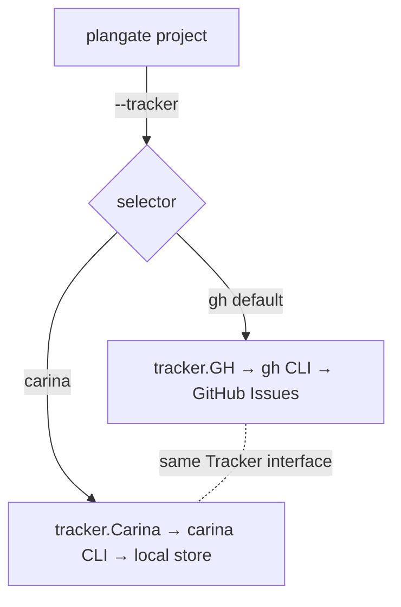

# plangate's Carina tracker adapter — projecting plans onto the local WorkTracker — technical design

| Field | Value |
|---|---|
| **Status** | Approved *(merge is the freezing event; "superseded" is computed by the index, never written here)* |
| **Owner** | @mdarabi |
| **Approver(s)** | @mdarabi (operator) — mandatory named reviewer: this is a projection/infra surface |
| **Date** | 2026-07-15 |
| **Relevant-when** | designing or changing plangate's tracker-adapter selection, the Carina (local WorkTracker) projection adapter, or the plangate-label→Carina-signal/type mapping; implementing `plangate project` against the local medium; superseding the Carina adapter |
| **Scope** | The plangate **Carina tracker adapter** and its selection: the `Tracker`-interface binding that drives Carina, the `--tracker` selector, the store-location config, the operation→verb mapping, and the label→signal/type mapping. **Not**: the planner, decomposition, or plan schema (unchanged — FR-25); the GitHub adapter; Carina's own store internals (owned by `local-work-tracker`); any engine that *reads* Carina to dispatch (does not exist). |
| **Tracking** | introducing PR (filed on approval) |
| **Builds-on** | docs/tech-design/plan-new-v1.md |
| **Supersedes** | — |
| **Serves** | prd:plan-new/FR-25 |
| **Security/privacy impact** | none — the adapter writes only local files the operand already owns; no network, third-party egress, or credentials (a *reduction* in surface vs the GitHub adapter). See §3.5 |
| **Template version** | tech-design-template/v1 |

## 1. Problem

`plan-new` FR-25 requires `plangate project` to bind the plan projection through the WorkTracker port's **local (Carina) adapter**, selected by configuration, with the planner, decomposition, and plan schema unchanged. Today plangate **hardcodes** `tracker.GH` (`cmd/plangate/main.go`), and its `Tracker` interface has exactly one adapter (`gh.go`). So there is no way to project a plan into the local medium — which pyxis needs in order to dogfood its own tracker (exercise Carina's write + query surface live with real plans). Why now: WR-3's trigger is met (Carina shipped) and FR-25 froze the requirement; the projection was already specified port-shaped for exactly this binding.

## 2. Decision

**Decision:** plangate gains a second `Tracker` adapter — a **Carina adapter** that implements the existing interface by driving the `carina` CLI, exactly as the `gh` adapter drives `gh` — chosen by a **`--tracker gh|carina` selector** (default `gh`; GitHub still drives the real build until an engine reads Carina). The planner, decomposition, and plan schema are untouched: the adapter is a pure projection-surface swap (FR-25, the swap test / AP-1). plangate's GitHub-Issues-shaped operations map onto Carina's verbs — `CreateIssue`→`create --type`, `LinkSubIssue`→`parent set`, `AddBlockedBy`→`dep add`, `Comment`→`comment` — with issue "numbers" being Carina's own sequential ids, and the idempotency probe (`OpenIssues`/`SubIssues` by plan-marker) reading Carina's `search`/`list`. **Labels map to Carina signals by a typed table, and any unmapped label is auto-defined as a *classification* signal** (Carina's one operand-extensible axis) so nothing is dropped and the adapter never fails on a label Carina's seed vocabulary does not know — mirroring plangate's own additive posture (`EnsureLabel` "create iff missing"; unknown issueType "falls back to untyped, legibility is additive"). Concrete forms — the adapter struct, the carina invocations, and the mapping table — live in the paired solution-shape.

Driving the `carina` **CLI** (rather than importing the `worktracker` package in-process) keeps the two adapters symmetric — both are thin drivers over an external command behind one `Tracker` interface — and it dogfoods the real CLI end to end, which is the point (§4 weighs the in-process alternative).

## 3. The design

### 3.1 Adapter selection

**Decision:** `plangate project` takes a `--tracker gh|carina` flag (default `gh`); `cmd/plangate/main.go` constructs the chosen adapter at the projection boundary (replacing the hardcoded `tracker.GH`). The Carina adapter takes a store-location option (`--carina-root`, default the repo's bucket-1 work-items root); the `gh` path is unchanged when unselected. Everything upstream of the `Tracker` interface — decomposition, sizing, the plan fold, the report — is untouched (DINV-1). Flag names fix at implementation (shape).

### 3.2 Boundaries and non-goals

- **Not solved here** — the planner / decomposition / plan schema (FR-25 holds them unchanged); the GitHub adapter; Carina's store internals (owned by `local-work-tracker`); unifying plangate's `Tracker` interface with the `worktracker` port (a larger refactor — §4).
- **Owned by a future design / does not exist** — any engine that *reads* Carina to dispatch workers; the actual build still runs off GitHub via harbormaster. A Carina-projected plan is a dogfood/test surface, not a build driver.
- **Implementation must not infer** — that projecting to Carina builds anything (nothing reads it yet); that the adapter may touch the planner/schema (it may not — DINV-1); that an unmapped label is an error (it is auto-defined — DINV-3); that GitHub issue *numbers* mean anything to Carina (identity is Carina's own id — DINV-4).
- **Must remain unchanged** — the `gh` adapter and its behavior when `--tracker gh`; the `Tracker` interface signature (the Carina adapter conforms to it, never widens it); Carina's closed engine-recognized vocabulary (the adapter extends only the classification axis — DINV-3).

### 3.3 Invariants

- **DINV-1** — the adapter changes no planner, decomposition, or plan-schema code; it is a pure `Tracker`-interface implementation selected at the projection boundary (FR-25 swap test). Binding it is a diff confined to the adapter package + the selector.
- **DINV-2** — the Carina adapter satisfies the full `Tracker` contract behaviorally identically to `gh`: additive, idempotent, and **never mutating a pre-existing item** (plan-new NR/guardrail); it passes the same tracker behavior the `gh` adapter does.
- **DINV-3** — plangate labels map to Carina signals by a typed table; an **unmapped label is auto-defined as a classification signal** (Carina's operand-extensible axis), never dropped and never a failure; the `epic` label is **elided** because the Carina `type` already carries the hierarchy role, and `local-agent` maps to the authorization signal `agent`.
- **DINV-4** — issue identity is **Carina's own sequential id**; links, dependency edges, and comments address items by that id, and no GitHub-specific identity or shape leaks into the plan, the report, or the `Tracker` contract.
- **DINV-5** — idempotency is by **plan-marker probe**: the adapter finds an already-projected item by its `pyxis:plan-*` marker (via Carina search/list over item bodies), so a re-run converges — creates the remainder, duplicates nothing, mutates no pre-existing item — the same guarantee plan-new FR-18 makes for `gh`.

### 3.4 Observability

- **Events/logs** — projection to Carina logs the same per-step lines plangate already emits (ensure/create/spec/link/wire/route + the projection report), naming the tracker (`carina`) and the store root; a carina subprocess error surfaces as a typed defect naming the verb, the item, and the carina stderr.
- **Metrics** — none intrinsic (no daemon; AP-19), consistent with plangate + Carina.
- **Alerts** — none intrinsic; a red projection (non-zero carina exit, or a duplicate detected) halts the run for that plan class, as `gh` does.
- **Debugging surface** — the store *is* the surface: `carina show`/`list --parent`/`ls work-items/` inspect what was projected; the plan markers in item bodies are greppable; every defect names the carina verb + item + reason + remedy.
- **Trace/correlation** — the adapter is a synchronous driver under plangate's existing context; no new async surface.

### 3.5 Security & privacy

none — the Carina adapter writes only local files the operand already owns; it opens no network connection, sends nothing to a third party, and uses no credentials. This is a **reduction** in surface relative to the `gh` adapter (which writes under the invoker's credentials and publishes model-derived content to a hosted service, per plan-new-v1 §3.5). Prompt-injection content in charters lands in local files, not a shared service. This subsection agrees with the header row (`none`).

### 3.6 Operation → verb mapping

**Decision:** each `Tracker` method maps to a Carina CLI verb, addressing items by Carina id: `CreateIssue(title, body, labels, issueType)` → `carina create --type <issueType> --title --body` (returning the new id) then label application (§3.7); `LinkSubIssue(parent, child)` → `carina parent set <child> <parent>`; `AddBlockedBy(issue, blocker)` → `carina dep add <issue> <blocker>`; `Comment` → `carina comment`; `AddLabels` → per-label signal add (§3.7). The read half — `OpenIssues`, `SubIssues`, `BlockedBy`, `Comments` — reads Carina's structured `--json` output (`list`, `list --parent` once FR-19 lands / `show` rollup until then, `search` for the marker probe). The exact invocations + `--json` shapes are in the solution-shape.

### 3.7 Label → signal / type mapping

**Decision:** the mapping is a typed table, ruled by the operator (2026-07-15): `issueType` `epic`/`task` → Carina `--type`; the `epic` *label* is elided (the type carries it); `local-agent` → `agent` (authorization); `operator` → `operator`; `kind:*` passes through; **any other label is auto-defined as a classification signal** via `carina signal def <name> classification` (idempotent — define iff absent) and then applied. `EnsureLabel` therefore never fails: a mapped-to engine-recognized signal already exists (no-op), and an unmapped one is materialized on the classification axis. This preserves every label as a queryable Carina signal without widening Carina's closed engine-recognized set (DINV-3). The full table is in the solution-shape.

### 3.8 Failure modes

| Failure | System behavior | Detection | Recovery |
|---|---|---|---|
| `carina` binary absent / unbuilt | projection aborts before any write with a defect naming the remedy (build/locate carina) | pre-flight resolve | build carina; re-run (idempotent) |
| a carina verb exits non-zero mid-projection | halt for that plan class; a re-run converges (DINV-5) | carina exit code | fix cause; re-run — no duplicates |
| an unmapped label | auto-defined as a classification signal, applied (DINV-3) | mapping lookup miss | none needed |
| re-run of a completed projection | every item found by marker; nothing re-created or mutated (DINV-5) | marker probe | none needed |

## 4. Alternatives considered

| Alternative | Why rejected |
|---|---|
| Import the `worktracker` package in-process (call `localfs.Store` directly, no subprocess) | tighter, type-safe, no binary dependency — but it couples plangate to the adapter package and **bypasses the CLI**, so it dogfoods the library, not the tool the operator wanted to exercise live; and it makes the two `Tracker` adapters asymmetric (one shells a CLI, one links a package). Driving the `carina` CLI keeps them symmetric and dogfoods the real surface. A future in-process path can be added behind the same interface if subprocess cost is ever measured hot. |
| Rebind plangate's projection to the `worktracker` **port** directly (retire plangate's own `Tracker` interface) | the cleanest long-term shape (one port, not two interfaces), but a larger refactor of plangate *and* a re-statement of the `gh` path; out of proportion to FR-25's "add the local binding." This adapter fills the existing, designed `Tracker` seam — the lighter, additive path. |
| A bespoke projection script (not a `Tracker` adapter) | not first-class or reusable; every future plan would re-script it, and it wouldn't pass the tracker conformance the design requires. The operator explicitly chose the real adapter over a throwaway script. |
| Drop unmapped labels (e.g. `mechanical`) | loses plan information silently; auto-defining them as classification signals preserves everything and matches plangate's additive-legibility posture (DINV-3). |
| Add unmapped labels to Carina's **seed** vocabulary | a governed-vocabulary change (operator-ratified input) for what the operand-extensible classification axis already handles; heavier and misplaced — the seed set is engine-recognized control state, not a projection dumping ground. |

## 5. Risks

| ID | Risk | Impact | Mitigation | Verification / evidence |
|---|---|---|---|---|
| R1 | the `carina` binary isn't available at projection time | projection can't run | pre-flight resolve of a built `carina` (or a documented build step); a clear defect naming the remedy | pre-flight fixture (A-4) |
| R2 | Carina's `--json` read surface is thinner than the marker probe needs (e.g. bodies not in `list --json`) | idempotency probe can't find markers | use `carina search` over the marker (exact substring across title/body/comments) + `show` for bodies; the probe is defined against Carina's actual read verbs | idempotency re-run fixture (A-2) |
| R3 | the adapter drifts from the `gh` adapter's behavior (non-idempotent, mutates existing) | duplicate or corrupted projections | the adapter is validated by the **same** `Tracker` contract test the `gh` adapter passes (A-1); re-run convergence asserted (A-2) | shared contract test |
| R4 | an operator reads a Carina-projected plan as "being built" | false expectation — nothing reads Carina to dispatch | scope boundary is explicit (§3.2); the projection report names the tracker and that it is a dogfood surface | doc + report copy |

## 6. Acceptance

| ID | Acceptance criterion | Verify | Required evidence | Traces to |
|---|---|---|---|---|
| A-1 | the Carina adapter passes the same `Tracker` contract/behavior test the `gh` adapter passes (additive, idempotent, no mutation of pre-existing items) | Test | shared contract-test run against both adapters | prd:plan-new/FR-25 · #DINV-2 |
| A-2 | `plangate project --tracker carina` on a fixture plan creates the full epic/task/hierarchy/edge/signal/charter structure, and a second run converges — zero duplicates, zero mutation of pre-existing items | Test | projection + re-run fixture over a Carina store | prd:plan-new/FR-25 · prd:plan-new/FR-18 · #DINV-5 |
| A-3 | the planner, decomposition, and plan-schema code is byte-unchanged from the GitHub binding; the diff is confined to the adapter package + the selector | Inspection | diff audit | prd:plan-new/FR-25 · #DINV-1 |
| A-4 | the label→signal/type mapping projects every plan label: mapped signals applied, `epic` elided (type carries it), and an unmapped label auto-defined as a classification signal and applied | Test | mapping fixture (incl. `mechanical`) | #DINV-3 · §3.7 |
| A-5 | issue identity is Carina's own id throughout — links, edges, and comments resolve by it; no GitHub identity leaks into plan/report/contract | Test + Inspection | id round-trip fixture + contract audit | #DINV-4 |

## 7. Open questions

| ID | Question | Owner | Blocks | Status | Resolution |
|---|---|---|---|---|---|
| Q1 | how the `carina` binary is resolved at projection time (a built binary on PATH, a config path, or `go run ./cmd/carina` in dev/CI) | implementation | nothing (a clear pre-flight defect covers absence) | open | decided at implementation against the pre-flight fixture (A-4/R1) |
| Q2 | whether `SubIssues` uses `list --parent` (FR-19, designed, not yet built) or the `show`-rollup interim until the hierarchy index lands | implementation | nothing | open | interim: `show` rollup; switch to `list --parent` when it ships |

## Principles

- **AP-1 / AP-3 / INV-37 — honored.** The Carina adapter is a second implementation of plangate's `Tracker` seam; selecting it changes no upstream (planner/decomposition/schema) code and it passes the same contract the `gh` adapter does — medium-independence proven by a second, radically different binding (DINV-1/DINV-2).
- **AP-6 — honored.** The adapter consumes Carina's schema-versioned `--json` output, not scraped prose (§3.6).
- **AP-19 — honored.** No daemon; the adapter runs on demand as a bounded subprocess sequence.
- **AP-22 — honored.** Projection is idempotent and raceable by marker probe; a re-run converges (DINV-5, plan-new FR-18).
- **AP-24 / GOV-5 — honored.** The mapping extends only Carina's operand-extensible classification axis; the engine-recognized seed vocabulary (authorization/routing/status) is never widened by the adapter (DINV-3).
- **Base plan-new-v1 — Builds-on, not Supersedes.** plan-new-v1 kept the projection "stateless / port-shaped… ahead of the WorkTracker port"; this design fills that anticipated seam with the local adapter without contradicting any binding statement — both designs stay live.
- **Deviation:** the `gh` adapter (per plan-new-v1 §3.5) carries a real security surface (credentials, third-party egress); this local adapter deliberately has **none** — a reduction, not a new surface, so the header/`§3.5` pair reads `none` rather than inheriting the `gh` posture.
