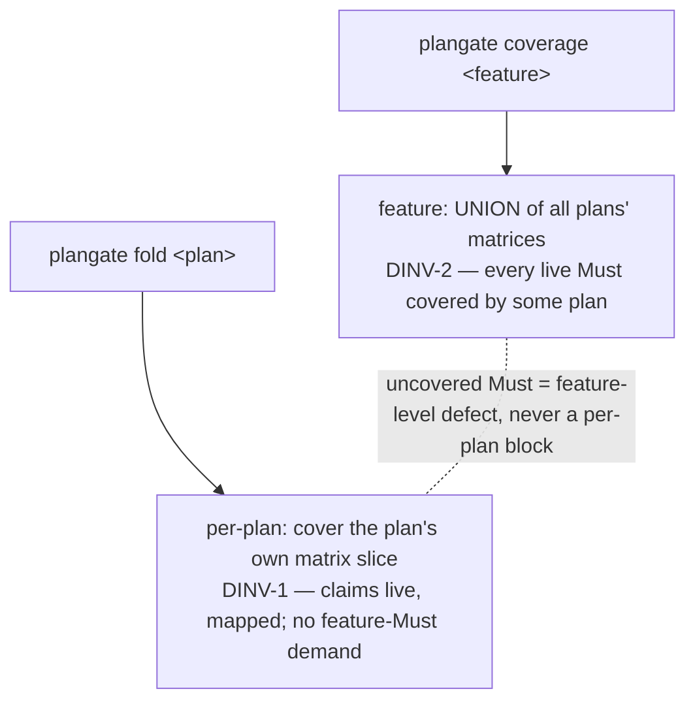

# Slice-scoped plan coverage — technical design

| Field | Value |
|---|---|
| **Status** | Approved *(merge is the freezing event; "superseded" is computed by the index, never written here)* |
| **Owner** | @mdarabi |
| **Approver(s)** | @mdarabi (operator) — the plan coverage gate is a governance surface |
| **Date** | 2026-07-15 |
| **Relevant-when** | designing or changing plangate's coverage gate, slice-scoped per-plan coverage, or feature-level Must-completeness; implementing the coverage check; triaging a plan that folds red on a requirement it does not address, or a feature Must covered by no plan; superseding the coverage model |
| **Scope** | The plan **coverage** model only: per-plan slice coverage and feature-level union completeness. **Not**: the planner/decomposition, the sizing/fog/cycle/lint gates, the tracker projection, or the plan grammar beyond the coverage matrix (all owned by plan-new-v1). |
| **Tracking** | introducing PR (filed on approval) |
| **Builds-on** | docs/tech-design/plan-new-v1.md |
| **Supersedes** | — |
| **Serves** | prd:plan-new/FR-26 |
| **Security/privacy impact** | none — a deterministic check over local plan + PRD documents; no network, identity, secrets, or new authenticated surface (see §3.5) |
| **Template version** | tech-design-template/v1 |

## 1. Problem

plan-new FR-26 requires plan coverage to be checked against a plan's **slice** — not against every live Must of the whole feature — with feature-level Must completeness taken as the **union** across the feature's plans. plangate today implements FR-15's older reading (every live Must FR/UB of the governing PRD maps to a task *in this plan*), so the instant a feature is amended: a **frozen plan** predating the amendment goes red (it cannot be edited to cover or defer the new requirement), and a **new plan** for the amendment must re-cover already-shipped, already-planned work. This blocked three features in one session (the plan-new Carina adapter, local-work-tracker's plan 001 after FR-19 landed, the hierarchy index). Until coverage is slice-scoped, no amendment can be planned and no amended feature's plans can fold.

## 2. Decision

**Decision:** a plan's fold checks coverage against its **own coverage matrix** — the plan's slice — never against the whole feature: every requirement the matrix claims must be **live** and map to ≥1 task, and every task must map to ≥1 requirement or design anchor (the internal-consistency + fog bar plan-new-v1 already enforces, minus the "every feature Must" demand). Feature-level Must completeness is a **separate** check: the **union** of all the feature's plans' matrices must cover every live Must FR/UB, and a live Must covered by no plan is a named **feature-level** coverage defect — surfaced by a feature-coverage check, *never* as a per-plan fold block (`design-brainstorm` n/a; direct from FR-26). So a frozen plan stays green after a later amendment, an amendment is planned by a new slice-plan covering only its new requirements, and no Must is silently dropped. Concrete forms (the gate signatures, the matrix-as-slice read, the feature-union check) live in the paired solution-shape.

The reasoning: the plan document boundary is the unit of freezing, so it must also be the unit of coverage — a plan can only ever answer for the requirements it was written against, and re-demanding the whole feature every time makes the frozen boundary a liability. Completeness is a property of the *feature*, not of any one plan, so it is checked where it lives — over the union — and where it does not block the very slice-plans that close the gaps.

## 3. The design

### 3.1 Per-plan coverage is the plan's matrix slice

**Decision:** `fold` validates a plan's coverage matrix as before — every claimed requirement resolves to a **live** unit of the governing PRD and maps to ≥1 task, every task maps to ≥1 requirement or design anchor, Should/Could rows are covered or explicitly Deferred (unchanged) — but it **no longer demands that every live Must FR/UB of the feature appear**. The matrix *is* the plan's declared slice. A claim on a superseded or retired unit is still a defect; a dropped claimed requirement or a rogue task is still a defect (the internal-consistency + fog bar is untouched — plan-new-v1 §3, FR-16). Exact defect wording and the resolver live in the shape.

### 3.2 Feature-level completeness is the union across plans

**Decision:** a feature-coverage check computes the **union** of the coverage matrices of all the feature's plans (`docs/plans/<feature>/*-plan.md`) and reports every live **Must** FR/UB of the governing PRD that no plan's matrix claims as a named **feature-level** coverage defect. This is where "no Must silently dropped" is enforced — at the feature, over the union — so completeness survives being split across an amendment's plans. Whether this check is a dedicated `coverage` verb, a mode of `fold`, or a project-time guard is an implementation choice (§7 Q1); what binds is that it is **feature-scoped and never a single plan's fold block** (DINV-3).

### 3.2b Boundaries and non-goals

- **Not solved here** — the planner/decomposition; the sizing/fog/cycle/lint/overlap gates; the tracker projection; the plan grammar beyond the coverage matrix (plan-new-v1).
- **Implementation must not infer** — that a plan must cover every feature Must (it covers its slice — DINV-1); that a frozen plan's slice grows when the feature is amended (a plan's slice is its own matrix, fixed at freeze — DINV-4); that a feature-level uncovered Must blocks a slice-plan's fold (it is surfaced, not blocking — DINV-3).
- **Must remain unchanged** — the coverage matrix grammar, the internal-consistency + fog + Deferred rules (plan-new-v1); a plan folds no *looser* on its own slice than before.

### 3.3 Invariants

- **DINV-1** — a plan's fold checks coverage against its **own matrix**: every claimed requirement is live and maps to ≥1 task, every task maps to ≥1 requirement/design anchor; it does **not** require every live feature Must to appear.
- **DINV-2** — feature-level Must completeness is the **union** of the feature's plans' matrices; a live Must FR/UB claimed by no plan is a named feature-level coverage defect (never silently dropped).
- **DINV-3** — the feature-completeness check is **feature-scoped and never a per-plan fold block**: a slice-plan folds green on its own matrix even while the feature has unplanned Musts, so the very plans that close gaps are never blocked by the gaps.
- **DINV-4** — a plan's slice is its own coverage matrix, **fixed at freeze**; a requirement added to the feature after a plan froze is never retroactively demanded of it.

### 3.4 Observability

- **Events/logs** — coverage defects are the existing typed plan defects (document · rule · reason · remedy); a feature-level uncovered-Must names the requirement id and the feature.
- **Metrics** — none intrinsic (a deterministic check; AP-19).
- **Alerts** — none intrinsic; a red coverage check in CI or at the checkpoint is the signal.
- **Debugging surface** — the coverage matrices are the surface: each plan's matrix is its declared slice, and the feature-union is a mechanical fold over them; a defect names exactly which requirement is unmapped and whether the scope is plan or feature.
- **Trace/correlation** — synchronous; no new surface (unchanged from plangate).

### 3.5 Security & privacy

none — a deterministic check over local plan and PRD documents; no network, identity, secrets, model/provider egress, or new authenticated surface. This subsection agrees with the header row (`none`).

## 4. Alternatives considered

| Alternative | Why rejected |
|---|---|
| Keep FR-15 — every live feature Must per plan | the amendment-coverage gap itself: a frozen plan can't absorb a later amendment, and every new plan re-covers shipped work (observed 3×). FR-26 supersedes it. |
| Enforce the union at **per-plan fold time** (fold reads sibling plans) | re-couples the fold to the whole feature and still blocks the pre-planning case: folding a base plan fails whenever an amendment's requirement isn't yet planned, which is exactly when you need to author the plan that covers it. The feature check must be separate (DINV-3). |
| A new explicit plan header field declaring the slice (`Covers: FR-1..18`) | redundant — the coverage matrix already enumerates the plan's requirements; a second declaration is a drift surface. The matrix *is* the slice (DINV-1). |
| Derive the slice from the plan's **design's `Serves`** | the base designs serve `corpus:*` anchors, not `prd:<feature>/FR-*`, so the design's Serves do not enumerate the plan's PRD-requirement slice; the matrix does. |

## 5. Risks

| ID | Risk | Impact | Mitigation | Verification / evidence |
|---|---|---|---|---|
| R1 | slice-scoping lets a Must be dropped by no plan claiming it | a requirement ships unplanned, silently | the feature-union check (DINV-2) makes an uncovered Must a named feature-level defect — completeness moves to the feature, it is not lost | feature-union fixture: a Must in no plan → defect (A-3) |
| R2 | a feature built pre-tooling (no plan) trips the feature-union check on its base Musts | a noisy or blocking defect for already-shipped work | the check is feature-scoped and advisory to a slice-plan's fold (DINV-3); an operator may acknowledge pre-tooling Musts as covered-by-shipped-code without blocking new plans | fold a slice-plan for a pre-tooling feature → green (A-1) |
| R3 | the internal-consistency bar is accidentally loosened along with the feature-Must demand | a genuinely rogue task or a dead-requirement claim slips through | the per-plan checks (claim-is-live, every-claim-mapped, every-task-mapped, fog) are preserved verbatim; only the "every feature Must" clause is removed | the existing plan-new fixtures stay green (A-4) |

## 6. Acceptance

| ID | Acceptance criterion | Verify | Required evidence | Traces to |
|---|---|---|---|---|
| A-1 | a plan whose matrix claims only an amendment's new requirements (a slice-plan), and a frozen base plan of a feature amended afterward, both fold green — no feature-Must demand blocks either | Test | slice-plan + frozen-base fixtures | prd:plan-new/FR-26 · #DINV-1 · #DINV-4 |
| A-2 | `fold` still rejects a matrix that claims a superseded/retired unit, drops a claimed requirement, or leaves a task unmapped (internal consistency + fog preserved) | Test | the existing plan-new coverage/fog fixtures stay green | #DINV-1 · prd:plan-new/FR-16 |
| A-3 | the feature-coverage check reports a live Must FR/UB claimed by no plan of the feature as a named feature-level defect, and green when the union covers every live Must | Test | feature-union fixtures (uncovered Must + fully-covered) | prd:plan-new/FR-26 · #DINV-2 |
| A-4 | the feature-coverage check never blocks a single plan's fold — a slice-plan folds green even while the feature has an unplanned Must | Test | fold-a-slice-plan-with-open-feature-gap fixture | #DINV-3 |

## 7. Open questions

| ID | Question | Owner | Blocks | Status | Resolution |
|---|---|---|---|---|---|
| Q1 | the feature-coverage check's invocation surface — a dedicated `coverage <feature>` verb, a mode of `fold`, and/or a project-time guard | implementation | nothing (the binding property is DINV-3, not the surface) | open | decided at implementation against the feature-union fixtures (A-3/A-4) |
| Q2 | how an operator acknowledges a pre-tooling feature's base Musts as covered-by-shipped-code (an allow-list, a per-feature marker, or simply the check staying advisory) | operator | nothing | open | decided when a pre-tooling feature first needs a clean feature-coverage verdict |

## Principles

- **AP-10 / AP-11 — honored.** Coverage stays one deterministic plangate verdict (code, not prompt); this refines its scope, not its owner — one implementation for the session, CI, and EVAL.
- **AP-13 — honored.** Success is the coverage matrices and the union fixtures passing, never prose.
- **AP-7 — honored (the load-bearing one).** The plan document is immutable at merge; making the plan's slice its own matrix (fixed at freeze, DINV-4) is what lets an immutable plan stay valid across later amendments — coverage respects the freezing boundary instead of fighting it.
- **AP-19 — honored.** No daemon; the check runs on demand as a bounded read of local documents.
- **Base plan-new-v1 — Builds-on, not Supersedes.** plan-new-v1 binds coverage as a fold gate (per FR-15) without a standalone coverage invariant this contradicts; this design refines the gate's scope per FR-26 and leaves plan-new-v1's other bindings true — both stay live. (plan-new-v1 carries a `stale-serves` flag for the superseded FR-15; it clears if plan-new-v1 is later superseded.)
- **Deviation:** none.
