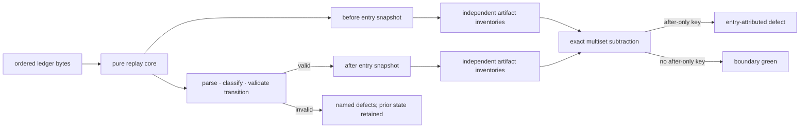

# PRD Amendment Model v2 — replay-state projection congruence

| Field | Value |
|---|---|
| **Status** | Draft → Approved *(operator review pending; merge requires Approved)* |
| **Owner** | @mdarabi |
| **Approver(s)** | @mdarabi (operator — document-system and gate surface) |
| **Date** | 2026-08-20 |
| **Relevant-when** | evolving an approved PRD; implementing or changing PRD ledger parsing, fold state, section supersession, rebase checkpoints, source-map generation, projection congruence, the repo-local transition epoch, or docs-gate wiring; designing the prerequisite init/adoption/repository-release handoffs; superseding the PRD amendment model |
| **Scope** | The complete PRD amendment model and its docgate realization: immutable ledger semantics, addressability, atomic replay transitions, generated projection/source-map agreement, checkpoint-carried question state, repair routing, per-repository baseline adoption, and enforcement. It records—but does not authorize or implement—the required init/adopt/front-door/release-manifest handoffs; those frozen surfaces require their own PRD amendments and successor designs or governed compatibility dispositions before this implementation resumes. Not: semantic conflict detection, design-document gates and indexes, the Contract Compiler, general upgrade UX, or registration of flow rows as contract units. |
| **Tracking** | contract PR #1093 · parked implementation PR #1091 |
| **Builds-on** | tech-design-conventions · installer-v1 · existing-repo-onboarding-v2 |
| **Supersedes** | prd-amendment-model · docgate-v1 |
| **Serves** | prd:docgate/FR-1 · prd:docgate/FR-2 · prd:docgate/FR-3 · prd:docgate/FR-4 · prd:docgate/FR-5 · prd:docgate/FR-6 · prd:docgate/FR-7 · prd:docgate/FR-8 · prd:docgate/FR-32 · prd:docgate/FR-33 · prd:docgate/FR-34 · prd:docgate/FR-35 · prd:docgate/FR-36 · prd:docgate/FR-37 · prd:docgate/FR-38 · prd:docgate/FR-39 · prd:docgate/FR-40 · prd:docgate/FR-41 · prd:docgate/FR-42 · prd:docgate/FR-43 · prd:docgate/UB-1 · prd:docgate/UB-2 · prd:docgate/UB-3 · prd:docgate/UB-4 · prd:docgate/UB-5 · prd:docgate/UB-6 · prd:docgate/NR-2 · prd:docgate/NR-3 · prd:docgate/NR-4 · prd:docgate/NFR-1 · prd:docgate/NFR-2 · prd:docgate/NFR-3 |
| **Security/privacy impact** | none — hermetic repo-local parsing and local-git reads; no identity, secrets, user data, network, or egress surface |
| **Template version** | tech-design-template/v1 |

## 0. Read to rule — the human reviewer's section (~8 min)

*The body is the contract; this section only routes attention — on any conflict
the body governs; machines ignore it.*

**Judge these** *(each row: the call · the alternative it displaced · what disagreeing concretely means, with its anchor)*

| # | The call | Could have gone | If you disagree |
|---|---|---|---|
| 1 | every ledger entry commits one atomic replay-state transition, and both generated faces are checked at that entry's own boundary | ALT-1 · ALT-2 | choose whether the fold model or a final-markdown reparse owns truth → §2, §3.1, §3.6 |
| 2 | merged-base rows retain content-led kind inference, while §0 ancestry excludes a row before addressability | ALT-3 | choose between corpus compatibility and exact-header migration → §3.2, DINV-3 |
| 3 | a post-activation section replacement validates a candidate before mutation; docgate requires each repository to carry its own immutable transition manifest, while external seed callsites remain blocked on their own requirements and design authority | ALT-4 · ALT-11 · ALT-12 · ALT-13 · ALT-15 | change the legal repair split, retroactively reinterpret frozen entries, compile one operand's history into the engine, or authorize cross-surface work ahead of contract → §3.3, §3.4, §3.8, §3.12, A-15 · A-16 · A-17 |
| 4 | rebase checkpoints carry a closed `replay-base/v1` block with every live Q's boolean answer state | ALT-5 · ALT-6 | choose a different state carrier or make compacted history live again → §3.7, DINV-6 |
| 5 | historical disagreement is adopted by exact per-entry mismatch-multiset subtraction plus an independently reconstructed activation golden | ALT-7 | choose advisory rollout, corpus repair, or a weaker debt identity → §3.5, §3.8 |
| 6 | all implementation, including the source-repository cutover, stays parked until Q4/Q5 close; only then may the additive Q source-map field, repo-local epoch, and one-tree audit land atomically, while distributed activation waits additionally for the separately governed lifecycle implementations and proofs | ALT-10 · ALT-11 · ALT-14 | choose whether generated projections may be transiently stale, frozen section transitions may be reinterpreted, the local gate may pay one object read per historical entry, or adopter CI may see a pin without its epoch → §3.8, §3.12, §3.14, A-14 · A-15 · A-17 · A-18 |

**Sanity-check the numbers** — every named entry gets its own before/after pair (A-4); every live Q appears exactly once in checkpoint metadata (A-7); canonical values perform no normalization beyond FR-38 (A-3); the activation golden is generated once and thereafter only shrinks by exact repaired multiplicity (A-9); every affected committed source projection is refolded while zero ledger-entry bytes and fingerprints move (A-14); exact repository-manifest membership is the only route to predecessor section-splice semantics (A-15); an unreachable local activation revision still produces a complete verdict in manifest-only mode (A-16); two separate PRD amendments plus their successor designs/dispositions must close before implementation resumes (A-17, Q4, Q5); the reachable audit invokes one Git tree listing and zero per-entry object reads (A-18).

**The author's open questions** — Q4 and Q5 block implementation on the installer/init/release and adoption contracts respectively; §7 names the exact artifacts that close each.

**Skip the rest** — closed schema and reference mechanics → docgate; substantive coherence and predecessor carry-forward → `tech-design-review`; implementation defects → fixture matrix, race suite, required docs gate, and downstream implementation review; rationale → §4.

## 1. Problem

The original amendment model made each PRD an immutable ledger and made both
current-state artifacts deterministic. That prevented hand-written projection
drift, but it did not require the two generated artifacts to agree with each
other. A whole-section supersede could replace Markdown lines without
refreshing the fold's parsed units. The fold would then emit the new
`effective.md` from one model and the old `effective.source.json` lineage from
another, byte-deterministically and forever.

The first projection-congruence implementation tried to detect that split by
reparsing the final Markdown as a base document. That exposed three deeper
model defects:

1. base parsing treated ID-looking rows in human-only §0 routing tables as
   contract units and let them shadow real requirements;
2. section replacement mutated `Doc.Lines` while leaving tables, units,
   sections, and source-map state stale; and
3. repair selection depended on incomplete fold state, so diagnostics named
   operations that the next validation layer rejected.

The corpus also contains legitimate historical projection/source-map debt.
A hard gate must stop every new or changed mismatch without requiring a
mandatory rewrite of frozen ledgers. Rebase checkpoints add a second state
problem: replay begins at the latest checkpoint, so an earlier `answer Q-n`
operation disappears from the replay window unless answered state is carried
by the checkpoint itself.

The design problem is therefore one boundary decision: **what is the complete
state of a replay boundary, how do all mutations advance it atomically, and
how does a merge-base gate prove that its human and machine projections agree
without turning existing debt into an unrelated blocker?**

## 2. Decision

**Decision:** The fold is one pure replay state machine. Each current ledger
entry is applied as an atomic transition over a fully parsed document plus
typed unit state; only a valid transition commits. Exact entries frozen in the
repository's activation manifest replay predecessor section-splice semantics
solely to reproduce their committed artifacts. At every requested entry
boundary the fold serializes both generated faces, independently inventories those bytes
under the same addressability contract, and exposes the exact mismatch
multiset. `check-projection-congruence` rejects the after-only multiset at each
entry's own before/after boundary.

The two generated artifacts remain projections, never authority. The ledger
remains the human-approved source, and all original immutability, typed-op,
normalization, fingerprint, review-tier, and downstream-invalidation rules
continue. This design replaces the predecessor's narrow supersede-target list,
its line-only section replacement, and its checkpoint equality definition;
it also carries forward the code shape of one binary, a pure fold, closed
registries, defects as data, and identical desk/CI invocation.



## 3. The design

### 3.1 Replay state, snapshots, and package boundaries

The existing Go ownership remains: the command layer parses CLI arguments and
writes fold outputs; `internal/docgate/gate` owns filesystem and local-git
reads; `internal/docgate/ledger` owns the pinned Markdown grammar;
`internal/docgate/fold` is pure; and `internal/docgate/schema` owns versioned
registries and canonical scalar encoding. Standard library only.

**Decision:** one replay core powers persisted folds, previews,
`verify-generated`, `verify-rebase`, diffs, and congruence. `Fold` is a thin
final-result call over that core; it is not a second implementation. A caller
may request boundary observations by entry name, but supplies only ordered
entry bytes and names—never git state or paths outside the ledger.

The replay state is:

| Part | Contents | Owner |
|---|---|---|
| parsed document | normalized logical body; complete section ancestry; tables; addressable units; exact row lines | `ledger` value held by `fold` |
| unit state | lifecycle, origin, source/current location, supersession links, projected contract fields, and optional Q answer state | `fold` |
| removed history | superseded/retired rows emitted in the human appendix while they remain in the replay window | `fold` |
| replay metadata | replay-base entry, fingerprint inputs, requested-entry observation set, per-entry section-transition epoch class | `fold` |

For every requested entry, the replay result contains an immutable boundary
record with entry name, replay range, immediately-before inventory,
immediately-after inventory, and transition defects. The first requested
entry does not lend its baseline to later entries: each record snapshots its
own adjacent states. The result also reports every requested name actually
observed; the gate set-differences requested and observed names to implement
UB-4.

The caller classifies each entry from the repository's closed activation
manifest in §3.8 and passes the resulting legacy-or-current tag with its
ordered bytes and name. The replay core never reads git or the manifest file.
The fold still normalizes CRLF/CR to LF, removes trailing spaces and tabs per line, writes
exactly one final newline, and fingerprints the normalized replayed entries in
filename order with a NUL separator. Tool version remains a separately
recorded field.

### 3.2 Addressability, table inference, and §0 ancestry

**Decision:** addressability is membership in the version-pinned
`schema.TableSchemas` registry, never membership in the broader lexical token
registry. A base, rebase, or section-replacement body retains merged-base
kind inference: an exact registered header may establish table kind; otherwise
the first addressable data-row prefix establishes it, and later rows in that
table must use the same prefix. Exact header equality remains mandatory only
for operation payload tables.

The section parser records the complete numbered-anchor ancestry for each
line, not only its innermost anchor. Before table-kind inference, any row whose
ancestry contains anchor `0` is discarded from addressability. This excludes
§0, §0.1, and every deeper descendant. The row remains ordinary Markdown and
is preserved byte-for-byte; it never enters `Doc.Units`, fold state, source
maps, mismatch inventories, citations, or repair routing.

Lexical-only IDs remain usable by citation parsers but create no fold state.
In particular, an `F` token is not a unit until a future governed change adds
an `F` table schema. The design does not enumerate the registry's current
members as a second source of truth.

Duplicate addressable IDs outside §0 remain hard parse defects. A row in a
table whose inferred kind differs from its prefix remains a hard defect. A
cosmetically drifted merged-base header is not a defect by itself.

### 3.3 Atomic whole-section replacement

**Decision:** section supersession introduced after the activation boundary is
a parse–classify–commit transition, not a line splice. The fold builds
candidate lines without mutating live state, reparses the complete candidate
body under §3.2, compares the before and candidate inventories, validates
every unit transition, and commits the candidate `Doc` plus state updates only
if the whole operation is valid.

The boundary is exact membership in the repository's transition manifest,
never a date, a filename range, or the caller's requested-entry set. The
configured PRD root is resolved before discovery; the manifest records its
resolved activation value once and records ledger identities relative to it,
so no operand path is compiled into docgate. When the entry's relative ledger,
filename, and normalized-byte digest exactly match a `legacy_entries` record
in §3.8's immutable transition-epoch manifest, each section supersede in that
entry replays with the predecessor's line-splice behavior and therefore
reproduces the historically committed document, fold-state, and source-map
bytes. An absent entry is current and uses the transition table below. A
present ledger/name with different normalized bytes is current unless the
reachable activation-tree audit proves that the manifest or historical entry
was altered, in which case §3.8 fails before replay. The manifest cannot be
regenerated or extended to admit a later entry.

This compatibility branch applies only while replaying those exact frozen
entries. It does not authorize their mutation, suppress congruence comparison,
or exempt a later operation. A current semantic-no-op checkpoint materializes
historical lineage-less rows under §3.7; every operation after that checkpoint
uses current semantics and typed state.

For a current entry, classification is by canonical row content under FR-38
with the ID lineage suffix decoded separately:

| Transition | Required behavior |
|---|---|
| row unchanged | restore the exact pre-operation row bytes and preserve the exact unit-state/source-map value; no annotation or origin refresh |
| row changed and prior live state exists | reject before mutation; name the prefix-authorized typed unit operation with a fresh same-prefix replacement where applicable |
| row changed, no prior state, prefix G/J/M/ABUSE/R | accept as the grandfathered direct repair; write the repairing entry's annotation into that row only and create matching live state/source lineage |
| row changed, no prior state, any other addressable prefix | reject before mutation; require a semantic-no-op checkpoint followed by the prefix-authorized typed operation |
| addressable row added by the section body | reject before mutation; use typed `add` after adding an empty receiving table if the section did not previously contain one |
| addressable row removed by the section body | reject before mutation; materialize lineage by checkpoint if necessary, then use the authorized removal/replacement operation |

Unanchored prose and non-addressable tables remain opaque section content and
may change through the same operation. Multiple legal lineage-less changed
rows may be repaired in one section operation; each is classified and
annotated independently. Any illegal row transition rejects the entire
section operation, so later operations observe the pre-operation state.

On commit, the candidate parse replaces the old sections, tables, units, and
line indexes as one value. There is no index-shifting approximation. Source
locations for newly repaired rows point to the repairing amendment and
section operation; current locations remain `effective.md#<ID>`.

### 3.4 Unit operations, repair routing, and reference-safe retirement

**Decision:** `supersede <ID>` accepts every live addressable prefix and
requires a complete fresh row with the same prefix, except that an unanswered
Q uses `answer`, and NG/WR use `rescope`. An answered Q uses `supersede` with a
fresh Q ID. `retire` means removal only and is never a replacement recipe.

The operation router reads only immediately-before typed state:

| Before state | Canonical-content intent | Authorized route |
|---|---|---|
| live ordinary row | replace | `supersede <ID>` with fresh same-prefix row |
| live unanswered Q | resolve | `answer <Q-ID>` |
| live answered Q | replace the resolved question | `supersede <Q-ID>` with fresh Q row |
| live NG or WR | move boundary inward/outward | `rescope <ID>` |
| lineage-less FR/NR/UB/NFR/DOD/EVAL/EVT/Q/NG/WR | replace | semantic-no-op checkpoint in one proposal; authorized typed operation in a later proposal |
| lineage-less G/J/M/ABUSE/R | replace | direct whole-section repair under §3.3, or checkpoint then typed operation |
| live uncited row | remove without replacement | `retire <ID>` |

The router never interprets a Q Status cell. It never emits `retire` plus
`add`, and it never offers a whole-section repair for a changed row with live
state.

Before `retire` commits, one shared reference scanner checks every live DOD
`Source` cell and every `Traces to` cell on a live addressable row. The scanner
uses the repository's canonical ID-token/range grammar, ignores non-reference
Markdown code spans, and resolves tokens against the immediately-before live
unit set. A reference resolving to the target blocks retirement and names the
citing row and column. This scanner is shared with citation validation; fold
does not grow a second token grammar.

For a successful supersede, the old record becomes `superseded`, its
`superseded_by` names the fresh ID, the new live record's `supersedes` names
the old ID, and the human ID annotation records the same predecessor. Rescope
keeps its existing lifecycle semantics. A successful answer changes the
rendered Status prose and sets typed Q answer state true; the prose is display,
not the state predicate.

### 3.5 Artifact inventories and the mismatch algebra

After each observed boundary, the fold serializes `effective.md` and
`effective.source.json`. The congruence inventory then parses those serialized
bytes—not `Doc.Units` or the pre-serialization state—so annotation and JSON
emission bugs remain observable. Both parsers consume shared low-level schema
rules, but neither calls `ParseBase` over the entire generated document:

- the Markdown inventory reads only the live binding body, applies §3.2, and
  excludes the generated wrapper and superseded appendix;
- the source inventory decodes the versioned JSON and retains every unit
  record, including non-live records needed to diagnose a rendered/non-live
  collision.

The Markdown inventory derives these fields per live unit:

| Field | Projected meaning |
|---|---|
| `presence` | literal `true` |
| `current_location` | `effective.md#<ID>` |
| contract fields | registered decoded row cells used by the source map: priority, fit-criterion presence, verify method, and Q answer state where applicable |
| `origin_entry` | entry sequence decoded from the ID annotation; an unannotated original-base row has the replay base as its implicit origin |
| `supersedes` | predecessor decoded from `*(NNN ← ID)*`, otherwise null |

Checkpoint rows must carry `*(NNN)*`; the original `000-base.md` is the only
replay base whose rows may use implicit unannotated origin. A typed add or
section repair carries `*(NNN)*`; typed supersede carries
`*(NNN ← OLD-ID)*`.

Mismatch classes and fields are closed:

| Class | Field | Projected value | Source value | Artifact named |
|---|---|---|---|---|
| `source-missing` | `presence` | `true` | `null` | source map |
| `source-non-live` | `status` | `"live"` | exact decoded status | source map |
| `projection-missing` | `presence` | `null` | `true` | effective Markdown |
| `current-location` | `current_location` | expected string | decoded source string/null | source map |
| `contract-field` | registered field name | projected scalar/null | source scalar/null | source map |
| `lineage` | `origin_entry` or `supersedes` | projected scalar/null | source scalar/null | both faces, with the source-map path as the defect file |

Each mismatch key is the fixed tuple `(unit ID, class, field, projected
value, source value)`. Values are canonical JSON tokens: exact decoded strings,
literal booleans, or `null`. Markdown normalization stops after line-ending and
trailing-line-space normalization, outer table delimiters, and
delimiter-adjacent cell whitespace. There is no case folding, Unicode
normalization, internal-whitespace folding, Markdown-markup normalization, or
empty/absent equivalence.

Before/after adoption is multiset subtraction. The implementation counts each
before key, walks deterministically sorted after keys, consumes one identical
before occurrence when available, and emits a defect for every exhausted key.
Changing class, field, either value, or multiplicity creates a new key; a
repair only removes keys.

### 3.6 Gate orchestration, exact reads, and attribution

`check-projection-congruence` remains a self-registered merge-base check. The
gate layer obtains added ledger paths from the same diff helper used by the
single-amendment check, groups names by ledger, and reads each complete ledger
once.

With a checked revision, the reader uses local git object reads for that exact
tree. With no checked revision, it uses the ordinary working-tree reader. Both
return ordered `[]ledger.Entry` plus `[]Defect`; they differ only in byte
source. No shell interpolation is used. Conformance fixtures feed identical
bytes through both readers and require byte-identical boundary inventories and
defects.

Every added amendment and rebase checkpoint is requested from replay. New
`000-base.md` entries are outside this change gate because they have no prior
contract boundary; ordinary fold and generated verification still govern
them. A requested amendment outside the active replay range, absent from the
exact revision, or otherwise unobserved yields UB-4 before any congruence
verdict, naming the requested entry and actual replay range. Rebase checkpoints
are observed: their before state is the preceding projection and their after
state is the newly restored replay base.

If reading or parsing the ledger yields defects, comparison does not run. The
gate returns every defect in stable order without changing its verb, file, op,
reason, or remedy. It never collapses the list to an error string.

Each after-only mismatch becomes one defect. `File` names the inconsistent
generated artifact from §3.5; `Op` names the causative ledger entry and
mismatch field; `Reason` carries the complete mismatch tuple; and `Remedy` is
selected from §3.4 using the entry's immediately-before state. No later entry
can be blamed for an earlier boundary, and no amendment path is substituted
for the actual artifact path.

### 3.7 Rebase checkpoints and typed Q answer state

**Decision:** every rebase checkpoint carries exactly one closed metadata
block immediately after its H1, separate from the PRD body:

```markdown
<!-- docgate:replay-base/v1
{"question_answered":{"Q1":true,"Q2":false}}
-->
```

The JSON is canonical: the outer object has exactly the
`question_answered` key; the value is an object containing every and only live
addressable Q ID immediately before the checkpoint; keys use stable ID order;
values are JSON booleans. Duplicate blocks, unknown keys, a missing/extra Q,
or a non-boolean value are hard defects. Original bases carry no block and
initialize every Q false. A Q introduced after a checkpoint also starts false.

The block is checkpoint metadata, not PRD body: the base parser strips it
before section/table parsing and the projection emitter does not reproduce it.
`verify-rebase` replaces the predecessor's raw byte comparison with two
orthogonal checks:

1. compare the preceding live body with the checkpoint body after normal
   normalization and after decoding only the permitted ID-lineage compaction;
   every other byte must match; and
2. compare the metadata map exactly with the preceding fold's live Q booleans.

The checkpoint's every addressable row must carry the checkpoint sequence as
its visible origin. After validation, replay starts from the checkpoint,
materializes one live state/source record per addressable row, sets every
machine origin to the checkpoint, restores Q booleans from the metadata, and
compacts pre-checkpoint supersession history out of active state. Human and
machine origins therefore advance together. Keeping an old visible annotation
or restoring an old machine origin is a congruence mismatch.

`answer Q<n>` is successful only when the immediately-before boolean is false
**and** the complete closed payload (`Answer`, `Evidence`, `Decided-by`,
`Effects`) parses and validates without any defect. Payload and state validation
finish before the row or boolean is mutated. Only then does the operation
render the resolved Status and set the boolean true. A malformed payload leaves
both faces and the typed boolean unchanged; a second valid answer, including
after checkpoint restore, is rejected with the fresh-Q supersede remedy.
Status text is never read for routing, verification, or restoration.

### 3.8 Source-map evolution and activation baseline

`effective.source.json` keeps its additive schema line. Each Q unit record
adds a required `question_answered` boolean; false is emitted explicitly.
Non-Q records omit the field. Readers evaluating current projections reject a
missing or non-boolean field on a Q rather than defaulting it. Historical
commits remain readable at their recorded schema/tool revision.

Section-transition compatibility uses a per-repository, committed production
input at `<configured PRD root>/section-transition-epoch.json`. The root is
resolved from repository config; only the schema-owned filename inside that
already-configured corpus is fixed. The operand-owned root and entry set are
therefore never compiled into the engine, and the installed namespace remains
byte-identical installed payload:

```json
{
  "schema_version": "section-transition-epoch/v1",
  "mode": "grandfathered",
  "activation_revision": "<full merge-base commit>",
  "activation_prds_root": "<resolved configured PRD root>",
  "git_object_format": "sha1",
  "legacy_entries": [
    {
      "ledger": "<path relative to activation_prds_root>",
      "entry": "NNN-<slug>.md",
      "blob_oid": "<full Git blob object ID>",
      "normalized_sha256": "sha256:..."
    }
  ]
}
```

This is a **seeded repo-owned policy artifact**, not release payload and not an
adoption receipt. Docgate owns its closed schema, deterministic generator, and
reader; each repository owns the one generated instance that describes its
own transition boundary. The callsites that invoke that generator from init,
adoption, and a repository release transition are external prerequisites, not
authority granted by this design (§3.12, Q4, Q5). `activation_prds_root` is
the config-resolved value captured at generation, not a code default or
authored literal. Ledger paths are relative to that root. `blob_oid` is the
full lowercase object ID in the repository's declared `git_object_format`
(`sha1` or `sha256`) and identifies the exact raw entry bytes;
`normalized_sha256` identifies the same bytes after the fold's pinned
normalization and remains the replay-membership key.

The schema has two closed modes. `grandfathered` requires a full activation
revision and the complete sorted inventory of every ledger entry at that
revision. `strict` represents a repository governed from birth, requires
`activation_revision: null` and an empty `legacy_entries`, and makes every
entry current; its configured root and object format are still recorded.
Unknown keys, unknown mode or object format, duplicate identities, an unsorted
record set, a malformed/null revision in the wrong mode, an OID of the wrong
width, or absence of the file is a hard defect before replay.

**Required dependency contract—not executable authority from this design:**
the source-repository cutover may generate `grandfathered` from its activation
merge base because that action is inside the docgate implementation proposal.
Distributed use additionally needs the following outcomes to be required by
the installer and onboarding ledgers and owned by approved successors (or by
exact governed compatibility dispositions):

- new-repository init invokes the docgate generator for `strict` after
  Git/config initialization and before the first docgate invocation;
- existing-repository adoption names the artifact in its reviewed action set,
  invokes `grandfathered` from the clean pre-apply `HEAD` plus the target
  config's resolved PRD root, and commits it before enabling hooks;
- the release manifest gains a sorted, duplicate-free closed
  `required_repo_policy_schemas` array; the activating release declares
  `section-transition-epoch/v1`, an absent array means no such migration, and
  an unknown identifier is a named front-door defect; and
- the first repository-system pin transition from a predecessor without the
  epoch invokes `grandfathered` from the pre-transition `HEAD` before ordinary
  converge, pre-warm, or target-docgate execution. The trigger is the exact
  pin-only working-tree change to a release declaring the schema, with no PRD
  or other config mutation. A manifest already present in `HEAD` is immutable,
  never a reseed candidate. Preview names the planned path/revision; an
  ambiguous edge refuses with a split-the-upgrade remedy. Ordinary converge
  remains validation-only, and the binary-only CLI upgrade remains
  repository-read-only.

Those bullets are the contract brief for Q4/Q5's upstream artifacts. They do
not permit this proposal to edit installer, init, adoption, converge, or
release-manifest code, and no distributed activation may rely on them while
either question remains open.

Generation resolves the PRD root from its caller-supplied, already-validated
repository config (the activation-tree config for source cutover; the exact
forms required of future integration callers are the Q4/Q5 brief above).
`grandfathered` then walks that root at the chosen activation
tree, records each raw blob OID, reads each blob once
to compute the pinned normalized digest, sorts, and writes atomically;
`strict` writes the empty variant without a tree walk. Creation and activation
are ordered so the target docgate cannot run first: a missing manifest is a
hard defect, not a cue for the gate to invent policy. The fold/gate never
interprets a pin diff as generation authority; only a future, independently
governed integration caller may do so after Q4 closes. The existing history
gate adds the manifest to its immutable-after-introduction set; no later
caller, fold, or gate may regenerate or extend it.

The current manifest location always resolves under the current configured
PRD root; `activation_prds_root` is used only to audit the historical tree. A
later governed PRD-root relocation moves the manifest byte-for-byte with the
corpus. The history gate recognizes only that config-authorized exact move as
continuity—never as a second introduction—and still rejects any content
change.

Activation-tree reconstruction is a conditional independent audit, not a
runtime prerequisite. When the named revision is reachable in the current
repository, the command/gate layer executes one
`git ls-tree -r -z --full-tree <activation_revision> -- <activation_prds_root>`
and compares the complete ledger-relative path and `blob_oid` set with the
manifest. The result is loaded and audited once per command invocation, then
shared across every ledger fold in that process. A raw blob OID is Git's exact
byte identity, so steady-state audit performs zero per-entry
`git show`/`cat-file` reads; the one-time generator has
already proven each normalized digest from those bytes, and manifest
immutability preserves that mapping. Any omission, addition, path difference,
or OID difference is a hard defect. `strict` mode has no activation-tree audit.
When a `grandfathered` revision is unreachable, replay continues from the
valid repository manifest and emits one stable stderr notice per invocation:
`section-transition epoch: activation revision unavailable; using repository manifest`.
The notice does not enter the defect list or change exit status.

The manifest is immutable after activation: a current entry is precisely one
absent from `legacy_entries`, so no later entry or new ledger can acquire the
compatibility branch. After the audit, the command/gate layer resolves exact
membership and passes only the epoch tag into the pure replay core (§3.1).
Once Q4/Q5's governed lifecycle lands, an adopted or upgraded repository
carries the epoch for its own frozen corpus rather than being compared with
Pyxis's corpus. An exact mirror carrying the source repository's committed
manifest may still reproduce those legacy entries when the activation object
is absent.

For the Pyxis source cutover, the transition manifest and the mismatch golden
below share an activation revision but have different authority. The manifest
is production replay policy for frozen section operations; it carries no mismatch keys. The golden
is an independently reconstructed audit artifact and is never replay policy.
In particular, source-missing rows produced by legacy section splices remain
unchanged historical debt and appear in the golden rather than being silently
registered during cutover.

The gate-activation baseline is a committed sorted JSON golden with this
shape:

```json
{
  "schema_version": "projection-congruence-baseline/v1",
  "activation_revision": "<full merge-base commit>",
  "ledgers": [
    {
      "ledger": "docs/prds/<feature>",
      "content_fingerprint": "sha256:...",
      "mismatches": [
        {
          "unit_id": "R6",
          "class": "source-missing",
          "field": "presence",
          "projected_value": true,
          "source_value": null,
          "count": 1
        }
      ]
    }
  ]
}
```

**Decision:** the implementation owner creates this file once from the exact
merge base at which the verb is first wired. A separate corpus-audit test
reconstructs inventories directly from committed artifact bytes without using
the production comparator and byte-compares the sorted result. The golden's
activation revision and ledger fingerprints never move. Ordinary proposals do
not regenerate it. An explicit debt-repair proposal deletes only the exact
repaired multiplicity; a proven oracle defect requires a dedicated reviewed
gate-fix while the verb is unwired.

The production per-entry verdict does not consult the golden; it uses the
immediately-before multiset. The golden is the independent false-green and
adoption audit. Keeping those roles separate prevents a mutable exemption
file from becoming runtime policy.

### 3.9 Failure modes and reversibility

| Failure | System behavior | Detection | Recovery |
|---|---|---|---|
| section candidate fails parse or transition routing | retain prior state; emit all named defects; emit no best-effort transition | operation fixtures and boundary replay | repair the operation using §3.4 |
| answer payload is incomplete or invalid | retain the preceding row and false Q boolean; emit every payload defect; preview and later operations observe no answer | malformed-answer transition fixture | supply the complete closed typed payload |
| requested entry is absent/outside replay | no congruence verdict for that ledger | UB-4 fixture | correct checked revision or split checkpoint/change proposals |
| exact-revision ledger read yields multiple defects | return every original defect unchanged | UB-5 fixture | repair each named cause |
| checkpoint body or Q metadata differs | reject checkpoint before it becomes replay base | `verify-rebase` plus congruence | regenerate body/metadata from preceding projection state |
| transition-epoch manifest is absent, malformed, unsorted, duplicated, modified after introduction, or differs from a reachable activation tree | refuse replay before the first entry; emit no projection | closed-manifest validation, immutability check, and reachable-tree audit | restore the repository's reviewed manifest, or treat a proven manifest defect as a dedicated unwired gate fix |
| Q4 or Q5 prerequisite authority/evidence is absent | keep #1091 and distributed activation parked; emit no claim that the external lifecycle exists | contract-gate/design-currency evidence plus A-17 | land the separately reviewed PRD amendment and successor/disposition; then implement its owned lifecycle and fixtures |
| grandfathered transition-epoch activation revision is unreachable | replay from the valid repository manifest; produce the complete projection/verdict and one stable stderr notice | manifest-only portability fixtures | fetch history if independent re-audit is desired; no repair is required to use docgate |
| activation audit differs from golden | block wiring or continued enforcement | corpus audit | explicit debt repair, or dedicated reviewed oracle fix while unwired |
| proven false-red in the hard gate | temporarily remove the registered verb from the umbrella; no bypass mode or exemptions | required-context failure plus reproducer | fix and independently audit proposals merged during the gap before rewiring |

There is no advisory mode. Reversibility is wiring-only; ledger semantics,
canonical equality, and the activation record are not weakened during repair.

### 3.10 Observability

- **Events/logs** — one human defect and one `--defects-json` record per
  mismatch or underlying cause; artifact path, causative entry, mismatch key,
  and executable remedy are the correlation fields. Manifest-only epoch mode
  emits one stable stderr notice and no defect. The docgate generator returns
  manifest mode, activation revision (or `strict`), entry count, and audit
  duration as typed result data without entry content; Q4/Q5's future owners
  decide how their callsites log that result.
- **Metrics** — existing fold-golden and first-try gate measures continue;
  projection congruence adds required-check history plus the independent
  activation-golden audit defined by M3.
- **Alerts** — the required docs-gate context is the enforcement alert; an
  accepted after-only key or non-executable remedy is a gate incident.
- **Debugging surface** — a failing ledger plus checked revision reproduces
  exact reads; every mismatch class and repair branch has a minimal fixture;
  the baseline file exposes the full adopted debt set.
- **Trace/correlation** — `(ledger, entry, unit ID, mismatch class, field)`
  connects the PR boundary, defect record, golden record, and fixture.

### 3.11 Security & privacy

none — matches the header row. The mechanism reads tracked Markdown/JSON and
local git objects, invokes no network or model, handles no secrets or user
data, and writes only deterministic generated artifacts through the existing
command layer. Git arguments are passed as argv, never shell-interpolated.

### 3.12 Boundaries and non-goals

**Decision:** Approval of this design is necessary but not sufficient to
resume implementation. Parked implementation PR #1091 and any replacement
remain blocked until Q4 and Q5 are both resolved by merged requirements plus
approved design authority. A `Builds-on` edge is evidence this design read a
surface; it is never permission to write that surface.

- **Not solved here** — semantic contradictions, duplicate-in-different-words
  requirements, policy approval, design-index behavior, Contract Compiler
  invalidation enforcement, registration of lexical-only flow rows, or the
  installer/adoption product contracts and their design evolution.
- **Owned elsewhere** — the installer PRD must gain init `strict`, the release-
  manifest declaration, the front-door seed, and same-commit pin-bump
  atomicity in one typed amendment; the existing-repo-onboarding PRD must gain
  the reviewed-plan/apply `grandfathered` seed before hook enablement in a
  separate typed amendment (one ledger entry per PR under FR-27). Each frozen
  design then needs an approved successor or an exact governed compatibility
  disposition covering those new obligations. Semantic/policy findings remain
  human/compiler/policy work; implementation review owns code defects; the
  future engine consumes the existing source-map invalidation data.
- **Implementation must not infer** — Q state from prose; addressability from
  lexical tokens; base kind from exact headers only; replacement as
  `retire`+`add`; pre-checkpoint history as a hidden live input; or the
  activation golden as a runtime exemption list; nor a section-transition
  epoch from dates, numeric filenames, requested-entry membership, a
  compiled-in Pyxis corpus, or an invocation's current merge base. It must not
  infer that this design authorizes init, adoption, converge, front-door, or
  release-manifest changes; only Q4/Q5's future governed owners may create
  those callsites.
- **Must remain unchanged** — immutable ledger history, typed evidence and
  blast-radius enforcement, normalized fingerprint semantics, generated-only
  projections, exact payload schemas, non-ledger corpus/content fences,
  existing design/wiki/governance checks, identical desk/CI umbrella use, and
  every installer/onboarding callsite until its prerequisite contract lands.

### 3.13 Verification strategy

All fold, parse, serialization, comparison, and routing dependencies are
in-process and tested directly. The two byte sources are a real working-tree
reader and a local-git-object reader exercised in temporary repositories; git
is local-substitutable, not mocked. There is no remote or true-external
dependency.

Fixtures are table-driven and golden-backed:

- one isolated red/green pair per mismatch class and canonical-value edge;
- every addressable table-schema key outside §0, plus lexical-only F and real
  §0/§0.1 documents;
- every §3.4 repair branch, cited retirement refusal, and lineage link;
- mixed changed/unchanged section replacement and wholly identical
  restatement;
- an activation-edge pair in which an exact manifest-listed section entry
  reproduces predecessor bytes and source-missing debt while the same
  transition in an absent/current entry is classified and rejected; manifest
  omission, addition, raw-OID drift against a reachable tree, normalized-
  digest drift at generation, duplicate, unknown-key, and post-introduction
  mutation fixtures;
- a docgate-owned generator matrix emits canonical empty `strict` and
  repository-specific `grandfathered` for explicit caller inputs, while
  malformed/ambiguous inputs write nothing; no fixture in this proposal
  mutates init, adoption, converge, front-door, or release-manifest code;
- a grandfathered repository with no activation object still produces
  complete fold and gate results in manifest-only mode and emits exactly one
  notice; a distinct configured PRD root uses its own manifest, while an exact
  mirror preserves matching legacy entries;
- a command-spy fixture proves a reachable steady-state audit performs one
  `ls-tree` invocation and zero per-entry object-content reads at corpus scale;
- complete answer false → true → checkpoint → restored true, plus fresh false
  Q and malformed-answer no-mutation fixtures;
- exact-revision/working-tree conformance, dirty shared-tree isolation,
  missing requested entry, and multi-defect preservation;
- activation-golden omission, hidden mismatch, exact repair shrinkage, and
  unauthorized regeneration.

The complete suite runs under the race detector. The fold import-boundary test
continues to forbid filesystem, network, clock, and environment access.
Q4/Q5's future requirements and design artifacts must bind the end-to-end
lifecycle matrix from §3.8—init-before-first-use, adoption-before-hooks,
pin-plus-manifest same-commit activation, no reseed, and later-converge no-op.
Those merged contracts are implementation-entry evidence. Their owning
implementations must later prove the matrix with lifecycle/CI fixtures before
distributed activation; neither evidence class belongs to this docgate-only
proposal.

### 3.14 Compatibility, migration, and cutover

**Decision:** after Q4/Q5 close, the implementation activates the required Q
source-map field as one atomic source-repository cutover. Before the shipped
revision enables the new `verify-generated` expectation or wires projection
congruence, it runs the new fold over every existing ledger whose committed
generated source changes and commits every regenerated
`effective.source.json` in the same implementation proposal.

The cutover creates and edits no ledger entry. The fold's content fingerprint
is computed only from normalized replayed entry bytes, so every ledger retains
its exact pre-cutover fingerprint. The expected projection delta is limited to
the additive required `question_answered` boolean on Q records; any
`effective.md` change, ledger-byte change, fingerprint movement, or unrelated
source-map change is a cutover defect.

Before the refold, the same proposal generates §3.8's repo-local
`grandfathered` transition-epoch manifest from the activation merge-base,
records raw blob OIDs plus normalized entry digests, and completes both the
one-time content audit and the one-tree steady-state audit. Manifest-listed
section operations replay with predecessor splice semantics,
so their historically absent source-map records remain absent and their
existing mismatch multiplicity remains in the activation golden. The new
classifier therefore cannot turn historical section debt into either an
`effective.md` rewrite or an unrelated source-map backfill during this
cutover. Only entries absent from that immutable manifest receive §3.3's
parse–classify–commit semantics.

Discovery is corpus-driven from the ledger roots, never a frozen list or count.
The implementation plan carries an explicit regeneration task after the schema
and fold changes and before gate wiring. The final pre-push and CI invocations
run only after those generated files are staged, so no intermediate revision
claims a green repository while its committed projections use the old shape.

The adopter cutover has the same no-red-intermediate invariant, owned by the
Q4/Q5 prerequisite contracts. The front-door seed runs in the pin-bump working
tree; the generated manifest and target system pin are staged and committed in
the **same commit**. Desk hooks may execute the target docgate only after the
manifest exists in that working tree. Hosted CI therefore sees either the
predecessor commit and predecessor docgate, or the pin-plus-manifest commit and
target docgate—never a revision that selects the target while omitting its
epoch. A target release must not activate or become distributable through this
path until that ordering is acceptance-tested by the installer successor.

Adoption analogously commits its reviewed action/undo record and generated
manifest before hook enablement, under the onboarding successor. Both paths
reuse the docgate-owned generator and parser but own their invocation and
transaction boundaries elsewhere. No compiled manifest is shipped; ordinary
converge stays validation-only; the binary-only CLI upgrade stays repository-
read-only. Until Q4/Q5 close, the entire implementation proposal remains
parked. Afterward, these external callsite changes still belong only to their
separately governed owner proposals.

## 4. Alternatives considered

| ID | Alternative | Why rejected |
|---|---|---|
| ALT-1 | reparse only the final effective Markdown and compare it with final state | loses per-entry attribution; a later entry can be blamed for an earlier mutation |
| ALT-2 | trust refreshed fold state and compare no serialized artifacts | makes agreement true by construction but cannot catch annotation or JSON-emission defects—the two faces, not only the model, are the contract |
| ALT-3 | require exact registered headers for every base/projection table | de-governs cosmetically drifted frozen bases and breaks legitimate payload routing; §0 ancestry is the narrow discriminator the failure needs |
| ALT-4 | refresh and annotate every row found after section replacement | self-heals the motivating lineage-bearing same-ID mutation and changes byte-identical restatements |
| ALT-5 | classify Q state from free-text Status | merged prose has no closed vocabulary and a resolved-looking base row need not have a successful answer operation |
| ALT-6 | scan pre-checkpoint operations to recover Q state | makes compacted history a hidden live input outside the replay fingerprint and defeats the checkpoint boundary |
| ALT-7 | launch advisory-first or repair the whole corpus before enforcement | permits another known regression or serializes unrelated work; exact mismatch subtraction plus the reviewed golden supports a hard gate safely |
| ALT-8 | repair excluded prefixes with retire plus fresh add | destroys both supersession links and may retire a cited row, violating the next validation layer |
| ALT-9 | implement congruence in a separate parser/checker binary | creates twin addressability and equality predicates; desk, CI, fold, and gate would drift independently |
| ALT-10 | land the Q source-map schema and regenerate existing projections in a later proposal | the first revision is red by construction under `verify-generated`; splitting the cutover creates an unshippable intermediate state |
| ALT-11 | apply §3.3's transition table retroactively to every replayed section operation | frozen entries containing section-added rows either stop folding or gain previously absent source-map records; both outcomes violate the byte-preserving cutover, while an exact activation epoch preserves history and still makes every later entry strict |
| ALT-12 | make a repository's activation revision a mandatory runtime input, or classify every entry current when it is unreachable | the first shape bricks shallow/mirrored histories; the second breaks mirrors carrying frozen debt; a valid repo-local manifest preserves both portability and historical replay, while reachable history remains the independent tamper audit |
| ALT-13 | compile Pyxis's transition manifest into docgate and treat unmatched adopter entries as current | writes operand-owned PRD paths into the engine contrary to AP-30 and gives an upgraded adopter no epoch for its own immutable ledgers; a generated artifact discovered under each repository's configured PRD root is local, config-derived, and portable without making the installed namespace operand-specific |
| ALT-14 | record only normalized digests and re-read each activation entry on every reachable audit | exact normalization requires one object-content read per entry—measured at about 2.1 s for 93 entries and linear growth on every Pyxis hook; the accompanying raw blob OID lets one `ls-tree` prove exact bytes while creation alone pays normalization reads |
| ALT-15 | treat `Builds-on` as authority and implement init, adoption, front-door, converge, and release-manifest changes in this proposal | repeats the ahead-of-contract failure that parked #1091 and contradicts frozen-design evolution; Q4/Q5 preserve the required lifecycle while forcing each owning ledger and design to authorize it first |

## 5. Risks

| ID | Risk | Impact | Mitigation | Verification / evidence |
|---|---|---|---|---|
| R1 | the artifact inventory quietly reuses fold state and becomes tautological | source-map drift can false-green again | inventories accept serialized bytes only; independent activation audit uses a separate test implementation | mutation tests alter emitted Markdown/JSON after fold and must red |
| R2 | base inference remains too permissive outside §0 | prose table accidentally becomes governed | addressability still requires a registered row prefix, one-kind-per-table, unique IDs, and full ancestry exclusion | real-corpus inventory plus malformed mixed-kind fixtures |
| R3 | candidate section parsing partially mutates state before a later defect | subsequent ops observe a state that never validly existed | copy-on-transition and atomic commit only after the complete classification passes | multi-defect section fixture asserts final bytes/state equal the pre-op snapshot |
| R4 | checkpoint metadata becomes another drifting projection | answered questions flip after compaction | closed exact map, every-and-only live Q, independent pre-checkpoint comparison, required source-map boolean | delete/flip/add-key fixtures and repeated checkpoint chain |
| R5 | the activation golden becomes an exemption surface | new debt is normalized as historical | production gate ignores it; revision/fingerprints immutable; lifecycle changes are mechanically constrained | ordinary-regeneration and new-key fixtures red |
| R6 | superseding the foundational models leaves live designs with `Builds-on` edges to retired targets, even though the successor carries docgate-v1's complete Serves set and the amendment model has no Serves set | currency checks can block planning for dependent features; no requirement coverage is orphaned | enumerate only the newly stale dependency edges; close each with a dependent successor or exact governed compatibility disposition before approval | design-index diff plus contract-currency evaluation; zero `stale-serves` edge attributable to this supersession |
| R7 | broadened supersede targets expose latent table-routing defects | a named repair still dead-ends | one end-to-end proof per addressable registry key and real ABUSE/EVT precedents | DOD-7 repair matrix |
| R8 | the additive Q source-map field lands without regenerating every affected committed projection | `verify-generated` becomes corpus-wide red immediately after activation | §3.14 makes regeneration part of the same atomic implementation proposal, before gate wiring | A-14 corpus refold evidence and final full-corpus gate |
| R9 | an entry is misclassified as legacy and bypasses current section-transition validation, or as current and rewrites frozen projection debt | a new regression can land or committed projections change at cutover | exact repo-local manifest with normalized digests, raw blob OIDs, and immutable membership; a reachable activation tree independently audits completeness and fails before replay on disagreement | A-15 activation-edge and manifest-tamper suite |
| R10 | an adopter or mirror cannot resolve its recorded activation revision | docgate refuses every fold and gate in a shallow or copied history | valid repo-local manifest is sufficient for replay; reachable history only strengthens it with an independent audit | A-16 no-history adopter and exact-mirror fixtures |
| R11 | implementation edits an external lifecycle before Q4/Q5 close, or an adopter pin commit selects the target docgate without its epoch | work lands ahead of contract, or hosted CI hard-fails with no in-job repair path | §3.12 blocks implementation on two merged PRD amendments plus successor authority; §3.14 requires pin and manifest in one commit before target execution | A-17 prerequisite evidence and downstream atomic-upgrade fixture |
| R12 | the reachable audit performs one Git object-content read per historical entry | every Pyxis hook pays corpus-linear process latency and breaches the pre-push budget as ledgers grow | record raw `blob_oid` beside normalized identity and compare the complete tree in one `ls-tree`; normalize only at one-time creation | A-18 command-spy and scaled benchmark |

## 6. Acceptance

| ID | Acceptance criterion | Verify | Required evidence | Traces to |
|---|---|---|---|---|
| A-1 | the replay core remains pure and every consumer uses it rather than a second fold | Test + Inspection | import-boundary test and call-graph inspection | prd:docgate/FR-1 · prd:docgate/FR-3 · DINV-1 |
| A-2 | base/rebase/section parsing preserves merged-base kind inference, excludes complete §0 ancestry, and uses only the addressable table-schema registry | Test | drifted-header corpus audit, §0/§0.1 fixtures, lexical-F fixture | prd:docgate/FR-37 · prd:docgate/FR-41 · prd:docgate/NR-4 |
| A-3 | every mismatch class and FR-38 scalar edge has an isolated fixture; exact multiset substitution, movement, count growth, and repair produce the required verdicts | Test | canonical mismatch matrix | prd:docgate/FR-32 · prd:docgate/FR-34 · prd:docgate/FR-38 |
| A-4 | each named entry is evaluated only at its adjacent before/after boundary and names the actual artifact plus causative entry | Test | two-entry attribution fixture and artifact-path golden | prd:docgate/FR-32 · prd:docgate/UB-4 |
| A-5 | exact-revision and working-tree readers produce identical results for identical bytes, and dirty working-tree state cannot affect a checked revision | Test | temporary-git conformance fixtures | prd:docgate/FR-33 · prd:docgate/UB-3 |
| A-6 | every current section replacement reparses atomically, preserves every unchanged row byte/state/map value, repairs only eligible changed lineage-less rows, and rejects lineage-bearing mutation before commit | Test | mixed-section transition golden and PR-1090 regression fixture | prd:docgate/FR-32 · prd:docgate/FR-39 · prd:docgate/FR-40 · prd:docgate/UB-6 |
| A-7 | a checkpoint re-anchors every addressable row on both faces and exactly preserves every live Q boolean through one or more replay-base resets; an incomplete or invalid answer payload leaves the row and boolean unchanged | Test | full-prefix checkpoint, complete answer/checkpoint chain, and malformed-answer no-mutation fixture | prd:docgate/FR-35 · prd:docgate/FR-36 · prd:docgate/FR-42 · prd:docgate/FR-43 |
| A-8 | every authorized replacement operation preserves `supersedes`/`superseded_by`; unanswered/answered Q and NG/WR route correctly; cited rows cannot retire | Test | per-prefix repair matrix and citation fixtures | prd:docgate/FR-39 · prd:docgate/UB-6 |
| A-9 | the independently reconstructed corpus inventory byte-equals the committed activation golden; ordinary regeneration and hidden/omitted mismatches red; exact repairs can only shrink matching multiplicity | Test | corpus-audit suite and reviewed golden | prd:docgate/FR-34 · prd:docgate/FR-38 |
| A-10 | ledger-read failures preserve every original defect field and stable order; no cause is collapsed or reattributed | Test | multi-defect exact-read golden | prd:docgate/UB-5 · prd:docgate/FR-2 |
| A-11 | Q source records always emit explicit boolean state, non-Q records omit it, and verify-generated catches deletion or alteration | Test | source-schema goldens | prd:docgate/FR-3 · prd:docgate/FR-43 |
| A-12 | predecessor expectation changes are limited to four intended docgate deltas: `verify-rebase` uses lineage-compaction body equality plus exact Q metadata; current section supersedes reparse and commit atomically while exact repo-manifest-listed predecessors replay unchanged; Q source records add the required boolean and receive A-14's one-time refold; and projection congruence plus the manifest parser/generator/audit join docgate. Every other predecessor fixture expectation, normalization/fingerprint rule, immutability/envelope/diff behavior, non-ledger tool, init/adopt/front-door/converge/release-manifest callsite, and desk/CI invocation remains unchanged and green in the docgate-owned proposal; successor-owned proposals carry the external callsites after Q4/Q5 close | Test + Inspection | classified fixture/golden diff mapping every changed expectation to one of the four deltas; zero-diff inspection over prerequisite-owned packages/schemas; unchanged suites green; wiring diff | prd:docgate/FR-1 · prd:docgate/FR-2 · prd:docgate/FR-3 · prd:docgate/FR-4 · prd:docgate/FR-5 · prd:docgate/FR-6 · prd:docgate/FR-7 · prd:docgate/FR-8 · prd:docgate/NR-2 · prd:docgate/NR-3 |
| A-13 | the implementation is stdlib-only, hermetic, formatted, vetted, lint-clean, race-clean, and remains within the pre-push performance budget, including A-18's reachable epoch audit | Test + Inspection | CI and scaled benchmark evidence | prd:docgate/NFR-1 · prd:docgate/NFR-2 · prd:docgate/NFR-3 |
| A-14 | the implementation proposal refolds and commits every existing ledger projection whose source shape changes under §3.8 before enabling the new verifier or gate; all ledger-entry bytes and content fingerprints remain identical, every expected Q record gains its required boolean, no unrelated generated byte changes, and full-corpus `verify-generated` is green | Test + Inspection | before/after ledger-byte and fingerprint equality report; classified source-map projection diff; full-corpus gate result | prd:docgate/FR-3 · prd:docgate/FR-43 |
| A-15 | the closed repo-local transition manifest byte-identically enumerates every grandfathered activation-tree ledger entry with its config-derived root-relative identity, raw blob OID, and normalized digest; exact listed section operations reproduce predecessor projection and source-map bytes, including historical source-missing debt, while absent/current entries alone obey §3.3; absence, malformed shape, duplicate identity, post-introduction mutation, or reachable-tree addition/omission/path/OID mismatch always fails closed; a configured PRD-root relocation moves the same bytes and preserves membership/audit behavior | Test + Inspection | independent creation-content audit; reachable activation-tree OID audit; activation-edge and root-relocation fixtures; classified cutover diff proving no section-debt rewrite or backfill | prd:docgate/FR-32 · prd:docgate/FR-34 · prd:docgate/FR-40 · AP-30 |
| A-16 | an unreachable grandfathered activation revision never blocks replay: docgate uses the valid repository manifest, emits exactly one stable stderr notice, and returns the same complete projection and gate verdict as the reachable-history path; an adopter uses its own configured-root inventory, while an exact mirror preserves matching legacy behavior | Test | temporary-repository matrix for full-history Pyxis, shallow/no-origin adopter with a distinct configured root, and exact mirror without the activation object; stdout/artifact/verdict equality plus stderr golden | prd:docgate/FR-1 · prd:docgate/FR-3 · prd:docgate/FR-33 |
| A-17 | implementation remains parked until two separately merged typed amendments authorize (a) installer/init/release-manifest/front-door seed plus same-commit pin activation and (b) adoption-plan/apply seed before hooks, and each frozen owning design has an approved successor or exact governed compatibility disposition; the resulting contracts carry §3.8's lifecycle matrix and §3.14's rule that adopter CI sees no target-docgate revision without the committed epoch; the docgate proposal changes zero prerequisite-owned callsites, and distributed activation additionally waits for the separately governed implementations and their lifecycle/CI proof | Inspection + Test | implementation-entry evidence: two amendment PRs plus two approved successor/disposition records; docgate-proposal zero-diff report; later activation evidence: downstream lifecycle/CI fixtures | prd:docgate/FR-1 · prd:docgate/FR-3 · §3.12 · Q4 · Q5 |
| A-18 | a reachable grandfathered audit executes exactly one full-tree `ls-tree` scoped to the recorded activation PRD root, compares every relative path and raw blob OID, performs zero per-entry `show`/`cat-file` reads, catches one-byte raw drift, and keeps the scaled full pre-push run within A-13's budget | Test + Analysis | Git-runner command spy, one-byte drift fixture, 93-entry reference measurement, and doubled-corpus benchmark | prd:docgate/NFR-1 · prd:docgate/NFR-2 · §3.8 |

## 7. Open questions

| ID | Question | Owner | Blocks | Status | Resolution |
|---|---|---|---|---|---|
| Q1 | Where does checkpoint-only Q answer state live? | design | implementation | resolved | the closed `docgate:replay-base/v1` JSON block immediately after the checkpoint H1 (§3.7) |
| Q2 | Does adding required Q state force a new source-map schema line? | design | implementation | resolved | no; the existing schema is additive, Q records gain a required boolean and non-Q records omit it (§3.8) |
| Q3 | Which predecessor designs does this decision replace? | operator | approval | resolved pending approval | whole-document supersession names both the amendment semantics and docgate-v1 realization; valid code-shape and ledger rules are carried forward here (§2) |
| Q4 | Have installer/init/repository-release requirements and design authority landed for `strict` seeding, the release-manifest declaration, the pin-only front-door seed, and pin-plus-manifest same-commit activation before desk/CI target-docgate execution? | operator + installer owner | implementation | open — blocking | resolve only with one merged installer PRD amendment and an approved successor to installer-v1 or exact governed compatibility disposition carrying §3.8/§3.14; #1091 remains parked until then |
| Q5 | Have existing-repository onboarding requirements and design authority landed for the reviewed-plan/apply `grandfathered` seed, undo ownership, and manifest commit before hooks? | operator + onboarding owner | implementation | open — blocking | resolve only with one separately merged existing-repo-onboarding PRD amendment and an approved successor to existing-repo-onboarding-v2 or exact governed compatibility disposition carrying §3.8/§3.14; #1091 remains parked until then |

## Principles

- **AP-5 / INV-42 — honored.** Boundary defects, activation inventory, and the ledger/entry/unit/mismatch correlation key make both correct operation and drift visible without runtime telemetry.
- **AP-6 / INV-32 / INV-39 — honored.** Checkpoint state, source records, mismatch keys, baseline records, operation payloads, and defects are closed typed data with explicit additive evolution.
- **AP-7 / INV-33 / INV-41 — honored.** Ledger history remains immutable; this successor replaces only the frozen amendment/docgate decisions it names, while Q4/Q5 require successor authority or governed dispositions before any frozen installer/onboarding surface changes; generated projections remain non-authoritative.
- **AP-10 — honored.** Addressability, canonical equality, repair selection, and baseline subtraction are code, never instructions an authoring model must remember.
- **AP-11 / INV-30 — honored.** One replay core and shared registries serve fold, verification, desk, and CI; exact-revision and working-tree readers differ only at the byte-source boundary.
- **AP-13 — honored.** A green gate certifies serialized artifacts for the exact checked revision and the precise entry boundary, not an agent's statement that the fold was refreshed.
- **AP-14 — honored.** Acceptance executes real ledger transitions, local-git reads, emitted artifacts, checkpoint resets, and corpus audits; no row rests on diff inspection alone.
- **AP-15 — honored.** Consequential pre-push comparison reads the exact pushed tree; dirty ambient state cannot influence it.
- **AP-17 / INV-6 — honored.** Invalid transitions, missing checkpoint state, missing named entries, and unreadable prefixes fail closed without partial state or silent defaults.
- **AP-19 — honored.** The hard gate is deterministic local computation; the reachable epoch audit is one Git tree walk with zero per-entry subprocesses, and no model or recurring runtime service is introduced.
- **AP-21 — honored.** Human judgment stays in approved ledger operations and design approval; replay consumes those frozen choices without reinterpretation.
- **AP-22 — honored.** The docgate-owned generator is atomic and idempotent. The intended init/adopt/front-door ordering is recorded as a prerequisite acceptance brief, not claimed as implemented behavior before Q4/Q5 grant its owners authority.
- **AP-23 — honored.** The ledger remains a dense append surface, the new baseline is deterministically sorted, and gate registration stays line-per-check.
- **AP-24 — honored.** The ledger remains governing input; source maps, effective Markdown, mismatch inventories, and goldens are derived verification artifacts and never regenerate authority.
- **AP-30 — honored.** The manifest is discovered under the repository's configured PRD root and each activation root/inventory is generated from that repository's config and Git tree; no operand-owned documentation path or Pyxis corpus record is compiled into the engine, while the installed namespace remains byte-identical payload.
- **RW-5 — honored.** This design resolves the coupled docgate replay/checkpoint/repair/congruence boundary, while independently revisable installer and onboarding decisions stay in their own amendments/designs; §3.12 and Q4/Q5 keep implementation parked until those contracts exist.
- **Deviation:** none.
