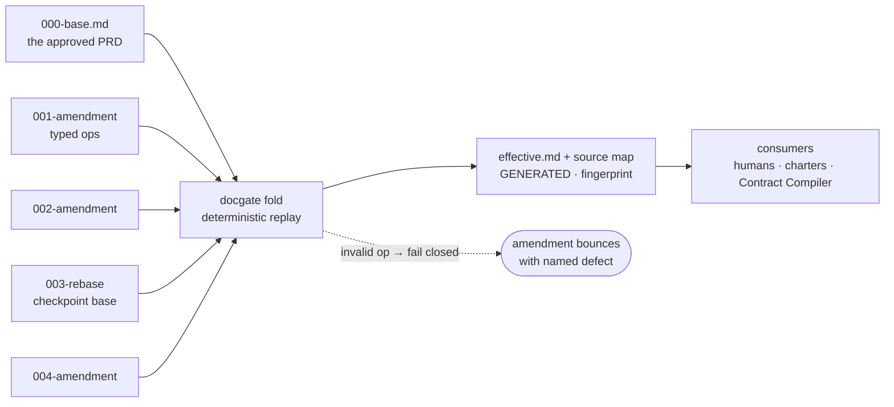

# PRD Amendment Model — ledger, projection, and the docs-gate

| Field | Value |
|---|---|
| **Status** | Draft v0.1 — awaiting review |
| **Owner** | @mdarabi |
| **Date** | 2026-07-06 |
| **Relevant-when** | evolving an approved PRD (authoring an amendment); implementing or changing the `docgate` tool or its CI wiring; designing stage-6 contract-compilation inputs; deciding how any approved document changes after merge |
| **Scope** | Per-feature PRD evolution after approval: the document ledger (base + amendments + rebase checkpoints), the deterministic fold that produces the effective view, and the CI/local gate that enforces both. **Not** in scope: the Contract Compiler itself (VNEXT-1), the PRD template's content, evolution of design docs (this doc's own class — see §11), lifecycle/gate mechanics inside a draft PRD (the template owns those). |
| **Tracking** | filed with the introducing PR |
| **Builds-on** | `docs/templates/prd-template.md` (the document this model versions) · `docs/domain-model.md` §7 doc-layer invariants (INV-32/33/41) |

## Terms

| Term | Meaning |
|---|---|
| **Ledger** | the immutable, dense-numbered sequence of merged PRD documents for one feature |
| **Amendment** | a typed ledger entry that changes the effective contract |
| **Rebase checkpoint** | a human-approved semantic no-op snapshot of the projection, re-approved as the new replay base |
| **Projection** | the generated current view of the contract (`effective.md` + `effective.source.json`) |
| **Fingerprint** | content hash over the normalized replayed ledger — proves which contract state a projection or downstream artifact derives from; the generating `docgate` version is recorded alongside, never hashed in |
| **Source map** | generated machine-readable map: per-unit status, lineage, and locations |

## 1. Problem

A PRD approved at time T records the understanding at T. Building teaches: fit
criteria turn out wrong, requirements get superseded by reality, open questions
resolve, non-goals flip. The current contract (AP-7 / INV-33) allows exactly
one evolution mechanism — supersede the whole document with a new one — which
is correct but so heavy for small deltas that the predictable outcome is
tolerated drift: the doc quietly stops describing the intended product, and
every consumer (human reviewers, worker charters, the future Contract
Compiler) inherits the lie.

The naive fix — make PRDs mutable and let git hold history — fails three ways:
approval semantics blur (what exactly was approved, and when?); citations
destabilize (a charter frozen against FR-3 must mean forever what FR-3 meant
at freeze time, without git archaeology); and in-place LLM edits have
unbounded blast radius — models rewrite adjacent prose while "just updating
one row". The layered alternative — append amendment documents — fails
differently if amendments are prose: the effective requirement set becomes an
*interpretation* over N layers, recomputed slightly differently by every
reader, and coherence decays with each LLM edit because it depends on editor
discipline.

The design problem, precisely: **an evolution mechanism whose cost is
proportional to the size of the change, whose history is immutable, whose
current state is single and canonical, and whose integrity does not depend on
the discipline of any LLM editor.**

## 2. Decision — ledger and projection

**Decision:** A feature's PRD is an append-only **ledger** of immutable
documents — one base plus typed amendments — and its current state is a
**projection** (`effective.md` + `effective.source.json`) computed from the
ledger by a deterministic tool. LLMs author ledger entries; only code writes the projection; CI verifies
the projection is exactly the fold of the ledger. Stability is structural, not
behavioral: the integrator is never a model.



Three load-bearing properties, each mechanically enforced (§5):

1. **Ledger entries are immutable once merged.** The base and every amendment
   freeze at merge; evolution only appends. This preserves AP-7/INV-33 — the
   model *is* "supersede with a new document citing the old", given mechanics
   small enough that people use them instead of tolerating drift.
2. **Amendments are typed operations with resolved payloads, never prose
   deltas.** By the time the fold runs there is nothing left to interpret.
3. **The projection is derived, never authored.** Both generated artifacts
   are regenerated on every ledger change and byte-verified in CI; hand-edits
   cannot merge.

## 3. The ledger — layout and amendment format

One directory per feature, one dense-numbered sequence, one generated view:

```
docs/prds/<feature>/
  000-base.md          # the instantiated PRD template — immutable once merged
  001-<slug>.md        # amendment — immutable once merged
  002-<slug>.md
  003-rebase.md        # checkpoint: a complete new base (§6) — immutable
  004-<slug>.md
  effective.md         # GENERATED human-readable projection
  effective.source.json # GENERATED machine map — per-unit lineage, liveness, fingerprint
```

Numbering is dense and monotonic (`000`, `001`, …, no gaps, no duplicates,
no renames — ever). Two racing amendment PRs claim the same number; the
second renumbers onto the next free number. Small single-purpose files keep those races content-free
(AP-23): the collision is the *number*, caught mechanically, never a textual
merge of substance.

An amendment is a small markdown document with a closed header and an
`## Operations` section; each operation is an anchored block carrying its
**complete resolved payload**:

```markdown
# Amendment 002 — <slug>

| Field | Value |
|---|---|
| **Amends** | <feature> (chain through 001) |
| **Status** | Draft → Approved |
| **Owner** | @handle |
| **Date** | YYYY-MM-DD |
| **Learned-from** | incident:I-12 · telemetry:<dashboard query link> |
| **Blast radius** | contract-changing — supersedes 1 Must row (FR-3) |

## Operations

### op: supersede FR-3

Reason: <one sentence — what was learned>

| ID | Requirement (EARS) | Rationale | Priority | Risk | Fit criterion | Verify | Traces to |
|---|---|---|---|---|---|---|---|
| FR-9 | When <trigger>, the <system> shall <response>. | <why> | Must | high | <measure> | Test | G1 |

### op: answer Q2

| Field | Value |
|---|---|
| **Answer** | <the decision> |
| **Evidence** | <link> |
| **Decided-by** | <person / role> |
| **Effects** | <IDs affected, or none> |
```

The operation vocabulary is **closed** (INV-32 applied to documents — an
unknown verb is a hard error):

| Verb | Target | Payload | Effect in the projection |
|---|---|---|---|
| `add` | — | complete new row(s) with fresh IDs, or a new anchored section | appended to the target table/section |
| `supersede` | an existing ID (FR/NR/NFR/DOD/EVAL/UB-n) or section anchor | the complete replacement (row or full section body) | replacement takes the position; the old unit moves to the Superseded appendix with lineage |
| `retire` | an existing ID | reason only | unit moves to the Superseded appendix marked retired |
| `answer` | an open-question ID (Q-n) | typed block: answer · evidence · decided-by · effects (IDs affected, or none) | question marked resolved with the decision inline |
| `rescope` | a non-goal or waiting-room entry | the complete requirement row(s) that absorb it (fresh IDs) | boundary entry moves to the Superseded appendix; the absorbing rows are materialized by this op — no separate `add` needed |

Two rules make the vocabulary sufficient without judgment: an operation that
would require interpretation to apply ("tighten NFR-1") **is not an
operation** — the author resolves it into a `supersede` with the full new
row; and prose that carries no anchor can only be superseded **wholesale at
section granularity**, so "merge these paragraphs" never exists as a fold
step. One declared exception: `answer.Effects` is author-declared, not
computable — `docgate diff` carries it into the affected-IDs output labeled
*declared* (never *computed*), and an answer that contradicts a live row is
semantic-tier territory (§4), not a gate check. `Learned-from` is mandatory and **typed**: a closed class vocabulary —
`incident` · `review-thread` · `telemetry-query` · `build-result` ·
`user-research` · `support-ticket` · `operator-decision` ·
`dependency-change` · `policy-change` — with structured references
(`incident:I-12 · review:PR-123#comment · telemetry:<query link>`). "Learned
from review" does not parse; evidence is a reference, not a vibe. Every
amendment traces to evidence, never to whim. The amendment's own judgment
happens once, at authoring time, with the richest context, and is frozen in
the payload (AP-21); the fold reads it verbatim.

**Approval semantics are explicit.** An amendment may merge only with
`Status: Approved`; approval is recorded in the header's status flip and the
PR review record, and the review granting it must satisfy the bar implied by
the amendment's blast radius (§7). **Merge is the freezing event**: once
merged, the file is immutable (`check-immutable`); approved-but-unmerged
content is still a draft and remains editable. A merged amendment carrying
`Status: Draft` is a gate error — `validate-amendments` refuses it at
merge-target validation. Statuses are **per document class**: an amendment's
header freezes at `Approved`; the base (`000-base.md`) is the instantiated
template, so its Status row carries the template's gate ladder and freezes at
whatever position it merged under. Feature lifecycle thereafter lives in the
projection header and the work tracker — never as edits to merged ledger
files.

## 4. The fold — semantics and determinism

`docgate fold` replays the ledger in filename order, starting from the latest
rebase checkpoint (or `000-base.md` if none), applying each operation to an
in-memory model of the document's anchored units, and emits the generated
artifacts:

- **Header**: a GENERATED banner naming the sole writer; `as of <NNN>`; the
  **content fingerprint** — sha256 over the *normalized* bytes of the
  *replayed* ledger (the latest rebase checkpoint and everything after it) —
  and the `docgate` version as a **separate recorded field, never hashed into
  the fingerprint**. Identity and staleness track the contract: a tool
  release may require regenerating committed artifacts (a mechanical,
  verifiable commit) but never changes any content fingerprint, so frozen
  provenance in charters (§12) stays valid across tool bumps.
- **Body**: the base's structure with operations applied. Every surviving
  unit carries lineage in its ID cell — `FR-9 *(002 ← FR-3)*` — so a reader
  sees at a glance what changed and where.
- **Superseded appendix**: retired and superseded units, verbatim, with the
  amendment that removed them — visible history without cluttering the
  living tables.
- **Source map** (`effective.source.json`): the machine face of the same
  fold — for every unit, live or superseded: status (`live` ·
  `superseded-by` · `retired`), the ledger entry that introduced it, what it
  supersedes, and its source/current locations; plus the content fingerprint
  and tool version. This is what the Contract Compiler, traceability
  (VNEXT-3), invalidation (§12), and review tooling consume — markdown
  lineage is for humans, the map is for machines.

Determinism rules, all testable: byte-identical output across runs and
platforms (stable ordering, normalized line endings, no clock, no
environment); golden-file tests over a fixture corpus; the fold never touches
the network and invokes no model — the job is arithmetic, not judgment
(AP-10). The repo already holds the precedent for this discipline:
the document renderer is byte-deterministic and golden-tested; `docgate` is the
same species, in Go.

**Fail-closed application (AP-17 / INV-6):** an operation whose target does
not exist, is already superseded, or whose payload does not parse against the
target table's schema aborts the fold with a named defect — file, op, reason.
There is no lenient mode and no best-effort output. ID discipline is enforced
at the same point: fresh IDs never reuse superseded or retired ones, matching
the template's Appendix A supersession contract.

Not every dangerous composition is mechanically catchable, and the boundary
is part of the design:

| Tier | Examples | Caught by |
|---|---|---|
| **Structural** | dangling target · double-supersede · ID reuse · schema-violating payload · `retire` of a unit still cited by a resolvable reference (DoD Source cells, Traces-to cells) | `docgate` — hard error, fold aborts |
| **Semantic** | a Must row superseded without its DoD row updated · an `answer` contradicting a live requirement · an `add` duplicating a live requirement in different words · a risk tier lowered without commensurate evidence | `docgate` warning + human review; Contract Compiler findings once it exists (VNEXT-1) |
| **Policy** | who may approve a given blast radius · which risk downgrades are permissible at all | policy engine (VNEXT-10), human-lane |

`docgate` guarantees structure; it does not guarantee wisdom. Semantic and
policy conflicts belong to review, the compiler, and the policy engine —
pretending the gate catches everything would rebuild the LLM-trust problem
one layer up.

### Anchors and schemas

The whole mechanism rests on addressability, so the rules are explicit:

- **Anchors** are unit IDs (`FR/NR/UB/NFR/DOD/EVAL/EVT/Q-n` — one namespace
  per PRD, globally unique across all tables, never reused) and numbered
  section headings. Table rows are anchored by ID only; position never
  matters.
- **Section numbers are append-only anchors.** A new section takes the next
  fresh number — renumbering does not exist, in drafts or ever. Update and
  deletion of content happen by superseding or retiring the anchored units;
  the numbering itself is permanent. (This document practices the rule: §12
  was appended by review, displacing nothing.)
- **Payload schemas derive from the PRD template's tables**: column names and
  order must match exactly; a reordered or missing column is a parse failure,
  never a fuzzy match.
- **Unanchored content** — prose, lists, mermaid diagrams — folds as opaque
  section bodies: replaceable wholesale by section-granularity `supersede`,
  never merged.
- **Normalization before hashing**: line endings and trailing whitespace are
  normalized before the fingerprint is computed, so formatting noise can
  neither fake nor mask a change.
- The **anchor and schema registries derive from the template**; a template
  change ships with updated `docgate` goldens in the same PR — the goldens
  fail otherwise (R3).

## 5. The docs-gate — enforcement in CI and at the desk

One Go binary, `docgate`, six verbs beyond `fold`; one required CI context;
the identical binary in the local pre-push hook. One predicate, one place
(AP-11 / INV-30): the local gate and CI cannot diverge because they are the
same code.

| Verb | Asserts | A failure means |
|---|---|---|
| `lint-structure` | every `docs/prds/<feature>/` directory has exactly one `000-base.md`; dense monotonic numbering; headers parse against closed schemas (unknown keys are hard errors); legacy flat files directly under `docs/prds/` (the placeholder corpus) are outside the gate's scope | malformed layout never lands |
| `check-immutable` | against the PR's merge base, ledger files are **add-only**: any modify, delete, or rename of an existing `NNN-*.md` fails | INV-41's CI half becomes real — rule 2 stops being prompt-side only |
| `validate-amendments` | closed op vocabulary; every target resolves in the fold-up-to-here; no double-supersede; no ID reuse; `Learned-from` parses against the evidence classes; merge-target validation requires `Status: Approved`; **computed blast radius** (derived from the ops) must not exceed the declared one — declared may exceed computed, never understate | a prose-only, dangling, evidence-free, unapproved, or radius-understating amendment bounces with a named defect |
| `verify-generated` | recomputes the fold hermetically and **byte-compares every generated artifact** (`effective.md`, `effective.source.json`) against the committed set; checks the content fingerprint matches the replayed ledger | a hand-authored, stale, or partially regenerated projection cannot merge |
| `diff` | renders an amendment's folded effect: projection before/after, affected IDs, computed blast radius, downstream invalidation levels (§12); CI attaches the output to the PR | reviewers evaluate the *effect* — no one mentally replays the ledger |
| `verify-rebase` | proves a rebase checkpoint is semantically identical to the projection immediately preceding it, modulo checkpoint metadata | a rebase cannot launder contract changes |

Wiring: `docs-gate` joins the required-contexts set (calibrated per GATE-7);
merge authority — human or any future auto-lane — requires it green (GATE-4/5
inheritance); the pre-push hook (BENCH-2's chokepoint) runs the same binary so
an agent fails in seconds locally rather than minutes later in CI. The gate
job is hermetic: no network, no model, no secrets.

**Decision:** `verify-generated` is byte-equality, not similarity — over the
whole generated set. The question "is the projection truly the fold of the
ledger?" must be unforgeable, and only recompute-and-compare is. Any weaker
check re-admits the failure mode this design exists to remove.

The gate also draws the trust boundary for LLM authors explicitly:

| Actor may | Enforced by |
|---|---|
| author ledger entries (base, amendments, rebase proposals) as PRs | normal review, scaled by blast radius (§7) |
| run `docgate fold` locally and commit the regenerated artifacts | `verify-generated` accepts only the true fold |
| **not** modify or delete any merged ledger file | `check-immutable` |
| **not** hand-write or "fix up" any generated artifact | `verify-generated` |
| **not** invent ops, skip evidence, or reuse IDs | `validate-amendments` |

## 6. Re-baselining — bounding the chain

Long chains raise reader cost, agent context cost, and fold surface. At a
threshold — **≥ 8 live amendments, or superseded units outnumbering surviving
base units** — the gate starts warning that a re-baseline is due.

A rebase checkpoint is a **human-approved semantic no-op**: `NNN-rebase.md`
contains the complete current projection, frozen and re-approved as the new
replay base, validated with the full base-document schema, immutable once
merged. It may compact lineage and reset the replay start; it may **not**
introduce, retire, or alter any requirement — contract changes travel only
through normal amendment operations before or after it, and `verify-rebase`
(§5) proves the no-op mechanically, so a rebase cannot launder a contract
change. The fold thereafter replays from the latest rebase; everything before
it remains in place as history. No renames, no archive moves, no second
directory — the sequence stays single and dense, and `000-base.md` is never
touched. Cutting a rebase re-ratifies the whole contract, and the old chain
stays citable forever.

## 7. Review gates scale with blast radius

Flexibility is real only if small changes are cheap. Amendment PRs carry a
declared blast radius, checked against their ops by `validate-amendments`,
and review scales accordingly:

| Blast radius | Ops | Review bar |
|---|---|---|
| **Additive** | `add` of Could/Should rows, `answer`, waiting-room `rescope` outward | light — one reviewer, fast lane |
| **Corrective** | `supersede`/`retire` of non-Must rows, fit-criterion tightening | standard review |
| **Contract-changing** | any op touching a Must row, a non-goal flip inward, a DoD blocking row, or §8-relevant content | full re-review of affected sections; Contract Compiler re-run once it exists; downstream invalidation per §12 |

The declaration is checked, not trusted: `docgate` computes the minimum
blast radius from the ops themselves and refuses an amendment whose
declaration understates it — declared may exceed computed, never the
reverse. An agent cannot label a Must-row supersession "additive".

**Decision:** there is no emergency lane. A production incident is answered
by the base contract's own pre-approved reversibility — the kill switch and
rollback the PRD shipped with — never by rushing a contract change past
review. The ledger catches up afterward through a normal corrective
amendment citing the incident (`Learned-from: incident:I-n`). Reduced-review
amendment paths are exactly how a factory's contract diverges from its
operator's intent under pressure.

This tiering is why the model beats both status-quo options: wholesale
supersession prices every change at the top tier (so drift wins); mutable
docs price every change at zero (so trust loses).

## 8. Alternatives considered

| Alternative | Why rejected |
|---|---|
| **Mutable PRD + git history** | approval semantics blur; citation meaning moves under frozen charters; unbounded in-place LLM edit blast radius; consumers read files, not reflogs |
| **Wholesale supersession only (status quo)** | correct but priced so high for small deltas that drift is tolerated instead; the doc decays into a lie the compiler would consume |
| **Prose amendment layers** | composition undefined; two layers touching one requirement collide silently; every reader folds the stack differently; decays with each LLM edit |
| **LLM-compiled effective view** | faithfulness of a judgment-based synthesis is unverifiable — CI would be grading one model's paraphrase with another; violates AP-10 (a mechanical rule encoded as model behavior) |
| **Store PRDs as structured data (YAML/JSON) instead of markdown** | solves parsing, loses the human review surface — PRDs are read and gated by people (operator review, rendered diffs); the anchored-markdown + closed-parser compromise keeps both audiences |

## 9. Risks

| # | Risk | Mitigation |
|---|---|---|
| R1 | Op vocabulary too narrow for a real change | section-granularity `supersede` is the escape hatch; the vocabulary itself evolves by superseding **this** design (its own rules apply to it) |
| R2 | Markdown-table payload parsing proves fragile | closed parser, hard errors, golden fixtures for every op × table kind; payloads either parse exactly or bounce — no lenient mode to accrete around |
| R3 | Template evolution (new table kinds/anchors) desyncs the fold | anchor + schema registries derive from the template (§4 Anchors and schemas); a template change ships with updated `docgate` goldens in the same PR — the goldens fail otherwise |
| R4 | Two-sources-of-truth confusion (ledger vs projection) | GENERATED banner + fingerprint; AGENTS.md gains the prompt-side rule; the gate is the mechanical side (INV-41's two-level pattern) |
| R5 | First Go code in the repo, maintained before the engine exists | stdlib-only, small, golden-tested; absorbed later as the Contract Compiler's front door rather than duplicated (AP-11) |
| R6 | Rebase judgment (when to cut) rots into never | gate warns at thresholds — the nag is mechanical even though the act is human |
| R7 | Invalidation (§12) is surfaced but unenforced until the engine exists | `docgate diff` attaches the stale set to every amendment PR; §12 names the review-discipline debt explicitly; enforcement is absorbed by the Contract Compiler (VNEXT-1) |

## 10. Acceptance

*Acceptance:* `docgate fold` is byte-deterministic across runs and platforms
on a fixture corpus (golden tests). *Acceptance:* the gate rejects, with named
defects: a hand-edited `effective.md`; a modified or deleted merged ledger
file; gapped or duplicate numbering; an op with a dangling target; a
double-supersede; a reused ID; an empty `Learned-from`. *Acceptance:* the
same binary produces identical verdicts in the pre-push hook and CI on the
same tree. *Acceptance:* the gate job runs with no network and no model
access. *Acceptance:* the gate rejects an amendment whose declared blast
radius understates the computed one, and any merged amendment whose
`Status` is not `Approved`. *Acceptance:* `verify-rebase` fails a rebase that
differs semantically from its preceding projection. *Acceptance:*
`verify-generated` fails when any generated artifact — `effective.md` or
`effective.source.json` — is stale. *Acceptance:* on a fixture amendment,
`docgate diff` lists the affected IDs, the computed blast radius, and the
invalidation levels (§12). *Acceptance:* `gofmt`/`go vet`/`golangci-lint`
clean and `go test -race` green, per the repo's Go rules.

## 11. Open questions

1. **Gate events as amendments.** Should post-base lifecycle facts (launch
   review passed, post-launch verdict) enter the ledger as a sixth op kind, or
   stay in the work tracker with the projection linking out? Leaning tracker —
   the ledger records *contract* changes, not status — but the post-launch
   verdict arguably changes the contract (kill = retire-all).
2. **Extending the model to technical designs.** This doc's own class evolves
   by Builds-on supersession today; whether design docs adopt the
   ledger/projection mechanics is a separate future decision — nothing here
   presumes it.
3. **Anchor granularity for prose sections.** The template's numbered
   headings are the natural anchor set; whether sub-section anchors are needed
   for §2/§4 prose is deferred until a real amendment wants one.
4. **`docgate`'s long-term home.** Standalone tool now; likely absorbed as
   the KnowledgeStore/Contract-Compiler front door once the engine exists —
   revisit at that design.
5. **Source-map schema evolution.** `effective.source.json` needs a
   versioned, additive schema (AP-6); the exact shape is
   implementation-defined against golden fixtures — revisit if consumers need
   more than status, lineage, and locations.

## 12. Downstream invalidation — the ledger's blast wave

The hard problem is not producing the projection; it is ensuring nothing
downstream keeps executing against a superseded intent. The chain a PRD
feeds: ledger → projection → executable contract (VNEXT-1) → implementation
plan → task charters → worker branches → proposals and evidence → release
decision. When the ledger changes, every derived artifact needs a defined
freshness relationship to it.

**Decision:** every downstream artifact derived from a PRD records the
**ledger position and fingerprint** it was derived from, plus the specific
unit IDs it cites — never a bare reference to `effective.md`. A frozen
charter cites `{ledger_as_of: 004, fingerprint: sha256:…, requirements:
[FR-9, DOD-2, NR-1]}`. The projection is current; charters need frozen
provenance.

Invalidation states are computed by `docgate diff` from the ops and emitted
as data (affected IDs + level, alongside the source map):

| State | Meaning | Trigger |
|---|---|---|
| **Unaffected** | cites no changed IDs | — |
| **Stale** | cites a superseded or retired ID | any `supersede`/`retire` touching a cited ID |
| **Blocked** | cites a changed Must, DoD blocking row, high/critical-risk, or non-regression ID | contract-changing ops (§7) |
| **Needs-recompile** | the executable contract or plan must be regenerated before work resumes | any contract-changing amendment |

Contract-changing amendments **block execution until recompile**: work
derived from the old contract does not continue on momentum.

The boundary, stated honestly: `docgate` *computes and surfaces* invalidation
as data; *acting* on it — parking charters, re-planning, flagging in-flight
proposals — is engine work, consumed through the source map and diff output
by the Contract Compiler (VNEXT-1) and the traceability plane (VNEXT-3).
Until the engine exists, invalidation output is review discipline: the
amendment PR's attached diff names what went stale, and the humans merging it
own the follow-through. The gap is a named debt (R7), not a silent
assumption.

## Principles

- **AP-7 / INV-33 — honored and mechanized.** Base and amendments are immutable once merged (merge is the freezing event, §3); every change is a new document citing what it supersedes; the rationale trail is never rewritten. This design adds the mechanics that make the contract cheap enough to obey.
- **AP-10 — honored; the pivotal application.** The fold is code, not prompt discipline; the projection's integrity never depends on model adherence.
- **AP-21 — honored.** Amendment authoring is the judgment site (richest context, evidence in hand); the result is frozen as a resolved payload the fold reads verbatim — judged once, never re-interpreted downstream.
- **AP-6 / INV-32 — honored.** Amendment headers and op payloads are contractual, closed-schema data; unknown verbs and keys are hard errors.
- **AP-13 — honored.** "The projection is current" is proven by a verifiable artifact — byte-equality against the recomputed fold — never by an author's claim.
- **AP-14 — honored.** Golden-file tests execute the fold over fixtures; CI recomputes hermetically; acceptance is observed output, not review of intent.
- **AP-17 / INV-6 — honored.** The fold fails closed: ambiguity or a dangling target bounces the amendment; there is no best-effort projection.
- **AP-11 / INV-30 — honored.** One binary is the predicate everywhere: pre-push and CI verdicts cannot diverge; the gate is also the single implementation of ledger validity for future consumers (compiler, sentinel).
- **AP-23 — honored.** The ledger is a line-per-item append surface at directory granularity: concurrent amendments collide only on the sequence number, mechanically, never on content.
- **AP-24 — honored.** The projection is derived *from* human-approved inputs and governs nothing; the ledger — human-gated at every entry — remains the sole authority. Nothing regenerates a governing document from observed reality.
- **AP-5 / INV-42 — honored.** Per-unit lineage, the machine-readable source map, and the fingerprint make every requirement's history traceable from the projection back through the exact amendment that shaped it — and give downstream artifacts the frozen provenance §12 requires.
- **AP-19 — honored.** The steady-state cost is zero tokens: fold and gate are deterministic code; models are invoked only to author amendments — an explicit, budgeted judgment point.
- **RW-5 — honored.** This document precedes the first line of `docgate` code; the open architecture questions it touches (§11) are decided here or explicitly deferred, never silently in code.
- **Deviation:** none.
