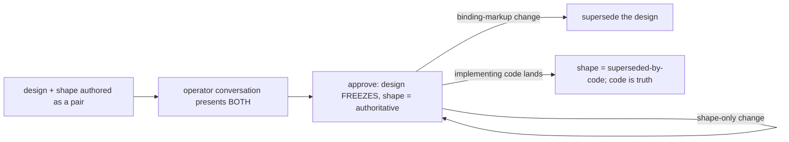

# solution-shape v1 — the non-frozen shape artifact, co-reviewed with its design — technical design

| Field | Value |
|---|---|
| **Status** | Draft → Approved *(merge requires Approved; merge is the freezing event; "superseded" is computed by the index, never written here)* |
| **Owner** | @mdarabi |
| **Approver(s)** | @mdarabi (operator) — mandatory named reviewer: this changes the technical-design document model and its gate (a doc-system / governance surface) |
| **Date** | 2026-07-10 |
| **Relevant-when** | designing or changing how a technical design splits into a frozen Decision and a non-frozen solution-shape; the solution-shape document class, its home, or its authoritative-until-code lifecycle; the paired review that presents a design and its shape together; the gate that enforces the split; triaging defects where a frozen design carried concrete shape, a review missed the shape, or a shape outlived its code; superseding this design |
| **Scope** | How the solution-shape is realized relative to the technical design and reviewed with it: the shape document class and its home, coupled authoring, presentation of both source documents in one operator conversation, the durable-vs-shape partition and its consistency check, the authoritative-until-code lifecycle, and the gate. **Not**: the durable-Decision model itself (`tech-design-conventions`, built on); the downstream plan (`plan-new`); stage-6 contract compilation |
| **Tracking** | introducing PR — serves and merges after the `design-solution-shape` PRD (merged) |
| **Builds-on** | `docs/tech-design/tech-design-conventions.md` (the durable-Decision model this splits from — immutability, supersession, the generated index, and the binding-markup `**Decision:**`/`DINV-n`/`A-n` that names the durable core) · `docs/tech-design/docgate-v1.md` (the gate + defects-as-data + closed-grammar parsing pattern the shape gate reuses) · `docs/tech-design/repo-layout-and-system-footprint.md` (the bucket + `paths` config surface the shape's home key is added to) |
| **Supersedes** | — |
| **Serves** | prd:design-solution-shape/FR-1 · prd:design-solution-shape/FR-2 · prd:design-solution-shape/FR-3 · prd:design-solution-shape/FR-4 · prd:design-solution-shape/FR-5 · prd:design-solution-shape/FR-6 · prd:design-solution-shape/FR-7 · prd:design-solution-shape/UB-1 · prd:design-solution-shape/UB-2 · prd:design-solution-shape/NR-1 · prd:design-solution-shape/NR-2 · prd:design-solution-shape/NFR-1 · prd:design-solution-shape/NFR-2 · prd:design-solution-shape/NFR-3 |
| **Security/privacy impact** | none — internal authoring artifact; no runtime, no new content egress, no identity/secret/user-data surface; inherits the repository's existing controls (see §3.5) |
| **Template version** | tech-design-template/v1 |

## 1. Problem

The `design-solution-shape` PRD decided *what*: a feature's design splits into a durable **Decision** and a concrete **solution-shape** (schema/interfaces), the shape reviewed in native form before the build and authoritative only until the code supersedes it. It deliberately deferred *how* — its Q1 (the shape's home and format) and Q2 (the durable-vs-shape partition) — to this design.

Without a decided realization, an implementer is cornered: fold the concrete shape into the design document and it freezes with the design (the record rots, and it violates the PRD's FR-3 / M2 — a frozen Decision carrying volatile shape); or omit it and the design gate cannot show the shape at all (the review goes blind — the failure the feature exists to fix). The realization must satisfy two constraints at once — **the frozen Decision carries no concrete shape** (FR-3/M2), yet **a single review shows both the decision and the shape** (FR-2, and the operator's binding requirement). The cheapest moment to decide is now, before the design-doc model and its gate settle around a missing shape artifact.

## 2. Decision

**Decision:** The solution-shape is a **separate, non-frozen sibling document** of the technical design — the two are authored as a coupled pair and presented together in one operator conversation, so both are seen in a single review, while **only the design (the Decision) freezes**. The frozen design *references* its shape and never contains it, so the frozen Decision carries no volatile shape (FR-3/M2); the shape is authoritative as the implementation reference until the code that implements it exists, then it is retired. The partition is **by artifact** — durable decisions live in the design (marked by the existing binding markup: `**Decision:**` / `DINV-n` / `A-n`); concrete schema and interfaces live in the shape — and a gate enforces both the split and the pairing. This is *separate at rest, combined in review*, using the operator conversation and the docgate gate without an additional runtime.

## 3. The design

### 3.1 The solution-shape document class and its home

**Decision:** A solution-shape is a document class of its own, homed in a `paths`-configured directory **distinct from and never nested under the technical-design corpus** — so it is never admitted to the design index and never reached by the immutability gate. Each design has at most one shape in v1, named to pair with its design (the same slug), so the pairing is resolvable by name without a registry.

The shape's body is the concrete solution in native form — the data model as a schema (a ` ```sql `/` ```dbml ` block or a ` ```mermaid erDiagram `) and interface signatures — the forms an engineer reviews *as* schema and interfaces, not as prose. It carries a small closed header: the paired design slug, and a **status** — `authoritative` or `superseded-by-code` (§3.6). Multiple concrete shapes per one design is out of scope (PRD WR-1).

### 3.2 Boundaries and non-goals

- **Not solved here** — the downstream plan / decomposition (`plan-new`); stage-6 contract compilation; any separate document-presentation application.
- **Owned by a future design** — mechanical detection that a proposed shape change contradicts a Decision invariant (PRD WR-3); scoped/surgical supersession of a Decision when only one invariant changes (PRD WR-2); more than one concrete shape per Decision (PRD WR-1).
- **Implementation must not infer** — that the shape is a design (it is never immutable, never in the design index); that *combined in review* means *combined at rest* (the design and shape remain separate files); that a reference from a frozen design to its shape makes the shape's *content* frozen (the target is non-frozen and moves).
- **Must remain unchanged** — the durable-Decision model: existing frozen designs, supersession, and the generated design index (PRD NR-1); and the planner's governing-input contract — it still consumes an approved design, unbroken by the split (PRD NR-2).

### 3.3 Invariants

- **DINV-1** — A frozen technical design contains no concrete solution-shape; at most it carries a reference to its shape document. *(FR-3, M2)*
- **DINV-2** — Operator review of a design with a paired shape presents both source documents in a **single conversation**. *(FR-2 — the operator's binding requirement)*
- **DINV-3** — A solution-shape is never entered in the technical-design index and is never immutability-gated; it is `authoritative` until its implementing code exists, then `superseded-by-code`. *(FR-5)*
- **DINV-4** — Every `DINV-n` in a design is witnessed by an element of its paired shape, and every shape element traces to a decision in its design; an unwitnessed invariant or an untraceable shape element is a defect. *(FR-7)*
- **DINV-5** — A change confined to shape content re-approves the shape and edits no frozen design; a change that alters a design's binding markup (`**Decision:**`/`DINV-n`/`A-n`) is a Decision change and proceeds only by supersession. *(FR-4, FR-6)*

### 3.4 Observability

Document-system mechanism, no runtime — so the surface is the gate, not telemetry.

- **Events/logs** — the shape gate emits **typed defects** (defects-as-data, per the docgate pattern): `design-carries-shape`, `unwitnessed-invariant`, `untraced-shape-element`, `shape-indexed-as-design`, `stale-shape` (authoritative shape whose code has landed).
- **Metrics** — none (no runtime); the PRD's M1/M2 are measured by inspection of authored pairs, not instrumentation.
- **Alerts** — none.
- **Debugging surface** — each defect names the offending file and element (the design + the `DINV-n` or the shape block), so the author sees the exact break.
- **Trace/correlation** — the design↔shape pairing is by slug; the defect carries both slugs.

### 3.5 Security & privacy

none — the solution-shape is an internal authoring artifact under the repository's existing access controls. It introduces no runtime, no new content egress, and no identity, secret, or user-data surface (echoes the header row; PRD NFR-3).

### 3.6 Lifecycle: authoritative → superseded-by-code

**Decision:** A shape is `authoritative` from its design's approval until the code implementing it exists; then its status becomes `superseded-by-code` and the code is the source of truth (FR-5). While `authoritative` and pre-code, a shape-confined change is a **re-approval** of the shape — the design is untouched (DINV-5); this is legal because the shape is non-frozen. A change that would alter the design's binding markup is not a shape change at all — it is a Decision change and takes the design's supersession path (DINV-5, FR-6). How "the implementing code exists" is signalled to flip the status is an open question (§7 Q2); until resolved, the flip is an explicit authoring act recorded in the shape header. A `superseded-by-code` shape is retained as a dated record but drops out of "the authoritative shape" resolution; the code answers "what is the shape now."



### 3.7 Coupled authoring and paired review

**Decision:** The design and its shape are authored as a pair and reviewed in **one operator conversation**. The handoff names both repository paths and presents their exact source content, so the reviewer sees what freezes (the design) beside what stays live (the shape); nothing is transformed or invented. Approval is one gate over the pair; only the design's approval is a freezing event.

### 3.8 The gate

**Decision:** A docgate check enforces the split, fail-closed (AP-17), reusing docgate's check + defects-as-data pattern rather than a new tool (the emitted defects are enumerated in §3.4): a frozen design carrying concrete shape fails (DINV-1); a shape admitted to the design index fails (DINV-3); an unwitnessed invariant or untraceable shape element fails (DINV-4). The witness/trace check (DINV-4) keys on the binding markup already parsed for the design class, so the partition needs no new tagging grammar — *which file* it lives in is the tag.

### 3.9 Testing strategy

The seams under test are all in-process or local-substitutable — no true-external dependency, so no injected mocks and no new port:

- **The gate checks** (in-process) — table-driven fixtures of design+shape pairs: a clean pair; a frozen design carrying shape; an unwitnessed `DINV-n`; an untraceable shape element; a shape indexed as a design; a stale (post-code) authoritative shape — each asserting its typed defect (or none).
- **The paired-review handoff** (in-process) — fixtures assert that a design + shape pair contributes both exact paths and exact source bytes to one review context.
- **The lifecycle transitions** (in-process) — authoritative → superseded-by-code, and the shape-only-change vs. binding-markup-change branch of DINV-5.

## 4. Alternatives considered

| Alternative | Why rejected |
|---|---|
| One authored source, docgate **projects** both (the design and shape extracted from one file by a fold) | Adds a new projection/extract verb and a subtler freeze story (the committed design must differ from what the author wrote); presenting two coupled source files together meets the "see both at review" requirement without it. Reserved as a possible v2 if a byte-deterministic partition is later needed. |
| A **fenced non-frozen region** inside the one design file | Breaks one-file-one-lifecycle: the immutability gate must special-case an intra-document mutability zone, and a reader can no longer trust the whole file as frozen; the region is concrete shape sitting inside a frozen design (violates FR-3/M2). |
| Keep the shape in the frozen design as an **as-of-decision illustration** (non-binding snapshot) | Still concrete shape detail inside a merged design — violates the PRD's FR-3 / M2 (zero volatile shape in a frozen Decision), and rots as the code moves. |
| Put the shape on the **work item / tracker** | That is the planner's surface (`plan-new`), downstream of the design; it misses the design-gate review the whole feature exists to enable (PRD NG-1). |

## 5. Risks

| ID | Risk | Impact | Mitigation | Verification / evidence |
|---|---|---|---|---|
| R1 | The paired review diverges from what actually freezes | A shape gap is "reviewed" but the frozen design differs | Present both exact source files and paths; the design freezes exactly as reviewed (§3.7) | handoff fixture matches both source files byte-for-byte |
| R2 | Authors drift concrete shape back into the design file | The rot the feature exists to prevent returns | Gate fails a frozen design carrying shape, fail-closed (DINV-1, §3.8) | gate fixture: design-carrying-shape → `design-carries-shape` defect |
| R3 | Design and shape drift apart — an invariant with no shape, or shape with no decision | Silent incompleteness at the gate | The witness/trace check (DINV-4) keyed on the binding markup | gate fixtures: unwitnessed invariant, untraceable element |
| R4 | A shape outlives its code and becomes a second source of truth | Readers trust a stale shape over the code | Retirement on code (DINV-3); `stale-shape` defect; never indexed as a design | lifecycle test + `stale-shape` fixture |

## 6. Acceptance

| ID | Acceptance criterion | Verify | Required evidence | Traces to |
|---|---|---|---|---|
| A-1 | A design and its paired shape are authored as a pair, and operator review presents both in one conversation | Demo | review record showing both exact paths and source documents together | prd:design-solution-shape/FR-2 · #DINV-2 |
| A-2 | The gate fails a frozen design that carries concrete shape, and passes one that only references its shape | Test | gate fixture report (`design-carries-shape` on the former, clean on the latter) | prd:design-solution-shape/FR-3 · #DINV-1 |
| A-3 | The consistency check flags an unwitnessed `DINV-n` and an untraceable shape element | Test | gate fixtures for both defects | prd:design-solution-shape/FR-7 · #DINV-4 |
| A-4 | A shape-confined change re-approves the shape with zero edits to the frozen design; a binding-markup change is refused as a shape change and routed to supersession | Test | fixtures for both branches | prd:design-solution-shape/FR-4 · prd:design-solution-shape/FR-6 · #DINV-5 |
| A-5 | Once implementing code exists the shape becomes `superseded-by-code` and drops from the authoritative-shape resolution; a shape is never present in the design index | Test + Inspection | lifecycle fixture + index audit | prd:design-solution-shape/FR-5 · #DINV-3 |
| A-6 | The planner's governing-input contract and every existing frozen design are unchanged by the split | Inspection | design corpus + planner-input review | prd:design-solution-shape/NR-1 · prd:design-solution-shape/NR-2 |

## 7. Open questions

| ID | Question | Owner | Blocks | Status | Resolution |
|---|---|---|---|---|---|
| Q1 | The exact `paths` key and bucket for the shape home (proposed: a `paths.solution-shapes` directory outside the design corpus) | @mdarabi | implementation | open | decided against the repo-layout config surface at implementation |
| Q2 | How "the implementing code exists" is signalled to flip a shape to `superseded-by-code` — a reference from the shape to its code, or a marker set when the implementing PR merges | @mdarabi | implementation | open | until decided, the flip is an explicit authoring act in the shape header (§3.6) |
| Q3 | Whether long paired documents are presented whole or section-by-section while retaining exact source paths | @mdarabi | implementation | open | decide from the first representative review without changing the one-conversation contract |

## Principles

- **AP-7 — honored.** Document mutability, gating, and links: the shape is split out precisely so the design stays cleanly frozen (DINV-1), and the frozen design only ever *links* to its shape (concrete→abstract link direction preserved).
- **INV-41 — honored.** Immutability gating: the design remains immutability-gated at both CI and prompt level; the shape is explicitly *not* a design, so it is deliberately outside that gate (DINV-3) — the boundary is stated, not blurred.
- **RW-5 — honored.** One decision per document: this decides one independently-revisable question — how the shape is realized and co-reviewed; the home, lifecycle, partition, and gate are subordinate facets in §3, not separate decisions.
- **AP-10 — honored.** Codify over prompt: the split, the partition, and the freeze-cleanliness are enforced by the gate (§3.8), not left to authoring discipline.
- **AP-17 — honored.** Fail closed on destructive: the gate fails closed on a frozen design carrying shape and on a shape indexed as a design — the destructive-to-the-model cases.
- **AP-6 — honored.** Everything passed around is contractual: the gate speaks typed defects, and paired review carries two named paths with their exact source bytes (§3.4, §3.7).
- **AP-5 — honored.** Monitoring/tracing first-class: the mechanism's health is designed in as typed gate defects, not bolted on (§3.4).
- **AP-13 — honored.** Success is a verified artifact: every §6 acceptance row carries a verify method and required evidence.
- **Deviation:** none.
